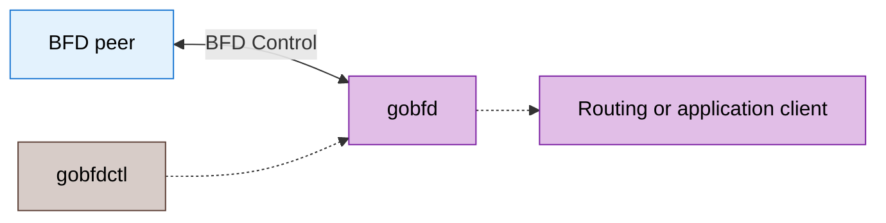

# GoBFD

GoBFD detects forwarding-path failures with Bidirectional Forwarding Detection
([RFC 5880](https://datatracker.ietf.org/doc/html/rfc5880)). It exposes session
state to routing and application integrations. Routing clients own route
selection and withdrawal; BFD does not route traffic.

This documentation describes `dev`. Use documentation at the deployed
binary's commit. `master` contains the accepted stable state;
`release/v0.6` preserves the v0.6 contract. The `dev` implementation has
unfinished v1 runtime and wire qualification.

## Components

| Binary | Responsibility |
|:---|:---|
| `gobfd` | BFD sessions, Linux transports, management API and metrics |
| `gobfdctl` | Session operations, capability discovery and diagnostics |
| `gobfd-haproxy-agent` | BFD state as HAProxy agent-check responses |
| `gobfd-exabgp-bridge` | BFD state as ExaBGP process-API route commands |



The daemon owns BFD sessions. Management and state observations connect the CLI
and routing clients to that owner; routing clients retain route ownership.

## Build and inspect

1. Select the pinned Podman Compose provider in [Development](docs/en/09-development.md).
2. Build the four binaries in the project environment.

```sh
git clone --branch dev https://github.com/dantte-lp/gobfd.git
cd gobfd
make up
make build
```

3. Configure Linux privileges and socket access using [Deployment](docs/en/06-deployment.md).
4. Start the daemon with a reviewed configuration; inspect its capabilities
   before enabling an extension. Follow [Configuration](docs/en/03-configuration.md)
   and [CLI](docs/en/04-cli.md).

The default management endpoint is `/run/gobfd/gobfd.sock`. Metrics bind to
`127.0.0.1:9100`. The initial configuration has no BFD sessions. Remote
management requires the transport and principal policy in
[Security](docs/en/15-security.md).

Source contracts: [defaults](internal/config/config.go),
[daemon startup](cmd/gobfd/main.go), [build targets](Makefile).

## Preview profiles

All profiles default to disabled. Capability readiness does not establish
peer health or completed RFC qualification. See [Configuration](docs/en/03-configuration.md#preview-profiles).

<!-- BEGIN GOBFD PREVIEW CAPABILITIES -->
| Profile | RFC | Maturity |
|:---|---:|:---|
| unsolicited | 9468 | preview; unsafe |
| echo | 9747 | preview; incomplete RFC qualification |
| micro_bfd | 7130 | preview; incomplete L2 owner integration |
| vxlan | 8971 | preview; unsafe/incomplete owner integration |
| geneve | 9521 | preview; unsafe/incomplete IPv4 Format A |
<!-- END GOBFD PREVIEW CAPABILITIES -->

## Documentation

| Task | Reference |
|:---|:---|
| Read the complete manual | [English](docs/en/README.md), [Русский](docs/ru/README.md) |
| Understand packet and timer behavior | [Protocol](docs/en/02-protocol.md), [RFC matrix](docs/en/08-rfc-compliance.md) |
| Connect a Cisco, Arista, Juniper or Huawei peer | [Vendor references](docs/en/reference/vendor-bfd.md) |
| Deploy and diagnose | [Deployment](docs/en/06-deployment.md), [Runbooks](docs/en/16-production-runbooks.md) |
| Check an architectural decision | [ADRs](docs/en/adr/README.md) |
| Check release acceptance | [Qualification status](docs/en/roadmap.md) |
| Contribute or report a defect | [Contributing](CONTRIBUTING.md), [Support](SUPPORT.md), [Security reports](SECURITY.md) |

English is canonical; `docs/ru/` contains the Russian translation. Feature
implementation, peer interoperability and stable-release acceptance are
separate states. An example topology or a micro-benchmark does not establish
a supported deployment scale or an end-to-end detection bound.

## License

[Apache License 2.0](LICENSE). Project responsibilities and release authority
are defined in [Governance](GOVERNANCE.md) and [Maintainers](MAINTAINERS.md).
