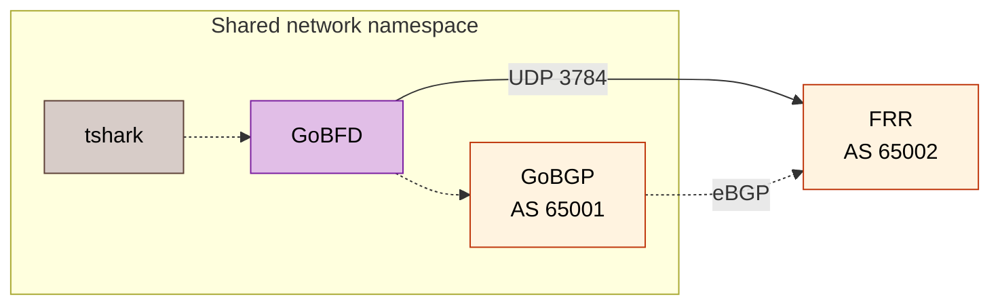

# BGP fast failover

This owned FRR/GoBGP lab checks route withdrawal and restoration driven by GoBFD. The source example does not establish stable-release acceptance or production forwarding continuity. English references: [integrations](../../../docs/en/11-integrations.md), [runbook](../../../docs/en/16-production-runbooks.md). Russian references: [интеграции](../../../docs/ru/11-integrations.md), [регламент](../../../docs/ru/16-production-runbooks.md).

## Topology and policy



| Endpoint | Address | Contract |
| :--- | :--- | :--- |
| GoBFD + GoBGP | `172.22.0.10` | Shared network namespace; filesystem/socket path remains container-local |
| FRR | `172.22.0.20` | BGP/BFD peer, advertises `10.20.0.0/24` |
| Lab network | `172.22.0.0/24` | Gateway `172.22.0.1`; overlaps RFC interop lab |
| Management TCP | `127.0.0.1:50052` | Plaintext read-only; Unix socket remains available |
| Metrics | `:9100` | Unauthenticated lab listener |

Sources: [Compose](compose.yml), [GoBFD config](gobfd/gobfd.yml), [GoBGP config](gobgp/gobgp.toml), [FRR config](frr/frr.conf).

The source recipes under [FRR](../../../test/interop/frr/Containerfile) and [GoBGP](../../../test/interop/gobgp/Containerfile) own build identities. The current daemon requires GoBGP v4 API; native GoBGP BFD remains disabled for GoBFD-managed peers. Each manual runtime container is limited to one CPU, 256 MiB and 128 PIDs; source limits are not measured resource admission. The lab grants network capabilities and FRR additionally receives `SYS_ADMIN`; preserve isolation.

## Packet contract

| Field | Expected | Source |
| :--- | :--- | :--- |
| UDP destination | `3784` | [RFC 5881](https://www.rfc-editor.org/rfc/rfc5881.html) |
| UDP source | `49152–65535` | RFC 5881 |
| TTL/Hop Limit | `255` | RFC 5881 |
| BFD version | `1` | [RFC 5880](https://www.rfc-editor.org/rfc/rfc5880.html) |
| TX/RX, Detect Mult | `300ms/300ms`, `3` | Checked-in GoBFD/FRR configuration |

The symmetric configured detection interval is approximately 900 ms before scheduling/consumer delay. Negotiated values and measured withdrawal latency must be read separately. Pausing FRR also pauses its BGP/control processing; this fault is not a pure data-plane blackhole.

## Automated gate

1. Admit local Podman resources and follow [provider setup](../../../docs/en/06-deployment.md#podman-compose).
2. Ensure fixed-name manual labs and overlapping subnets are absent.
3. Run the Go-owned assertion lifecycle.

```sh
make int-bgp-failover-testcontainers
```

`make int-bgp-failover` aliases the same target. The [test](../../../test/e2e/bgp-failover/testcontainers_test.go) builds/starts owned resources, waits for exact neighbor Established and route presence, captures packets, pauses FRR, requires route absence within 20 seconds, unpauses FRR and requires route restoration. Evidence is retained under `reports/e2e/bgp-fast-failover/run.*/`, including JSON/container/packet observations. The lifecycle cleans its exact owned test resources.

The assertions do not directly time GoBFD Down to 900 ms, prove all RFC fields, qualify hardware offload or measure independent forwarding continuity.

## Manual inspection

Use the ownership-checked Go controller only after resource admission. Preserve captures before approved teardown.

```sh title="bgp-manual-inspection.sh"
make int-bgp-failover-up
podman exec gobgp-bgp-failover gobgp neighbor
podman exec gobgp-bgp-failover gobgp global rib
podman exec gobfd-bgp-failover gobfdctl session list
podman exec tshark-bgp-failover tshark -r /captures/bfd.pcapng -Y bfd
```

Require BFD Up, BGP Established and exact route `10.20.0.0/24` before failure testing. Keep detailed packet evidence in restricted storage. `make int-bgp-failover-logs` follows the owned topology. `make int-bgp-failover-down` removes owned resources; perform it only after retaining evidence and obtaining required deletion approval. Do not start the automated gate while the manual topology owns fixed names.

### Packet field readback

```sh title="bfd-packet-fields.sh"
podman exec tshark-bgp-failover tshark -r /captures/bfd.pcapng -Y bfd \
  -T fields -e frame.time_relative -e ip.src -e ip.dst \
  -e udp.srcport -e udp.dstport -e ip.ttl \
  -e bfd.version -e bfd.diag -e bfd.sta \
  -e bfd.detect_time_multiplier -e bfd.desired_min_tx_interval \
  -e bfd.required_min_rx_interval -E header=y -E separator=,
```

Compare destination/source ports, TTL, version and negotiated timer fields with the packet contract above. Correlate both directions and the exact failure/recovery interval. Require Down/Init/Up transitions and distinguish protocol Detection Time from subsequent client/RIB latency. The retained capture does not establish independent data-plane continuity.

## Failure checks

| Symptom | Check | Required result |
| :--- | :--- | :--- |
| BGP absent | Neighbor output and FRR logs | Exact peer Established |
| Initial route absent | FRR network/Null0 route and GoBGP RIB | Exact prefix present |
| No BFD | Source/local/interface bindings, capabilities, capture | Bidirectional valid Control |
| No withdrawal | GoBGP compatibility, canonical BFD owner and pending-action status | Route absent under admitted fault |
| No recovery | FRR unpaused, BFD/GoBGP state and dampening | Route restored and independent probe succeeds |

Official vendor semantics remain separate: [four-vendor guide](../../../docs/en/reference/vendor-bfd.md), [EOS note](vendor-notes/arista-eos.md).
