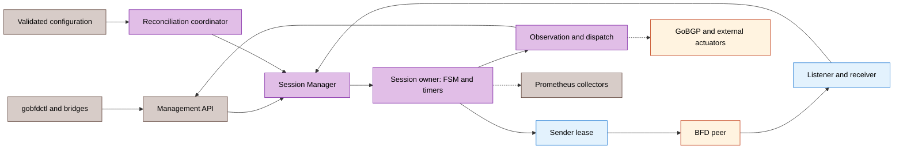
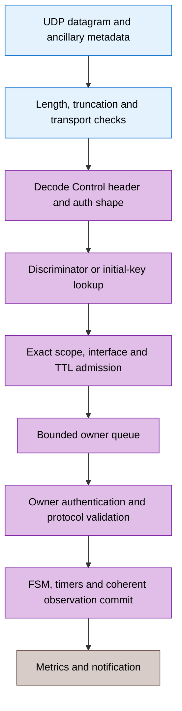
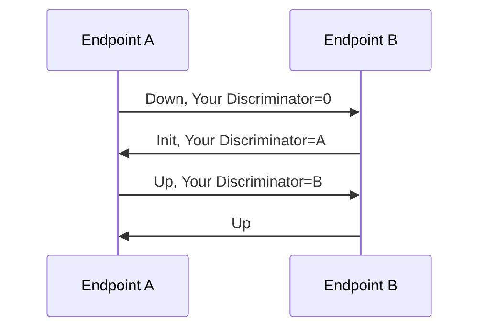

# Architecture

GoBFD separates BFD state machines, Linux UDP I/O, management authorization and routing actuators. A physical session belongs to the session Manager; configuration and API principals hold claims on that session. A claim does not own an independent protocol instance. Sources: [session identity](../../internal/bfd/session_identity.go), [Manager](../../internal/bfd/manager.go).

## System Overview

The diagram shows process boundaries and message direction. It does not assert that the monitored path fate-shares with any routing or overlay dataplane. [RFC 5882](../rfc/rfc5882.txt) defines client interactions; [ADR-0003](adr/0003-linux-advanced-bfd-applicability.md) constrains Linux ownership.

## Package Dependency Diagram

| Package | Responsibility | Boundary |
|:---|:---|:---|
| [`internal/bfd`](../../internal/bfd) | Codec, authentication, FSM, owners, claims, delivery ledger | No Linux socket ownership |
| [`internal/netio`](../../internal/netio) | UDP sockets, ancillary metadata, overlays, interface monitor, LAG backends | Adapts I/O to core interfaces |
| [`internal/config`](../../internal/config) | Decode and validate YAML, environment and defaults | Produces complete candidate |
| [`internal/server`](../../internal/server) | API conversion, authorization, Watch, capabilities | Principal comes from transport |
| [`internal/overlay`](../../internal/overlay) | Shared backend vocabulary | Standard-library leaf package |
| [`internal/gobgp`](../../internal/gobgp) | BFD-to-BGP action policy | External action has a deadline |
| [`cmd/gobfd`](../../cmd/gobfd) | Startup, resource owners, reload, readiness, shutdown | Composes runtime services |
| [`api/bfd/v1`](../../api/bfd/v1) | Public protobuf schema | Generated clients are in `pkg/bfdpb` |

### Dependency Rules

The FSM returns actions; the session executes them. Socket adapters depend on core interfaces. Configuration and network I/O share overlay names through the leaf package. Generated protobuf code is not edited directly. See [FSM](../../internal/bfd/fsm.go), [receiver interface](../../internal/netio/receiver.go), [ADR-0004](adr/0004-overlay-backend-vocabulary.md).

## Packet RX Flow

[Receiver](../../internal/netio/receiver.go) returns the pooled datagram buffer after demultiplexing. Authenticated input retains an owned copy of the complete wire payload for owner verification. Decoded authentication metadata and up to 20 payload bytes belong to the packet value; this does not remove the wire requirement. [ADR-0011](adr/0011-bfd-auth-inline-payload.md) defines the lifetime.

`Queued` confirms admission only. Full, closed and stopped paths return typed outcomes. A common admission/stop barrier prevents enqueue after terminal drain; owner shutdown accounts abandoned entries. [Delivery accounting](../../internal/bfd/delivery.go) keeps stage denominators separate; a sum of all stages is not a packet total.

## Packet TX Flow

The owner builds or updates its cached Control packet, signs it when authentication is enabled, applies the configured transport-padding target and sends through `PacketSender`. The sender lease fixes the source-port and resource lifetime. Padding is outside the declared BFD Length and authentication domain; transmission never truncates an authenticated PDU. Sources: [packet construction](../../internal/bfd/session_packet.go), [send loop](../../internal/bfd/session_loop.go), [UDP sender](../../internal/netio/sender.go).

## Demultiplexing

A nonzero Your Discriminator selects a candidate session. Zero uses the initial transport-aware address key. Selection alone is insufficient: transport class, ingress interface, exact overlay scope and TTL are checked before queue delivery. Single-hop packets cannot enter multihop sessions through a known discriminator. Overlay identity includes the outer endpoints, VNI and supported inner IP/MAC tuple. Sources: [Manager receive path](../../internal/bfd/manager_session.go), [overlay checks](../../internal/netio/overlay_inner.go), [identity tests](../../internal/bfd/overlay_identity_test.go).

The single-hop implementation binds numbered multiaccess sessions to one explicit or derived receive interface. Point-to-point initial acceptance from an arbitrary source remains outside the qualified profile. IPv6 link-local zones select the interface but do not enter the initial demux key. See [RFC coverage](08-rfc-compliance.md#rfc-5881-implementation-notes).

## Session Identity and Ownership

| Object | Identity or policy | Lifetime |
|:---|:---|:---|
| `SessionKey` | Type, family, normalized peer/local addresses, interface, network scope, transport scope | One physical Control wire |
| `SessionOwner` | Typed source and source-local owner ID | One claim |
| Effective parameters | Role, timer tuple, TTL, padding, auth type and immutable key fingerprint | Must agree for shared claims |
| `SenderLease` | Accepted sender plus idempotent release | Retained through owner drain and join |
| Echo key | Structured peer/local addresses and exact interface | One shared Echo wire |

IPv4-mapped addresses are unmapped. Compatibility API, authenticated API principal, configuration and unsolicited claims remain distinct. A matching claim shares the existing session and discriminator; release removes only that owner's claim. Unknown key-store semantics fail closed. Sources: [identity and effective parameters](../../internal/bfd/session_identity.go), [authentication store](../../internal/bfd/auth.go), [Echo ownership](../../internal/bfd/manager_echo.go).

Lock order is lifecycle, ownership, then registry. No Manager mutation lock spans peer notification drain or release callbacks. The retiring exact key remains reserved until owner join, lease/discriminator release and metrics cleanup finish, including failure. A conflicting Add returns `AlreadyExists`; retry after Delete completes. See [replacement lifecycle](../../internal/bfd/manager_replace.go) and [ADR-0006](adr/0006-session-preserving-reload-policy.md).

### Reconciliation and receive ownership

Startup and SIGHUP share one serialized coordinator. A candidate must satisfy the retained startup-runtime contract and complete session validation before a desired generation is published. Authentication admission compares both retained accepted intent and the live registry. Rejection preserves the accepted configuration, generation and log level.

Each receipt covers five sources: base, Echo, Micro-BFD, VXLAN and Geneve. Each source prepares desired claims and receive resources before releasing stale claims. Failed or resource-pending preparation preserves old claims; timer negotiation is a separate pending class. The applied generation advances only after all sources converge. A partial apply does not roll back another source's accepted changes.

The listener owner shares sockets among source and physical-session claims. API Add acquires RX and TX together. Configuration withdrawal cannot remove Echo RX while an API claim survives. Overlay backends are shared per tunnel kind and outer local address; each physical sender holds an exact-scope reference through drain. Scope preflight precedes backend open and `SetScopes`; unequal live same-wire scopes require explicit removal/recreation.

Sources: [coordinator](../../cmd/gobfd/reconciliation.go), [listener owner](../../cmd/gobfd/listeners.go), [overlay owner](../../cmd/gobfd/overlay_owner.go), [reload admission](../../internal/bfd/manager_auth_reload.go).

### Recovery and readiness

Linux link/address notifications and resync request bounded, generation-scoped retries. Only typed unavailable-interface/address errors become resource pending; other failures remain failed. A shared two-second availability check covers all five sources. Inventory errors require a new explicit SIGHUP. The non-Linux monitor supplies no automatic recovery.

Aggregate health is `NOT_SERVING` before first convergence, while desired differs from applied, or when required runtime/listener state is lost. Named BFD/Echo/Micro-BFD health describes each source. Unexpected receiver or dispatch loss is fail-stop. `READY=1` is process/listener readiness and does not imply configuration convergence. Sources: [interface events](../../cmd/gobfd/interface_events.go), [readiness](../../cmd/gobfd/readiness.go), [ADR-0001](adr/0001-link-state-rtnetlink.md).

## Three-Way Handshake

This is one permitted asynchronous startup ordering. Simultaneous Down/Init exchanges follow the same [RFC 5880 §6.8.6](https://www.rfc-editor.org/rfc/rfc5880.html#section-6.8.6) FSM. A local Up event does not establish route convergence.

## Goroutine Model

One winning `Run` owns each Control session's packet processing, timers and administrative commands. One owner runs each Echo wire. Receivers run per listener; Manager dispatch fans out notifications. Current Control/Echo owners do not permanently pin an OS thread. Native A/B, thread bounds and scale acceptance remain separate. Sources: [Control loop](../../internal/bfd/session_loop.go), [Echo loop](../../internal/bfd/echo.go), [ADR-0008](adr/0008-experimental-prerelease-boundary.md).

An observation commits local state/diagnostic, known remote facts, C-bits, cause and version coherently. Diagnostic-only changes advance the observation without a state-transition count. Manager versions identify semantic changes and physical identity; dispatch revision orders delivery separately. Neither is an atomic telemetry watermark. Counters, timers and configuration in API snapshots are sampled. See [observation model](../../internal/bfd/session_observation.go), [public schema](../../api/bfd/v1/bfd.proto).

Raw notification and subscription queues use the bounded policy `min(65536, 64 + 3*N)` at construction. They do not resize on reload. GAP means lost original events and requires consumer resynchronization; it does not count as a delivered original. Per-stage counters survive session deletion. [ADR-0007](adr/0007-workload-phase-accounting.md) defines sizing and completeness.

GoBGP and bridges act after state publication. A successful local observation, notification delivery and successful external action are different measurements. BGP disable/enable policy and deadlines are in the [handler](../../internal/gobgp/handler.go); generic route withdrawal is not implemented.

## Graceful Shutdown

Default `Manager.Close` may abandon queued state notifications. The workload Owner opts into draining registered physical-session changes to live subscribers before EOF; this performs no external actuation and does not guarantee lossless delivery to canceled or slow subscribers. See [shutdown policy](adr/0007-workload-phase-accounting.md#down-journal).

1. Request `Manager.DrainAllSessions` on SIGTERM/SIGINT with one fresh ten-second budget.
2. Await owner AdminDown/7 commit, the first successful permitted write and the negotiated notification window; retry failed writes on the normal TX timer.
3. Close the Manager, join owners and dispatch, release sender leases, then shut down HTTP and receive resources.

The notification window begins at the first successful write and covers the larger of local receive Detection Time and `localDetectMult * max(advertisedAdminDownTX, remoteMinRX)`. A default multiplier of three and the one-second non-Up floor produce a three-second window. Earlier cancellation or insufficient time returns `DrainIncompleteError`. Local write completion is not peer acknowledgement.

Final Control-claim release uses the same drain outside Manager locks. Sole unsolicited failure cleanup cancels without this administrative exchange; Echo and group-only Micro-BFD removal do not own a Control AdminDown exchange. Shared overlay leases do not interrupt a backend used by other sessions. Arbitrary external sender callbacks have no universal shutdown bound. Sources: [drain](../../internal/bfd/session_drain.go), [Manager lifecycle](../../internal/bfd/manager.go), [RFC 5882 §8](https://www.rfc-editor.org/rfc/rfc5882.html#section-8).

## Project Structure

Keep protocol logic in `internal/bfd`, Linux resources in `internal/netio`, runtime composition in `cmd/gobfd`, public contracts in `api/bfd/v1` and executable qualification in `test`. [ADR index](adr/README.md) owns accepted decisions.

## Technology Stack

The [runtime manifest](../../go.mod) and [tools manifest](../../tools/go.mod) declare dependencies. The [repository contract](../../AGENTS.md) owns compiler and container policies. A manifest pin is a source input, not compatibility or deployment evidence.

## UDP Port Map

| Destination | Transport | Scope |
|:---|:---|:---|
| 3784 | Single-hop Control | IPv4/IPv6 numbered multiaccess profile |
| 4784 | Multihop Control | Configured address pair and receive-hop policy |
| 3785 | Unaffiliated Echo | Default-off preview |
| 6784 | Micro-BFD | Default-off per-member preview |
| 4789 | VXLAN outer UDP | `userspace-udp` preview |
| 6081 | Geneve outer UDP | `userspace-udp` IPv4 Format A preview |

Ordinary UDP senders require a fixed source port in 49152–65535, including Echo as a product policy. Source: [sender constructor](../../internal/netio/sender.go).

## TCP/HTTP Port Map

Management endpoints and metrics bind addresses are configuration, not BFD protocol constants. Default management uses the Unix socket; TCP is disabled until configured. Plaintext TCP is loopback-only; non-loopback TCP requires mTLS. See [defaults and validation](../../internal/config/config.go), [configuration](03-configuration.md), [security](15-security.md).

## Related Documents

- [Protocol](02-protocol.md) — wire fields, state transitions and timing.
- [RFC coverage](08-rfc-compliance.md) — implementation and qualification boundaries.
- [Vendor BFD references](reference/vendor-bfd.md) — official peer documentation.
- [Performance analysis](14-performance-analysis.md) — measurements and workload limits.
