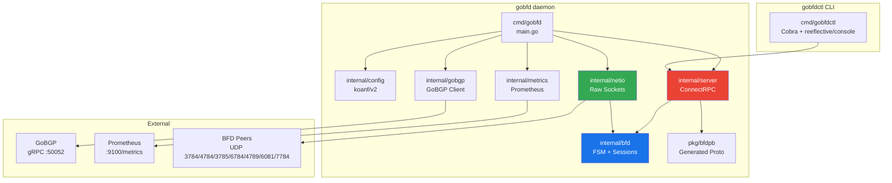
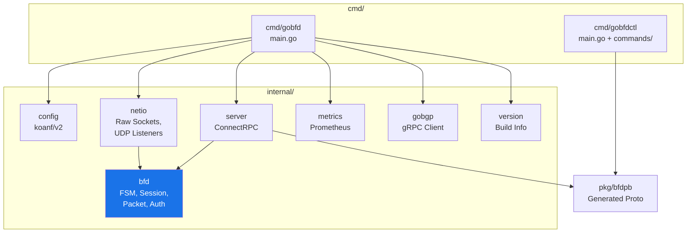
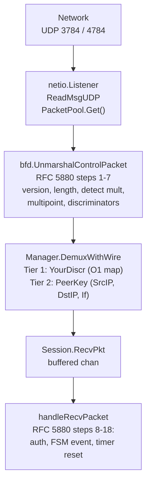
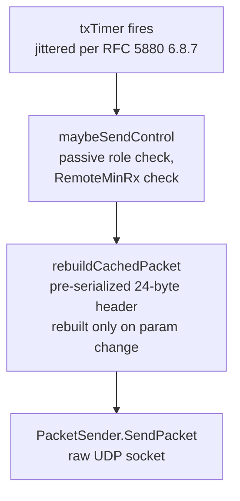
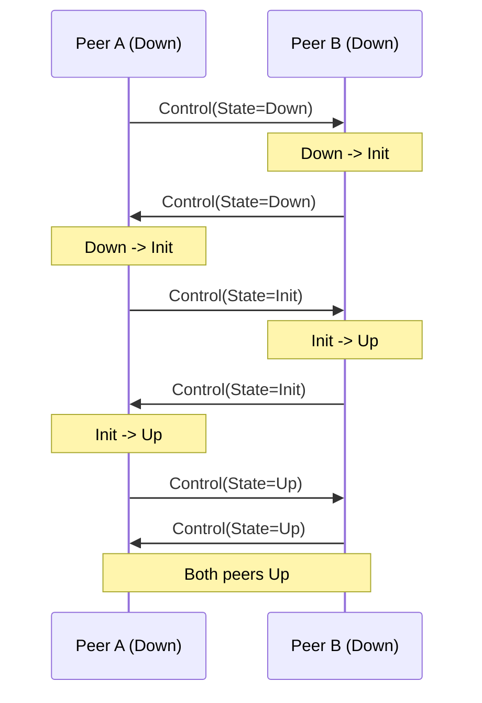
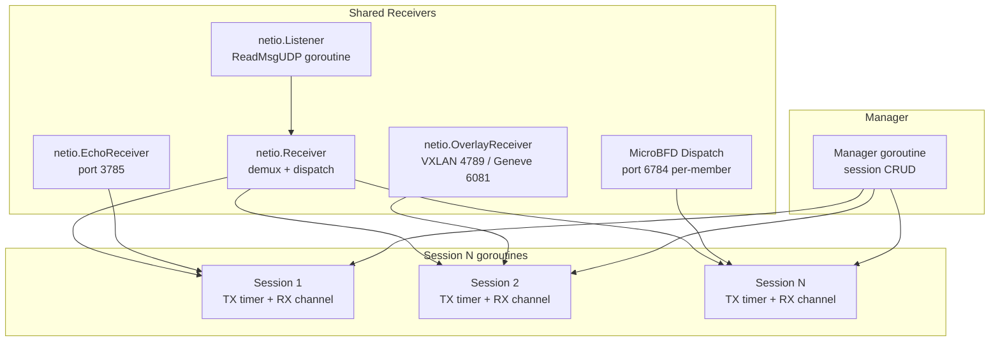

# Architecture


> System architecture of GoBFD: package dependencies, packet flow, session lifecycle, and goroutine model.

---

## Table of Contents

- [System Overview](#system-overview)
- [Package Dependency Diagram](#package-dependency-diagram)
- [Dependency Rules](#dependency-rules)
- [Packet RX Flow](#packet-rx-flow)
- [Packet TX Flow](#packet-tx-flow)
- [Demultiplexing](#demultiplexing)
- [Session Identity and Ownership](#session-identity-and-ownership)
- [Three-Way Handshake](#three-way-handshake)
- [Goroutine Model](#goroutine-model)
- [Graceful Shutdown](#graceful-shutdown)
- [Project Structure](#project-structure)
- [Technology Stack](#technology-stack)

### System Overview

GoBFD is a production-oriented BFD (Bidirectional Forwarding Detection) protocol daemon. It consists of four binaries:

- **gobfd** -- the daemon that manages BFD sessions, sends/receives BFD Control packets, and integrates with GoBGP
- **gobfdctl** -- the CLI client that communicates with gobfd via ConnectRPC
- **gobfd-haproxy-agent** -- HAProxy agent-check bridge (BFD state to TCP agent responses)
- **gobfd-exabgp-bridge** -- ExaBGP process API bridge (BFD state to route announcements)



### Package Dependency Diagram



### Dependency Rules

- `internal/bfd` has **zero** dependency on `internal/server`, `internal/netio`, or `internal/config`
- `internal/server` depends on `internal/bfd` (Manager, Session, types) and `pkg/bfdpb`
- `internal/netio` reuses the BFD packet codec, pool, packet metadata, sender
  interface, and Micro-BFD state/event types from `internal/bfd`
- `pkg/bfdpb` is generated code -- never edited manually

### Packet RX Flow



The 13-step validation from RFC 5880 Section 6.8.6 is split across two layers:

| Layer | Steps | Responsibility |
|---|---|---|
| **Codec** (`packet.go`) | 1-7 | Version, length, detect mult, multipoint, discriminators (stateless) |
| **Session** (`session.go`) | 8-18 | Auth verification, FSM event, timer update, state variable update |

This split allows the listener to discard invalid packets before any session lock is acquired.

### Packet TX Flow



**Cached Packet Pattern** (inspired by FRR bfdd): each session maintains a pre-serialized `cachedPacket []byte` that is rebuilt only when parameters change (state transition, Poll/Final, timer negotiation). On each TX interval, the cached bytes are sent directly without re-encoding. For authenticated sessions, the auth sequence number is updated in the cached packet on each transmission without full re-serialization.

### Demultiplexing

Two-tier lookup per RFC 5880 Section 6.8.6:

1. **Tier 1** -- Your Discriminator is nonzero: O(1) map lookup by discriminator. Fast path for established sessions.
2. **Tier 2** -- Your Discriminator is zero AND state is Down/AdminDown: lookup by composite key (SrcIP, DstIP, Interface). Used only during initial session establishment.

### Session Identity and Ownership

`SessionKey` is the comparable canonical identity of one desired wire session.
It contains the session type and address family, normalized peer and local
addresses, interface, network scope, and transport scope. IPv4-mapped
addresses are normalized to IPv4. This identity is separate from the smaller
packet demultiplexing key used only for initial packet delivery.

Enabled unsolicited interfaces open separate IPv4 and IPv6 wildcard single-hop
listeners bound with `SO_BINDTODEVICE`, independently of configured sessions.
Ancillary data retains the actual destination and ingress index. Configured
peer lookup runs first; an unbound listener resolves an unmatched ingress index
through a startup snapshot of enabled interfaces before unsolicited lookup and
admission. No packet triggers a system interface-name lookup. Interface changes
require a restart, as does the unsolicited policy.

The manager records typed claims from base configuration, Micro-BFD members,
VXLAN, Geneve, the compatibility/API path, and unsolicited BFD. Ownership
mutations are serialized. Each declarative adapter reconciles only its typed
source. Claims with the same canonical key and effective parameters share one
wire session and discriminator; releasing one claim preserves the others, and
releasing the last claim destroys the wire session. Empty declarative sets are
forwarded, so removing the final entry releases only that source's claims.
The daemon validates the complete combined base, Micro-BFD member, VXLAN, and
Geneve control-session candidate before applying any of those sources. Each
source compiler also validates its complete set before that adapter opens
senders or mutates session ownership.

A daemon-level coordinator serializes startup and SIGHUP compilation and apply.
It retains a deep-copied startup-runtime contract. Every SIGHUP candidate is
checked against that contract before candidate compilation or any generation,
health, log-level, session, or resource mutation. Startup-owned server,
unsolicited listener, socket, policy, actuator, GoBGP, and overlay fields are rejected with
bounded field identifiers; configuration values and secrets are not retained in
the error. Desired-set membership changes may need new control, Echo, or Micro-BFD
listeners, which the listener owner opens as part of the generation, but
cannot require a new overlay binding; same-key effective
parameter changes remain reconciliation conflicts rather than in-place updates.
The coordinator publishes a
monotonic desired generation only after that check and the complete immutable
session candidate compiles. One receipt then records claim-level `created`, `released`,
`pending`, and `failed` counts plus a bounded error-code histogram for exactly
five sources: base, Echo, Micro-BFD (groups with their member sessions), VXLAN, and Geneve.
The applied generation advances only when every source converges. A partial
pass preserves the last applied generation, marks the snapshot stale, and does
not roll back changes already accepted by another source. A later SIGHUP is an
explicit new generation and can converge the runtime. Unavailable interface
claims become `pending` after whole-source preflight without releasing old
claims. Linux link up/down/delete events trigger generation-scoped preflight
and retry of affected pending sources. A fixed source mask and capacity-one
wake-up coalesce events; stale generations and converged-source retries are
discarded. Netlink or channel overflow requests a complete inventory resync.
The monitor owns channel closure; cancellation stops the consumer and worker.
The non-Linux stub emits no events and provides no automatic recovery.
A listener owner (`cmd/gobfd/listeners.go`) makes receive sockets part of each
source apply: the base, Echo, and Micro-BFD sources claim their listeners and
open missing ones before the Manager apply, so a source cannot converge on
senders alone. An absent listener interface leaves the source `pending` for the
interface retry. After a source applies without failed or resource-pending
entries, the source drops claims outside its desired set. API-created control
and Echo sessions claim their listeners with their senders through the same
owner, under one mutex, and fail the request when the listener cannot open; a
listener closes when its last claim goes.
Each listener runs its own required receiver; a deliberate close cancels that
receiver first, so only an unexpected socket loss is fail-stop. A device-bound
listener of a recreated interface is rebound in place with `SO_BINDTODEVICE`.
Overlay backends stay startup-owned: a missing backend leaves its source
`failed` until restart, and runtime backend creation or replacement is not
implemented yet. Only `ENODEV` from a listener device binding is
classified as an unavailable interface; other runtime failures remain `failed`,
without string or errno classification.

The empty-service gRPC health check is `NOT_SERVING` before the first converged
generation and while desired differs from applied; it returns `SERVING` after
convergence while no runtime worker is lost and every device-bound listener
interface is up with the ifindex of its latest bind. One aggregator
(`cmd/gobfd/readiness.go`) also derives the BFD, Echo, and Micro-BFD named
services from their own sources, listeners and the runtime workers; the
`grpc.health.v1.Health` service stays `SERVING`. Loss of a receiver or the
dispatch loop is fail-stop: health becomes `NOT_SERVING` and the daemon exits
with an error (see `07-monitoring.md`). SIGHUP is registered into a bounded channel before startup
apply, but its handler starts only after startup reconciliation, so an early
reload cannot apply ahead of the startup candidate. systemd `READY=1` remains a
process/listener readiness signal and is sent even when configuration health is
stale.

For a newly accepted physical session, the manager opens one lazy sender lease
and stores its idempotent release operation with the session entry. Unchanged
reconciliation and matching claims from another source do not open another
sender. Creation rollback, release of the last claim, and manager shutdown
release the accepted lease once; releasing a non-last claim preserves it. Base
configuration, Micro-BFD, and the compatibility API use owning UDP leases that
also return the allocated source port. Overlay sessions use explicit
non-owning leases because their sender shares the backend connection. Each
RFC 9468 session owns a UDP lease on the local address and interface that
received its triggering packet; cleanup of the session closes that lease once.

The session owner receives whether the unsolicited claim is the only claim
through the existing timer-intent lock and wakeup. In that ownership mode,
natural failure or an independent setup deadline stops non-Final Control TX.
The deadline covers the greatest observed local RX Detection Time from the
attempt start; repeated valid RX does not refresh it. Claim-mode changes
preserve the original budget and failure latch. Configured/API claims retain
generic Control TX even if the private setup budget expires. Setup expiry retains
the RFC 5880 FSM and diagnostic. A private notification requests cleanup without
broadcasting a synthetic state transition. Cleanup checks the local attempt
under the owner lock and fences resumption before retiring a sole claim;
shared configured/API claims preserve their wire session. Final replies and
local AdminDown keep the RFC 5880 procedures.

Echo sessions use the same accepted-session lease boundary with separate API
and declarative sources. The compatibility `CreateEchoSession` path keeps an
explicit non-owning raw-sender wrapper, while the API adapter and declarative
reconciler pass lazy owning factories. Declarative reconciliation validates the
complete canonical candidate before opening senders, ignores adapter-supplied
keys for identity, preserves API-created Echo sessions, and forwards an empty
desired set. A sender acquisition failure rolls back only the newly accepted
declarative Echo sessions from that pass; removal and shutdown release each
accepted lease once after its Echo goroutine exits.

For authenticated sessions, the effective parameters include the built-in
authenticator type and an immutable fingerprint of a `StaticAuthKeyStore`.
The static store clones constructor inputs and returns caller-owned key copies;
unknown key-store implementations fail closed because no stable semantic
identity can be derived.

This is the C01.1 ownership core plus the C01.2 atomic-candidate/source
isolation slice, the C01.3a accepted-control-session sender-lease slice, the
C01.3b Manager lifecycle slice, and the C01.4a Echo sender-lease/source
isolation slice, and the C01.4b generation/receipt coordinator slice. It is not
the complete v1 reconciliation or RFC contract. The
following boundaries remain deferred:

- overlay backend replacement ownership;
- stable per-group and per-tunnel owner identifiers;
- Poll/Final parameter negotiation;
- transport-aware packet demultiplexing; and
- authenticated API principal identities instead of one compatibility/API
  owner.

### Three-Way Handshake

BFD sessions use a three-way handshake (RFC 5880 Section 6.2):



FSM transitions in sequence:

1. A(Down) sends State=Down. B(Down) receives State=Down --> B transitions to Init.
2. B(Init) sends State=Init. A(Down) receives State=Init --> A transitions to Up.
3. A(Up) sends State=Up. B(Init) receives State=Up --> B transitions to Up.

### Goroutine Model

The session owner commits one causal observation under `Session.mu`: local
state/diagnostic, remote-known/state/diagnostic, local/remote C-bits, cause and
`ObservationVersion`. A packed atomic local pair also serves scalar getters
and packet construction. Received remote facts remain staged until the final
local pair commits. Timer transition handling observes the old state before
commit; logging, notifications and sends run after the lock is released.
Diagnostic-only or remote-only changes publish observations without increasing
state-transition counters or changing `LastStateChange`. Unchanged packets do
not advance the version.

A Manager-owned clock supplies fresh registration, semantic commit and removal
versions. `Revision` orders dispatch separately; snapshots may contain an owner
observation ahead of dispatch. Consumers compare versions per row, including
before deletion. Internal `SessionRef` prevents discriminator reuse from
retargeting pending actions. The clock is not a global snapshot watermark.
Control and Echo Watch events carry a value copy of the full API status.
The causal tuple comes from the explicit owner commit; configuration, timers,
counters and timestamps are sampled at publication or List boundaries, outside
that tuple. Owner publication follows counter/`LastStateChange` updates and
precedes an immediate Control send, so its TX count can precede that send.
Telemetry does not advance `ObservationVersion` on every packet.

Control delivery has separate stages: wire parse, base TTL or overlay
decapsulation, demux, unsolicited policy, queue admission and owner processing.
`Queued` means admission only. Full or stopped queues return typed refusals;
the caller may reuse the header immediately, while authenticated wire storage
remains immutable until owner processing. A shared admission/stop lock prevents
enqueue after terminal drain. A canceled first `Run` abandons queued work once;
abandoned AdminDown receipts never acknowledge commit. Full AdminDown admission
still waits for capacity or its context without blocking RX.

`ListSessions.delivery_counters` and fixed-label Prometheus telemetry retain
process-lifetime stage decisions after session deletion. Each stage has its own
denominator; summing the ledger does not yield a packet total. Each bucket is
sampled once in stable pair order, including zero rows; neither lifecycle
revision nor observation version provides an atomic counter snapshot. Session
drop/auth counters are projections of terminal reasons, with auth a subset of
drops; they are not added back into the global ledger. Echo admission and its
single winning owner share a terminal barrier: pre-Run admission is allowed,
full/closed queues return typed refusals, and stop abandons pending RX once.
Echo raw notifications use the same comparable `SessionRef` identity fence as
Control, with exactly one private owner pointer. Managed Echo registration,
state commits and removal share the Manager observation clock. A coherent
Echo tuple contains local state, diagnostic, cause and version; initial and
returned-Echo causes are Unknown, and detection expiry is DetectionTimeout.
Watch maps actual Echo TX interval, detection parameters, sent/received counts,
transitions and timestamps into the existing status shape. Unowned remote,
negotiated, RX, authentication and drop fields are zero; zero Echo drop/auth
fields do not prove absence of loss.

Raw Control/private/Echo notifications, dispatch, each Watch recipient and
legacy delivery have separate bounded ledger stages. GAP markers report lost
original events and do not count as successful originals. Raw shutdown drain
follows active-operation and worker joins.

Private unsolicited failures commit before a coalesced capacity-one cleanup
hint is sent, independently of best-effort raw notification admission. Dispatch
scans failures only at startup or a coalesced hint. An initial attempt zero
with no failure cause is preserved; a committed Down DetectionTimeout/PathDown
at attempt zero is eligible. Each retained physical entry lazily owns at most
one parked cleanup worker, one reused timer and one pending attempt/deadline.
Duplicates do not extend retention; a newer failure replaces pending work.
Retirement still fences identity, current attempt, AdminDown and shared claims.
Dispatch cancellation has no restart/progress promise; Manager.Close joins and
releases remaining resources. The worker bound follows retained physical
entries, not MaxSessions.

Public Control/Echo raw QueueFull sends a separate capacity-one loss hint after
the owner commits and before external delivery callbacks. Dispatch consumes the
hint before queuing a fresh revisioned GAP for every subscriber, including a
subscriber whose earlier GAP was already consumed. A full subscriber already
contains an unread GAP; its later snapshot covers the committed loss. Recovery
markers do not count as original dispatch, recipient or legacy deliveries and
do not invoke Micro actuators. Watch resnapshots both registries; GoBGP retains
its Control-only snapshot. Their observation-version floors reject older raw
events dispatched after the snapshot. Recovery needs no next owner edge or
reconnect while dispatch runs. Private failure hints remain cleanup-only, and
legacy `StateChanges()` remains best effort without resynchronization. Kernel
`SO_RXQ_OVFL` remains separate work, and
unsolicited/Echo modes retain their existing preview qualification boundaries.

Registration publishes `SESSION_ADDED` after registry insertion and before the
owner starts, including a passive session that stays Down. This lifecycle
covers the Control registry (base, Micro-BFD, VXLAN/Geneve and unsolicited)
and the separate Echo registry. It reaches revisioned subscribers without invoking Micro actuators
or unsolicited cleanup; legacy `StateChanges()` retains FSM/removal events.
Control and Echo updates and tombstones replace the whole client row, including
zero, false, NONE and absent timestamps. Echo removal freezes its final tuple
with a fresh global version before cancellation/join and lease release. API
deletion, declarative removal and rollback use that shared detach path.
Watch alone snapshots both registries under one Manager read lock, reading
the dispatch revision before either registry. Control List/Get and GoBGP
snapshots and typed Echo RPC shapes retain their existing scope. Manager.Close
closes streams for reconnect; it does not guarantee per-session tombstones.

GoBGP suppresses local/known remote AdminDown and retains that remote fact
through later timeout diagnostics. Explicit local PathDown remains actionable
even while already Down. Its cause persists through a later Down timeout;
the diagnostic becomes 1 without restarting the outstanding routing action.
Current canonical identity and administrative policy
are checked before each disable, including after a blocking `PeerAdminDown`
read. This local preflight cannot make a remote RPC atomic with future BFD
commits. C-bit reporting retains hard-fail behavior; it adds no graceful
restart policy.

Each BFD session runs as an independent goroutine with its own timers and
state. Its context is detached from the daemon signal context so SIGTERM does
not stop it before the AdminDown drain. `Manager.Close()` cancels the
per-session context explicitly and waits for every registered session and echo
goroutine to exit before releasing its sender lease or discriminator.

The Manager lifecycle is `Open -> Closing -> Closed`. Once `Closing` begins,
new session claims, reconciliation, unsolicited claims, and state-change
subscriptions fail with stable lifecycle errors without mutation. The daemon
still starts `RunDispatch` from its errgroup, but the Manager registers and
owns that run for shutdown. `RunDispatch` is single-run: a second invocation
returns immediately. Cancellation of its caller context or `Manager.Close()`
stops dispatch and closes the legacy `StateChanges()` channel exactly once.
Per-consumer subscription channels are closed exactly once by their registered
subscriber goroutine when either the subscriber context or Manager closes.

After the lifecycle transition, Close detaches registries under `ownershipMu`
and `manager.mu`, then releases both locks before cancellation and waits.
Sender release callbacks run only after the corresponding session goroutine
exits and without either lock; discriminator release and metrics unregister
follow the sender release in that order. Concurrent Close calls wait for the
same shutdown result. The operation releases the lifecycle mutation lock before
detached or unused sender callbacks, so Close can transition to `Closing`, but
keeps its active-operation registration through the callback, discriminator
release, and metrics cleanup. Therefore Close waits for the complete cleanup,
while a release callback may call Manager snapshot APIs and may attempt Manager
mutations, which fail with `ErrManagerClosing`. It must not call the blocking
`Manager.Close()` recursively: a synchronous callback is part of that same
Close completion, so the two calls would wait on each other. An explicit
recursive-safe callback or asynchronous shutdown API is deferred to
`gobfd-qj0.8.2.2.5.1` rather than weakening concurrent Close semantics.

The lifecycle gate covers control and echo session creation/destruction,
control and echo reconciliation, Micro-BFD group creation/destruction and
reconciliation, unsolicited claims, and subscription registration. Each
top-level reconciliation holds one lifecycle operation and calls internal
ungated helpers, avoiding a nested read-lock deadlock when Close has queued the
write-side lifecycle transition.



### Graceful Shutdown

On SIGTERM/SIGINT (RFC 5880 Section 6.8.16):

1. `Manager.DrainAllSessions(ctx)` -- capture concrete sessions, release Manager
   locks, and concurrently wait for owner commit, a successful AdminDown/7 write,
   and each negotiated notification window. All stages share a fresh ten-second
   deadline detached from the cancelled signal context. `DrainIncompleteError`
   preserves the failed stage, suppression reason and underlying error.
2. Keep normal Control transmission during that window, retrying failed writes
   through the existing TX timer and preserving RFC transmission suppression
3. `Manager.Close()` -- enter Closing, detach sessions, cancel and wait for
   registered Manager goroutines, close notification channels, and release
   sender resources
4. Close listener sockets
5. Shut down HTTP servers (gRPC, metrics)

`Session.SetAdminDown(ctx)` queues through the existing control channel, including
before `Run`. A full queue waits for capacity, cancellation, or owner exit; no
caller changes session state directly. A receipt confirms owner state, cached
state, and diagnostic before the immediate transmit attempt. Timeout leaves an
admitted request pending; owner exit returns `ErrSessionStopped`. Repeated requests
acknowledge the committed state without another transition or immediate TX burst.
`Run` permits one owner for the session's lifetime and handles queued startup
controls before timer transmission, preserving Passive-role restrictions.

The drain window starts at the first successful AdminDown write and is the
maximum of local receive Detection Time and the peer-facing bound
`localDetectMult * max(advertisedAdminDownTX, remoteMinRX)`. The non-Up TX floor
makes the default window three seconds. Larger negotiations extend the deadline;
unchanged or smaller values never restart or shorten it. Concurrent drains share
progress; owner exit before completion cannot turn into later success. Completion
confirms local kernel writes and elapsed notification time, not peer receipt.

Manager-owned UDP sender leases interrupt pending writes on session cancellation
and join that callback before owner completion or source-port release. Non-owning
shared overlay senders are never interrupted by a session lease. `Manager.Close()`
does not promise a bound for an arbitrary external `PacketSender` or release
callback.

Releasing the last Control-session claim detaches its captured identity, then
uses the same drain before cancel/join and sender/discriminator release. API,
base configuration, Micro-BFD members, VXLAN, Geneve and
accepted creation rollback share this path. Non-final claims leave the wire
session unchanged. A private ten-second cap also bounds Background callers;
earlier caller cancellation returns `DrainIncompleteError` while cleanup still
releases resources. Reconciliation drains retired sessions concurrently within
one budget. No Manager lock is held across the wait, and a same-key replacement
does not inherit the retired session's drain. `Manager.Close()` only cancels,
joins and releases; daemon shutdown already drains its captured sessions.
RFC 9468 Section 2 failure cleanup cancels unsolicited Down sessions without
AdminDown drain: the passive side must stop Control transmission. Standalone
Echo and Micro-BFD group-only removal have no Control-session AdminDown
exchange. Echo removal publishes its Watch tombstone without changing protocol state.

### Project Structure

```
gobfd/
+-- api/bfd/v1/bfd.proto          # Protobuf service definitions (buf managed)
+-- cmd/
|   +-- gobfd/main.go             # Daemon entry point
|   +-- gobfdctl/                 # CLI client
|   |   +-- main.go
|   |   +-- commands/             # Cobra commands + reeflective/console shell
|   +-- gobfd-haproxy-agent/      # HAProxy agent-check bridge
|   +-- gobfd-exabgp-bridge/      # ExaBGP process API bridge
+-- internal/
|   +-- bfd/                      # Core protocol (FSM, session, packet, auth)
|   +-- config/                   # koanf/v2 configuration
|   +-- gobgp/                    # GoBGP gRPC client + flap dampening
|   +-- metrics/                  # Prometheus collectors
|   +-- netio/                    # Raw sockets, UDP listeners, overlay tunnels (Linux)
|   +-- sdnotify/                 # systemd readiness/watchdog notifications
|   +-- server/                   # ConnectRPC server + interceptors
|   +-- version/                  # Build info
+-- pkg/bfdpb/                    # Generated protobuf types (public API)
+-- test/interop/                 # 4-peer interop tests (FRR, BIRD3, Holo, Thoro/bfd)
+-- test/interop-bgp/            # BGP+BFD interop tests (GoBGP, FRR, BIRD3, ExaBGP)
+-- test/interop-rfc/            # RFC-specific interop tests (7419, 9384, 9468)
+-- test/interop-clab/           # Vendor NOS interop tests (Nokia, Arista, Cisco, FRR, SONiC, VyOS)
+-- test/integration/            # Integration tests (datapath, CLI, server)
+-- configs/                      # Example configuration
+-- deployments/
|   +-- compose/                  # Podman Compose (dev + prod stacks)
|   +-- docker/                   # Containerfile + debug image
|   +-- systemd/                  # systemd unit file
|   +-- nfpm/                     # deb/rpm install scripts
|   +-- integrations/            # 5 integration examples (BGP, HAProxy, observability, ExaBGP, k8s)
+-- docs/                         # Documentation + RFC texts
```

### Technology Stack

| Component | Technology | Purpose |
|---|---|---|
| Language | Go 1.27 | Green Tea GC, `testing/synctest`, flight recorder |
| Network I/O | `x/net/ipv4`, `x/net/ipv6`, `x/sys/unix` | Raw sockets, TTL control, `SO_BINDTODEVICE` |
| RPC Server | ConnectRPC | gRPC + Connect + gRPC-Web from one handler |
| RPC Client | `google.golang.org/grpc` | GoBGP integration (gRPC client) |
| CLI | Cobra + reeflective/console | Non-interactive + interactive shell |
| Configuration | koanf/v2 | YAML + env vars + flags, hot reload |
| Metrics | Prometheus `client_golang` | Counters, gauges, histograms |
| Logging | `log/slog` (stdlib) | Structured JSON/text logging |
| Protobuf | buf CLI | Lint, breaking detection, code generation |
| Lint | golangci-lint v2.14.0 | 92 signal-bearing linters, schema and build-tag matrix gates |
| Release | GoReleaser v2 | Binaries + deb/rpm + container images |
| Containers | Podman + Podman Compose | Development and testing |
| systemd | Type=notify, watchdog | Production daemon lifecycle |

### UDP Port Map

| Port | Protocol | RFC | Direction | Status |
|---|---|---|---|---|
| 3784 | BFD Single-Hop | RFC 5881 | TX + RX | Active |
| 4784 | BFD Multi-Hop | RFC 5883 | TX + RX | Active |
| 3785 | BFD Echo | RFC 9747 | TX + RX | Active |
| 6784 | Micro-BFD (LAG) | RFC 7130 | TX + RX | Active |
| 4789 | VXLAN BFD (outer) | RFC 8971 | TX + RX | Active |
| 6081 | Geneve BFD (outer) | RFC 9521 | TX + RX | Active |
| 7784 | S-BFD Reflector | RFC 7881 | RX (reflector) + TX (initiator) | Planned |

### TCP/HTTP Port Map

| Port | Protocol | Purpose | Status |
|---|---|---|---|
| `/run/gobfd/gobfd.sock` | ConnectRPC (gRPC) over a Unix socket | Session management API; optional TCP via `grpc.addr` | Active |
| 9100 | HTTP | Prometheus metrics (`/metrics`) | Active |

### Related Documents

- [02-protocol.md](./02-protocol.md) -- BFD protocol details (FSM, timers, packet format)
- [03-configuration.md](./03-configuration.md) -- Configuration reference
- [06-deployment.md](./06-deployment.md) -- Production deployment
- [09-development.md](./09-development.md) -- Development workflow

---

*Last updated: 2026-08-28*
