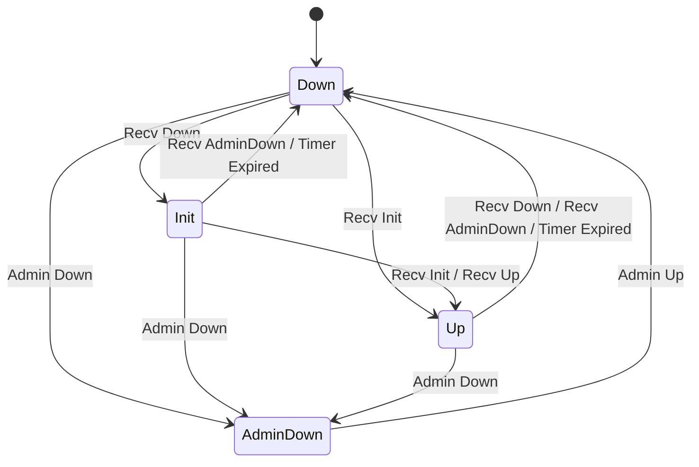
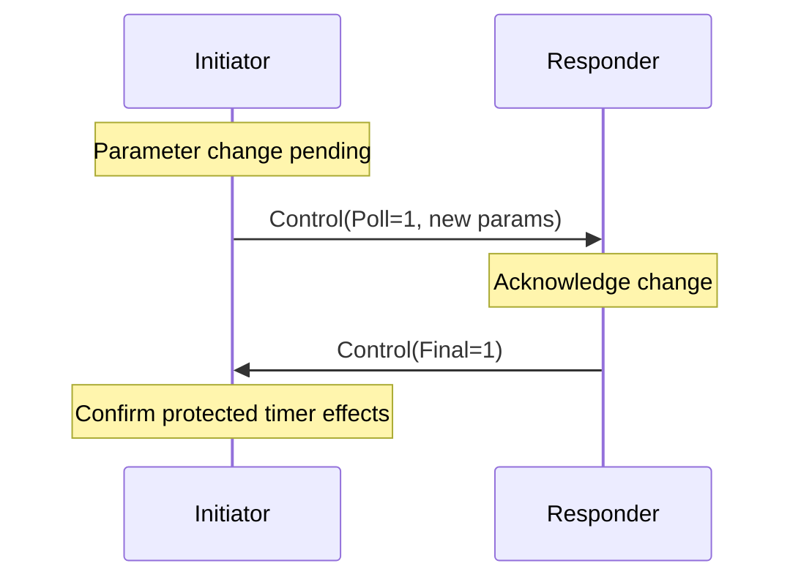

# BFD Protocol


> BFD protocol implementation details: FSM state machine, packet format, timer negotiation, jitter, authentication, and Poll Sequences.

---

## Table of Contents

- [BFD Control Packet Format](#bfd-control-packet-format)
- [FSM State Machine](#fsm-state-machine)
- [State Transition Table](#state-transition-table)
- [State Variables](#state-variables)
- [Timer Negotiation](#timer-negotiation)
- [Jitter](#jitter)
- [Poll Sequence](#poll-sequence)
- [Authentication](#authentication)
- [Unaffiliated Echo](#unaffiliated-echo)
- [Not Implemented](#not-implemented)

### BFD Control Packet Format

RFC 5880 Section 4.1 defines a 24-byte mandatory header:

| Offset | Size | Field | Notes |
|---|---|---|---|
| 0 | 1 | Version (3 bits) + Diagnostic (5 bits) | Version MUST be 1 |
| 1 | 1 | State (2 bits) + P F C A D M (6 bits) | P=Poll, F=Final, C=CPI, A=Auth, D=Demand, M=Multipoint |
| 2 | 1 | Detect Multiplier | MUST NOT be zero |
| 3 | 1 | Length | BFD PDU length in bytes; excludes RFC 9764 transport padding |
| 4-7 | 4 | My Discriminator | MUST NOT be zero |
| 8-11 | 4 | Your Discriminator | Zero until peer discriminator is known |
| 12-15 | 4 | Desired Min TX Interval | **Microseconds** |
| 16-19 | 4 | Required Min RX Interval | **Microseconds** |
| 20-23 | 4 | Required Min Echo RX Interval | **Microseconds** (0 for affiliated Echo; RFC 9747 unaffiliated Echo is implemented separately) |
| 24+ | var | Authentication Section | Optional, present when A bit is set |

> **IMPORTANT**: All interval fields are in **microseconds** on the wire. Conversion to `time.Duration` happens at the boundary:
> ```go
> interval := time.Duration(pkt.DesiredMinTxInterval) * time.Microsecond
> ```

**Codec allocation and lifetime**: marshal writes into a supplied buffer;
unauthenticated unmarshal fills a caller-owned packet without allocation.
Authenticated unmarshal allocates `AuthSection`, while its digest/password
fields borrow the input buffer. Callers retaining those fields must copy them
before returning the buffer to the pool.

### FSM State Machine

RFC 5880 Section 6.8.6 defines four states and the transitions between them:



The FSM is a pure indexed lookup over a `[state][event]` array built from the
declarative `map[stateEvent]transition` at initialization. The caller (Session)
executes the returned actions.

### State Transition Table

Derived from RFC 5880 Section 6.8.6 pseudocode:

| Current State | Event | New State | Actions |
|---|---|---|---|
| AdminDown | AdminUp | Down | (none) |
| Down | RecvDown | Init | SendControl |
| Down | RecvInit | Up | SendControl, NotifyUp |
| Down | AdminDown | AdminDown | SetDiagAdminDown |
| Down | TimerExpired | Down | SetDiagTimeExpired |
| Init | RecvAdminDown | Down | SetDiagNeighborDown, NotifyDown |
| Init | RecvDown | Init | (self-loop) |
| Init | RecvInit | Up | SendControl, NotifyUp |
| Init | RecvUp | Up | SendControl, NotifyUp |
| Init | TimerExpired | Down | SetDiagTimeExpired, NotifyDown |
| Init | AdminDown | AdminDown | SetDiagAdminDown |
| Up | RecvAdminDown | Down | SetDiagNeighborDown, NotifyDown |
| Up | RecvDown | Down | SetDiagNeighborDown, NotifyDown |
| Up | RecvInit | Up | (self-loop) |
| Up | RecvUp | Up | (self-loop) |
| Up | TimerExpired | Down | SetDiagTimeExpired, NotifyDown |
| Up | AdminDown | AdminDown | SetDiagAdminDown |

Unlisted (state, event) pairs are silently ignored. Down timeout diagnostic
handling follows the accepted Held-erratum policy described in
[RFC compliance](08-rfc-compliance.md).

### State Variables

All mandatory state variables from RFC 5880 Section 6.1:

| RFC Variable | Go Field | Notes |
|---|---|---|
| bfd.SessionState | `session.localPair` | Packed atomic state/diagnostic; coherent `Observation` available |
| bfd.RemoteSessionState | `session.observation` | Committed remote facts read under the session mutex |
| bfd.LocalDiscr | `session.localDiscr` | Immutable after creation |
| bfd.RemoteDiscr | `session.remoteDiscr` | Set from received packets |
| bfd.LocalDiag | `session.localPair` | Published with local state |
| bfd.DesiredMinTxInterval | `session.desiredMinTxInterval` | Configurable |
| bfd.RequiredMinRxInterval | `session.requiredMinRxInterval` | Configurable |
| bfd.RemoteMinRxInterval | `session.remoteMinRxInterval` | From received packets |
| bfd.DemandMode | Not implemented | See [Not Implemented](#not-implemented) |
| bfd.RemoteDemandMode | `session.remoteDemandMode` | Suppresses periodic TX while both peers are Up and no local Poll is active |
| bfd.DetectMult | `session.detectMult` | Configurable |
| bfd.AuthType | `session.auth` (interface) | Via `Authenticator` interface |
| bfd.RcvAuthSeq | `session.authState` | `AuthState` tracks this |
| bfd.XmitAuthSeq | `session.authState` | `AuthState` tracks this |
| bfd.AuthSeqKnown | `session.authState` | `AuthState` tracks this |

**Thread safety**: scalar local state/diagnostic getters use the packed atomic
pair. `Observation` reads a coherent committed snapshot under `Session.mu`;
remote state is not an independent atomic snapshot. Owner processing and
supported configuration updates serialize their mutable fields.

**Initialization** per RFC 5880 Section 6.8.1:
- `bfd.SessionState` = Down
- `bfd.RemoteSessionState` = Down
- `bfd.LocalDiag` = 0 (None)
- `bfd.RemoteDiscr` = 0
- `bfd.RemoteMinRxInterval` = 1 (microsecond)
- `bfd.XmitAuthSeq` = random 32-bit value (via `crypto/rand`)

### Timer Negotiation

RFC 5880 Sections 6.8.1-6.8.4.

#### TX Interval

The actual transmission interval is the larger of the local desired minimum and the remote required minimum:

```text
ActualTxInterval = max(bfd.DesiredMinTxInterval, bfd.RemoteMinRxInterval)
```

When the session is not Up, the advertised Desired Min TX and the unjittered
TX interval have a one-second floor (1,000,000 microseconds) per RFC 5880
Section 6.8.3. Section 6.8.7 jitter still applies: a one-second interval can
produce a periodic transmission after 750 ms.

#### Detection Time

The detection time is calculated from the remote peer's parameters:

```text
DetectionTime = bfd.RemoteDetectMult * max(bfd.RequiredMinRxInterval, bfd.RemoteDesiredMinTxInterval)
```

If no valid packet is received within Detection Time, Init and Up transition
to Down with Diagnostic = Control Detection Time Expired (1). An already Down
session updates that diagnostic under the selected Held-erratum policy;
AdminDown retains its administrative state and diagnostic. See
[`handleDetectTimer`](../../internal/bfd/session_loop.go).

### Jitter

RFC 5880 Section 6.8.7. Periodic transmission intervals include random jitter to prevent synchronization:

| Condition | Jitter Range | Effective Interval |
|---|---|---|
| DetectMult > 1 | 0-25% reduction | 75-100% of interval |
| DetectMult == 1 | 10-25% reduction | 75-90% of interval |

Implementation: [`applyJitterWithRand` and `Session.applyJitter`](../../internal/bfd/session_packet.go).

The session-local PRNG prefers a cryptographic seed and falls back to a
time-based seed if that read fails. Jitter is not a security boundary;
session-local state avoids global RNG contention on this path.

### Poll Sequence

RFC 5880 Sections 6.5 and 6.8.3 govern timer negotiation. While Up, protected
TX increases and RX decreases wait for Final; reverse directions retain their
immediate local effect when the proposal activates. A promoted non-Up proposal
applies locally before Final; unresolved Poll and separation still serialize
promotion. Detect-only Async changes do not require Poll; local TTL policy
does not use Poll. See [reload policy](adr/0006-session-preserving-reload-policy.md).



Key rules:

- Only one Poll Sequence may be active at a time (RFC 5880 Section 6.5)
- Config-owned updates retain one active proposal and the latest waiting proposal,
  including an explicit zero receive interval
- Poll is advertised until a Final follows a successful Poll send; crossed
  Final-only replies do not confirm the local Poll
- While Up, TX increases and RX decreases defer their local effect until Final;
  TX decreases and RX increases take effect when the proposal becomes active

Consecutive transactions wait the measured exchange duration after Final.
Expiry fails the receipt without rolling back advertised values. See the
[transaction contract](../superpowers/specs/2026-09-08-gobfd-timer-update-transactions-design.md)
for recovery and generation semantics. Bounded FRR/BIRD wire slices are recorded
in [Interop](05-interop.md); final unified candidate qualification remains open.
Those slices do not establish full Section 6.5 compliance.

### Authentication

RFC 5880 Section 6.7. Five authentication types are supported:

| Type ID | Name | RFC Section | Sequence Behavior |
|---|---|---|---|
| 1 | Simple Password | 4.2 | No sequence number |
| 2 | Keyed MD5 | 4.3 | Increment on each signing call in GoBFD |
| 3 | Meticulous Keyed MD5 | 4.3 | Increment on every packet |
| 4 | Keyed SHA1 | 4.4 | Increment on each signing call in GoBFD |
| 5 | Meticulous Keyed SHA1 | 4.4 | Increment on every packet |

**Sequence behavior**: GoBFD increments `bfd.XmitAuthSeq` on every signing call
for both keyed and meticulous variants. RFC 5880 permits more frequent
non-meticulous increments than state changes alone. The receive window is
inclusive `[last, last + 3 * received DetectMult]` for non-meticulous and
`[last + 1, last + 3 * received DetectMult]` for meticulous, using serial arithmetic.

**Key rotation**: multiple keys in `AuthKeyStore` do not establish a live
rotation protocol. Same-identity authentication changes are rejected on reload;
coordinated hitless rotation remains separate work. Plan a disruptive restart
or explicit release/recreation with the peer when changing deployed keys.

> **WARNING**: MD5 and SHA1 are retained despite cryptographic weakness because RFC 5880 defines them as the only hash-based BFD authentication types. Prefer SHA1 over MD5 when interoperability allows, and use meticulous modes when replay-window tightness matters.

#### Auth Section Wire Format

| Auth Type | Wire Layout | Auth Len |
|---|---|---|
| Simple Password | Type(1) + Len(1) + KeyID(1) + Password(1-16) | 4-19 |
| Keyed MD5 | Type(1) + Len(1) + KeyID(1) + Reserved(1) + SeqNum(4) + Digest(16) | 24 |
| Meticulous MD5 | Same as Keyed MD5 | 24 |
| Keyed SHA1 | Type(1) + Len(1) + KeyID(1) + Reserved(1) + SeqNum(4) + Hash(20) | 28 |
| Meticulous SHA1 | Same as Keyed SHA1 | 28 |

### Unaffiliated Echo

RFC 9747 unaffiliated Echo is implemented outside the affiliated RFC 5880
control-session Echo mode.

| Field | Status |
|---|---|
| Session type | `SessionTypeEcho` |
| UDP port | 3785 |
| Packet format | BFD Control packet |
| Timer model | Locally provisioned; no remote negotiation |
| Demultiplexing | Returned packet `MyDiscriminator` |
| Diagnostic on timeout | `DiagEchoFailed` |

### Not Implemented

#### Demand Mode (Section 6.6)

Local Demand mode is not implemented: transmitted D remains zero. Remote D
does affect periodic TX: when both peers are Up and no local Poll is active,
periodic Control sends are suppressed. Poll/Final and the constrained reload
handling remain separate. This does not qualify general Demand operation.

#### Affiliated Echo Mode (Section 6.4)

Not implemented for control sessions. `RequiredMinEchoRxInterval` remains zero
for standard BFD control sessions.

**Rationale**: Affiliated Echo Mode requires control-session coordination and
remote echo loopback support. RFC 9747 unaffiliated Echo is implemented as the
standalone forwarding-path echo mechanism.

#### Point-to-Multipoint

The Multipoint (M) bit is always zero. Received packets with M=1 are rejected per RFC 5880 Section 6.8.6 step 5.

### Related Documents

- [01-architecture.md](./01-architecture.md) -- System architecture and packet flow
- [08-rfc-compliance.md](./08-rfc-compliance.md) -- Full RFC compliance matrix
- [RFC 5880 full text](../rfc/rfc5880.txt) -- RFC 5880

---

*Reviewed against `dev` source: 2026-10-24.*
