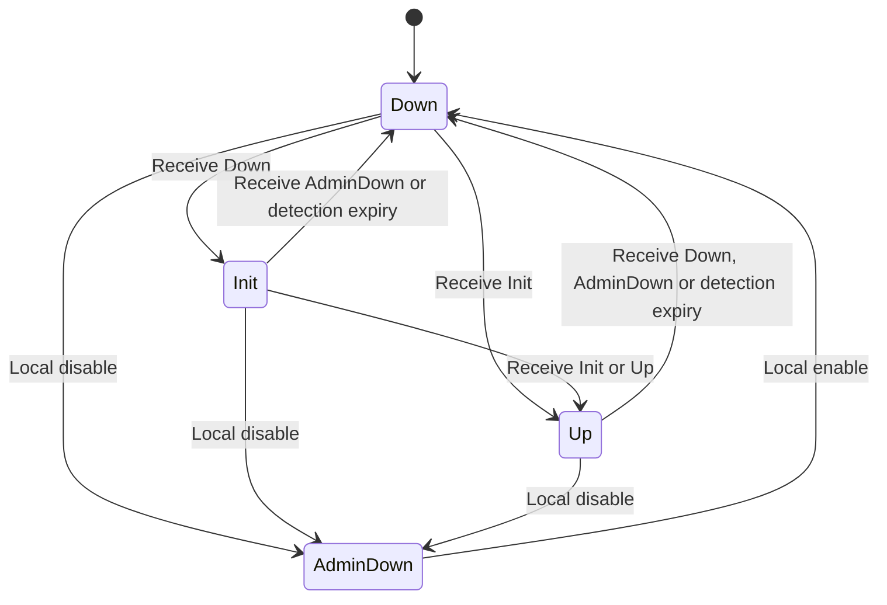
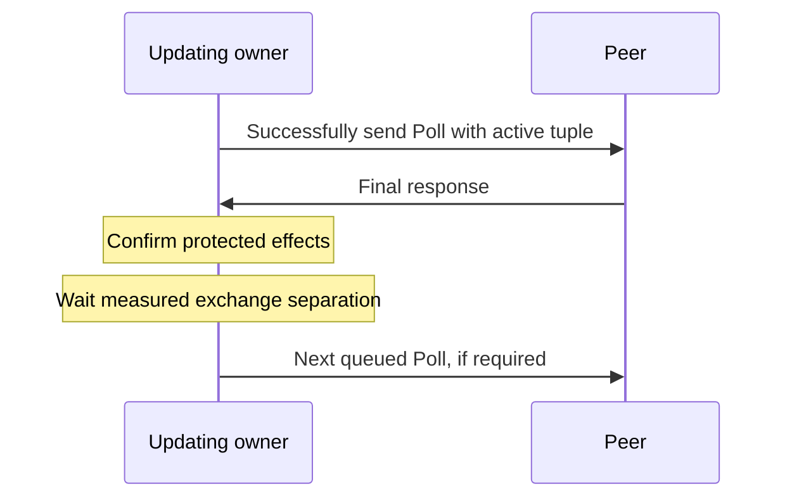

# BFD Protocol

[Russian translation](../ru/02-protocol.md).

The asynchronous Bidirectional Forwarding Detection (BFD) Control implementation follows the four-state model of [RFC 5880](../rfc/rfc5880.txt). Single-hop, constrained multihop and preview transports reuse that core. Local Demand, affiliated Echo and complete extension coverage remain outside it. The [RFC matrix](08-rfc-compliance.md) states each boundary.

The finite state machine (FSM) governs session state. TX and RX denote transmit and receive intervals. A protocol data unit (PDU) contains the declared BFD packet; transport padding follows it.

## BFD Control Packet Format

All multibyte integers use network byte order. The fixed header is 24 bytes; interval fields use microseconds. Sources: [RFC 5880 §4.1](https://www.rfc-editor.org/rfc/rfc5880.html#section-4.1), [codec](../../internal/bfd/packet.go).

| Offset, bytes | Bytes | Field | Validation or meaning |
|---:|---:|:---|:---|
| 0 | 1 | Version:3, Diagnostic:5 | Version 1 |
| 1 | 1 | State:2, P/F/C/A/D/M:6 | Poll, Final, Control Plane Independent (CPI), Auth, Demand, Multipoint |
| 2 | 1 | Detect Multiplier | Nonzero |
| 3 | 1 | Length | Declared BFD PDU; excludes transport padding |
| 4–7 | 4 | My Discriminator | Nonzero |
| 8–11 | 4 | Your Discriminator | Zero permitted only in AdminDown/Down |
| 12–15 | 4 | Desired Min TX Interval | Requested transmit minimum |
| 16–19 | 4 | Required Min RX Interval | Receive minimum; zero suppresses periodic peer TX |
| 20–23 | 4 | Required Min Echo RX Interval | Zero in GoBFD Control sessions |
| 24 onward | Variable | Authentication section | Present exactly when A=1 |

The codec rejects malformed header/auth lengths, zero Detect Multiplier, invalid discriminators and M=1. Session processing additionally checks the received Desired Min TX, authentication agreement and transport admission. Parser success is not acceptance by a session. Sources: [codec validation](../../internal/bfd/packet.go), [owner receive processing](../../internal/bfd/session_packet.go).

A caller-supplied buffer receives marshal output. `AuthSection` owns its bounded 20-byte array and logical `DataLen`; packet copies own metadata and payload bytes. Hash verification still requires the complete immutable received wire. Failed decode is dropped; partial header mutation on failure is not an atomicity contract. See [ADR-0011](adr/0011-bfd-auth-inline-payload.md).

## FSM State Machine

[FSM](../../internal/bfd/fsm.go) is a pure indexed lookup. It returns a new state and actions; the [session owner](../../internal/bfd/session_loop.go) executes sends, diagnostics and publication. The [transition tests](../../internal/bfd/fsm_test.go) compare the state/event table. A diagram edge does not describe every diagnostic-only change.

## State Transition Table

| Local state | Received AdminDown | Received Down | Received Init | Received Up |
|:---|:---|:---|:---|:---|
| AdminDown | Ignore | Ignore | Ignore | Ignore |
| Down | Down | Init | Up | Down |
| Init | Down, diagnostic 3 | Init | Up | Up |
| Up | Down, diagnostic 3 | Down, diagnostic 3 | Up | Up |

Detection expiry changes Init/Up to Down with diagnostic 1. The selected Held-erratum policy also updates an already Down diagnostic to 1 without a state edge. Local disable selects AdminDown/7; local enable returns to Down. A link failure requests Down/5 but preserves an existing AdminDown/7. Sources: [FSM actions](../../internal/bfd/fsm.go), [path/timer handlers](../../internal/bfd/session_loop.go), [erratum policy](08-rfc-compliance.md#rfc-5880-implementation-notes).

## State Variables

| RFC variable | Implementation | Read boundary |
|:---|:---|:---|
| SessionState, LocalDiag | Packed `localPair` | Atomic local pair |
| RemoteSessionState, remote diagnostic/C-bit | Committed observation | Session mutex |
| LocalDiscr | Immutable discriminator | Physical-session identity |
| RemoteDiscr | Learned discriminator | Owner updates; silence reset applies |
| DesiredMinTxInterval, RequiredMinRxInterval | Local timer fields | Desired/advertised/effective may differ |
| RemoteMinRxInterval, RemoteDesiredMinTxInterval | Validated peer fields | Directional timing inputs |
| DetectMult | Local transmit value | Does not replace received peer multiplier |
| RcvAuthSeq, XmitAuthSeq, AuthSeqKnown | `AuthState` | Updated by successful authentication |
| DemandMode | Local D=0 | Local Demand absent |

Initialization sets local/remote Down, diagnostic 0, remote discriminator 0 and RemoteMinRxInterval to one microsecond. Authentication sequence starts from a random 32-bit value. Coherent observation includes semantic facts; counters and timer telemetry are sampled separately. Sources: [session initialization](../../internal/bfd/session.go), [auth state](../../internal/bfd/auth.go), [observation](../../internal/bfd/session_observation.go).

## Timer Negotiation

### TX interval

`Ttx = max(local DesiredMinTxInterval, received RequiredMinRxInterval)`.

Before Up, advertised Desired Min TX and the unjittered interval have a one-second floor. Jitter still applies. A received Required Min RX of zero suppresses periodic Control transmission; permitted Final responses follow their own rules. Sources: [RFC 5880 §§6.8.3, 6.8.7](https://www.rfc-editor.org/rfc/rfc5880.html#section-6.8.3), [timer and packet code](../../internal/bfd/session_packet.go).

### Detection time

`Dlocal = received DetectMult * max(local RequiredMinRxInterval, received DesiredMinTxInterval)`.

Each direction computes its own Detection Time. With local RX 300 ms, received TX 500 ms and received multiplier 3, local D is 1.5 s. The formula gives a protocol deadline; scheduling, receive queues and client actions require separate measurements. [RFC 5880 §6.8.4](https://www.rfc-editor.org/rfc/rfc5880.html#section-6.8.4) defines expiry; [ADR-0012](adr/0012-owner-down-transition-witness.md) defines the owner commit witness.

### Common intervals

[RFC 7419 §3](https://www.rfc-editor.org/rfc/rfc7419.html#section-3) defines 3.3, 10, 20, 50, 100 and 1000 ms. Optional `bfd.align_intervals` rounds up within this set; values above one second remain unchanged. These values are not universal hardware minima. See [interval helpers](../../internal/bfd/intervals.go) and [vendor profiles](reference/vendor-bfd.md).

## Jitter

| Local DetectMult | Periodic send interval |
|:---|:---|
| Greater than 1 | 75–100% of negotiated interval |
| Equal to 1 | 75–90% of negotiated interval |

Jitter uses session-local pseudorandom number generator (PRNG) state, seeded cryptographically when available and from time on seed failure. It prevents synchronization; it is not an authentication boundary. Sources: [RFC 5880 §6.8.7](https://www.rfc-editor.org/rfc/rfc5880.html#section-6.8.7), [implementation](../../internal/bfd/session_packet.go).

## Poll Sequence

While Up, TX increases and RX decreases retain old protected local effects until the relevant Final. TX decreases and RX increases take effect when the proposal activates. A promoted non-Up tuple applies locally before Final, while active Poll and separation still serialize promotion.

One proposal is advertised and the latest waiting proposal is retained, including explicit RX=0. Final confirms only after a successful local Poll send; crossed Final-only replies do not confirm it. Consecutive transactions wait the measured exchange duration after Final. Expiry fails the receipt without undoing already advertised values. Sources: [transaction owner](../../internal/bfd/session_update.go), [transaction tests](../../internal/bfd/session_update_test.go), [timer transaction contract](reference/timer-transactions.md).

Detect-only asynchronous updates need no Poll. Remote Demand with both ends Up adds Poll/Final requirements. Local multihop TTL changes need no Poll; qualified padding updates are limited to asynchronous sessions already prepared for IPv4 Don’t Fragment (DF). [ADR-0006](adr/0006-session-preserving-reload-policy.md) specifies the complete five-field tuple, admission and ownership limits. Bounded wire slices in [interop](05-interop.md) do not close general Poll/Demand or final-candidate qualification.

## Authentication

[RFC 5880 §6.7](https://www.rfc-editor.org/rfc/rfc5880.html#section-6.7) defines the supported types. [Authentication code](../../internal/bfd/auth.go) verifies the selected algorithm, key, shape, digest and sequence before publishing replay-state changes.

| Wire type | Mode | Auth section bytes | Receive sequence window |
|---:|:---|---:|:---|
| 1 | Simple Password | 4–19 | No sequence |
| 2 | Keyed MD5 | 24 | Inclusive last through last + 3 × received DetectMult |
| 3 | Meticulous Keyed MD5 | 24 | Inclusive last + 1 through last + 3 × received DetectMult |
| 4 | Keyed SHA1 | 28 | Inclusive last through last + 3 × received DetectMult |
| 5 | Meticulous Keyed SHA1 | 28 | Inclusive last + 1 through last + 3 × received DetectMult |

Sequence arithmetic wraps serially at 32 bits. GoBFD increments the transmit sequence on every signing call for keyed and meticulous variants. Failed verification leaves replay state and received wire unchanged. The static key store clones input and returns caller-owned public copies.

Hash verification copies the validated declared BFD PDU into bounded scratch storage, substitutes the key there and compares fixed-width digests in constant time. Bytes after BFD Length are transport padding, including with a 9000-byte datagram; Simple Password has no packet digest. Independent vectors cover all modes and padding sizes in [auth padding tests](../../internal/bfd/auth_padding_test.go).

Multiple stored keys do not establish live rotation. Same-identity auth enablement, algorithm and unqualified key changes fail reload admission. Coordinate a separate disruptive transition with the peer; coordinated rotation remains unqualified. RFC-defined MD5/SHA1 modes do not imply modern cryptographic strength or confidentiality. Restrict the receive path and use the peer-supported authentication policy. See [security](15-security.md).

## Unaffiliated Echo

Default-off Echo uses UDP/3785, a separate `EchoSession`, locally provisioned `D = TxInterval * DetectMult`, TTL 255 on send and exact 254 on receive. It transitions directly Down↔Up, demultiplexes returns by My Discriminator and selects diagnostic 2 on timeout. Sources: [Echo owner](../../internal/bfd/echo.go), [Echo receiver](../../internal/netio/echo_receiver.go).

[RFC 9747 §2](https://www.rfc-editor.org/rfc/rfc9747.html#section-2) requires the RFC 5880 FSM without AdminDown, initial address/source-port bootstrap and subsequent Your Discriminator demux. The preview lacks those procedures, return authentication and slow pre-Up/post-Down pacing. Its peer-address send path does not qualify traversal of an adjacent forwarding plane. Management claims in [ADR-0009](adr/0009-echo-principal-claims.md) do not authenticate Echo returns.

## Not Implemented

### Demand Mode (Section 6.6)

Local D remains zero. Received D suppresses periodic TX while both peers are Up and no local Poll is active. Constrained reload and crafted-peer remote-Demand evidence do not qualify general Demand mode. Source: [periodic transmission gate](../../internal/bfd/session_loop.go).

### Affiliated Echo Mode (Section 6.4)

Control sessions advertise Required Min Echo RX Interval zero. The separate unaffiliated preview does not implement affiliated Echo. Source: [Control construction](../../internal/bfd/session_packet.go).

### Point-to-Multipoint

Transmit M remains zero; receive M=1 is rejected. No P2MP implementation is claimed. Source: [codec](../../internal/bfd/packet.go).

## Related Documents

- [Architecture](01-architecture.md) — ownership, receive flow and shutdown.
- [RFC coverage](08-rfc-compliance.md) — transport and acceptance limits.
- [RFC source archive](../rfc/) — retained standards texts.
