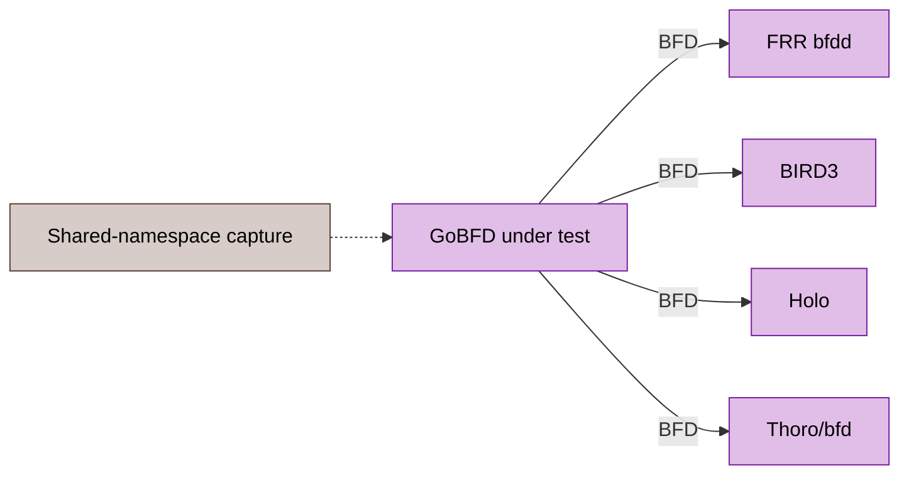

# Interoperability testing

[Russian translation](../ru/05-interop.md).

Interoperability evidence names the exact GoBFD revision, peer artifact, scenario and capture. Test definitions are source contracts; historical passes do not qualify a changed candidate. [RFC coverage](08-rfc-compliance.md) records implemented and incomplete procedures; [vendor reference](reference/vendor-bfd.md) records external configuration semantics.

BFD means Bidirectional Forwarding Detection. TX and RX denote transmission and reception; Detection Time (DT) is the negotiated expiry interval. A protocol data unit (PDU) is the declared BFD packet; Don’t Fragment (DF) is the IPv4 fragmentation flag. Packet captures (PCAPs) retain wire evidence. Network operating system (NOS) qualification requires actual peer execution.

## Select the gate

| Gate | Entry point | Boundary |
|:---|:---|:---|
| Base peers | make interop | Race-enabled testcontainers: FRR, BIRD3, Holo, Thoro/bfd plus crafted profiles |
| BGP coupling | make interop-bgp | Race-enabled testcontainers: GoBGP with FRR/BIRD3/ExaBGP |
| RFC scenarios | make interop-rfc | Race-enabled testcontainers: 7419, 9384 action path, 9468 and Echo preview |
| Routing aggregate | make e2e-routing | Separate retained Compose suites; does not select every testcontainers profile |
| RFC aggregate | make e2e-rfc | Legacy Compose/no-race runner; separate from interop-rfc |
| Containerlab | make interop-clab | Owned FRR-only dual-stack topology; native acceptance remains separate |
| Vendor manifests | make e2e-vendor | Metadata/policy evidence; no vendor NOS execution |

The first three are aliases for their explicit -testcontainers targets. [Makefile](../../Makefile) defines suite filters, environment and artifact directories. [E2E inventory](../../test/e2e/targets.md) states execution and cleanup differences.

## Prepare and run

Use the supported Linux environment and an account authorized to control the selected Podman engine and create the declared network/capture resources. Bound the run to one owned lab/project; record existing resource identities before startup and keep production peers outside its subnets. The commands below are unexecuted procedure examples.

1. Complete the [development environment](09-development.md), pinned Compose provider and required Podman API configuration.
2. Read the selected topology and runtime policy. Check project names, fixed names, subnets, resource limits and ownership before creating resources.
3. Select a fresh evidence location and retain the full source commit.
4. Execute the required full-cycle gate:

```sh
make interop-testcontainers
make interop-bgp-testcontainers
make interop-rfc-testcontainers
```

5. Inspect named test results, skips, packet assertions and cleanup receipts. Preserve raw JSON/logs, PCAP and SHA-256 sidecars.
6. Repeat affected profiles after production changes. A former exact-SHA receipt does not qualify a later thread, transport or timer change.

The base artifact root is reports/e2e/interop-testcontainers; BGP and RFC use the corresponding -bgp- and -rfc- names. GOBFD_REQUIRE_PODMAN=1 makes missing required Podman fail rather than silently skip. Full-cycle owners retain diagnostics before exact-owned cleanup.

Stop the sequence on a gate failure, unexpected skip, missing packet assertion or ownership collision. Retain the failing run's artifacts and cleanup state before recovery. Do not repeat a full cycle over unknown residual resources: reconcile exact IDs/labels with the owning harness, complete authorized owned cleanup and verify the lab baseline first. Preserve unrelated resources and retain each rerun in a separate evidence location. Source: [E2E lifecycle and cleanup contract](../../test/e2e/README.md).

## Base topology



Peer recipes are under [test/interop](../../test/interop/). The source baseline selects FRR 10.7.1, BIRD 3.4.0 plus the retained fix, immutable Holo 0.9.0 and a pinned Thoro source build. Obtain actual build/image identities from those recipes and each run; version labels alone are insufficient.

The fixed lab uses the private subnet 172.20.0.0/24; the addresses below reproduce the tracked topology rather than a production address plan. Assertions cover handshake, AdminDown, negotiated timers, failure/recovery and captured Control fields. Authentication, padding and crafted procedures have separate profiles. The independent Go peer uses the repository codec; it is not an independent codec implementation.

### Crafted peer procedures

TestCraftedPeerTestcontainers starts GoBFD, shared-namespace tshark and the Go peer at 172.20.0.40. The peer uses TTL 255, source port 49152, no authentication and SIGUSR1 phase advance.

| Phase | Input | Required evidence |
|:---|:---|:---|
| rx0/poll | Required RX zero and successive Polls | One Final per Poll; no periodic TX for at least ten negotiated intervals |
| silent | Stop peer transmission | Down diag 1 and expiry timing; first Down frame with Your Discriminator zero; at least three slow-rate intervals |
| recover | New handshake | Up with 300 ms intervals |
| demand | D=1 plus Poll; reload to 500 ms | Final, periodic suppression, local Poll/peer Final and converged receipt |
| demand-clear | D=0 plus Poll | Final, resumed periodic TX, twelve intervals and mean/jitter checks |
| final-loss/poll/final-restore | Lose Finals, cross Poll, restore | Repeated active 400 ms Poll tuple; 800 ms candidate only after prior Final/exchange spacing; P and F never simultaneous |

The silent bound is DT−1 ms through DT+max(2 ms,DT/50) from the last peer frame. The first GoBFD Down frame has an additional 50 ms allowance. Multiplier 1 uses 75–90% jitter with mean 0.825T; other tested multipliers use 75–100% with mean 0.875T. The resumed 500 ms phase uses a three-standard-error mean check.

Async authenticated FRR/BIRD3 multiplier reloads are 1→5→3 without local Poll. Remote Demand uses 5→3 with its own Poll/Final/receipt/quiet interval per change. Capture preserves source port/length, auth type/key/sequence, discriminators and timers. Local receive Detection Time uses the peer multiplier; peer Async and local Demand bounds remain separately labelled. The crafted peer has no detection timer.

### Padding and multihop profiles

Prepared padding exercises authenticated 128→192→128-byte sizes, auth+padding rejection, enable/disable and combined-candidate rejection. Default keyed SHA1 and TestFourPeerMeticulousTopologyTestcontainers each restore their immutable startup baseline. Capture verifies DF, UDP payload, declared PDU length, zero padding, MAC domain and replay state across phases. SIGUSR2 probes the current crafted Poll state without clearing Demand.

TestCraftedMultihopTTLTestcontainers uses peer-multihop: UDP 4784, meticulous SHA1, local RX 3 s, TX 300 ms. Async and Demand change max-hops 1→5→1, followed by rejected auth+hop-policy input. Successive 200 ms probes replay accepted wire, send a fresh below-floor Poll and repeat it at the floor; one accepted RX and one deliberate auth replay failure preserve transition counts. This qualifies the local 255−N policy only, not routed/cloud paths.

Final capture filtering limits decoded matching rows after display filtering. A capture read limit can hide later matching frames. Mandatory initial Down diag 0 and detection-expiry assertions may not silently skip. The pinned BIRD Linux high-port helper does not enforce the RFC 5881 source range; the retained padding capture contains 938 packets from port 43990. This is a named peer deviation, not GoBFD coverage.

### Retained wire receipts

| Slice | Exact source / receipt | Measured result | Remaining limit |
|:---|:---|:---|:---|
| Detect multiplier | d9e67064e51012c0d25a1a22dc9bd469600d8469; reports/detect-wire-20261024 | Both topologies pass | Padding/TTL/final gate separate |
| Padding | b97729458a696aee21023ba147af51417ed9ff7b; reports/padding-wire-20261024 | Three runtime receipts, 675 verified sidecars | Baseline skips and final disposition separate |
| TTL | 491b2214994f07e017eb93ab67a29a95378c619e; reports/ttl-wire-20261024 | 162.94 s crafted, 81.98 s multihop; seven windows; 863 source hashes, 212 sidecars | Unified final/stable gate separate |
| Default FourPeer | e4e79a8eee8e7c38bfc78321bdc5e9030909c214; reports/final-wire-20261024 | 429.47 s; ten scenarios; expiry gap 0.901 s; one BIRD RFC skip | Repeat all four final profiles after thread/scale changes |

The FourPeer receipt retains six image identities, 867 matching source hashes, 310 sidecars and fourteen dual-service SERVING probes. Its 512 MiB runner records zero max/out-of-memory (OOM) events and swap; exact image absence is checked. These are dated retained observations, not a current run or complete release qualification.

## BGP coupling

The 172.21.0.0/24 topology pairs GoBFD/GoBGP with FRR native BFD+BGP, BIRD3 native BFD+BGP and GoBFD/ExaBGP. ExaBGP uses the GoBFD bridge; it is not a native BFD peer.

| Peer path | Announced prefix |
|:---|:---|
| FRR | 10.20.0.0/24 |
| BIRD3 | 10.30.0.0/24 |
| ExaBGP bridge | 10.40.0.0/24 |

Retain established BFD/BGP, route presence, failure withdrawal and restored route/BGP observations separately. Shared namespaces align BFD and BGP source addresses. Current dev uses the GoBGP v4 API; the supported v0.6 line retains v3 and cannot use the v4 endpoint contract.

## RFC scenarios

The 172.22.0.0/24 topology contains an interval-alignment FRR peer, GoBFD/GoBGP BGP path, unsolicited FRR peer and independent Echo reflector.

| Scenario | Assertion | Qualification boundary |
|:---|:---|:---|
| 7419 | Configured 80 ms aligns to 100 ms on wire | Exact interval scenario |
| 9384-labelled action path | BFD Down disables BGP; Up re-enables it | GoBGP DisablePeer emits Cease/2; required wire subcode 10 is not implemented |
| 9468 | Unconfigured incoming session reaches Up and stays five seconds | Does not test expiry/cleanup |
| 9747-labelled Echo | Reflector Up, paused failure, recovery | Echo preview; no complete RFC return validation/authentication |

Use [RFC 5880](../rfc/rfc5880.txt), [RFC 5881](../rfc/rfc5881.txt) and [RFC matrix](08-rfc-compliance.md) for normative scope. A passing action path does not change the RFC implementation status.

## Retained Compose workflow

Use these commands only for an intentionally retained project; their filters and failure handling differ from the testcontainers gates.

Apply the same Linux, engine-authority and ownership prerequisites. Record the initial project state before `interop-up`; stop on creation/test failure, inspect `interop-logs` and preserve evidence before recovery. Inspect an already-running project before repeating `interop-up`; do not treat it as a fresh run or assume repetition leaves it unchanged.

```sh
make interop-up
make interop-test
make interop-logs
```

After authorized owned cleanup, use interop-down. BGP/RFC families provide matching -up/-test/-logs/-down targets. Capture helpers are interop-capture, interop-pcap and interop-pcap-summary. Routing aggregate base/BGP tests and legacy RFC aggregate omit race detection. Fixed names/subnets can collide across projects.

Require owned lab containers/networks to be absent after cleanup and the recorded unrelated resources to remain. Preserve data volumes and evidence unless their removal is explicitly included in the cleanup scope.

## Containerlab FRR procedure

Execution policy is defined by [profiles.json](../../test/e2e/vendor/profiles.json) and [vendorprofiles](../../test/internal/vendorprofiles/manifest.go). Arista cEOS, Nokia SR Linux, SONiC-VS, VyOS and deferred Cisco XRd remain retained-unavailable. Cached images, historical configuration, registry metadata and vendor manuals do not grant execution or acceptance. e2e-vendor reports policy without deploying them.

Use an account authorized for the selected engine and topology networking. Record the existing fixed-name resources and any retained ownership receipt before bootstrap. Stop if either belongs to another run or cannot be verified; the FRR-only procedure does not authorize changing that resource.

1. Use native Linux amd64/arm64, Podman with the intended Unix API socket, GNU Make/coreutils/flock and exact containerlab 0.82.0 from the controller pin.
2. Preload SDK/Debian references in [test_compiler_source.go](../../test/internal/clabbootstrap/test_compiler_source.go). Keep CLAB_LABDIR_BASE unset.
3. Use the full cycle or explicit owned stages:

```sh
make interop-clab-bootstrap ARGS=--dry-run
make interop-clab-up
make interop-clab-test
```

4. Inspect package PASS and ten named PASS results: dual-stack establishment, failure, negotiation, detection timing, packet format and all-available checks. Only SessionIndependence may skip with FRR alone.
5. Perform authorized interop-clab-down and verify removal against exact recorded IDs.

Stop before the next stage on failed bootstrap, deployment or assertions. Preserve discovery and receipts; retry cleanup through the same owner before beginning a fresh run. An `up` or `test` retry requires a fresh identity check against the retained receipt, not an assumption of idempotency. Verify preserved shared images and absence of exact owned resources after down.

interop-clab performs the complete FRR cycle. A prepare-only bootstrap leaves both staged image IDs/receipt for --deploy --skip-build or owned down cleanup; skip-build never trusts latest. Help/dry-run/down still compile a fresh controller. Old vendor archive/ISO flags remain parseable but cannot enable preparation.

The cold compiler receives a private source snapshot, no engine socket and bounded resources. The test payload compiles separately with race detection in a network-disabled SDK; Debian runtime receives exact hashed binaries and the selected engine socket without a compiler. A read-only socket mount still grants engine authority. Native host controller has a timeout but no equivalent hard memory cap. Payload containers use 2 CPU/2 GiB/no additional swap/512 PIDs.

Before/after compile checks validate schema-3 receipt, full IDs and owner/run labels through CLI and the once-selected API client, each with a 30-second context. Refuse changed/malformed receipts, foreign fixed-name collisions and retained-NOS execution rosters. Host-global UID lock serializes the fixed lab across worktrees.

Containerlab wires already-running ext-container applications without a management network. IPv6 addresses wait up to 30 seconds for duplicate address detection (DAD). Select sessions by exact tuple and typed local/remote state; another session or a diagnostic containing Down is insufficient.

Cleanup validates all identities before mutation, removes exact application image IDs without force/pruning and deletes the receipt last. Failed destroy retains discovery/receipt for retry. Historical schema-1/2 receipts remain cleanup inputs only. Shared SDK/runtime images are preserved. Test-result JSON remains in test/interop-clab/gobfd/.runtime.

FRR assertions use nominal/negotiated 300 ms and detection 900 ms; the detection timing test allows up to five seconds. Packet-format assertions require twenty complete dual-stack frames. Native FRR lifecycle/compiler-engine qualification and all five NOS qualifications remain incomplete; retain actual run receipts before claiming acceptance.

## Troubleshooting

| Symptom | Check | Action |
|:---|:---|:---|
| Required runtime missing | Provider/socket and GOBFD_REQUIRE_PODMAN | Restore the selected runtime; do not accept a skip |
| Fixed-name/subnet collision | Project manifest and exact live ownership | Select an isolated project; preserve foreign resources |
| Session stays Down | Local/peer tuple, capabilities, TTL/auth/ports | Correct the matching input and retain packet evidence |
| Empty capture | Capture namespace/filter, start time, decoded matching rows | Repeat bounded capture with the assertion window |
| RFC name passes without wire guarantee | Actual assertions and RFC matrix | Report the exact action-path scope |
| Cleanup fails | Receipt IDs, labels, API selection | Retry the owning down path; preserve recovery state |
| Vendor profile unavailable | Execution policy and source/license evidence | Keep it unavailable until separately admitted |

[Development](09-development.md), [E2E harness](../../test/e2e/README.md), [vendor reference](reference/vendor-bfd.md), [runtime measurements](14-performance-analysis.md).
