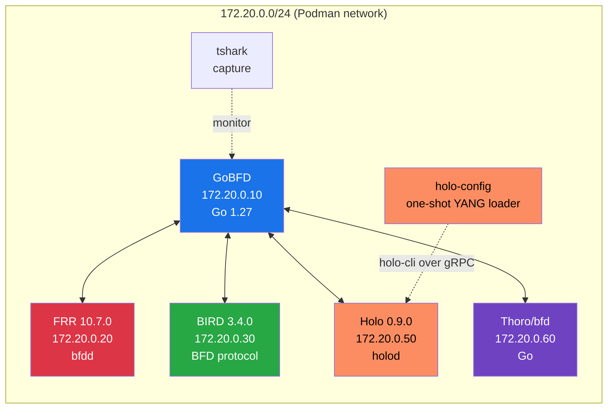
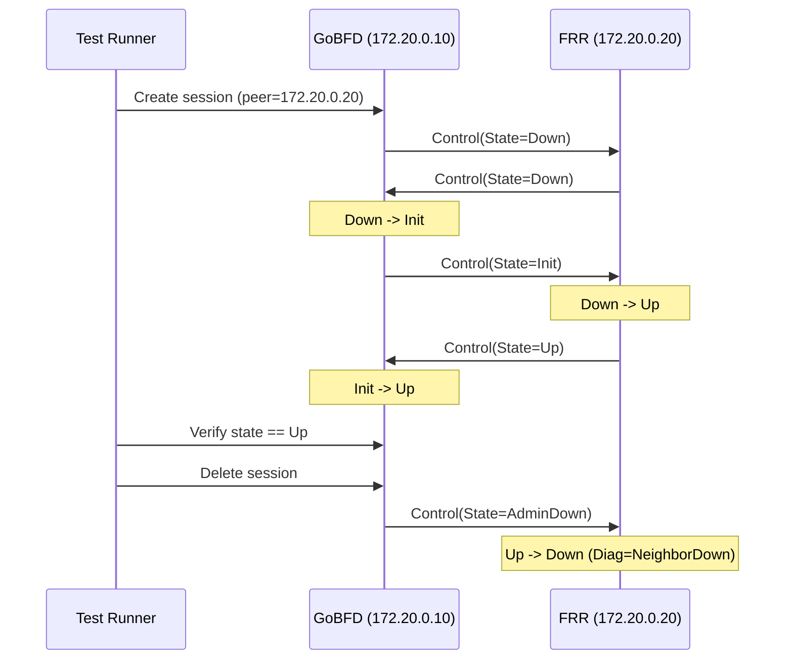
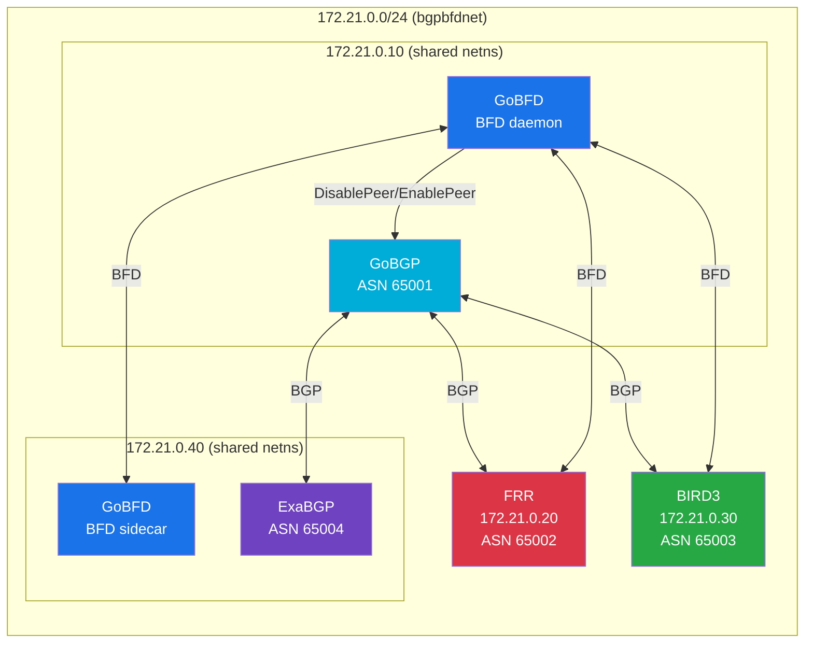
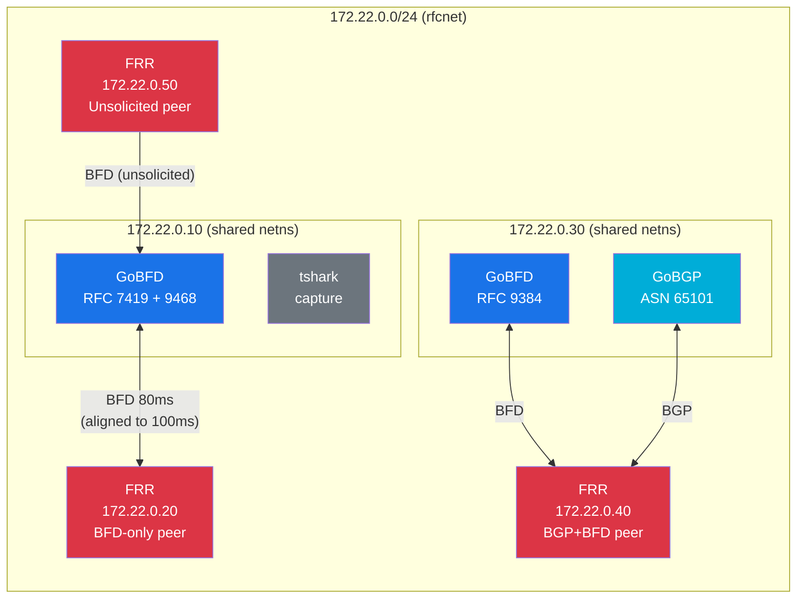
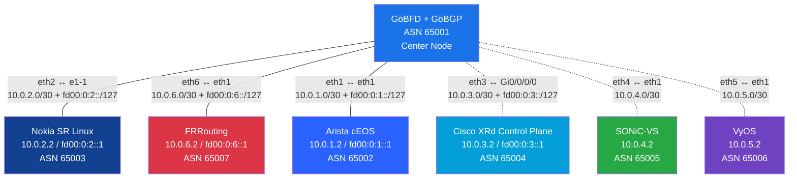

# Interoperability Testing


> Mandatory four-peer interoperability testing with Debian FRR 10.7.1, BIRD 3.4.0,
> Holo 0.9.0, and Thoro/bfd in a Podman topology with packet capture.
>
> **Remaining live-run blocker (2026-09-08):** the old pinned FRR `10.7.0`
> image uses Alpine 3.22.5. BASE now uses qualified Debian FRR `10.7.1`;
> E2E and Containerlab targets still using the old image must not run
> until their migration in Beads `gobfd-qj0.8.2.8.5.2.4` is accepted.
> A vendor image name is not an Alpine-policy exception.

Base consumer migration is locally accepted in Beads `.8.5.2.4.2.1`:
`test/interop/compose.yml` and its testcontainers harness use the shared
Debian FRR 10.7.1 recipe. Manual Compose and testcontainers gates passed on
linux/amd64 on 2026-09-08; the latter completed in 247.71 seconds with owned
container, network and image cleanup verified. Each ran the existing nine
functional tests. Both explicitly skipped BIRD3's source-port deviation and
capture-dependent detection precision; the manual run also skipped initial
diagnostic capture. These skips do not prove full RFC compliance.
Logs, PCAPs and a structured receipt are retained locally under
`reports/e2e/frr-base-caps-20260908/`. Check shared-host disk headroom before
each run. BGP and RFC are also locally qualified below; E2E and Containerlab
migration remain open.
The historical 10.7.0 baseline below is not relabeled.
The testcontainers and invalid-vector builds enforce CPU/RAM limits.
For manual BASE startup, `interopctl` renders `compose config --format json`
and builds each active image sequentially with two CPUs, 2 GiB RAM, no swap
and one build job. Both startup phases use `--no-build`; service limits apply
separately at runtime. Unsupported build options and `COMPOSE_COMPATIBILITY`
are rejected before building. Do not use `compose build --print` as a dry run:
Compose 5.5.0 with `DOCKER_BUILDKIT=0` can start actual builds.
`make interop-testcontainers` passes the full host checkout revision through
`GOBFD_BUILD_REVISION`, so an isolated worktree mount does not need access to
the host Git directory. Direct container invocations must supply the same value
when Git metadata is unavailable; malformed revisions are rejected.

The current BASE fixtures use Simple Password for FRR and Keyed SHA1 for
BIRD, with the public test-only key `gobfd-interop` and key ID 7. GoBFD sends
128-byte UDP payloads to both; Holo and Thoro remain unauthenticated with
24-byte payloads. FRR uses Simple Password because its pinned
[SHA1 implementation uses HMAC](https://github.com/FRRouting/frr/blob/frr-10.7.1/bfdd/bfd_packet.c#L532),
while [BIRD hashes the declared BFD PDU](https://github.com/CZ-NIC/bird/blob/e66773c42f115d80aaaef3b7246953b276a88065/proto/bfd/packets.c#L268).
GoBFD authentication is not weakened to accommodate either peer.

On 2026-10-15, `task/rfc9764-interop` at
`e71afa118ae10cac8e8a53e3672f7f7b6cc83afa` passed the critical race-enabled
manual Compose gate on linux/amd64: all four handshakes, Version, packet
length/authentication/padding, TTL 255, destination port and source-port range.
Capture checked 293 FRR-bound and 296 BIRD-bound GoBFD packets with BFD
Length 40/52, UDP Length 136, zero padding and IPv4 DF; 300 Holo-bound and
296 Thoro-bound packets retained BFD Length 24 and UDP Length 32. The GoBFD
API reported local and remote Up for all four peers. Evidence is retained
locally under `reports/rfc9764-interop/`. This is padded GoBFD TX and ordinary
authenticated peer RX qualification; peers do not send padding. The full
functional suite, timer reload and path MTU qualification did not run.
The invocation used the existing command-scoped container DNS override;
host resolver remediation remains open. Owned containers, network and images
are retained after stopping the exact verified container IDs.

The replacement recipe is `test/interop/frr/Containerfile`, built with
`test/interop/frr` as its context. It pins the shared Debian trixie base by
digest and official FRR `10.7.1-0~deb13u1` / libyang
`3.13.6-1~deb13u1` packages by architecture-specific SHA-256. The amd64
startup smoke passes; arm64 runtime and the remaining consumer migrations remain
unqualified. Historical `10.7.0` results below do not qualify this artifact.

Builds supply the full checkout commit as `VCS_REF` and an RFC 3339
`BUILD_DATE`, with `--cpu-period 100000 --cpu-quota 200000 --memory 2g
--memory-swap 2g --jobs 1`. Native foreground `watchfrr` supervises `mgmtd`,
`zebra`, `bfdd` and `staticd`; packaged startup applies `/etc/frr/frr.conf`.
BGP consumers must supply their daemon configuration and include `bgpd` in
the command. FRR requires `NET_ADMIN`, `NET_RAW` and `SYS_ADMIN`; no host
network or runtime socket is needed for the isolated startup smoke.
Python and `frr-pythontools` are not installed. Package-owned startup scripts
remain external FRR internals; no repository-owned shell launcher is added.

The smoke uses one CPU, 256 MiB, 64 PIDs and `--network none`: the configured
BFD peer remains Down, with TX/RX 300 ms, while all four daemons are Up.
Stopping within ten seconds exits with code 0 and removes their host PIDs.
This is PID-namespace teardown, **not graceful per-daemon shutdown**:
[watchfrr exits on SIGTERM](https://github.com/FRRouting/frr/blob/frr-10.7.1/watchfrr/watchfrr.c#L1027).
CycloneDX and SPDX reports are retained locally under
`reports/frr-debian-20260908/`. Debian dependency resolution is not snapshot
pinned, so this recipe does not claim bit-reproducible final images.
Beads `.8.5.2.4.1` covers this artifact slice; `.8.5.2.4.2` owns consumer
migration and live qualification. The remaining-consumer blocker above stays active.

---

## Table of Contents

- [Overview](#overview)
- [Test Topology](#test-topology)
- [Peer Implementations](#peer-implementations)
- [Running Interop Tests](#running-interop-tests)
- [What is Tested](#what-is-tested)
- [Packet Capture](#packet-capture)
- [Troubleshooting](#troubleshooting)
- [RFC-Specific Interop Testing](#rfc-specific-interop-testing)

### Overview

GoBFD is tested against four independent BFD implementations. The mandatory
base gate runs on `linux/amd64` because Holo publishes an official amd64 image
but no multi-architecture manifest. GoBGP and ExaBGP belong to the separate
BGP+BFD suite and are not counted as base peers.

### Test Topology



### Peer Implementations

| Peer | Version | Implementation | Language | Documented RFC coverage |
|---|---:|---|---|---|
| [FRR](https://frrouting.org/) | 10.7.0 | bfdd | C | 5880, 5881, 5882, 5883 |
| [BIRD3](https://bird.network.cz/) | 3.4.0 + fix | BFD protocol | C | 5880, 5881, 5882, 5883 |
| [Holo](https://github.com/holo-routing/holo/releases/tag/v0.9.0) | 0.9.0 | holod | Rust | 5880, 5881, 5882, 5883 |
| [Thoro/bfd](https://github.com/Thoro/bfd) | repository build | gRPC daemon | Go | 5880, 5881 |

The BIRD recipe builds tag commit `c3669497e3949b942d86d07e343092cc439b4659`
and applies the checksum-pinned upstream fix
[`7cf75587`](https://gitlab.nic.cz/labs/bird/-/commit/7cf75587b6f38b87849fe192bf5dfd124b7702bc)
for CVE-2026-112112. The image records both hashes in
`/usr/share/doc/bird/gobfd-source.txt`. `TestBIRDFlowSpecValidation`
(`interop_testcontainers` tag) checks that BIRD marks an IPv6 FlowSpec
destination with a nonzero offset invalid; `make interop-testcontainers` runs
it. BIRD is built from source, so image SBOMs and package scanners do not list
it.

Holo uses the immutable official image digest recorded in `compose.yml`. The
daemon starts with `holo/holod.toml`; a healthy-gated, one-shot `holo-config`
service then applies `holo/holo.startup` through `holo-cli`. The YANG values are
microseconds: `300000` for both transmit and receive intervals with multiplier
`3`, producing the negotiated 300 ms interval and 900 ms detection time. The
loader has no fixed address and is not a fifth peer.

### Crafted Go Peer

Pinned FRR 10.7.1 and BIRD 3.4.0 cannot advertise Required Min RX 0 or set
the Demand bit. `TestCraftedPeerTestcontainers` (`interop_testcontainers` tag)
therefore runs a separate topology: GoBFD with one session from
`gobfd/crafted-peer.yml`, tshark in the GoBFD network namespace, and the
repository-owned Go tool from `scapy/Containerfile` started with the `peer`
argument at `172.20.0.40`. Without an argument the same binary still sends the
invalid-vector corpus. The peer uses the in-repository codec, TTL 255, source
port 49152, Poll/Final, the slow rate outside Up and no authentication. Each
`SIGUSR1` from the test moves it to the next phase:

| Phase | Peer action | Capture assertion |
|---|---|---|
| `rx0`, `poll` | Required Min RX 0 with a Poll, then a second Poll | Only Finals from GoBFD, one per Poll, for at least 10 negotiated intervals (RFC 5880 Section 6.8.7) |
| `silent` | No transmission | The daemon logs Down with diag 1 one Detection Time (from `gobfdctl`, cross-checked with the wire) after the last peer frame, within `[DT-1 ms, DT+max(2 ms, DT/50)]`; the first GoBFD frame (Down, diag 1, Your Discriminator 0) follows within `DT+50 ms+max(2 ms, DT/50)` of the last peer frame, then at least 3 slow-rate intervals within the jitter bounds (Sections 6.8.4, 6.8.7 and 6.8.18) |
| `recover` | New three-way handshake | Up with 300 ms timers in both directions |
| `demand` | D=1 with a Poll | GoBFD answers with Final and then sends only Poll or Final frames; a SIGHUP to 500 ms produces a GoBFD Poll with the new timers, a peer Final, and a converged reload receipt after that Final (Sections 6.5 and 6.6) |
| `demand-clear` | D=0 with a Poll | GoBFD answers with Final and resumes periodic TX within `T+slack`, then at least 12 intervals pass the jitter bound and the 3-standard-error mean check for T=500 ms |
| `final-loss`, `poll`, `final-restore` | Drops its Final replies (simulated loss), then crosses the outstanding GoBFD Poll with its own Poll, then answers again | SIGHUP to 400 ms and, while the Final is lost, to 800 ms: GoBFD repeats P=1 with the active 400 ms tuple, answers the crossing Poll with F only and the same tuple, resumes P=1, and sends the 800 ms Poll only after the peer Final plus at least the measured exchange time; that Poll gets its own Final and receipt (Sections 6.5 and 6.8.3); no captured frame sets both P and F |

`make interop-testcontainers` runs the pure evaluator tests
(`TestCraftedPeerEvidence*`) and the live topology. The test stores the daemon
and peer logs, the frame TSV, the summary JSON and the PCAP with SHA-256 files
under `INTEROP_TESTCONTAINERS_ARTIFACT_DIR`.

The existing reload scenarios also exercise Detect Multiplier changes:
authenticated FRR/BIRD3 Async sessions use 1→5→3 without a GoBFD Poll;
the crafted remote-Demand session uses 5→3, each with its own Poll, peer Final,
applied receipt and quiet window. DetectMult 1 uses 75–90% jitter with mean
0.825T; other tested multipliers use 75–100% with mean 0.875T. Capture checks
preserve UDP source port/length, authentication type/key/sequence, discriminators
and timers. Before mutations, runtime tshark registry queries are restricted to
`frame.`, `ip.`, `bfd.` and `udp.`; the retained rows use first-column field
matching. This avoids buffering the full registry in the bounded race runner.
Local receive Detection Time uses the peer's multiplier. Derived peer Async
and local Demand Poll bounds are labelled separately from measured timing;
the crafted peer does not implement a detection timer. Source contracts alone
do not close P0 `gobfd-qj0.8.2.2.7.5.2`; actual candidate captures are required.

Local qualification on `d9e67064e51012c0d25a1a22dc9bd469600d8469` passes both
topologies with those captures; receipts are in `reports/detect-wire-20261024/`.
This does not close prepared-padding, TTL or final five-field qualification.

Prepared-padding scenarios extend the same timer lifecycle with authenticated
128→192→128 targets, rejected auth+padding changes, padding enable/disable,
and combined-candidate rejection. The meticulous SHA1 startup profile uses
`TestFourPeerMeticulousTopologyTestcontainers`; the default keyed SHA1 profile
remains `TestFourPeerTopologyTestcontainers`. Each loads and restores its own
selected immutable baseline. The independent peer keeps its own packet size.
Capture verification retains replay state across phases and retries, and
checks DF, raw UDP payload, declared PDU length, zero padding and MAC domain.
Aggregate and named BFD readiness are probed inside the owned daemon container
through the existing Unix socket, using the same compiled interop executable
copied through container files; TCP remains loopback-only. The crafted peer accepts
SIGUSR2 as a current-state Poll probe without advancing its phase or clearing
Demand, allowing old-size Final evidence after a rejected Demand resize.
Actual capture acceptance is tracked separately in
`gobfd-qj0.8.2.2.7.5.3.3`; source-only results do not close it.

Local qualification at `b97729458a696aee21023ba147af51417ed9ff7b` passes both
FourPeer profiles and crafted Demand with these captures. The three runtime
receipts and 675 verified sidecars are in `reports/padding-wire-20261024/`.
This qualifies the padding reload slice only; actual TTL, unified final-candidate
and stable-release gates remain separate. Baseline initial-Down and
DetectionPrecision skips require final-gate disposition alongside the known
BIRD Linux source-port range deviation.

Final-candidate qualification limits decoded TShark rows after display filtering;
`-c` limits packets read and can hide later matching frames. Missing initial
Down(diag=0) or detection-expiry evidence fails these mandatory assertions.
The remaining BIRD source-port exception is source-backed: its pinned
[BFD TX socket](https://github.com/CZ-NIC/bird/blob/c3669497e3949b942d86d07e343092cc439b4659/proto/bfd/packets.c#L496)
requests `SKF_HIGH_PORT`, but
[the platform helper](https://github.com/CZ-NIC/bird/blob/c3669497e3949b942d86d07e343092cc439b4659/sysdep/unix/io.c#L796)
does not enforce the RFC 5881 range on Linux. The retained padding capture has
938 BIRD packets from port 43990; this is a peer deviation, not GoBFD compliance
coverage. The shared builder retains immutable image IDs and required OCI
source/base annotations before cleanup. Evidence: `reports/final-wire-20261024/`;
actual final-candidate qualification remains with `gobfd-qj0.8.2.2.7.5.5`.

The same crafted lifecycle also provides `TestCraftedMultihopTTLTestcontainers`
with the closed `peer-multihop` startup command: UDP/4784, meticulous SHA1,
local RX 3 s and unchanged TX 300 ms. `SIGUSR1` enters remote Demand;
three `SIGUSR2` steps pause peer periodic TX before reload, replay its last
accepted payload at admissible TTL, then send a fresh below-floor Poll and
its byte-identical at-floor retry at successive 200 ms slots, then resume
after authenticated Final and counter snapshots. Max-hops 1→5→1 is exercised
in Async and remote Demand, followed by rejected auth+hop-policy input.
Capture/authentication checkpoints persist across phases. Accepted RX increases
by one; exactly one auth failure accounts for the deliberate replay, and
state transitions remain unchanged. A persistent initial baseline checks
reload and Demand transitions as well as each probe. This
checks GoBFD's local `255 - N` policy; routed/cloud acceptance remains separate.
Actual qualification belongs to `gobfd-qj0.8.2.2.7.5.4.3`.

Local qualification on `491b2214994f07e017eb93ab67a29a95378c619e` passes the
default crafted profile in 162.94 s and authenticated multihop in 81.98 s.
All seven boundary/replay windows pass; 863 source hashes and 212 artifact
sidecars match. Evidence: `reports/ttl-wire-20261024/`. Both profiles repeat
on the corrected source after a duplicated session-log attribute was removed;
strict JSON receipt parsing remains enforced. This does not close unified
five-field or stable-release qualification.

### Running Interop Tests

#### Full Cycle (Recommended)

```bash
# Build, start topology, run tests, cleanup -- all in one
make interop
```

This runs the Go-owned testcontainers lifecycle. It validates fixed-name
availability, requires the Holo loader to exit with status zero, runs the Go
assertions, persists the packet capture, and verifies cleanup of every
test-owned container, network, and image.

#### Explicit Go testcontainers Target

```bash
make interop-testcontainers
```

This is the explicit form of the default full-cycle target. It creates the static-IP network, GoBFD, FRR, BIRD3, Holo,
Thoro/bfd, and tshark directly through the Podman testcontainers provider. It
runs the same Go assertions, retains the packet capture under
`reports/e2e/interop-testcontainers`, and verifies removal of every test-owned
container, network, and image.

#### Step by Step

```bash
# Step 1: Start the 4-peer topology
make interop-up

# Step 2: Run Go interop tests
make interop-test

# Step 3: Stop and cleanup
make interop-down
```

#### Inspect Captured Packets

```bash
# Summary view (CSV fields)
make interop-pcap-summary

# Full packet decode
make interop-pcap

# Live capture
make interop-capture
```

### What is Tested

The interop tests (`test/interop/interop_test.go`) verify:

| Test Case | Description |
|---|---|
| Session establishment | Three-way handshake with each peer reaches Up state |
| Session teardown | Graceful AdminDown propagation |
| Timer negotiation | Correct negotiated intervals across implementations |
| Packet capture analysis | tshark validates BFD packet format on the wire |



The testcontainers BASE harness runs `TestTimerReload` between the RFC baseline
analysis and destructive lifecycle tests, in three ordered subprocess batches. It
changes only test-owned FRR/BIRD configurations: peer RX floor 100 ms, local
`300→100→500→300 ms`, then separate explicit RX0 phases with baseline
restoration. Every phase requires generation-qualified JSON receipts, a closed
packet window with Poll and Final, and applied receipt publication after the
completing Final. Nonzero phases also require unchanged discriminators, Up state
and text CLI counters. RX0 phases require the zero advertisement, receipts and
restoration; a Down after Final is permitted because the peer may stop
transmitting: BIRD 3.4.0 does, FRR 10.7.1 continues. Exact JSON/PCAP timestamps
assume the testcontainers daemon and capture share one host realtime clock; no
rounding or clock-skew allowance is applied.

Timing requires at least 12 consecutive post-Final periodic intervals sent by
GoBFD. RFC 5880 section 6.8.7 bounds each interval to 75–100% of the negotiated
TX when DetectMult exceeds 1. The check widens these bounds by max(2 ms, 2% of
TX) for timer wakeup and capture latency. It requires the sample mean within
three standard errors of 87.5%, the mean of the uniform 0–25% reduction that
GoBFD draws; the upper side adds the same latency allowance because the timer
rearms after each send. Logs,
configurations, frame summaries, subprocess statuses, checksums and a
readback-validated PCAP are retained in `INTEROP_TESTCONTAINERS_ARTIFACT_DIR`
before owned cleanup on success and failure; without an explicit directory the
harness prints a retained temporary path. The testcontainers topology runs the
daemon with JSON logs; log assertions accept both the text and JSON forms.

On 2026-10-21 the gate-compiled binary of `af7c907` passed all eight phases
against FRR 10.7.1 and BIRD 3.4.0 with fix `7cf75587`. Pooled GoBFD intervals at
100, 300 and 500 ms (n = 37, 26, 25) had means of 88.3%, 89.1% and 86.2% of the
negotiated TX. Kolmogorov–Smirnov and χ² tests at α = 0.05 did not reject the
uniform 75–100% model; the largest excess over 100% was 0.97 ms. Authenticated selective-Final loss, deterministic crossed
Poll and remote Demand remain open under `gobfd-qj0.8.2.1.1.1.4.3`; H-05 remains
partial.

### Packet Capture

The topology includes a tshark container that captures all BFD traffic on the shared network. Captures are stored as `.pcapng` files.

```bash
# View captured packets with full decode
make interop-pcap

# Summary as CSV
make interop-pcap-summary

# Fields in summary:
#   frame.time_relative, ip.src, ip.dst,
#   bfd.version, bfd.diag, bfd.sta, bfd.flags,
#   bfd.detect_time_multiplier, bfd.my_discriminator,
#   bfd.your_discriminator, bfd.desired_min_tx_interval,
#   bfd.required_min_rx_interval
```

### Troubleshooting

| Issue | Solution |
|---|---|
| Containers fail to start | Check `podman network inspect` for IP conflicts |
| Sessions stuck in Down | Verify `CAP_NET_RAW` is available in containers |
| tshark no data | Ensure the shared network interface is configured |

```bash
# View project-owned container logs through the guarded target
make interop-logs
```

---

## BGP+BFD Full-Cycle Testing


> End-to-end testing of the BFD->BGP coupling (RFC 5882): BFD failure detection triggers BGP peer disable, BFD recovery triggers BGP peer re-enable.

### BGP+BFD Topology



### Three Test Scenarios

| # | Scenario | BFD | BGP | Route |
|---|---|---|---|---|
| 1 | GoBFD+GoBGP ↔ FRR | FRR bfdd (native) | FRR bgpd (native) | `10.20.0.0/24` |
| 2 | GoBFD+GoBGP ↔ BIRD3 | BIRD3 BFD (native) | BIRD3 BGP (native) | `10.30.0.0/24` |
| 3 | GoBFD+GoBGP ↔ GoBFD+ExaBGP | GoBFD sidecar | ExaBGP (no BFD) | `10.40.0.0/24` |

### Full Cycle Test Flow

Each scenario tests three phases:

1. **Establish**: BGP session Established, BFD session Up, route received in GoBGP RIB
2. **Failure**: Stop/pause peer → BFD Down detected (~900ms) → GoBGP DisablePeer → route withdrawn
3. **Recovery**: Start/unpause peer → BFD Up → GoBGP EnablePeer → BGP re-established → route restored

### Running BGP+BFD Tests

**BGP trixie qualification passed locally** (Beads `gobfd-qj0.8.2.8.5.2.4.2.2`).
The approved replacement uses shared recipes under `test/interop/` for FRR,
GoBGP and ExaBGP. GoBGP v4.10.0 is built from upstream commit
`da824d99912e02124b53741245ee4186c381adcc` on trixie; the recipe pins Go 1.27.3,
while the recorded qualification used the Go 1.27.2 builder and is repeated under
`gobfd-bjr`. GoBGP v3
serves `/apipb.GobgpApi` and v4 serves `/api.GoBgpService`; the two are
wire-incompatible, so `dev` GoBFD requires a GoBGP v4 daemon. GoBGP v4 native
BFD is disabled by default, and no repository GoBGP configuration enables it.
External ExaBGP 5.0.13 uses trixie's system
Python and its native `python3 -m exabgp` entrypoint, without pip, uv, a custom
launcher or repository-owned Python source. Its
[pinned upstream manifest](https://github.com/Exa-Networks/exabgp/blob/edf249571174449f80c72d75eb6933dcabd67f92/pyproject.toml)
declares no runtime package dependencies. Both source archives are SHA-256
pinned. This narrowly scoped ExaBGP runtime exception does not permit Python
development tooling.

With GoBGP v3.37.0 on linux/amd64, manual Compose and the complete
testcontainers gate passed on 2026-09-08; the latter took 200.07 seconds.
Both ran all four existing race-enabled BGP tests: peer establishment and
FRR/BIRD3/ExaBGP failure, route withdrawal and recovery, with no skipped
tests. Seven containers per topology were limited to one CPU, 256 MiB RAM,
no swap and 128 PIDs; inspection found no OOM kills. Sequential builds were
limited to two CPUs and 2 GiB. Owned containers, networks and image tags were
removed. Logs, PCAPs, CycloneDX/SPDX peer SBOMs and the acceptance receipt
are retained locally in `reports/e2e/bgp-trixie-20260908/`. This does not
qualify arm64, remaining image consumers, timer reloads or full RFC
compliance. Debian package resolution is not snapshot-pinned; final images are
not claimed to be bit-reproducible.
GoBGP v3.37.0 has no fix for `GO-2026-4736`; on GoBGP v4.10.0 the strict
runtime `govulncheck` reports no reachable finding, and the remaining
module-level exception is described in [SECURITY.md](../../SECURITY.md).
Keep these peers isolated from untrusted networks; BGP functionality and SBOMs
are not a security qualification.

On 2026-10-13, at commit `f85ca09` on linux/amd64, the testcontainers gate
`TestBGPBFDTopologyTestcontainers` passed with GoBGP v4.10.0 in 359.25
seconds: all four race-enabled subtests (`AllPeersUp`, FRR, BIRD3, ExaBGP)
ran without skips, the GoBGP version assertion reported 4.10.0, and no
containers remained. The manual Compose path was not rerun on GoBGP v4.

```bash
# Authoritative routing aggregate with owned artifacts and cleanup
make e2e-routing

# Default full cycle: Go owns the Podman lifecycle through testcontainers
make interop-bgp
```

The Go lifecycle creates the static network, both GoBFD instances, GoBGP
v4.10.0, FRR 10.7.1, BIRD 3.4.0, ExaBGP 5.0.13, and tshark directly through
the Podman provider. It runs the same establish, failure, route-withdrawal, and
recovery assertions, saves a non-empty packet capture, and proves removal of
all test-owned containers, network, and locally built images.

Both BGP paths select `mgmtd`, `zebra`, `bgpd`, `bfdd` and `staticd` for native
`watchfrr`. The tracked FRR configuration remains read-only in Compose; these
tests stop/start peers but do not save configuration. All seven services have
one CPU, 256 MiB RAM, no additional swap and 128 PIDs. Image builds use the
two-CPU / 2 GiB limits above. Manual `make interop-bgp-up/down/logs` uses the
existing ownership-checked controller, with `up --no-build` after capped builds.
`INTEROP_BGP_PROJECT_NAME` defaults to `${INTEROP_PROJECT_NAME}-bgp`, matching
the routing aggregate; manual tests use that same project. Shared `dev-exec`
allows ten minutes for compilation and the five-minute suite, while ordinary
control commands retain their two-minute bound. The testcontainers
target passes the host revision and registers image cleanup before building.

### Key Design: Shared Network Namespaces

GoBFD and GoBGP share a network namespace (both at `172.21.0.10`), so the BFD peer address matches the BGP neighbor address. When GoBFD detects BFD Down for peer `172.21.0.20`, it calls `DisablePeer("172.21.0.20")`, which correctly targets FRR's BGP session.

The same pattern applies to ExaBGP: GoBFD sidecar and ExaBGP share a netns at `172.21.0.40`. The ExaBGP test uses `podman pause` to freeze only the BFD sidecar while keeping ExaBGP's BGP session alive, proving BFD detects failure before BGP's holdtimer expires.

### Related Documents

- [09-development.md](./09-development.md) -- Development workflow and make targets
- [06-deployment.md](./06-deployment.md) -- Container image and Podman Compose
- [08-rfc-compliance.md](./08-rfc-compliance.md) -- RFC compliance matrix

---

## RFC-Specific Interop Testing


> Targeted interoperability tests for RFC extensions beyond the base protocol
> in an eight-container topology with packet capture (tshark).

### RFC Interop Topology



### Containers (8)

| Container | IP | Role |
|---|---|---|
| `gobfd-rfc` | 172.22.0.10 | GoBFD with align_intervals + unsolicited enabled |
| `tshark-rfc` | (shared netns) | Packet capture on gobfd-rfc's interfaces |
| `frr-rfc` | 172.22.0.20 | FRR BFD-only peer for RFC 7419 timer alignment |
| `gobfd-rfc9384` | 172.22.0.30 | GoBFD with GoBGP integration for RFC 9384 |
| `gobgp-rfc` | (shared netns) | GoBGP ASN 65101 for BGP Cease testing |
| `frr-rfc-bgp` | 172.22.0.40 | FRR BGP+BFD peer for RFC 9384 |
| `frr-rfc-unsolicited` | 172.22.0.50 | FRR BFD peer with no pre-configured session on GoBFD |
| `echo-reflector` | 172.22.0.60 | Independent UDP echo reflector for RFC 9747 |

### Test Results

| Test | RFC | Description | Result |
|---|---|---|---|
| `TestRFC7419_CommonIntervalAlignment` | 7419 | GoBFD configures 80ms timers; with `align_intervals: true`, negotiated interval should be aligned to 100ms. Verified via tshark capture of `DesiredMinTxInterval` field on the wire. | **PASS** |
| `TestRFC9384_BGPCeaseBFDDown` | 9384 | Pause frr-rfc-bgp → BFD Down → GoBFD calls DisablePeer → verify BGP session torn down. Unpause → BFD Up → EnablePeer → BGP re-established. The annotation mentions Cease/10, but `DisablePeer` sends Administrative Shutdown (Cease/2): GoBGP v3 emits it, and the GoBGP v4 `DisablePeerRequest` still has only `address` and `communication` fields. The action path passed on GoBGP v3.37.0 and on v4.10.0 (2026-10-13). | **Action path passes; RFC 9384 wire subcode not implemented** |
| `TestRFC9468_UnsolicitedBFD` | 9468 | frr-rfc-unsolicited (172.22.0.50) initiates BFD with no configured GoBFD session. The test verifies Up packets and five seconds of stability; it does not test unsolicited-session expiry or cleanup. | **PASS** |
| `TestRFC9747_EchoSession` | 9747 | GoBFD echo reaches Up through the independent reflector; pause and recovery prove echo failure detection and restoration. | **PASS** |

The RFC 9384 test proves BFD-to-BGP teardown and recovery coupling. It does
not inspect or prove Cease subcode 10 on the wire.

### Running RFC Interop Tests

P0 migration `.8.5.2.4.2.3` passed the complete local linux/amd64
testcontainers gate on 2026-09-08 in 117.50 seconds: all four existing
race-enabled scenarios passed without skips. FRR 10.7.1 and GoBGP v3.37.0
used the shared trixie recipes. Five sequential builds have two-CPU / 2 GiB
limits; all eight containers have one CPU, 256 MiB, no swap and 128 PIDs.
Inspection found no OOM kills, and exact container/network/image cleanup
passed. Logs, PCAP, peer CycloneDX/SPDX SBOMs and a JSON acceptance receipt
are retained in `reports/e2e/rfc-trixie-20260908/`.
Raw fixed-name Compose lifecycle remains unsupported. This targeted
acceptance does not qualify arm64, full RFC 9384 wire behavior, unsolicited
session expiry or timer reloads, and it is not a security gate. The shared
recipe now builds GoBGP v4.10.0. On 2026-10-13 the same testcontainers gate
passed on GoBGP v4.10.0 in 162.12 seconds at `7559c05`: all four race
scenarios passed without skips and no test-owned containers remained.

Use the Go-owned Podman lifecycle for live validation. It resolves every
runtime operation to an immutable container ID:

```bash
make interop-rfc
```

---

## Vendor NOS Interoperability (Containerlab)


> Multi-vendor BFD interoperability testing against commercial/enterprise NOS containers. Validates RFC 5880/5881/5882 compliance against independent, production-oriented BFD implementations. Dual-stack: IPv4 (RFC 5881 Section 4) and IPv6 (RFC 5881 Section 5) tested on every available vendor.

### Vendor Topology

Star topology with GoBFD at the center and dual-stack point-to-point links to each vendor NOS: IPv4 /30 (RFC 3021) and IPv6 /127 (RFC 6164) on the same veth pair. Containers and veth links are managed directly via Podman for maximum compatibility.



> Solid lines = primary or baseline profiles. Dashed lines = deferred profile
> or image-dependent profile. Image availability is recorded by `make
> e2e-vendor`.

### Vendor Availability

| Vendor | Image | IPv4 Subnet | IPv6 Subnet | ASN | Status | License |
|---|---|---|---|---|---|---|
| **Nokia SR Linux** | `ghcr.io/nokia/srlinux:25.10.2` | `10.0.2.0/30` | `fd00:0:2::/127` | 65003 | Primary, public image | Free, no registration |
| **FRRouting** | `quay.io/frrouting/frr:10.7.0` | `10.0.6.0/30` | `fd00:0:6::/127` | 65007 | Baseline | GPL, free |
| **Arista cEOS** | `ceos:4.36.0.1F` | `10.0.1.0/30` | `fd00:0:1::/127` | 65002 | Primary, operator image | Free Arista.com account |
| SONiC-VS | `docker.io/netreplica/docker-sonic-vs:latest` | `10.0.4.0/30` | -- | 65005 | Primary, public image | Free |
| VyOS | `docker.io/muruu1/vyos:latest` | `10.0.5.0/30` | -- | 65006 | Primary, public mirror; ISO build fallback | Free rolling/community image |
| Cisco XRd | `ios-xr/xrd-control-plane:25.4.1` | `10.0.3.0/30` | `fd00:0:3::/127` | 65004 | Deferred | Cisco service contract |

### Prerequisites

- **Podman** with socket API active (`/run/podman/podman.sock`)
- **containerlab** 0.57+ (for topology reference; direct Podman management used)
- Container capabilities: `NET_ADMIN`, `NET_RAW`
- At least one vendor image available

### Lab Preparation (Go Bootstrap)

The Go 1.27 bootstrap command owns preflight, bounded parallel pulls, build,
inventory, native VyOS ISO/rootfs preparation, and operator-supplied
Arista/Cisco archive imports. No repository Python or shell helper participates
in vendor image preparation.

```bash
# Pull all public images + prepare VyOS tag + build GoBFD
go run ./test/cmd/clabbootstrap -v

# With commercial images
go run ./test/cmd/clabbootstrap \
    --arista-image /path/to/cEOS64-lab-4.36.0.1F.tar

# Prepare + deploy topology
go run ./test/cmd/clabbootstrap --deploy

# Prepare + full test run
go run ./test/cmd/clabbootstrap --test

# Dry run (show what would be done)
go run ./test/cmd/clabbootstrap --dry-run
```

The command handles:
- **Preflight checks**: podman and the exact Go toolchain
- **Parallel image pulls**: Nokia SR Linux, SONiC-VS, VyOS, FRRouting (+ build dependencies)
- **VyOS image preparation**: pulls `docker.io/muruu1/vyos:latest`, tags it as `vyos:latest`, and keeps ISO build as fallback
- **Commercial image import**: Arista cEOS (`podman load`); Cisco XRd remains deferred until an operator-provided image is available
- **GoBFD image build**: multi-stage Containerfile with GoBGP sidecar, using a
  run-owned `localhost/gobfd-clab:<run-id>` reference and exact image ID. The
  sidecar is GoBGP v4.10.0 built from the same source pin as
  `test/interop/gobgp`; a contract test keeps both pins identical. Vendor
  interoperability on GoBGP v4 is not qualified yet
- **Inventory report**: final list of all images with ready/missing status

Run `make interop-clab-bootstrap ARGS=--help` for all options. HTTPS redirects,
archive extraction, and external image-tool argv are validated by the Go
bootstrap boundary.

### Running Vendor Tests

```bash
# Full cycle: build GoBFD image + deploy + test + cleanup
make interop-clab

# Step by step
make interop-clab-up     # Build + deploy topology
make interop-clab-test   # Run Go tests (topology must be up)
make interop-clab-down   # Destroy owned containers, links, and the exact GoBFD image

# Prepare only, then either consume or remove the staged owned image
make interop-clab-bootstrap
make interop-clab-bootstrap ARGS="--deploy --skip-build"
# or: make interop-clab-down
```

`make interop-clab` pulls public Nokia SR Linux, SONiC-VS, VyOS, and FRRouting
images before availability checks. Cisco XRd and Arista cEOS remain
operator-provided images. The Go lifecycle renders a topology containing only
available profiles, records exact container identities in a mode-0600 receipt,
and records the run-owned GoBFD image reference, ID, and ownership labels in
the same mode-0600 receipt. Cleanup validates all recorded identities before
its first mutation, removes the image by exact ID without force, and deletes
the receipt last. A standalone bootstrap intentionally leaves the staged image
and receipt for a later `--skip-build` deployment or exact `--down` cleanup;
`--skip-build` never trusts a shared `latest` tag. A UID-scoped host-global lock
serializes the fixed Containerlab lab namespace across repository worktrees.
Before `--test-only` emits evidence, it revalidates every recorded live
container ID and ownership label and rejects any unrecorded fixed-name
container that the test suite could otherwise discover.

### RFC Compliance Matrix

| Test | RFC Section | Description |
|---|---|---|
| Session establishment (v4+v6) | 5880 Section 6.8.6 | Three-way handshake reaches Up state |
| Failure detection (v4+v6) | 5880 Section 6.8.4 | Detection within DetectMult x interval |
| Packet format (v4) | 5880 Section 4.1, 5881 Section 4 | Version=1, TTL=255, port 3784 |
| Packet format (v6) | 5880 Section 4.1, 5881 Section 5 | Version=1, Hop Limit=255, port 3784 |
| Timer negotiation (v4+v6) | 5880 Section 6.8.2 | Negotiated TX = max(DesiredMinTx, RemoteMinRx) |
| Detection timing (v4+v6) | 5880 Section 6.8.4 | Detection time ~900ms (3 x 300ms) |
| Session independence | 5880 Section 6.8.1 | Failure of one vendor doesn't affect others (grouped by baseName) |

### Vendor-Specific Notes

**Nokia SR Linux**: BFD sessions are protocol-triggered (requires established BGP session). Containerlab applies `nokia/config.cli`, whose explicit timer values are 300ms. The SR Linux container runs the same code as production Nokia hardware.

**FRRouting**: Native `bfdd` daemon implements RFC 5880/5881/5882/5883. BFD timers are configured directly in `frr.conf` (300ms TX/RX, multiplier 3). FRR integrates BFD with BGP via `neighbor X bfd` directive. The container is ~188MB and starts in seconds.

**Arista cEOS**: BFD sessions are protocol-triggered (requires established BGP session via `neighbor X bfd`). cEOS 4.36.0.1F runs with `service routing protocols model multi-agent` and requires 8 mandatory environment variables for containerized operation (`CEOS=1`, `EOS_PLATFORM=ceoslab`, `INTFTYPE=eth`, etc.). Boot time is 60-120s; the test runner waits for `Cli -p 15 -c "show version"` to succeed. BFD state is checked via `Cli -p 15 -c "show bfd peers"`.

**Cisco XRd**: XRd Control Plane is a deferred optional profile. The profile remains defined, but it is not part of the primary vendor set until an operator-provided XRd image is available. XRd vRouter requires PCI passthrough and is incompatible with veth-based topologies.

**GoBGP integration**: GoBFD runs alongside GoBGP (ASN 65001) inside the GoBFD container. Vendor NOS like Nokia require BGP for protocol-triggered BFD. When a vendor container is paused/unpaused, GoBGP's BGP neighbor transitions to `Idle(Admin)` and must be explicitly re-enabled via `gobgp neighbor <ip> enable`.

### Vendor Configuration Validation

| Profile | Runtime Config | Official Source Constraint | Repository Status |
|---|---|---|---|
| Arista cEOS | `arista/startup-config.cfg` | EOS BGP uses `neighbor bfd`; interface timers use `bfd interval`; VXLAN BFD uses `bfd vtep evpn` under VTI. | Current profile is single-hop BGP+BFD. RFC 8971 is reserved for a future Vxlan1 profile. |
| Nokia SR Linux | `nokia/config.cli` | BFD subinterface timers are microseconds; BGP failure-detection can enable BFD at group or neighbor level. | Current profile enables BFD on `ethernet-1/1.0` before BGP group failure-detection. |
| SONiC-VS | Go lifecycle in `test/internal/clabbootstrap` | SONiC uses ConfigDB for data-plane interface configuration; `sonic-vs` is the containerized SONiC kind; the current BFD path is FRR-backed. | Fixed argv calls start bgpd/bfdd and configure the data-plane interface without a repository shell. Separate evidence is still required before claiming native SONiC BFD CLI coverage. |
| VyOS | `vyos/config.boot` | VyOS enables BFD for BGP through `protocols bgp neighbor <neighbor> bfd`; data interfaces are `ethN`. | Current profile configures `eth1`, BGP neighbor BFD, and a BFD peer tied to `eth1`. |
| FRRouting | `frr/frr.conf` | FRR requires BFD peers plus `neighbor ... bfd`; `receive-interval`, `transmit-interval`, and `detect-multiplier` are supported. | Current profile is IPv4/IPv6 single-hop BGP+BFD. |
| Cisco XRd | `cisco/xrd.cfg` | IOS XR BGP neighbors support `bfd fast-detect`, `bfd minimum-interval`, and `bfd multiplier`. | Current profile is deferred and image-gated; XRd Control Plane is required for veth-based tests. |

### IPv6 Dual-Stack BFD Testing

RFC 5881 defines BFD for both IPv4 (Section 4) and IPv6 (Section 5). The vendor interop suite tests both address families on every available vendor using dual-stack links.

**Key differences (RFC 5881 Section 5 vs Section 4)**:
- IPv6 uses Hop Limit=255 instead of TTL=255 for GTSM
- BFD sessions are per address family (separate IPv4 and IPv6 sessions per vendor)
- Same UDP port 3784 and source port range 49152-65535

**Address plan** (RFC 4193 ULA `fd00::/8`, /127 per link per RFC 6164):

| Vendor | GoBFD IPv6 | Vendor IPv6 | Link Prefix | Announced Route |
|---|---|---|---|---|
| Arista | `fd00:0:1::` | `fd00:0:1::1` | `fd00:0:1::/127` | `fd00:20:1::/48` |
| Nokia  | `fd00:0:2::` | `fd00:0:2::1` | `fd00:0:2::/127` | `fd00:20:2::/48` |
| Cisco  | `fd00:0:3::` | `fd00:0:3::1` | `fd00:0:3::/127` | `fd00:20:3::/48` |
| FRR    | `fd00:0:6::` | `fd00:0:6::1` | `fd00:0:6::/127` | `fd00:20:6::/48` |

**Design notes**:
- ULA addresses avoid conflicts with global routing tables in lab environments
- /127 prefixes per RFC 6164 prevent ping-pong issues on inter-router point-to-point links
- IPv4 and IPv6 sessions share the same container but are independent BFD sessions
- The `SessionIndependence` test groups peers by `baseName` to correctly handle container pause affecting both address families

---

## Future: netlab Integration

[netlab](https://github.com/ipspace/netlab) is an orchestration layer on top of containerlab and libvirt/Ansible with a built-in BFD module that supports 16+ network platforms.

### Comparison: Current vs netlab

| Capability | Current (Podman + containerlab) | netlab |
|---|---|---|
| Topology management | Generated Containerlab YAML + Go lifecycle | Automated (YAML declarative) |
| IP addressing | Static in Go profile definitions | Auto-assigned |
| BFD configuration | Per-vendor config files | `module: [bgp, bfd]` directive |
| BGP configuration | Per-vendor + GoBGP TOML | Auto-generated per platform |
| Vendor support | 6 (native containers) | 29 (native + vrnetlab VMs) |
| Runtime | Podman (direct) | Docker (recommended) or Podman (experimental) |
| Prerequisites | Podman, containerlab | Python 3.8+, Ansible 2.9+, Docker/libvirt |

### Example netlab Topology

```yaml
provider: clab
module: [bgp, bfd]

nodes:
  gobfd:
    device: linux
    image: localhost/gobfd-clab:<run-id>
  frr1:
    device: frr
  srlinux1:
    device: srlinux

links:
  - gobfd-frr1
  - gobfd-srlinux1
```

netlab automatically handles IP addressing, BGP AS assignment, and BFD session configuration on vendor nodes.

### Migration Path

1. Install Python 3.8+ and Ansible on the test host
2. Evaluate netlab separately before adding it to the repository's locked
   Python dependency groups.
3. Install Docker (netlab's primary runtime)
4. Convert the generated Containerlab topology to netlab YAML
5. For VM-based vendors (Cisco IOS-XR, Juniper vMX), enable nested KVM on the host

> **Note**: netlab is not part of the supported repository toolchain and requires Ansible
> and KVM. It remains a future direction for expanding vendor coverage beyond
> native container platforms.

### Three-Tier Testing Strategy

Vendor interop coverage uses three tiers:

| Tier | Vendor | Purpose | RFC Coverage |
|---|---|---|---|
| 1 (immediate) | FRRouting | Full open-source RFC coverage | 5880, 5881, 5882, 5883 |
| 2 (commercial) | Nokia SR Linux | Production-grade commercial NOS | 5880 (async mode) |
| 3 (breadth) | Arista cEOS | Independent enterprise implementation | 5880, 5881, 5882 |

**Native containers** (FRR, SR Linux, cEOS) consume ~0.5 vCPU and 0.5-1.5 GB RAM each. A 3-node topology fits comfortably in a VM with 4 vCPU and 8 GB RAM.

**vrnetlab VM-in-container** platforms (Cisco IOL/IOSv/CSR, Juniper vMX/vPTX) require nested KVM and 2-8 GB RAM per node.

---

*Last updated: 2026-05-01*
