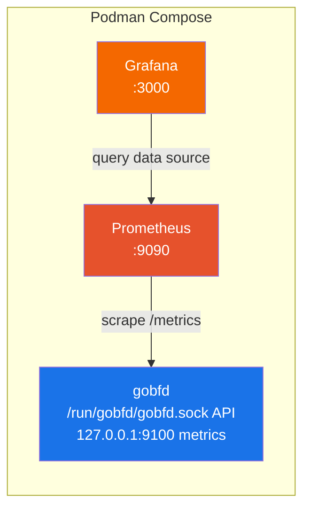

# Deployment


> Production deployment guide: systemd service, Podman Compose stacks, container images, deb/rpm packages, and security hardening.

---

## Table of Contents

- [Requirements](#requirements)
- [Release Artifact Matrix](#release-artifact-matrix)
- [Installation Methods](#installation-methods)
- [systemd Service](#systemd-service)
- [Podman Compose](#podman-compose)
- [Container Image](#container-image)
- [Security Hardening](#security-hardening)
- [Management Certificate Renewal](#management-certificate-renewal)
- [Production Checklist](#production-checklist)

### Requirements

- **Linux** kernel (raw sockets require Linux-specific APIs)
- **CAP_NET_RAW** and **CAP_NET_ADMIN** capabilities in the shipped runtime contract (device binding and configured network operations)
- Repository-pinned Go 1.27.3 inside Podman (source builds only)

Non-Linux targets are compile-only compatibility surfaces. The `internal/netio`
transport constructors return `ErrUnsupportedPlatform`; GoBFD does not publish
or support a non-Linux dataplane runtime.

### Release Artifact Matrix

This is the artifact contract of the current `dev` release configuration
([`.goreleaser.yml`](../../.goreleaser.yml)), not a list of published or
qualified products. `master` contains the accepted stable state;
`release/v0.6` retains its own contracts and GoBGP v3.37.0. Publication of the
next line remains on hold pending final qualification and authorization.

| Artifact | Target systems | Architectures | Base image / package format |
|---|---|---|---|
| Static binaries | Linux distributions with glibc or musl user space | `amd64`, `arm64` | `tar.gz` archive |
| Debian package | Debian 13 `trixie` lifecycle profile | `amd64`, `arm64` | `.deb`, systemd unit |
| RPM package | Generic RPM generation; target-platform qualification separate | `amd64`, `arm64` | `.rpm`, systemd unit |
| Default OCI image | Docker, Podman, Kubernetes CRI runtimes | `linux/amd64`, `linux/arm64` | `docker.io/library/debian:trixie-slim` |

| Image tag | Base |
|---|---|
| `ghcr.io/dantte-lp/gobfd:<version>` | Debian `trixie-slim` |
| `ghcr.io/dantte-lp/gobfd:latest` | Debian `trixie-slim` |
| `ghcr.io/dantte-lp/gobfd:<version>-debian-trixie` | Debian `trixie-slim` |
| `ghcr.io/dantte-lp/gobfd:debian-trixie` | Debian `trixie-slim` |

Oracle Linux 10 is excluded from v1 OCI and lifecycle qualification. Generic
RPM generation remains enabled; an RPM file does not establish platform
qualification. Existing v0.6 images and tags are preserved.

### Installation Methods

Select one package for the intended version and host architecture. Package
format compatibility alone does not establish a qualified operating system.

#### From deb/rpm Packages

```bash
# Install .deb package
sudo apt install ./gobfd_*.deb   # resolves the systemd and procps dependencies

# Install .rpm package
sudo rpm -i gobfd_*.rpm

# Edit configuration
sudo vim /etc/gobfd/gobfd.yml

# Start the daemon
sudo systemctl enable --now gobfd

# Verify
sudo systemctl status gobfd
sudo gobfdctl session list
```

Packages are built by GoReleaser v2 and include:
- `/usr/local/bin/gobfd`, `/usr/local/bin/gobfdctl`, `/usr/local/bin/gobfd-haproxy-agent`, `/usr/local/bin/gobfd-exabgp-bridge` binaries
- `/etc/gobfd/gobfd.yml` example configuration
- `/usr/lib/systemd/system/gobfd.service` systemd unit
- `gobfd` system user and group
- `gobfd-admin` management-socket group; grant membership only to authorized operators

The repository owns package lifecycle behavior in the package-internal
`internal/cmd/gobfd-package-lifecycle` executable. It maps only the supported
Debian and RPM install, upgrade, and final-removal phases to fixed systemd
commands. The declarative inputs are `deployments/systemd/gobfd.sysusers` and
`deployments/systemd/gobfd.tmpfiles`; they create the non-login `gobfd` system
identity and `/etc/gobfd` ownership without changing the four public-binary
contract.

`go run ./test/cmd/cictl package-lifecycle` installs the release DEB
into a Debian systemd container and runs its install and final-removal phases; see
[Package Lifecycle Tests](./09-development.md#package-lifecycle-tests).

#### From Source

```bash
git clone --branch dev https://github.com/dantte-lp/gobfd.git
cd gobfd

# Build all 4 binaries with version info in the pinned container
make up
make build

# Install the binaries written to the repository root
sudo install -m 755 gobfd gobfdctl gobfd-haproxy-agent gobfd-exabgp-bridge /usr/local/bin/
```

Copying binaries does not install the package configuration, systemd unit or
system identities. The example configuration requires an existing `gobfd-admin`
group. Use the package lifecycle for a managed service; a default-config smoke
can run as `sudo ./gobfd` without that example. Query its socket from another
terminal with `sudo ./gobfdctl session list`. Non-root operators require socket
group membership in their current login session.

### systemd Service

The systemd unit file at `deployments/systemd/gobfd.service`:

```ini
[Unit]
Description=GoBFD — BFD Protocol Daemon
Documentation=https://github.com/dantte-lp/gobfd
After=network-online.target
Wants=network-online.target

[Service]
Type=notify
ExecStart=/usr/local/bin/gobfd -config /etc/gobfd/gobfd.yml
ExecReload=/bin/kill -HUP $MAINPID
Restart=on-failure
RestartSec=5s
WatchdogSec=30s

# Security hardening
User=gobfd
Group=gobfd
# The management socket /run/gobfd/gobfd.sock is 0660 with group gobfd-admin;
# operators join gobfd-admin, not gobfd, which can read /etc/gobfd.
SupplementaryGroups=gobfd-admin
RuntimeDirectory=gobfd
RuntimeDirectoryMode=0755
UMask=0077
AmbientCapabilities=CAP_NET_RAW CAP_NET_ADMIN
CapabilityBoundingSet=CAP_NET_RAW CAP_NET_ADMIN
NoNewPrivileges=true
# The only writable state is RuntimeDirectory= and the private /tmp.
ProtectSystem=strict
ProtectHome=true
ReadOnlyPaths=/etc/gobfd
PrivateTmp=true
ProtectProc=invisible
ProcSubset=pid
ProtectKernelModules=true
ProtectKernelTunables=true
ProtectControlGroups=true
RestrictRealtime=true
RestrictSUIDSGID=true
LockPersonality=true
# UDP and TCP (BFD, gRPC, metrics, GoBGP), Unix (management socket, sd_notify,
# NetworkManager D-Bus, OVSDB) and rtnetlink (interface inventory and monitor).
RestrictAddressFamilies=AF_UNIX AF_INET AF_INET6 AF_NETLINK
SystemCallArchitectures=native
SystemCallFilter=@system-service
SystemCallErrorNumber=EPERM
# The v1 bound is 2*sessions+256 descriptors; 16384 covers the 5,000-session
# engineering gate.
LimitNOFILE=16384

[Install]
WantedBy=multi-user.target
```

Key features:

| Feature | Description |
|---|---|
| `Type=notify` | Uses `sd_notify(READY)` for process/listener startup; configuration convergence has separate gRPC health |
| `WatchdogSec=30s` | systemd watchdog -- daemon sends keepalives at 15s intervals |
| `ExecReload` | SIGHUP reloads log level and reconciles sessions plus owned UDP listeners/backends; startup-owned settings require restart |
| `Restart=on-failure` | Auto-restart with 5s delay after a crash or a fail-stop exit on receive-path or dispatch loss |
| Orderly stop | Exits 0 after the AdminDown drain. A drain that cannot finish because a peer is unreachable or never supplied a discriminator is logged as a warning; local drain failures still exit with an error |
| Security directives | Least-privilege with only `CAP_NET_RAW` and `CAP_NET_ADMIN` |

#### Sandbox Contract

The address-family, system-call, `/proc`, umask and file-descriptor directives
come from a measured inventory of the daemon, not from a generic template:

| Directive | Basis |
|---|---|
| `RestrictAddressFamilies=AF_UNIX AF_INET AF_INET6 AF_NETLINK` | `strace` of a daemon running single-hop IPv4/IPv6, multihop, unsolicited, Echo, Micro-BFD with `SO_BINDTODEVICE`, VXLAN, Geneve, GoBGP, metrics, the management socket, reload and shutdown created only these families. `AF_UNIX` also serves `sd_notify` and the NetworkManager D-Bus and OVSDB LAG backends; `AF_NETLINK` serves the interface inventory and monitor. No `AF_PACKET` socket is used. |
| `SystemCallFilter=@system-service`, `SystemCallErrorNumber=EPERM` | All 50 system calls observed in that run belong to `@system-service` as expanded by `systemd-analyze syscall-filter` on Debian 13 and Oracle Linux 10 (systemd 257). `@privileged` is not denied: the management socket group change uses `fchownat`. |
| `LockPersonality=true` | The daemon never calls `personality(2)`. |
| `ProtectProc=invisible`, `ProcSubset=pid` | The daemon reads only `/proc/self/cgroup` and `/proc/self/mountinfo` (Go runtime). The Go listener backlog read of `/proc/sys/net/core/somaxconn` is hidden, so management, gRPC and metrics listeners use the Go fallback backlog of 128. |
| `UMask=0077` | The only file the daemon creates is the management socket, which is then set to the configured mode and group (`0660 gobfd:gobfd-admin`). |
| `LimitNOFILE=16384` | The v1 resource bound is `2*sessions+256` descriptors; 16384 covers the 5,000-session engineering gate (10,256). Go keeps the soft limit equal to this hard limit. |

The only writable state is `RuntimeDirectory=` (`/run/gobfd`) and the private
`/tmp`. `ProtectKernelTunables=true` keeps `/sys` read-only, so the
`kernel-bond` Micro-BFD actuator in `enforce` mode cannot write
`/sys/class/net/<bond>/bonding/slaves` under this unit; `dry-run`, `ovs` and
`networkmanager` are unaffected. The opt-in drop-in
[`deployments/systemd/gobfd-kernel-bond.conf`](../../deployments/systemd/gobfd-kernel-bond.conf)
reopens only `/sys/devices/virtual/net/<bond>/bonding/slaves`, the file the
backend writes, for each actuated bond:

```bash
sudo install -D -m 0644 deployments/systemd/gobfd-kernel-bond.conf /etc/systemd/system/gobfd.service.d/kernel-bond.conf
# Replace bond0 in the installed drop-in with each actuated bond before restart.
sudoedit /etc/systemd/system/gobfd.service.d/kernel-bond.conf
sudo systemctl daemon-reload && sudo systemctl restart gobfd
```

The bond must exist when gobfd starts. Sysfs network attributes are
`0644 root:root`, so the drop-in also grants `CAP_DAC_OVERRIDE`: an
unprivileged UID with only `CAP_NET_ADMIN` got `EACCES` writing a sysfs
network attribute and succeeded with `CAP_NET_ADMIN` plus `CAP_DAC_OVERRIDE`.
That capability bypasses file permission checks on every path the service can
see, including reads of root-only files such as `/etc/shadow`; writes stay
limited by the read-only mount namespace. Enable the drop-in only where that
trade-off is accepted. `systemd-analyze verify` accepts it on Debian 13 and
Oracle Linux 10; write qualification on a host with the bonding module is
pending (`gobfd-qj0.8.2.3.3.1`).

Larger deployments raise the descriptor limit with a drop-in instead of editing
the packaged unit:

```bash
sudo systemctl edit gobfd   # [Service] LimitNOFILE=<2*sessions+256 or more>
```

The [package lifecycle test](./09-development.md#package-lifecycle-tests)
covers the release DEB on Debian 13. Historical systemd 257 qualification
also covered RPM on Oracle Linux 10 before that platform was retired from v1.
The daemon starts with `Seccomp: 2`, `NoNewPrivs: 1`, `Umask: 0077`,
`hidepid=invisible,subset=pid` and a 16384 descriptor limit, holds its sessions
Up for longer than `WatchdogSec=` without a restart, reloads without a PID
change, restarts after `SIGKILL` and stops with `Result=success` after its peer
was killed. The journal holds no sandbox denial. `systemd-analyze security`
reports exposure 5.2 for the previous unit and 3.3 for this one.

#### Managing the Service

```bash
# Start/stop
sudo systemctl start gobfd
sudo systemctl stop gobfd

# Reload configuration (hot reload via SIGHUP)
sudo systemctl reload gobfd

# View logs
sudo journalctl -u gobfd -f

# Check status
sudo systemctl status gobfd
```

### Podman Compose

GoBFD uses Podman's external Compose-provider wrapper with the official Docker
Compose v5.6.0 Go binary. Install the checksum-pinned provider and select it
explicitly; Python `podman-compose` is unsupported:

The bootstrap command below currently runs on the host and requires the
repository-pinned Go toolchain. It does not use the development container.

```bash
go run ./test/cmd/toolbootstrap compose --install-dir "$HOME/.local/bin"
export PODMAN_COMPOSE_PROVIDER="$HOME/.local/bin/docker-compose"
export PODMAN_COMPOSE_WARNING_LOGS=false
export DOCKER_BUILDKIT=0
podman compose version
```

The bootstrap command lexically canonicalizes an absolute install path before
using it and accepts only a path made entirely of real directories. The final
directory must be owned by the current user and must not be group- or
world-writable. Ancestors must be owned by root or the current user; writable
ancestors are accepted only when protected by the sticky bit. The
downloaded provider stays bound to its original file identity through checksum
verification, execution, and atomic publication, and cleanup refuses to remove
a replacement inode.

`DOCKER_BUILDKIT=0` keeps builds on the Podman-compatible classic Docker API;
Docker Buildx/Bake is not part of the repository's Podman runtime.

#### Development Stack

`deployments/compose/compose.dev.yml` -- development environment with hot reload:

```bash
# Start development environment
make up

# Run a targeted test through the Make-owned Compose project
make test-run RUN=TestFSMTransition PKG=./internal/bfd

# Build and test through the repository targets
make build && make test
```

Four report-producing testcontainers gates use the Go-owned `e2ectl` binary,
which Make builds inside the development container before execution:

| Target | Report directory |
|---|---|
| `make e2e-core-testcontainers` | `reports/e2e/core/run.*` |
| `make int-bgp-failover-testcontainers` | `reports/e2e/bgp-fast-failover/run.*` |
| `make int-haproxy-testcontainers` | `reports/e2e/haproxy-health/run.*` |
| `make int-observability-testcontainers` | `reports/e2e/observability/run.*` |

#### Production Stack

`deployments/compose/compose.yml` -- production stack with Prometheus and Grafana:

```bash
# Start production stack
podman compose -f deployments/compose/compose.yml up -d

# Services:
#   gobfd API:        unix:///run/gobfd/gobfd.sock (inside gobfd container)
#   Prometheus:       http://localhost:9090
#   Grafana:          http://localhost:3000 (admin/admin)
```

This source-built example is not a published release product or a new
production acceptance result. Render it with the selected provider first;
its three builds do not use the capped interop controller. Admit build and
runtime resources separately on a shared host.

The Unix socket stays inside the GoBFD container because this Compose file
does not bind-mount `/run/gobfd`. Use `podman exec gobfd gobfdctl session list`
for management, or separately configure an owned socket mount. Host networking
does not share filesystem paths.

All three services share the Linux host network. Prometheus scrapes
`127.0.0.1:9100`, and Grafana uses `http://127.0.0.1:9090` as its data source.
Prometheus and Grafana listen only on host loopback; use an SSH tunnel or an
authenticated reverse proxy for remote access. Host ports 9100, 9090 and 3000
must be available. After the first scrape (up to 15 seconds), verify the target:

```bash
curl --fail --silent --show-error http://127.0.0.1:9090/api/v1/targets |
  jq -e '.status == "success" and
    ([.data.activeTargets[] | select(.labels.job == "gobfd")] |
      length == 1 and all(.[]; .health == "up" and .lastError == ""))'
```



### Container Image

Build the container image:

```bash
# Standard build
podman build -f deployments/docker/Containerfile -t gobfd .

# Multi-arch build (via GoReleaser)
goreleaser release --snapshot --clean
```

Release images contain the four GoBFD binaries and no development toolchain:
`gobfd`, `gobfdctl`, `gobfd-haproxy-agent`, and
`gobfd-exabgp-bridge`.

The source-build `deployments/docker/Containerfile` above contains only
`gobfd` and `gobfdctl`; the separate release recipe is
`deployments/docker/Containerfile.release`.

Running the container requires:
- `CAP_NET_RAW` and `CAP_NET_ADMIN` capabilities
- `network_mode: host` (recommended) or proper port mapping for UDP 3784/4784

### Security Hardening

GoBFD follows the principle of least privilege:

| Layer | Mechanism |
|---|---|
| **Capabilities** | Only `CAP_NET_RAW` + `CAP_NET_ADMIN` (no root) |
| **systemd** | `ProtectSystem=strict`, `NoNewPrivileges`, `PrivateTmp`, address-family and system-call filters, `ProcSubset=pid`; see [Sandbox Contract](#sandbox-contract) |
| **Code** | No `unsafe` in handwritten first-party code; generated protobuf runtime code is excluded; all socket errors handled |
| **TTL** | Control TX TTL=255; single-hop RX requires 255, multihop RX uses the configured `255 - multihop_max_hops` floor |
| **Auth** | Optional BFD authentication (5 types per RFC 5880 Section 6.7) |

The default management endpoint is `unix:///run/gobfd/gobfd.sock`, mode
`0660`; the example and packages select group `gobfd-admin`. Metrics default
to unauthenticated `127.0.0.1:9100`. A configured non-loopback management TCP
listener requires `grpc.tls.cert_file`, `key_file` and `client_ca_file`;
anonymous loopback TCP access is read-only by default. Keep the Unix socket
unless remote management is required. For a separately configured mTLS server:

```bash
gobfdctl --addr https://bfd.example:50052 \
  --tls-ca /etc/gobfd/tls/server-ca.pem \
  --tls-cert /etc/gobfd/tls/operator.pem \
  --tls-key /etc/gobfd/tls/operator.key session list
```

The server certificate must cover the selected hostname. Role rules such as
`grpc.mutating_identities` control mutations separately from certificate trust.
The exact defaults and checks are in
[`internal/config/config.go`](../../internal/config/config.go); client flags
are in [`cmd/gobfdctl/commands/root.go`](../../cmd/gobfdctl/commands/root.go).

### Management Certificate Renewal

With an existing certificate valid for TLS client authentication, its matching
private key and explicit trusted CA roots, run renewal outside the daemon:

```bash
gobfdctl certificate renew \
  --ca-url https://ca.example \
  --ca-root /etc/gobfd/root.pem \
  --cert /etc/gobfd/management.pem \
  --key /etc/gobfd/management-key.pem
```

The native mTLS `POST /renew` retains the key and exact SAN, replacing only the
public certificate atomically. Use a caller-owned key with mode `0400` or
`0600`; input files must be regular, single-link and free of symlinks, with
trusted parent directories that are not group- or world-writable. An
`ErrCommitted` error reports an already replaced certificate with potentially
uncertain durability; do not assume rollback.

A management server certificate restricted to `serverAuth` cannot authenticate
the renewal request. See the [CLI prerequisites](04-cli.md#certificate-renewal)
before selecting the certificate profile at initial enrollment.

The server reads PEM files on each new TLS handshake. Existing TLS connections
retain their negotiated identity. `gobfdctl` and persistent bridge clients load
client credentials when their transport is created; restart or recreate the
client transport after renewal. A trusted CA can issue identities selected by
API role rules; issuance alone does not authorize API access.

Enrollment and scheduling are separate lifecycle work. Actual step-ca
qualification remains pending in `gobfd-qj0.8.2.3.7.4`; local TLS fixtures do not
establish it. See the [CLI reference](04-cli.md#certificate-renewal) for flags
and unchanged-chain behavior.

### Memory Tuning (`GOMEMLIMIT` and `GOGC`)

Go 1.27 treats `GOMEMLIMIT` as a soft limit for memory managed by the Go
runtime. It excludes the binary mapping, kernel memory, and memory managed
outside Go. The runtime may increase garbage-collection frequency to respect
the limit even when `GOGC=off`; this setting does not eliminate GC pauses. A
limit below the working set can make GC run nearly continuously.

GoBFD does not publish session-count-to-memory sizing tiers. Select a limit
below the service or container memory limit with headroom for the binary,
kernel socket buffers, and other non-Go memory, then qualify it with the target
session count, authentication mode, telemetry, and failure workload. Keep the
default `GOGC` unless deployment measurements justify an override.

#### systemd Configuration

Add a deployment-qualified byte value to the `[Service]` section of
`gobfd.service`:

```ini
# Example only; replace with a deployment-qualified value.
Environment=GOMEMLIMIT=512MiB
```

#### Container Configuration

```dockerfile
# Example only; replace with a deployment-qualified value.
ENV GOMEMLIMIT=512MiB
```

#### Monitoring

Monitor process RSS, the container or service memory limit, GC frequency, and
GC pause time together. RSS is not the same quantity as `GOMEMLIMIT`. Sustained
GC growth or memory-limit thrashing requires a larger qualified limit or a
smaller workload; the soft limit is not an OOM guarantee.

### Production Checklist

- [ ] Qualify `GOMEMLIMIT` with deployment headroom and representative load
- [ ] Keep the default `GOGC` unless measurements justify an override
- [ ] Monitor RSS, the service memory limit, GC frequency, and GC pauses
- [ ] Configure `gobfd.yml` with appropriate session parameters
- [ ] Set `log.format: json` for structured logging
- [ ] Enable GoBGP integration if using BFD for BGP failover
- [ ] Enable flap dampening to prevent route churn
- [ ] Set up Prometheus scraping of `:9100/metrics`
- [ ] Import Grafana dashboard from `deployments/compose/configs/grafana/dashboards/bfd.json`
- [ ] Configure alerting on `gobfd_bfd_state_transitions_total{from_state="Up",to_state="Down"}`
- Verify successful socket startup and the selected dataplane profile; `session list` only tests management access.
- [ ] Test SIGHUP reload: `systemctl reload gobfd`
- [ ] Verify graceful shutdown sends AdminDown (check peer logs)

### Related Documents

- [03-configuration.md](./03-configuration.md) -- Configuration reference
- [07-monitoring.md](./07-monitoring.md) -- Prometheus metrics and Grafana
- [09-development.md](./09-development.md) -- Development environment setup

---

*Reviewed against `dev` source: 2026-10-25; commands were inspected, not executed.*
