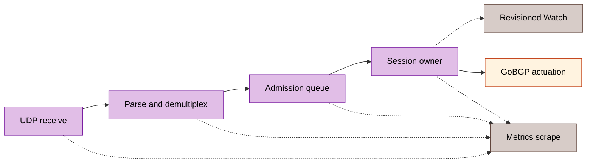

# Monitoring

[Russian translation](../ru/07-monitoring.md).

The default endpoint is `http://127.0.0.1:9100/metrics`, without authentication. Bind beyond loopback only with an explicit network access policy. The metrics listener exposes no debug handlers. Sources: [configuration](../../internal/config/config.go), [collector](../../internal/metrics/collector.go).

BFD means Bidirectional Forwarding Detection. RX and TX denote reception and transmission; a finite state machine (FSM) governs state transitions. A remote procedure call (RPC) performs an external API operation. Mutual TLS (mTLS) authenticates both management endpoints.

## Signal boundaries

`gobfd_bfd_sessions` counts registered Control and Echo sessions, including Micro-BFD, VXLAN and Geneve Control types. A registered session need not be Up. Echo registers its own `session_type` series and contributes packet/transition increments to shared families. Peer/local packet counters have no discriminator, interface or type dimension: identical address pairs aggregate across wires. Use API snapshots to identify individual sessions. Sources: [Echo registration](../../internal/bfd/manager_echo.go), [direct collector wiring](../../cmd/gobfd/factory.go).



## Metric reference

| Metric | Type | Labels | Meaning |
|:---|:---|:---|:---|
| `gobfd_bfd_sessions` | gauge | `peer_addr,local_addr,session_type` | Registered Control and Echo sessions |
| `gobfd_bfd_packets_sent_total` | counter | `peer_addr,local_addr` | Successful Control/Echo sends |
| `gobfd_bfd_packets_received_total` | counter | `peer_addr,local_addr` | Owner-validated Control/Echo receives |
| `gobfd_bfd_packets_dropped_total` | counter | `peer_addr,local_addr` | Admitted-identity refusals/abandonment |
| `gobfd_bfd_state_transitions_total` | counter | `peer_addr,local_addr,from_state,to_state` | FSM changes |
| `gobfd_bfd_auth_failures_total` | counter | `peer_addr,local_addr` | Authentication refusal subset |
| `gobfd_bfd_delivery_outcomes_total` | counter | `source,outcome` | Fixed pipeline/notification decisions |
| `gobfd_bfd_control_rx_timing_total` | counter | `outcome` | Owner commits by clock validity |
| `gobfd_bfd_control_rx_commit_seconds` | histogram | none | Kernel software RX to completed owner processing |
| `gobfd_bfd_timer_events_total` | counter | `timer,event` | Dispatch and terminal timer observations |
| `gobfd_bfd_timer_delay_seconds` | histogram | `timer,stage` | Valid dispatch/effect delay |
| `gobfd_bfd_socket_drop_samples_total` | counter | `kind,outcome` | Socket-drop sample validity |
| `gobfd_bfd_socket_drops_total` | counter | `kind` | Ordered observed drop increments |
| `gobfd_gobgp_rpc_errors_total` | counter | `rpc` | Failed GoBGP API/preflight calls |
| `gobfd_gobgp_endpoint_compatible` | gauge | none | 1 after compatibility preflight |
| `gobfd_gobgp_dampening_penalty` | gauge | `peer_addr` | Decayed penalty at scrape |
| `gobfd_gobgp_dampening_suppressed` | gauge | `peer_addr` | Recovery currently held |
| `gobfd_gobgp_dampening_suppression_deadline_seconds` | gauge | `peer_addr` | Maximum suppression deadline, Unix seconds; otherwise 0 |
| `gobfd_gobgp_pending_action` | gauge | `peer_addr,action` | Unapplied `up`/`down` intent |
| `gobfd_gobgp_pending_action_deadline_seconds` | gauge | `peer_addr,action` | Next retry/recheck deadline, Unix seconds; otherwise 0 |

Sources: [base metrics](../../internal/metrics/collector.go), [Control validation/counting](../../internal/bfd/session_packet.go), [accepted Echo returns](../../internal/bfd/echo.go), [timing](../../internal/metrics/receive_timing.go), [timers](../../internal/metrics/timer.go), [socket drops](../../internal/metrics/socket_drops.go), [GoBGP](../../internal/metrics/gobgp.go).

### Delivery ledger

Parser, TTL and unknown-peer refusals create no peer labels. The process-lifetime ledger preinitializes supported source/outcome pairs and survives last-session removal. Each stage has its own denominator: `queued` is not `committed`; summing stages does not produce packet loss.

Control demux reports `scope_mismatch` for wrong transport/interface and `ttl_rejected` for failed hop policy. Echo uses separate `echo_read`, `echo_parse`, `echo_ttl`, `echo_demux`, `echo_admission` and `echo_owner` sources. Zero Echo discriminators fail parsing. Ordinary canceled/closed reads are not read errors.

Notification attempts use `control_notification`, `unsolicited_notification` and `echo_notification`. Dispatch distinguishes accepted, stale and shutdown-abandoned raw events. `watch_recipient` records each original event as queued/gapped; a coalesced GAP marker is not another original event. Public Control/Echo raw queue overflow invalidates revisioned subscribers, which must resnapshot. Legacy delivery remains best effort. Notification loss never increments packet-drop counters. ListSessions exposes sampled `delivery_counters`; snapshot revision does not atomically version those counters. Source: [delivery model](../../internal/bfd/delivery.go).

### Timing and socket loss

| Observation | Fixed values | Interpretation |
|:---|:---|:---|
| Receive timing outcome | `valid`, `unavailable`, `invalid`, `before_calibration`, `future`, `clock_step` | Histograms accept valid commits only |
| Timer | `control_tx`, `control_detection`, `echo_tx`, `echo_detection` | Owner-specific observations |
| Timer event | `dispatch`, `effect`, `no_effect`, `invalid_dispatch`, `invalid_effect` | Histograms include valid dispatch/effect |
| Socket kind | `control`, `echo` | Separate consumed-datagram streams |
| Socket outcome | `initial`, `sample`, `unavailable`, `invalid`, `ambiguous` | Only ordered samples contribute drop deltas |

Missing samples do not mean zero latency/loss. Overlay/legacy transports without kernel timestamps report unavailable. Clock revocation persists until listener recreation. TX effect means successful transport return, not peer delivery. Detection effect means timeout-caused Down publication before logging/notifications. A panic/in-flight handler can leave dispatch without terminal observation. Fresh owned sockets start at known zero; existing/custom sockets establish a first-sample baseline without inferred historical loss. See [performance measurement boundaries](14-performance-analysis.md).

### GoBGP status

Per-peer gauges exist only for integration-enabled peers in the accepted declarative `sessions` set. API/unsolicited input cannot create labels. Reload updates the allowlist; removed peers disappear on next scrape. IPv4-mapped peers normalize and deduplicate. Each peer produces seven samples across five gauges, including both idle action values.

Penalty/suppression are evaluated at scrape time without changing routes. Maximum suppression bounds eligibility, not RPC completion. Pending intent reflects the last completed handler step; its deadline may be past while an RPC runs. Success, cancellation, deletion or shutdown clears intent. Source: [GoBGP status metrics](../../internal/metrics/gobgp.go).

## Queries and alerts

These are illustrative PromQL expressions, not measured results:

```promql
sum(gobfd_bfd_sessions)
increase(gobfd_bfd_state_transitions_total{from_state="Up",to_state="Down"}[1m])
rate(gobfd_bfd_auth_failures_total[5m])
rate(gobfd_bfd_delivery_outcomes_total[5m])
```

The first query measures registrations, not Up sessions. Shipped [alert rules](../../deployments/integrations/observability/configs/prometheus/alert-rules.yml) define:

| Alert | Condition | Hold |
|:---|:---|---:|
| `BFDNoActiveSessions` | Healthy exporter without positive registration series | `10s` |
| `BFDExporterUnavailable` | Failed or absent `gobfd` scrape target | `10s` |
| `BFDSessionDownTransition` | Up→Down increase over 1 minute | `0s` |
| `BFDSessionFlapping` | More than 3 transitions over 5 minutes | `1m` |
| `BFDAuthFailures` | Positive failure rate over 5 minutes | `30s` |
| `BFDPacketDrops` | Positive admitted-peer drop rate over 5 minutes | `1m` |

An exporter with no sessions differs from an unreachable exporter. `BFDNoActiveSessions` evaluates all positive registration series, including Echo, although its shipped annotation says “Control sessions”; it is not a Control-only or Up-state test. A transition alert does not prove current Down state. Dashboard source: [Grafana JSON](../../deployments/integrations/observability/configs/grafana/dashboards/bfd.json).

### Prometheus readback

Use read access to the published API of one admitted observability lab and record its intended GoBFD target, rules and accepted peer/forwarding state. The following unexecuted commands only read API state and may be repeated; they create no resources and need no rollback. Inspect the API before fault injection:

```sh
curl -fsS http://localhost:9090/api/v1/targets
curl -fsS http://localhost:9090/api/v1/rules
curl -fsS http://localhost:9090/api/v1/alerts
```

Require the intended GoBFD target with health `up` and no scrape error, all expected alert rules loaded, a firing transition alert during the admitted fault and an inactive rule after recovery. An empty target/rule response or HTTP 200 alone is insufficient. The [Prometheus HTTP API](https://prometheus.io/docs/prometheus/latest/querying/api/) defines these responses; the [Go-owned observability gate](11-integrations.md#observability) supplies assertions and exact-owned lifecycle.

Stop before fault injection on a failed request, missing target/rule or unhealthy baseline. Perform mutations only through that gate or the [operational drill](16-production-runbooks.md) with its target, privileges and recovery path. If recovery fails, stop the drill, restore its recorded accepted configuration and peer/forwarding state, then repeat the target, rule and alert readbacks before acceptance. A successful readback does not authorize cleanup of unrelated resources.

## Logging, health and traces

`log/slog` emits configured JSON/text at debug/info/warn/error levels. Record local/remote state, diagnostic, principal, reconciliation generation and pending resource errors as applicable. Keep peer addresses and traces within the operational evidence boundary.

Management health distinguishes service readiness from BFD Up. Unsafe anonymous loopback mutation mode forces `gobfd.management` to `NOT_SERVING`. GoBGP ambiguity/incompatibility and reconciliation failures require their own health checks; a successful metrics scrape cannot substitute.

`grpc.flight_recorder` enables `/debug/flightrecorder` only on management listeners. Unix principals and authorized mTLS identities may obtain traces; anonymous callers remain denied even in unsafe mode. Store traces as sensitive artifacts and run analysis UIs on loopback. Sources: [management debug](../../cmd/gobfd/shutdown.go), [security](15-security.md), [observability drill](16-production-runbooks.md).

No monitoring or production drill is executed by this reference page.
