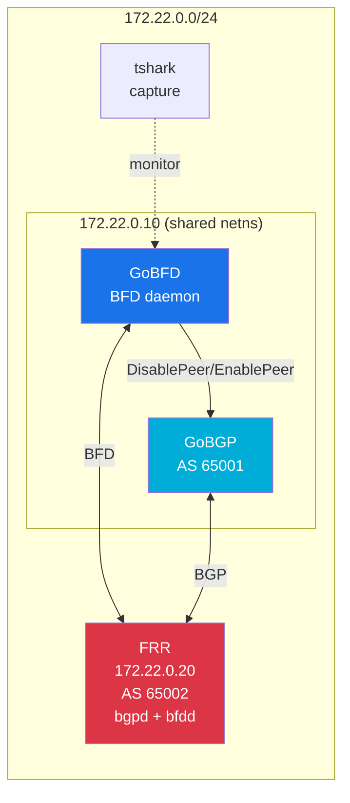
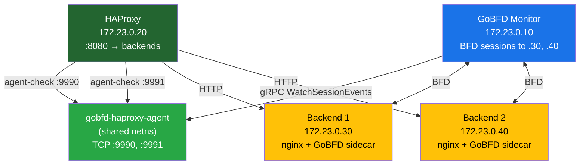
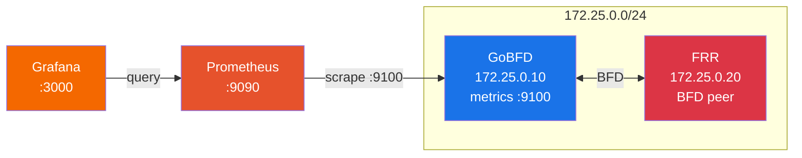
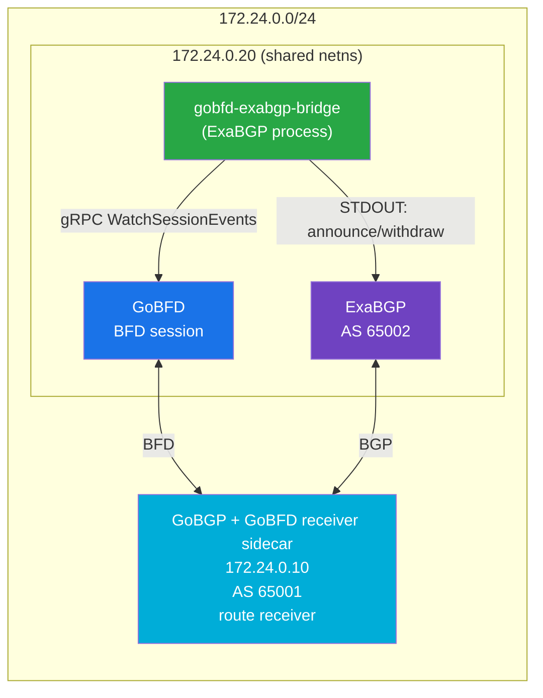
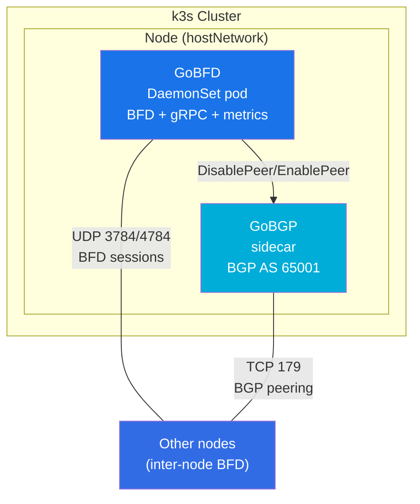

# Integration Examples


> Integration examples for routing, load balancing, monitoring and Kubernetes. Compose examples include packet-capture containers; target-environment qualification remains separate.

---

## Table of Contents

- [Overview](#overview)
- [BGP Fast Failover](#bgp-fast-failover)
- [HAProxy Backend Health](#haproxy-backend-health)
- [Observability](#observability)
- [ExaBGP Anycast](#exabgp-anycast)
- [Kubernetes DaemonSet](#kubernetes-daemonset)
- [Packet Verification with tshark](#packet-verification-with-tshark)
- [Integration Architecture](#integration-architecture)
- [Related Documents](#related-documents)

---

## Overview

GoBFD integrates with routing, load balancing, monitoring and orchestration
systems. Example topologies live under `deployments/integrations/`; their
timers and workload determine detection time. Historical runs below establish
only their recorded source and scenario, not a new run or current release
acceptance. Publication remains on hold pending the final candidate gates.

The four Compose examples use **podman compose** and include **tshark** capture
containers. Kubernetes uses manifests and an existing k3s cluster; it has no
tshark sidecar. Examples require separate qualification on the target environment.

| # | Integration | Components | Subnet | New Code |
|---|------------|-----------|--------|----------|
| 1 | BGP Fast Failover | GoBFD + GoBGP + FRR | 172.22.0.0/24 | Configs only |
| 2 | HAProxy Backend Health | GoBFD + HAProxy + nginx | 172.23.0.0/24 | `gobfd-haproxy-agent` |
| 3 | Observability | GoBFD + Prometheus + Grafana | 172.25.0.0/24 | Alert rules |
| 4 | ExaBGP Anycast | GoBFD + ExaBGP + GoBGP | 172.24.0.0/24 | `gobfd-exabgp-bridge` |
| 5 | Kubernetes DaemonSet | GoBFD + GoBGP + k3s | Host network | K8s manifests |

GoBFD on `dev` uses the GoBGP v4 API and requires a GoBGP v4 daemon: GoBGP v3
`/apipb.GobgpApi` and v4 `/api.GoBgpService` are wire-incompatible. Examples
that use GoBGP build v4.10.0 from `test/interop/gobgp`; HAProxy and observability
do not run GoBGP.
The Kubernetes example builds `gobgp:local` from that recipe and imports it
into k3s next to `gobfd:local`; it has not been run on a live k3s cluster.

Bootstrap the pinned [Compose provider](06-deployment.md#podman-compose) and
render selected Compose files before use. Manual examples use fixed container
names; check that the names, subnets and published ports belong to this lab.
Observability `-up` uses direct Compose builds without the
capped interop controller. Its `-down` target removes volumes and orphans;
cleanup requires ownership inspection and the required deletion approval.

At startup GoBFD probes the endpoint with the side-effect-free `GetBgp` RPC.
An endpoint without the v4 API, such as a GoBGP v3 daemon, stops startup
with "requires GoBGP v4". An unreachable endpoint logs a warning and is
re-checked in the background with backoff from 1 s to 30 s until the result
is conclusive; a late incompatible daemon is then logged at error level.
The same preflight lists GoBGP neighbors through `ListPeer` and rejects GoBGP
v4 native BFD (`[neighbors.bfd.config] enabled = true`) for any peer of a
configured GoBFD session: one peer must have one BFD owner. Native BFD for
other neighbors is allowed. Sessions added later through the API are not
checked.

---

## BGP Fast Failover

**Directory:** `deployments/integrations/bgp-fast-failover/`

BFD Down triggers BGP peer disable and route withdrawal before the normal BGP hold timer expires.

Detailed runbook: [`deployments/integrations/bgp-fast-failover/README.md`](../../deployments/integrations/bgp-fast-failover/README.md)

Compose and the Go testcontainers gate reuse the shared Debian trixie FRR
10.7.1 and GoBGP v4.10.0 recipes. Builds use at most 2 CPUs / 2 GiB; runtime
containers use 1 CPU / 256 MiB / 128 PIDs. The automated gate retains exact
route withdrawal/restoration, packet evidence and owned-resource cleanup.
On 2026-10-13, at commit `f85ca09` on linux/amd64, the gate
(`e2ectl bgp-fast-failover`,
`TestBGPFastFailoverTestcontainers/BFD-driven_route_withdrawal_and_restoration`)
passed with GoBGP v4.10.0 in 105.39 seconds. The manual Compose path was not
rerun on GoBGP v4.

The lab uses RFC 5881 single-hop BFD packets on UDP destination port 3784 with
TTL 255. The example timers are 300 ms transmit, 300 ms receive, and detect
multiplier 3, giving an expected detection target of about 900 ms before local
scheduling and BGP control-plane latency.

### Topology



### Quick Start

```bash
# Automated Go testcontainers gate with evidence and exact cleanup
make int-bgp-failover

# Operational Compose example, step by step
make int-bgp-failover-up     # Start topology
make int-bgp-failover-logs   # View logs
make int-bgp-failover-down   # Cleanup
```

### Demo Flow

1. GoBFD establishes BFD session with FRR at 172.22.0.20
2. GoBGP establishes BGP session, receives route 10.20.0.0/24
3. **Failure:** FRR is paused → BFD detects failure (~900ms) → GoBGP disables peer → route withdrawn
4. **Recovery:** FRR is unpaused → BFD Up → GoBGP re-enables peer → route restored

---

## HAProxy Backend Health

**Directory:** `deployments/integrations/haproxy-health/`

BFD state drives HAProxy's agent-check protocol. The example uses nominal
300 ms BFD intervals, Detect Mult 3 and a 1 s agent polling interval. Measure
backend removal latency separately; these settings do not guarantee removal
in less than one second.

### Architecture



### Agent-Check Protocol

The `gobfd-haproxy-agent` binary bridges BFD state to HAProxy's agent-check protocol:

- HAProxy connects TCP to agent port, reads ASCII response until newline
- BFD Up → responds `"up ready\n"` → HAProxy marks server operational
- BFD Down → responds `"down\n"` → HAProxy removes server from rotation

Agent-check listeners have no authentication. They bind to `127.0.0.1` unless
`listen_addr` in the agent configuration names another address. A HAProxy
`agent-addr` on another host needs an explicit reachable address; the lab
configuration sets `listen_addr: "0.0.0.0"`.

Management defaults to `unix:///run/gobfd/gobfd.sock`. Sharing a network
namespace does not share that socket path: the HAProxy lab explicitly uses
read-only loopback TCP at `http://127.0.0.1:50052` in `haproxy-agent.yml`.
For remote management, select `https://host:port` with `GOBFD_ADDR` (or the
agent's `gobfd_addr`) and set all of `GOBFD_TLS_CA_FILE`,
`GOBFD_TLS_CERT_FILE` and `GOBFD_TLS_KEY_FILE`. The ExaBGP bridge uses the
same endpoint and TLS environment variables. These client settings do not
configure the daemon's mTLS listener or role rules; see
[Deployment](06-deployment.md#security-hardening) and
[`internal/apiclient/endpoint.go`](../../internal/apiclient/endpoint.go).

In the HAProxy agent, a nonempty configuration `gobfd_addr` overrides both
`--gobfd-addr` and `GOBFD_ADDR`; update that field when adapting the lab.

The agent reconnects Watch after errors and EOF with a cancellable 1–30 second
backoff. Disconnects and `GAP` invalidate health immediately; a new snapshot
becomes usable only after `SYNC_COMPLETE`. Unknown, deleted and ambiguous
sessions return `down`. Public Control/Echo raw notification loss also forces
GAP/resnapshot without reconnect. The shared Watch client rejects an older
queued observation after the authoritative snapshot. Each backend can add `local`, `interface` and `type`
(`single_hop`, `multi_hop`, `micro_bfd`, `vxlan`, `geneve`) to its required
`peer`. Peer-only configurations continue to work when exactly one session
matches; add these selectors when multiple sessions share a peer. Even an
explicit tuple fails closed if the public API cannot distinguish its transport
scope. Agent ports must be distinct and within 1–65535.

Watch includes Echo sessions. A Control and Echo session to the same peer make
a peer-only selector ambiguous, even when local address and interface match.
Use an explicit Control `type: single_hop` or `type: multi_hop` for that backend.

### Quick Start

```bash
make int-haproxy              # Full demo
make int-haproxy-up           # Start topology
curl http://localhost:8080    # Verify load balancing
make int-haproxy-down         # Cleanup
```

`make int-haproxy` requires successful nginx traffic and the current
`session list` command against the monitor's explicit loopback TCP endpoint.
It pauses `backend1-bfd`, keeps the HTTP backend running, and attempts to
restore the sidecar after an error or cancellation. Packet diagnostics remain
optional. Use `make int-haproxy-testcontainers` for the separate assertion-based
gate; a completed demo does not establish failover acceptance. Bounded native
qualification is tracked in `gobfd-qj0.8.2.8.7.1.4.1.2`.

The full demo and manual `int-haproxy-up/down/logs` targets use the existing
guarded controller with the `gobfd-haproxy-health` project. It refuses an
existing project or colliding fixed container names, builds sequentially under
2 CPU/2 GiB limits, and cleans its exact owned IDs after partial startup.
Each of the eight runtime containers receives 1 CPU, 256 MiB, no additional
swap, and a 128-PID limit. Nginx enables its official quota-aware worker tuning;
HAProxy uses one thread. Captures stay in the owned tshark container, with no
named capture volume. Existing volumes are neither adopted nor deleted.

The testcontainers gate bounds both image builds to 2 CPUs/2 GiB and all nine
runtime roles to 1 CPU/256 MiB/no additional swap/128 PIDs. It verifies runtime
limits through inspection and records nine public OCI annotations against the
candidate revision and build date. Image cleanup uses captured immutable IDs
and the shared ownership checks; a foreign replacement tag is preserved.
On 2026-10-28, the local linux/amd64 guarded demo and assertion-based
testcontainers lifecycle passed at
`15a4af8c5f017134b08719f79ae8a7cbc52037c9`; the latter completed in 156.54 s.
Runtime limits, image provenance, packet evidence, and cleanup were checked.
Reference workload and final release wire qualification remain separate.

---

## Observability

**Directory:** `deployments/integrations/observability/`

Isolated lab example with Prometheus rules and a pre-provisioned Grafana dashboard.
The Compose file publishes ports 9090 and 3000 on host interfaces and uses
Grafana credentials `admin/admin`. The localhost URLs below do not restrict
that publication. Isolate the host or override bindings and credentials before
starting it. The separate [deployment stack](06-deployment.md#podman-compose)
binds its published monitoring ports to loopback.

### Topology



### Metrics

Packet-drop and authentication-failure accounting is wired. The per-peer
counters and fixed delivery outcomes have different stage denominators;
pre-session parser/demux refusals are not all peer packet drops. See
[Monitoring](07-monitoring.md) before interpreting zero counters or alerts.

| Metric | Type | Description |
|--------|------|-------------|
| `gobfd_bfd_sessions` | Gauge | Active BFD sessions per peer |
| `gobfd_bfd_packets_sent_total` | Counter | TX packets per peer |
| `gobfd_bfd_packets_received_total` | Counter | RX packets per peer |
| `gobfd_bfd_packets_dropped_total` | Counter | Dropped packets per peer |
| `gobfd_bfd_state_transitions_total` | Counter | FSM transitions (from/to labels) |
| `gobfd_bfd_auth_failures_total` | Counter | Authentication failures per peer |

### Alert Rules

| Alert | Expression | Severity |
|-------|-----------|----------|
| BFDNoActiveSessions | `(up{job="gobfd"} == 1) unless on(job, instance) (gobfd_bfd_sessions{job="gobfd"} > 0)` for 10s | Warning |
| BFDExporterUnavailable | `(up{job="gobfd"} == 0) or absent(up{job="gobfd"})` for 10s | Critical |
| BFDSessionDownTransition | `increase(gobfd_bfd_state_transitions_total{from_state="Up",to_state="Down"}[1m]) > 0` | Critical |
| BFDSessionFlapping | `sum by (peer_addr, local_addr) (increase(gobfd_bfd_state_transitions_total[5m])) > 3` for 1m | Warning |
| BFDAuthFailures | `rate(gobfd_bfd_auth_failures_total[5m]) > 0` for 30s | Warning |
| BFDPacketDrops | `rate(gobfd_bfd_packets_dropped_total[5m]) > 0` for 1m | Warning |

The shipped `BFDNoActiveSessions` rule checks each healthy GoBFD exporter for
the absence of a positive Control-session series, including a fresh empty
exporter. `BFDExporterUnavailable` separately covers a failed scrape or an
absent GoBFD scrape job. See [Monitoring](07-monitoring.md#alerting-rules).

Prometheus v3.15.0, Grafana 13.2.4 and FRR 10.7.1 are built from
checksum-pinned upstream artifacts on Debian trixie
(`test/interop/prometheus`, `test/interop/grafana`, `test/interop/frr`). On
2026-10-13 the testcontainers gate passed in 172.77 seconds: BFD metrics,
alert, Grafana provisioning and FRR failure/recovery, with no remaining
test-owned containers or images.

### Quick Start

```bash
make int-observability        # Full demo
make int-observability-up     # Start topology

# Open in browser:
# Grafana:    http://localhost:3000 (admin/admin)
# Prometheus: http://localhost:9090

make int-observability-down   # Cleanup
```

The full-demo runner displays metrics and alerts and treats several failures
as warnings; it is not an assertion-based alert gate. Use
`make int-observability-testcontainers` for that gate, or follow the bounded
[alert drill](16-production-runbooks.md#prometheus-alert-validation).

The testcontainers builder limits each of the five image builds to 2 CPUs,
2 GiB RAM and no additional swap. Its GoBFD compiler uses `GOMAXPROCS=2`,
`GOMEMLIMIT=1500MiB` and `GOFLAGS=-p=1`. These build limits are separate from
the runtime container limits and do not qualify production capacity.

Each of the six runtime containers requests 1 CPU, 128 PIDs and no additional
swap. Grafana receives 512 MiB RAM; GoBFD, FRR, Prometheus and both tshark
containers receive 256 MiB each. The gate inspects these limits and rejects
missing or different values while preserving each role's network and
capability settings.

All five images receive one run's revision and build date through the shared
metadata resolver. For an archived checkout without Git, pass its verified
`GOBFD_BUILD_REVISION`. The gate verifies the nine public OCI annotations,
records their allowlisted values with immutable image IDs, and rejects another
run's images. Cleanup uses the captured ID; recovery of a failed build accepts
only the exact image name with matching ownership labels. A substituted tag
cannot redirect cleanup to a foreign image.

---

## ExaBGP Anycast

**Directory:** `deployments/integrations/exabgp-anycast/`

Anycast IP announcement controlled by BFD link health via ExaBGP's process API.

### Architecture



### Pipe Protocol

The `gobfd-exabgp-bridge` runs as an ExaBGP process:

- **BFD Up** → writes `announce route 198.51.100.1/32 next-hop self` to STDOUT
- **BFD Down** → writes `withdraw route 198.51.100.1/32 next-hop self` to STDOUT
- Logs to STDERR (ExaBGP convention)
- Reconnects to GoBFD with exponential backoff

`GOBFD_PEER` and `ANYCAST_PREFIX` are required. Optional `GOBFD_LOCAL`, `GOBFD_INTERFACE` and
`GOBFD_SESSION_TYPE` select one session using the same rules as the HAProxy
agent. `ANYCAST_PREFIX` must be a valid IP prefix. The bridge starts with a
withdrawal to reconcile a previous process's route. Only a completed snapshot
or live event proving one selected session Up permits an announcement. Every
other state, deletion, disconnect, `GAP` or ambiguous match withdraws it.
Applied announcement state survives Watch reconnects; EOF also reconnects.
Public Control/Echo raw notification loss invalidates the same live stream and
resnapshots without another BFD edge. The shared Watch client's observation
floor prevents an older queued Up from restoring the withdrawn route.
Failed and short stdout writes terminate the bridge without confirming the
route change.

Echo rows participate in the same ambiguity check. Set `GOBFD_SESSION_TYPE` to
`single_hop` or `multi_hop` when selecting Control alongside Echo for one peer.

### Quick Start

```bash
make int-exabgp-anycast        # Capped build, route checks, exact cleanup
make int-exabgp-anycast-up     # Capped build and start without implicit builds
make int-exabgp-anycast-down   # Cleanup
```

GoBGP v4.10.0 and ExaBGP 5.0.15 use the shared Debian trixie recipes; the
anycast image adds `gobfd-exabgp-bridge` to the same pinned ExaBGP runtime.
The 5.0.15 source pin requires fresh route announce/withdraw/recovery qualification;
the dated receipt below covers an earlier source pin.
Every container is limited to 1 CPU, 256 MiB and 128 PIDs; builds run
sequentially with 2 CPUs and 2 GiB through the ownership-checked project
controller. The gate fails unless the route is announced, withdrawn after the
receiver-side GoBFD is paused, and restored after it resumes. On 2026-10-13
the local amd64 run passed in 106 seconds with no remaining project
containers, networks or volumes; the controller keeps the built images.

---

## Kubernetes DaemonSet

**Directory:** `deployments/integrations/kubernetes/`

Deploy GoBFD as a DaemonSet in a k3s cluster with GoBGP sidecar and host networking.

### Architecture



### Prerequisites

- Root or sudo access
- `podman`, `kubectl`, and an existing k3s cluster
- `/etc/rancher/k3s/k3s.yaml` available to the runner

### Key Design Decisions

- **hostNetwork: true** — BFD uses raw sockets, needs direct access to host network
- **CAP_NET_RAW + CAP_NET_ADMIN** — required for BFD packet operations
- **Linux node selector** — the example relies on Linux socket and capability semantics
- **Probes** — exec `gobfdctl` over the Unix socket for readiness; metrics TCP for liveness; neither proves session convergence
- **DaemonSet** — one GoBFD instance per node for consistent BFD coverage
- **Dynamic sessions** — BFD sessions added via `gobfdctl` after discovering node IPs

The shipped sidecar overrides the pinned
[upstream API default](https://github.com/osrg/gobgp/blob/da824d99912e02124b53741245ee4186c381adcc/cmd/gobgpd/main.go#L58-L76)
with `--api-hosts=127.0.0.1:50051`. GoBFD uses that loopback endpoint; both
GoBGP probes execute `/usr/local/bin/gobgp --host 127.0.0.1 --port 50051 global`
inside the container with `timeoutSeconds: 3`. The command queries the API;
it does not prove BFD or route convergence. Host-local processes still have
plaintext API access. Metrics TCP/9100 and BGP TCP/179 remain host-network
listeners; restrict node reachability before applying the example.
Live-cluster probe and resource acceptance remains with
`gobfd-qj0.8.2.8.7.1.4.1.1`; source contracts do not close it.

### Quick Start

```bash
# Full demo against an existing k3s cluster (build, import, deploy, verify)
sudo make int-k8s

# Step by step
sudo make int-k8s-up
kubectl -n gobfd rollout status daemonset/gobfd

# Cleanup removes only the gobfd namespace and preserves the host cluster
sudo make int-k8s-down
```

This runner imports both images into the local k3s image store only. Other
nodes need the same images before scheduling because `imagePullPolicy: Never`
is set. The full demo currently selects `app=gobfd`, which does not match the
manifest labels, and retains obsolete CLI/tool probes. A successful image
import or rollout does not complete the demo or qualify BFD/BGP convergence.
Runner correction and live verification are tracked in
`gobfd-qj0.8.2.8.7.1.4.1`.

### Manifests

| File | Resource | Description |
|------|----------|-------------|
| `namespace.yml` | Namespace | `gobfd` namespace |
| `configmap-gobfd.yml` | ConfigMap | GoBFD daemon configuration |
| `configmap-gobgp.yml` | ConfigMap | GoBGP configuration |
| `daemonset.yml` | DaemonSet | GoBFD + GoBGP sidecar (hostNetwork) |
| `service.yml` | Service | Headless service for DNS discovery |

---

## Packet Verification with tshark

The four Compose examples include a **tshark** capture container. The Kubernetes
manifests do not; capture there requires a separately authorized namespace tool.

### Capture Setup

The tshark container captures Control and Echo UDP ports in the shared network namespace:

- **Filter:** `udp port 3784 or udp port 3785 or udp port 4784`
- **Format:** pcapng written to `/captures/bfd.pcapng`
- **Autostop:** 100MB file size limit

### Offline Analysis

```bash
# Full packet decode
podman exec <tshark-container> tshark -r /captures/bfd.pcapng -V -Y bfd

# CSV summary of BFD fields
podman exec <tshark-container> tshark -r /captures/bfd.pcapng -Y bfd \
    -T fields -e frame.time_relative -e ip.src -e ip.dst \
    -e bfd.version -e bfd.diag -e bfd.sta -e bfd.flags \
    -e bfd.detect_time_multiplier -e bfd.desired_min_tx_interval \
    -e bfd.required_min_rx_interval -E header=y -E separator=,
```

### Verification Checklist

| Field | Expected Value | RFC Reference |
|-------|---------------|---------------|
| Version | 1 | RFC 5880 Section 4.1 |
| Single-hop TTL | 255 | RFC 5881 Section 5 (GTSM) |
| Dest Port | 3784 (single-hop) / 4784 (multihop) | RFC 5881 Section 4 / RFC 5883 Section 5 |
| Source Port | 49152-65535 | RFC 5881 Section 4 |
| State transitions | Down → Init → Up (three-way) | RFC 5880 Section 6.8.6 |

Reference: [tshark.dev](https://tshark.dev/) — tshark documentation and tutorials.

---

## Integration Architecture

| Stack | Subnet | Services | Host Ports |
|-------|--------|----------|------------|
| BGP Fast Failover | 172.22.0.0/24 | gobfd, gobgp, frr, tshark | — |
| HAProxy Health | 172.23.0.0/24 | gobfd-monitor, haproxy-agent, haproxy, backend1/2, backend1/2-bfd, tshark | 8080 |
| Observability | 172.25.0.0/24 | gobfd, frr, prometheus, grafana, tshark | 9090, 3000 |
| ExaBGP Anycast | 172.24.0.0/24 | gobgp, gobfd-receiver, gobfd, exabgp, tshark | — |
| Kubernetes | Host network | DaemonSet (gobfd + gobgp sidecar) | TCP 179, 9100; API TCP 50051 on loopback; UDP 3784, 4784 as configured |
| **Interop: Base** | 172.20.0.0/24 | gobfd, frr, bird3, holo, holo-config, thoro, tshark | — |
| **Interop: BGP+BFD** | 172.21.0.0/24 | gobfd, gobgp, frr, bird3, exabgp, gobfd-sidecar | — |
| **Interop: RFC** | 172.22.0.0/24 | gobfd-rfc, gobfd-rfc9384, gobgp-rfc, frr-rfc, frr-rfc-bgp, frr-rfc-unsolicited, tshark-rfc | — |
| **Interop: Vendor** | 10.0.6.0/30; fd00:0:6::/127 | Owned gobfd, gobgp, frr only; native acceptance pending | — |

The Containerlab source workflow retains Arista, Nokia, Cisco, SONiC and VyOS
profiles as `retained-unavailable` under `gobfd-qj0.8.2.8.5.2.7.4`.
Their metadata and cached images do not authorize pulls, preparation or
execution. The FRR baseline separately requires its owned receipt and native
acceptance under `gobfd-qj0.8.2.8.5.2.7.3`; the compiler/engine/socket gate is
`gobfd-qj0.8.2.8.5.2.7.3.4`.
Its five Make entrypoints build the native controller without host Go or an
engine socket in the compiler. The race-enabled test payload compiles in a
separate socket-free SDK and executes in Debian with the selected engine
socket. Strict PCAP and typed timer assertions pass independent local fixtures;
source/launcher checks do not establish native FRR acceptance. Actual wire
and command qualification remains open under `gobfd-qj0.8.2.8.5.2.7.3.5`.
CLI and API ownership checks reuse the original receipt and selected client
before preparation and runtime entry. The local source regressions in
`gobfd-qj0.8.2.8.5.2.7.3.4.4` do not close native acceptance; see the
[Containerlab prerequisites](05-interop.md#prerequisites).

The RFC topology also includes the independent `echo-reflector`. Its subnet
overlaps the BGP fast-failover example; do not start both networks concurrently
on one Podman engine. Static addresses and fixed names require separate host
admission even when Compose project names differ.

### New Binaries

| Binary | Purpose | Dependencies |
|--------|---------|-------------|
| `gobfd-haproxy-agent` | HAProxy agent-check bridge | connectrpc, bfdv1connect |
| `gobfd-exabgp-bridge` | ExaBGP process API bridge | connectrpc, bfdv1connect |

---

## Related Documents

- [03-configuration.md](./03-configuration.md) — GoBFD configuration reference
- [05-interop.md](./05-interop.md) — Interoperability testing (FRR, BIRD3, vendor NOS)
- [06-deployment.md](./06-deployment.md) — Container image, Podman Compose, systemd
- [07-monitoring.md](./07-monitoring.md) — Prometheus metrics and Grafana dashboard
- [16-production-runbooks.md](./16-production-runbooks.md) — Production drills and validation checklist

---

*Reviewed against `dev` source: 2026-10-25; commands were inspected, not executed.*
