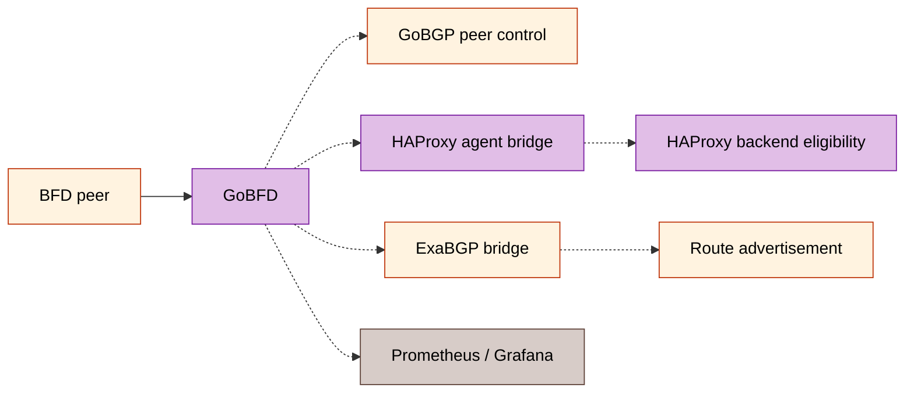

# Integrations

[Russian translation](../ru/11-integrations.md).

GoBFD publishes BFD state; a consumer applies routing or backend policy. The repository supplies GoBGP actuation, HAProxy agent-check, ExaBGP process output, observability and Kubernetes examples. Each requires independent failure/recovery and forwarding acceptance.



## Admit an isolated run

Use the [development prerequisites](09-development.md#prepare-a-checkout) and the selected runner's Podman or cluster access. Admit one disposable topology and record its names, subnet, ports and resource ownership before startup. Stop on overlap with existing resources, failed readiness, missing asserted withdrawal/recovery or failed cleanup; retain the run directory and terminal result. A repeated invocation is a new failure drill, not a rollback. Restore the injected fault and verify the consumer before separately authorized removal of owned resources.

Retained Compose entry points use the shared project ownership checks. Kubernetes teardown requires the original checkout's private ownership receipt and matching cluster, namespace UID and owner label. Preserve that receipt after failure. Inspect the exact [integration runner](../../test/internal/integrationrunner/runner.go) and [E2E admission rules](../../test/e2e/README.md) before running cleanup.

## BGP fast failover

The [FRR/GoBGP specimen](../../deployments/integrations/bgp-fast-failover/README.md) has GoBFD and GoBGP sharing `172.22.0.10` and FRR at `172.22.0.20`. FRR advertises `10.20.0.0/24`. GoBFD monitors a 300 ms × 3 Control profile and applies `disable-peer` to GoBGP.

GoBGP v4 API compatibility and single BFD ownership are mandatory. Native GoBGP BFD on managed neighbors conflicts; several base sessions for one peer address prevent canonical actuation. GoBFD dampening holds recovery, not Down handling. Administrative transitions differ from forwarding failures. Sources: [preflight/selection](../../cmd/gobfd/handlers.go), [handler](../../internal/gobgp/handler.go), [RFC 5882 section 10.2](https://www.rfc-editor.org/rfc/rfc5882.html#section-10.2).

When GoBFD connects to GoBGP over a local filesystem Unix socket (`unix:///abs/path` or `unix:/abs/path`), confirmed `DisablePeer` actions persist a mode-`0600` receipt in `gobgp.state_file` bound to the GoBGP speaker epoch ([ADR-0013](adr/0013-gobgp-restart-disable-ownership.md)), allowing a restarted GoBFD controller to re-enable a neighbor it disabled once live BFD returns Up while leaving operator-disabled, `Conf.AdminDown = true` or restarted-speaker neighbors disabled. Over TCP GoBGP endpoints (where kernel `SO_PEERCRED` is unavailable), or when `gobgpd` itself restarted, GoBFD cannot prove speaker-epoch continuity across a GoBFD restart and leaves disabled neighbors untouched until explicit recovery via the [restart recovery procedure](16-production-runbooks.md#22-startup-owned-changes). Never enable an operator-disabled peer automatically.

```sh
make int-bgp-failover-testcontainers
```

The gate retains `reports/e2e/bgp-fast-failover/run.*/` and asserts exact route withdrawal/restoration around FRR pause/unpause. Its 20-second withdrawal bound does not measure a 900 ms BFD guarantee or data-plane continuity. A separate manual topology uses `make int-bgp-failover-up`; fixed names/subnet overlap other labs. See the specimen before startup or cleanup.

## HAProxy backend health

`gobfd-haproxy-agent` selects one BFD session per configured backend and serves unauthenticated TCP agent responses. Only Up produces `up ready\n`; other/missing/ambiguous states produce `down\n`. Watch reconnection uses authoritative resnapshots. These responses describe BFD path eligibility, not application HTTP/TLS health.

| Input | Contract |
|:---|:---|
| Flags | `-config`, `-gobfd-addr`, `-version` |
| Endpoint precedence | Built-in Unix socket → `GOBFD_ADDR` → flag → nonempty YAML `gobfd_addr` |
| YAML globals | `gobfd_addr`, `listen_addr`, `backends` |
| Backend fields | `peer`, `local`, `interface`, `type`, `agent_port` |
| Listener default | `127.0.0.1`; explicit host for a remote HAProxy |
| TLS environment | `GOBFD_TLS_CA_FILE`, `GOBFD_TLS_CERT_FILE`, `GOBFD_TLS_KEY_FILE` for HTTPS |
| Admission | At least one backend; unique port 1–65535; validated session selector |
| Request bound | 64 concurrent writes/listener, 100 ms write deadline |

Source: [agent implementation](../../cmd/gobfd-haproxy-agent/main.go), [example configuration](../../deployments/integrations/haproxy-health/haproxy-agent.yml). Restrict remote agent listener access; it has no authentication.

```sh
make int-haproxy-testcontainers
```

The Go-owned gate checks backend response and recovery and retains `reports/e2e/haproxy-health/run.*/`. See [development gates](09-development.md) for runtime prerequisites. It does not qualify the production application protocol.

## ExaBGP anycast

`gobfd-exabgp-bridge` writes only ExaBGP process commands to stdout and logs to stderr. A selected Up session emits `announce route PREFIX next-hop self`; absent, ambiguous, non-Up or disconnected observation withdraws. Repeated identical state does not duplicate a command; process restart reconciles initial route state.

| Environment | Contract |
|:---|:---|
| `GOBFD_ADDR` | Default `unix:///run/gobfd/gobfd.sock` |
| `GOBFD_PEER` | Required peer address |
| `ANYCAST_PREFIX` | Required valid IP prefix; normalized to network |
| `GOBFD_LOCAL` | Optional source selector |
| `GOBFD_INTERFACE` | Optional interface selector |
| `GOBFD_SESSION_TYPE` | Optional type selector |
| `GOBFD_TLS_CA_FILE`, `GOBFD_TLS_CERT_FILE`, `GOBFD_TLS_KEY_FILE` | Management HTTPS trust/client identity |

Only `-version`/`--version` are recognized as version requests. Selector type accepts empty, `single_hop`, `multi_hop`, `micro_bfd`, `vxlan`, `geneve`; empty matches any observed type, including Echo. A peer-only selector must resolve uniquely; add local/interface/type when needed. The same selector contract applies to HAProxy backend `type`. Source: [bridge](../../cmd/gobfd-exabgp-bridge/main.go), [selector and Watch](../../internal/apiclient).

```sh
make int-exabgp-anycast
```

The [anycast specimen](../../deployments/integrations/exabgp-anycast) is a separate integration boundary. Go-owned lifecycle output or a route command alone does not prove external BGP propagation or anycast forwarding.

## Observability

The [observability stack](../../deployments/integrations/observability/compose.yml) supplies BFD peers, Prometheus rules and Grafana. Its lab host ports and default Grafana credentials require an isolated admitted environment; do not expose it as a production dashboard.

```sh
make int-observability-testcontainers
```

The gate requires healthy scraping, a firing transition alert during failure, BFD recovery and an inactive transition alert after recovery. It retains `reports/e2e/observability/run.*/`. HTTP 200 alone does not satisfy the gate. See [metrics/alerts](07-monitoring.md).

The retained demo `make int-observability` and its `-up`, `-logs` and `-down` targets use the [owned Compose controller](../../test/internal/interopproject/controller.go). Apply the [retained-workflow prerequisites](05-interop.md#retained-compose-workflow) before starting it. The controller serializes the fixed project, builds unique image aliases, starts by recorded image IDs and removes only verified owned runtime resources. The demo does not replace the testcontainers qualification gate above.

Capture files remain under `reports/e2e/observability-compose/run.<nonce>/`, including files created before a partial startup failure; incomplete startup can produce an incomplete capture. Preserve this directory for diagnosis. Prometheus uses a bounded 1 GiB tmpfs for its TSDB, so its demo history is ephemeral. This is a demo storage ceiling, not sustained-retention qualification; account for [WAL and head chunk storage](https://prometheus.io/docs/prometheus/latest/storage/) before changing it. Existing named volumes are preserved and are not migrated automatically. For recovery, use the matching `-down` target from the original source directory with the same UID and engine selection. Sources: [capture owner](../../test/internal/interopproject/capture.go), [scenario mounts](../../deployments/integrations/observability/compose.yml).

## Kubernetes

The [manifest set](../../deployments/integrations/kubernetes/manifests) runs one host-network DaemonSet per selected Linux node with local images and a GoBGP sidecar. Inspect `imagePullPolicy: Never`, per-node image imports, port conflicts, probes and host-local management boundaries before apply.

`make int-k8s` is an example runner. Require verified per-node image imports, matching labels/probes and a live-cluster rollout/resource/failure-recovery receipt before acceptance. The manifests alone do not establish an accepted cluster deployment. See [deployment](06-deployment.md#kubernetes).

After rollout, the [pod checks](../../test/internal/integrationrunner/kubernetes_probe.go) select the single non-terminating `Running` and `Ready` Pod scheduled on the matched local Node (`deletionTimestamp` absent, `status.phase == "Running"`, `Ready == "True"`, `spec.nodeName` equal to the local node) and require successful GoBFD Unix-socket and GoBGP loopback RPC queries. An empty successful session list establishes management reachability only. Metrics are fetched through the Kubernetes Pod proxy with a 1 MiB output limit; the operator needs `get` access to `pods/proxy` in namespace `gobfd`. Require exactly one unlabelled `gobfd_gobgp_endpoint_compatible` sample with numeric value `1`; missing, duplicate, labelled or unsuccessful samples fail the command. This gauge witnesses GoBGP API compatibility preflight, not BFD Up or forwarding. RPC, proxy and output errors stop the checks; optional packet-capture tooling does not establish acceptance. Source: [Pod proxy API](https://kubernetes.io/docs/reference/kubernetes-api/core/pod-v1/).

The [build owner](../../test/internal/integrationrunner/kubernetes_build.go) reuses the shared image lifecycle for the [two existing recipes](../../deployments/integrations/kubernetes/compose.build.yml). It writes unique aliases, verified source IDs and a rendered DaemonSet to private `reports/e2e/kubernetes-build/run.<identity>/` directories before import, then updates `images.json` with the published OCI manifest digests after import completes. The DaemonSet selects those aliases and records source IDs as annotations. Before namespace creation, the runner connects to the kubelet-selected image-service endpoint, sends `containerd-namespace: k8s.io` on every gRPC request, records the returned server UUID, verifies that the namespace exists and requires both aliases to be absent. Only a gRPC `NotFound` from `Images.Get` means absent. The private `containerd.json` receipt records the endpoint, namespace and UUID. Local build images are removed by verified ID after the callback, while imported images and report files remain. Preserve the plan after an import or apply failure. Authenticated server identity, imported-store cleanup ownership, digest-qualified runtime references and multi-node image distribution remain unqualified.

Before namespace creation or image import, the runner requires a non-empty, bounded `NodeList` with unique names and UIDs, a Ready condition, Linux OS metadata, a supported architecture, machine and boot IDs, and a `containerd://` runtime version. It matches the local host to exactly one node by machine ID and boot ID, then reads the merged kubelet configuration through `/api/v1/nodes/{name}/proxy/configz`. It accepts only absolute Unix socket values for `containerRuntimeEndpoint` and the effective `imageServiceEndpoint` (which defaults to the runtime endpoint). The private run receipt records the local node UID, both socket paths, the sorted observed node identities and cluster UID before namespace mutation; it checks cluster UID continuity again before namespace creation. It records the UUID returned by the image-service endpoint, but no separate trust anchor authenticates that UUID. Setup readiness uses a 60-second deadline and rejects an empty list. These checks do not prove DaemonSet scheduling or per-node image availability. A Ready cordoned node remains in the inventory because DaemonSets tolerate unschedulable nodes. The required `nodes/proxy` permission is privileged; see [operator permissions](06-deployment.md#kubernetes). Sources: [Node status](https://kubernetes.io/docs/reference/node/node-status/), [DaemonSet tolerations](https://kubernetes.io/docs/concepts/workloads/controllers/daemonset/), [Kubelet configuration API](https://kubernetes.io/docs/reference/config-api/kubelet-config.v1beta1/).

The [namespace owner](../../test/internal/integrationrunner/kubernetes_namespace.go) rejects an existing `gobfd` namespace. It saves a random owner label and the observed `kube-system` UID before exclusive creation, then records the created namespace UID in private `reports/e2e/kubernetes-build/namespace.json`. Startup and teardown share a local lock. A lost creation response leaves a pending receipt; teardown may recover its UID only from a namespace with the matching owner label and cluster UID. An unresolved pending receipt blocks another startup even when the namespace is absent; preserve its nonce and reconcile the original request before another run. It never replays creation automatically. Keep this namespace exclusive to the run; do not add unrelated resources.

Run `make int-k8s-down` from the original checkout, UID and cluster context. Teardown checks the receipt, owner label and namespace UID, sends [DeleteOptions UID and resourceVersion preconditions](https://kubernetes.io/docs/reference/kubernetes-api/common-definitions/delete-options/) and requires deletion completion followed by an absence readback. A changed identity, conflict or failed wait stops teardown; preserve the receipt and request files for diagnosis. Receipts remain after successful teardown; repeated teardown of an absent namespace performs no deletion. Imported containerd images remain preserved. These source guards do not establish native cluster or image-store acceptance.

The [importer](../../test/internal/integrationrunner/runner.go) and [containerd ingestion client](../../test/internal/integrationrunner/kubernetes_containerd_import.go) require one full SHA-256 source image ID before creating an archive. Export selects that ID with explicit `docker-archive` and `--multi-image-archive=false`; the requested tag is retained as archive metadata. Invalid, ambiguous or oversized identity output fails before export. The importer holds the private archive descriptor open, checks that the exported path still identifies its original regular file and verifies its content without unpacking to disk. It then opens a 15-minute run-owned containerd lease (`Leases.Create` with `containerd.io/gc.expire`, deleted on return with `Leases.Delete`), streams verified layer blobs and the verified config blob from the open descriptor to `Content.Write` with expected digests and sizes, writes a deterministic OCI v1 image manifest carrying `containerd.io/gc.ref.content.config` and `containerd.io/gc.ref.content.0..N` labels, and publishes the alias through create-only `Images.Create` without calling `Images.Update` (`AlreadyExists` fails closed without overwriting an existing alias). Readback checks `Images.Get` and `Content.Info` for the exact manifest digest, size and GC root labels, then records `import-<source-id>.json` and updates `images.json` with `manifest_digest`. Export, verification, receipt, content-store, create-only publication, descriptor-close and cleanup errors fail the command. Cleanup removes only the original file identity; a replacement is preserved and reported. Imported-store cleanup ownership, digest-qualified runtime references and multi-node acceptance remain unqualified.

The [archive verifier](../../test/internal/integrationrunner/kubernetes_archive.go) requires one Docker manifest with the exact run alias, a config SHA-256 equal to the selected source ID, and ordered uncompressed layer hashes equal to `rootfs.diff_ids`. It rejects duplicate members, ambiguous JSON, unsafe paths, missing data, truncated framing and hybrid OCI layouts. Legacy `layer.tar` links may target only verified physical layers; corresponding `VERSION`, `json` and `repositories` metadata remain supported. Verification streams file contents without extraction. Before import, the runner writes `archive-<source-id>.json` beside `images.json`, recording schema, alias, source ID, whole-archive SHA-256 and byte count without replacing an existing record. Preserve these records after failure. Sources: [export format and legacy links](https://github.com/containers/image/blob/df7e80d2d19872b61f352a8a182ec934dc0c2346/docker/internal/tarfile/writer.go), [uncompressed layer export](https://github.com/containers/image/blob/df7e80d2d19872b61f352a8a182ec934dc0c2346/docker/internal/tarfile/dest.go).

| Archive input | Limit |
|:---|:---|
| File size | 4 GiB |
| Members | 4096 |
| Manifest JSON | 1 MiB |
| Config JSON | 4 MiB |
| Zero padding after terminal blocks | 10 KiB |

Private-file verification does not freeze the inode against concurrent writes by its owner. The archive digest and source config ID are distinct from the OCI manifest or index digest selected by containerd. Target-store ownership, immutable runtime references and native per-node acceptance remain unqualified.

## Qualification and vendor references

| Evidence | Establishes | Does not establish |
|:---|:---|:---|
| Unit/source checks | Contract behavior on tested paths | Native peer interoperability |
| Owned testcontainers lifecycle | Asserted local failure/recovery | Production resources or continuous forwarding |
| Packet capture | Captured wire fields/events | Exhaustive RFC coverage |
| Vendor manual | Documented selected release/platform behavior | GoBFD acceptance against that device |
| Production drill | Measured declared topology/SHA/workload | Other profiles/platforms |

Use [RFC coverage](08-rfc-compliance.md), [the operational drill](16-production-runbooks.md) and [official Cisco/Arista/Juniper/Huawei references](reference/vendor-bfd.md). Optional [EOS notes](../../deployments/integrations/bgp-fast-failover/vendor-notes/arista-eos.md) remain outside the runnable FRR topology.
