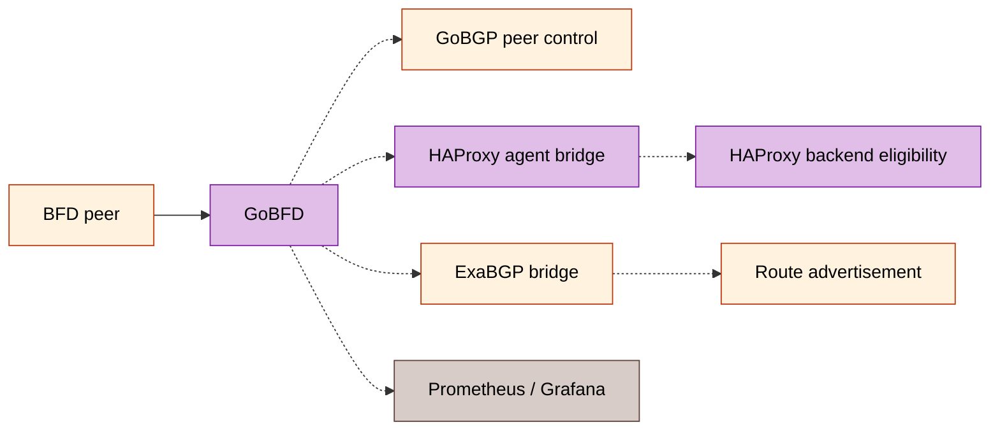

# Integrations

GoBFD publishes BFD state; a consumer applies routing or backend policy. The repository supplies GoBGP actuation, HAProxy agent-check, ExaBGP process output, observability and Kubernetes examples. Each requires independent failure/recovery and forwarding acceptance.



## BGP fast failover

The [FRR/GoBGP specimen](../../deployments/integrations/bgp-fast-failover/README.md) has GoBFD and GoBGP sharing `172.22.0.10` and FRR at `172.22.0.20`. FRR advertises `10.20.0.0/24`. GoBFD monitors a 300 ms × 3 Control profile and applies `disable-peer` to GoBGP.

GoBGP v4 API compatibility and single BFD ownership are mandatory. Native GoBGP BFD on managed neighbors conflicts; several base sessions for one peer address prevent canonical actuation. GoBFD dampening holds recovery, not Down handling. Administrative transitions differ from forwarding failures. Sources: [preflight/selection](../../cmd/gobfd/handlers.go), [handler](../../internal/gobgp/handler.go), [RFC 5882 section 10.2](https://www.rfc-editor.org/rfc/rfc5882.html#section-10.2).

The handler remembers peers it disabled only in process memory. Restarting GoBFD loses that ownership record; an already disabled GoBGP peer remains disabled even after BFD recovers. Before restart, retain each peer's administrative state and evidence of GoBFD ownership. Afterward, explicitly enable only a peer proven to have been disabled by GoBFD, using the [restart recovery procedure](16-production-runbooks.md#22-startup-owned-changes). Never enable an operator-disabled peer automatically.

```sh
make int-bgp-failover-testcontainers
```

The gate retains `reports/e2e/bgp-fast-failover/run.*/` and asserts exact route withdrawal/restoration around FRR pause/unpause. Its 20-second withdrawal bound does not measure a 900 ms BFD guarantee or data-plane continuity. A separate manual topology uses `make int-bgp-failover-up`; fixed names/subnet overlap other labs. See the specimen before startup or cleanup.

## HAProxy backend health

`gobfd-haproxy-agent` selects one BFD session per configured backend and serves unauthenticated TCP agent responses. Only Up produces `up ready\n`; other/missing/ambiguous states produce `down\n`. Watch reconnection uses authoritative resnapshots. These responses describe BFD path eligibility, not application HTTP/TLS health.

| Input | Contract |
| :--- | :--- |
| Flags | `-config`, `-gobfd-addr`, `-version` |
| Endpoint precedence | Built-in Unix socket → `GOBFD_ADDR` → flag → nonempty YAML `gobfd_addr` |
| YAML globals | `gobfd_addr`, `listen_addr`, `backends` |
| Backend fields | `peer`, `local`, `interface`, `type`, `agent_port` |
| Listener default | `127.0.0.1`; explicit host for a remote HAProxy |
| TLS environment | `GOBFD_TLS_CA_FILE`, `GOBFD_TLS_CERT_FILE`, `GOBFD_TLS_KEY_FILE` for HTTPS |
| Admission | At least one backend; unique port 1–65535; validated session selector |
| Request bound | 64 concurrent writes/listener, 100 ms write deadline |

Source: [agent implementation](../../cmd/gobfd-haproxy-agent/main.go), [example configuration](../../deployments/integrations/haproxy-health/haproxy-agent.yml). Restrict remote agent listener access; it has no authentication.

```sh
make int-haproxy-testcontainers
```

The Go-owned gate checks backend response and recovery and retains `reports/e2e/haproxy-health/run.*/`. See [development gates](09-development.md) for runtime prerequisites. It does not qualify the production application protocol.

## ExaBGP anycast

`gobfd-exabgp-bridge` writes only ExaBGP process commands to stdout and logs to stderr. A selected Up session emits `announce route PREFIX next-hop self`; absent, ambiguous, non-Up or disconnected observation withdraws. Repeated identical state does not duplicate a command; process restart reconciles initial route state.

| Environment | Contract |
| :--- | :--- |
| `GOBFD_ADDR` | Default `unix:///run/gobfd/gobfd.sock` |
| `GOBFD_PEER` | Required peer address |
| `ANYCAST_PREFIX` | Required valid IP prefix; normalized to network |
| `GOBFD_LOCAL` | Optional source selector |
| `GOBFD_INTERFACE` | Optional interface selector |
| `GOBFD_SESSION_TYPE` | Optional type selector |
| `GOBFD_TLS_CA_FILE`, `GOBFD_TLS_CERT_FILE`, `GOBFD_TLS_KEY_FILE` | Management HTTPS trust/client identity |

Only `-version`/`--version` are recognized as version requests. Selector type accepts empty, `single_hop`, `multi_hop`, `micro_bfd`, `vxlan`, `geneve`; empty matches any observed type, including Echo. A peer-only selector must resolve uniquely; add local/interface/type when needed. The same selector contract applies to HAProxy backend `type`. Source: [bridge](../../cmd/gobfd-exabgp-bridge/main.go), [selector and Watch](../../internal/apiclient).

```sh
make int-exabgp-anycast
```

The [anycast specimen](../../deployments/integrations/exabgp-anycast) is a separate integration boundary. Go-owned lifecycle output or a route command alone does not prove external BGP propagation or anycast forwarding.

## Observability

The [observability stack](../../deployments/integrations/observability/compose.yml) supplies BFD peers, Prometheus rules and Grafana. Its lab host ports and default Grafana credentials require an isolated admitted environment; do not expose it as a production dashboard.

```sh
make int-observability-testcontainers
```

The gate requires healthy scraping, a firing transition alert during failure, BFD recovery and an inactive transition alert after recovery. It retains `reports/e2e/observability/run.*/`. HTTP 200 alone does not satisfy the gate. See [metrics/alerts](07-monitoring.md).

## Kubernetes

The [manifest set](../../deployments/integrations/kubernetes/manifests) runs one host-network DaemonSet per selected Linux node with local images and a GoBGP sidecar. Inspect `imagePullPolicy: Never`, per-node image imports, port conflicts, probes and host-local management boundaries before apply.

`make int-k8s` is an example runner. Require verified per-node image imports, matching labels/probes and a live-cluster rollout/resource/failure-recovery receipt before acceptance. The manifests alone do not establish an accepted cluster deployment. See [deployment](06-deployment.md#kubernetes).

## Qualification and vendor references

| Evidence | Establishes | Does not establish |
| :--- | :--- | :--- |
| Unit/source checks | Contract behavior on tested paths | Native peer interoperability |
| Owned testcontainers lifecycle | Asserted local failure/recovery | Production resources or continuous forwarding |
| Packet capture | Captured wire fields/events | Exhaustive RFC coverage |
| Vendor manual | Documented selected release/platform behavior | GoBFD acceptance against that device |
| Production drill | Measured declared topology/SHA/workload | Other profiles/platforms |

Use [RFC coverage](08-rfc-compliance.md), [the operational drill](16-production-runbooks.md) and [official Cisco/Arista/Juniper/Huawei references](reference/vendor-bfd.md). Optional [EOS notes](../../deployments/integrations/bgp-fast-failover/vendor-notes/arista-eos.md) remain outside the runnable FRR topology.
