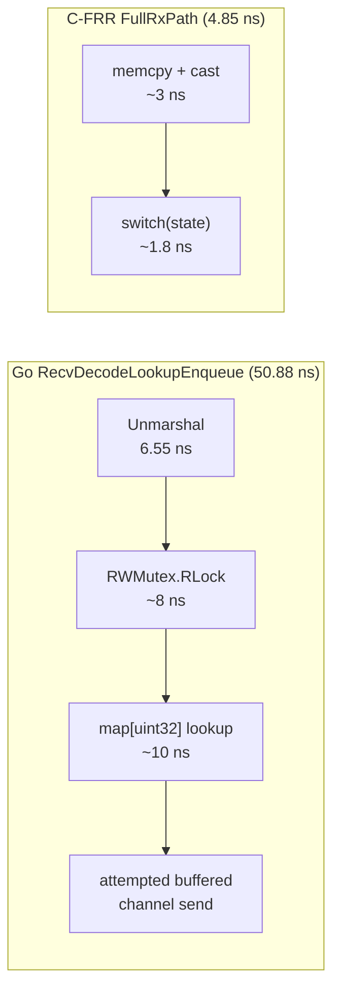
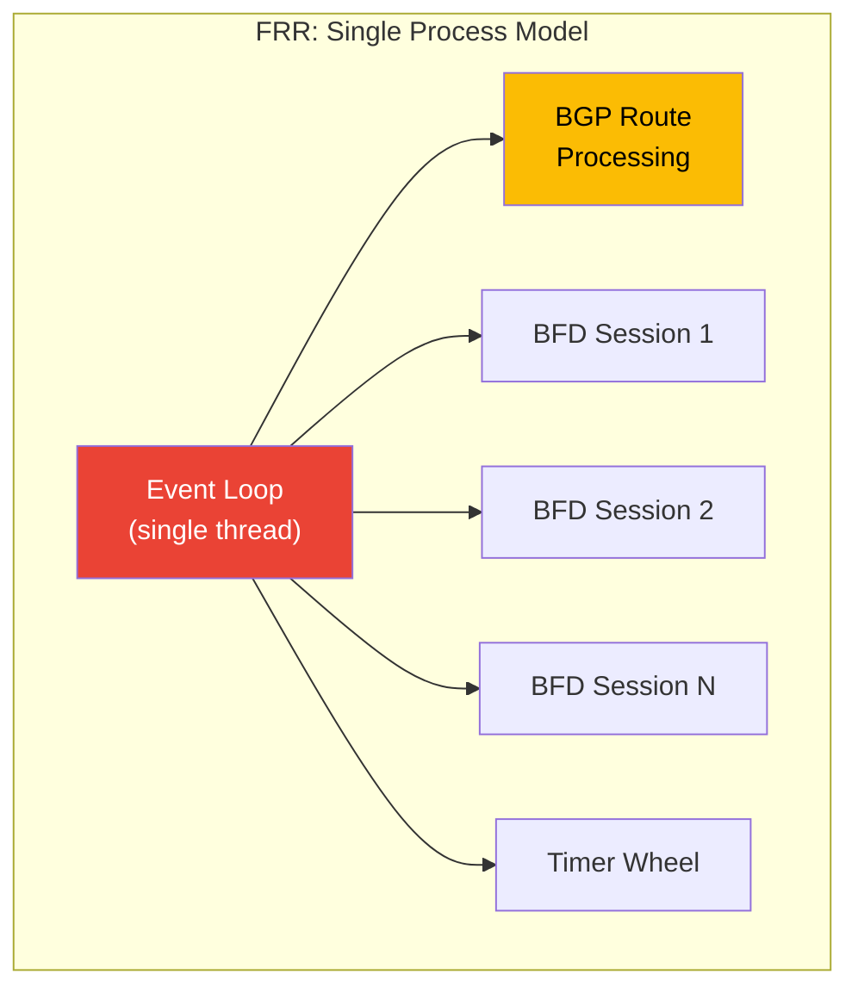
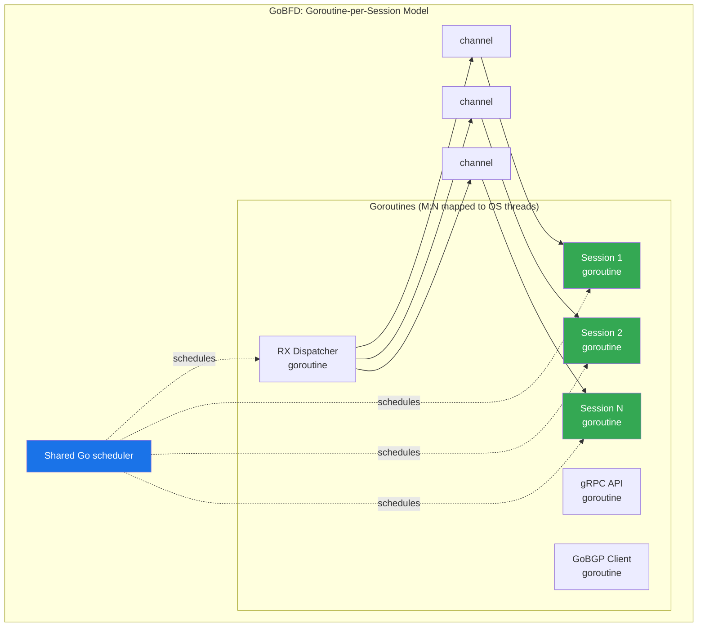

# Performance Analysis: GoBFD vs C Implementations


> Historical cross-implementation micro-benchmark analysis comparing selected
> GoBFD, FRR bfdd, and BIRD3 operations. These measurements do not include the
> kernel network path and are not release qualification, supported scale, or
> end-to-end latency evidence.

---

## Linux Receive Telemetry Boundary

Development tracks the committed-latency baseline in `gobfd-qj0.8.2.1.6`.
The receive metadata stage enables `SO_TIMESTAMPNS_NEW` and `SO_RXQ_OVFL`
on Linux listeners when supported. `ENOPROTOOPT` leaves that measurement
unavailable without stopping BFD; other socket-option failures include the
option name and stop listener creation. TTL and packet-info options remain
mandatory. Qualification requires actual samples; unavailable telemetry does
not mean zero latency or zero loss. The 128-byte ancillary buffer covers timestamp, drop,
TTL/Hop Limit and destination/interface metadata for IPv4 and IPv6.
`MSG_CTRUNC` returns `ErrAncillaryTruncated` before demultiplexing.

`PacketMeta.KernelRXUnixNano` is a raw software `CLOCK_REALTIME` sample;
zero means absent or invalid. Decode accepts native-endian time64 values
only when nanoseconds are normalized and the result fits positive int64
Unix nanoseconds. See the [kernel timestamp ABI](https://www.kernel.org/doc/html/latest/networking/timestamping.html).

`SocketDrops` is the cumulative uint32 counter carried by `SO_RXQ_OVFL`;
`SocketDropsKnown` records whether a valid counter message was present.
The kernel omits zero-valued drop messages. Samples describe drops before
that datagram was queued; aggregation must handle wrap and a final accepted
datagram after the load stops. See [socket(7)](https://man7.org/linux/man-pages/man7/socket.7.html)
and [`sock_recv_drops`](https://github.com/torvalds/linux/blob/master/net/socket.c).

Each Control listener now owns a paired realtime/monotonic calibration. A
sample maps to the calibration's monotonic time by its realtime offset;
samples before calibration, in the future, outside the numeric range or
without a monotonic reading are excluded. The observed realtime-versus-
monotonic elapsed difference must stay within 1 ms at receive and commit.
An observed larger step revokes the calibration for that listener's lifetime,
including already queued samples through shared atomic revocation. Recreating
the listener establishes a new calibration; restarting the receiver on the
same listener does not clear revocation. This avoids guessing the clock epoch
of queued timestamps after a backward step.

The bound is a measurement-validity policy, not a sub-millisecond accuracy
guarantee. A step that returns between observations cannot be detected by
these paired samples. See Go's [monotonic clock contract](https://pkg.go.dev/time#hdr-Monotonic_Clocks).
Clock outcomes never alter packet acceptance or detection deadlines, which
retain the existing monotonic accepted-packet time.

Timing follows discriminator, peer and unsolicited admissions by value.
`gobfd_bfd_control_rx_timing_total{outcome}` counts every normally completed
Control owner packet using six fixed outcomes: `valid`, `unavailable`,
`invalid`, `before_calibration`, `future` and `clock_step`. Only valid samples
enter `gobfd_bfd_control_rx_commit_seconds`. Validation refusal, enqueue,
queue refusal, abandonment and panic are not completed samples; their existing
delivery denominators remain separate. Neither metric has peer labels.
Overlay and direct legacy callers without kernel timing report `unavailable`.

Real IPv4/IPv6 UDP tests supply nonzero committed samples for both demux paths.
The real-collector owner benchmark waits for every commit, but excludes UDP,
wire parsing and authentication and uses synthetic clock input for cost only.
The initial result was 16 B/op and 2 allocs/op from peer-address formatting.
Active registered peer/local pairs now retain the four packet counter handles;
the unchanged benchmark reports 0 B/op and 0 allocs/op in three local runs.
Reference counting keeps shared labels cached until their last registration.
The cache contains only active pairs; historical CounterVec series remain
retained, and unregistered callers keep the existing vector lookup path.
Registration publishes zero packet/auth counters before their first update.
This does not qualify lifetime series retention or the complete UDP pipeline.
Before/after evidence is in `reports/collector-owner-20261022/`.
Bounded CPU/GC/loss distributions, calibrated regression policy, supported
scale and final qualification remain open under the parent.

## Timer observation boundary

Control and Echo owner loops retain the actual `time.Timer.C` timestamp.
Go's [sendTime](https://github.com/golang/go/blob/master/src/time/sleep.go)
adjusts a delayed channel delivery back to its scheduled firing time. Normal
runtime readings retain Go monotonic arithmetic; network realtime samples
are not used in these timer measurements.

`dispatch` measures scheduled firing to owner handling. A TX `effect` measures
successful `SendPacket` return, before later Poll bookkeeping; it does not
promise wire or peer arrival. A detection `effect` measures publication of a
timeout-caused transition to Down, before logs, notifications or announcement
sends. No deadline, jitter, suppression or FSM action is changed.

Four fixed timer kinds produce 20 counter series and eight histograms for
valid dispatch/effect stages. Zero-value or future timestamps remain explicit
outcomes and never enter valid latency histograms. `no_effect` covers normal
processing with no qualifying send/transition; it combines policy suppression,
send failure and idle detection, so it is not a packet-loss counter. A panic or
in-flight handler may leave dispatch without an effect/no-effect receipt.
Untimed actions do not enter timer observations. These measurements do not
establish false-Down rate, supported scale or the required load distributions;
those require the actual UDP workload and accounting in Beads.

## Socket-drop observation boundary

Linux [socket cmsgs](https://github.com/torvalds/linux/blob/a1c2b1da93f5f612aa7a33190c4900c98e51f6da/net/socket.c)
omit a zero dropcount; the [UDP enqueue path](https://github.com/torvalds/linux/blob/a1c2b1da93f5f612aa7a33190c4900c98e51f6da/net/ipv4/udp.c)
stores a cumulative snapshot on queued datagrams. Old queued packets therefore
do not reveal later drops. Drain the old queue and retain fresh post-load
markers, including a repeated marker that must not add the same losses twice.
Absence can also mean unsupported telemetry, so it never proves loss-zero.

Each base UDP listener owns a synchronized scalar high-water mark across
receiver reruns. Fresh daemon sockets start at zero; existing/custom sockets
need an initial known baseline. A new listener starts a new observation epoch.
Only a forward modular distance below `2^31` advances the mark and contributes
an increment. Equal known samples contribute zero; stale or half-range values
are `ambiguous` and preserve the previous mark. This uses bounded
[serial arithmetic](https://www.rfc-editor.org/rfc/rfc1982.html#section-3),
not an assumption that every numeric decrease is a wrap.

The counter epoch must stay unchanged and the observation gap must remain
below half the `uint32` space. Multiple unobserved wraps and a reset that
mimics forward progress cannot be detected. Initial samples on existing
transports, unavailable intervals and invalid samples are not complete-loss
evidence. The two fixed kinds and five outcomes produce ten sample counters
and two increment counters without peer labels. Handles are created once;
resetting or deleting their vector series is unsupported.

Sampling precedes read-size, TTL and BFD parser rejection. Payload truncation
keeps independently valid complete ancillary metadata while retaining its
typed read error; truncated, malformed or duplicate drop cmsgs are invalid.
Ordinary read errors, closure and timeouts are not consumed-datagram samples.
Overlay paths are not instrumented by this listener boundary. These observations
do not establish wire loss, supported scale or final runtime qualification.

## Workload environment observations

The Go-owned `test/internal/bfdload.CaptureEnvironment` observes its own
process. Run `go run ./test/cmd/bfdload environment` inside the pinned development
container to emit its JSON snapshot: [RSS and threads](https://www.kernel.org/doc/html/latest/filesystems/proc.html),
FDs, [process-wide context switches](https://man7.org/linux/man-pages/man2/getrusage.2.html),
effective `GOMAXPROCS`, GC settings and cumulative runtime histograms.
RSS uses `smaps_rollup`; FD counts include observation descriptors.
[CPU affinity](https://man7.org/linux/man-pages/man2/sched_setaffinity.2.html)
belongs to the observing thread. Start time and elapsed time bound a sequential,
non-atomic sample; observation overhead requires calibration.

[Histograms](https://github.com/golang/go/blob/2aae1000ea1d4b28923b96db28acf4e3b99d6aff/src/runtime/metrics/histogram.go)
retain copied counts and ordered half-open bounds, with infinite bounds as
JSON strings. Scheduler delay is separate from kernel RX-to-owner latency.

[Cgroup v2 data](https://www.kernel.org/doc/html/latest/admin-guide/cgroup-v2.html)
covers the current visible group. `cpu.stat` bandwidth counters exclude
inherited throttling; optional `cpu.stat.local` has separate validity.
Missing or malformed data remains unavailable. Limits distinguish `max` from
numeric zero. Hidden parents, reference admission, generator isolation and
supported load remain separate gates in Beads.

Snapshots retain `pids.current` and `pids.max` as task counts. Before named
owner profiles create sessions, admission checks additional headroom of
`sessions + 64` at every visible ancestor: 1,064 tasks for reference and 5,064
for engineering. This conservative policy covers the currently pinned Control
baseline, not a measured upper bound. The report retains the budget even on
refusal; it does not reserve capacity or relax the separate CPU, memory,
thread-pin A/B and runtime qualification gates. See [ADR-0007](./adr/0007-workload-phase-accounting.md).

`test/internal/bfdload.StartOwner` runs the production UDP listeners, receiver,
session manager and owning UDP senders with a fresh real collector. Its typed
snapshot includes configured endpoints, source ports, session observations,
delivery counters, collector metrics and self-process resources. Cancellation
or a failed receiver joins all owned workers and closes their sockets; `Close`
returns shutdown errors. Control receive ports exclude Echo port 3785 and the
49152–65535 TX source range. The IPv4/IPv6 component fixture uses isolated
alternate ports and validates actual packet commit, rejection and returned TX. It does not
qualify RFC ports, an independent generator, daemon-wide resource bounds or the
reference workload.

`test/internal/bfdload.RunPeers` drives actual UDP with its own unauthenticated
asynchronous Control state model, independent of the target session FSM.
Separate seeded PCG streams cover each peer and direction; protocol jitter
uses another stream. Random omissions and timed blackholes retain separate
counts from successful UDP writes, canceled writes and unprocessed input.
Partial startup and cancellation close owned sockets and join workers.
Named `reference` and `engineering` profiles reject reduced qualification
inputs; `fixture` is explicitly unqualified. Generator reports remain scoped
to the generator, with raw kernel-drop samples and no reference verdict.
`bfdload peers PROFILE` and `bfdload owner PROFILE` consume typed flags and
repeatable `--session=localAddrPort,peerAddrPort` bindings, plus `--interface`
for the named profiles. Scalar duplicates, malformed endpoints and reduced
named profiles fail before sockets open. SIGINT/SIGTERM cancel the workload,
join workers and emit a partial JSON report; signals retain normal termination
while stdout is blocked after cleanup.

Commands without `--control-dir` retain independent duration timers and lifetime
totals that include setup and shutdown. Controlled owner/peer commands use the
existing Go-owned topology controller: bind both roles, reach Up, publish a common
future monotonic epoch, freeze the owner measurement snapshot, stop and join peers,
then drain terminal accounting before owner shutdown. The private bounded control
files refuse replacement and verify a common time namespace. Missing terminal
receipts fail at a bounded deadline instead of marking the run complete.
The conversion bracket does not establish independent RX timing uncertainty.
Lifetime totals must not be divided by the requested measurement duration to
claim window throughput; snapshots remain sampled observations.
See [ADR-0007](./adr/0007-workload-phase-accounting.md).

The 2026-10-24 independent-process IPv4/IPv6 fixture passes in 47.98 s with
79 actual writes and 79 owner commits, matching phase identities, idempotent
namespace setup and four verified container removals. Evidence:
`reports/udp-resume-20261024/`. Both reports retain `reference_qualified=false`
and unknown total clock uncertainty. This is a production-core fixture receipt,
not reference-load or complete-daemon qualification. Beads
`gobfd-qj0.8.2.1.6.3.3` owns implementation acceptance.
Local implementation acceptance is recorded at
`b2e68ad2a13824a05a9b92528fe55c9a8d4fd6d1`; the corrected process fixture
passes in 47.67 s with the same 79/79 ledger and explicit nonempty measurement
snapshot. Mutation and malformed-report checks prove snapshot and failure
boundaries. Reference and absolute-clock qualification remain open.

`RunOwner` records initial/final real collector snapshots, sampled resource
peaks, means for the first/final six-hour RSS windows, runtime histogram
deltas and a bounded Down journal. Missing transition events and journal
overflow remain explicit; the owner does not classify intentional Down without
the independent peer report. `completed` means the observation duration ended;
controlled mode additionally requires terminal-ledger settlement. It does not
mean all sessions remained Up. Reference resources require exact 8 CPU/
8 GiB child limits, GOMAXPROCS 8, the pinned compiler and no tighter visible
cgroup ancestors. Hidden ancestor roots fail closed. Admission does not reserve
capacity or prove host namespace visibility; the isolated runner must verify
these independently. Process isolation, settled 24-hour Up duration, background
CPU load, independent clock validity and full daemon qualification remain
separate gates in Beads. See the [cgroup v2 hierarchy contract](https://docs.kernel.org/admin-guide/cgroup-v2.html).

Listener `clock_calibrations` retain a three-read monotonic bracket around the
wall/monotonic pair and the nominal native clock resolutions. The conditional
conversion bound is `span_ns + realtime_resolution_ns + monotonic_resolution_ns`.
It assumes native clocks with a constant realtime-minus-monotonic offset. For
each clock, all read errors must stay in one fixed interval whose width is at
most that clock's nominal resolution; this is not an absolute `+/-resolution`
error model. Nominal resolution does not establish this assumption or physical
clock accuracy. The 1 ms consistency tolerance remains separate from this bound.

Let `B,A` be the outer monotonic readings, `M,R` the anchor's monotonic and
realtime readings, and `C,K` the owner-commit and kernel-RX readings. Measured
latency is `C-M-(K-R)`. Both anchor reads lie inside the bracket and observed
monotonic values preserve order. Relative to ideal latency, canceling the common
clock offsets bounds its error by `A-B` plus one within-clock error difference
for each clock. Those differences are bounded by their fixed interval widths,
giving `span + qMonotonic + qRealtime` for either anchor-read order. Fixed clock
biases cancel. Independent conversion fixtures exercise nonzero pairing skew
and opposite endpoints of both error intervals.

The workload's `ClockEpochGuard` arms a nonblocking
[realtime timerfd](https://man7.org/linux/man-pages/man2/timerfd_create.2.html)
with absolute `CANCEL_ON_SET` before calibration. `Finish` checks cancellation
after the last sample and closes its FD. A successful nonblocking read check
sets `no_cancellation_observed`; it does not prove that the clock never stepped.
[Timekeeping publishes before notification](https://github.com/torvalds/linux/blob/adc218676eef25575469234709c2d87185ca223a/kernel/time/timekeeping.c#L1468-L1474),
and [resume notification is deferred](https://github.com/torvalds/linux/blob/adc218676eef25575469234709c2d87185ca223a/fs/timerfd.c#L118-L131).
These upstream v6.12 sources do not qualify a vendor kernel. Cancellation, expiration, unavailable data and
aborted guards cannot provide a usable witness. Its seven-day horizon bounds
the witness lifetime. No per-packet syscall or guard goroutine is added.
`WithClockEpoch` requires process-local monotonic provenance covering the entire
calibration bracket and owner shutdown. UTC values remain reporting metadata;
replaying JSON cannot reconstruct that provenance or requalify a run. It accepts
only known calibrations inside the completed guard window and attaches the
largest conditional conversion bound to `conditional_timing_uncertainty_ns`.
The constant-offset clock model remains an assumption. Total
`timing_uncertainty_ns` stays null with an explicit unknown reason, and stale
reference qualification is cleared. Invalid or uncovered inputs clear both
bounds. Independent evidence of clock validity is still required before full
load acceptance; cancellation evidence alone cannot satisfy it. This does not
establish hardware timestamp accuracy, reference admission or supported load.

## Table of Contents

- [Executive Summary](#executive-summary)
- [Linux Receive Telemetry Boundary](#linux-receive-telemetry-boundary)
- [Timer Observation Boundary](#timer-observation-boundary)
- [Socket-Drop Observation Boundary](#socket-drop-observation-boundary)
- [Workload Environment Observations](#workload-environment-observations)
- [Test Methodology](#test-methodology)
- [Benchmark Results](#benchmark-results)
  - [Codec Operations](#31-codec-operations)
  - [FSM Transitions](#32-fsm-transitions)
  - [Timer Calculations](#33-timer-calculations)
  - [Receive and Transmit Stages](#34-receive-and-transmit-stages)
  - [Session Scaling](#35-session-scaling)
- [Architecture: Goroutine-per-Session vs Single-Threaded Event Loop](#architecture-goroutine-per-session-vs-single-threaded-event-loop)
  - [FRR/BIRD Architecture](#41-frrbird-architecture)
  - [GoBFD Architecture](#42-gobfd-architecture)
- [Behavior Under CPU Load](#behavior-under-cpu-load)
  - [What Happens When Host CPU is at 100%](#51-what-happens-when-host-cpu-is-at-100)
  - [GOMAXPROCS Tuning](#52-gomaxprocs-tuning)
  - [GC Impact and Measured Allocation Boundaries](#53-gc-impact-and-measured-allocation-boundaries)
  - [Timer Precision Targets](#54-timer-precision-targets)
- [Where Go is Better Than C](#where-go-is-better-than-c)
  - [Memory Safety](#61-memory-safety)
  - [Concurrency Isolation](#62-concurrency-isolation)
  - [RFC Coverage](#63-rfc-coverage)
  - [Operational Advantages](#64-operational-advantages)
- [Where C is Better Than Go](#where-c-is-better-than-go)
  - [Raw Per-Packet Throughput](#71-raw-per-packet-throughput)
  - [Memory Per Session](#72-memory-per-session)
  - [Startup Latency](#73-startup-latency)
- [Production Recommendations](#production-recommendations)
- [Summary Table](#summary-table)

---

### Executive Summary

Key findings from cross-implementation benchmarks:

- **Codec parity**: GoBFD achieves 1.2-1.4x of C performance on marshal/unmarshal operations (5.96 ns vs 4.98 ns for FRR marshal), while performing 7 RFC validation checks vs 3 in C implementations
- **FSM at native speed**: Go FSM transitions run at 0.35-0.67 ns/op, matching or beating C-FRR (0.59 ns for UpRecvUp) -- array-indexed lookup compiles to the same machine code in both languages
- **Pipeline stages differ**: the historical `FullRecvPath` result stops at
  buffered-channel enqueue, while the C result includes an inline FSM
  transition. Their ratio is not an end-to-end or language comparison.
- **Scheduling remains unqualified**: goroutine-per-session isolates ownership,
  but `runtime.LockOSThread` provides no scheduling-delay guarantee.
- **Allocations are stage-specific**: named benchmark bodies report their own
  allocations; authenticated unmarshal and compatibility paths allocate.

---

### Test Methodology

**Environment**: All benchmarks run inside Podman containers on identical hardware. Go benchmarks use `go test -bench -benchmem -count=6`. C benchmarks use an identical `bench_harness.h` macro framework with the same iteration counts.

**Statistical analysis**: 6 runs per benchmark, medians computed via `benchstat`. Medians are reported (not means) to eliminate outlier sensitivity.

**What is measured**: Isolated hot-path micro-operations -- packet serialization, FSM state lookup, timer arithmetic, session demultiplexing. These are **not** system-level benchmarks. They measure the computational cost of individual operations, not end-to-end packet processing through the kernel network stack.

**Fair disclosure**: Go benchmarks include bounds checks, interface dispatch, and goroutine scheduling overhead. C benchmarks run with `-O2` optimization. The same `bench_harness.h` header provides consistent timing infrastructure for FRR and BIRD benchmarks.

**Reproducibility**:

```bash
# Run all benchmarks (requires only Podman)
make up
make benchmark-save BENCH_VERSION=v0.4.0

# Results in bench-results/
ls bench-results/
# bench-go.txt  bench-c-frr.txt  bench-c-bird.txt
```

See [12-benchmarks.md](./12-benchmarks.md) for the full benchmark guide.

---

### Benchmark Results

#### 3.1 Codec Operations

Marshal, unmarshal, and round-trip (marshal + unmarshal) of a 24-byte BFD Control Packet.

| Operation | Go (ns/op) | C-FRR (ns/op) | C-BIRD (ns/op) | Go/FRR Ratio |
|-----------|----------:|---------------:|----------------:|-------------:|
| Marshal | 5.96 | 4.98 | 6.05 | 1.20x |
| Unmarshal | 6.55 | 4.78 | 4.78 | 1.37x |
| RoundTrip | 12.82 | 9.67 | 9.74 | 1.33x |

**Analysis**: Go codec operations run at 1.2-1.4x the cost of C. The gap is accounted for by:

1. **Bounds checking** (~1-2 ns): Go validates every slice index access at runtime. C trusts the caller.
2. **RFC validation depth**: Go's unmarshal performs 7 field validations per RFC 5880 (version, diagnostic, length, detect multiplier range, discriminator non-zero, interval sanity, state enum). FRR's `bfd_pkt_get()` validates 3 fields.
3. **Function call overhead**: Go's calling convention passes arguments on the stack (until Go 1.17 register ABI, now register-based but still includes frame pointer setup). C with `-O2` inlines the entire codec.

The 5.96 ns/op sample measures only the marshal benchmark body. It must not be
extrapolated into production packets per second, supported session scale, or
headroom.

#### 3.2 FSM Transitions

State machine transitions for the BFD FSM (RFC 5880 section 6.8.6).

| Transition | Go (ns/op) | C-FRR (ns/op) | C-BIRD (ns/op) | Go/FRR Ratio |
|------------|----------:|---------------:|----------------:|-------------:|
| UpRecvUp | 0.37 | 0.59 | 0.30 | **0.63x** |
| DownRecvDown | 0.65 | 0.57 | 0.30 | 1.14x |
| UpTimerExpired | 0.35 | 0.29 | 0.57 | 1.21x |
| Ignored | 0.66 | 0.29 | 0.30 | 2.28x |

**Analysis**: FSM transitions are at native parity. Both Go and C implementations use an array-indexed lookup table (`[state][event] -> newState`), which compiles to a single memory load instruction. The sub-nanosecond timings are at the noise floor of CPU measurement -- variations between Go and C are within the ±0.3ns margin of `rdtsc` precision.

Go's UpRecvUp is **1.6x faster** than FRR's. This is not because Go is faster than C -- it reflects differences in what each FSM lookup returns (Go returns `{newState, action}` from a flat array; FRR's `bfd_fsm` table includes function pointer indirection).

#### 3.3 Timer Calculations

Pure arithmetic operations for BFD timer negotiation and jitter.

| Operation | Go (ns/op) | C-FRR (ns/op) | C-BIRD (ns/op) | Go/FRR Ratio |
|-----------|----------:|---------------:|----------------:|-------------:|
| DetectionTimeCalc | 0.74 | 0.31 | 0.56 | 2.39x |
| CalcTxInterval | 0.68 | 0.60 | 0.31 | 1.13x |
| DetectionTimeCalcHot | 0.69 | -- | -- | -- |
| CalcTxIntervalHot | 0.53 | -- | -- | -- |
| Jitter | 8.95 | 5.01 | 4.81 | 1.79x |

**Analysis**: Sub-nanosecond arithmetic at parity with C. The `DetectionTimeCalc` 2.4x ratio is explained by `atomic.LoadUint32` in Go's implementation -- the hot-path variant reads from a local variable and closes to 0.69 ns (2.2x FRR). Jitter calculation includes PRNG (`math/rand`) which is slightly slower than C's `rand()` due to Go's thread-safe FastRand.

The 0.74 ns/op sample is a component cost, not throughput or capacity evidence.
The operation runs on parameter change rather than on every packet.

#### 3.4 Receive and Transmit Stages

Historical micro-benchmark stages that combine selected operations. None is
end to end.

| Operation | Go (ns/op) | C-FRR (ns/op) | C-BIRD (ns/op) | Go/FRR Ratio |
|-----------|----------:|---------------:|----------------:|-------------:|
| RecvDecodeLookupEnqueue (historical `FullRecvPath`) | 50.88 | 4.85 | 5.00 | Not comparable |
| RecvDecodeFSM (historical `FullRecvPathCodec`) | 13.96 | -- | -- | -- |
| TxMarshalJitter (historical `FullTxPath`) | 14.43 | 9.76 | 9.50 | Stage-specific |

**Why the receive ratio is not comparable**:

The Go benchmark measures unmarshal + map lookup + an attempted buffered
channel send. It does not wait for the session goroutine. The C benchmark
measures unmarshal + inline FSM transition. These are architecturally
different operations:



`RecvDecodeFSM` measures unmarshal plus a stateless transition-table lookup. It
still excludes session validation, mutation, diagnostics, timers, and delivery,
so it is not a complete equivalent of a production receive path. Likewise,
`TxMarshalJitter` excludes session snapshot construction, authentication
updates, cached-packet publication, and socket send.

#### 3.5 Session Scaling

Operations on a session manager with 1,000 active sessions.

| Operation | Go (ns/op) | C-FRR (ns/op) | C-BIRD (ns/op) | Go/FRR Ratio |
|-----------|----------:|---------------:|----------------:|-------------:|
| Create1000 (per session) | 5,792 | 2,394 | 2,472 | 2.42x |
| Demux1000 | 52.94 | 1.36 | 1.49 | **38.9x** |
| Lookup1000 | 18.13 | -- | -- | -- |

**Why Demux1000 shows 39x and why this is misleading**:

`Demux1000` in Go measures: RWMutex.RLock + map lookup + channel send. `SessionDemux1000` in C measures: hash table lookup only. The breakdown:

| Component | Cost (ns) | Fraction |
|-----------|----------:|---------:|
| RWMutex.RLock + RUnlock | ~8 | 15% |
| map[uint32] lookup | ~10 | 19% |
| Channel send to session goroutine | ~29 | 55% |
| Goroutine wake + scheduling | ~6 | 11% |
| **Total (Demux1000)** | **52.94** | **100%** |

`Lookup1000` (18.13 ns) measures only the RWMutex + map lookup -- the **equivalent** of C's hash table lookup. The ratio becomes 18.13 / 1.36 = **13.3x**, explained by:

1. **RWMutex** (~8 ns): C has no lock because it's single-threaded
2. **Swiss table map** (~10 ns): Go's runtime map vs C's `khash` -- Go's map includes hash seeding, overflow bucket checks, and pointer indirection

The remaining stage cost includes channel delivery and scheduler variability;
the benchmark does not acknowledge session processing. It therefore cannot be
converted into a supported packets-per-second claim.

---

### Architecture: Goroutine-per-Session vs Single-Threaded Event Loop

#### 4.1 FRR/BIRD Architecture

FRR and BIRD use a **single-threaded event loop** architecture:



**The starvation problem** (FRR Issue #9078):

1. BGP receives a full routing table (890K routes) from a route reflector peer
2. `bgpd` processes routes in a single batch, occupying 100% CPU for 1-2 seconds
3. During this time, `bfdd` cannot run -- no timer processing, no packet TX/RX
4. Remote BFD peers detect timeout (3 x 300ms = 900ms) and declare session Down
5. Session Down triggers BGP teardown, which triggers re-convergence, which triggers more CPU load

This is a **structural problem**: the event loop cannot preempt BGP route processing to service BFD timers. FRR's mitigation is to separate `bfdd` into its own process with `--dplaneaddr`, but this requires hardware/ASIC support and is not available on commodity servers.

#### 4.2 GoBFD Architecture

GoBFD uses a **goroutine-per-session** architecture:



Each BFD session owns its state in a goroutine, receives packets through a
buffered channel, and currently calls `runtime.LockOSThread()`. The ownership
boundary avoids concurrent state mutation, but it does not reserve a CPU,
provide affinity, or establish real-time scheduling. Sessions share the Go
scheduler, CPUs, memory, and process-wide runtime. Channel saturation and
scheduler or kernel delay can therefore postpone packet and timer processing.
A `time.Timer` makes work eligible to run after its deadline; it does not
guarantee when the session goroutine will execute it.

See [01-architecture.md](./01-architecture.md) for the full goroutine model and packet flow diagrams.

---

### Behavior Under CPU Load

#### 5.1 What Happens When Host CPU is at 100%

The component benchmarks in this document do not measure behavior at host CPU
saturation. GoBFD's goroutines remain subject to scheduler, kernel, and CPU
contention; `runtime.LockOSThread()` does not bound scheduling delay. Buffered
channels decouple ownership, but a full channel drops the attempted delivery
instead of proving that the session processed it. Timer error, committed-packet
latency, loss, and false-Down behavior require a context-bounded end-to-end load
test on the deployment kernel and hardware. No 1-10 ms or full-load guarantee
is established here.

#### 5.2 GOMAXPROCS Tuning

`GOMAXPROCS` controls how many OS threads the Go scheduler uses for goroutines. Default: `runtime.NumCPU()` (all available cores).

Do not derive a `GOMAXPROCS` or CPU-affinity value from these microbenchmarks.
The default and any override must be qualified with the service CPU quota,
kernel network work, co-located processes, session count, and overload tests.
Affinity is an operational isolation choice, not a timer-latency guarantee.

#### 5.3 GC Impact and Measured Allocation Boundaries

Historical benchmark samples reported the following per-body allocations:

| Hot-Path Operation | B/op | allocs/op | Notes |
|--------------------|-----:|----------:|-------|
| ControlPacketMarshal | 0 | 0 | Stack-allocated buffer |
| ControlPacketUnmarshal | 0 | 0 | In-place field extraction |
| FSMTransitionUpRecvUp | 0 | 0 | Array index lookup |
| RecvDecodeLookupEnqueue | 0 | 0 | Decode + lookup + attempted enqueue only |
| TxMarshalJitter | 0 | 0 | Pre-built packet marshal + jitter only |
| ManagerDemux1000Sessions | 0 | 0 | Map lookup + channel send |
| DetectionTimeCalc | 0 | 0 | Pure arithmetic |
| ApplyJitter | 0 | 0 | PRNG + multiply |

These rows are not a repository-wide allocation assertion. Authenticated
unmarshal and compatibility wrappers have documented allocations, and the
receive benchmark does not include session processing.

**Deployment-qualified GC configuration**:

```bash
# Example only; replace with a deployment-qualified value.
export GOMEMLIMIT=512MiB
# Keep the default GOGC unless deployment measurements justify an override.
```

In Go 1.27, `GOMEMLIMIT` is a soft limit for Go-managed memory. The runtime may
increase GC frequency to respect it even with `GOGC=off`, and a value below the
working set can cause nearly continuous collection. Zero allocations in a
selected benchmark body do not prove that the process performs no allocations
or GC during steady state. Qualify RSS, the service memory limit, GC frequency,
pause time, packet loss, and timer error together.

**Comparison with C**: C has no garbage collector. These component benchmarks
do not establish GoBFD's process-level GC latency or its effect on BFD.

#### 5.4 Timer Precision Targets

The arithmetic and component benchmarks do not establish a supported BFD
interval or timer-error bound. Each proposed interval must pass the release
interop, overload, loss, and soak gates on the target kernel and hardware.
`GOMAXPROCS`, affinity, or a real-time kernel may be qualification inputs, but
none alone proves a production interval.

See [13-competitive-analysis.md](./13-competitive-analysis.md) for the full production timer targets table.

---

### Where Go is Better Than C

#### 6.1 Memory Safety

Go provides compile-time and runtime guarantees that eliminate entire classes of security vulnerabilities:

| Vulnerability Class | Possible in C | Possible in Go | Cost in Go |
|---------------------|:-------------:|:--------------:|:----------:|
| Buffer overflow | Yes | No | ~1-2 ns/bounds check |
| Use-after-free | Yes | No | Runtime and GC overhead |
| Double-free | Yes | No | Runtime and GC overhead |
| Null pointer deref | Yes | Panic (controlled crash) | Zero (nil check is free on x86) |
| Integer overflow | Yes (undefined behavior) | Defined behavior (wraps) | Zero |
| Format string attack | Yes | No (type-safe formatting) | Zero |

The bounds checking cost (~1-2 ns per access) is already included in all benchmark results. Go's codec is 1.2-1.4x slower than C, and **memory safety is part of that cost**.

For a network daemon processing untrusted packets from remote peers, this is a fundamental advantage. FRR has had CVEs related to buffer handling in packet parsing code. In GoBFD, these vulnerability classes are **impossible by construction**.

#### 6.2 Concurrency Isolation

Separate session, API, and metrics goroutines provide ownership boundaries and
permit concurrent execution when scheduler and CPU capacity are available.
They do not isolate CPU or runtime resources, and API, metrics, configuration,
or other process work can still contend with session processing. Historical
component timings attribute about 35 ns to lookup and attempted channel
delivery, but that sample does not prove timer-starvation immunity.

#### 6.3 RFC Coverage

This historical performance document is not an RFC support contract. The
section-by-section [RFC compliance matrix](./08-rfc-compliance.md) is the only
authoritative support status and records the remaining protocol gaps and
release gates. Component benchmarks do not promote an RFC from partial or
experimental to supported.

The matrix covers base, transport, and extension RFCs at different maturity
levels. RFC 7419 is implemented, while RFC 5881 is a partial
numbered-multiaccess profile; the remaining entries are partial, constrained,
preview, not implemented, planned, or stub capabilities.
Raw RFC counts are therefore not a valid implementation or product comparison.

See [08-rfc-compliance.md](./08-rfc-compliance.md) for the full compliance matrix.

#### 6.4 Operational Advantages

| Feature | GoBFD | FRR bfdd |
|---------|-------|----------|
| Config reload | SIGHUP reconciles membership within startup-open transports; same-key parameter changes conflict and leave the generation stale | Restart required for many changes |
| Graceful shutdown | Owner AdminDown commit → successful write → negotiated notification window within 10s → close; incomplete stages return errors | Process kill (sessions flap) |
| API | ConnectRPC (gRPC + HTTP) | vtysh CLI (text parsing) |
| Metrics | Native Prometheus (`/metrics` endpoint) | SNMP (requires SNMP infrastructure) |
| Deployment | Single static binary, no dependencies | C dependencies, shared libraries |
| Container support | Pinned Debian trixie runtime images | Not assessed here |

---

### Where C is Better Than Go

#### 7.1 Raw Per-Packet Throughput

The channel send + RWMutex overhead on the RX path adds ~35 ns per packet compared to C's inline processing:

| Component | Go (ns) | C-FRR (ns) | Overhead |
|-----------|--------:|-----------:|---------:|
| Unmarshal | 6.55 | 4.78 | +1.77 |
| Session lookup (RWMutex + map) | 18.13 | 1.36 | +16.77 |
| Channel send + goroutine wake | ~29 | 0 (inline) | +29 |
| **Total per-packet RX cost** | **~54** | **~6** | **9x** |

These component timings do not include kernel receive, session commit, timer
delivery, or loss accounting and cannot establish production packet rate or
headroom. The goroutine model is an ownership choice, not proof of immunity to
timer starvation.

#### 7.2 Memory Per Session

| Component | Go | C |
|-----------|---:|--:|
| Goroutine stack | 2,048 B | 0 (no goroutine) |
| Channel buffer | ~256 B | 0 (inline processing) |
| Context + cancel func | ~128 B | 0 |
| Logger instance | ~512 B | 0 (global logger) |
| Session struct | ~300 B | ~300 B |
| **Total per session** | **~3,244 B** | **~300 B** |

Go uses ~10x more memory per session. However:

- 1,000 sessions = 3.2 MB in Go vs 0.3 MB in C
- A typical BFD daemon runs on a machine with 4-64 GB RAM

The 1,000-session construction fixture is not a supported-scale qualification.
Memory acceptance is established only by the v1 scale and soak gate.

#### 7.3 Startup Latency

| Phase | Go | C |
|-------|---:|--:|
| Runtime initialization | ~5 ms | 0 |
| Goroutine scheduler setup | ~3 ms | 0 |
| Config loading | ~2 ms | ~1 ms |
| **Total cold start** | **~10 ms** | **~1 ms** |

Go's runtime initialization adds ~10ms to startup. For a long-running daemon that starts once and runs for months, this is meaningless. BFD sessions are not established until after startup completes anyway.

---

### Production Recommendations

**Environment variables** (examples only):

```bash
# Replace with a deployment-qualified value and retain the default GOGC.
export GOMEMLIMIT=512MiB
# Set only after CPU-quota and overload qualification.
export GOMAXPROCS=4
```

**systemd unit with CPU affinity**:

```ini
[Unit]
Description=GoBFD - BFD Protocol Daemon
After=network-online.target
Wants=network-online.target

[Service]
Type=notify
ExecStart=/usr/local/bin/gobfd --config /etc/gobfd/config.yaml
ExecReload=/bin/kill -HUP $MAINPID

# Examples only; qualify for this service and host.
Environment=GOMEMLIMIT=512MiB
Environment=GOMAXPROCS=4
CPUAffinity=0-3

# Network priority
AmbientCapabilities=CAP_NET_RAW CAP_NET_BIND_SERVICE
Nice=-10

# Security hardening
ProtectSystem=strict
ProtectHome=yes
NoNewPrivileges=yes

[Install]
WantedBy=multi-user.target
```

**Network tuning**:

```bash
# Set DSCP for BFD packets (CS6 = Network Control, recommended by RFC 5881)
# Configured in GoBFD config.yaml: network.dscp: 48

# Increase socket buffer sizes for burst absorption
sysctl -w net.core.rmem_max=16777216
sysctl -w net.core.wmem_max=16777216
```

**Monitoring** (Prometheus metrics to watch):

| Metric | Alert Threshold | Description |
|--------|----------------|-------------|
| `bfd_session_flap_total` | > 0 in 5min | Session instability |
| `bfd_packet_drop_total` | increasing | RX buffer overflow or demux failure |
| `bfd_timer_drift_seconds` | > 0.01 (10ms) | Timer precision degradation |
| `go_gc_duration_seconds` | > 0.001 (1ms) | GC pause exceeding BFD tolerance |

---

### Summary Table

| Aspect | GoBFD | FRR bfdd | BIRD3 |
|--------|-------|----------|-------|
| **Architecture** | Goroutine-per-session | Single-threaded event loop | Single-threaded event loop |
| **CPU starvation resilience** | Not qualified; shared scheduler and CPUs | Historical external incident evidence | Not qualified here |
| **Timer precision** | Requires deployment E2E qualification | Not qualified here | Not qualified here |
| **Session scale evidence** | 1,000-session construction benchmark only | Not qualified here | Not qualified here |
| **Codec overhead vs C** | 1.2-1.4x | baseline | baseline |
| **FSM overhead vs C** | 0.6-2.3x (at parity) | baseline | baseline |
| **Receive stages vs C** | Different boundaries; not comparable end to end | baseline | baseline |
| **Demux vs C** | 13.3x (lookup), 38.9x (with channel) | baseline | baseline |
| **Memory per session** | ~3 KB | ~300 B | ~300 B |
| **Memory safety** | Yes (bounds checks, GC) | No | No |
| **RFC coverage** | See the authoritative RFC matrix | Not assessed here | Not assessed here |
| **Allocation evidence** | Selected benchmark bodies report 0 allocs/op | N/A (C, no GC) | N/A (C, no GC) |
| **GC impact on BFD** | Not established by component benchmarks | N/A | N/A |
| **Config hot reload** | SIGHUP membership reconciliation within startup-open transports; same-key changes conflict/stale | Restart required | Restart required |
| **API** | ConnectRPC (gRPC + HTTP) | vtysh CLI | CLI |
| **Prometheus metrics** | Native | Via SNMP | No |

---

### Related Documents

- [12-benchmarks.md](./12-benchmarks.md) -- How to run and interpret benchmarks
- [13-competitive-analysis.md](./13-competitive-analysis.md) -- Market comparison with feature matrix
- [01-architecture.md](./01-architecture.md) -- Goroutine model and packet flow details
- [08-rfc-compliance.md](./08-rfc-compliance.md) -- Full RFC compliance matrix

---

*Last updated: 2026-02-25*
