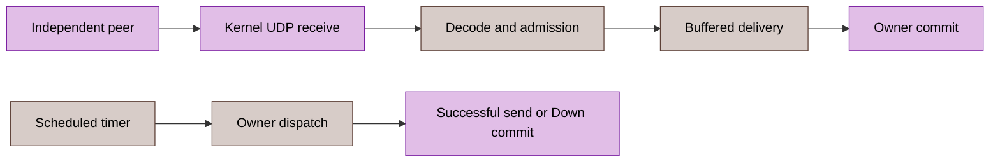

# Runtime performance and measurement

[Russian translation](../ru/14-performance-analysis.md).

Runtime qualification combines independent packet accounting, owner state, timer effects, resources and clock evidence. A source test, component benchmark or short fixture does not establish supported scale. [Benchmark procedures](12-benchmarks.md) cover component cost; this page defines runtime measurements and their limits.

## Measurement boundaries



| Measurement | Start → end | Limit |
|:---|:---|:---|
| Control RX commit | Converted kernel software RX → owner commit | Only valid clock conversions |
| Timer dispatch | Scheduled timer firing → owner handling | Owner scheduling delay |
| TX effect | Scheduled firing → successful SendPacket return | No wire/peer-arrival guarantee |
| Detection effect | Scheduled firing → timeout-caused Down publication | Before logs, notification or actuator |
| Peer send | Actual UDP write | Not owner receipt |
| Enqueue benchmark | Decode/lookup → attempted buffered enqueue | Not owner processing |

Implementations: [receiver](../../internal/netio/receiver.go), [timer observations](../../internal/bfd/timer_observation.go), [workload owner](../../test/internal/bfdload/owner_linux.go), [assessment](../../test/internal/bfdload/assessment_linux.go).

## Receive telemetry

Linux base listeners request SO_TIMESTAMPNS_NEW and SO_RXQ_OVFL. ENOPROTOOPT marks optional telemetry unavailable; other option errors stop listener creation. TTL and packet-info metadata remain mandatory. The 128-byte ancillary buffer includes timestamp, drop count, TTL/Hop Limit and destination/interface data. MSG_CTRUNC produces ErrAncillaryTruncated before demux.

KernelRXUnixNano holds a software CLOCK_REALTIME reading; zero means absent/invalid. Native-endian time64 decoding requires normalized nanoseconds and a positive int64 result. This is not a hardware timestamp. The [kernel timestamp ABI](https://www.kernel.org/doc/html/latest/networking/timestamping.html) owns the external format.

Each listener calibrates paired realtime/monotonic readings. Missing monotonic data, numeric overflow, samples before calibration or in the future remain invalid/unusable. Realtime-versus-monotonic elapsed disagreement above 1 ms revokes that listener's calibration, including already queued packets. Restarting a receiver on the same listener does not clear revocation; recreating the listener does.

The 1 ms tolerance is a validity policy, not an accuracy guarantee. An intervening clock step that returns before observation can escape paired checks. Clock validity never changes packet acceptance or monotonic detection deadlines.

Completed Control owner packets increment timing outcomes valid, unavailable, invalid, before_calibration, future or clock_step. Only valid samples enter gobfd_bfd_control_rx_commit_seconds. Refused validation, enqueue/refusal, abandonment and panic have separate delivery denominators. Metrics have no peer labels. Legacy/overlay inputs without kernel timing report unavailable.

### Socket drops

SO_RXQ_OVFL is a cumulative uint32 snapshot attached when a datagram is queued. It is not a per-packet delta. An absent cmsg does not prove zero drops. Drain old queue entries and observe fresh post-load markers; repeat a marker to verify idempotent aggregation.

Each base listener retains a synchronized high-water mark across receiver restarts. Fresh daemon sockets begin at zero; existing/custom sockets need a known initial baseline. Forward modular distances below 2^31 advance the mark; equal samples add zero, stale/half-range samples are ambiguous and preserve it. Multiple unobserved wraps or resets that mimic progress cannot be detected.

Drop observation precedes size/TTL/BFD rejection. Complete independent ancillary metadata survives payload truncation; malformed, duplicate or truncated drop cmsgs are invalid. Read error, closure and timeout are not consumed-datagram samples. Overlay listeners are outside this boundary. Two kinds and five outcomes produce ten sample counters and two increment counters without peer labels; deleting/resetting their series is unsupported.

See [socket-drop tests](../../internal/netio/socket_drops_test.go) and [real UDP tests](../../internal/netio/socket_drops_linux_test.go). These counters do not establish complete wire loss.

## Timer observations

Control/Echo owners retain the actual timer-channel timestamp and reset their own detection timers. Dispatch and effect use monotonic arithmetic, separately from converted kernel realtime.

Four timer kinds expose 20 event-counter series and eight valid-stage histograms. Invalid zero/future timestamps remain outcomes. no_effect combines suppression, send failure and idle detection; it is not a loss counter. A panic/in-flight handler can leave dispatch without a terminal effect. Untimed actions do not enter observations.

Do not turn timer arithmetic or a reset-contract test into scheduling, false-Down or scale acceptance.

## Workload command reference

The Linux-only [bfdload entry point](../../test/cmd/bfdload/main.go) exposes the following forms. Run or build it in the pinned environment; owner/peer/prepare commands create sockets or namespace addresses and require an admitted disposable runtime.

| Form | Result |
|:---|:---|
| bfdload environment | JSON observations of the current process |
| bfdload prepare HOST_NAMESPACE PROFILE [flags] | Add missing local/peer addresses to a verified private loopback namespace |
| bfdload owner PROFILE [flags] | Run production-core owners and emit owner JSON |
| bfdload peers PROFILE [flags] | Run independent peer traffic and emit peer JSON |
| bfdload assess OWNER_JSON PEER_JSON | Read joined reports and emit conditional assessment |

PROFILE is fixture, reference or engineering. Pass the complete explicit endpoint manifest to both roles; named profiles do not synthesize it from a session count.

Owner listeners and senders request the daemon's default socket buffers, including recreated churn senders: 4 MiB for receive and transmit. The kernel can clamp these requests; record effective socket capacities and drop counters on the runner. A successful buffer request does not establish lossless reception. Sources: [owner sockets](../../test/internal/bfdload/owner_linux.go), [daemon defaults](../../internal/config/config.go).

| Flag | Meaning/default |
|:---|:---|
| --session=LOCAL_ADDRPORT,PEER_ADDRPORT | Repeat once per session; IPv6 AddrPort uses brackets |
| --interface=NAME | Interface for all bindings; required by named profiles |
| --source-port-base=49152 | First stable peer source port; all N ports must fit through 65535 |
| --control-dir=ABSOLUTE_PATH | Private shared phase-control directory; absent means independent timers |
| --echo | Select Echo owner/return mode; default false |
| --sessions / --interval / --duration | Exact selected profile dimensions |
| --detect-multiplier | Nonzero wire multiplier; default 3 |
| --cpu-load-percent | Requested owner duty; actual consumption is measured separately |
| --gc-pressure / --scheduler-pressure / --session-churn | Default-off pressure/lifecycle variants |
| --tx-only-blackhole | Default-off fixture-only direction selector |
| --loss-permille | Per-direction intentional random omission rate |
| --blackhole-every / --blackhole-for | Period/duration; zero disables both |
| --seed | Reproducible loss seed; default 1 |

Scalar flags reject repetition; only session repeats. The manifest count must equal sessions, peer receive endpoints must be unique and distinct from their owner endpoint, and the stable source range must fit. Named profiles require both address families and both receive endpoints on Control 3784 or Echo 3785. The fixture permits bounded alternative ports.

prepare has a 30-second setup context. HOST_NAMESPACE is the freshly observed host network-namespace inode supplied by the owner. The current nonzero namespace must differ, contain only an already-Up loopback interface, and every manifest binding must name lo. Preparation is idempotent for existing exact host-length prefixes; it adds addresses through rtnetlink and never deletes existing addresses. A partial failure leaves the owning runner responsible for authorized disposal of the entire owned namespace. See [preparation](../../test/internal/bfdload/topology_linux.go) and [flag validation](../../test/cmd/bfdload/peers.go).

A coordinated run is not resumable by restarting roles in the same control directory: complete phase publications refuse replacement. On cancellation or an incomplete terminal ledger, join the owned processes and preserve their partial JSON and diagnostics. Start a new admitted run with a fresh private control directory; do not merge counters across runs or remove shared namespaces. Namespace disposal remains the owning runner's separately authorized recovery action. Sources: [one-time publications](../../test/internal/bfdload/control_linux.go), [phase stop/join protocol](../../test/internal/bfdload/control_phase_linux.go), [workload phases](adr/0007-workload-phase-accounting.md).

## Workload profiles

[profile_linux.go](../../test/internal/bfdload/profile_linux.go) defines the approved inputs:

| Profile | Sessions and interval | Duration | Fault/pressure input |
|:---|:---|:---|:---|
| reference | 1000 mixed IPv4/IPv6, 100 ms | 24 hours after setup | 1-per-mille loss, 80% CPU request, 1 s blackhole every 30 min |
| engineering | 5000, 300 ms | 30 minutes | Same loss/CPU; 1 s blackhole every 10 min |
| fixture | Explicit reduced test input | Selected bounded duration | Unqualified |

Engineering has complete blackholes at minutes 10 and 20; activity at cutoff belongs to drain. GC, scheduler and churn variants are default-off and require separate actual activity. Named profiles reject reduced dimensions and TX-only blackholes.

Reference admission requires exact child 8 CPU/8 GiB limits, GOMAXPROCS 8 and no tighter visible ancestors. Hidden hierarchy roots fail closed. Conservative PID headroom is sessions+64 at every visible ancestor: 1064 for reference and 5064 for engineering. This preserves the historical pinned-owner budget; it does not reserve resources or measure a required thread count.

## Observe resources

Run the Go-owned environment command inside the pinned container:

```sh
go run ./test/cmd/bfdload environment
```

CaptureEnvironment observes its own process: smaps_rollup RSS, threads, FDs, process context switches, observing-thread affinity, GOMAXPROCS, GC settings and copied cumulative runtime histograms. Infinite histogram bounds are strings. Samples are sequential and non-atomic; FD counts include observer descriptors, and overhead requires calibration.

Cgroup observations cover the visible hierarchy. cpu.stat bandwidth counts exclude inherited throttling; cpu.stat.local has separate optional validity. Missing/malformed values stay unavailable; max differs from numeric zero. Follow the [cgroup v2 contract](https://docs.kernel.org/admin-guide/cgroup-v2.html). Namespace visibility and generator isolation need separate evidence.

### CPU diagnostic attribution

Decode retained traces with the pinned Go toolchain before starting another workload. Go 1.27 uses `go tool trace -d=parsed` for decoded events; see the [pinned decoder source](https://github.com/golang/go/blob/go1.27.3/src/cmd/trace/main.go). Pair worker ClockGettime entries and syscall exits by GoID and transition stack; separate `Syscall→Running`, `Syscall→Runnable`, resumption, worker Gosched and companion yields. A syscall entry alone does not prove loss of the Go P. Entry-to-resumption duration includes runtime and scheduling; it is not isolated kernel execution time.

Keep source generations and trace-off/trace-on observations separate. A companion fixture with no observed P-loss is a negative attribution control, not proof that P-loss cannot occur under native load. Missing or unmatched events leave the cause unknown. Retain raw trace and decoder identity; scheduler waits, CPU profiles and wall brackets answer different questions. Existing duty, missed-window and native admission gates remain unchanged. See [Go runtime tracing](https://github.com/golang/go/blob/go1.27.3/src/runtime/HACKING.md#execution-tracer).

### Pressure and churn

| Driver | Bounded behavior | Receipt boundary |
|:---|:---|:---|
| CPU | One pinned helper per GOMAXPROCS, at most eight; 100 ms duty windows | Requested duty, actual thread CPU, worker wall time, lateness/missed windows |
| GC | At most 4 MiB/100 ms, 64 KiB objects, 16 MiB retained references | Bytes/objects/batches, skipped/truncated work, references and lateness |
| Scheduler | Four helpers per GOMAXPROCS, at most 32; up to 64 rounds of 1024 iterations plus Gosched per 100 ms | Actual rounds/yields, joined workers, skipped/incomplete windows, checksum |
| Churn | One admitted fixed-manifest session at a time; first at 250 ms, cadence 5 s, gap 200 ms | Real release/create/Up, source ports, generations and phase times |

CPU duty includes polling/runtime overhead; elapsed time does not prove consumed CPU. GC workers do not force GC/change settings, and released_objects counts occupied ring entries dropped at exit, not GC reclamation. Yield counts do not prove OS context switches or queue depth. Workers join before measurement freeze and drain.

A CPU window receives credit only from a thread-clock sample completed strictly before its wall deadline, checked after the clock call. Late reads retain the last on-time credit so later CPU work cannot erase a missed window; lifetime CPUTimeNS remains a separate total. This may conservatively report a miss when completion time is unknown. Cancellation and wall time are checked before every shared chunk; the thread-CPU clock is polled every four chunks. A partial batch adds no credit; coarser samples can defer the yield decision without a wall-latency bound. See [CPU accounting](adr/0007-workload-phase-accounting.md).

Missed CPU windows retain at most 16 diagnostic samples per worker, plus an omitted count. Each sample identifies the worker/window and original budget, separates accepted CPU from the last observed nondecreasing CPU sample, and records existing wall-check offsets with known flags and an exit branch. No clock reads are added. A rejected late sample never increases accepted credit. The last wall check does not prove return time or scheduler/GC cause. Join order is not temporal order; an omitted sample leaves its cause unknown. Rebuild the strict report reader for the new schema and identify this pressure generation by source SHA; diagnostic cost requires fresh qualification. See [CPU accounting](adr/0007-workload-phase-accounting.md).

CPU helpers call Gosched after about 5 ms of measured thread CPU while work remains in their 100 ms window. A full 80 ms CPU budget permits at most 15 voluntary checkpoints. They retain their full CPU budget and locked thread; waiting after a yield is not CPU consumption. Checkpoints provide no wall-latency guarantee. Identify this pressure generation by source SHA and apply it identically to both A/B sides; keep earlier-generation results separate. Eight workers, measured duty of at least 80% and zero missed windows remain required. Fresh native calibration is required. See [CPU pressure](../../test/internal/bfdload/cpu_pressure_linux.go) and [ADR-0007](adr/0007-workload-phase-accounting.md).

Churn requires duration at least six seconds and skips a cycle with less than five seconds remaining. AdminDown multiplier 3 needs at least three seconds of notification drain; recovery waits at most five seconds and never beyond measurement. The mixed-family process fixture uses 11 seconds. No actual recovery fails the enabled variant. Release start/completion brackets registry removal; completion is not the exact removal timestamp.

Current and retired generations retain separate RX counts; terminal accounting is lifetime-scoped. Active registrations differ from retained collector label sets. The fixed-manifest variant does not qualify arbitrary unique-peer metric growth.

## Owner, peers and phases

StartOwner runs production listeners, receiver, manager, owned senders and a real collector. Its snapshot retains endpoints/source ports, session state, delivery counters and resources. Shutdown joins owned workers and reports socket errors. Isolated alternate-port tests do not qualify RFC ports or the full daemon.

RunPeers uses an independent unauthenticated asynchronous Control model. Separate seeded PCG streams cover each direction and protocol jitter. Random omissions, blackholes, UDP writes, cancellation and unprocessed input remain distinct. Typed flags and repeatable session bindings reject duplicate scalar flags, malformed endpoints and reduced named profiles before opening sockets. Signals cancel, join and emit partial JSON.

Without control-dir, totals include setup/shutdown under independent duration timers. Controlled roles bind, reach readiness, adopt a future common monotonic epoch, freeze measurement_final, stop/join peers, settle terminal packets, then close owners. Private bounded control files refuse replacement and verify a common time namespace. Missing terminal receipts fail at a bounded deadline.

Never divide lifetime totals by requested duration as window throughput. [ADR-0007](adr/0007-workload-phase-accounting.md) owns phases and ledger.

### Echo mode

The permanent --echo selector uses actual Manager Echo sessions, production receiver and source-port leases. Both named endpoints use UDP 3785; one owner address per family remains in the prepared plan. Each physical session registers once and unregisters after owner join.

Peers return the complete datagram, including padding, with TTL/Hop Limit 254. Codec, tuple, inbound TTL and unauthenticated input are checked. They do not send periodic Control or synthesize remote Control Up. Readiness requires an actual return write. Independent received_sequences correlate accepted RX and return omissions.

This exercises the Echo preview, not an adjacent forwarding plane, RFC return authentication or complete RFC 9747. Current typed assessment handles Echo separately; no Control RX latency sample substitutes for an Echo measurement.

## Down evidence

The workload Manager drains queued notifications after producer join and before subscriber EOF with `WithShutdownNotificationDrain`. Physical identity checks, GAP and journal count equality remain mandatory. This observational shutdown invokes no actuator and leaves default Manager abandonment unchanged; see [ADR-0007](adr/0007-workload-phase-accounting.md).

A complete source journal is required even when there are no Down rows. Raw and subscriber queues reserve min(65536,64+3N): 3064 entries at N=1000, reaching saturation beyond 21824 producers. Each subscriber owns its queue. Sustained churn/reload growth can overflow; legacy/unconfigured queues remain 64. GAP and overflow checks stay mandatory.

One consumer runs from setup through owner shutdown. After owners join, it joins within five seconds; gaps, omissions, missing counters or unsettled delivery fail completeness. Retain:

| Field | Meaning |
|:---|:---|
| cutoff_at_utc | Planned measurement end |
| source_sampled_at_utc | Actual completion of cutoff counter read |
| source_transitions | Lifetime Up→Down count at that read |
| final_source_transitions | Count after owner shutdown |
| observed_before_cutoff / observed_after_cutoff | Delivered notification-time totals, including setup/drain |
| down_events | Notification rows only in [start,end) |

Require observed_before_cutoff ≤ source_transitions ≤ final_source_transitions and final_source_transitions = observed_before_cutoff + observed_after_cutoff. Samples are not atomic at cutoff. Do not subtract an unobserved startup baseline.

### Owner witnesses and identity

StateChange.TransitionTiming contains the last validated receive, actual dispatched detection deadline, Detection Time and a local commit bracket. ObservationVersion must match. Echo ValidatedAt means preview-owner acceptance; direct handler calls cannot invent detection deadlines or remote state.

down_witnesses retains setup/drain rows even when notification arrives after cutoff. Known flags distinguish measured zero from unavailable timing. Missing monotonic readings, mismatched versions and reversed brackets remain unknown. Compute offsets before UTC serialization; virtual synctest values do not establish native proof.

An incarnation binds slot, generation and full endpoint to a physical session. Seed before churn and follow matching Deleted/Added notifications; repeated active Added does not advance generation. Release session references on deletion/invalidation/end; historical rows retain scalars. Source-count complete and incarnations_complete are independent prerequisites. See [ADR-0012](adr/0012-owner-down-transition-witness.md).

### Independent peer expiries

Each Control peer retains up to 256 actual `detection_expiry_events`: lifetime expiry ID, previous state, old discriminators, accepted-receive time, actual deadline and handler-check time. `first_down_write` records only the first successful Down write after Init/Up expiry and before any new accepted input. Its `scheduled` ordinal is the lifetime TX decision number; decision time differs from the bracket around the socket write. Omissions and failed/canceled writes leave it unknown. Later writes do not replace it.

Offsets are projected after worker join; `phase_known=false` denotes the generator group epoch. `timing_known` distinguishes missing monotonic timestamps from measured zero. Overflow counts `detection_expiry_events_omitted` and rejects completion, including cancellation. A successful write does not establish delivery, owner incarnation or intentional loss. RemoteDown requires the existing old-deadline proof for every possible prior expiry origin; any unproven origin remains unresolved. See [ADR-0012](adr/0012-owner-down-transition-witness.md#independent-peer-expiry-evidence) and [producer](../../test/internal/bfdload/peer_expiry_linux.go).

A qualified Control RX omission retains `receive_qualified`: actual codec/tuple/TTL checks and protocol acceptance on a peer-state copy, with actual state/counters unchanged. RemoteDown classification enumerates every expiry with `ExpiredNS ≤ owner_validated+Bowner`, using checked arithmetic. Require a nonempty set and, for each possible origin, complete history, matching Up incarnation and expired-Down body, strictly ordered write/receive brackets and qualified RX coverage with `max(p)+D>d+Bpeer`. Reject any candidate whose lifetime write ordinal does not exceed every strictly earlier phase TX omission sequence; later ordinal equality remains valid after setup. Missing or late write evidence cannot exclude a possible origin. Each origin has a separate conditional old-deadline intervention, with all other dispositions fixed; this does not prove one physical replay or absence of later Down. The owner commit may follow the blackhole end. Legacy reports without producer witnesses remain unresolved. See [ADR-0012](adr/0012-owner-down-transition-witness.md#first-expiry-remotedown-ancestry).

### Actual omissions and classification

Peer blackhole_windows record actual TX/RX omission decisions separately from the schedule. Zero counts mean timestamps have no observation. RX decisions can precede validation; timing is not socket arrival or commit. Correlate only a common phase, never independent worker epochs.

Bounds per peer are 256 windows, 16 segments and 128 combined offset/sequence pairs per window. At 1000 peers absolute bounds are 4096000 segments and 32768000 pairs; 47 in-window reference periods bound them to 752000 and 6016000. These are cardinality limits, not measured RSS. Overflow is counted and rejects completion. Repeated markers do not duplicate loss.

ClassifyDowns assigns each eligible source witness intentional, false or unresolved; wholly outside commit brackets are separate. Local Control timeout attribution requires exact incarnation/tuple, old validated remote discriminator, directional Detection Time, actual due and known conversion brackets. Selectively restore only captured matching Up packets with unchanged intervals/multiplier, diagnostic None and clear Poll/Final. Each selected offset p satisfies `p>r+owner_bracket` and `p+peer_bracket<d`; a nonempty set must prove checked `max(p)+D>d+owner_bracket`. Validate every potentially in-range TX body before success. Keep RX omissions and narrowly validated expired Down packets withheld; their timing does not constrain the restored-Up proof. Unsupported bodies, Up after Down and broken actual decision accounting remain unresolved. [ADR-0012](adr/0012-owner-down-transition-witness.md) defines the complete packet grammar and intervention. Schedule overlap, packet count and nominal cadence alone are insufficient.

A positive intentional result assumes selected packets would be accepted and complete detection Reset before old due, with no coincident hidden independent fault. The conclusion concerns that old deadline; it does not replay the generator, remove the full fault or exclude later Down. Missing actual decisions, duplicate witnesses, journal overflow and run/clock mismatch prevent passing. Preserve earlier assessments; write reassessments separately with original producer and new assessor SHAs. The controller saves down-classification.json beside owner/peer reports and binary/resource/cleanup receipts. A changed cold reader does not qualify a native run.

Echo attribution instead checks local D=interval×DetectMult, the old actual deadline d, last accepted return r, matching incarnation/version and EchoFailed diagnostic. RX and return-TX omissions join by received_sequences: unique increasing read indices, nondecreasing times and a nonempty consecutive set matching the owner wire generation. Every selected input p must satisfy `p>r+owner_bracket` and `p+peer_bracket<d`; the complete commit bracket follows d inside the same blackhole window. Require checked `max(p)+D>d+owner_bracket` for a strictly later replacement deadline. DetectMult enters D; input count alone does not prove extension. Missing/replayed inputs, boundary overlap, overflow, absent extension or independent loss remain unresolved. This classifies only that old deadline under the explicit assumption of owner acceptance and Reset before due; it does not prove absence of later timeouts or authenticate RFC Echo returns. See [Echo omission model](../../test/internal/bfdload/echo_omission_linux.go).

Default-off tx-only-blackhole is fixture-only. Its quiet fixture uses six seconds, a 1.2-second blackout after three seconds and no loss/pressure/churn. The separate 13-second bidirectional fixture blackholes after nine seconds, uses CPU/GC/scheduler/churn and 25-per-mille loss, and requires actual random omissions. Neither is a named workload acceptance.

## Clock validity

Calibration retains a three-read monotonic bracket and nominal clock resolutions. The conditional conversion bound is span_ns + realtime_resolution_ns + monotonic_resolution_ns. It assumes constant realtime-minus-monotonic offset and one fixed read-error interval per clock, each no wider than nominal resolution. Nominal resolution alone does not prove that model or physical accuracy.

For outer monotonic B,A, anchor M,R and commit/kernel C,K, measured latency is C−M−(K−R). Fixed offsets cancel; the bracket plus one within-clock error difference per clock yields the conditional bound. The independent fixtures exercise skew and opposite interval endpoints. The separate 1 ms consistency tolerance is not this bound.

ClockEpochGuard arms realtime timerfd CANCEL_ON_SET before calibration and checks after the last sample. no_cancellation_observed does not prove no clock step; kernel publication/notification can race. Its seven-day horizon bounds lifetime. No per-packet syscall/guard goroutine is added.

WithClockEpoch requires process-local monotonic provenance covering calibration and owner shutdown. JSON replay cannot recreate it. Unknown/invalid/uncovered input clears bounds and stale qualification. Even with a conditional bound, total timing_uncertainty_ns remains null and reference_qualified remains false.

Before an authorized native run, apply the owned-runner clock procedure: chrony over its Unix socket, makestep 1.0 3, bounded waitsync 60 0.01 0 1, then makestep 1.0 0 before the anchor. Retain PID/InvocationID/restarts, selected source/leap state, boot/time namespace, kernel/Go/clocksource/config identities and compare afterward. No suspend, migration, restart, manual set or leap step is assumed. Chrony correction/skew is not the RX conversion bound. This is an owned-runner procedure, not an assessor option or authorization to modify a shared host.

## Assess joined reports

Run inside the pinned environment after both processes join:

```sh
go run ./test/cmd/bfdload assess OWNER_JSON PEER_JSON
```

Inputs are regular JSON files bounded at 512 MiB each. Duplicate/unknown members, invalid Unicode, trailing documents and malformed schema fail. Numeric nanosecond durations remain supported.

The assessor checks profile/admission, matching native phase, peer coverage of the full owner window, terminal ledger, causal Down evidence, resources and actual requested pressure/churn. Setup/drain UTC ranges need not start identically. One pass does not satisfy the variant matrix.

| Numeric check | Threshold or condition |
|:---|:---|
| TX/detection effect CDF | At 25/50 ms reach exact ceil(0.99N)/ceil(0.999N) ranks |
| Threads | Sampled peak ≤48 |
| FDs | Sampled peak ≤2N+256 |
| Goroutines | Sampled peak ≤3N+256 |
| RSS | Sampled peak ≤512 MiB |
| Reference RSS growth | First/final six-hour means: strictly below 5% growth |
| Engineering six-hour comparison | Not applicable to 30-minute duration |

Dispatch/no-effect denominators remain separate; percentile interpolation is absent. Control kernel-RX latency has its own distribution/bound, not the TX threshold. Echo selects echo_tx/echo_detection; RX-commit distribution is explicitly not_applicable. Stopped Echo returns must equal current+retired RX; peer input cannot exceed lifetime owner TX. Exact cross-counter settlement uses stopped snapshots.

pass exits zero; fail/incomplete emit structured output and exit nonzero. A pass is numeric acceptance under the declared conditional native software-clock model. Guest identity, operator discipline, source provenance, variant coverage and release acceptance remain separate.

## Retained observations and open gates

| Observation | Receipt | Boundary |
|:---|:---|:---|
| Mixed IPv4/IPv6 process fixture | reports/udp-resume-20261024; 47.98 s, 79 writes/79 commits, four removals | Production-core fixture, not reference/full-daemon acceptance |
| Corrected process fixture | b2e68ad2a13824a05a9b92528fe55c9a8d4fd6d1; 47.67 s, 79/79, nonempty measurement snapshot | reference_qualified=false; total clock uncertainty unknown |
| Owner collector allocation | reports/collector-owner-20261022; 16 B/op/2 allocs → 0/0 | Synthetic, no UDP/decode/auth |
| Numeric-zone sender recovery | 706991db9433b13cec47e0bb8ea2549b01e948d9 baseline; reports/sender-rebind-20261025 | Combined send/receive cost 3→51; corrected fixture 3 before and after two recreations |

Sender recovery retains source port 49152 and new ifindex; it is not a zero-allocation SendPacket benchmark. Its corrected receipt is green03-artifacts/sender-rebind-IPv6LinkLocal.json under the named report root; red08-test.txt preserves the failure.

Current Control/Echo owners run in goroutines without permanent per-session OS-thread pins. The old pinned baseline cannot satisfy 48 threads at 1000 owners. Matched native A/B, thread/RSS distributions, timer p99.9, false-Down and final 24-hour/wire gates remain required. Source integration does not supply them.

Do not infer RSS/session, startup time or GC pauses from construction B/op. The daemon has no project-wide GOMAXPROCS override. Keep default GOGC; qualify GOMEMLIMIT with deployment measurements. CPU quota does not reserve execution time. No network.dscp configuration field exists; qualify host QoS separately.

[Comparison method](13-competitive-analysis.md), [monitoring](07-monitoring.md), [RFC coverage](08-rfc-compliance.md).
