# ADR-0001: Link-state monitoring via rtnetlink

[Russian translation](../../ru/adr/0001-link-state-rtnetlink.md).

| Field | Value |
|:---|:---|
| Status | Accepted |
| Date | 2026-05-01 |

## Context

Interface state is a control-plane input to BFD. A link-down notification should request local PathDown before normal detection expiry, subject to event delivery and owner scheduling. Packet tracing does not supply interface lifecycle ownership.

## Decision

Use Linux `NETLINK_ROUTE` notifications in `internal/netio`. Parse `RTM_NEWLINK`/`RTM_DELLINK` into `InterfaceEvent{IfName, IfIndex, Up}`; operational Up is `IFF_UP && IFF_RUNNING`. Subscribe to IPv4/IPv6 address changes for pending-resource retries. Do not introduce `cilium/ebpf` into link-state monitoring.

| Input | Required behavior | Source |
|:---|:---|:---|
| Link down/delete | Request Down/5 without waiting for Detection Time | [interface_events.go](../../../cmd/gobfd/interface_events.go) |
| Existing local AdminDown | Retain AdminDown/7 | [session_loop.go](../../../internal/bfd/session_loop.go) |
| Address change | Retry pending resource classes without link side effects | [interface_events.go](../../../cmd/gobfd/interface_events.go) |
| Kernel/channel loss | Request full inventory resync | [ifmon_linux.go](../../../internal/netio/ifmon_linux.go) |
| Cancellation | Close monitor socket and owner-owned event channel | [ifmon_linux.go](../../../internal/netio/ifmon_linux.go) |

## Consequences

The socket observes its network namespace; host-interface observation requires the host namespace. Deployment policy must permit that access and netlink subscription. A PathDown request can lose a race to timer expiry; no earlier commit is guaranteed.

Use rtnetlink for link, address and route notifications; reserve TC/XDP/eBPF for independently designed packet-path features. The non-Linux stub provides no automatic retry events. Validate resync and interface recreation with [monitor tests](../../../internal/netio/ifmon_linux_test.go) and runtime reconciliation evidence.

## Interface recreation

Device-bound UDP sender recovery keeps the existing socket and source port. After resolving the interface name, require the `SO_BINDTOIFINDEX` readback to equal that positive expected index; return an error if the name refers to another incarnation during the operation. A successful bind syscall alone does not prove the expected binding. Sources: [sender recovery](../../../internal/netio/sender_rebind_linux.go), [socket regression](../../../internal/netio/sender_rebind_linux_test.go), [RFC 5881 §§3–4](https://datatracker.ietf.org/doc/html/rfc5881#section-3).

For a recreated explicitly named interface, the daemon resource checks refresh every physical single-hop session, including API-only and shared sessions. Preserve the session object, Ref, discriminator, authentication state, counters, claims and sender lease. Mark transport pending before recovery; block new RX and TX. The session owner commits PathDown unless already AdminDown and verifies same-socket sender rebinding. The daemon verifies the receive listener before the owner publishes a fresh receive binding. The Manager checks that the exact entry still exists before commit. Packets tagged with a previous binding cannot mutate the recovered session. Sources: [Manager refresh](../../../internal/bfd/manager_binding.go), [owner barrier](../../../internal/bfd/session_binding.go), [RX validation](../../../internal/bfd/session_packet.go), [UDP adapter](../../../internal/netio/sender_binding_linux.go).

Refresh unsolicited policy indices before taking the physical-session snapshot. Fence policy publication and session registration with the same registry lock. Recheck the interface after sender acquisition and validate the original packet metadata at activation. Reject a stale trigger and release only its unsolicited claim and quota; preserve independent API or configuration claims. Sources: [registration and activation](../../../internal/bfd/manager_session.go), [admission regression](../../../internal/bfd/manager_binding_admission_test.go).

Listener rebinding checks the inventory's expected index. Aggregate and Control health remain NOT_SERVING after a failed transport or listener check; return to SERVING only after both checks succeed and other required components are ready. Resource checks run on interface events and periodic rechecks without SIGHUP. Configuration receipts still describe desired generations; operational binding readiness is a separate condition. Sources: [resource wiring](../../../cmd/gobfd/handlers.go), [combined check](../../../cmd/gobfd/reconciliation.go), [readiness](../../../cmd/gobfd/readiness.go).

Obtain a fresh listener proof for each binding commit and the final readiness publication. Serialize checks, join a running check after refresh cancellation and reject callbacks admitted after finalization. A synchronous interface-inventory call can extend this join beyond the refresh deadline; the API cannot interrupt that syscall.

The [Linux daemon regression](../../../test/e2e/linux/daemon_pending_test.go) checks actual IPv4/IPv6 UDP RX/TX, retained discriminator, source port and socket identities during configuration-first shared ownership, configuration withdrawal, API-only veth recreation and configuration restoration followed by API release. Repeated API Add by the same principal returns `AlreadyExists` without another physical session or socket. The public snapshot exposes no internal SessionRef; these external checks do not prove full Ref equality or uninterrupted forwarding. Sources: [API claim probe](../../../test/e2e/linux/daemon_binding_test.go), [claim contract](../../../internal/bfd/manager_session.go).

The [retained-binding failure regression](../../../test/e2e/linux/binding_fault_test.go) covers IPv4/IPv6 with configuration, shared and API ownership after veth recreation. A missing local address fails actual sender recovery before listener verification. A wrong expected listener index fails actual readback verification; it does not simulate a failed bind syscall. Valid new-index UDP is observed and rejected while pending; successful RX/TX counters remain unchanged over a 1.1-second window with a configured one-second transmit interval. A correct retry preserves the full internal Ref, discriminator, socket identities and source port without another sender acquisition. Shared ownership survives configuration withdrawal; final claim withdrawal closes the physical sender once. These checks do not qualify aggregate daemon readiness, queued packets from an old binding, deletion races or supported peer interoperability.

The [isolated launcher](../../../test/internal/e2erunner/runner.go) enables IPv4 `accept_local` and disables `rp_filter` only in the `--network none` test namespace: both veth peers use local addresses. These are fixture settings, not deployment recommendations. Source: [Linux IP sysctl](https://docs.kernel.org/networking/ip-sysctl.html).

```mermaid
flowchart LR
    accTitle: Interface recreation and retained session binding recovery
    accDescr: Inventory changes move a confirmed binding to pending, trigger PathDown and sender/listener verification, and republish readiness only after live entry commit.
    confirmed["Confirmed binding"]:::leaf --> inventory["Inventory change"]:::mgt
    inventory --> pending["Pending: block RX and TX"]:::brt
    pending --> rebind["Owner PathDown and sender rebind"]:::srv
    rebind --> listener["Verify listener binding"]:::srv
    listener --> commit["Verify live entry and commit RX binding"]:::leaf
    commit --> ready["Publish readiness"]:::mgt
    rebind -->|"failure"| pending
    listener -->|"failure"| pending
    classDef mgt fill:#d7ccc8,stroke:#5d4037,color:#000
    classDef srv fill:#e1bee7,stroke:#7b1fa2,color:#000
    classDef leaf fill:#e3f2fd,stroke:#1976d2,color:#000
    classDef brt fill:#fff3e0,stroke:#bf360c,color:#000
```

An unnamed path migration or a sender without retained rebind support remains pending and requires explicit operator recovery. Never silently replace a physical session. Control-plane component tests do not qualify actual interface recreation, wire continuity or supported scale; retain the exact-source Linux and performance gates.

## References

- [Monitor implementation](../../../internal/netio/ifmon_linux.go).
- [Linux rtnetlink API](https://man7.org/linux/man-pages/man7/rtnetlink.7.html).
- [Architecture recovery boundary](../01-architecture.md#recovery-and-readiness).
