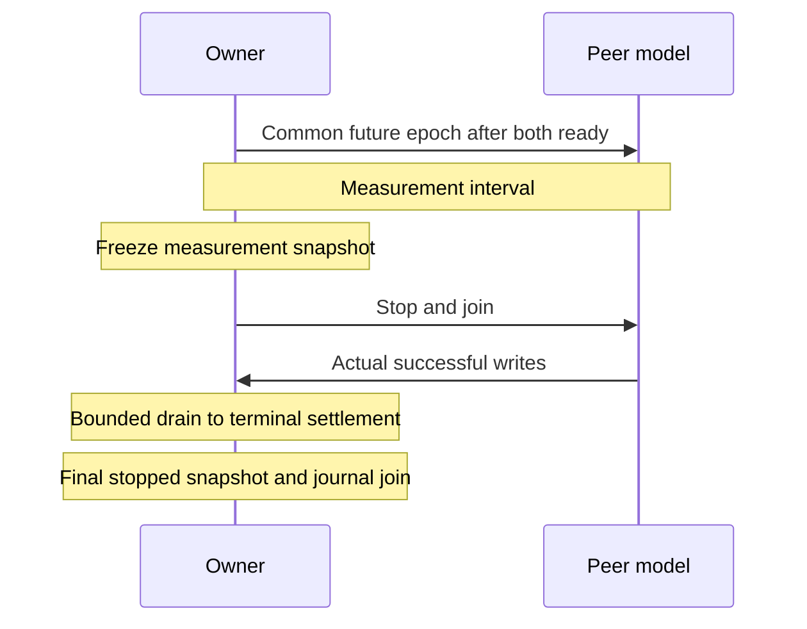

# ADR-0007: Workload phases and terminal packet accounting

| Field | Value |
|:---|:---|
| Status | Accepted policy; runtime qualification separate |
| Date | 2026-10-24 |
| CPU-generation amendment | 2026-10-29 |

## Context

Queue admission is not owner commit. Independent stop timers can end reception before a successful peer write reaches a terminal outcome. Elapsed duration alone cannot prove packet settlement, latency or reference acceptance.

## Decision

Use the existing Go-owned production-core workload and independent peer model. Keep source, subscription, terminal, clock and causal completeness independent.

### Queue population

Daemon and workload owner use `Q=min(65536,64+3*N)` for raw and per-subscription queues. Count configured Control sessions, enabled Echo/VXLAN/Geneve peers, Micro-BFD members and enabled unsolicited limit with checked arithmetic; shared claims may overcount. The reserve covers registration and two state changes per producer, not sustained lossless churn. Full reserve fits through N=21824.

Each subscriber costs O(Q), without a global subscriber budget. Default construction and legacy channel retain 64. API/reload growth does not resize queues or alter admission. Raw overflow emits recovery GAP; subscriber overflow retains its own GAP. Either invalidates journal completeness. Apply the shared policy to both A/B sides before comparing thread pins. Source: [Manager sizing](../../../internal/bfd/manager.go).

### Phase and terminal contract

After owner Up and peer traffic readiness, publish one future native-monotonic epoch. Both roles check time-namespace identity before Go-timer conversion. Owner-checked private `os.Root` control files are bounded to 64 bytes, reject links/special files and refuse replacement of complete publications. Conversion bracket is not a bound on total RX-clock uncertainty.

Require `successful peer writes = owner committed + terminal rejections + observed kernel drops`. The terms are disjoint; intermediate accepted/queued stages do not enter. Excess terminal counts fail immediately; missing counts fail at drain deadline with an incomplete report. Missing overflow samples never justify invented drops.

Keep frozen measurement and stopped lifetime snapshots separate. Handshake/drain counts divided by requested duration are not window throughput. Snapshot sampling is not simultaneous observation; unknown clock evidence stays unknown. Commands without a control directory retain independent timers and explicit limits. Sources: [phase protocol](../../../test/internal/bfdload/control_phase_linux.go), [terminal accounting](../../../test/internal/bfdload/controlled_owner_linux.go).

### Resource admission and pressure

Use the daemon's default receive/transmit buffer requests for workload-owner sockets, including churn recreation. Reuse the existing listener/sender configuration; do not substitute OS defaults or change host sysctls. Record effective kernel capacities and observed drops independently. This aligns transport setup with the daemon without qualifying throughput or loss. Sources: [owner](../../../test/internal/bfdload/owner_linux.go), [defaults](../../../internal/config/config.go).

| Input | Fixed contract | Measurement boundary |
|:---|:---|:---|
| PID headroom | Every visible nonroot ancestor: `pids.max−pids.current≥sessions+64` | Sequential check, no reservation/peak proof; reject missing/malformed/tight limits |
| CPU pressure | Effective GOMAXPROCS workers, at most 8; 100 ms windows; thread-CPU duty, truncate last | Report actual CPU/wall/lateness/missed budgets; no debt carry |
| GC pressure, default off | Up to 64 × 64 KiB objects/window, at most 256 refs =16 MiB, touch pages | Report batches/allocations/released refs; no immediate RSS reclamation promise |
| Scheduler pressure, default off | 4 helpers/GOMAXPROCS, max 32; max 64 rounds/window of 1024-iteration mix + Gosched | Yield count is not OS context-switch count |

Prepare helpers before common epoch; check cancellation/wall deadlines and skip elapsed windows. Join CPU/GC/scheduler workers before measurement freeze and drain on success/failure. CPU helpers pin only to measure CLOCK_THREAD_CPUTIME_ID and unlock on exit; scheduler helpers remain unpinned. Do not change GOGC, GOMEMLIMIT, scheduler policy or force GC. CPU polling/runtime work contributes to measured thread CPU. A request for 80% does not prove held host load; calibrate admitted resources separately.

CPU helpers voluntarily yield after about 1 ms of measured thread CPU while their current budget remains incomplete. Keep the original 100 ms wall window, full CPU budget, cancellation checks and no-debt rule; time waiting after a yield is not consumed CPU. Gosched preserves the helper's locked thread and makes its P available, but guarantees neither 1 ms wall latency nor a product timer bound. Record the source SHA as the pressure generation and use the same generation on both A/B sides; do not pool earlier distributions. The strict actual-CPU and zero-missed-window checks remain unchanged. This is a calibration change, not evidence of a production-latency correction.

PID limits count threads/descendants; GOMAXPROCS does not cap thread creation. Keep the conservative pinned-baseline task budget until measured native thread-pin A/B justifies change. Sources: [admission](../../../test/internal/bfdload/admission_linux.go), [CPU](../../../test/internal/bfdload/cpu_pressure_linux.go), [GC](../../../test/internal/bfdload/gc_pressure_linux.go), [scheduler](../../../test/internal/bfdload/scheduler_pressure_linux.go).

### Session churn, default off

Cycle one Up slot from the fixed endpoint manifest at a time: first start 250 ms after epoch, then five-second cadence without missed-cycle replay. Release the real final Manager claim, join drain, wait a 200 ms registration gap, recreate the same identity and require observed Up. Wait at most five seconds within measurement; do not begin with less than five seconds remaining. Enabled fixtures need six seconds minimum. Count not-Up slots and trailing skipped cycles; absent actual recovery fails.

AdminDown's one-second advertised floor with multiplier 3 needs at least three seconds of drain. Peer traffic continues independently. Subscribe before churn. Serialize inventory mutation, Close and snapshots under one lock; reject creation after closing. Each slot retains only current lease, accumulating retired counters after join. Record generations, discriminators, source ports, phase times and cardinality before release/during absence/after recovery. Release-start and drain-end bracket removal; neither is its exact instant.

Keep one-to-one Manager/demux counts separate from active gauges and retained metric series. Bound lifetime event storage for the 24-hour/five-second profile and count omissions. Join churn before freeze; settle the lifetime ledger across generations. Fixed-manifest reuse does not qualify arbitrary unique-label growth. Sources: [churn](../../../test/internal/bfdload/session_churn_linux.go), [inventory](../../../test/internal/bfdload/owner_churn_linux.go).

### Down journal

Start one bounded subscriber through setup, measurement and shutdown. Sample cutoff denominator from the actual collector Up→Down source counter, incremented before notification timestamp/enqueue. Retain planned cutoff and actual sample completion separately. Freeze measurement before stop/drain/journal join; use that snapshot for histogram deltas.

Retain at most maxDownEvents compact rows with monotonic timestamps until phase is known. Count all notifications before/after cutoff, but keep `down_events` rows only in [start,end); before-cutoff includes setup. After owners join, require normal subscriber closure within five seconds, otherwise cancel/join.

Completeness requires final source count equals before+after observations and `before≤cutoff source≤final source`. GAP, overflow, invalid counters, unclosed subscription or mismatch fails. Later events cannot compensate earlier loss; do not subtract sampled startup flaps. Reuse metrics without a hot-path fence. Completeness alone proves neither intentional Down nor commit/clock validity. Source: [journal](../../../test/internal/bfdload/down_journal_linux.go).

### Blackholes and assessment

Engineering uses 5000 sessions, 300 ms, 30 minutes, random loss and CPU pressure, with one-second blackholes every 10 minutes. Full measured windows begin at minutes 10 and 20. Reference retains one-second windows every 30 minutes over 24 hours. A first blackhole at the 30-minute cutoff cannot qualify engineering failure/recovery. Record profile differences; older engineering 30-minute-period runs do not qualify the corrected workload.

The positive actual-UDP Control fixture uses multiplier 1 and 75–90% planned jitter for dispatch headroom. Named profiles retain multiplier 3; actual omission gaps above negotiated interval remain unresolved, including fractional overruns.

`bfdload assess OWNER_JSON PEER_JSON` joins one canonical stopped reference/engineering run. Require complete profile/admission/ledger/causal evidence before numeric thresholds. Use producer calibration bounds and exact integer CDF ranks at 25/50 ms effect-histogram boundaries. Keep RX, dispatch, successful-effect, no-effect and invalid denominators distinct; exact cross-counter settlement needs stopped observations.

Measured violations/false Down fail. Unknown/malformed evidence is incomplete; unresolved Control Down is numeric failure, unresolved Echo is incomplete. Both retain structured report and nonzero exit. Engineering has no invented six-hour subwindows. Readers preserve numeric nanosecond durations but reject duplicate/unknown fields and invalid Unicode.

Passing remains conditional on clock/transport assumptions; serialized input cannot recreate private monotonic coverage. Total uncertainty stays null and reference_qualified false. Native clock discipline, source provenance, required variants and release acceptance remain separate. Sources: [assessment](../../../test/internal/bfdload/assessment_linux.go), [classification](../../../test/internal/bfdload/down_classification_linux.go), [ADR-0012](0012-owner-down-transition-witness.md).

### Echo workload

Explicit `--echo` records mode without changing named profile dimensions. Reuse Manager, leases, phases, pressure, churn and drain. Mixed-family topology retains one owner address/family and receive port 3785; Control validation remains unchanged.

Peers return only bytes actually received, including padding, at TTL/Hop Limit 254. Validate codec, IP tuple and inbound TTL before RX-loss decision; authenticated input is unsupported. Each surviving input produces one return decision, without peer Control FSM or autonomous periodic TX. Readiness means an actual return write. RX blackhole omission creates no TX attempt.

Register metrics once per physical Echo creation and unregister after final release/Manager close joins owner. Compatible claims share registration. Count actual physical Manager entries, not retained series. Echo has no Control AdminDown exchange, but retains conservative churn budgets.

Omissions retain original Read sequence, joining RX and return-TX choices. Keep journal bounds and independent read/return/drop counters. Valid means codec/tuple/TTL-checked, not RFC authentication/delivery. Sum current/retired returns against committed Echo delivery; peer Read cannot exceed lifetime owner TX. Echo kernel-RX latency is explicitly not_applicable. Old-deadline classification follows ADR-0012, without remote Up or guessed Control traffic.

Sources: [Echo peer](../../../test/internal/bfdload/echo_peer_linux.go), [owner](../../../test/internal/bfdload/owner_echo_linux.go), [omission model](../../../test/internal/bfdload/echo_omission_linux.go). Native Echo qualification remains required.

## Consequences

Implementation acceptance is separate from reference distributions, regression policy, native A/B and final wire/24-hour release gates. Local fixture success does not qualify full-daemon load, clock accuracy or stable delivery and does not justify a new scheduler/kernel fast path.

## References

- [Performance and clock boundaries](../14-performance-analysis.md).
- [RFC 5880 §6.8.4](../../rfc/rfc5880.txt).
- [Owner Down witness and conditional causality](0012-owner-down-transition-witness.md).
