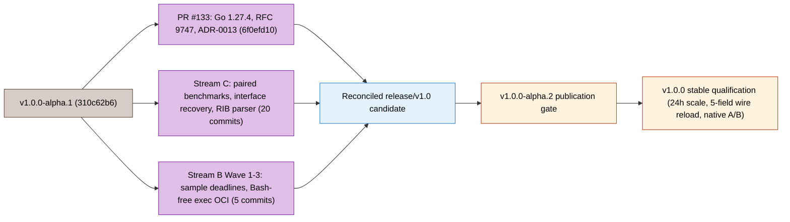

# V1 release retrospective and stream reconciliation — 2026-11-27

[Russian translation](../../ru/audits/2026-11-27-release-retrospective.md).

This assessment compares the [26 October release retrospective](2026-10-26-release-retrospective.md) (`dev@1c535f9ac1de7a12f7d85054a9d0fe81216f02c0`) with `release/v1.0@6f0efd108c7a66f291818063e2c447c676ef0dd8` (merged pull request `#133`) and records the convergence of the divergent post-`v1.0.0-alpha.1` local work streams onto `release/v1.0`. The [production contract](../reference/production-contract.md) and its accepted amendments define release scope. This document is a dated engineering assessment; it does not authorize stable release publication.

## Change since the 26 October retrospective

Between `1c535f9ac1de7a12f7d85054a9d0fe81216f02c0` and `6f0efd108c7a66f291818063e2c447c676ef0dd8`, `release/v1.0` incorporates 253 commits across 543 changed files (`+59,134/-33,561` lines; 864 tracked Go files):

| Scope | Files changed | Added | Deleted |
|:---|---:|---:|---:|
| Runtime and API, excluding tests and generated code | 52 | 2,332 | 350 |
| Tests, tools, scripts, container recipes and CI | 358 | 47,222 | 3,959 |
| Documentation and supply-chain data below docs | 119 | 9,235 | 29,173 |
| Generated protobuf packages | 0 | 0 | 0 |
| Root configuration and build metadata | 14 | 345 | 79 |

Key delivery and protocol blockers resolved in `release/v1.0` source by `6f0efd108c7a66f291818063e2c447c676ef0dd8`:

| Area | Verified boundary on `release/v1.0` | Evidence |
|:---|:---|:---|
| Experimental prerelease boundary | Maintainer-authorized `v1.0.0-alpha.N` channel ([ADR-0008](../adr/0008-experimental-prerelease-boundary.md)); immutable `v1.0.0-alpha.1` tag at `310c62b61254f702fbbbe84496b3dea7967dcf63` | Git tag `v1.0.0-alpha.1`, active tag/branch rulesets |
| GoBGP restart ownership and Unix IPC | Kernel-verified `SO_PEERCRED` speaker-epoch receipts ([ADR-0013](../adr/0013-gobgp-restart-disable-ownership.md)), filesystem `unix://` targets (`#131`, `#132`) and loopback `--api-hosts=127.0.0.1:50051` in Kubernetes manifests | Pull request `#133`, `internal/gobgp/`, `deployments/integrations/kubernetes/manifests/daemonset.yml` |
| Toolchain, Debian trixie peers and vulnerability baseline | Go `1.27.4`, `debian:trixie-slim@sha256:8aa5a7bf5a1955bddbe7d74fcdd0b91ab30e74362a8b73af672b0481b35b44a0` (including FRR `10.7.1` and BIRD `3.4.0` interop peers), `GoBGP v4.11.0`, `GoReleaser v2.20.3`, `Syft v1.57.2`, `Trivy v0.76.2`, `Compose v5.8.0`; zero runtime/tool allowlist entries | `scripts/vuln-audit.go`, `test/interop/`, CI run `45973518398` |
| RFC 5880, RFC 9747 and goroutine scheduling | Slow one-second Echo TX pacing outside `Up` (`max(TxInterval, 1s)`), sub-microsecond Echo rejection, fail-closed auth length/`DetectMult` guards, exact `[75%, 90%]` `ApplyJitter` ceiling for `DetectMult == 1`, and removal of permanent per-session `runtime.LockOSThread` (`bb6668fc`) | `internal/bfd/`, E2E run `45973518378` |
| Hosted CI determinism | Preserved `argv[0]` on `/proc/self/fd/3` execution for Ubuntu 26.04 `uutils`, unique `ext4` socket inodes in restart tests, single Go module cache owner | CI run `45973518398`, E2E run `45973518378` |

## Post-alpha.1 branch divergence and reconciliation

After `v1.0.0-alpha.1` (`310c62b61254f702fbbbe84496b3dea7967dcf63`), local engineering split across three isolated worktrees while `release.yml` benchmark comparison blocked `alpha.1` draft publication against `v0.6.4`. Reconciling the lint-clean waves onto `6f0efd108c7a66f291818063e2c447c676ef0dd8` consolidates completed work while keeping unlinted prototype and diagnostic branches preserved under backup refs:

| Stream slice | Disposition on `release/v1.0` | Rationale |
|:---|:---|:---|
| Paired release benchmark overlay (`decode-packet-per-iteration-v1`), race preflight and 120s sample deadlines | Integrated | Resolves pointer-retaining baseline race and enforces equivalent timed boundaries against `v0.6.4` |
| Reviewed RX demux optimizations (`transportScope` reuse and concrete `*Manager` delivery reporter) | Integrated | Preserves zero allocations and thread safety; five unreviewed lock-elision experiments remain excluded |
| Interface recreation and retained session binding recovery | Integrated | Restores `SO_BINDTODEVICE` sender/listener leases across link delete/recreate and preserves local `AdminDown` causes |
| Function/profile code-quality inventory (`repoquality code`) and strict GoBGP RIB JSON parser | Integrated | Separates test support from production complexity budgets and fails closed on truncated RIB output |
| Bash-free diagnostic/dev OCI recipes and exec-form `Containerfile` contract | Integrated (`PR #135`, `a315549c`) | Removes explicit Bash installation and shell `RUN` steps while retaining checksum-verified `Compose v5.8.0` |
| Runtime core hardening: Micro-BFD loss resync & `enforce` readiness, bounded per-peer metrics (`4096`), kernel `dev_valid_name` validation and recursive-safe shutdown | Integrated (`PR #136`, `53644fae`) | Eliminates stale LAG actuation on notification loss, bounds churn series cardinality, and deduplicates NetworkManager D-Bus helpers |
| Run-owned E2E/Compose/stage image cleanup, direct Kubernetes containerd gRPC lease import, canonical Grafana provisioning and Bash-free `Makefile` (`Stream B` Wave 4–5) | Integrated (`PR #137`) | Decomposes all 387 lint findings across 19 profiles (`0` issues), imports OCI archives create-only via containerd gRPC leases, and removes duplicate observability assets |
| Source-built Docker Compose Go module graph (`v5.6.1` prototype) | Deferred to post-v1 | Current `release/v1.0` already verifies `Compose v5.8.0` by SHA-256; source graph requires `v5.8.0` upgrade first |
| Diagnostic CPU-window attribution witnesses (`695b2fa1`) | Parked on diagnostic branch | Extra per-window clock reads carry unbounded observer cost and are documented as diagnostic-only |

## Execution hierarchy and remaining v1 scope

Counts below measure the v1 work hierarchy at `6f0efd108c7a66f291818063e2c447c676ef0dd8` immediately before closing the newly reconciled post-`alpha.1` tasks, preserving comparability with the October snapshots:

| Measure | 23 October | 26 October | 27 November |
|:---|---:|---:|---:|
| Descendants | 423 | 523 | 698 |
| Closed descendants | 293 | 384 | 535 |
| Unclosed descendants | 130 | 139 | 163 |
| Leaf tasks | 322 | 392 | 528 |
| Unclosed leaves | 84 | 75 | 85 |
| Unclosed leaves by priority P0/P1/P2/P3 | 8/51/24/1 | 7/41/26/1 | 7/39/38/1 |

Task counts are not a completion percentage: added leaves reflect finer-grained prerelease, container-ownership and Kubernetes verification decomposition, while `535` closed descendants (`+151` since 26 October) retired the Go 1.27.4 / GoBGP v4.11.0 / advisory / Unix-ownership / RFC 9747 pacing backlog.

| Remaining gate | Target channel | Required evidence |
|:---|:---|:---|
| Publish `v1.0.0-alpha.2` from converged `release/v1.0` (`PR #133`, `#135`, `#136`, `#137`) | `v1.0.0-alpha.2` | Hosted `CI`, `PR-safe E2E`, `release.yml` paired benchmark pass, verified draft assets and package lifecycle |
| Qualify live Debian trixie integration consumers (BGP failover, ExaBGP, Kubernetes DaemonSet) | `v1.0.0` stable | Live Compose and Kubernetes DaemonSet verification receipts on the converged `release/v1.0` candidate |
| Record native Control/Echo A/B baseline without `runtime.LockOSThread` | `v1.0.0` stable | Native 1,000-session A/B evidence meeting the `2*GOMAXPROCS+32` OS-thread ceiling without timer regression |
| Unified five-field session-preserving reload qualification on supported peers | `v1.0.0` stable | Wire pcaps and uninterrupted `Up` state across pinned FRR `10.7.1` and BIRD `3.4.0` on the frozen candidate |
| Admitted reference runner, 5,000-session engineering gate and 24-hour 1,000-session run | `v1.0.0` stable | 24h run on isolated 8 vCPU / 8 GiB Debian runner (`p99 <= 25 ms`, `p99.9 <= 50 ms`, `RSS <= 512 MiB`, `< 5%` drift) |
| Final candidate audit, changelogs and branch synchronization (`release/v1.0`, `master`, `dev`) | `v1.0.0` stable | Signed deb/rpm/OCI/SBOM/provenance verification, EN/RU changelog parity and forward-port to `dev` |

## Engineering estimate

Ranges below are active engineering estimates excluding external infrastructure wait times; parent and child scopes are not summed twice:

| Work package | Active hours |
|:---|---:|
| W1: land reconciled post-`alpha.1` Wave 1–3 PR, publish `v1.0.0-alpha.2` and verify hosted package lifecycle | 2–4 |
| W2: lint-clean `Stream B` Wave 4–5, source-built `Compose v5.8.0` and Debian trixie integration consumer checks | 4–7 |
| W3: record native Control/Echo A/B evidence and 5,000-session engineering run | 3–5 |
| W4: unified five-field wire reload qualification (`FRR 10.7.1`, `BIRD 3.4.0`) and UDP ancillary checks | 3–5 |
| W5: isolated reference runner admission, final candidate audit, changelogs and branch closeout | 4–6 |
| Total active engineering to stable candidate freeze | **16–27** |
| Mandatory 1,000-session reference qualification | **24 elapsed hours** |

## Process lessons

1. **Keep one integration tip per release line.** Parallel unpushed worktrees (`20` and `43` commits ahead of `v1.0.0-alpha.1`) created duplicate fixes and left uncommitted container/Kubernetes edits stranded. Commit work on topic branches immediately and merge each lint-verified wave before opening the next.
2. **Run the full 92-linter gate before parking prototype branches.** `Stream C` and `Stream B` Wave 1–3 passed all 19 lint profiles cleanly, whereas `Stream B` Wave 4–5 accumulated 387 complexity and error-wrapping diagnostics; isolating Wave 4–5 prevents blocking `v1.0.0-alpha.2`.
3. **Separate unsafe micro-optimizations from reviewed changes.** Unsynchronized cross-goroutine `time.Time` reads and lock-splitting experiments regressed either `-race` safety or paired throughput; retaining backup refs while integrating only race-clean, benchmark-verified commits (`0c93f227`) prevented hot-path regressions.
4. **Upgrade compiler, modules and scanners as one atomic wave.** Moving to `Go 1.27.4`, `GoBGP v4.11.0`, `GoReleaser v2.20.3` and `x/crypto v0.59.0` together eliminated all temporary vulnerability allowlist entries instead of extending exception review dates.
