# V1.0.0 post-release retrospective and formal RFC audit — 2026-11-28

[Russian translation](../../ru/audits/2026-11-28-v1-post-release-retrospective-and-formal-rfc-audit.md).

This engineering retrospective and formal protocol audit records the completed `v1.0.0` release delivery, evaluates GoBFD against the full 2026 IETF BFD Working Group RFC and Internet-Draft set, and documents machine-checked verification results produced with `Z3`, `TLA+ TLC`, `Lean 4`, `SageMath`, cryptographic cost modeling and `Go 1.27.4` microbenchmarks. It complements the [27 November pre-release convergence assessment](2026-11-27-release-retrospective.md) and defines the technical input for the post-`v1.0.0` (`dev` / `v1.1`) roadmap.

## 1. V1.0.0 release delivery retrospective

### Delivery timeline and verified artifacts

Between `v1.0.0-alpha.1` (`310c62b61254f702fbbbe84496b3dea7967dcf63`) and the published `v1.0.0` release (`release/v1.0@bc558130d37e489939f4b8764b6a9d1b568861da`, immutable annotated tag `v1.0.0@1cac85e8083b38717066769f2db7b0d62ad7f11d`, synchronized to `master` and `dev` at `3bcdea03d3f05f21b14dd2a785e20805f642bf5f`), engineering converged three parallel development streams through eight reviewed pull requests (`#133`–`#140`):

```mermaid
flowchart LR
    accTitle: GoBFD v1.0.0 convergence, release publication and branch synchronization
    accDescr: Pull requests 133 through 139 converge onto release/v1.0, Release Please PR 134 cuts v1.0.0, release.yml publishes verified artifacts, and PR 140 synchronizes master and dev.
    A1["v1.0.0-alpha.1 (310c62b6)"]:::mgt --> W1["PRs #133, #135, #136, #137: Go 1.27.4, GoBGP v4.11.0, Bash-free OCI, 0 lint"]:::srv
    W1 --> W2["PRs #138, #139: ADR-0014 graduation, 115-doc audit, mascot logo"]:::srv
    W2 --> RP["PR #134: Release Please v1.0.0 (bc558130)"]:::leaf
    RP --> TAG["Annotated tag v1.0.0 (1cac85e8) + release.yml (46083125672)"]:::brt
    TAG --> SYNC["PR #140: master & dev sync (3bcdea03)"]:::leaf
    classDef mgt fill:#d7ccc8,stroke:#5d4037,color:#000
    classDef srv fill:#e1bee7,stroke:#7b1fa2,color:#000
    classDef leaf fill:#e3f2fd,stroke:#1976d2,color:#000
    classDef brt fill:#fff3e0,stroke:#bf360c,color:#000
```

| Milestone | Reference | Measured verification receipt |
|:---|:---|:---|
| Core stack, Unix ownership and preview pacing | Pull request `#133` (`6f0efd10`) | `Go 1.27.4`, `GoBGP v4.11.0`, [ADR-0013](../adr/0013-gobgp-restart-disable-ownership.md) `SO_PEERCRED` epoch receipts, slow `1 s` Echo TX outside `Up` |
| Bash-free OCI and runtime hardening | Pull requests `#135` (`a315549c`), `#136` (`53644fae`), `#137` (`e4f9c3b8`) | Exec-form `Containerfile` recipes, Micro-BFD loss resync, bounded `4,096` inactive peer series, containerd gRPC lease import, `0` issues across 92 linters / 19 profiles |
| `v1.0` GoBGP v4 graduation and documentation audit | Pull requests `#138` (`816fc7e0`), `#139` (`a1f8c84c`) | [ADR-0014](../adr/0014-v1-gobgp-v4-release-line-baseline.md), `repoquality markdown` clean across `115` `.md` files and `36` Mermaid diagrams |
| `v1.0.0` release cut and publication | Pull request `#134` (`bc558130`), tag `v1.0.0` (`1cac85e8`) | Workflow run `46083125672` (`SUCCESS`): `12` release assets (`.deb`, `.rpm`, `.tar.gz`, CycloneDX SBOMs, `checksums.txt`, Cosign bundle) + multi-arch GHCR `:1.0.0` / `:latest` |
| Default-branch and `dev` synchronization | Pull request `#140` (`3bcdea03`) | `master` and `dev` aligned to tree `61b43f886e09a5943a9774c406dc9a654790b6d9`; 12 superseded `v0.6`/GoBGP-v3 Dependabot PRs (`#111`–`#130`) closed |
| Host storage and container hygiene | Build workstation cleanup | `+43.1 GiB` reclaimed on `/` (`97%` to `83%` utilization) across stale container layers, dangling build caches and language caches without disrupting active services |

### Retrospective lessons from the `v1.0.0` closeout

1. **Release-branch merges require explicit back-merge to `master` before landing documentation on `master`.** Landing documentation and Release Please commits on `release/v1.0` left `master` at the `v0.6.4` tree until pull request `#140` reconciled both branches. Maintaining the post-release back-merge as an explicit release-checklist gate prevents default-branch README drift.
2. **Paired benchmark overlays must isolate allocation semantics across major internal refactors.** Comparing `v1.0.0` against `v0.6.4` failed initially because `v0.6.4` mutated a retained packet struct while `v1.0` enforced immutable per-iteration decoding; shipping `decode-packet-per-iteration-v1` established apples-to-apples timing without weakening regression thresholds.
3. **Splitting product-line contracts (`release/v0.6` on GoBGP v3 vs `release/v1.0` on GoBGP v4) retired 12 incompatible dependency PRs cleanly.** Recording the boundary in [ADR-0014](../adr/0014-v1-gobgp-v4-release-line-baseline.md) separated incompatible major-API upgrades from security maintenance.
4. **Operational soak and hardware NOS qualification remain distinct from source release readiness.** Publishing `v1.0.0` with explicit `CapabilityService` maturity and enablement states (`CAPABILITY_MATURITY_PREVIEW` paired with `CAPABILITY_ENABLEMENT_DISABLED` / `CAPABILITY_ENABLEMENT_ENABLED`) preserved honest operator boundaries while keeping 24-hour reference-runner soak and physical switch interop tracked separately.

## 2. 2026 IETF BFD RFC and Internet-Draft audit

Evaluation against the IETF Datatracker BFD Working Group corpus as of **2026-11-28** covers all published Standards Track, Experimental and Informational RFCs plus the five active Internet-Standard `-bis` revisions:

| Document | Category / Date | Key technical delta or requirement | GoBFD `v1.0.0` / `dev` disposition |
|:---|:---|:---|:---|
| [RFC 5880](../../rfc/rfc5880.txt) + `draft-ietf-bfd-rfc5880bis-02` | Standards Track / `2026-11-18` draft | Incorporates Verified Errata `2530` (`RemoteSessionState` typo), `6926` (`+1` sequence increment wording), `7082` (MD5) and `7083` (SHA-1) moving `AuthSeqKnown`/`RcvAuthSeq` commit *after* digest verification; defines `"meticulous keyed"`; updates IANA Auth Types `0..8`; leaves Held Errata `5205`/`7240` unmerged | **Aligned on Verified Errata `2530`/`6926`/`7082`/`7083`**: [auth.go](../../../internal/bfd/auth.go) commits `AuthSeqKnown` and `RcvAuthSeq` strictly after constant-time digest match; Held Errata `5205`/`7240` remain documented project policy in [fsm.go](../../../internal/bfd/fsm.go) |
| [RFC 5881](../../rfc/rfc5881.txt) + `draft-ietf-bfd-rfc5881bis-02` | Standards Track / `2026-11-18` draft | Incorporates Verified Erratum `2293` (fixes §8 IANA Echo port typo `3875` to `3785`); §2 reiterates that Echo transmission to the sender's own address typically requires APIs bypassing normal IP-layer local-address lookup | **Aligned on UDP `3784`/`3785` and GTSM `255`**; §2 directly confirms GitHub issue `#126` (Linux `UDP` send to local IP loops on `lo` unless sent via `AF_PACKET` / raw L2) |
| [RFC 5882](../../rfc/rfc5882.txt) + `draft-ietf-bfd-rfc5882-bis-02` | Standards Track / `2026-08-19` draft | Editorial/reference refresh (`RFC 8174` BCP 14 boilerplate) with unchanged client interaction semantics (`AdminDown` isolation, dampening freedom) | **Aligned** for `disable-peer` strategy and [ADR-0013](../adr/0013-gobgp-restart-disable-ownership.md) Unix epoch ownership |
| [RFC 5883](../../rfc/rfc5883.txt) + `draft-ietf-bfd-rfc5883-bis-02` | Standards Track / `2026-08-19` draft | Editorial/reference refresh for multihop UDP `4784`, Echo prohibition and authentication recommendation | **Aligned** with GoBFD's stricter per-session GTSM hop budget (`multihop_max_hops`) |
| [RFC 5884](../../rfc/rfc5884.txt) + `draft-ietf-bfd-rfc5884-bis-01`, [RFC 5885](../../rfc/rfc5885.txt), [RFC 7726](../../rfc/rfc7726.txt) | Standards Track / `2026-08-15` draft | MPLS LSP BFD, VCCV and clarification of multiple BFD sessions per LSP FEC | **Out of scope** (no MPLS dataplane or LSP Ping signaling in GoBFD) |
| [RFC 7130](../../rfc/rfc7130.txt), [RFC 7419](../../rfc/rfc7419.txt) | Standards Track | Per-LAG member Micro-BFD (`UDP/6784`, dedicated multicast MAC `01:00:5E:90:00:01`) and common interval rounding | **Preview (`7130`) / Implemented (`7419`)**: dedicated member MAC (`#126`-adjacent LAG wire gap) and dual-stack per-LAG groups remain tracked on `dev` |
| [RFC 7880](https://www.rfc-editor.org/rfc/rfc7880.html)–`7886` | Standards Track | Seamless BFD (`S-BFD`, `UDP/7784`, stateless reflector, initiator discriminator tables) | **Planned** (`dev` R&D backlog; zero wire listeners in `v1.0.0`) |
| [RFC 8562](../../rfc/rfc8562.txt), [RFC 8563](../../rfc/rfc8563.txt), [RFC 9780](https://www.rfc-editor.org/rfc/rfc9780.html) | Standards Track (`9780`: May 2025) | Multipoint BFD (`M=1` / `MultipointHead` / `MultipointTail`); `RFC 9780` updates `RFC 8562` over P2MP MPLS LSPs to IPv6 dummy prefix `100:0:0:1::/64` | **Not implemented**: [packet.go](../../../internal/bfd/packet.go) rejects `M=1` per `RFC 5880` §6.8.6 point-to-point rules |
| [RFC 8971](../../rfc/rfc8971.txt), [RFC 9521](../../rfc/rfc9521.txt) | Standards Track | BFD for VXLAN (`UDP/4789`, Management VNI) and Geneve (`UDP/6081`, `0x6558` Ethernet VAP Format A) | **Userspace UDP preview**: fail-closed inner validation implemented; shared kernel/CNS/OVS dataplane ownership remains separate |
| [RFC 9314](https://www.rfc-editor.org/rfc/rfc9314.html), [RFC 9612](https://www.rfc-editor.org/rfc/rfc9612.html), [RFC 9355](https://www.rfc-editor.org/rfc/rfc9355.html) | Standards Track | `RFC 9314` obsoletes `RFC 9127` as canonical NMDA YANG data model for BFD; `RFC 9612` updates MPLS YANG; `RFC 9355` defines OSPF BFD strict-mode | **Reference models**: GoBFD exposes ConnectRPC (`bfd.v1`) and Prometheus metrics rather than NETCONF/RESTCONF YANG |
| [RFC 9384](../../rfc/rfc9384.txt) | Standards Track | BGP `NOTIFICATION` Cease subcode `10` (*BFD Down*) | **Partial**: message text references `RFC 9384`, while GoBGP `DisablePeer` emits Cease/`2`; requires upstream GoBGP subcode API |
| [RFC 9468](../../rfc/rfc9468.txt) | Standards Track | Unsolicited BFD for sessionless passive single-hop interfaces | **Default-off preview**: subnet, `TTL=255`, rate (`10/s`, burst `20`) and quota guards implemented |
| [RFC 9747](../../rfc/rfc9747.txt) | Standards Track (March 2025) | Unaffiliated BFD Echo (`UDP/3785`) reusing `RFC 5880` Control packet format, 3-state `Down -> Init -> Up` FSM, `YourDiscriminator` demux and loopback security | **Default-off preview**: slow `1 s` non-`Up` pacing implemented; 3-state FSM + `YourDiscriminator` demux (`#125`) and raw L2 adjacent-peer send (`#126`) targeted for `v1.1` |
| [RFC 9764](../../rfc/rfc9764.txt) | Standards Track (May 2025) | BFD encapsulated in large packets (`bfd.PaddedPduSize` up to `9,000` bytes with `IP_MTU_DISCOVER` DF and declared-length auth) | **Partial**: `24..9,000` B RX/TX, declared-length hash and positive-to-positive reload implemented; dynamic enable/disable reload tracked on `dev` |
| [RFC 9978](../../rfc/rfc9978.txt) | Experimental (June 2026) | *BFD Stability*: `NULL Auth Type (6)` (8-byte unauthenticated sequence header) and per-session `lost-packet-count` telemetry on meticulous sessions | **Not implemented (archived & formally audited)**: Z3 proof below identifies two arithmetic defects in §5 literal subtraction that GoBFD must guard against in `v1.1` |
| [RFC 9985](../../rfc/rfc9985.txt), [RFC 9986](../../rfc/rfc9986.txt) | Experimental (June 2026) | *Optimizing BFD Authentication* (`Opt. Mode 1` MCI for state/param changes + Poll reauth; `Opt. Mode 2` LCI in steady `Up`) and *Meticulous Keyed ISAAC* (`Auth Types 7` and `8`, 16-byte section, 256-word pages) | **Not implemented (archived & formally audited)**: hardware SHA-NI benchmarks and Z3/Lean proofs below define exact crossover and page-buffering rules |

## 3. Formal verification and mathematical audit

All machine-checked proofs and symbolic computations were executed in ephemeral, isolated Podman containers (`Z3 4.13.3`, `TLA+ TLC 2.19` / `v1.7.4` on `OpenJDK 21.0.13.1`, `Lean 4.36.0` commit `611c117bfaf7`, and `SageMath 10.10`).

### 3.1 SMT bit-vector and linear integer verification (`Z3 4.13.3`)

| ID | Domain / Logic | Property checked against GoBFD source and RFC text | Result | Time (ms) |
|:---|:---|:---|:---|---:|
| `Z1a` | `QF_BV(32)` | `SeqInWindow(seq, rcv+1, rcv+3*M)` ([auth.go](../../../internal/bfd/auth.go)) equals modular `1 <= (seq - rcv) mod 2^32 <= 3*M` for all `M in [1, 255]` | `UNSAT` (proven) | 147.09 |
| `Z1b` | `QF_BV(32)` | `SeqInWindow(seq, rcv, rcv+3*M)` equals modular `0 <= (seq - rcv) mod 2^32 <= 3*M` for all `M in [1, 255]` | `UNSAT` (proven) | 0.53 |
| `Z2` | `QF_BV(32)` | Meticulous sequence acceptance admits no 1-, 2- or 3-step replay cycle across `2^32` wraparound (`M in [1, 255]`) | `UNSAT` (proven) | 33.37 |
| `Z3a` | `QF_BV(32)` | Pre-errata `RFC 5880` §§6.7.3–6.7.4 / `RFC 9985` §7.1 (mutating `RcvAuthSeq` when `AuthSeqKnown == 0` *before* MAC check) admits 1-packet sequence-window DoS | `SAT` (`atk_seq=43008`, `peer_seq=1`, `M=3`) | 5.48 |
| `Z3b` | `QF_BV(32)` | GoBFD `verifyAndUpdateSeq` / `verifyHash` commit-after-MAC (`rfc5880bis-02` Verified Errata `7082`/`7083`) preserves state on invalid MAC | `UNSAT` (proven) | 0.52 |
| `Z4a` | `QF_LIA` | `applyJitterWithRand` ([session_packet.go](../../../internal/bfd/session_packet.go)) with `DetectMult == 1` satisfies exact `0.75 * I <= out <= 0.90 * I` across `[1 µs, 4,294,967,295 µs]` | `UNSAT` (proven) | 5.51 |
| `Z4b` | `QF_LIA` | `applyJitterWithRand` with `DetectMult > 1` satisfies exact `0.75 * I <= out <= 1.00 * I` across `[1 µs, 4,294,967,295 µs]` | `UNSAT` (proven) | 4.79 |
| `Z4c` | `QF_BV(64)` | All intermediate `int64` multiplications and additions in `applyJitterWithRand` are free of signed 64-bit overflow | `UNSAT` (proven) | 24.58 |
| `Z5a` | `QF_BV(32)` | `RFC 9978` §5 literal `rxSeq - RcvAuthSeq` overcounts missed packets by `+1` on forward loss (`rcv=100`, `rx=102`, 1 packet `101` missed, formula adds `2`) | `SAT` (`rcv=100`, `rx_seq=102`) | 0.74 |
| `Z5b` | `QF_BV(32)` | `RFC 9978` §5 `NULL Auth (6)` without window discard wraps by `+4,294,967,295` (`0xFFFFFFFF`) on 1-packet ECMP/LAG reorder (`rcv=1000`, `rx=999`) | `SAT` (`rcv=1000`, `rx_seq=999`) | 0.50 |
| `Z5c` | `QF_BV(32)` | Guarded forward-gap counter (`1 < delta <= 3*M ? delta - 1 : 0`) is exact on forward gaps, `0` on 1-packet reorder, and bounded by `764` per packet | `UNSAT` (proven) | 29.52 |
| `Z6a` | `QF_BV(32)` | `RFC 9986` §11.1 double-buffered 256-word ISAAC pages (`{current, next}`) suffer zero fast-path page misses for all `DetectMult in [1, 85]` | `UNSAT` (proven) | 18.38 |
| `Z6b` | `QF_BV(32)` | Sharp boundary: `DetectMult = 86` at `page_idx = 255` can jump `255 + 257 = 512` past a 2-page (`512`-entry) buffer | `SAT` (`mult=86`, `idx=255`) | 4.21 |

**RFC 9986 ISAAC byte-order finding (KAT verification):** Reproducing `RFC 9986` §10 Table 1 (`Seed = 0x0bfd5eed`, `Y-Disc = 0x4002d15c`, `Secret = "RFC5880June"`, `Counter = 0..50`) against Table 2 (`9af65d83`, `44355d56`, `9334074e`, `b643ef59`, `74d659f1`, `8966dc56`, `a1f6f9bc`, `21895a46`) succeeded bit-for-bit and isolated an implicit endianness requirement in `RFC 9986` §10: `Seed` and `Your Discriminator` are serialized into the 1,024-byte seeding buffer in **big-endian (network) byte order**, whereas the resulting 1,024-byte buffer MUST be unpacked into `randrsl[0..255]` as **little-endian 32-bit unsigned integers** (`binary.LittleEndian.Uint32`) before calling `randinit(true)`, reading output indices `0..255` forward from the first generated page. A host-endian cast on big-endian architectures would fail interoperability without explicit `binary.LittleEndian` word decoding.

### 3.2 Exhaustive temporal model checking (`TLA+ TLC 2.19`)

| Model | Reachable state space | Graph depth | Verified temporal/safety invariants | Violations |
|:---|---:|---:|:---|---:|
| `BFDSessionAndEcho` (two coupled RFC 5880 peers + Poll/Final + Echo 2-state vs 3-state) | `8,821,904` generated / `849,642` distinct | 32 | `~(wireP /\ wireF)` (`RFC 5880` §6.8.7 P/F mutual exclusion), `pollSent => pollActive`, `AdminDown` Poll/Final quiescence, and `echo3State = "Up" => echo2State = "Up"` (confirming a single reflected `Down` packet drives 2-state preview to `Up` while `RFC 9747` §2 3-state holds in `Init` awaiting a second RTT) | `0` |
| `GoBGPEpochOwnership` ([ADR-0013](../adr/0013-gobgp-restart-disable-ownership.md) controller crash, GoBGP speaker-epoch change, operator `ConfAdminDown` / CLI enable) | `87` generated / `24` distinct | 6 | `operatorOwned => peerAdminDown` (GoBFD never re-enables an operator-disabled BGP peer), `operatorOwned => (~disabledByUs /\ recoveredEpoch = 0)`, and `recoveredEpoch # 0 => (recoveredEpoch = speakerEpoch /\ ~confAdminDown /\ peerAdminDown)` | `0` |

### 3.3 Constructive theorem proving (`Lean 4.36.0`)

Nine constructive theorems were kernel-checked in `Lean 4.36.0` (`commit 611c117bfaf7`) with **zero `sorry` axioms**:

1. `adminDown_closed`: for all diagnostics and all non-`AdminUp` events (packets, detection timeouts, `PathDown`), `StateAdminDown` remains `StateAdminDown` with `changed = false`.
2. `changed_iff_state_ne`: across all `4 x 7 = 28` `(State, Event)` transitions in [fsm.go](../../../internal/bfd/fsm.go) extended with owner `controlPathDown` and `9` diagnostic codes from [session_loop.go](../../../internal/bfd/session_loop.go) (`4 x 9 x 8 = 288` combined cases), `changed = true` holds if and only if `newState != curState`.
3. `rxUp_from_down_stays_down`: receiving a remote `Up` packet in local `Down` never bypasses `Init` (`RFC 5880` §6.2 three-way handshake).
4. `recovery_to_up_preserves_diag`: every transition into `StateUp` preserves `curDiag` (Held Erratum `7240` policy).
5. `seqInWindow_lo` and `seqInWindow_hi`: both boundary endpoints `lo` and `hi` are inclusively accepted for all `UInt32` wraparound pairs.
6. `microBFD_monotone`: `MicroBFDGroup` quorum evaluation `minActive <= upCount` ([micro.go](../../../internal/bfd/micro.go)) is monotone under member `Up` additions.
7. `rfc9985_lci_never_mutates_params`: under `RFC 9985` §7.1, no packet carrying `Opt. Mode = 2` (LCI / ISAAC), whether authentic or forged, can alter `(state, desiredMinTx, reqMinRx, detectMult, demandMode)`.
8. `rfc9978_missed_count_exact`: the cardinality of missed sequence numbers strictly inside `(rcv, rcv + d)` for `d >= 1` is `d - 1`.
9. `cutset_survives_f_link_failures`: in any topology with Menger edge connectivity `lambda`, any simultaneous failure of `f < lambda` BFD-monitored links leaves `lambda - f >= 1` surviving forwarding paths.

### 3.4 Exact stochastic, combinatorial and graph analysis (`SageMath 10.10`)

#### Jitter renewal moments over exact rationals

GoBFD samples integer reduction percentages uniformly (`0..25%` for `DetectMult >= 2`; `10..25%` for `DetectMult == 1`). Over exact rational arithmetic (`QQ`):

- For `DetectMult >= 2`: `E[T/I] = 7/8 = 0.875`, `Var(T/I) = 9/1600`, asymptotic TX renewal rate `lambda_TX = 8 / (7 * I) = 1.142857 / I` (`+14.29%` packet rate above nominal `DesiredMinTxInterval`).
- For `DetectMult == 1`: `E[T/I] = 33/40 = 0.825`, `Var(T/I) = 17/8000`, asymptotic TX renewal rate `lambda_TX = 40 / (33 * I) = 1.212121 / I`, with exact worst-case single-interval safety slack `1 - 9/10 = 1/10` (`10%` of detection time).

#### False-Down Markov absorption: Bernoulli vs Gilbert–Elliott burst loss (`24 h` at `10 ms` TX)

At `DesiredMinTxInterval = 10 ms` (`E[T] = 8.75 ms`, `K = 9,874,285` packets per session per 24 hours), comparing an i.i.d. Bernoulli channel against a 2-state Gilbert–Elliott burst channel with the **exact same mean packet-loss rate** `p_avg = 3/50005` (`~6.0e-5`, with `p_G = 1e-5`, `p_B = 0.5`, `alpha = 2e-5`, `beta = 0.2`, mean burst `43.75 ms`, `30–100 ms` detection windows) over 256-bit precision (`RealField(256)`):

| `DetectMult` (`M`) | 24 h false-`Down` (1, i.i.d.) | 24 h false-`Down` (1,000, i.i.d.) | 24 h false-`Down` (1, Gilbert–Elliott) | 24 h false-`Down` (1,000, Gilbert–Elliott) |
|---:|---:|---:|---:|---:|
| 3 | `2.13e-06` | `2.13e-03` | `1.0000` | `1.0000` |
| 5 | `7.67e-15` | `7.67e-12` | `0.9994` | `1.0000` |
| 7 | `2.76e-23` | `2.76e-20` | `0.7016` | `1.0000` |
| 10 | `5.96e-36` | `5.96e-33` | `0.0747` | `1.0000` |

This proves quantitatively why `DetectMult = 3` at `10 ms` (`30 ms` detection time) is resilient against uncorrelated bit errors (`0.21%` daily fleet flap risk across `1,000` sessions) yet collapses under `40–50 ms` queue microbursts unless either the interval is raised to `50–100 ms` ([RFC 7419](../../rfc/rfc7419.txt)) so `M * I` exceeds burst duration, or sub-detection packet drops are observed ahead of flap via `RFC 9978` stability counters.

#### Discriminator birthday collisions and topology connectivity

- **Non-zero 32-bit discriminator space** (`D = 2^32 - 1 = 4,294,967,295`): exact collision probability is `1.16e-4` at `1,000` sessions, `2.91e-3` at `5,000` sessions, `3.08e-2` at `16,384` sessions, and `0.3935` (`39.35%`) at `65,536` sessions — confirming that collision-checked allocation in `DiscriminatorAllocator.allocated` ([discriminator.go](../../../internal/bfd/discriminator.go)) and `Manager.sessions` ([manager.go](../../../internal/bfd/manager.go)) is mandatory even with cryptographic randomness.
- **Graph connectivity (Menger edge connectivity `kappa'(G)` and Fiedler algebraic connectivity `lambda_2(L)`)**: a 12-node dual-ring DCI graph (`14` edges) has `kappa'(G) = 2`, diameter `4`, and `lambda_2 = 0.4384` (surviving any single link fault with bounded ring reconvergence), whereas a `4`-spine / `8`-leaf Clos fabric `K_{4,8}` (`32` edges) achieves `kappa'(G) = 4`, diameter `2`, and `lambda_2 = 4.0000` (`9.12x` stronger spectral expansion, tolerating up to `3` concurrent link failures before partition).

## 4. Cryptanalysis, Go 1.27.4 runtime and SIMD boundary

### Cryptographic and side-channel assessment

Evaluating BFD authentication modes against Merkle–Damgård compression geometry, collision/MAC forgery bounds and constant-time execution (`Go 1.27.4` on `Intel Xeon Gold 6348` @ `2.60 GHz` in Podman):

| Auth mode (`AuthType`) | PDU / 64 B blocks | Sign (`ns/op`) | Verify (`ns/op`) | Forgery / collision security and side-channel posture |
|:---|:---|---:|---:|:---|
| Simple Password (`1`) | `27–43 B` / `0` | 12.42 | 48.06 | **Cleartext credential on wire**; zero passive attacker resistance; constant-time fixed-slot comparison in GoBFD prevents key-length timing |
| Keyed / Meticulous MD5 (`2`, `3`) | `48 B` / **1** | 165.0 | 188.2 | Envelope suffix keying `MD5(PDU_with_padded_key)` fits in 1 block (`48+9 <= 64`); immune to naive length extension because `Length` is fixed, but `MD5` suffers `~2^39` differential weaknesses; software-only serial ARX rounds |
| Keyed / Meticulous SHA-1 (`4`, `5`) | `52 B` / **1** | **149.5** | **166.9** | Fits in **1 single 64-byte block** (`52+9 <= 64`) and uses hardware **SHA-NI** (`SHA1RNDS4`) in Go `crypto/sha1`, making SHA-1 **10–12% faster than MD5** while raising collision cost (`>= 2^61.2`) and retaining `subtle.ConstantTimeCompare` |
| `RFC 9764` 9,000 B padded SHA-1 (`5`) | `52 B` (`9,000` UDP) / **1** | 149.5 | 166.9 | GoBFD hashes `pdu[:buf[3]]` (`52` B declared BFD length), avoiding the `141`-block (`141x`) hash-amplification DoS of hashing trailing zero padding |
| `RFC 9978` `NULL Auth` (`6`, Experimental) | `32 B` / `0` | — | — | **Zero cryptographic protection** (`0`-bit MAC); telemetry-only sequence counter |
| `RFC 9985`/`9986` ISAAC LCI (`7`, `8`, `Opt. Mode 2`) | `40 B` / `0` (`1/256` mix) | ~8–12 (est.) | ~10–15 (est.) | `32`-bit stream token (`p_blind = 2^-32` per slot; `1.40e-05` across `60,000` guesses in a `60 s` window at `1,000 pps`), **zero PDU payload MAC**; security relies entirely on `RFC 9985` §7.1 rejecting any state/timer mutation in LCI mode plus periodic MCI Poll reauthentication |

On `x86_64` with SHA-NI and `arm64` with ARMv8 Crypto Extensions, `Meticulous Keyed SHA-1` (`AuthType = 5`) requires only `31.7 ms` of CPU time per second (`3.17%` of one core) to sign and verify `1,000` sessions at `100 pps` bidirectional (`200,000` packets/s), with `0 B/op` and `0 allocs/op`. Confirming `RFC 9986` §15.1, `Meticulous Keyed ISAAC` provides no security advantage and negligible CPU savings on hardware-accelerated servers at `<= 5,000` sessions; it remains an experimental opt-in candidate only for `50,000+` session software reflectors or CPUs lacking SHA hardware instructions.

### Go 1.27.4 runtime and SIMD crossover analysis

Measured `Go 1.27.4` hot-path costs (`0 B/op`, `0 allocs/op` across all benchmarks):

- `ControlPacketUnmarshal`: `7.86 ns/op` (`24` bytes = three `uint64` scalar loads inside one `64`-byte L1 cache line).
- `ControlPacketMarshal`: `11.18 ns/op` (`14.55 ns/op` with auth).
- `FSMTransition`: `7.17–7.74 ns/op`; `DetectionTimeCalcHot`: `1.59 ns/op`; `SessionApplyJitter`: `6.53 ns/op`.
- `ManagerDemux1000Sessions` (Go 1.27 Swiss-table `MapSplitGroup` runtime map): `191.9 ns/op`.

Per Go `1.27.4` `internal/buildcfg/exp.go`, `simd/archsimd` remains gated behind `GOEXPERIMENT=simd` (`SIMDStable` is not yet part of the unflagged standard library contract) and requires `unsafe`-adjacent architecture intrinsics forbidden by GoBFD's memory-safety rules. Geometrically, a `24`-byte BFD Control header (`3 × 8` B scalar words) is narrower than a single `32`-byte `AVX2` register (`1` masked load + lane shuffles + AVX frequency/transition overhead > `7.86 ns` scalar `binary.BigEndian` loads). SIMD becomes bandwidth-positive only on bulk buffer operations such as optional `8,976`-byte `RFC 9764` non-zero padding inspection (`1,122` scalar `uint64` loads vs `281` `AVX2` vectors, `3.99x` load reduction), where standard library `bytes.IndexByte` / `bytes.Equal` already dispatches hand-vetted `AVX2` and `NEON` assembly in Go `1.27.4` without enabling `GOEXPERIMENT=simd` or `unsafe` in GoBFD source.

## 5. Post-`v1.0.0` (`dev` / `v1.1`) engineering plan

Based on the formal audit, post-`v1.0.0` engineering on `dev` is ordered into four concrete tracks while keeping `release/v1.0` frozen to bug and security fixes:

1. **Full `RFC 9747` Unaffiliated Echo graduation (`#125`, `#126`):**
   - Implement `AF_PACKET` (`SOCK_DGRAM` / Ethernet neighbor-MAC egress) self-addressed Echo transmission on Linux per `draft-ietf-bfd-rfc5881bis-02` §2 so packets traverse the adjacent peer's forwarding plane instead of short-circuiting on `lo` (`#126`).
   - Upgrade the Echo state machine from 2-state `Down <-> Up` (`MyDiscriminator` demux) to the `RFC 9747` §2 3-state `Down -> Init -> Up` machine with `YourDiscriminator` demultiplexing after bootstrap and keyed/random-token return validation (`#125`), matching the `TLA+` `BFDSessionAndEcho` safety proof.
2. **Service-health anycast coupling and reload completeness (`#88`):**
   - Add local TCP/HTTP backend health probing -> GoBGP v4 route announcement/withdrawal coupling with configurable hold-down and graceful drain per `RFC 4786` §4.4.1 (`#88`), complementing `gobfd-haproxy-agent`.
   - Qualify dynamic `RFC 9764` padding enable/disable reload and coordinated `AuthKeyID` rotation without session drop.
3. **Experimental `2026` RFC extensions (`RFC 9978`, `RFC 9985`/`9986`):**
   - Prototype optional `RFC 9978` per-session `lost_packets_total` Prometheus/API telemetry on meticulous sessions (`AuthType` `3`, `5`, and opt-in `6` `NULL Auth`) using the `Z3`-verified window-gated gap formula `1 < delta <= 3*M ? delta - 1 : 0` (plus a GoBFD-defined 64-bit sliding reorder bitmap implementing the optional out-of-order handling permitted by `RFC 9978` §6.2) to prevent off-by-one overcounts and `2^32 - 1` LAG/ECMP reorder wraparound.
   - Retain `RFC 9985`/`9986` (`AuthType` `7`/`8`) behind an experimental feature gate with double-buffered 256-word pages (`DetectMult <= 85` enforced at config validation per `Z6a`/`Z6b`) and explicit network-seed / little-endian-word packing per the Table 2 KAT verification.
4. **Operational `v1.0` reference qualification campaigns:**
   - Execute the 24-hour 1,000-session soak campaign on an isolated Debian runner, native `linux/amd64` + `linux/arm64` ancillary/A-B scale runs, multi-node Kubernetes containerd delivery, and physical vendor NOS interoperability (`Arista EOS`, `Cisco IOS XR`, `Juniper Junos`, `Nokia SR Linux`).
