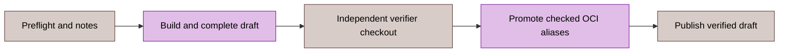

# CI and release automation

[Russian translation](../../ru/reference/automation.md).

Go commands own workflow execution. [.github/workflows/ci.yml](../../../.github/workflows/ci.yml), [security.yml](../../../.github/workflows/security.yml), [e2e.yml](../../../.github/workflows/e2e.yml) and [release.yml](../../../.github/workflows/release.yml) select the commands. [cictl](../../../test/cmd/cictl/main.go), [cirunner](../../../test/internal/cirunner/) and [toolbootstrap](../../../test/cmd/toolbootstrap/main.go) implement them.

These are source contracts. A command's existence does not establish candidate acceptance or authorize a remote mutation.

## Routine commands

| Command | Contract |
|:---|:---|
| `cictl build` | Build workflow binaries with fixed direct arguments |
| `cictl lint` | 92 configured base linters and 18 explicit build-tag profiles |
| `cictl test-coverage` | gotestsum race tests; JUnit, JSON and atomic coverage |
| `cictl commit-policy` | Pass PR_TITLE as one literal repository-quality argument |
| `cictl proto-verify` | Build pinned generators, regenerate, reject tracked/staged/untracked protobuf drift |
| `cictl buf-fetch-base`, `buf-breaking` | Validate GITHUB_BASE_REF, fetch full refspec, resolve exact commit for Buf |
| `cictl sbom` | Separate nonempty runtime/tools CycloneDX module-file scans |
| `cictl sonar-mode`, `sonar-skip-notice` | Preserve workflow analysis selection and explicit skip notices |

Fixed report outputs are validated and cleared before collection. A failed child command keeps its stdout/stderr and fails the step; an older regular artifact cannot substitute for successful execution. SBOM collection records dependency inventory, not symbol reachability.

`toolbootstrap podman-runtime` verifies the pinned Go Compose provider, Podman and jq. `podman-e2e` adds hosted-runner setup and a private rootless API socket. Socket readiness has a 20-second bound; it does not prove API health. An existing socket is reused without ownership. Failed bootstrap kills/joins only a newly owned service; its diagnostic log remains available. GITHUB_ENV/GITHUB_PATH publication is part of readiness. `apparmor-denials` filters diagnostics to denial lines.

CI executable steps remain single commands; no multiline shell programs or explicit shell declarations are required. Token values stay in process environments, never command arguments or artifacts.

## Benchmarks

`benchmark-pair` collects ten alternating base/head pairs, one 100 ms non-race sample per invocation for BFD/netio. A package/name needs exactly ten valid samples per side. Each output has a 64 MiB streaming limit; aliased/symlinked outputs are rejected. The detached base worktree is created once below RUNNER_TEMP and removed using a bounded cancellation-safe context. Child pipe waiting is bounded at 30 seconds.

`benchmark-run`, `benchmark-base` and release snapshots retain six non-interleaved runs. `benchmark-normalize` maps only the three historical aliases and requires RecvDecodeLookupEnqueue, RecvDecodeFSM and TxMarshalJitter on both sides. `benchmark-report` validates both raw inputs, parses benchstat CSV and atomically publishes Markdown, escaped HTML, raw CSV/notes and versioned JSON. Named critical time/op regressions of at least 10% fail the command when base or head reaches the 100 ns/op floor; other report-only regressions use 1 ns/op. Reports remain available on a critical failure. Step-summary and warning errors are propagated; a missing warning writer or skipped release summary does not bypass the critical gate. Malformed/missing collection and actual benchstat command failures also fail. See [benchmarks](../12-benchmarks.md).

## Release sequence

The sequence separates build, independent evidence verification, alias changes and terminal publication. Preserve the exact candidate and stop at the first failed stage.

| Command | Validation or mutation |
|:---|:---|
| `release-preflight` | Canonical stable tag, annotation, repository, exact release-branch HEAD; reject existing release/draft/versioned OCI tags |
| `release-notes` | Paginated published stable releases, complete maintenance range, real dates; immutable links |
| `release-build` | Four binaries using GITHUB_REF_NAME/GITHUB_SHA metadata |
| `release-upx` | Exact archive size/hash, complete tar-entry validation, bound executable version; rooted PATH publication |
| `release-test-report` | Race tests and existing JUnit/JSON/HTML paths |
| `release-benchmarks`, `release-benchmark-metadata` | Six BFD/netio samples; commit, version, UTC, Go and count |
| `release-benchmark-comparison` | Fresh text/HTML/Markdown/CSV/notes/structured comparison when baseline.txt exists; otherwise clear stale outputs and skip comparison |
| `release-reports-archive` | Rooted evidence copy and reports archive; no aggregate producer size or entry bound |
| `release-artifacts` | Independent source/commit validation and exact expected asset receipts |
| `release-assets-upload` | Upload receipt-bound primary assets without clobber |
| `release-oci-evidence` | Both versioned indexes, amd64/arm64, SPDX and linked SLSA v1 attestations |
| `release-evidence` | Hash report/digest snapshots and upload supplemental evidence |
| `release-verify` | Recheck identities, draft body, exact 12 assets; download and semantically verify the same hashed bytes |
| `release-promote` | Snapshot aliases, copy verified index, read back descriptors; bounded rollback on failure |
| `release-publish` | Final identity/asset/digest checks, close roots, terminal draft-publication mutation |

GoReleaser creates a draft with primary upload disabled. Native package finalization replaces RPM lifecycle programs and refreshes checksums/manifests. The asset matrix requires two Linux archives, four DEB/RPM packages, two archive-matched CycloneDX SBOMs and checksums; reports, OCI digest and supplemental checksum receipts complete the 12 remote names.

The verifier uses a separate checkout at the exact workflow SHA without persistent credentials. It binds original workspace paths to opened roots and preflight receipts. Strict JSON rejects invalid UTF-8, duplicate/noncanonical contract fields and unsafe paths. Downloads reject missing/extra/linked/empty/oversized files. Archive parsing rejects extra gzip members, trailing data, unsafe/duplicate entries, links and special files.

The [producer](../../../test/internal/cirunner/release.go) clears comparison outputs before checking `testdata/benchmarks/baseline.txt` and packages reports without an aggregate output bound. The downstream verifier limits the [compressed asset](../../../test/internal/cirunner/release_download.go) to 64 MiB and the [reports archive](../../../test/internal/cirunner/release_asset_content.go) to 256 MiB expanded and 4096 entries. These verifier limits do not bound archive creation.

OCI evidence is queried by immutable index digest. Both primary and Debian product digests must match and contain exactly linux/amd64 and linux/arm64 with linked attestations. Git/Docker do not receive GitHub tokens. Alias rollback verifies restored identities; terminal publication has no subsequent fallible release step. Postpublication readback and stable-branch closeout remain separate maintainer obligations.

## Dependency inventory

[dependency-inventory.json](../../supply-chain/dependency-inventory.json) describes selected runtime/tools graphs, declared tools, Actions, OCI and peer sources. Generation queries exact-version license evidence through deps.dev; static overrides and source coordinates remain unverified without their own observation.

The snapshot binds its observation epoch, source/query/result/hash, owner and review date. Advancing the epoch requires fresh collection. The offline checker rejects graph, package-count, source-binding and declaration drift. Unresolved release reviews require exact dimension coverage in review_exception; deferred/stale decisions keep their own bounds. Neither regeneration nor offline success supplies current upstream security or stable-line acceptance.

## Failure procedure

1. Preserve the exact command, revision, expected artifact list and raw diagnostic output.
2. Check the producer's exit status before using its files.
3. Reject stale, partial or identity-mismatched evidence.
4. Correct the owning source/command and repeat the failed gate on the final candidate.
5. Preserve an explicit remaining release gate until its actual measurement exists.

[Development](../09-development.md), [release process](../10-changelog.md), [E2E harness](../../../test/e2e/README.md).
