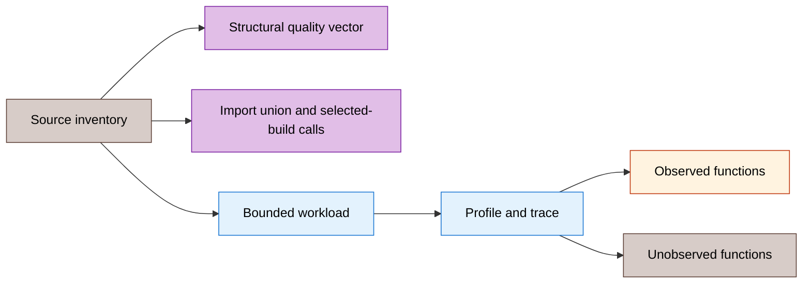

# RFC-CQ-0001: Code quality and measurement standard

[Russian translation](../../ru/reference/code-quality-standard.md).

## Scope

This project standard governs first-party Go source, tests and tooling. Generated code and build-constrained variants remain in the inventory, with separate quality denominators. The [documentation standard](documentation-standard.md) governs prose. RFC-CQ-0001 is a project identifier, not an IETF RFC.

## Naming and contracts

Use lowercase package names, `snake_case.go` filenames and Go `MixedCaps` identifiers. Preserve initialisms: `BFD`, `TTL`, `UDP`, `IP`, `RFC`, `ID`, `URL`, `API`, `CPU`, `TX`, `RX`. Avoid package stutter, generic `util` packages and synonyms for an existing domain term. Name conversions `Parse`, `Marshal`, `Unmarshal`, `Validate` or `Format` according to their actual operation. Name desired-state operations `Reconcile`; distinguish `Create`, `Register`, `Acquire`, `Close` and `Release` by ownership. Keep branch grammar `fix/vMAJOR.MINOR-<slug>` for supported-line fixes and English Conventional Commits.

Use `ctx context.Context` as the first parameter. Return errors with context and `%w`; classify with `errors.Is` or `errors.As`. Validate external data before dependent effects. Give every goroutine an owner, cancellation and join. Record the exact RFC section for protocol behavior; project naming rules do not change wire formats.

| Function class | Required property | Verification |
|:---|:---|:---|
| Pure transformation | Same inputs yield same result; input ownership is explicit | Table/property tests; no implied state-idempotence |
| Desired-state reconcile | Repeating the same desired state preserves converged state and resource ownership | Repeat, drift and failure/retry tests |
| Teardown | Repeat does not release a resource twice | Concurrent/repeated close tests |
| Event, timer, counter, RX/TX | Each admitted event has its declared effect and terminal accounting | Conservation, generation and lifecycle tests |
| Unclassified | No idempotence conclusion | Explicit review required |

Do not require cumulative event processing to be idempotent. State-idempotence means `R(R(s,d),d)=R(s,d)` after convergence; it does not require identical incidental timestamps or suppressing errors. Reconciliation after external drift is a separate obligation.

## Audit measurements

Inventory every named function, method and function literal with file, line, build constraints, generated/test category and content identity. Report package imports separately from call edges. An unreferenced declaration is an unused candidate: interface dispatch, callbacks, reflection, CLI entrypoints, external users and build profiles require independent verification before deletion.

Report source length, branch count, explicit loop nesting, call sites, goroutines and deferred work per function. These are structural observations, not Big-O proofs or measured allocations. Exact token matches, locally renamed structural matches and manually reviewed semantic overlap are separate duplicate classes. Shared RFC shapes can justify repetition. Keep existing lint thresholds and critical benchmark gates; do not replace them with an arbitrary aggregate quality score.

Fail discovery on empty inputs, invalid source, duplicate identities, unreadable files, traversal or changed input. Sort report output deterministically. Publish the complete input set and exclusions. Test the analyzer with renamed locals, different receivers, closures, build-excluded files and negative inputs; measure the repository itself in a Go test.

The lightweight rename fingerprint is scope-insensitive and preserves selector/key names and literals. Shadowing and type information require independent semantic review. Separate production, tooling, tests and generated code in all denominators. Classify non-generated support code under `internal/testutil/` as tooling; `_test.go` files remain tests. Source categories describe repository roles, not binary reachability. A complex tooling function is not a runtime hot-path finding.

## Run the audit

Use the pinned development container with the repository mounted. Default discovery includes nested modules and excludes hidden directories and root-level `vendor`, `node_modules`, `reports`, `bin`, `build`, `dist`. Domain directories such as `test/e2e/vendor` remain included. For an exact tracked snapshot, supply `--files=<path>` containing NUL-delimited `git ls-files` Go paths. The CLI rejects duplicate or escaping paths; limits are 10000 inputs, 2 MiB per source file and 256 MiB total. JSON contains every function and file hash; Mermaid contains the first-party import union, not a selected-build cycle verdict.

```sh
mkdir -p reports
go run ./test/cmd/repoquality code --root . > reports/code-quality.json
go run ./test/cmd/repoquality code --root . --format=mermaid > reports/code-dependencies.mmd
go test -race -count=1 -v -run '^TestCode' ./test/internal/repoquality/
```

The test prints the measured quality vector and rejects missing classifications or duplicate function identities. Compare unused candidates across the existing build profiles and include the isolated tools module; root `./...` alone does not cover it. Keep raw tool results, source patch and invocation metadata with dated audit evidence.

## Runtime evidence

Bind every measurement to source identity, compiler, executable hash, workload, limits and command. Separate non-instrumented benchmark latency from sampled CPU cost, scheduler traces and instrumented inclusive wall time. Instrumentation overhead and nested calls prevent summing inclusive time into total execution time. Report unexecuted functions as `not_observed`, never as zero latency. A short scenario cannot establish universal speed, absence of races or native capacity.

Measure RIB observation with `go test -run '^$' -bench '^BenchmarkGoBGP' -benchmem -count=5 ./test/internal/interopcheck/` in the pinned development container. Run latency benchmarks separately from other development workloads. The RIB cases validate complete snapshots with 0, 1, 256 and 4096 canonical IPv4 destinations and one path per destination; the prefix cases measure canonical IPv4 and IPv6 parsing. Setup is excluded by `b.Loop`; result validation remains timed. These measurements exclude CLI execution, multipath tables and BFD packet processing. Collect CPU profiles and execution traces in a separate run and retain the matching executable.

Import the complete `go tool pprof -top -nodecount=0 -nodefraction=0 -edgefraction=0 -unit=ns` CPU table with `--cpu=<path> --cpu-source=<recorded-source-sha256>`. Reject source mismatch, malformed values and ambiguous symbols across build variants before writing output. The source hash is the operator's recorded binding, not an attestation of binary provenance; retain the binary hash and exact collection command separately. `cpu.flat_ns` and `cpu.cumulative_ns` are sampled totals, not ns/call. Unmatched declarations retain `cpu: null`. Closures, generic instantiations and special `main`/`init` names can remain unresolved; raw profiles retain those symbols.



## Sources

- [Go naming](https://go.dev/doc/effective_go#names), [Go specification](https://go.dev/ref/spec).
- [RFC 2119](https://www.rfc-editor.org/rfc/rfc2119), [RFC 8174](https://www.rfc-editor.org/rfc/rfc8174): normative terminology when uppercase keywords are used.
- [RFC 5880 §6.8](https://www.rfc-editor.org/rfc/rfc5880#section-6.8): BFD processing and state.
- [Go execution tracing](https://github.com/golang/go/blob/go1.27.4/src/runtime/HACKING.md), [profiling](https://pkg.go.dev/runtime/pprof).
