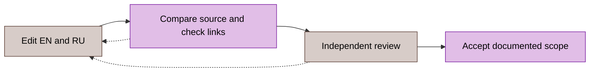

# Documentation standard

This standard defines the publication rules for GoBFD documentation. English under `docs/en/` is canonical; Russian under `docs/ru/` mirrors its technical meaning and relative paths. Root contribution and release documents follow the same rules. [Russian translation](../../ru/reference/documentation-standard.md).

The uppercase requirement words MUST, MUST NOT, SHOULD, SHOULD NOT and MAY carry the meanings defined by [RFC 2119](https://www.rfc-editor.org/rfc/rfc2119.html), as clarified by [RFC 8174 §2](https://www.rfc-editor.org/rfc/rfc8174.html#section-2). These are project documentation requirements, not additional BFD wire requirements. Lowercase words express ordinary prose.

## Document purpose and ownership

Give each page one purpose. Apply the [Diátaxis categories](https://diataxis.fr/) within the existing tree; classification does not require moving or renaming files.

| Type | Required content |
|:---|:---|
| Tutorial | Starting state, ordered learning steps, working result |
| Procedure or runbook | Prerequisites, bounded target, actions, expected results, stop conditions, recovery |
| Reference | Exact fields, units, defaults, validation and compatibility boundaries |
| Explanation or ADR | Context, decision, alternatives, consequences and source links |
| Release status | Dated technical scope, accepted evidence and remaining qualification |
| Historical record | Original date, source identity, measurement conditions and limitations |

Executable tasks, dependencies, priorities and handoffs belong in the project issue tracker. A public roadmap is a dated technical projection, not a second task database. Internal task identifiers, tracker-specific commands, orchestration prompts, assistant attribution and session transcripts MUST NOT appear in current manuals, roadmaps, changelogs or release notes. Do not substitute opaque audit codes for removed task identifiers. Use behavior, source links, RFC sections or public issue links that resolve.

Historical source material, published release bodies, legal text and verbatim RFC/vendor material MUST retain their facts and provenance. Remove tooling metadata from publishable derivatives only after preserving the original and repairing its callers and links. Historical cleanup remains incomplete while tool-specific files or references are tracked; this standard does not certify their absence.

## Declarative and imperative prose

State behavior in the present tense: “The owner commits the state before publishing the event.” State actions with an imperative verb: “Record the active configuration. Apply the candidate. Verify readiness.” Russian procedures use consistent infinitives: “Сохранить. Применить. Проверить.”

Each sentence MUST state a fact, action or constraint. Omit first-person narration, direct appeals, promotional claims and investigation history from current reference pages. Expand an unfamiliar abbreviation at first use. Preserve canonical protocol, API and configuration identifiers in English. Define one term once and reuse it.

A procedure MUST identify privileges, supported platform, target scope and initial state before mutation. Name expected output and a stop condition for each consequential step. State whether repetition is safe; specify ownership checks and cleanup for created resources. Preserve an independent recovery path and state how to restore and verify the accepted state. A successful command is not proof of the intended runtime result.

## Markdown and layout

Use UTF-8, LF and a final newline, following [EditorConfig](../../../.editorconfig). Use [GitHub Flavored Markdown](https://github.github.com/gfm/) with [CommonMark](https://spec.commonmark.org/) block semantics. The choices below are project conventions.

| Element | Rule |
|:---|:---|
| Headings | One H1 in a normal document; H2–H4 without skipped levels or terminal punctuation |
| Spacing | One blank line around headings, lists, tables and fenced blocks; no tabs or trailing spaces in prose |
| Lists | `-` for parallel items; numbered items for ordered actions; no executable task checklists in Markdown |
| Tables | Leading and trailing pipes; explicit alignment; right-align numeric values; split tables wider than five columns |
| Code | Fenced blocks with a language; inline backticks for identifiers, paths, flags and literal values |
| Links | Relative paths within the repository; descriptive HTTPS links for external sources |

Preserve existing useful anchors. Add an explicit alias before changing a heading that has inbound links. Root README branding may retain its existing HTML wrapper; normal documentation MUST NOT require MDX, site-only frontmatter, tabs or custom admonition syntax.

Use the following closed language vocabulary for new or revised examples: `sh` for individual CLI invocations, `text` for output or formulas, `go`, `yaml`, `json`, `toml`, `ini`, `promql` and `mermaid` for their respective content. Do not mix `bash` and `sh` for equivalent command examples. Multi-step repository automation belongs in Go; do not add shell scripts or repository-owned Python. External ad hoc inspection does not become a product prerequisite.

The opening fence contains only its language. Put a useful example title in the preceding sentence; do not depend on `title=` or `showLineNumbers` rendering. Distinguish commands from output, omit shell prompts, and preserve executable indentation. Label illustrative or unexecuted examples explicitly.

## Requirements, protocol claims and sources

Distinguish a protocol requirement, an implementation fact, a measured result and a proposed decision. Link a normative requirement to the exact RFC section and check relevant updates and errata. Link implementation claims to source symbols or the nearest stable section. Bind acceptance evidence to its exact commit and environment. [RFC 7322 §4.8.6](https://www.rfc-editor.org/rfc/rfc7322.html#section-4.8.6) provides the distinction between normative and informative references; project page layouts remain local conventions.

The [RFC coverage matrix](../08-rfc-compliance.md) owns implementation status. A source stub, unit test, short workload or vendor configuration guide MUST NOT be described as complete RFC conformance, production scale or interoperability acceptance. Preserve negation, conditions, known failures and preview boundaries in both languages.

For Cisco, Arista, Juniper and Huawei, cite the official manual section and name the hardware or virtual platform, NOS family/version and relevant mode. Use the existing [vendor reference](vendor-bfd.md); a manual establishes vendor behavior, not a successful GoBFD peer test. Record the actual peer/version, topology, configuration, packet evidence and result before claiming compatibility.

Examples use documentation addresses: IPv4 `192.0.2.0/24`, `198.51.100.0/24` or `203.0.113.0/24` from [RFC 5737 §3](https://www.rfc-editor.org/rfc/rfc5737.html#section-3), IPv6 `2001:db8::/32` from [RFC 3849 §2](https://www.rfc-editor.org/rfc/rfc3849.html#section-2), and reserved domains from [RFC 2606 §§2–3](https://www.rfc-editor.org/rfc/rfc2606.html#section-2). Identify loopback, multicast or link-local addresses separately when their actual semantics are required. Do not publish real credentials or private operational identifiers.

Write dates as `YYYY-MM-DD`; use [RFC 3339 §5.6](https://www.rfc-editor.org/rfc/rfc3339.html#section-5.6) timestamps with an explicit offset, preferably UTC `Z`, for observations. Every duration and bound MUST have a unit. Distinguish configuration units, encoded wire units, nominal equations and measured distributions; never infer a guaranteed failure-detection bound from a nominal timer formula.

## Mermaid diagrams

Use Mermaid for ownership, packet flow, topology, message exchange and lifecycle. Use tables for values. A diagram MUST communicate one relationship and have a nearby text explanation that remains useful without rendering. Include [accessible titles and descriptions](https://mermaid.js.org/config/accessibility.html) with `accTitle` and `accDescr` where supported by the selected diagram type.

| Subject | Diagram |
|:---|:---|
| Ownership or topology | `flowchart LR` |
| Hierarchy or decision | `flowchart TD` |
| Protocol exchange | `sequenceDiagram` |
| State lifecycle | `stateDiagram-v2` |

Keep flowcharts at no more than 30 nodes. Quote labels, use stable node identifiers and distinguish actual traffic (`-->`) from logical dependency (`-.->`). Use direction and text as well as color. Flowcharts use the existing registered classes below; register an additional class here before introducing it. Sequence and state diagrams retain their native notation.

| Class | Meaning | Fill | Stroke | Text |
|:---|:---|:---|:---|:---|
| `srv` | Daemon or session owner | `#e1bee7` | `#7b1fa2` | `#000` |
| `mgt` | Management or configuration | `#d7ccc8` | `#5d4037` | `#000` |
| `leaf` | Packet I/O or device | `#e3f2fd` | `#1976d2` | `#000` |
| `brt` | Peer or routing actuator | `#fff3e0` | `#bf360c` | `#000` |

For example, the publication decision depends on both source comparison and independent review; an unsuccessful check returns to editing.

Render modified diagrams in the intended viewer and inspect labels, arrows and contrast. A source or link check alone MUST NOT be reported as successful visual rendering.

## Changelog and public development status

Follow [Keep a Changelog](https://keepachangelog.com/en/1.1.0/) and the existing [release guide](../10-changelog.md). Keep the root English/Russian changelogs semantically equivalent, newest first, with user-visible changes under the applicable Added, Changed, Deprecated, Removed, Fixed or Security category and its Russian counterpart. Keep unreleased changes separate from dated releases.

Describe the trigger, resulting behavior, compatibility impact and required operator action. Remove internal task IDs and execution narration; retain resolvable public issues, advisories, exact versions and necessary limitations. A changelog is not a commit dump or a task completion log. Preserve published release sections; add a dated correction when their meaning needs amendment.

Public development status records capabilities and remaining technical qualification in ordinary terms. Detailed work items, estimates and priority changes stay in the issue tracker. A new documentation standard MUST NOT be presented as proof that every existing document already conforms.

## Translation and acceptance

Update English first, then Russian in the same change. Keep paths, links, examples, numbers, units, normative strength, exclusions and status equivalent; translate prose and human diagram labels. Link to the counterpart. Preserve historical originals and distinguish a translation erratum from a changed implementation claim.

Before accepting a documentation change:

1. Compare each changed technical statement with its source, RFC or official vendor reference.
2. Check both languages, identifiers, units, links and preserved anchors; search for internal task IDs as well as tracker names and commands.
3. Run the existing `make lint-docs` gate in the qualified environment and record its actual input count and exit status. Check the diff for whitespace and unintended non-document changes.
4. Render modified diagrams and examples where applicable; record anything not executed or rendered.
5. Obtain independent review of the exact final diff, resolve findings, and verify the accepted commit and clean working tree.

The existing Markdown gate checks selected structural rules; it does not certify prose style, complete source correctness, external URL availability, identifier removal or visual rendering. Record those checks separately. Reuse the existing Go-owned tooling; a prose standard does not introduce a new runtime dependency or authorize publication.
