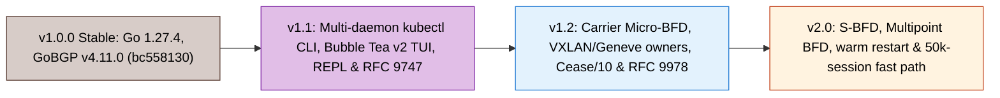

# Release qualification status

[Russian translation](../ru/roadmap.md).

Snapshot: **2026-11-28**. This page records the post-`v1.0.0` technical
qualification boundary and `dev` roadmap projection; it does not broaden
published release claims beyond the documented [RFC matrix](08-rfc-compliance.md).

## Source baseline

Published `v1.0.0` baseline:
[`bc558130d37e489939f4b8764b6a9d1b568861da`](https://github.com/dantte-lp/gobfd/commit/bc558130d37e489939f4b8764b6a9d1b568861da)
on branch `release/v1.0` (annotated tag `v1.0.0` at
`1cac85e8083b38717066769f2db7b0d62ad7f11d`, synchronized to `master` at
[`3bcdea03d3f05f21b14dd2a785e20805f642bf5f`](https://github.com/dantte-lp/gobfd/commit/3bcdea03d3f05f21b14dd2a785e20805f642bf5f)),
incorporating Go `1.27.4`, GoBGP `v4.11.0`, ADR-0013 Unix restart ownership,
ADR-0014 `v1.0` GoBGP v4 release-line graduation, RFC 9747 slow Echo pacing,
Micro-BFD loss resync and `enforce` health gating, bounded inactive per-peer
Prometheus series, run-owned Compose/stage image cleanup, direct containerd
gRPC lease import for Kubernetes, and Bash-free `Makefile`/OCI orchestration.
Stable branches, release tags and backup refs are preserved.

## Stable v1 acceptance

| Area | Implemented | Remaining acceptance |
|:---|:---|:---|
| Control workload | Real owner/peer workload and terminal accounting | Calibrated native reference distributions and full reference run |
| Reference environment | Isolated Debian runner; identity, clock and admission checks | Canonical resource admission and qualified workload measurements |
| Pressure profiles | CPU, GC, scheduler, loss and session-churn drivers | Measurements in the admitted reference envelope |
| Echo workload | Real return traffic and owner Down witnesses | Native scale, timing and resource qualification |
| Session-preserving reload | Source implementation and scoped packet checks | Unified five-field qualification on the exact final candidate and supported peers |
| Security disposition | Scoped dependency exceptions and management controls | Stable v1 advisory, reachability and final-candidate security evidence |
| Documentation | Source-linked EN/RU manual and ADR contracts | Independent correspondence, links and language-parity checks |

Under [ADR-0014](adr/0014-v1-gobgp-v4-release-line-baseline.md), `release/v1.0`
graduates to the `1.0.0` product line coupled to GoBGP v4 while preserving
explicit preview/experimental boundaries in [RFC coverage](08-rfc-compliance.md);
users requiring GoBGP v3 remain on `release/v0.6`. Long-horizon 24-hour soak,
native Control/Echo scale campaigns and external hardware NOS runs remain
tracked as operational qualification evidence outside the initial `1.0.0`
branch cut. See [Performance](14-performance-analysis.md) and
[Interoperability](05-interop.md) for measurement conditions.

## Release channels and prerelease history

[ADR-0008](adr/0008-experimental-prerelease-boundary.md) defines the historical
`v1.0.0-alpha.N` prerelease boundary dated 2026-10-30, and
[ADR-0014](adr/0014-v1-gobgp-v4-release-line-baseline.md) graduates
`release/v1.0` to stable `1.0.0` proposals on 2026-11-27. Release Please
prepares the reviewed release PR; GoReleaser and the independent verifier
own draft creation and publication. Policy acceptance does not establish a
published release until the reviewed release PR merges and the annotated tag
passes `release.yml`.

## Product development roadmap (`dev`)

Development on `dev` is organized into three post-`v1.0.0` product horizons while `release/v1.0` remains restricted to bug and security fixes:

| Horizon | Focus | Planned capabilities on `dev` | Qualification gate |
|:---|:---|:---|:---|
| `v1.1` | Multi-daemon operator CLI, TUI, REPL and `RFC 9747` graduation | Additive read-only `bfd.v1.DaemonService` introspection RPCs (daemon build/uptime, socket readiness and `SO_RXQ_OVFL` drops, `GOMEMLIMIT`/goroutines/threads, latency quantiles, `GoBGP v4` speaker epoch / `PeerAdminState` / dampening, recent transitions); `kubeconfig`-style multi-daemon contexts (`$XDG_CONFIG_HOME/gobfd/config.yaml`, `--context`, `-A`, `-l` labels) and `kubectl` verbs (`get`, `describe`, `top`, `events` with `-o wide` and `--field-selector`); full-screen `gobfdctl tui` (`charm.land/bubbletea/v2` `v2.2.0`, `lipgloss/v2` `v2.1.1`, `bubbles/v2` `v2.2.2`, read-only default); full-parity `gobfdctl shell` (`reeflective/console` + `carapace` RPC completion, context/health prompt, secret-safe `0600` history, `Ctrl-C` stream cancel); Linux `AF_PACKET` Echo (`#126`), 3-state `RFC 9747` Echo FSM (`#125`), and L4/HTTP health -> GoBGP v4 anycast coupling (`#88`) | Backward-compatible `v1.0` CLI flags, headless TUI + multi-daemon mTLS/Unix E2E tests, FRR/BIRD Echo PCAPs |
| `v1.2` | Carrier LAG/overlay integration, `RFC 9384` and 2026 experimental RFCs | `RFC 7130` Micro-BFD multicast MAC `01:00:5E:90:00:01`, enslaved kernel-bond TX, dual-stack LAG groups; dynamic `RFC 9764` DF/padding enable-disable reload and hitless `AuthKeyID` rotation; wire `RFC 9384` BGP `NOTIFICATION` Cease/`10` via GoBGP v4; shared Linux/OVS/CNI tunnel ownership for `RFC 8971` VXLAN and `RFC 9521` Geneve; opt-in `RFC 9978` `lost_packets_total` (`delta - 1` + 64-bit sliding reorder bitmap) and opt-in `RFC 9985`/`9986` `Meticulous Keyed ISAAC` (`DetectMult <= 85`) | Wire PCAPs, `RFC 9986` Table 2 KAT parity, tunnel data + OAM coexistence receipts |
| `v2.0` | Seamless/Multipoint BFD, warm restart and `50k+` dataplane | `RFC 7880`–`7886` `S-BFD` (`UDP/7784` reflector and initiator); `RFC 8562`/`8563`/`9780` Multipoint BFD (`MultipointHead`/`MultipointTail`); hitless daemon warm-restart state handoff (`SCM_RIGHTS` socket passing + session/sequence transfer); ADR-gated `recvmmsg`/`sendmmsg`, sharded timing wheel and optional `eBPF`/`XDP` / `io_uring` RX fast path for `50,000+` sessions per node | Approved benchmarked ADRs, `0` BGP flaps across live binary upgrade, vendor S-BFD interop |

## Additional scope

| Capability | Boundary |
|:---|:---|
| Multi-daemon `kubectl` CLI, TUI and full-parity REPL | Planned on `dev` (`v1.1`): `v1.0.0` `gobfdctl` targets one `--addr` endpoint per invocation without TUI or multi-daemon contexts |
| RFC 9747 full Unaffiliated Echo (`#125`, `#126`) | Planned on `dev` (`v1.1`): Linux `AF_PACKET` adjacent-peer send (`rfc5881bis-02` §2), 3-state `Down -> Init -> Up` FSM, `YourDiscriminator` demux and return authentication |
| HAProxy health as anycast VIP policy (`#88`) | Not implemented; the existing agent exports BFD state to HAProxy; reverse L4/HTTP health -> GoBGP v4 route control with hold-down planned on `dev` |
| Experimental 2026 RFCs (`RFC 9978`, `RFC 9985`/`9986`) | Not implemented; `RFC 9978` window-gated `lost_packets_total` (`delta - 1` with reorder guard) and `RFC 9986` ISAAC evaluation tracked on `dev` (`v1.2`) |
| Broader ExaBGP process API | A native anycast cycle does not qualify ACK/reload, JSON/EOR or the full dual-stack matrix |
| Pending-interface validation | Separate from the implemented core pending activation |
| Runtime global VNI defaults | Separate from startup-default behavior |

For service-driven anycast, [RFC 4786 §4.4.1](https://datatracker.ietf.org/doc/html/rfc4786#section-4.4.1)
provides availability guidance. A configured hold-down and explicit route
owner are project requirements. Do not use BFD AdminDown as a portable route
withdrawal command; client reaction is governed separately.

## Branch-specific maintenance gaps

| Branch | Contract |
|:---|:---|
| `dev` | Next product line; source acceptance does not establish stable delivery |
| `master` | Latest accepted stable state |
| `release/v1.0` | Supported v1.0 public and GoBGP v4 dependency contract |
| `release/v0.6` | Supported v0.6 public and GoBGP v3 dependency contract |

[Release process](10-changelog.md) defines qualification, changelog,
ruleset, exact-tag and draft-asset checks. Oracle Linux 10 is excluded from
v1 OCI products; Debian trixie and generic RPM generation retain separate
contracts. Preserve existing v0.6 assets and tags.

## Historical records

The previous accumulated status and exact receipts remain available at
[the integration baseline](https://github.com/dantte-lp/gobfd/blob/eae8f0636055de8ac4714199e27ff0c9d18b9859/docs/en/roadmap.md).
Dated audits remain in [the 2026-11-28 post-release retrospective and formal RFC audit](audits/2026-11-28-v1-post-release-retrospective-and-formal-rfc-audit.md),
[the 2026-11-27 retrospective](audits/2026-11-27-release-retrospective.md),
[the 2026-10-26 retrospective](audits/2026-10-26-release-retrospective.md)
and [external-audit reconciliation](gist-audit-reconciliation.md). Historical
results are not fresh measurements of the current candidate.
