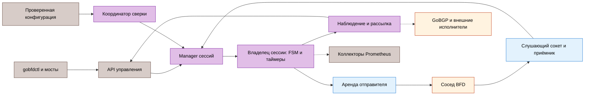
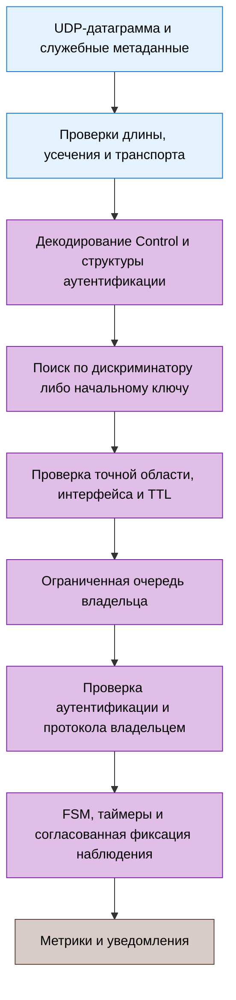
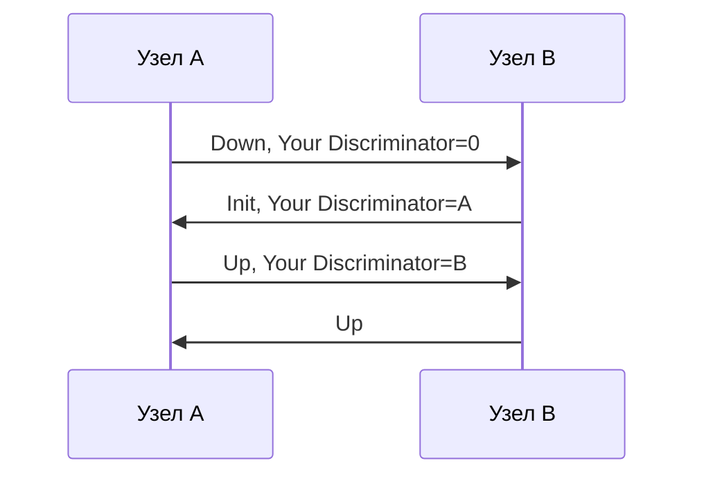

# Архитектура

[Английский оригинал](../en/01-architecture.md).

GoBFD разделяет автоматы двунаправленного обнаружения отказов пересылки (Bidirectional Forwarding Detection, BFD), ввод-вывод UDP в Linux, авторизацию управления и действия маршрутизации. Физической сессией владеет Manager; конфигурация и субъекты API держат заявки на владение этой сессией (claims). Заявка не создаёт отдельный экземпляр протокола. Источники: [идентичность сессии](../../internal/bfd/session_identity.go), [Manager](../../internal/bfd/manager.go).

Конечный автомат (finite state machine, FSM) задаёт переходы протокола. RX и TX обозначают приём и передачу; time to live (TTL) ограничивает число скачков IPv4, а IPv6 использует Hop Limit. Protocol data unit (PDU) — объявленный пакет BFD. VXLAN network identifier (VNI) разделяет области оверлея; link aggregation group (LAG) объединяет линии участников. Взаимная TLS-аутентификация (mTLS) проверяет обе конечные точки управления.

## Общее устройство

Схема задаёт границы компонентов и направление сообщений. Она не подтверждает общность отказов контролируемого пути и плоскости пересылки маршрутизации либо оверлея. [RFC 5882](../rfc/rfc5882.txt) задаёт взаимодействие клиентов; [ADR-0003](adr/0003-linux-advanced-bfd-applicability.md) ограничивает владение ресурсами Linux.

## Зависимости пакетов

| Пакет | Ответственность | Граница |
|:---|:---|:---|
| [`internal/bfd`](../../internal/bfd) | Кодек, аутентификация, FSM, владельцы, заявки, учёт доставки | Не владеет сокетами Linux |
| [`internal/netio`](../../internal/netio) | UDP, служебные метаданные, оверлей, монитор интерфейсов, реализации LAG | Адаптирует ввод-вывод к интерфейсам ядра BFD |
| [`internal/config`](../../internal/config) | Декодирование и проверка YAML, среды и значений по умолчанию | Формирует полный кандидат конфигурации |
| [`internal/server`](../../internal/server) | Преобразование API, авторизация, Watch, каталог возможностей | Субъект доступа задаётся транспортом |
| [`internal/overlay`](../../internal/overlay) | Общий словарь реализаций оверлея | Листовой пакет, зависящий только от стандартной библиотеки |
| [`internal/gobgp`](../../internal/gobgp) | Политика действий BFD→BGP | Внешнее действие ограничено предельным сроком |
| [`cmd/gobfd`](../../cmd/gobfd) | Запуск, владельцы ресурсов, перечитывание, готовность, завершение | Собирает среду исполнения |
| [`api/bfd/v1`](../../api/bfd/v1) | Публичная protobuf-схема | Генерируемые клиенты находятся в `pkg/bfdpb` |

### Правила зависимостей

FSM возвращает действия; сессия исполняет их. Адаптеры сокетов зависят от интерфейсов ядра BFD. Конфигурация и сетевой ввод-вывод используют словарь оверлея из листового пакета. Генерируемый protobuf-код не редактируется вручную. Источники: [FSM](../../internal/bfd/fsm.go), [интерфейс приёмника](../../internal/netio/receiver.go), [ADR-0004](adr/0004-overlay-backend-vocabulary.md).

## Приём пакета

[Приёмник](../../internal/netio/receiver.go) возвращает буфер в пул после демультиплексирования. Для аутентифицированного входа сохраняется собственная копия полной полезной нагрузки с линии до проверки владельцем сессии. Метаданные и до 20 байт полезной нагрузки аутентификации принадлежат значению пакета; требование сохранять исходные байты с линии остаётся. Срок жизни задаёт [ADR-0011](adr/0011-bfd-auth-inline-payload.md).

`Queued` подтверждает только допуск в очередь. Полная или закрытая очередь и остановленная сессия возвращают типизированные результаты. Общий барьер допуска и остановки запрещает добавление в очередь после окончательного опустошения; завершение учитывает оставленные записи. [Учёт доставки](../../internal/bfd/delivery.go) разделяет знаменатели стадий; их сумма не равна числу пакетов.

## Передача пакета

Владелец сессии формирует или обновляет кешированный пакет Control, подписывает его при включённой аутентификации, применяет целевой размер транспортного дополнения и передаёт через `PacketSender`. Аренда отправителя фиксирует исходный порт и срок владения ресурсом. Дополнение находится за объявленным BFD Length и областью аутентификации; передача не обрезает аутентифицированный PDU. Источники: [формирование пакета](../../internal/bfd/session_packet.go), [цикл передачи](../../internal/bfd/session_loop.go), [отправитель UDP](../../internal/netio/sender.go).

## Демультиплексирование

Ненулевой Your Discriminator выбирает сессию-кандидата. Нулевой использует начальный ключ адресов с учётом транспорта. До передачи в очередь проверяются класс транспорта, входной интерфейс, точная область оверлея и TTL. Известный дискриминатор не позволяет односкачковому пакету попасть в многоскачковую сессию. Идентичность оверлея включает внешние конечные точки, VNI и поддерживаемый кортеж внутренних IP/MAC. Источники: [приём Manager](../../internal/bfd/manager_session.go), [проверки оверлея](../../internal/netio/overlay_inner.go), [тесты идентичности](../../internal/bfd/overlay_identity_test.go).

Односкачковый режим реализует нумерованную сеть множественного доступа с одним явным либо вычисленным интерфейсом приёма. Начальное демультиплексирование соединения точка-точка с произвольным исходным адресом остаётся вне квалифицированного профиля. Зона IPv6 link-local выбирает интерфейс, но не входит в начальный ключ демультиплексирования. См. [границы RFC](08-rfc-compliance.md#rfc-5881-implementation-notes).

## Идентичность сессии и владение

| Объект | Идентичность либо политика | Срок жизни |
|:---|:---|:---|
| `SessionKey` | Тип, семейство адресов, нормализованные адреса соседа и локальный адрес, интерфейс, сетевая и транспортная области | Один физический обмен Control |
| `SessionOwner` | Типизированный источник и локальный для источника ID владельца | Одна заявка |
| Действующие параметры | Роль, кортеж таймеров, TTL, дополнение, тип аутентификации, неизменяемый отпечаток ключа | Должны совпадать для общих заявок |
| `SenderLease` | Принятый отправитель и идемпотентное освобождение | До опустошения и ожидания завершения владельца |
| Ключ Echo | Структурированные адреса соседа и локальный адрес, точный интерфейс | Один общий обмен Echo |

IPv4-mapped адреса преобразуются в IPv4. Различаются заявки API совместимости, аутентифицированного субъекта API, конфигурации и незапрошенных сессий. Совпадающая заявка использует существующие сессию и дискриминатор; освобождение удаляет только заявку своего владельца. Неизвестная семантика хранилища ключей отклоняется. Источники: [идентичность и параметры](../../internal/bfd/session_identity.go), [хранилище аутентификации](../../internal/bfd/auth.go), [владение Echo](../../internal/bfd/manager_echo.go).

Порядок блокировок: жизненный цикл, владение, реестр. Блокировки изменения Manager не удерживаются во время завершающего уведомления соседа и вызовов освобождения ресурсов. Точный ключ удаляемой сессии зарезервирован до ожидания завершения владельца, освобождения аренды и дискриминатора, очистки метрик, включая обработку ошибок. Конфликтующий Add возвращает `AlreadyExists`; повторить после завершения Delete. См. [жизненный цикл замены](../../internal/bfd/manager_replace.go), [ADR-0006](adr/0006-session-preserving-reload-policy.md).

### Сверка и владение приёмом

Запуск и SIGHUP используют один сериализованный координатор. До публикации желаемой генерации кандидат проходит сохранённый контракт начальной среды исполнения и полную проверку сессий. Допуск аутентификации сравнивает сохранённое принятое намерение и действующий реестр. Отказ сохраняет принятую конфигурацию, генерацию и уровень журналирования.

Квитанция содержит пять источников: базовый, Echo, Micro-BFD, VXLAN и Geneve. Каждый источник готовит желаемые заявки и ресурсы приёма до освобождения устаревших заявок. Ошибка подготовки либо ожидание ресурса сохраняют прежние заявки; согласование таймеров имеет отдельный класс ожидания. Применённая генерация меняется после сходимости всех источников. Частичное применение не откатывает уже принятые изменения другого источника.

Владелец слушающих сокетов разделяет сокеты между заявками источников и физических сессий. API Add получает RX и TX совместно. Удаление конфигурации не прекращает приём Echo при сохранившейся заявке API. Реализация оверлея разделяется по типу туннеля и внешнему локальному адресу; физический отправитель держит ссылку на точную область до завершения опустошения. Предварительная проверка области предшествует открытию реализации и `SetScopes`; несовпадающие действующие области одного обмена требуют явного удаления и повторного создания.

Источники: [координатор](../../cmd/gobfd/reconciliation.go), [владелец слушающих сокетов](../../cmd/gobfd/listeners.go), [владелец оверлея](../../cmd/gobfd/overlay_owner.go), [допуск перечитывания](../../internal/bfd/manager_auth_reload.go).

### Восстановление и готовность

Уведомления Linux об интерфейсах и адресах, а также повторная синхронизация запускают ограниченные повторы в рамках генерации. Только типизированная недоступность интерфейса или адреса переводит источник в ожидание ресурса; другие ошибки остаются отказами. Общая проверка доступности с периодом две секунды охватывает пять источников. Ошибка инвентаризации требует нового явного SIGHUP. Монитор вне Linux не обеспечивает автоматическое восстановление.

Общая проверка работоспособности возвращает `NOT_SERVING` до первой сходимости, при различии желаемой и применённой генераций и потере обязательного состояния среды исполнения или слушающих сокетов. Именованные проверки BFD/Echo/Micro-BFD описывают свой источник. Неожиданная потеря приёмника либо рассылки останавливает демон с ошибкой. `READY=1` означает готовность процесса и слушающих сокетов и не подтверждает сходимость конфигурации. Источники: [события интерфейсов](../../cmd/gobfd/interface_events.go), [готовность](../../cmd/gobfd/readiness.go), [ADR-0001](adr/0001-link-state-rtnetlink.md).

## Трёхстороннее установление сессии

Это один допустимый порядок асинхронного запуска. Одновременные Down/Init обрабатываются тем же FSM [RFC 5880 §6.8.6](https://www.rfc-editor.org/rfc/rfc5880.html#section-6.8.6). Локальный Up не подтверждает сходимость маршрутизации.

## Модель goroutines

Один вызов `Run`, получивший владение, обрабатывает пакеты, таймеры и административные команды каждой сессии Control. Один владелец обслуживает обмен Echo. Приёмники запускаются для каждого слушающего сокета; рассылка Manager передаёт уведомления. Текущие владельцы Control/Echo не закрепляются постоянно за потоком ОС. Нативное сравнение A/B, пределы числа потоков и приёмка масштаба остаются отдельными проверками. Источники: [цикл Control](../../internal/bfd/session_loop.go), [цикл Echo](../../internal/bfd/echo.go), [ADR-0008](adr/0008-experimental-prerelease-boundary.md).

Наблюдение согласованно фиксирует локальное состояние и диагностику, известные факты удалённой стороны, C-биты, причину и версию. Изменение только диагностики увеличивает версию наблюдения без увеличения счётчика переходов состояния. Версии Manager отражают семантические изменения и физическую идентичность; ревизия рассылки отдельно упорядочивает доставку. Они не являются атомарной границей полноты телеметрии. Счётчики, таймеры и снимок конфигурации API снимаются выборочно. См. [модель наблюдения](../../internal/bfd/session_observation.go), [публичную схему](../../api/bfd/v1/bfd.proto).

Очереди исходных уведомлений и подписок получают размер `min(65536, 64 + 3*N)` при создании и не растут при перечитывании. GAP означает потерю исходных событий и требует повторной синхронизации потребителя; он не считается доставленным исходным событием. Счётчики стадий сохраняются после удаления сессии. [ADR-0007](adr/0007-workload-phase-accounting.md) задаёт размеры и полноту.

GoBGP и мосты действуют после публикации состояния. Успешная фиксация локального наблюдения, доставка уведомления и внешнее действие — разные измерения. Политика отключения и включения BGP и предельные сроки находятся в [обработчике](../../internal/gobgp/handler.go); универсальный отзыв маршрутов не реализован.

## Штатное завершение

Обычный `Manager.Close` может оставить уведомления состояния в очереди с исходом Abandoned. Владелец нагрузки Owner включает доставку изменений зарегистрированных физических сессий активным подписчикам до EOF. Она не вызывает внешние исполнители и не гарантирует доставку отменённому или медленному подписчику. См. [политику завершения](adr/0007-workload-phase-accounting.md#down-journal).

1. На SIGTERM/SIGINT демон вызывает `Manager.DrainAllSessions` с отдельным общим бюджетом десять секунд.
2. Завершающий обмен ожидает фиксацию владельцем AdminDown/7, первую успешную разрешённую запись и согласованное окно уведомления; неуспешная запись повторяется по обычному таймеру TX.
3. Завершение закрывает Manager, ожидает владельцев и рассылку, освобождает аренды отправителей, затем завершает HTTP и ресурсы приёма.

Окно уведомления начинается с первой успешной записи и покрывает максимум локального Detection Time приёма и `localDetectMult * max(advertisedAdminDownTX, remoteMinRX)`. При множителе три и минимальном интервале вне Up в одну секунду окно равно трём секундам. Ранняя отмена либо недостаточный бюджет возвращает `DrainIncompleteError`. Успешная локальная запись не означает подтверждение соседа.

Освобождение последней заявки Control использует то же опустошение вне блокировок Manager. Очистка единственной незапрошенной сессии после отказа отменяет сессию без административного обмена; удаление Echo и только группы Micro-BFD не владеет обменом Control AdminDown. Общая аренда оверлея не прерывает реализацию других сессий. Произвольный внешний вызов отправителя не имеет универсального ограничения времени завершения. Источники: [опустошение](../../internal/bfd/session_drain.go), [жизненный цикл Manager](../../internal/bfd/manager.go), [RFC 5882 §8](https://www.rfc-editor.org/rfc/rfc5882.html#section-8).

## Структура проекта

Размещать протокольную логику в `internal/bfd`, ресурсы Linux — в `internal/netio`, сборку среды исполнения — в `cmd/gobfd`, публичные контракты — в `api/bfd/v1`, исполняемые проверки квалификации — в `test`. [Указатель ADR](adr/README.md) хранит принятые решения.

## Технологический состав

[Манифест рабочей среды](../../go.mod) и [манифест инструментов](../../tools/go.mod) задают зависимости. [Контракт репозитория](../../AGENTS.md) определяет политики компилятора и контейнеров. Закрепление в манифесте задаёт исходный входной артефакт и не подтверждает совместимость либо развёртывание.

## UDP-порты

| Порт назначения | Транспорт | Область |
|---:|:---|:---|
| 3784 | Односкачковый Control | Нумерованная сеть множественного доступа IPv4/IPv6 |
| 4784 | Многоскачковый Control | Настроенная пара адресов и политика числа скачков при приёме |
| 3785 | Несвязанный Echo | Предварительная реализация, отключённая по умолчанию |
| 6784 | Micro-BFD | Предварительная реализация по участникам, отключённая по умолчанию |
| 4789 | Внешний UDP VXLAN | Предварительная реализация `userspace-udp` |
| 6081 | Внешний UDP Geneve | Предварительная реализация `userspace-udp`, IPv4 Format A |

Обычный отправитель UDP требует фиксированный исходный порт 49152–65535; для Echo это политика продукта. Источник: [конструктор отправителя](../../internal/netio/sender.go).

## TCP/HTTP-порты

Конечные точки управления и адреса привязки метрик задаются конфигурацией и не являются константами BFD. Управление по умолчанию использует сокет Unix; TCP выключен до явной настройки. Незашифрованный TCP ограничен loopback; TCP вне loopback требует mTLS. См. [значения по умолчанию и проверку](../../internal/config/config.go), [конфигурацию](03-configuration.md), [безопасность](15-security.md).

## Связанные документы

- [Протокол](02-protocol.md) — поля пакета на линии, переходы и таймеры.
- [Границы RFC](08-rfc-compliance.md) — реализация и квалификация.
- [Справочник BFD производителей](reference/vendor-bfd.md) — официальная документация соседей.
- [Анализ производительности](14-performance-analysis.md) — измерения и ограничения нагрузки.
