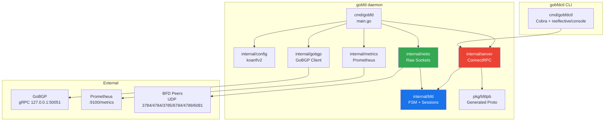
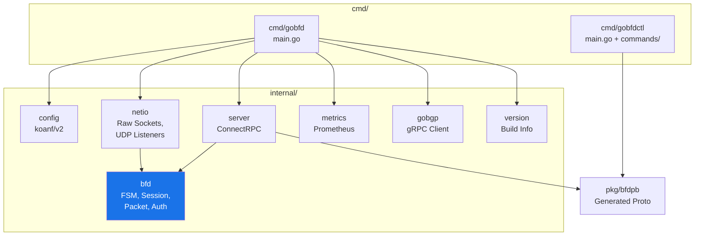
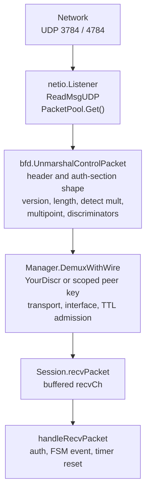
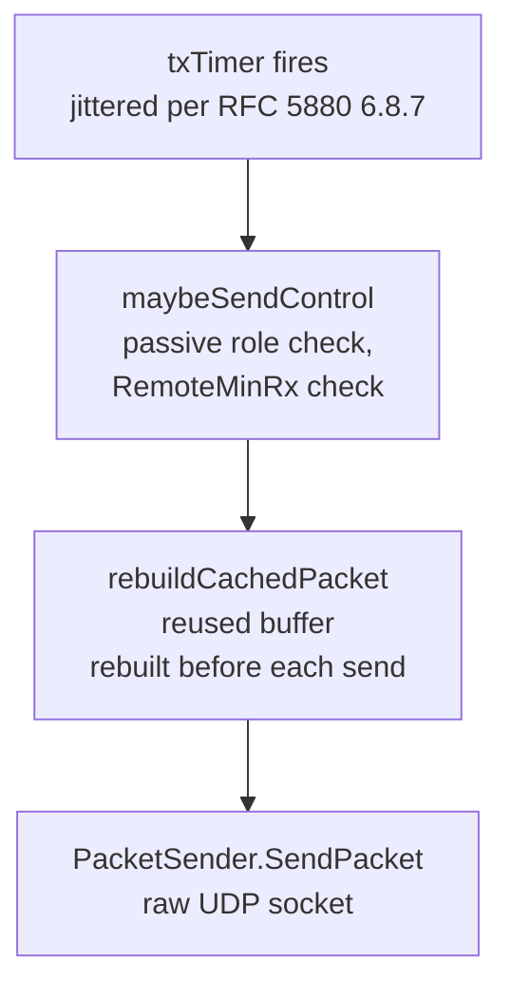
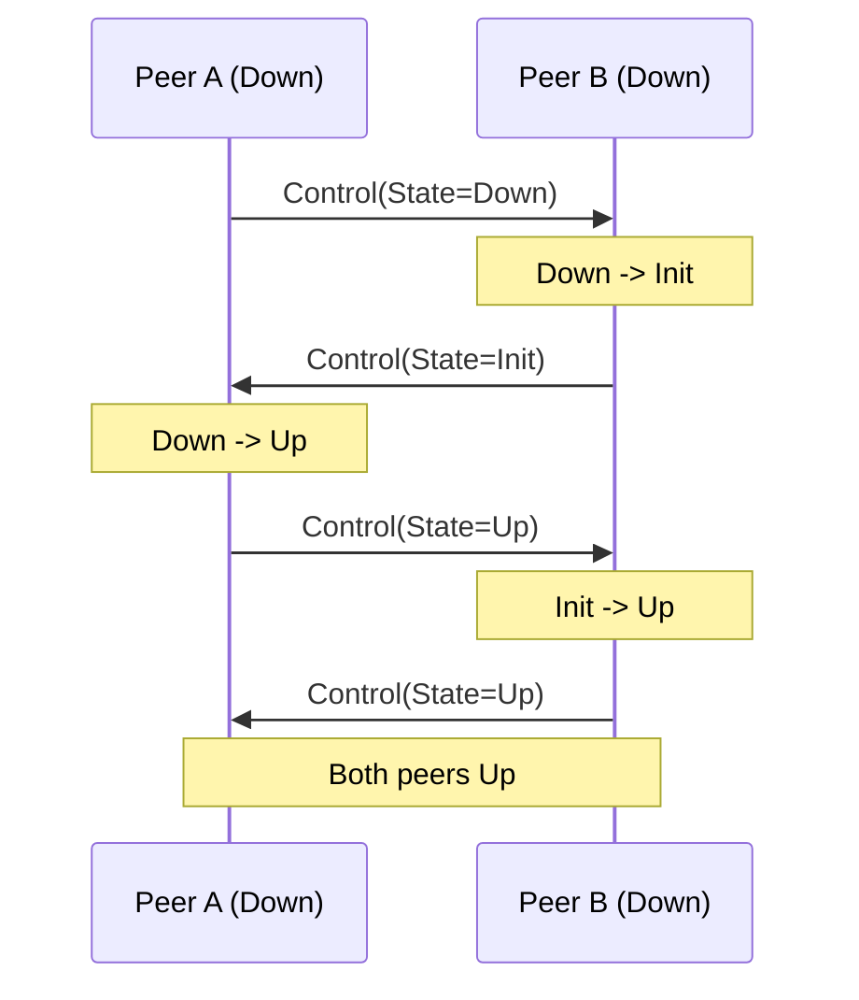
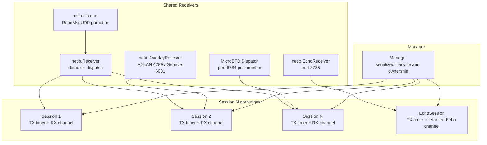

# Архитектура

> Архитектура GoBFD: зависимости пакетов, путь пакета, жизненный цикл сессии и модель горутин.

---

## Содержание

- [Обзор системы](#обзор-системы)
- [Диаграмма зависимостей пакетов](#диаграмма-зависимостей-пакетов)
- [Правила зависимостей](#правила-зависимостей)
- [Путь приёма пакета (RX)](#путь-приёма-пакета-rx)
- [Путь отправки пакета (TX)](#путь-отправки-пакета-tx)
- [Демультиплексирование](#демультиплексирование)
- [Идентичность и ownership сессий](#идентичность-и-ownership-сессий)
- [Трёхстороннее рукопожатие](#трёхстороннее-рукопожатие)
- [Модель горутин](#модель-горутин)
- [Корректное завершение](#корректное-завершение)
- [Структура проекта](#структура-проекта)
- [Технологический стек](#технологический-стек)

### Обзор системы

GoBFD — демон протокола BFD (Bidirectional Forwarding Detection) с
[явными границами частичного соответствия RFC и предварительных реализаций](08-rfc-compliance.md).
Состоит из четырёх бинарных файлов:

- **gobfd** -- демон, управляющий BFD-сессиями, отправляющий/принимающий BFD Control пакеты и интегрированный с GoBGP
- **gobfdctl** -- CLI-клиент, взаимодействующий с gobfd через ConnectRPC
- **gobfd-haproxy-agent** -- мост для HAProxy agent-check (состояние BFD в TCP-ответы агента)
- **gobfd-exabgp-bridge** -- мост для ExaBGP process API (состояние BFD в анонсы маршрутов)

### Диаграмма зависимостей пакетов

Ключевые пакеты:

| Пакет | Ответственность |
|---|---|
| `internal/bfd` | Ядро протокола: FSM, сессии, кодек пакетов, аутентификация |
| `internal/netio` | Абстракция сырых сокетов, UDP-слушатели, overlay-туннели (Linux) |
| `internal/server` | ConnectRPC-сервер с перехватчиками (логирование, recovery) |
| `internal/config` | Конфигурация через koanf/v2: YAML + env + флаги |
| `internal/metrics` | Prometheus-коллекторы для BFD-сессий |
| `internal/gobgp` | gRPC-клиент к GoBGP + демпфирование flap-ов (RFC 5882) |
| `pkg/bfdpb` | Сгенерированные protobuf-типы (публичный API) |

### Правила зависимостей

- `internal/bfd` **не зависит** от `internal/server`, `internal/netio` или `internal/config`
- `internal/server` зависит от `internal/bfd` (Manager, Session, типы) и `pkg/bfdpb`
- `internal/netio` переиспользует кодек и пул пакетов, метаданные пакетов,
  интерфейс отправки и типы состояния/событий Micro-BFD из `internal/bfd`
- `pkg/bfdpb` -- сгенерированный код, никогда не редактируется вручную

### Путь приёма пакета (RX)

Приём по RFC 5880 Section 6.8.6 проходит три уровня. Номера шагов в комментариях
кода локально группируют проверки; RFC включает выбор сессии между проверками
заголовка и аутентификации.

| Уровень | Исходник | Ответственность |
|---|---|---|
| **Кодек** | [`packet.go`](../../internal/bfd/packet.go) | Версия, длины, множитель обнаружения, multipoint, ненулевой My Discriminator и ограничение состояния при нулевом Your Discriminator |
| **Manager** | [`manager_session.go`](../../internal/bfd/manager_session.go) | Выбор сессии, допуск по транспортной области, интерфейсу и TTL |
| **Сессия** | [`session_packet.go`](../../internal/bfd/session_packet.go) | Отклонение нулевого Desired Min TX, проверка аутентификации, событие FSM, обновление таймеров и переменных |

Кодек отклоняет некорректные пакеты до выбора сессии или захвата её блокировки.

### Путь отправки пакета (TX)

**Переиспользуемый буфер пакета:** `sendControl` вызывает `rebuildCachedPacket`
перед каждой отправкой, включая сериализацию заголовка и аутентификацию.
Увеличение дополнения готовит один ожидающий буфер при допуске управляющего
изменения; владелец меняет его до фиксации полей. Цикл пакетов использует готовую
ёмкость без выделения памяти для роста.

### Демультиплексирование

Двухуровневый поиск по RFC 5880 Section 6.8.6:

1. **Уровень 1** -- Your Discriminator ненулевой: O(1) поиск по дискриминатору. Быстрый путь для установленных сессий.
2. **Уровень 2** -- Your Discriminator нулевой И состояние Down/AdminDown: поиск по составному ключу (SrcIP, DstIP, Interface, transport scope). Используется при установлении или повторном установлении после потери дискриминатора пиром.

### Идентичность и ownership сессий

`SessionKey` — сравнимый канонический идентификатор одной желаемой протокольной
сессии. Он содержит тип сессии и семейство адресов, нормализованные адреса пира
и локальной системы, интерфейс, сетевую и транспортную область. IPv4-mapped
адреса нормализуются в IPv4. Идентичность отделена от более узкого ключа
демультиплексирования, используемого только для доставки начального пакета.

Для включённых интерфейсов unsolicited открываются отдельные слушатели IPv4
и IPv6 на всех адресах с `SO_BINDTODEVICE`, независимо от настроенных сессий.
Служебные данные сокета сохраняют фактический адрес назначения и входной индекс.
Сначала ищется настроенный пир; для несовпавшего пакета слушатель без привязки
определяет интерфейс по стартовому снимку включённых интерфейсов, затем выполняет
поиск и допуск unsolicited. Системный поиск имени интерфейса на пути пакета
отсутствует. Изменение набора интерфейсов или политики unsolicited требует
перезапуска.

Manager хранит типизированные права владельцев (claims) базовой конфигурации,
участников Micro-BFD, VXLAN, Geneve, пути совместимости/API и unsolicited BFD.
Изменения владения сериализованы. Каждый декларативный адаптер согласует только
свой типизированный источник. Права с одинаковым каноническим ключом и
действующими параметрами разделяют одну протокольную сессию и дискриминатор;
освобождение одного сохраняет остальные, а последнего — уничтожает сессию.
Пустые декларативные наборы передаются в Manager, поэтому удаление последней
записи освобождает только права этого источника.

Согласование сначала получает и готовит желаемые ресурсы, затем освобождает
устаревшие права только при нулевых `Failed` и `ResourcePending`;
`TimerPending` учитывается отдельно. Фатальная ошибка подготовки откатывает лишь
новые права; допустимые непересекающиеся права могут сохраниться для повтора
при недоступности ресурса. Коллизия ключа приёма допускает подготовленную замену
SingleHop/MultiHop только для базовой идентичности без интерфейса, с единственным
владельцем конфигурации, отсутствующим в желаемом наборе старым ключом и прежними
остальными полями идентичности. Совместное владение, API/unsolicited, совпадающий
тип или другая область отклоняются до фабрики; проверка базового допуска также
выполняется до принятия поколения. Демон проверяет полный объединённый кандидат
контрольных сессий base, участников Micro-BFD, VXLAN и Geneve до применения
любого из этих источников. Компилятор каждого источника проверяет весь набор
до открытия отправителей или изменения владения.

Координатор демона сериализует компиляцию и применение при запуске и SIGHUP.
Он хранит глубокую копию контракта стартовых параметров. Каждый кандидат SIGHUP
сверяется с ним до компиляции и изменения поколения, готовности, уровня
журналирования, сессий или ресурсов. Стартовые параметры серверов, слушателей
unsolicited, сокетов, политик, актуаторов, GoBGP и глобальные поля backend/VNI
оверлеев отклоняются с ограниченным набором идентификаторов полей; значения
конфигурации и секреты в ошибке не сохраняются. Изменение желаемого состава
может потребовать новых слушателей Control, Echo, Micro-BFD или backend
оверлеев; их владельцы открывают ресурсы в составе поколения.

Базовые сессии с единственным владельцем конфигурации и стабильной протокольной
идентичностью принимают изменения TX/RX, Detect Multiplier, минимального TTL
multihop и допустимого дополнения пакетов на месте. Единый кортеж из пяти полей
и квитанции поколения/редакции сохраняют аутентификацию. Изменение только
множителя в Async применяется локально без Poll; Demand пира при обоих концах
Up требует Poll/Final. Комбинация с TX/RX сохраняет направленное откладывание,
активный объявленный кортеж и последнее ожидающее предложение. Изменение только
TTL публикует порог приёма под `Session.mu` без Poll даже при Demand.
Дополнение допускает лишь переходы между положительными размерами в Async на
отправителе с подтверждённой конструктором подготовкой DF. Неизвестные или
неподготовленные отправители, включение/отключение дополнения и обновления
базового дополнения при совместном владении/API отклоняются до принятия
поколения. Координатор проверяет только `candidate.base`; Micro-BFD и оверлеи
остаются вне квалифицированного профиля, конфликты и устаревание других
источников не меняются. Владелец повторно проверяет ожидающую политику до
фиксации любого поля, если за время ожидания включился Demand. Неподдерживаемые
изменения аутентификации той же идентичности также отклоняются до принятия
поколения. [ADR-0006](adr/0006-session-preserving-reload-policy.md) принимает
общую политику, но не квалифицирует реализацию или действующих пиров.

Координатор публикует монотонное желаемое поколение только после проверки и
компиляции полного неизменяемого кандидата сессий. Одна квитанция хранит
счётчики прав `created`, `released`, `pending`, `failed` и ограниченную
гистограмму кодов ошибок для пяти источников: base, Echo, Micro-BFD вместе
с сессиями участников, VXLAN и Geneve. Применённое поколение продвигается
только при сходимости всех источников. Частичный проход сохраняет последнее
применённое поколение, помечает снимок устаревшим и не откатывает изменения,
принятые другим источником. Следующий SIGHUP создаёт новое поколение и может
привести среду исполнения к сходимости. Права на недоступный интерфейс переходят
в `pending` после проверки всего источника без освобождения старых прав.

События включения, отключения и удаления интерфейсов Linux запускают проверку
и повтор затронутых ожидающих источников в том же поколении. Фиксированная маска
источников и канал пробуждения ёмкостью один объединяют события. Устаревшие
поколения и повторы уже сошедшихся источников отбрасываются. Переполнение netlink
или канала запрашивает полную сверку интерфейсов. Монитор закрывает канал;
отмена контекста завершает потребителя и рабочую горутину. Заглушка для других
ОС не выдаёт событий и не обеспечивает автоматическое восстановление.

Владелец слушателей (`cmd/gobfd/listeners.go`) включает приёмные сокеты в
применение источника: base, Echo и Micro-BFD получают права на слушатели и
открывают недостающие до применения в Manager. Источник не может сойтись только
на отправителях. Отсутствующий интерфейс оставляет источник в `pending` для
повтора по событиям. После применения без ошибок и ожидающих ресурсов источник
снимает права вне желаемого набора. Созданные через API Control- и Echo-сессии
получают слушатели вместе с отправителями через того же владельца под одной
блокировкой; невозможность открыть слушатель завершает запрос ошибкой.
Слушатель закрывается при снятии последнего права.
Каждый слушатель запускает собственный обязательный приёмник; намеренное
закрытие сначала отменяет его, поэтому аварийную остановку вызывает только
неожиданная потеря сокета. Слушатель пересозданного интерфейса перепривязывается
на месте через `SO_BINDTODEVICE`.

Владелец оверлеев (`cmd/gobfd/overlay_owner.go`) делает то же для VXLAN и Geneve:
один backend на вид туннеля и внешний локальный адрес открывается при первом
праве, расширяется на месте при добавлении идентичности и закрывается при
опустошении. `SetScopes` заменяет набор идентичностей копированием при записи;
путь пакета читает его одной атомарной загрузкой. Сужение учитывает текущий
желаемый набор и ссылки физических аренд; работающие сессии не меняют сокет.

Ошибки получения классифицируются по локальной конечной точке, но любое
неполное получение возвращает Pending/Failed до применения Manager или
освобождения backend всего источника, сохраняя прежние действующие и завершаемые
сессии, точные области и backend. Фабрики физических отправителей увеличивают
ссылки областей; зарегистрированная сессия удерживает ссылку до окончания drain
и освобождает её при идемпотентном закрытии аренды. Неиспользованные или
неопубликованные аренды очищаются однократно без drain, включая ошибку создания
или отмену. Сужение сохраняет существующие области текущего желаемого набора и
области со ссылками, удаляя устаревшие неиспользованные заготовки после успешной
проверки и до следующих прав. Чистая проверка всего источника отклоняет разные
области с одной протокольной идентичностью только при действующих или завершаемых
ссылках, включая изменение VXLAN `local_mac`. Такой переход требует отдельного
явного удаления и повторного создания. Никогда не зафиксированные неиспользованные
заготовки допускают замену. Дубликаты желаемой протокольной идентичности запрещены.
Это защита применения одного источника, а не атомарность пяти источников или
общий допуск оверлеев до принятия поколения.

Классифицируются только `ENODEV` от привязки слушателя к недоступному интерфейсу
и `EADDRNOTAVAIL` от привязки слушателя, отправителя или оверлея к недоступному
адресу; оба оставляют источник в `pending`. События адресов и сверка повторяют
все ожидающие источники без побочных действий для линков. Остальные ошибки
исполнения учитываются как `failed` без классификации строк ошибок.

Проверка gRPC health с пустым именем сервиса возвращает `NOT_SERVING` до первого
сошедшегося поколения и пока желаемое отличается от применённого. После
сходимости возвращается `SERVING`, если рабочие горутины сохранены и каждый
интерфейс слушателя включён с ifindex последней привязки. Агрегатор
`cmd/gobfd/readiness.go` определяет готовность именованных сервисов BFD, Echo и
Micro-BFD из их источников, слушателей и рабочих горутин; сервис
`grpc.health.v1.Health` остаётся `SERVING`. Потеря приёмника или цикла диспетчера
вызывает аварийную остановку: health становится `NOT_SERVING`, демон завершается
с ошибкой (см. `07-monitoring.md`). SIGHUP регистрируется в ограниченном канале
до стартового применения, но обработчик запускается только после стартового
согласования, поэтому ранняя перезагрузка не опережает стартовый кандидат.
systemd `READY=1` остаётся сигналом готовности процесса и слушателей и
отправляется даже при устаревшей готовности конфигурации.

Для новой принятой физической сессии Manager лениво открывает одну аренду
отправителя и хранит её идемпотентное освобождение в записи сессии. Неизменившееся
согласование и совпадающее право другого источника не открывают новый
отправитель. Откат создания, освобождение последнего права и закрытие Manager
освобождают аренду один раз; снятие не последнего права её сохраняет. Базовая
конфигурация, Micro-BFD и API совместимости используют владеющие аренды UDP,
возвращающие выделенный порт источника. Оверлеи используют явные невладеющие
аренды, поскольку отправитель разделяет соединение backend. Каждая сессия
RFC 9468 владеет арендой UDP на адресе и интерфейсе получения создавшего её
пакета; очистка сессии закрывает аренду один раз.

Владелец сессии получает признак единственного unsolicited-права через
существующие блокировку и пробуждение намерений таймера. В этом режиме
естественный отказ или независимый срок установления останавливают Control TX
без Final. Окно покрывает наибольший наблюдаемый локальный RX Detection Time
от начала попытки; повторный корректный RX его не перезапускает. Смена прав
сохраняет исходное окно и зафиксированный отказ. Права конфигурации/API сохраняют
обычный TX даже при истечении частного окна. Истечение сохраняет FSM и
диагностику RFC 5880. Частное уведомление запрашивает очистку без фиктивного
перехода состояния. Очистка проверяет попытку под блокировкой владельца и
запрещает возобновление до удаления единственного права; совместные права
конфигурации/API сохраняют сессию. Final и локальный AdminDown сохраняют
процедуры RFC 5880.

Echo-сессии разделяют одну протокольную сессию между совместимыми владельцами
конфигурации и субъектами API. Допущенный повтор того же владельца сохраняет
дискриминатор, отправитель и состояние; удаление освобождает только право
вызывающего. Путь совместимости `CreateEchoSession` имеет собственного владельца
и явную невладеющую оболочку отправителя. API и декларативное создание используют
ленивые владеющие фабрики. Физическая аренда Echo сохраняет RX после удаления
конфигурации, если остаётся право API. Согласование проверяет весь кандидат
относительно всех владельцев, подготавливает новые права конфигурации до снятия
устаревших и откатывает только новые права при ошибке подготовки. Последнее
освобождение или остановка ожидает горутину Echo до закрытия аренды. См.
[ADR-0009](adr/0009-echo-principal-claims.md).

У аутентифицированных сессий действующие параметры включают тип встроенного
аутентификатора и неизменяемый отпечаток `StaticAuthKeyStore`. Хранилище клонирует
входы конструктора и возвращает принадлежащие вызывающему копии ключей.
Неизвестные реализации отклоняются: их стабильную семантическую идентичность
получить нельзя.

`Manager.AdmitSessionReload` проверяет политику стабильных полей и владения,
сравнивает отпечатки аутентификации с сохранённым принятым намерением base,
включая записи без работающей сессии, и реестром Manager независимо от API или
совместного владения. Включение/отключение, алгоритм, ID/материал ключей,
выбранный ключ TX и набор ключей RX отклоняются до изменения поколения, уровня
журналирования, готовности, настроенных пиров или ресурсов. Прежние конфигурация
и сессии сохраняются; стартовая аутентификация, новые/удаляемые идентичности и
новые хранилища с прежней семантикой допустимы.
Порядок блокировок: lifecycle → ownership → registry. Блокировка реестра
снимается до короткого локального принятия; владение сериализовано до публикации
желаемого поколения и освобождается до callbacks или применения ресурсов.
Поздние права API проверяются обычным согласованием с отказом при неопределённости.
Последующее применение всего источника не становится атомарным и не гарантирует
бесшовный откат.

Описаны ядро владения C01.1, атомарный кандидат и изоляция источников C01.2,
аренда отправителя принятой Control-сессии C01.3a, жизненный цикл Manager C01.3b,
аренда отправителя и изоляция Echo C01.4a, координатор поколений и квитанций
C01.4b. Полный контракт согласования v1 и RFC не закрыт. Отложены:

- изменения глобальных backend оверлеев и VNI по умолчанию во время работы;
- стабильные идентификаторы владельцев отдельных групп и туннелей;
- полная квалификация Poll/Demand за пределами ограниченных обновлений TX/RX/Detect Multiplier базовых сессий конфигурации.

Демультиплексирование уже проверяет транспортный класс, интерфейс, область
оверлея и TTL до доставки. Права API выводятся из аутентифицированных Unix UID
или субъектов mTLS; явно включаемый анонимный путь совместимости остаётся
отдельным. Реализация этих границ не закрывает более широкую квалификацию.

### Трёхстороннее рукопожатие

BFD-сессии используют трёхстороннее рукопожатие (RFC 5880 Section 6.2):

Последовательность переходов FSM:

1. A(Down) отправляет State=Down. B(Down) получает State=Down --> B переходит в Init.
2. B(Init) отправляет State=Init. A(Down) получает State=Init --> A переходит в Up.
3. A(Up) отправляет State=Up. B(Init) получает State=Up --> B переходит в Up.

### Модель горутин

Владелец сессии фиксирует под `Session.mu` одно причинное наблюдение: локальные
состояние/диагностику, известность и состояние/диагностику пира, оба C-бита,
причину и `ObservationVersion`. Упакованная атомарная локальная пара обслуживает
скалярные чтения и сборку пакетов. Принятые сведения о пире остаются подготовленными
до фиксации итоговой локальной пары. Обработка перехода таймеров видит старое
состояние; журналирование, уведомления и отправки выполняются после снятия
блокировки. Изменения только диагностики или сведений о пире публикуют наблюдение
без увеличения счётчика переходов и изменения `LastStateChange`. Неизменившиеся
пакеты не продвигают версию.

Часы Manager выдают новые версии регистрации, семантической фиксации и удаления.
`Revision` отдельно упорядочивает диспетчеризацию; снимок может содержать
наблюдение владельца, опережающее диспетчер. Потребители сравнивают версии каждой
строки, включая удаление. Внутренний `SessionRef` не позволяет повторному
использованию дискриминатора перенаправить ожидающее действие. Часы не являются
общей границей согласованного снимка.
События Watch Control/Echo несут копию полного статуса API. Причинный кортеж
берётся из явной фиксации владельца; конфигурация, таймеры, счётчики и временные
метки читаются на границах публикации или List отдельно от него. Публикация
следует за обновлением счётчиков и `LastStateChange`, но предшествует немедленной
отправке Control: её TX-счётчик может не включать эту отправку. Телеметрия не
продвигает `ObservationVersion` на каждом пакете.

Доставка Control разделяет разбор пакета, базовый TTL или снятие оверлея,
демультиплексирование, политику unsolicited, допуск в очередь и обработку
владельцем. `Queued` означает только допуск. Полная или остановленная очередь
возвращает типизированный отказ. Вызывающий может сразу переиспользовать
заголовок, но аутентифицированные байты остаются неизменяемыми до обработки
владельцем. Общая блокировка допуска/остановки запрещает постановку после
окончательной очистки очереди. Первый `Run` с отменённым контекстом однократно
учитывает оставшуюся работу как брошенную; её квитанции AdminDown не подтверждают
фиксацию. Полная очередь AdminDown продолжает ждать ёмкости или отмены без
блокирования RX.

`ListSessions.delivery_counters` и Prometheus с фиксированными метками сохраняют
решения стадий за время жизни процесса, включая удалённые сессии. У каждой стадии
свой знаменатель; сумма учёта не равна числу пакетов. Каждая ячейка читается один
раз в стабильном порядке, включая нулевые строки. Редакция жизненного цикла и
версия наблюдения не задают атомарного снимка счётчиков. Сессионные счётчики
потерь/аутентификации — проекции конечных причин; ошибки аутентификации входят
в потери и повторно к общему учёту не прибавляются.
Допуск Echo и его единственный выбранный владелец используют общий барьер
завершения: допуск до Run разрешён, полная/закрытая очередь даёт типизированный
отказ, остановка однократно учитывает ожидающий RX как брошенный.
Исходные уведомления Echo используют общий с Control сравнимый `SessionRef`
с одним частным указателем владельца. Регистрация управляемого Echo, фиксация
состояний и удаление используют часы наблюдений Manager. Согласованный кортеж
Echo содержит локальные состояние, диагностику, причину и версию; начальная
причина и возврат Echo — Unknown, истечение обнаружения — DetectionTimeout.
Watch отображает фактический TX-интервал Echo, параметры обнаружения, число
отправленных/принятых пакетов, переходы и временные метки в существующий статус.
Поля пира, согласования, RX, аутентификации и потерь, которыми Echo не владеет,
нулевые; это не доказывает отсутствие потерь.

Исходные уведомления Control/частные/Echo, диспетчер, каждый получатель Watch
и совместимая доставка имеют отдельные ограниченные стадии учёта. GAP сообщает
о потерянных исходных событиях и не считается успешно доставленным исходным
событием. Окончательная очистка исходных уведомлений выполняется после завершения
активных операций и рабочих горутин.

Частные отказы unsolicited фиксируются до отправки объединяемой подсказки
очистки в канал ёмкостью один, независимо от доставки исходных уведомлений без
гарантий. Диспетчер сканирует отказы только при запуске и по подсказке. Начальная
попытка zero без причины отказа сохраняется; зафиксированный Down с
DetectionTimeout/PathDown при попытке zero допускает очистку. Каждая сохранённая
физическая запись лениво владеет не более чем одной ожидающей рабочей горутиной
очистки, одним переиспользуемым таймером и одной ожидающей попыткой со сроком.
Дубликаты не продлевают удержание; новый отказ заменяет ожидающую работу.
Завершение по-прежнему проверяет идентичность, текущую попытку, AdminDown и
совместные права. Отмена диспетчера не обещает перезапуск или продвижение;
Manager.Close ожидает оставшиеся горутины и освобождает ресурсы. Число горутин
ограничено числом сохранённых физических записей, а не MaxSessions.

Переполнение исходной очереди публичных событий Control/Echo отправляет отдельную
подсказку потери в канал ёмкостью один после фиксации владельца и до внешних
callbacks доставки. Диспетчер читает её до постановки нового GAP с редакцией
каждому подписчику, включая уже прочитавшего прежний GAP. Полная очередь
подписчика уже содержит непрочитанный GAP; его следующий снимок покрывает
зафиксированную потерю. Восстановительные маркеры не считаются исходной
диспетчеризацией, доставкой получателю или совместимой доставкой и не вызывают
актуаторы Micro-BFD. Watch переснимает оба реестра, GoBGP — только Control.
Нижние границы версий наблюдений отклоняют старые исходные события,
диспетчеризованные после снимка. При работающем диспетчере восстановлению не
нужны следующий переход владельца или переподключение. Частные подсказки отказов
остаются только механизмом очистки; совместимый `StateChanges()` не гарантирует
доставку или повторную синхронизацию. Наблюдения ядра `SO_RXQ_OVFL` имеют отдельные
эпохи и знаменатели; см.
[Производительность](14-performance-analysis.md#граница-измерений-потерь-сокета).
Unsolicited и Echo сохраняют границы квалификации предварительных режимов.

Регистрация публикует `SESSION_ADDED` после вставки в реестр и до запуска
владельца, включая пассивную сессию, остающуюся Down. Жизненный цикл охватывает
реестр Control (base, Micro-BFD, VXLAN/Geneve, unsolicited) и отдельный реестр
Echo. Событие достигает подписчиков с редакциями без актуаторов Micro-BFD и
очистки unsolicited; совместимый `StateChanges()` сохраняет события FSM и
удаления. Обновления и маркеры удаления Control/Echo заменяют всю строку клиента,
включая нули, false, NONE и отсутствующие временные метки. Удаление Echo фиксирует
итоговый кортеж с новой глобальной версией до отмены, ожидания завершения и
освобождения аренды. API, декларативное удаление и откат используют общий путь
отсоединения. Только Watch снимает оба реестра под одной блокировкой чтения
Manager, читая редакцию диспетчера до обоих реестров. Control List/Get, снимки
GoBGP и типизированные RPC Echo сохраняют прежний охват. Manager.Close закрывает
потоки для переподключения без гарантии маркера удаления каждой сессии.

GoBGP подавляет локальный и известный удалённый AdminDown, сохраняя знание о нём
при последующих таймаутах. Явный локальный PathDown действует даже в Down;
причина сохраняется при следующем таймауте Down, диагностика становится 1 без
перезапуска ожидающего действия маршрутизации. Перед каждым отключением,
включая возврат блокирующего `PeerAdminDown`, проверяются текущая каноническая
идентичность и административная политика. Локальная проверка не делает удалённый
RPC атомарным с будущими фиксациями BFD. C-бит сохраняется и отображается,
но политика остаётся hard-fail без graceful restart.

Каждая BFD-сессия работает в отдельной горутине с собственными таймерами и
состоянием. Владельцы [Control](../../internal/bfd/session_loop.go) и
[Echo](../../internal/bfd/echo.go) сейчас вызывают `runtime.LockOSThread` на всё
время цикла. Число горутин не описывает затраты потоков ОС; поддерживаемый
масштаб и точность таймеров требуют отдельной квалификации. Контекст сессии
отделён от сигнального контекста демона, чтобы SIGTERM не остановил её до drain
AdminDown. `Manager.Close()` явно отменяет контекст каждой сессии и ждёт все
зарегистрированные горутины Control/Echo до освобождения аренды или дискриминатора.

Жизненный цикл Manager: `Open -> Closing -> Closed`. После начала Closing
новые права сессий, согласование, права unsolicited и подписки отклоняются
стабильными ошибками жизненного цикла без изменений. Демон запускает RunDispatch
из errgroup, но Manager регистрирует запуск и владеет его остановкой.
RunDispatch допускает один запуск; повторный вызов сразу возвращается. Отмена
контекста вызывающего или Manager.Close останавливает диспетчер и ровно один раз
закрывает совместимый канал `StateChanges()`. Канал отдельной подписки ровно один
раз закрывается её зарегистрированной горутиной при отмене контекста или закрытии
Manager.

Close отсоединяет реестры под `ownershipMu` и `manager.mu`, затем снимает обе
блокировки до отмены и ожиданий. Callback освобождения отправителя выполняется
после завершения горутины сессии без этих блокировок; затем последовательно
освобождаются дискриминатор и регистрация метрик. Конкурентные Close ожидают
один результат. Операция освобождает блокировку изменений жизненного цикла до
callbacks отсоединённых или неиспользованных отправителей, позволяя Close
перейти в Closing, но остаётся зарегистрированной до callback, освобождения
дискриминатора и метрик. Поэтому Close ждёт всю очистку. Callback может читать
снимки Manager и пытаться изменять его, получая `ErrManagerClosing`, но не должен
рекурсивно вызывать блокирующий Manager.Close: синхронный callback входит в
завершение того же Close, и вызовы будут ждать друг друга. Безопасный рекурсивный
callback или асинхронный API остановки отложен в `gobfd-qj0.8.2.2.5.1`, сохраняя
семантику конкурентных Close.

Проверка жизненного цикла охватывает создание/удаление и согласование Control,
Echo и групп Micro-BFD, права unsolicited и регистрацию подписок. Каждое
согласование верхнего уровня удерживает одну операцию жизненного цикла и
вызывает внутренние помощники без повторной проверки: это предотвращает
вложенную блокировку чтения, когда Close уже ожидает переход с блокировкой записи.

Ключевые принципы:
- Отправитель закрывает каналы
- Время жизни горутины = время жизни контекста
- Каждая горутина обязана иметь механизм завершения

### Корректное завершение

При SIGTERM/SIGINT (RFC 5880 Section 6.8.16):

1. `Manager.DrainAllSessions(ctx)` снимает конкретные сессии, освобождает
   блокировки Manager и параллельно ждёт фиксации владельца, успешной записи
   AdminDown/7 и согласованного окна уведомления каждой сессии. Все стадии
   используют общий новый десятисекундный срок, независимый от отменённого
   сигнального контекста. `DrainIncompleteError` сохраняет стадию, причину
   подавления передачи и исходную ошибку.
2. Передача Control продолжается в течение окна с повторами через существующий
   TX-таймер и сохранением ограничений передачи RFC.
3. `Manager.Close()` переходит в Closing, отсоединяет сессии, отменяет и ожидает
   зарегистрированные горутины Manager, закрывает каналы уведомлений и
   освобождает ресурсы отправителей.
4. Закрываются сокеты слушателей.
5. Останавливаются HTTP-серверы gRPC и метрик.

`Session.SetAdminDown(ctx)` ставит команду в существующий управляющий канал,
включая период до `Run`. Полная очередь ждёт ёмкости, отмены или выхода владельца;
вызывающий не меняет состояние сессии напрямую. Квитанция подтверждает состояние
владельца, сохранённое состояние пакета и диагностику до немедленной попытки
передачи. Таймаут оставляет допущенную команду ожидающей; выход владельца
возвращает `ErrSessionStopped`. Повторы подтверждают зафиксированное состояние
без нового перехода или немедленного всплеска TX. `Run` допускает одного
владельца за время жизни сессии и обрабатывает стартовые команды до передачи
по таймеру, сохраняя ограничения пассивной роли.

Окно начинается с первой успешной записи AdminDown и равно максимуму локального
RX Detection Time и границы для пира
`localDetectMult * max(advertisedAdminDownTX, remoteMinRX)`. Нижний порог TX вне
Up даёт стандартное окно три секунды. Только увеличение согласованных значений
продлевает срок; неизменные или меньшие значения не перезапускают и не сокращают
его. Конкурентные drain используют общий прогресс; выход владельца до завершения
не превращается в последующий успех. Успех подтверждает локальные записи в ядро
и время уведомления, а не получение пиром.

Владеющие аренды UDP-отправителей прерывают ожидающие записи при отмене сессии
и завершают callback до завершения владельца или освобождения порта источника.
Невладеющие общие отправители оверлея не прерываются сессионной арендой.
`Manager.Close()` не гарантирует временной границы произвольного внешнего
`PacketSender` или callback освобождения.

Освобождение последнего права на Control-сессию отсоединяет сохранённую
идентичность, затем использует тот же drain до отмены, ожидания завершения и
освобождения отправителя/дискриминатора. Общий путь охватывает API, базовую
конфигурацию, участников Micro-BFD, VXLAN, Geneve и откат принятого создания.
Снятие не последнего права не меняет протокольную сессию. Частный предел десять
секунд действует и для Background; более ранняя отмена вызывающего возвращает
`DrainIncompleteError`, а очистка всё равно освобождает ресурсы. Согласование
выполняет drain отсоединённых сессий параллельно в одном бюджете. Ожидание не
удерживает блокировки Manager; замена с тем же ключом не наследует drain
прежней сессии. `Manager.Close()` только отменяет, ждёт и освобождает: остановка
демона уже выполнила drain захваченных сессий.
Смена ключа идентичности публикует подготовленную замену до фактического
AdminDown/drain прежней захваченной сессии вне блокировок изменений Manager и
жизненного цикла. Старые аренда/дискриминатор удерживаются до завершения drain
или типизированной ошибки неполного завершения, затем освобождаются один раз.
Отмена до публикации сохраняет старую идентичность и отбрасывает подготовленные
ресурсы; после видимого пиру переключения бесшовный откат не обещается.
Очистка отказа unsolicited Down-сессии отменяет её без AdminDown: RFC 9468
Section 2 требует прекратить передачу Control пассивной стороной. Отдельный
Echo и удаление только группы Micro-BFD не владеют обменом AdminDown
Control-сессии. Удаление Echo публикует маркер удаления Watch без изменения
протокольного состояния.

### Структура проекта

| Путь | Ответственность |
|---|---|
| `api/bfd/v1/`, `pkg/bfdpb/` | Схема API и сгенерированные публичные привязки |
| `cmd/` | Демон, CLI, агент HAProxy и мост ExaBGP |
| `internal/bfd/` | Владельцы сессий, FSM, аутентификация, согласование |
| `internal/netio/`, `internal/overlay/` | Сокеты Linux и общий словарь оверлеев |
| `internal/config/`, `internal/server/`, `internal/apiclient/` | Конфигурация и граница управления |
| `internal/gobgp/`, `internal/metrics/`, `internal/sdnotify/` | Связь с маршрутизацией и эксплуатационные сигналы |
| `internal/stepca/`, `internal/version/` | Обновление сертификатов и идентичность сборки |
| `test/`, `bench/` | Стенды квалификации и компонентные бенчмарки |
| `configs/`, `deployments/` | Примеры конфигурации и развёртывания |
| `tools/` | Изолированный модуль инструментов разработки |
| `docs/` | Английский исходник, русский перевод, ADR и тексты RFC |

### Технологический стек

| Компонент | Технология | Назначение |
|---|---|---|
| Язык | Go 1.27 | Green Tea GC, `testing/synctest`, flight recorder |
| Сетевой I/O | `x/net/ipv4`, `x/net/ipv6`, `x/sys/unix` | Сырые сокеты, управление TTL, `SO_BINDTODEVICE` |
| RPC-сервер | ConnectRPC | gRPC + Connect + gRPC-Web из одного обработчика |
| RPC-клиент | `google.golang.org/grpc` | Интеграция с GoBGP (gRPC-клиент) |
| CLI | Cobra + reeflective/console | Неинтерактивный + интерактивная оболочка |
| Конфигурация | koanf/v2 | YAML, переменные окружения, флаги, горячая перезагрузка |
| Метрики | Prometheus `client_golang` | Счётчики, gauge, гистограммы |
| Логирование | `log/slog` (stdlib) | Структурированное журналирование JSON/text |
| Protobuf | buf CLI | Линтинг, проверка совместимости, генерация кода |
| Линтинг | golangci-lint v2.14.0 | 92 значимых линтера, проверка схемы и матрицы build tags |
| Релизы | GoReleaser v2 | Бинарники + deb/rpm + контейнерные образы |
| Контейнеры | Podman + Podman Compose | Разработка и тестирование |
| systemd | Type=notify, watchdog | Жизненный цикл рабочего демона |

### Карта UDP-портов

| Порт | Протокол | RFC | Направление | Статус |
|---|---|---|---|---|
| 3784 | BFD Single-Hop | RFC 5881 | TX + RX | Активен |
| 4784 | BFD Multi-Hop | RFC 5883 | TX + RX | Активен |
| 3785 | BFD Echo | RFC 9747 | TX + RX | Предварительная реализация; выключена по умолчанию |
| 6784 | Micro-BFD (LAG) | RFC 7130 | TX + RX | Предварительная реализация; выключена по умолчанию |
| 4789 | VXLAN BFD (outer) | RFC 8971 | TX + RX | Неполная предварительная реализация; выключена по умолчанию |
| 6081 | Geneve BFD (outer) | RFC 9521 | TX + RX | Неполная предварительная реализация; выключена по умолчанию |
| 7784 | S-BFD Reflector | RFC 7881 | RX (рефлектор) + TX (инициатор) | Планируется |

Порты описывают настраиваемые транспортные пути; наличие строки не означает
безусловно открытый слушатель или соответствие RFC. Включение предварительного
режима и готовность пути приёма проверяются отдельно. См.
[`DefaultConfig`](../../internal/config/config.go),
[`listeners.go`](../../cmd/gobfd/listeners.go) и [матрицу RFC](08-rfc-compliance.md).

### Карта TCP/HTTP-портов

| Порт | Протокол | Назначение | Статус |
|---|---|---|---|
| `/run/gobfd/gobfd.sock` | ConnectRPC (gRPC) через Unix-сокет | API управления сессиями; необязательный TCP через `grpc.addr` | Активен |
| 127.0.0.1:9100 | HTTP | Слушатель метрик Prometheus по умолчанию (`/metrics`) | Активен |

### Связанные документы

- [02-protocol.md](./02-protocol.md) -- Детали протокола BFD (FSM, таймеры, формат пакета)
- [03-configuration.md](./03-configuration.md) -- Справочник конфигурации
- [06-deployment.md](./06-deployment.md) -- Развёртывание в production
- [09-development.md](./09-development.md) -- Рабочий процесс разработки

---

*Сверено с исходниками `dev`: 2026-10-25.*
