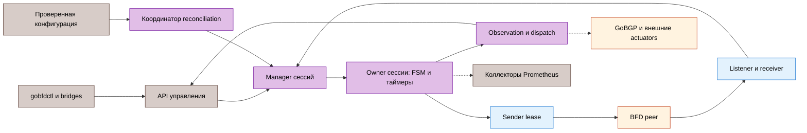
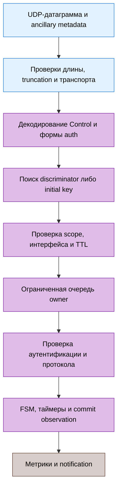
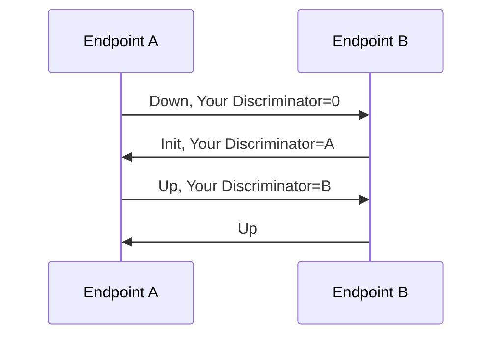

# Архитектура

GoBFD разделяет автоматы BFD, Linux UDP I/O, авторизацию управления и действия маршрутизации. Физической сессией владеет Manager; конфигурация и API-принципалы держат claims на эту сессию. Claim не создаёт отдельный экземпляр протокола. Источники: [идентичность сессии](../../internal/bfd/session_identity.go), [Manager](../../internal/bfd/manager.go).

## Общее устройство

Схема задаёт границы компонентов и направление сообщений. Она не подтверждает совместную судьбу контролируемого пути и dataplane маршрутизации либо overlay. [RFC 5882](../rfc/rfc5882.txt) задаёт взаимодействие клиентов; [ADR-0003](adr/0003-linux-advanced-bfd-applicability.md) ограничивает владение ресурсами Linux.

## Зависимости пакетов

| Пакет | Ответственность | Граница |
|:---|:---|:---|
| [`internal/bfd`](../../internal/bfd) | Codec, аутентификация, FSM, owners, claims, delivery ledger | Не владеет сокетами Linux |
| [`internal/netio`](../../internal/netio) | UDP, ancillary metadata, overlay, монитор интерфейсов, LAG backends | Адаптирует I/O к интерфейсам ядра |
| [`internal/config`](../../internal/config) | Декодирование и проверка YAML, environment и defaults | Формирует полный candidate |
| [`internal/server`](../../internal/server) | Преобразование API, авторизация, Watch, capabilities | Principal задаётся транспортом |
| [`internal/overlay`](../../internal/overlay) | Общий словарь backends | Leaf-пакет стандартной библиотеки |
| [`internal/gobgp`](../../internal/gobgp) | Политика действий BFD→BGP | Внешнее действие ограничено deadline |
| [`cmd/gobfd`](../../cmd/gobfd) | Startup, resource owners, reload, readiness, shutdown | Собирает runtime |
| [`api/bfd/v1`](../../api/bfd/v1) | Публичная protobuf-схема | Генерируемые клиенты находятся в `pkg/bfdpb` |

### Правила зависимостей

FSM возвращает действия; сессия исполняет их. Socket adapters зависят от интерфейсов ядра. Конфигурация и сетевой I/O используют словарь overlay из leaf-пакета. Генерируемый protobuf-код не редактируется вручную. Источники: [FSM](../../internal/bfd/fsm.go), [интерфейс receiver](../../internal/netio/receiver.go), [ADR-0004](adr/0004-overlay-backend-vocabulary.md).

## Приём пакета

[Receiver](../../internal/netio/receiver.go) возвращает pooled-буфер после demux. Для аутентифицированного входа сохраняется собственная копия полного wire payload до проверки owner. Metadata и до 20 байт authentication payload принадлежат значению пакета; требование сохранять wire остаётся. Срок жизни задаёт [ADR-0011](adr/0011-bfd-auth-inline-payload.md).

`Queued` подтверждает только admission. Полная или закрытая очередь и остановленная сессия возвращают типизированные результаты. Общий барьер admission/stop запрещает enqueue после terminal drain; shutdown учитывает abandoned entries. [Delivery accounting](../../internal/bfd/delivery.go) разделяет знаменатели стадий; их сумма не равна числу пакетов.

## Передача пакета

Owner формирует или обновляет cached Control packet, подписывает его при включённой аутентификации, применяет transport-padding target и передаёт через `PacketSender`. Sender lease фиксирует source port и срок владения ресурсом. Padding находится за объявленным BFD Length и областью аутентификации; передача не обрезает аутентифицированный PDU. Источники: [формирование пакета](../../internal/bfd/session_packet.go), [send loop](../../internal/bfd/session_loop.go), [UDP sender](../../internal/netio/sender.go).

## Демультиплексирование

Ненулевой Your Discriminator выбирает candidate-сессию. Нулевой использует начальный ключ адресов с учётом транспорта. До передачи в очередь проверяются transport class, ingress interface, exact overlay scope и TTL. Известный discriminator не позволяет single-hop пакету попасть в multihop-сессию. Overlay identity включает outer endpoints, VNI и поддерживаемый inner IP/MAC tuple. Источники: [приём Manager](../../internal/bfd/manager_session.go), [overlay-проверки](../../internal/netio/overlay_inner.go), [тесты identity](../../internal/bfd/overlay_identity_test.go).

Single-hop реализует numbered multiaccess с одним явным либо вычисленным receive interface. Начальный point-to-point demux с произвольным source address остаётся вне квалифицированного профиля. IPv6 link-local zone выбирает интерфейс, но не входит в initial demux key. См. [границы RFC](08-rfc-compliance.md#rfc-5881-implementation-notes).

## Идентичность сессии и владение

| Объект | Идентичность либо политика | Срок жизни |
|:---|:---|:---|
| `SessionKey` | Тип, family, нормализованные peer/local, интерфейс, network scope, transport scope | Один физический Control wire |
| `SessionOwner` | Типизированный source и source-local owner ID | Один claim |
| Effective parameters | Role, timer tuple, TTL, padding, auth type, immutable key fingerprint | Совпадают для общих claims |
| `SenderLease` | Принятый sender и idempotent release | До drain и join owner |
| Echo key | Структурированные peer/local и точный интерфейс | Один общий Echo wire |

IPv4-mapped адреса преобразуются в IPv4. Compatibility API, authenticated API principal, configuration и unsolicited claims различаются. Совпадающий claim разделяет существующие сессию и discriminator; release удаляет только claim своего owner. Неизвестная семантика key store отклоняется. Источники: [identity и параметры](../../internal/bfd/session_identity.go), [auth store](../../internal/bfd/auth.go), [Echo ownership](../../internal/bfd/manager_echo.go).

Порядок locks: lifecycle, ownership, registry. Manager mutation locks не удерживаются во время peer notification drain и release callbacks. Retiring exact key зарезервирован до owner join, освобождения lease/discriminator и cleanup метрик, включая ошибки. Конфликтующий Add возвращает `AlreadyExists`; повторите после завершения Delete. См. [replacement lifecycle](../../internal/bfd/manager_replace.go), [ADR-0006](adr/0006-session-preserving-reload-policy.md).

### Reconciliation и владение приёмом

Startup и SIGHUP используют один сериализованный координатор. До публикации desired generation candidate проходит retained startup-runtime contract и полную проверку сессий. Authentication admission сравнивает retained accepted intent и live registry. Отказ сохраняет принятую конфигурацию, generation и log level.

Receipt содержит пять sources: base, Echo, Micro-BFD, VXLAN и Geneve. Каждый source готовит desired claims и receive resources до освобождения stale claims. Failed либо resource-pending подготовка сохраняет прежние claims; timer negotiation имеет отдельный pending class. Applied generation меняется после convergence всех sources. Частичный apply не откатывает уже принятые изменения другого source.

Listener owner разделяет сокеты между source claims и physical-session claims. API Add получает RX и TX совместно. Удаление configuration не прекращает Echo RX при surviving API claim. Overlay backend разделяется по tunnel kind и outer local address; physical sender держит exact-scope ref до завершения drain. Scope preflight предшествует backend open и `SetScopes`; несовпадающие live scopes с одним wire требуют явного удаления и повторного создания.

Источники: [координатор](../../cmd/gobfd/reconciliation.go), [listener owner](../../cmd/gobfd/listeners.go), [overlay owner](../../cmd/gobfd/overlay_owner.go), [reload admission](../../internal/bfd/manager_auth_reload.go).

### Восстановление и readiness

Linux link/address notifications и resync запускают ограниченные generation-scoped retries. Только типизированная недоступность интерфейса/адреса переводит source в resource pending; другие ошибки остаются failed. Общая проверка доступности с периодом две секунды охватывает пять sources. Ошибка inventory требует нового явного SIGHUP. Не-Linux monitor не обеспечивает автоматическое восстановление.

Aggregate health имеет `NOT_SERVING` до первой convergence, при различии desired/applied и потере обязательного runtime/listener state. Named BFD/Echo/Micro-BFD health описывает свой source. Неожиданная потеря receiver либо dispatch останавливает daemon с ошибкой. `READY=1` означает готовность процесса/listeners и не подтверждает convergence конфигурации. Источники: [interface events](../../cmd/gobfd/interface_events.go), [readiness](../../cmd/gobfd/readiness.go), [ADR-0001](adr/0001-link-state-rtnetlink.md).

## Трёхстороннее установление сессии

Это один допустимый порядок asynchronous startup. Одновременные Down/Init обрабатываются тем же FSM [RFC 5880 §6.8.6](https://www.rfc-editor.org/rfc/rfc5880.html#section-6.8.6). Локальный Up не подтверждает convergence маршрутизации.

## Модель goroutines

Один выигравший `Run` владеет обработкой пакетов, таймерами и administrative commands каждой Control-сессии. Один owner обслуживает Echo wire. Receivers запускаются для каждого listener; Manager dispatch раздаёт notifications. Текущие Control/Echo owners не удерживают постоянный OS-thread pin. Native A/B, thread bounds и scale acceptance остаются отдельными. Источники: [Control loop](../../internal/bfd/session_loop.go), [Echo loop](../../internal/bfd/echo.go), [ADR-0008](adr/0008-experimental-prerelease-boundary.md).

Observation согласованно фиксирует local state/diagnostic, known remote facts, C-bits, cause и version. Изменение только diagnostic увеличивает observation version без state-transition count. Manager versions задают semantic changes и physical identity; dispatch revision отдельно упорядочивает delivery. Они не являются atomic telemetry watermark. Counters, timers и configuration API snapshot снимаются выборочно. См. [observation model](../../internal/bfd/session_observation.go), [публичную схему](../../api/bfd/v1/bfd.proto).

Raw notification и subscription queues получают размер `min(65536, 64 + 3*N)` при создании и не растут на reload. GAP означает потерю исходных событий и требует resynchronization потребителя; он не считается доставленным original. Счётчики стадий сохраняются после удаления сессии. [ADR-0007](adr/0007-workload-phase-accounting.md) задаёт sizing и completeness.

GoBGP и bridges действуют после state publication. Успешные local observation, notification delivery и external action — разные измерения. Политика BGP disable/enable и deadlines находятся в [handler](../../internal/gobgp/handler.go); generic route withdrawal не реализован.

## Штатное завершение

1. На SIGTERM/SIGINT вызовите `Manager.DrainAllSessions` с отдельным общим бюджетом десять секунд.
2. Дождитесь owner commit AdminDown/7, первой успешной разрешённой записи и negotiated notification window; повторяйте неуспешную запись по обычному TX timer.
3. Закройте Manager, выполните join owners и dispatch, освободите sender leases, затем завершите HTTP и receive resources.

Notification window начинается с первой успешной записи и покрывает максимум local receive Detection Time и `localDetectMult * max(advertisedAdminDownTX, remoteMinRX)`. При multiplier три и non-Up floor одна секунда окно равно трём секундам. Ранняя отмена либо недостаточный бюджет возвращает `DrainIncompleteError`. Успешная локальная запись не означает подтверждение peer.

Final Control-claim release использует тот же drain вне Manager locks. Sole unsolicited failure cleanup отменяет сессию без административного обмена; Echo и group-only Micro-BFD removal не владеют Control AdminDown exchange. Общий overlay lease не прерывает backend других сессий. Произвольный внешний sender callback не имеет универсальной границы shutdown. Источники: [drain](../../internal/bfd/session_drain.go), [Manager lifecycle](../../internal/bfd/manager.go), [RFC 5882 §8](https://www.rfc-editor.org/rfc/rfc5882.html#section-8).

## Структура проекта

Протокольная логика размещается в `internal/bfd`, Linux resources — в `internal/netio`, runtime composition — в `cmd/gobfd`, публичные contracts — в `api/bfd/v1`, executable qualification — в `test`. [ADR index](adr/README.md) хранит принятые решения.

## Технологический состав

[Runtime manifest](../../go.mod) и [tools manifest](../../tools/go.mod) задают зависимости. [Repository contract](../../AGENTS.md) определяет compiler/container policies. Manifest pin задаёт исходный input и не подтверждает совместимость либо deployment.

## UDP-порты

| Destination | Transport | Scope |
|:---|:---|:---|
| 3784 | Single-hop Control | IPv4/IPv6 numbered multiaccess |
| 4784 | Multihop Control | Настроенная пара адресов и receive-hop policy |
| 3785 | Unaffiliated Echo | Default-off preview |
| 6784 | Micro-BFD | Default-off per-member preview |
| 4789 | VXLAN outer UDP | `userspace-udp` preview |
| 6081 | Geneve outer UDP | `userspace-udp` IPv4 Format A preview |

Обычный UDP sender требует фиксированный source port 49152–65535; для Echo это product policy. Источник: [sender constructor](../../internal/netio/sender.go).

## TCP/HTTP-порты

Management endpoints и metrics bind addresses задаются конфигурацией и не являются константами BFD. Default management использует Unix socket; TCP выключен до явной настройки. Plaintext TCP ограничен loopback; non-loopback TCP требует mTLS. См. [defaults и validation](../../internal/config/config.go), [конфигурацию](03-configuration.md), [безопасность](15-security.md).

## Связанные документы

- [Протокол](02-protocol.md) — wire fields, переходы и таймеры.
- [Границы RFC](08-rfc-compliance.md) — реализация и квалификация.
- [Vendor BFD references](reference/vendor-bfd.md) — официальная документация peers.
- [Анализ производительности](14-performance-analysis.md) — измерения и workload limits.
