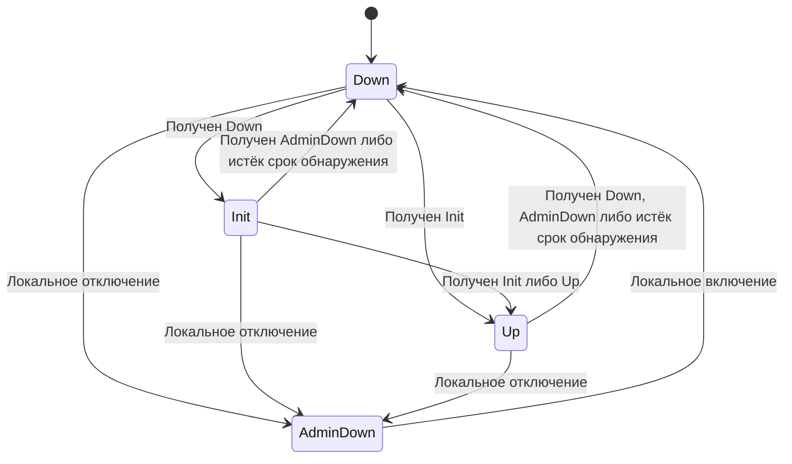
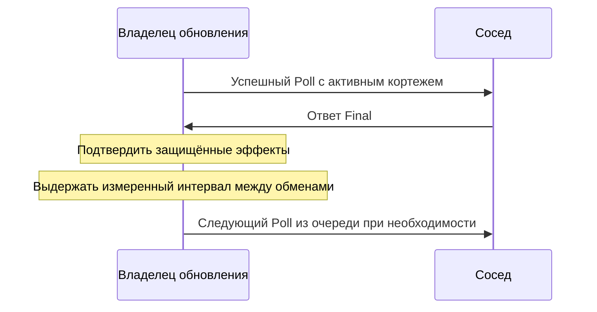

# Протокол BFD

Асинхронный Control использует четырёхсостоянийную модель [RFC 5880](../rfc/rfc5880.txt). Односкачковый режим, ограниченный многоскачковый режим и предварительные реализации транспортов используют это ядро. Локальный Demand, связанный Echo и полное покрытие расширений остаются за его границами. [Матрица RFC](08-rfc-compliance.md) фиксирует ограничения.

## Формат пакета BFD Control

Многобайтовые числа передаются в сетевом порядке байтов. Фиксированный заголовок занимает 24 байта; интервалы задаются в микросекундах. Источники: [RFC 5880 §4.1](https://www.rfc-editor.org/rfc/rfc5880.html#section-4.1), [кодек](../../internal/bfd/packet.go).

| Смещение | Байты | Поле | Проверка либо смысл |
|:---|---:|:---|:---|
| 0 | 1 | Version:3, Diagnostic:5 | Версия 1 |
| 1 | 1 | State:2, P/F/C/A/D/M:6 | Poll, Final, CPI, Auth, Demand, Multipoint |
| 2 | 1 | Detect Multiplier | Не ноль |
| 3 | 1 | Length | Объявленный BFD PDU без транспортного дополнения |
| 4–7 | 4 | My Discriminator | Не ноль |
| 8–11 | 4 | Your Discriminator | Ноль допустим только в AdminDown/Down |
| 12–15 | 4 | Desired Min TX Interval | Желаемый минимум передачи |
| 16–19 | 4 | Required Min RX Interval | Минимум приёма; ноль подавляет периодическую передачу соседа |
| 20–23 | 4 | Required Min Echo RX Interval | Ноль в Control-сессиях GoBFD |
| С 24 | Переменный | Секция аутентификации | Присутствует только при A=1 |

Кодек отклоняет некорректные длины заголовка и аутентификации, Detect Multiplier=0, недопустимые дискриминаторы и M=1. Обработка сессии дополнительно проверяет полученный Desired Min TX, согласованность аутентификации и допуск транспорта. Успешный разбор не означает принятие сессией. Источники: [проверки кодека](../../internal/bfd/packet.go), [обработка приёма владельцем](../../internal/bfd/session_packet.go).

Marshal записывает в буфер вызывающей стороны. `AuthSection` владеет массивом до 20 байт и логическим `DataLen`; копия пакета владеет метаданными и байтами полезной нагрузки. Проверка хеша требует полные неизменяемые принятые байты с линии. Результат неуспешного декодирования отбрасывается; частичная запись заголовка при ошибке не даёт гарантии атомарности. См. [ADR-0011](adr/0011-bfd-auth-inline-payload.md).

## Автомат состояний

[FSM](../../internal/bfd/fsm.go) — чистый поиск по индексу. Он возвращает состояние и действия; [владелец сессии](../../internal/bfd/session_loop.go) выполняет передачу, устанавливает диагностику и публикует результат. [Тесты переходов](../../internal/bfd/fsm_test.go) проверяют таблицу состояний и событий. Ребро схемы не описывает все изменения только диагностики.

## Таблица переходов

| Локальное состояние | Получен AdminDown | Получен Down | Получен Init | Получен Up |
|:---|:---|:---|:---|:---|
| AdminDown | Игнорировать | Игнорировать | Игнорировать | Игнорировать |
| Down | Down | Init | Up | Down |
| Init | Down, диагностика 3 | Init | Up | Up |
| Up | Down, диагностика 3 | Down, диагностика 3 | Up | Up |

Истечение срока обнаружения переводит Init/Up в Down с диагностикой 1. Выбранная политика исправления RFC со статусом Held также меняет диагностику уже находящейся в Down сессии на 1 без перехода состояния. Локальное отключение задаёт AdminDown/7; локальное включение возвращает Down. Отказ интерфейса запрашивает Down/5, сохраняя существующий AdminDown/7. Источники: [действия FSM](../../internal/bfd/fsm.go), [обработчики пути и таймера](../../internal/bfd/session_loop.go), [политика исправлений RFC](08-rfc-compliance.md#rfc-5880-implementation-notes).

## Переменные состояния

| Переменная RFC | Реализация | Граница чтения |
|:---|:---|:---|
| SessionState, LocalDiag | Упакованная пара `localPair` | Атомарная локальная пара |
| RemoteSessionState, удалённые диагностика и C-бит | Зафиксированное наблюдение | Мьютекс сессии |
| LocalDiscr | Неизменяемый дискриминатор | Идентичность физической сессии |
| RemoteDiscr | Изученный дискриминатор | Обновления владельцем; действует сброс после молчания |
| DesiredMinTxInterval, RequiredMinRxInterval | Локальные поля таймеров | Желаемые, объявленные и действующие значения могут различаться |
| RemoteMinRxInterval, RemoteDesiredMinTxInterval | Проверенные поля соседа | Входные параметры таймеров по направлениям |
| DetectMult | Локальное передаваемое значение | Не заменяет полученный множитель соседа |
| RcvAuthSeq, XmitAuthSeq, AuthSeqKnown | `AuthState` | Изменяются после успешной аутентификации |
| DemandMode | Локальный D=0 | Локальный Demand отсутствует |

Инициализация задаёт локальное и удалённое состояния Down, диагностику 0, удалённый дискриминатор 0 и RemoteMinRxInterval одну микросекунду. Номер последовательности аутентификации начинается со случайного 32-битного значения. Согласованное наблюдение содержит семантические факты; счётчики и телеметрия таймеров снимаются отдельно. Источники: [инициализация сессии](../../internal/bfd/session.go), [состояние аутентификации](../../internal/bfd/auth.go), [наблюдение](../../internal/bfd/session_observation.go).

## Согласование таймеров

### Интервал передачи

`Ttx = max(local DesiredMinTxInterval, received RequiredMinRxInterval)`.

До Up объявленный Desired Min TX и интервал без случайного разброса составляют не менее одной секунды. Случайный разброс продолжает действовать. Полученный Required Min RX=0 подавляет периодическую передачу Control; допустимые ответы Final следуют отдельным правилам. Источники: [RFC 5880 §§6.8.3, 6.8.7](https://www.rfc-editor.org/rfc/rfc5880.html#section-6.8.3), [код таймеров и пакетов](../../internal/bfd/session_packet.go).

### Время обнаружения

`Dlocal = received DetectMult * max(local RequiredMinRxInterval, received DesiredMinTxInterval)`.

Каждое направление вычисляет собственный Detection Time. При локальном RX 300 мс, полученном TX 500 мс и полученном множителе 3 локальное D равно 1,5 с. Формула задаёт предельный срок протокола; планирование, очереди приёма и действия клиентов требуют отдельных измерений. [RFC 5880 §6.8.4](https://www.rfc-editor.org/rfc/rfc5880.html#section-6.8.4) задаёт истечение срока; [ADR-0012](adr/0012-owner-down-transition-witness.md) — свидетельство фиксации владельцем.

### Общие интервалы

[RFC 7419 §3](https://www.rfc-editor.org/rfc/rfc7419.html#section-3) задаёт 3,3, 10, 20, 50, 100 и 1000 мс. Опция `bfd.align_intervals` округляет вверх внутри набора; значения больше секунды не меняются. Этот набор не задаёт универсальный аппаратный минимум. См. [функции интервалов](../../internal/bfd/intervals.go), [профили производителей](reference/vendor-bfd.md).

## Случайный разброс интервалов

| Локальный DetectMult | Интервал периодической передачи |
|:---|:---|
| Больше 1 | 75–100% согласованного интервала |
| Равен 1 | 75–90% согласованного интервала |

Случайный разброс использует отдельный PRNG сессии: начальное значение берётся из криптографического источника при успехе и из времени при его ошибке. Он предотвращает синхронизацию и не является границей аутентификации. Источники: [RFC 5880 §6.8.7](https://www.rfc-editor.org/rfc/rfc5880.html#section-6.8.7), [реализация](../../internal/bfd/session_packet.go).

## Последовательность Poll

В Up увеличение TX и уменьшение RX сохраняют прежние защищённые локальные эффекты до соответствующего Final. Уменьшение TX и увеличение RX действуют при активации предложения. Продвинутый кортеж вне Up применяется локально до Final; активный Poll и разделение обменов по-прежнему сериализуют продвижение.

Одно предложение объявляется, последнее ожидающее предложение сохраняется, включая явный RX=0. Final подтверждает предложение только после успешной передачи локального Poll; пересекающийся ответ только с Final его не подтверждает. Следующая транзакция ждёт измеренную длительность обмена после Final. Истечение срока переводит квитанцию в состояние отказа, не отменяя уже объявленные значения. Источники: [владелец транзакции](../../internal/bfd/session_update.go), [тесты](../../internal/bfd/session_update_test.go), [исходный контракт транзакции](../superpowers/specs/2026-09-08-gobfd-timer-update-transactions-design.md).

Асинхронное обновление только множителя обнаружения не требует Poll. Удалённый Demand при обоих концах Up требует Poll/Final. Локальный многоскачковый TTL меняется без Poll; квалифицированные обновления дополнения ограничены асинхронными сессиями с отправителем, уже подготовленным для DF. [ADR-0006](adr/0006-session-preserving-reload-policy.md) определяет кортеж из пяти полей и ограничения допуска и владения. Ограниченные сценарии обмена на линии в [проверках совместимости](05-interop.md) не закрывают общую квалификацию Poll/Demand и финального кандидата.

## Аутентификация

[RFC 5880 §6.7](https://www.rfc-editor.org/rfc/rfc5880.html#section-6.7) определяет поддерживаемые типы. [Код аутентификации](../../internal/bfd/auth.go) проверяет алгоритм, ключ, структуру, хеш и номер последовательности до изменения состояния защиты от повторов.

| Тип на линии | Режим | Секция аутентификации, байт | Окно приёма номеров последовательности |
|---:|:---|---:|:---|
| 1 | Simple Password | 4–19 | Без номера последовательности |
| 2 | Keyed MD5 | 24 | От last до last + 3 × полученный DetectMult включительно |
| 3 | Meticulous Keyed MD5 | 24 | От last + 1 до last + 3 × полученный DetectMult включительно |
| 4 | Keyed SHA1 | 28 | От last до last + 3 × полученный DetectMult включительно |
| 5 | Meticulous Keyed SHA1 | 28 | От last + 1 до last + 3 × полученный DetectMult включительно |

Номера последовательности используют 32-битную арифметику серийных номеров с переходом через границу диапазона. GoBFD увеличивает передаваемый номер при каждом вызове подписи для вариантов Keyed и Meticulous. Неуспешная проверка сохраняет состояние защиты от повторов и принятые байты с линии. Статическое хранилище ключей копирует вход и возвращает публичные копии, принадлежащие вызывающей стороне.

Проверка хеша копирует проверенный объявленный BFD PDU во временное хранилище ограниченного размера, подставляет ключ в копию и сравнивает хеши фиксированной длины за постоянное время. Байты после BFD Length — транспортное дополнение, в том числе в датаграмме 9000 байт; Simple Password не имеет хеша пакета. Независимые векторы для всех режимов и размеров дополнения находятся в [тестах аутентификации и дополнения](../../internal/bfd/auth_padding_test.go).

Несколько сохранённых ключей не задают ротацию без перерыва. Изменения включения аутентификации, алгоритма и неквалифицированных ключей при той же идентичности отклоняются при допуске перечитывания. Согласовать отдельный переход с перерывом с соседом; координированная ротация остаётся неквалифицированной. Режимы MD5/SHA1 из RFC не обеспечивают современную криптографическую стойкость либо конфиденциальность. Ограничить путь приёма и использовать поддерживаемую соседом политику аутентификации. См. [безопасность](15-security.md).

## Несвязанный Echo

Отключённый по умолчанию Echo использует UDP/3785, отдельный `EchoSession`, локальное `D = TxInterval * DetectMult`, TTL 255 при отправке и точно 254 при приёме. Он переходит непосредственно Down↔Up, выбирает возврат по My Discriminator и диагностику 2 при истечении срока. Источники: [владелец Echo](../../internal/bfd/echo.go), [приёмник Echo](../../internal/netio/echo_receiver.go).

[RFC 9747 §2](https://www.rfc-editor.org/rfc/rfc9747.html#section-2) требует FSM RFC 5880 без AdminDown, начальную установку по адресу и исходному порту и последующее демультиплексирование по Your Discriminator. Предварительная реализация не реализует эти процедуры, аутентификацию возвращаемых пакетов и медленную передачу до Up и после Down. Отправка на адрес соседа не подтверждает прохождение его плоскости пересылки. Заявки управления из [ADR-0009](adr/0009-echo-principal-claims.md) не аутентифицируют возвращаемые пакеты Echo.

## Нереализованные функции

### Режим Demand (раздел 6.6)

Локальный D остаётся нулём. Полученный D подавляет периодическую передачу при обоих соседях Up и отсутствии локального Poll. Ограниченные свидетельства перечитывания и удалённого Demand с управляемым тестовым соседом не квалифицируют общий режим Demand. Источник: [условие периодической передачи](../../internal/bfd/session_loop.go).

### Связанный режим Echo (раздел 6.4)

Сессии Control объявляют Required Min Echo RX Interval=0. Отдельная предварительная реализация несвязанного Echo не реализует связанный Echo. Источник: [формирование Control](../../internal/bfd/session_packet.go).

### Режим точка-многоточка

Передаваемый M остаётся нулём; приём M=1 отклоняется. Реализация P2MP не заявляется. Источник: [кодек](../../internal/bfd/packet.go).

## Связанные документы

- [Архитектура](01-architecture.md) — владение, путь приёма и завершение.
- [Границы RFC](08-rfc-compliance.md) — ограничения транспорта и приёмки.
- [Архив RFC](../rfc/) — сохранённые тексты стандартов.
