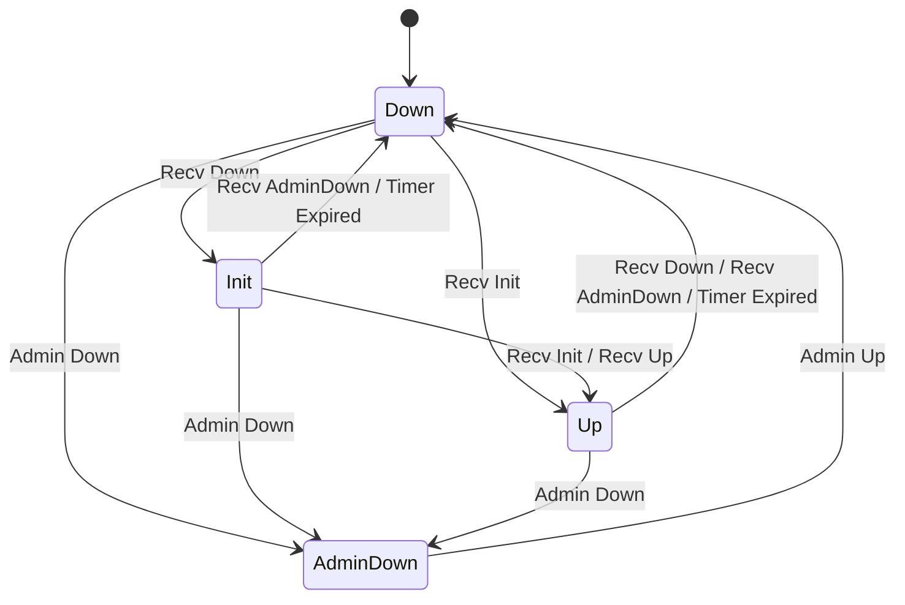
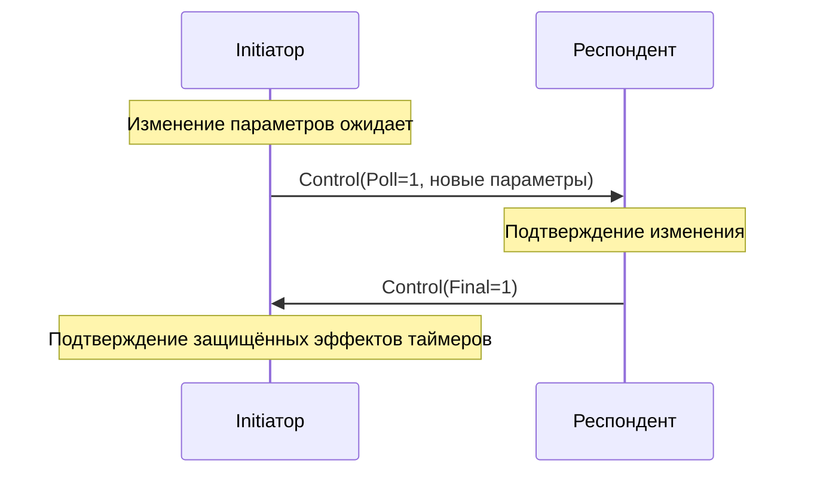

# Протокол BFD


> Детали реализации протокола BFD: конечный автомат (FSM), формат пакетов, согласование таймеров, джиттер, аутентификация и Poll-последовательности.

---

## Содержание

- [Формат BFD Control пакета](#формат-bfd-control-пакета)
- [Конечный автомат (FSM)](#конечный-автомат-fsm)
- [Таблица переходов состояний](#таблица-переходов-состояний)
- [Переменные состояния](#переменные-состояния)
- [Согласование таймеров](#согласование-таймеров)
- [Джиттер](#джиттер)
- [Poll-последовательность](#poll-последовательность)
- [Аутентификация](#аутентификация)
- [Независимый Echo](#независимый-echo)
- [Не реализовано](#не-реализовано)

### Формат BFD Control пакета

RFC 5880 Section 4.1 определяет обязательный заголовок длиной 24 байта:

| Смещение | Размер | Поле | Примечания |
|---|---|---|---|
| 0 | 1 | Версия (3 бита) + Диагностика (5 бит) | Версия ОБЯЗАНА быть 1 |
| 1 | 1 | Состояние (2 бита) + P F C A D M (6 бит) | P=Poll, F=Final, C=CPI, A=Auth, D=Demand, M=Multipoint |
| 2 | 1 | Множитель обнаружения | НЕ ДОЛЖЕН быть нулём |
| 3 | 1 | Длина | Длина BFD PDU в байтах; transport padding RFC 9764 не входит |
| 4-7 | 4 | My Discriminator | НЕ ДОЛЖЕН быть нулём |
| 8-11 | 4 | Your Discriminator | Ноль, пока дискриминатор пира не известен |
| 12-15 | 4 | Desired Min TX Interval | **Микросекунды** |
| 16-19 | 4 | Required Min RX Interval | **Микросекунды** |
| 20-23 | 4 | Required Min Echo RX Interval | **Микросекунды** (0 в Control-сессиях GoBFD; связанный Echo не реализован) |
| 24+ | var | Секция аутентификации | Опциональная, присутствует при установленном бите A |

> **ВАЖНО**: Все поля интервалов -- в **микросекундах** на проводе. Конвертация в `time.Duration` происходит на границе:
> ```go
> interval := time.Duration(pkt.DesiredMinTxInterval) * time.Microsecond
> ```

**Выделение памяти и время жизни данных кодека**: сериализация пишет в
переданный буфер; разбор без аутентификации заполняет принадлежащий вызывающему
пакет без выделения памяти. Разбор с аутентификацией создаёт `AuthSection`,
а его поля дайджеста/пароля заимствуют входной буфер. Для сохранения этих полей
вызывающий должен скопировать их до возврата буфера в пул.

### Конечный автомат (FSM)

RFC 5880 Section 6.8.6 определяет четыре состояния:

| Значение | Состояние | Описание |
|---|---|---|
| 0 | AdminDown | Административно отключено |
| 1 | Down | Сессия неактивна или только создана |
| 2 | Init | Удалённая сессия неактивна, но локальная инициализирована |
| 3 | Up | Сессия полностью установлена |



FSM выполняет чистый индексный поиск по массиву `[state][event]`, построенному
из декларативной `map[stateEvent]transition` при инициализации. Вызывающая
сторона (Session) выполняет возвращённые действия.

### Таблица переходов состояний

Извлечена из псевдокода RFC 5880 Section 6.8.6:

| Текущее состояние | Событие | Новое состояние | Действия |
|---|---|---|---|
| AdminDown | AdminUp | Down | (нет) |
| Down | RecvDown | Init | SendControl |
| Down | RecvInit | Up | SendControl, NotifyUp |
| Down | AdminDown | AdminDown | SetDiagAdminDown |
| Down | TimerExpired | Down | SetDiagTimeExpired |
| Init | RecvAdminDown | Down | SetDiagNeighborDown, NotifyDown |
| Init | RecvDown | Init | (переход в то же состояние) |
| Init | RecvInit | Up | SendControl, NotifyUp |
| Init | RecvUp | Up | SendControl, NotifyUp |
| Init | TimerExpired | Down | SetDiagTimeExpired, NotifyDown |
| Init | AdminDown | AdminDown | SetDiagAdminDown |
| Up | RecvAdminDown | Down | SetDiagNeighborDown, NotifyDown |
| Up | RecvDown | Down | SetDiagNeighborDown, NotifyDown |
| Up | RecvInit | Up | (переход в то же состояние) |
| Up | RecvUp | Up | (переход в то же состояние) |
| Up | TimerExpired | Down | SetDiagTimeExpired, NotifyDown |
| Up | AdminDown | AdminDown | SetDiagAdminDown |

Down timeout diagnostic соответствует принятой политике Held erratum в
[соответствии RFC](08-rfc-compliance.md). Неуказанные пары state/event игнорируются.

Ключевые переходы:

- **Down + RecvDown --> Init**: начало установления сессии (первый шаг рукопожатия)
- **Down + RecvInit --> Up**: локальный пир в Down получает Init от удалённого пира
- **Up + RecvDown --> Down**: пир упал (Diag = NeighborDown)
- **Up + TimerExpired --> Down**: таймаут обнаружения (Diag = ControlTimeExpired)

### Переменные состояния

Отдельные переменные состояния RFC 5880 Section 6.1 и границы их реализации:

| Переменная RFC | Поле Go | Примечания |
|---|---|---|
| bfd.SessionState | `session.localPair` | Упакованная атомарная пара состояния/диагностики; доступен согласованный `Observation` |
| bfd.RemoteSessionState | `session.observation` | Зафиксированные сведения о пире читаются под блокировкой сессии |
| bfd.LocalDiscr | `session.localDiscr` | Неизменяем после создания |
| bfd.RemoteDiscr | `session.remoteDiscr` | Устанавливается из полученных пакетов |
| bfd.LocalDiag | `session.localPair` | Публикуется вместе с локальным состоянием |
| bfd.DesiredMinTxInterval | `session.desiredMinTxInterval` | Настраиваемый |
| bfd.RequiredMinRxInterval | `session.requiredMinRxInterval` | Настраиваемый |
| bfd.RemoteMinRxInterval | `session.remoteMinRxInterval` | Из полученных пакетов |
| bfd.DemandMode | Не реализован | См. [Не реализовано](#не-реализовано) |
| bfd.RemoteDemandMode | `session.remoteDemandMode` | Подавляет периодическую передачу при обоих концах Up без локального Poll |
| bfd.DetectMult | `session.detectMult` | Настраиваемый |
| bfd.AuthType | `session.auth` (interface) | Через интерфейс `Authenticator` |
| bfd.RcvAuthSeq | `session.authState` | `AuthState` отслеживает |
| bfd.XmitAuthSeq | `session.authState` | `AuthState` отслеживает |
| bfd.AuthSeqKnown | `session.authState` | `AuthState` отслеживает |

**Потокобезопасность**: скалярные методы чтения локального состояния и диагностики
используют упакованную атомарную пару. `Observation` читает согласованный
зафиксированный снимок под `Session.mu`; состояние пира не является отдельным
атомарным снимком. Обработка владельцем и поддерживаемые обновления конфигурации
сериализуют изменения полей.

**Инициализация** по RFC 5880 Section 6.8.1:

- `bfd.SessionState` = Down
- `bfd.RemoteSessionState` = Down
- `bfd.LocalDiag` = 0 (None)
- `bfd.RemoteDiscr` = 0
- `bfd.RemoteMinRxInterval` = 1 (микросекунда)
- `bfd.XmitAuthSeq` = случайное 32-битное значение (через `crypto/rand`)

### Согласование таймеров

RFC 5880 Section 6.8.1-6.8.4.

**TX-интервал**: фактический интервал передачи -- больший из локального желаемого минимума и удалённого требуемого минимума:

```text
ActualTxInterval = max(bfd.DesiredMinTxInterval, bfd.RemoteMinRxInterval)
```

Вне Up объявляемый Desired Min TX и TX-интервал до джиттера имеют нижнюю границу
одна секунда (1 000 000 микросекунд) по RFC 5880 Section 6.8.3. Джиттер Section
6.8.7 сохраняется: интервал в одну секунду допускает периодическую передачу
через 750 мс.

**Время обнаружения**:

```text
DetectionTime = bfd.RemoteDetectMult * max(bfd.RequiredMinRxInterval, bfd.RemoteDesiredMinTxInterval)
```

Если за Detection Time не принят корректный пакет, Init и Up переходят в Down
с Diagnostic Control Detection Time Expired (1). Уже находящаяся в Down сессия
обновляет диагностику по выбранной политике Held erratum; AdminDown сохраняет
административное состояние и диагностику. См.
[`handleDetectTimer`](../../internal/bfd/session_loop.go).

### Джиттер

RFC 5880 Section 6.8.7. Случайный джиттер предотвращает синхронизацию:

| Условие | Диапазон джиттера | Эффективный интервал |
|---|---|---|
| DetectMult > 1 | Уменьшение на 0-25% | 75-100% интервала |
| DetectMult == 1 | Уменьшение на 10-25% | 75-90% интервала |

Реализация: [`applyJitterWithRand` и `Session.applyJitter`](../../internal/bfd/session_packet.go).

Локальный генератор псевдослучайных чисел сессии предпочитает криптографическое
начальное значение; при ошибке чтения используется значение на основе времени.
Джиттер не является границей безопасности; локальное состояние сессии устраняет
конкуренцию за глобальный генератор на этом пути.

### Poll-последовательность

RFC 5880 Sections 6.5 и 6.8.3 задают согласование таймеров. В Up защищённые
увеличения TX и уменьшения RX ждут Final; обратные направления сохраняют
немедленный локальный эффект при активации предложения. Вне Up активированное
предложение применяется до Final; незавершённый Poll и интервал разделения
по-прежнему сериализуют активацию. Изменение только множителя в Async не требует
Poll; локальная политика TTL не использует Poll. См.
[политику перезагрузки](adr/0006-session-preserving-reload-policy.md).



Ключевые правила:

1. Одновременно активна только одна Poll-последовательность; обновления владельца
   конфигурации сохраняют активное и последнее ожидающее предложение, включая
   явно заданный нулевой RX.
2. Final завершает локальный Poll только после успешной отправки Poll;
   ответ только с Final при встречном Poll не подтверждает локальную последовательность.
3. В Up увеличение TX и уменьшение RX откладывают локальный эффект до Final;
   уменьшение TX и увеличение RX действуют при активации предложения.

После Final следующая транзакция ждёт измеренную длительность обмена.
Таймаут завершает квитанцию ошибкой без отката объявленных значений.
[Контракт транзакций](../superpowers/specs/2026-09-08-gobfd-timer-update-transactions-design.md)
определяет восстановление и семантику поколений. Ограниченные проверки пакетов
FRR/BIRD сохранены в [тестировании совместимости](05-interop.md); финальная
объединённая квалификация кандидата открыта. Эти проверки не устанавливают полное
соответствие Section 6.5.

### Аутентификация

RFC 5880 Section 6.7. Поддерживаются пять типов:

| ID | Имя | RFC Section | Поведение последовательности |
|---|---|---|---|
| 1 | Simple Password | 4.2 | Нет номера последовательности |
| 2 | Keyed MD5 | 4.3 | Инкремент при каждом вызове подписания в GoBFD |
| 3 | Meticulous Keyed MD5 | 4.3 | Инкремент на каждый пакет |
| 4 | Keyed SHA1 | 4.4 | Инкремент при каждом вызове подписания в GoBFD |
| 5 | Meticulous Keyed SHA1 | 4.4 | Инкремент на каждый пакет |

**Последовательность**: GoBFD увеличивает `bfd.XmitAuthSeq` при каждом подписании
для обычных keyed- и meticulous-вариантов. RFC 5880 допускает увеличение обычного
keyed-счётчика чаще, чем только при изменениях состояния. Включительное окно
приёма равно `[last, last + 3 * received DetectMult]` для non-meticulous и
`[last + 1, last + 3 * received DetectMult]` для meticulous; используется
арифметика серийных номеров.

**Ротация ключей**: несколько ключей в `AuthKeyStore` не задают протокол ротации
во время работы. Изменение аутентификации той же идентичности отклоняется при
перезагрузке конфигурации; согласованная ротация без прерывания остаётся отдельной
работой. При смене развёрнутых ключей согласуйте с пиром прерывающий перезапуск
или явное освобождение и повторное создание.

> **ПРЕДУПРЕЖДЕНИЕ**: MD5 и SHA1 сохранены несмотря на криптографическую слабость, поскольку RFC 5880 определяет их как единственные хэш-основанные типы аутентификации BFD. Если совместимость позволяет, предпочитайте SHA1 вместо MD5; если важна более строгая replay-защита, используйте meticulous-режимы.

#### Формат секции аутентификации на проводе

| Тип Auth | Расположение на проводе | Длина Auth |
|---|---|---|
| Simple Password | Type(1) + Len(1) + KeyID(1) + Password(1-16) | 4-19 |
| Keyed MD5 | Type(1) + Len(1) + KeyID(1) + Reserved(1) + SeqNum(4) + Digest(16) | 24 |
| Meticulous MD5 | Аналогично Keyed MD5 | 24 |
| Keyed SHA1 | Type(1) + Len(1) + KeyID(1) + Reserved(1) + SeqNum(4) + Hash(20) | 28 |
| Meticulous SHA1 | Аналогично Keyed SHA1 | 28 |

### Независимый Echo

Независимый Echo — предварительная реализация, выключенная по умолчанию и
отделённая от Echo, связанного с контрольной сессией RFC 5880.
Полного соответствия RFC 9747 нет.

| Поле | Статус |
|---|---|
| Тип сессии | `SessionTypeEcho` |
| UDP порт | 3785 |
| Формат пакета | BFD Control packet |
| Модель таймеров | Локальная настройка; без согласования с пиром |
| Демультиплексирование | `MyDiscriminator` возвращённого пакета |
| Диагностика при таймауте | `DiagEchoFailed` |

Текущий цикл переходит непосредственно между Down и Up, принимает пакеты по
`MyDiscriminator` и не аутентифицирует возвращённые пакеты. RFC 9747 Section 2
требует FSM из RFC 5880 без AdminDown, начальный выбор сессии и последующее
демультиплексирование по `YourDiscriminator`. Медленная передача до Up и после
Down также не реализована. Права владельцев в API управления не закрывают эти
протокольные пробелы. См. [покрытие RFC](08-rfc-compliance.md#заметки-по-rfc-9747)
и [ADR-0009](adr/0009-echo-principal-claims.md).

### Не реализовано

- **Локальный Demand** (Section 6.6): передаваемый D всегда 0. D пира подавляет
  периодическую передачу, когда оба конца Up и локальный Poll не активен.
  Poll/Final и ограниченная обработка перезагрузки остаются отдельными;
  общая работа Demand не квалифицирована.
- **Связанный Echo** (Section 6.4): `RequiredMinEchoRxInterval` остаётся 0 в обычных контрольных сессиях BFD. Отдельная предварительная реализация независимого Echo имеет перечисленные выше ограничения.
- **Point-to-Multipoint**: бит Multipoint (M) всегда 0. Пакеты с M=1 отклоняются.

### Связанные документы

- [01-architecture.md](./01-architecture.md) -- Архитектура системы
- [08-rfc-compliance.md](./08-rfc-compliance.md) -- Полная матрица соответствия RFC
- [Полный текст RFC 5880](../rfc/rfc5880.txt) -- RFC 5880

---

*Сверено с исходниками `dev`: 2026-10-25.*
