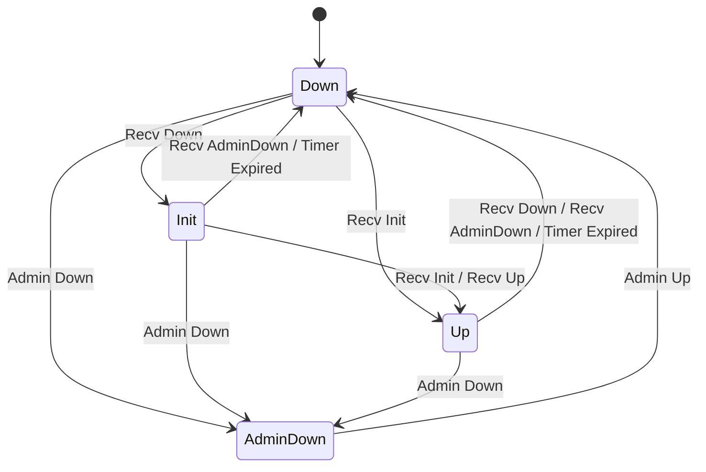
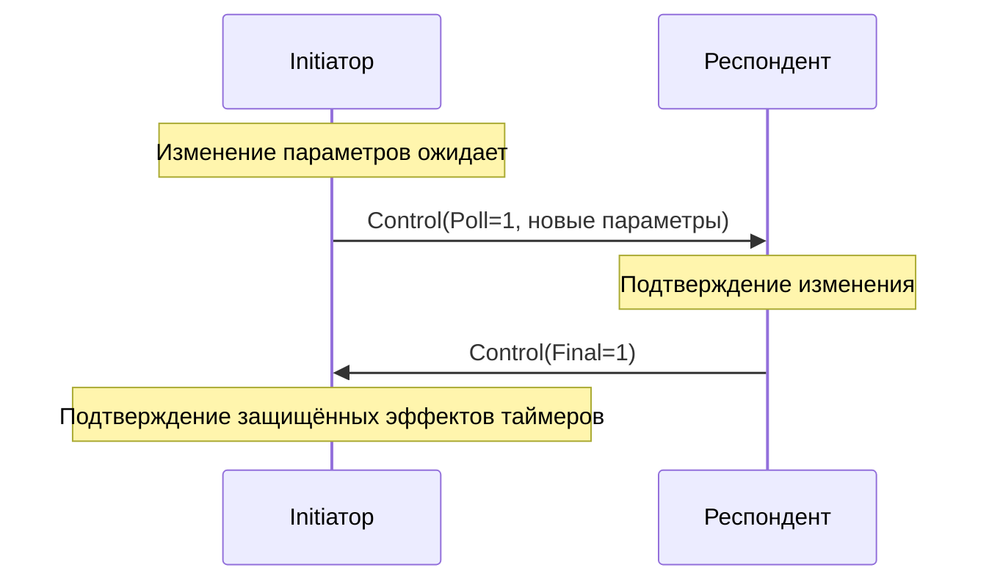

# Протокол BFD


> Детали реализации протокола BFD: конечный автомат (FSM), формат пакетов, согласование таймеров, джиттер, аутентификация и Poll-последовательности.

---

## Содержание

- [Формат BFD Control пакета](#формат-bfd-control-пакета)
- [Конечный автомат (FSM)](#конечный-автомат-fsm)
- [Таблица переходов состояний](#таблица-переходов-состояний)
- [Переменные состояния](#переменные-состояния)
- [Согласование таймеров](#согласование-таймеров)
- [Джиттер](#джиттер)
- [Poll-последовательность](#poll-последовательность)
- [Аутентификация](#аутентификация)
- [Unaffiliated Echo](#unaffiliated-echo)
- [Не реализовано](#не-реализовано)

### Формат BFD Control пакета

RFC 5880 Section 4.1 определяет обязательный заголовок длиной 24 байта:

| Смещение | Размер | Поле | Примечания |
|---|---|---|---|
| 0 | 1 | Версия (3 бита) + Диагностика (5 бит) | Версия ОБЯЗАНА быть 1 |
| 1 | 1 | Состояние (2 бита) + P F C A D M (6 бит) | P=Poll, F=Final, C=CPI, A=Auth, D=Demand, M=Multipoint |
| 2 | 1 | Множитель обнаружения | НЕ ДОЛЖЕН быть нулём |
| 3 | 1 | Длина | Длина BFD PDU в байтах; transport padding RFC 9764 не входит |
| 4-7 | 4 | My Discriminator | НЕ ДОЛЖЕН быть нулём |
| 8-11 | 4 | Your Discriminator | Ноль, пока дискриминатор пира не известен |
| 12-15 | 4 | Desired Min TX Interval | **Микросекунды** |
| 16-19 | 4 | Required Min RX Interval | **Микросекунды** |
| 20-23 | 4 | Required Min Echo RX Interval | **Микросекунды** (0 для affiliated Echo; RFC 9747 unaffiliated Echo реализован отдельно) |
| 24+ | var | Секция аутентификации | Опциональная, присутствует при установленном бите A |

> **ВАЖНО**: Все поля интервалов -- в **микросекундах** на проводе. Конвертация в `time.Duration` происходит на границе:
> ```go
> interval := time.Duration(pkt.DesiredMinTxInterval) * time.Microsecond
> ```

**Allocations и lifetime codec**: marshal пишет в переданный буфер;
unauthenticated unmarshal заполняет caller-owned packet без allocation.
Authenticated unmarshal создаёт `AuthSection`, digest/password которого
заимствуют входной буфер. Retaining callers должны скопировать эти поля до
возврата буфера в pool.

### Конечный автомат (FSM)

RFC 5880 Section 6.8.6 определяет четыре состояния:

| Значение | Состояние | Описание |
|---|---|---|
| 0 | AdminDown | Административно отключено |
| 1 | Down | Сессия неактивна или только создана |
| 2 | Init | Удалённая сессия неактивна, но локальная инициализирована |
| 3 | Up | Сессия полностью установлена |



FSM — чистый indexed lookup по массиву `[state][event]`, который строится
из декларативной `map[stateEvent]transition` при initialization. Вызывающая
сторона (Session) выполняет возвращённые actions.

### Таблица переходов состояний

Извлечена из псевдокода RFC 5880 Section 6.8.6:

| Текущее состояние | Событие | Новое состояние | Действия |
|---|---|---|---|
| AdminDown | AdminUp | Down | (нет) |
| Down | RecvDown | Init | SendControl |
| Down | RecvInit | Up | SendControl, NotifyUp |
| Down | AdminDown | AdminDown | SetDiagAdminDown |
| Down | TimerExpired | Down | SetDiagTimeExpired |
| Init | RecvAdminDown | Down | SetDiagNeighborDown, NotifyDown |
| Init | RecvDown | Init | (self-loop) |
| Init | RecvInit | Up | SendControl, NotifyUp |
| Init | RecvUp | Up | SendControl, NotifyUp |
| Init | TimerExpired | Down | SetDiagTimeExpired, NotifyDown |
| Init | AdminDown | AdminDown | SetDiagAdminDown |
| Up | RecvAdminDown | Down | SetDiagNeighborDown, NotifyDown |
| Up | RecvDown | Down | SetDiagNeighborDown, NotifyDown |
| Up | RecvInit | Up | (self-loop) |
| Up | RecvUp | Up | (self-loop) |
| Up | TimerExpired | Down | SetDiagTimeExpired, NotifyDown |
| Up | AdminDown | AdminDown | SetDiagAdminDown |

Down timeout diagnostic соответствует принятой Held-erratum policy в
[соответствии RFC](08-rfc-compliance.md). Неуказанные пары state/event игнорируются.

Ключевые переходы:

- **Down + RecvDown --> Init**: начало установления сессии (первый шаг рукопожатия)
- **Down + RecvInit --> Up**: локальный peer в Down получает Init от удалённого peer
- **Up + RecvDown --> Down**: пир упал (Diag = NeighborDown)
- **Up + TimerExpired --> Down**: таймаут обнаружения (Diag = ControlTimeExpired)

### Переменные состояния

Все обязательные переменные из RFC 5880 Section 6.1:

| Переменная RFC | Поле Go | Примечания |
|---|---|---|
| bfd.SessionState | `session.localPair` | Packed atomic state/diagnostic; доступен coherent `Observation` |
| bfd.RemoteSessionState | `session.observation` | Committed remote facts читаются под session mutex |
| bfd.LocalDiscr | `session.localDiscr` | Неизменяем после создания |
| bfd.RemoteDiscr | `session.remoteDiscr` | Устанавливается из полученных пакетов |
| bfd.LocalDiag | `session.localPair` | Публикуется вместе с local state |
| bfd.DesiredMinTxInterval | `session.desiredMinTxInterval` | Настраиваемый |
| bfd.RequiredMinRxInterval | `session.requiredMinRxInterval` | Настраиваемый |
| bfd.RemoteMinRxInterval | `session.remoteMinRxInterval` | Из полученных пакетов |
| bfd.DemandMode | Не реализован | См. [Не реализовано](#не-реализовано) |
| bfd.RemoteDemandMode | `session.remoteDemandMode` | Подавляет periodic TX при обоих peers Up и отсутствии local Poll |
| bfd.DetectMult | `session.detectMult` | Настраиваемый |
| bfd.AuthType | `session.auth` (interface) | Через интерфейс `Authenticator` |
| bfd.RcvAuthSeq | `session.authState` | `AuthState` отслеживает |
| bfd.XmitAuthSeq | `session.authState` | `AuthState` отслеживает |
| bfd.AuthSeqKnown | `session.authState` | `AuthState` отслеживает |

**Потокобезопасность**: scalar getters локальных state/diagnostic используют
packed atomic pair. `Observation` читает coherent committed snapshot под
`Session.mu`; remote state не является отдельным atomic snapshot. Owner processing
и поддерживаемые configuration updates сериализуют изменения mutable fields.

**Инициализация** по RFC 5880 Section 6.8.1:

- `bfd.SessionState` = Down
- `bfd.RemoteSessionState` = Down
- `bfd.LocalDiag` = 0 (None)
- `bfd.RemoteDiscr` = 0
- `bfd.RemoteMinRxInterval` = 1 (microsecond)
- `bfd.XmitAuthSeq` = random 32-bit value (через `crypto/rand`)

### Согласование таймеров

RFC 5880 Section 6.8.1-6.8.4.

**TX-интервал**: фактический интервал передачи -- больший из локального желаемого минимума и удалённого требуемого минимума:

```text
ActualTxInterval = max(bfd.DesiredMinTxInterval, bfd.RemoteMinRxInterval)
```

Вне Up объявляемый Desired Min TX и TX-интервал до jitter имеют нижнюю границу
одна секунда (1 000 000 микросекунд) по RFC 5880 Section 6.8.3. Jitter Section
6.8.7 сохраняется: интервал в одну секунду допускает периодическую передачу
через 750 ms.

**Время обнаружения**:

```text
DetectionTime = bfd.RemoteDetectMult * max(bfd.RequiredMinRxInterval, bfd.RemoteDesiredMinTxInterval)
```

Если за Detection Time не принят корректный пакет, Init и Up переходят в Down
с Diagnostic Control Detection Time Expired (1). Уже находящаяся в Down сессия
обновляет диагностику по выбранной Held-erratum policy; AdminDown сохраняет
административное состояние и диагностику. См.
[`handleDetectTimer`](../../internal/bfd/session_loop.go).

### Джиттер

RFC 5880 Section 6.8.7. Случайный джиттер предотвращает синхронизацию:

| Условие | Диапазон джиттера | Эффективный интервал |
|---|---|---|
| DetectMult > 1 | Уменьшение на 0-25% | 75-100% интервала |
| DetectMult == 1 | Уменьшение на 10-25% | 75-90% интервала |

Реализация: [`applyJitterWithRand` и `Session.applyJitter`](../../internal/bfd/session_packet.go).

Session-local PRNG предпочитает cryptographic seed; при ошибке чтения
используется time-based seed. Jitter не является security boundary;
локальное состояние сессии устраняет contention на глобальном RNG этого пути.

### Poll-последовательность

RFC 5880 Sections 6.5 и 6.8.3 задают timer negotiation. В Up защищённые
TX increases и RX decreases ждут Final; обратные направления сохраняют
немедленный локальный эффект при активации proposal. В non-Up эффекты
promoted proposal применяются до Final; unresolved Poll и separation сохраняют
сериализацию promotion. Detect-only Async change не требует Poll; локальная
TTL policy не использует Poll. См. [reload policy](adr/0006-session-preserving-reload-policy.md).



Ключевые правила:

1. Одновременно активна только одна Poll-последовательность; config-owned
   обновления сохраняют активное и последнее ожидающее предложение, включая явный RX zero.
2. Final завершает локальный Poll только после успешной отправки Poll;
   crossed Final-only ответ не подтверждает локальную последовательность.
3. В Up увеличение TX и уменьшение RX откладывают локальный эффект до Final;
   уменьшение TX и увеличение RX действуют при активации предложения.

После Final следующая транзакция ждёт измеренную длительность обмена.
Таймаут завершает receipt ошибкой без отката объявленных значений.
[Контракт транзакций](../superpowers/specs/2026-09-08-gobfd-timer-update-transactions-design.md)
определяет recovery и семантику поколений. Ограниченные FRR/BIRD wire slices
сохранены в [Interop](05-interop.md); финальная объединённая квалификация
кандидата открыта. Эти slices не устанавливают полное соответствие Section 6.5.

### Аутентификация

RFC 5880 Section 6.7. Поддерживаются пять типов:

| ID | Имя | RFC Section | Поведение последовательности |
|---|---|---|---|
| 1 | Simple Password | 4.2 | Нет номера последовательности |
| 2 | Keyed MD5 | 4.3 | Инкремент при каждом вызове signing в GoBFD |
| 3 | Meticulous Keyed MD5 | 4.3 | Инкремент на каждый пакет |
| 4 | Keyed SHA1 | 4.4 | Инкремент при каждом вызове signing в GoBFD |
| 5 | Meticulous Keyed SHA1 | 4.4 | Инкремент на каждый пакет |

**Последовательность**: GoBFD увеличивает `bfd.XmitAuthSeq` при каждом signing
для keyed и meticulous variants. RFC 5880 допускает более частый non-meticulous
increment, чем только state changes. Включительное receive window равно
`[last, last + 3 * received DetectMult]` для non-meticulous и
`[last + 1, last + 3 * received DetectMult]` для meticulous; используется serial arithmetic.

**Ротация ключей**: несколько ключей в `AuthKeyStore` не создают live rotation
protocol. Изменение authentication той же identity отклоняется при reload;
coordinated hitless rotation остаётся отдельной работой. При смене deployed
keys согласуйте с peer прерывающий restart или explicit release/recreation.

> **ПРЕДУПРЕЖДЕНИЕ**: MD5 и SHA1 сохранены несмотря на криптографическую слабость, поскольку RFC 5880 определяет их как единственные хэш-основанные типы аутентификации BFD. Если совместимость позволяет, предпочитайте SHA1 вместо MD5; если важна более строгая replay-защита, используйте meticulous-режимы.

#### Формат секции аутентификации на проводе

| Тип Auth | Расположение на проводе | Длина Auth |
|---|---|---|
| Simple Password | Type(1) + Len(1) + KeyID(1) + Password(1-16) | 4-19 |
| Keyed MD5 | Type(1) + Len(1) + KeyID(1) + Reserved(1) + SeqNum(4) + Digest(16) | 24 |
| Meticulous MD5 | Аналогично Keyed MD5 | 24 |
| Keyed SHA1 | Type(1) + Len(1) + KeyID(1) + Reserved(1) + SeqNum(4) + Hash(20) | 28 |
| Meticulous SHA1 | Аналогично Keyed SHA1 | 28 |

### Unaffiliated Echo

RFC 9747 unaffiliated Echo реализован отдельно от affiliated RFC 5880
control-session Echo mode.

| Поле | Статус |
|---|---|
| Тип сессии | `SessionTypeEcho` |
| UDP порт | 3785 |
| Формат пакета | BFD Control packet |
| Модель таймеров | Локальная настройка; без remote negotiation |
| Демультиплексирование | `MyDiscriminator` возвращённого пакета |
| Диагностика при timeout | `DiagEchoFailed` |

### Не реализовано

- **Local Demand Mode** (Section 6.6): передаваемый D всегда 0. Remote D подавляет
  periodic TX, когда оба peers Up и local Poll не активен. Poll/Final и constrained
  reload handling остаются отдельными; general Demand operation не квалифицирована.
- **Affiliated Echo Mode** (Section 6.4): `RequiredMinEchoRxInterval` остаётся 0 для standard BFD control sessions. RFC 9747 unaffiliated Echo реализован как отдельный forwarding-path echo mechanism.
- **Point-to-Multipoint**: бит Multipoint (M) всегда 0. Пакеты с M=1 отклоняются.

### Связанные документы

- [01-architecture.md](./01-architecture.md) -- Архитектура системы
- [08-rfc-compliance.md](./08-rfc-compliance.md) -- Полная матрица соответствия RFC
- [Полный текст RFC 5880](../rfc/rfc5880.txt) -- RFC 5880

---

*Сверено с исходниками `dev`: 2026-10-24.*
