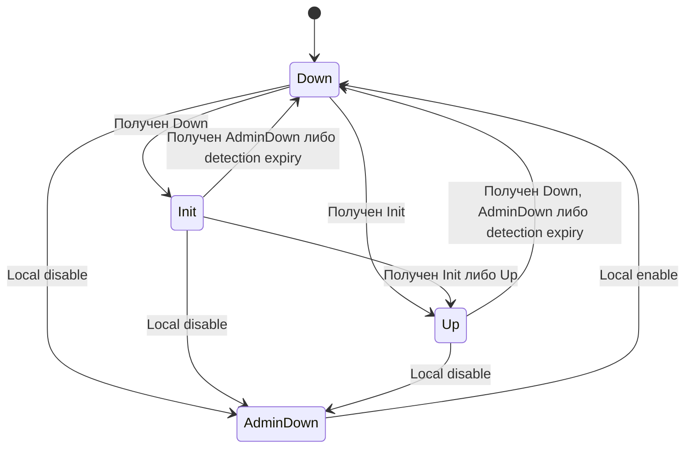
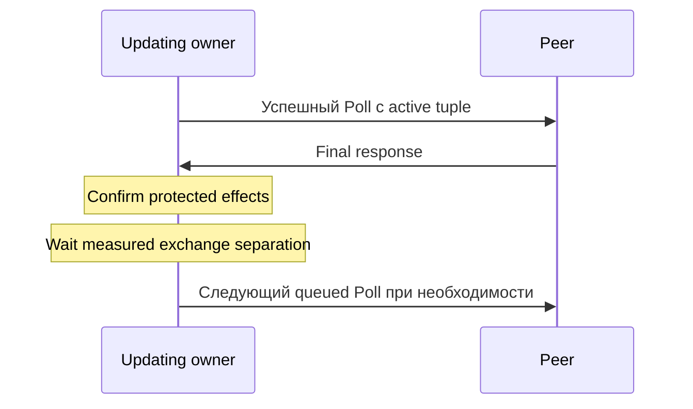

# Протокол BFD

Asynchronous Control использует четырёхсостоянийную модель [RFC 5880](../rfc/rfc5880.txt). Single-hop, ограниченный multihop и preview transports используют это ядро. Local Demand, affiliated Echo и полное покрытие расширений остаются за его границами. [Матрица RFC](08-rfc-compliance.md) фиксирует ограничения.

## Формат BFD Control packet

Многобайтовые числа передаются в network byte order. Фиксированный заголовок занимает 24 байта; интервалы задаются в микросекундах. Источники: [RFC 5880 §4.1](https://www.rfc-editor.org/rfc/rfc5880.html#section-4.1), [codec](../../internal/bfd/packet.go).

| Offset | Байты | Поле | Проверка либо смысл |
|:---|---:|:---|:---|
| 0 | 1 | Version:3, Diagnostic:5 | Version 1 |
| 1 | 1 | State:2, P/F/C/A/D/M:6 | Poll, Final, CPI, Auth, Demand, Multipoint |
| 2 | 1 | Detect Multiplier | Не ноль |
| 3 | 1 | Length | Объявленный BFD PDU без transport padding |
| 4–7 | 4 | My Discriminator | Не ноль |
| 8–11 | 4 | Your Discriminator | Ноль допустим только в AdminDown/Down |
| 12–15 | 4 | Desired Min TX Interval | Желаемый минимум передачи |
| 16–19 | 4 | Required Min RX Interval | Минимум приёма; ноль подавляет periodic peer TX |
| 20–23 | 4 | Required Min Echo RX Interval | Ноль в Control-сессиях GoBFD |
| С 24 | Переменный | Authentication section | Присутствует только при A=1 |

Codec отклоняет malformed header/auth lengths, Detect Multiplier=0, недопустимые discriminators и M=1. Session processing дополнительно проверяет received Desired Min TX, согласованность auth и transport admission. Parser success не означает принятие сессией. Источники: [codec validation](../../internal/bfd/packet.go), [owner receive processing](../../internal/bfd/session_packet.go).

Marshal записывает в переданный caller-буфер. `AuthSection` владеет массивом до 20 байт и logical `DataLen`; копия пакета владеет metadata и payload bytes. Hash verification требует полный неизменяемый received wire. Неуспешный decode отбрасывается; частичная запись header при ошибке не даёт atomicity contract. См. [ADR-0011](adr/0011-bfd-auth-inline-payload.md).

## Автомат состояний

[FSM](../../internal/bfd/fsm.go) — чистый indexed lookup. Он возвращает состояние и действия; [owner сессии](../../internal/bfd/session_loop.go) выполняет send, diagnostic и publication. [Тесты переходов](../../internal/bfd/fsm_test.go) проверяют state/event table. Ребро схемы не описывает все diagnostic-only changes.

## Таблица переходов

| Local state | Получен AdminDown | Получен Down | Получен Init | Получен Up |
|:---|:---|:---|:---|:---|
| AdminDown | Ignore | Ignore | Ignore | Ignore |
| Down | Down | Init | Up | Down |
| Init | Down, diagnostic 3 | Init | Up | Up |
| Up | Down, diagnostic 3 | Down, diagnostic 3 | Up | Up |

Detection expiry переводит Init/Up в Down с diagnostic 1. Выбранная Held-erratum policy также меняет diagnostic уже Down-сессии на 1 без state edge. Local disable задаёт AdminDown/7; local enable возвращает Down. Link failure запрашивает Down/5, сохраняя существующий AdminDown/7. Источники: [FSM actions](../../internal/bfd/fsm.go), [path/timer handlers](../../internal/bfd/session_loop.go), [политика errata](08-rfc-compliance.md#rfc-5880-implementation-notes).

## Переменные состояния

| RFC variable | Реализация | Граница чтения |
|:---|:---|:---|
| SessionState, LocalDiag | Packed `localPair` | Atomic local pair |
| RemoteSessionState, remote diagnostic/C-bit | Committed observation | Session mutex |
| LocalDiscr | Immutable discriminator | Physical-session identity |
| RemoteDiscr | Learned discriminator | Owner updates; действует silence reset |
| DesiredMinTxInterval, RequiredMinRxInterval | Local timer fields | Desired/advertised/effective могут различаться |
| RemoteMinRxInterval, RemoteDesiredMinTxInterval | Проверенные peer fields | Directional timing inputs |
| DetectMult | Локальное передаваемое значение | Не заменяет received peer multiplier |
| RcvAuthSeq, XmitAuthSeq, AuthSeqKnown | `AuthState` | Изменяются после успешной auth |
| DemandMode | Local D=0 | Local Demand отсутствует |

Initialization задаёт local/remote Down, diagnostic 0, remote discriminator 0 и RemoteMinRxInterval одну микросекунду. Auth sequence начинается со случайного 32-битного значения. Coherent observation содержит semantic facts; counters и timer telemetry снимаются отдельно. Источники: [session initialization](../../internal/bfd/session.go), [auth state](../../internal/bfd/auth.go), [observation](../../internal/bfd/session_observation.go).

## Согласование таймеров

### TX interval

`Ttx = max(local DesiredMinTxInterval, received RequiredMinRxInterval)`.

До Up advertised Desired Min TX и unjittered interval имеют минимум одну секунду. Jitter продолжает действовать. Received Required Min RX=0 подавляет periodic Control TX; допустимые Final responses следуют отдельным правилам. Источники: [RFC 5880 §§6.8.3, 6.8.7](https://www.rfc-editor.org/rfc/rfc5880.html#section-6.8.3), [timer/packet code](../../internal/bfd/session_packet.go).

### Detection time

`Dlocal = received DetectMult * max(local RequiredMinRxInterval, received DesiredMinTxInterval)`.

Каждое направление вычисляет собственный Detection Time. При local RX 300 мс, received TX 500 мс и received multiplier 3 local D равен 1,5 с. Формула задаёт protocol deadline; scheduling, receive queues и client actions требуют отдельных измерений. [RFC 5880 §6.8.4](https://www.rfc-editor.org/rfc/rfc5880.html#section-6.8.4) задаёт expiry; [ADR-0012](adr/0012-owner-down-transition-witness.md) — owner commit witness.

### Общие интервалы

[RFC 7419 §3](https://www.rfc-editor.org/rfc/rfc7419.html#section-3) задаёт 3,3, 10, 20, 50, 100 и 1000 мс. Опция `bfd.align_intervals` округляет вверх внутри набора; значения больше секунды не меняются. Этот набор не задаёт универсальный hardware minimum. См. [interval helpers](../../internal/bfd/intervals.go), [vendor profiles](reference/vendor-bfd.md).

## Jitter

| Local DetectMult | Интервал periodic send |
|:---|:---|
| Больше 1 | 75–100% negotiated interval |
| Равен 1 | 75–90% negotiated interval |

Jitter использует session-local PRNG: seed из cryptographic source при успехе и из времени при его ошибке. Он предотвращает синхронизацию и не является границей аутентификации. Источники: [RFC 5880 §6.8.7](https://www.rfc-editor.org/rfc/rfc5880.html#section-6.8.7), [реализация](../../internal/bfd/session_packet.go).

## Poll Sequence

В Up увеличение TX и уменьшение RX сохраняют прежние protected local effects до соответствующего Final. Уменьшение TX и увеличение RX действуют при активации proposal. Promoted non-Up tuple применяется локально до Final; active Poll и separation по-прежнему сериализуют promotion.

Один proposal рекламируется, последний waiting proposal сохраняется, включая явный RX=0. Final подтверждает только после успешной передачи local Poll; crossed Final-only reply его не подтверждает. Следующая транзакция ждёт measured exchange duration после Final. Expiry переводит receipt в failed, не отменяя уже advertised values. Источники: [transaction owner](../../internal/bfd/session_update.go), [тесты](../../internal/bfd/session_update_test.go), [исходный transaction contract](../superpowers/specs/2026-09-08-gobfd-timer-update-transactions-design.md).

Detect-only asynchronous update не требует Poll. Remote Demand при обоих концах Up требует Poll/Final. Local multihop TTL меняется без Poll; qualified padding updates ограничены asynchronous sessions с уже DF-prepared sender. [ADR-0006](adr/0006-session-preserving-reload-policy.md) определяет five-field tuple и admission/ownership limits. Ограниченные wire slices в [interop](05-interop.md) не закрывают general Poll/Demand и final-candidate qualification.

## Аутентификация

[RFC 5880 §6.7](https://www.rfc-editor.org/rfc/rfc5880.html#section-6.7) определяет поддерживаемые типы. [Auth code](../../internal/bfd/auth.go) проверяет алгоритм, key, shape, digest и sequence до изменения replay state.

| Wire type | Режим | Auth section, байт | Receive sequence window |
|---:|:---|---:|:---|
| 1 | Simple Password | 4–19 | Без sequence |
| 2 | Keyed MD5 | 24 | Включая last и last + 3 × received DetectMult |
| 3 | Meticulous Keyed MD5 | 24 | Включая last + 1 и last + 3 × received DetectMult |
| 4 | Keyed SHA1 | 28 | Включая last и last + 3 × received DetectMult |
| 5 | Meticulous Keyed SHA1 | 28 | Включая last + 1 и last + 3 × received DetectMult |

Sequence использует 32-битную serial arithmetic с wrap. GoBFD увеличивает transmit sequence на каждом signing call для keyed и meticulous variants. Failed verification сохраняет replay state и received wire. Static key store копирует input и возвращает caller-owned public copies.

Hash verification копирует проверенный объявленный BFD PDU в bounded scratch storage, подставляет key в копию и сравнивает fixed-width digests за constant time. Байты после BFD Length — transport padding, в том числе в датаграмме 9000 байт; Simple Password не имеет packet digest. Независимые vectors для всех режимов и padding sizes находятся в [auth padding tests](../../internal/bfd/auth_padding_test.go).

Несколько сохранённых keys не задают live rotation. Same-identity changes auth enablement, algorithm и unqualified keys отклоняются при reload admission. Согласуйте отдельный disruptive transition с peer; coordinated rotation остаётся неквалифицированной. Режимы MD5/SHA1 из RFC не обеспечивают современную cryptographic strength либо confidentiality. Ограничьте receive path и используйте поддерживаемую peer authentication policy. См. [безопасность](15-security.md).

## Unaffiliated Echo

Default-off Echo использует UDP/3785, отдельный `EchoSession`, локальное `D = TxInterval * DetectMult`, TTL 255 при отправке и точно 254 при приёме. Он переходит непосредственно Down↔Up, выбирает return по My Discriminator и diagnostic 2 при timeout. Источники: [Echo owner](../../internal/bfd/echo.go), [Echo receiver](../../internal/netio/echo_receiver.go).

[RFC 9747 §2](https://www.rfc-editor.org/rfc/rfc9747.html#section-2) требует RFC 5880 FSM без AdminDown, initial address/source-port bootstrap и последующий Your Discriminator demux. Preview не реализует эти процедуры, return authentication и slow pre-Up/post-Down pacing. Его отправка на peer address не подтверждает traversal соседнего forwarding plane. Management claims из [ADR-0009](adr/0009-echo-principal-claims.md) не аутентифицируют Echo returns.

## Нереализованные функции

### Demand Mode (Section 6.6)

Local D остаётся нулём. Received D подавляет periodic TX при обоих peers Up и отсутствии local Poll. Ограниченные reload и crafted-peer remote-Demand evidence не квалифицируют general Demand mode. Источник: [periodic transmission gate](../../internal/bfd/session_loop.go).

### Affiliated Echo Mode (Section 6.4)

Control sessions рекламируют Required Min Echo RX Interval=0. Отдельный unaffiliated preview не реализует affiliated Echo. Источник: [Control construction](../../internal/bfd/session_packet.go).

### Point-to-Multipoint

Transmit M остаётся нулём; receive M=1 отклоняется. P2MP implementation не заявляется. Источник: [codec](../../internal/bfd/packet.go).

## Связанные документы

- [Архитектура](01-architecture.md) — ownership, receive flow и shutdown.
- [Границы RFC](08-rfc-compliance.md) — transport/acceptance limits.
- [Архив RFC](../rfc/) — сохранённые тексты стандартов.
