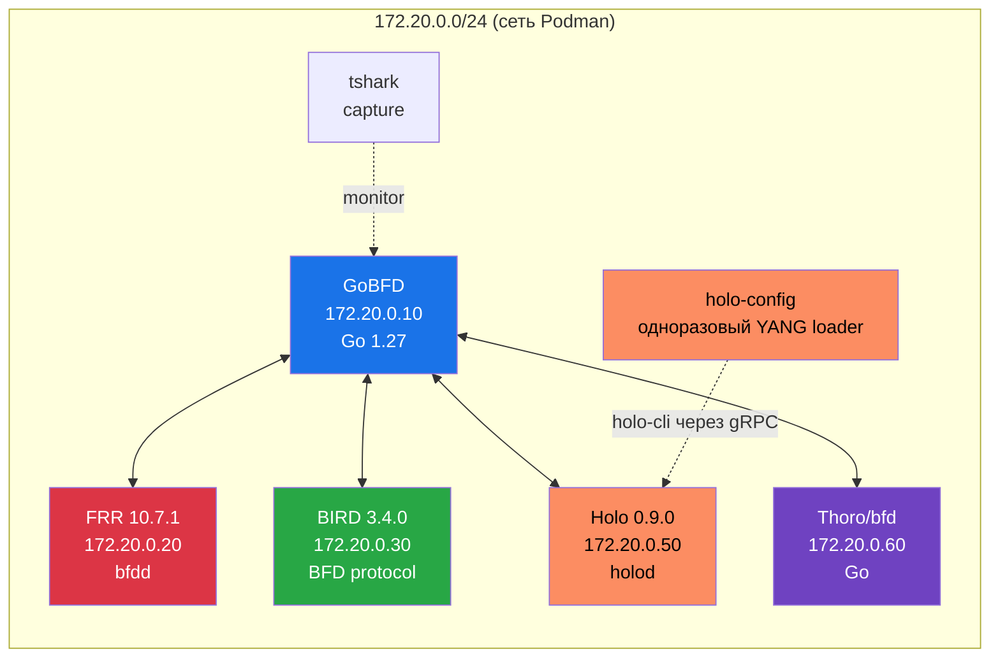
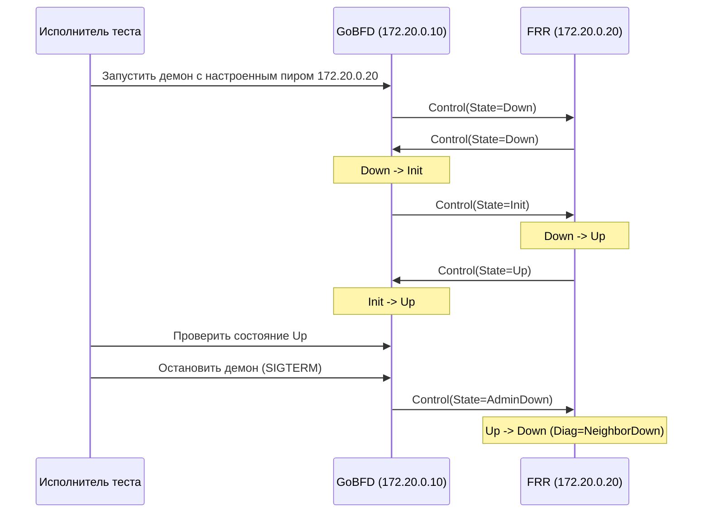
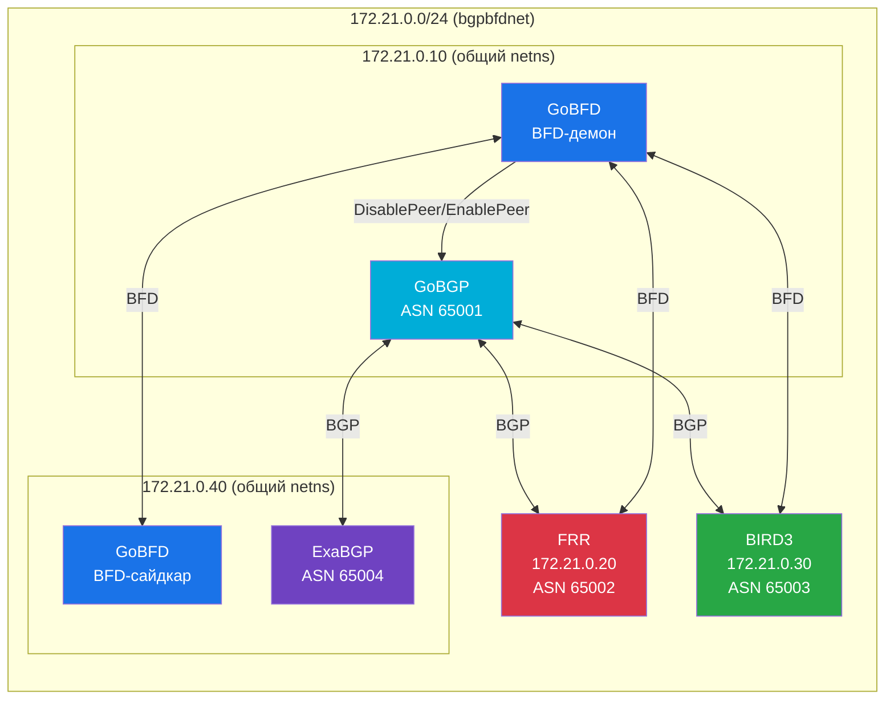
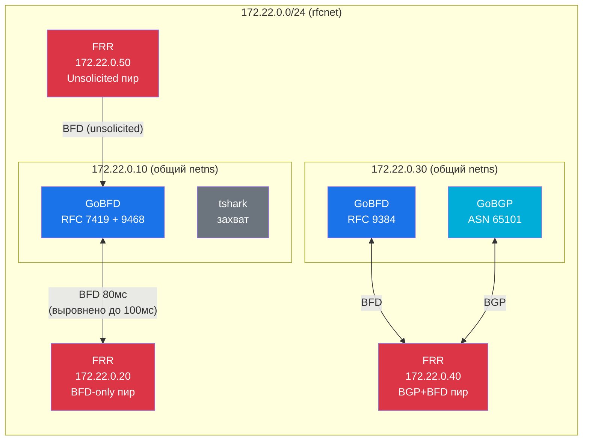
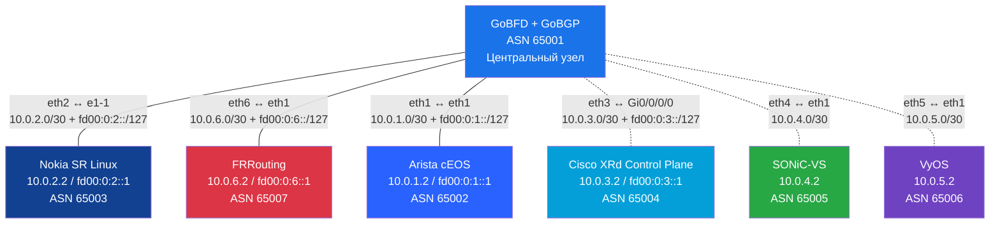

# Тестирование совместимости


> Обязательное тестирование четырёх пиров: Debian FRR 10.7.1, BIRD 3.4.0,
> Holo 0.9.0 и Thoro/bfd в топологии Podman с захватом пакетов.
>
> **Оставшийся блокер запуска (2026-09-08):** старый закреплённый образ FRR
> `10.7.0` использует Alpine 3.22.5. BASE переведён на квалифицированный Debian
> FRR `10.7.1`; E2E и Containerlab со старым образом нельзя запускать
> до приёмки их миграции в Beads `gobfd-qj0.8.2.8.5.2.4`.
> Имя образа производителя не является исключением из запрета Alpine.

Страница описывает текущий тестовый стенд `dev` и датированные локальные
результаты. Исторические квитанции подтверждают только записанные исходники,
образы и сценарии; они не являются новым прогоном или приёмкой стабильного
релиза. Публикация остаётся заблокированной до прохождения отдельных проверок
финального кандидата и релиза. Используйте закреплённый провайдер Compose из
[Развёртывания](06-deployment.md#podman-compose) и проверьте сформированную
конфигурацию выбранных Compose-файлов до запуска топологии.

Переключение базовых потребителей 2026-09-08 локально принято в Beads `.8.5.2.4.2.1`:
`test/interop/compose.yml` и его стенд testcontainers используют общий
рецепт Debian FRR 10.7.1. Ручные проверки Compose и testcontainers пройдены на
linux/amd64 2026-09-08; второй набор завершился за 247.71 секунды с проверенным
удалением своих контейнеров, сети и образов. В каждом выполнены существующие
девять функциональных тестов. В обоих явно пропущены отклонение порта источника
BIRD3 и зависящее от захвата измерение точности обнаружения; в ручном запуске
также пропущен начальный захват диагностики. Это не полное соответствие RFC.
Логи, PCAP и структурированная квитанция сохранены локально в
`reports/e2e/frr-base-caps-20260908/`. Перед каждым запуском проверяйте свободное
место на общем хосте. BGP и RFC также локально квалифицированы ниже;
переключение E2E и Containerlab ещё впереди.
Историческая база 10.7.0 ниже не переименовывается.
Сборки testcontainers и некорректных тестовых векторов ограничены по CPU/RAM.
При ручном запуске BASE `interopctl` получает `compose config --format json`
и последовательно собирает активные образы: два CPU, 2 GiB RAM, без swap,
одно задание сборки. Обе фазы запуска используют `--no-build`; лимиты сервисов
действуют отдельно при выполнении. Неподдерживаемые параметры сборки и
`COMPOSE_COMPATIBILITY` отклоняются до сборки. Не используйте
`compose build --print` как пробный запуск: Compose 5.5.0 с `DOCKER_BUILDKIT=0`
может начать настоящую сборку.
`make interop-testcontainers` передаёт полную ревизию рабочего дерева с хоста через
`GOBFD_BUILD_REVISION`: изолированному монтированию рабочего дерева не нужен доступ
к Git-каталогу хоста. При прямом запуске из контейнера без Git-метаданных
передайте то же значение; некорректные ревизии отклоняются.

Текущие тестовые конфигурации BASE используют Simple Password для FRR и Keyed SHA1 для
BIRD с публичным тестовым ключом `gobfd-interop` и ID ключа 7. GoBFD передаёт
обоим полезную нагрузку UDP размером 128 байт; Holo и Thoro используют полезную нагрузку размером 24 байта без
аутентификации. Для FRR выбран Simple Password, поскольку закреплённая
[SHA1-реализация использует HMAC](https://github.com/FRRouting/frr/blob/frr-10.7.1/bfdd/bfd_packet.c#L532),
а [BIRD хеширует объявленный BFD PDU](https://github.com/CZ-NIC/bird/blob/e66773c42f115d80aaaef3b7246953b276a88065/proto/bfd/packets.c#L268).
Проверки аутентификации GoBFD сохраняются без ослабления.

На 2026-10-15 критический ручной набор проверок Compose с race detector пройден на
linux/amd64 для `task/rfc9764-interop` в
`e71afa118ae10cac8e8a53e3672f7f7b6cc83afa`: четыре рукопожатия, Version,
длина, аутентификация и дополнение, TTL 255, порт назначения и диапазон портов источника.
Захват проверил 293 пакета GoBFD к FRR и 296 к BIRD: BFD Length 40/52,
UDP Length 136, нулевое дополнение и IPv4 DF; 300 пакетов к Holo и 296 к Thoro
сохранили BFD Length 24 и UDP Length 32. API GoBFD показал локальный и
удалённый Up для четырёх пиров. Локальные доказательства сохранены в
`reports/rfc9764-interop/`. Проверен TX GoBFD с дополнением и обычный аутентифицированный
RX от пиров; пиры не передают дополнение. Полный функциональный набор, перезагрузка
таймеров и проверка MTU пути не выполнялись. Запуск использовал существующее
переопределение DNS контейнеров для одной команды; исправление резолвера хоста остаётся
открытым. Контейнеры остановлены по проверенным точным ID; контейнеры, сеть
и образы сохранены.

Рецепт замены — `test/interop/frr/Containerfile`, контекст сборки —
`test/interop/frr`. Общая база Debian trixie закреплена digest, официальные
пакеты FRR `10.7.1-0~deb13u1` / libyang `3.13.6-1~deb13u1` — SHA-256
для каждой архитектуры. Начальная проверка запуска на amd64 пройдена; выполнение на arm64
и переключение остальных потребителей ещё не квалифицированы. Исторические
результаты `10.7.0` ниже не квалифицируют новый артефакт.

Сборка принимает полный commit рабочего дерева в `VCS_REF` и время RFC 3339 в
`BUILD_DATE`, с лимитами `--cpu-period 100000 --cpu-quota 200000 --memory 2g
--memory-swap 2g --jobs 1`. Штатный `watchfrr` на переднем плане наблюдает за `mgmtd`,
`zebra`, `bfdd` и `staticd`; запуск из пакета применяет `/etc/frr/frr.conf`.
BGP-потребители должны передать свою конфигурацию демонов и включить `bgpd`
в команду. FRR требует `NET_ADMIN`, `NET_RAW` и `SYS_ADMIN`; для изолированного
проверочного запуска не нужны сеть хоста или сокет среды исполнения.
Python и `frr-pythontools` не установлены. Скрипты из пакета остаются внешними
деталями FRR; собственная оболочка запуска в репозиторий не добавляется.

Проверочный запуск использует один CPU, 256 MiB, 64 PID и `--network none`: заданный
BFD-пир остаётся Down с TX/RX 300 ms, четыре демона — Up.
Остановка в пределах десяти секунд возвращает код 0; PID демонов на хосте исчезают.
Это удаление пространства имён PID, **не корректная остановка отдельных демонов**:
[watchfrr завершается по SIGTERM](https://github.com/FRRouting/frr/blob/frr-10.7.1/watchfrr/watchfrr.c#L1027).
Отчёты CycloneDX и SPDX сохранены локально в
`reports/frr-debian-20260908/`. Debian-зависимости не закреплены снимком репозитория,
поэтому побитовая воспроизводимость итогового образа не заявляется.
Beads `.8.5.2.4.1` охватывает этот этап артефакта; `.8.5.2.4.2` — переключение
потребителей и квалификацию запуска. Блокер остальных потребителей остаётся активным.

---

## Содержание

- [Обзор](#обзор)
- [Топология тестирования](#топология-тестирования)
- [Реализации пиров](#реализации-пиров)
- [Запуск тестов совместимости](#запуск-тестов-совместимости)
- [Что тестируется](#что-тестируется)
- [Захват пакетов](#захват-пакетов)
- [Устранение проблем](#устранение-проблем)
- [Тестирование совместимости по RFC](#тестирование-совместимости-по-rfc)

### Обзор

GoBFD тестируется с четырьмя независимыми реализациями BFD. Обязательный
базовый набор проверок работает на `linux/amd64`: Holo публикует официальный amd64-образ,
но не манифест нескольких архитектур. GoBGP и ExaBGP входят в отдельный BGP+BFD
набор и не считаются базовыми пирами.

### Топология тестирования



### Реализации пиров

| Пир | Версия | Реализация | Язык | Документированное покрытие RFC |
|---|---:|---|---|---|
| [FRR](https://frrouting.org/) | 10.7.1 | bfdd | C | 5880, 5881, 5882, 5883 |
| [BIRD3](https://bird.network.cz/) | 3.4.0 + исправление | протокол BFD | C | 5880, 5881, 5882, 5883 |
| [Holo](https://github.com/holo-routing/holo/releases/tag/v0.9.0) | 0.9.0 | holod | Rust | 5880, 5881, 5882, 5883 |
| [Thoro/bfd](https://github.com/Thoro/bfd) | сборка из репозитория | демон gRPC | Go | 5880, 5881 |

Рецепт BIRD собирает commit тега `c3669497e3949b942d86d07e343092cc439b4659`
и применяет закреплённое контрольной суммой исправление upstream
[`7cf75587`](https://gitlab.nic.cz/labs/bird/-/commit/7cf75587b6f38b87849fe192bf5dfd124b7702bc)
для CVE-2026-112112. Образ хранит оба хеша в
`/usr/share/doc/bird/gobfd-source.txt`. `TestBIRDFlowSpecValidation`
(тег `interop_testcontainers`) проверяет, что BIRD помечает IPv6 FlowSpec
назначение с ненулевым смещением как недопустимое; его запускает
`make interop-testcontainers`. BIRD собирается из исходников, поэтому
SBOM образа и пакетные сканеры его не показывают.

Holo использует неизменяемый digest официального образа из `compose.yml`. Демон
запускается с `holo/holod.toml`, после чего одноразовый сервис, ожидающий готовности,
`holo-config` применяет `holo/holo.startup` через `holo-cli`. Значения YANG
указаны в микросекундах: `300000` для интервалов передачи и приёма с
множителем `3`, что даёт согласованный интервал 300 мс и время обнаружения 900 мс.
У загрузчика нет фиксированного адреса, и он не является пятым пиром.

### Программируемый Go-пир

Закреплённые профили FRR/BIRD не проверяют все входные условия с нулевым RX и Demand пира.
Поведение BIRD при нулевом RX не является общим доказанным ограничением.
`TestCraftedPeerTestcontainers` (тег
`interop_testcontainers`) запускает отдельную топологию: GoBFD с одной сессией
из `gobfd/crafted-peer.yml`, tshark в сетевом пространстве имён GoBFD и
репозиторный Go-инструмент из `scapy/Containerfile` с аргументом `peer` по
адресу `172.20.0.40`. Без аргумента тот же бинарник по-прежнему отправляет
корпус некорректных векторов. Пир использует кодек репозитория, TTL 255,
порт источника 49152, Poll/Final, медленный интервал вне Up и работает без
аутентификации. Каждый `SIGUSR1` из теста переводит его в следующую фазу:

| Фаза | Действие пира | Проверка по захвату |
|---|---|---|
| `rx0`, `poll` | Required Min RX 0 с Poll, затем второй Poll | От GoBFD только Final, по одному на Poll, не менее 10 согласованных интервалов (RFC 5880 Section 6.8.7) |
| `silent` | Передача прекращена | Демон фиксирует Down с diag 1 через один Detection Time (из `gobfdctl`, сверен с захватом) после последнего кадра пира, в пределах `[DT-1 ms, DT+max(2 ms, DT/50)]`; первый кадр GoBFD (Down, diag 1, Your Discriminator 0) следует не позднее `DT+50 ms+max(2 ms, DT/50)` после последнего кадра пира, далее не менее 3 интервалов медленного режима в границах джиттера (Sections 6.8.4, 6.8.7 и 6.8.18) |
| `recover` | Новое трёхстороннее рукопожатие | Up с таймерами 300 ms в обе стороны |
| `demand` | D=1 с Poll | GoBFD отвечает Final и далее передаёт только кадры Poll или Final; SIGHUP на 500 ms даёт Poll GoBFD с новыми таймерами, Final от пира и квитанцию сошедшейся перезагрузки после этого Final (Sections 6.5 и 6.6) |
| `demand-clear` | D=0 с Poll | GoBFD отвечает Final и возобновляет периодическую передачу в пределах `T+slack`; далее не менее 12 интервалов проходят границы джиттера и проверку среднего в 3 стандартные ошибки для T=500 ms |
| `final-loss`, `poll`, `final-restore` | Отбрасывает свои ответы Final (имитация потерь), затем пересекает незавершённый Poll GoBFD своим Poll, затем снова отвечает | SIGHUP на 400 ms и, пока Final теряется, на 800 ms: GoBFD повторяет P=1 с активным кортежем 400 ms, отвечает на пересекающий Poll только F с тем же кортежем, возобновляет P=1 и отправляет Poll 800 ms только после Final пира и интервала не меньше измеренного обмена; этот Poll получает свой Final и квитанцию (Sections 6.5 и 6.8.3); ни один кадр захвата не содержит одновременно P и F |

`make interop-testcontainers` запускает чистые тесты оценщика
(`TestCraftedPeerEvidence*`) и живую топологию. Тест сохраняет журналы демона и
пира, TSV кадров, итоговый JSON и PCAP с файлами SHA-256 в
`INTEROP_TESTCONTAINERS_ARTIFACT_DIR`.

Существующие сценарии перезагрузки конфигурации также проверяют изменения Detect Multiplier:
аутентифицированные FRR/BIRD3 Async-сессии — 1→5→3 без GoBFD Poll;
программируемая сессия с Demand пира — 5→3, каждый раз с собственными Poll, Final пира,
квитанцией применения и окном без изменений. DetectMult 1 использует джиттер 75–90% со
средним 0.825T, остальные проверяемые множители — 75–100% и 0.875T.
Проверка захвата сохраняет порт источника и длину UDP, тип, ключ и последовательность аутентификации,
дискриминаторы и таймеры. До изменений запросы реестра tshark во время выполнения ограничены
префиксами `frame.`, `ip.`, `bfd.` и `udp.`; сохраняемые строки сопоставляются
по первому столбцу. Полный реестр не буферизуется в ограниченном исполнителе с race detector.
Локальное Detection Time приёма зависит от множителя пира. Расчётные границы Async пира
и локального Demand Poll отделены от измерений; программируемый пир не имеет
таймера обнаружения. Контракты исходников не закрывают P0 `gobfd-qj0.8.2.2.7.5.2`:
обязательны фактические захваты кандидата.

Локальная квалификация на `d9e67064e51012c0d25a1a22dc9bd469600d8469` проходит
обе топологии с этими захватами; квитанции — в `reports/detect-wire-20261024/`.
Это не закрывает подготовленное дополнение, TTL и финальную квалификацию пяти полей.

Сценарии подготовленного дополнения расширяют тот же жизненный цикл таймеров аутентифицированными
целями 128→192→128, отклонением смены аутентификации с дополнением, включения/отключения дополнения и
комбинированного кандидата. Стартовый профиль Meticulous SHA1 запускается через
`TestFourPeerMeticulousTopologyTestcontainers`; профиль Keyed SHA1 по умолчанию — через
`TestFourPeerTopologyTestcontainers`. Каждый загружает и восстанавливает
собственную выбранную неизменяемую исходную конфигурацию. Независимый пир сохраняет свой
размер пакета. Проверка захвата сохраняет состояние защиты от повторов между фазами и попытками,
проверяет DF, исходную полезную нагрузку UDP, объявленную длину PDU, нулевое дополнение и область MAC.
Общая и именованная готовность BFD проверяются внутри собственного контейнера демона
через существующий Unix-сокет тем же собранным interop-бинарником, скопированным
механизмом файлов контейнера; TCP остаётся доступным только на loopback. Программируемый пир принимает SIGUSR2
как Poll текущего состояния без продвижения фазы и сброса Demand: это даёт
Final старого размера после отклонённого изменения размера в Demand. Фактическая приёмка захвата ведётся отдельно в `gobfd-qj0.8.2.2.7.5.3.3`;
результаты только по исходникам эту задачу не закрывают.

Локальная квалификация на `b97729458a696aee21023ba147af51417ed9ff7b` проходит
оба профиля FourPeer и программируемый Demand с этими захватами. Три квитанции запуска
и 675 проверенных сопутствующих файлов сохранены в `reports/padding-wire-20261024/`.
Квалифицирована только перезагрузка дополнения; фактический TTL, единый финальный кандидат
и проверки стабильного релиза остаются отдельными. Пропуски начального Down
и DetectionPrecision в исходной базе требуют решения на финальной проверке вместе с известным
отклонением диапазона портов источника BIRD на Linux.

Финальная проверка кандидата ограничивает декодированные строки TShark после фильтра отображения; `-c` ограничивает прочитанные пакеты и может скрыть поздние подходящие кадры.
Отсутствие начального Down(diag=0) или доказательств истечения обнаружения завершает обязательные
проверки ошибкой. Исключение порта источника BIRD подтверждено закреплённым
[сокетом BFD TX](https://github.com/CZ-NIC/bird/blob/c3669497e3949b942d86d07e343092cc439b4659/proto/bfd/packets.c#L496)
и [платформенной функцией](https://github.com/CZ-NIC/bird/blob/c3669497e3949b942d86d07e343092cc439b4659/sysdep/unix/io.c#L796):
`SKF_HIGH_PORT` не обеспечивает диапазон RFC 5881 на Linux. В сохранённом захвате дополнения 938 пакетов BIRD используют порт 43990; это отклонение пира, а не
подтверждение соответствия GoBFD. Общий сборщик сохраняет неизменяемые ID образов и
обязательные аннотации исходников и базы OCI до очистки.
Доказательства: `reports/final-wire-20261024/`; фактическая квалификация финального кандидата
остаётся в `gobfd-qj0.8.2.2.7.5.5`.
Проверка FourPeer по умолчанию проходит на
`e4e79a8eee8e7c38bfc78321bdc5e9030909c214` за 429,47 с: все десять сценариев,
начальный Down и DetectionPrecision выполнены (разрыв 0,901 с), один явный пропуск RFC для BIRD; сохранены шесть ID образов, совпали 867 хешей исходников и 310 сопутствующих файлов
артефактов. Четырнадцать проверок готовности вернули SERVING для обоих сервисов.
При лимите исполнителя 512 MiB события max/OOM и swap — 0; отсутствие точных ID
образов после очистки подтверждено. Все четыре финальных профиля повторяются после
оставшихся изменений потоков и масштаба рабочей реализации.

Тот же программируемый жизненный цикл предоставляет `TestCraftedMultihopTTLTestcontainers`
с фиксированной командой запуска `peer-multihop`: UDP/4784, meticulous SHA1,
локальный RX 3 s и прежний TX 300 ms. `SIGUSR1` включает Demand пира;
три шага `SIGUSR2` приостанавливают периодический TX пира до перезагрузки конфигурации, повторяют
последнюю принятую полезную нагрузку с допустимым TTL, отправляют свежий Poll ниже
порога и его побайтово идентичный повтор на пороге с шагом 200 ms, затем явно
возобновляют TX после аутентифицированного Final и снимков счётчиков. Max-hops 1→5→1
проверяется в Async и Demand пира, затем — отклонение входных данных со сменой аутентификации и политики переходов.
Контрольные точки захвата и аутентификации сохраняются между фазами. Число принятых RX
увеличивается на один; ровно одна ошибка аутентификации относится к намеренному повтору,
переходы состояний не меняются. Исходная база охватывает перезагрузку и вход
в Demand, а также каждую пробу.
Проверяется локальная политика GoBFD `255 - N`; приёмка маршрутизируемых и облачных сред остаётся
отдельной. Фактическая квалификация принадлежит `gobfd-qj0.8.2.2.7.5.4.3`.

Локальная квалификация на `491b2214994f07e017eb93ab67a29a95378c619e` проходит
исходный программируемый профиль за 162.94 s и аутентифицированный multihop за 81.98 s.
Все семь окон проверки границ и повторов проходят; совпадают 863 хеша исходников
и 212 сопутствующих файлов артефактов. Доказательства: `reports/ttl-wire-20261024/`. Оба профиля
повторены на исправленных исходниках после удаления повторного атрибута журнала сессий;
строгий разбор JSON-квитанций сохранён. Единая квалификация пяти полей и стабильного релиза остаются отдельными.

### Запуск тестов совместимости

#### Полный цикл (рекомендуется)

```bash
# Сборка, запуск топологии, тесты, очистка -- всё в одном
make interop
```

Команда запускает жизненный цикл на Go на testcontainers: проверяет доступность
фиксированных имён, требует нулевой код завершения загрузчика Holo, выполняет Go-
проверки, сохраняет захват пакетов и подтверждает удаление каждого принадлежащего тесту
контейнера, сети и образа.

#### Явная цель Go testcontainers

```bash
make interop-testcontainers
```

Это явная форма цели полного цикла по умолчанию. Её четырёхпировые профили
создают сеть со статическими адресами, GoBFD, FRR,
BIRD3, Holo, Thoro/bfd и tshark напрямую через провайдер Podman библиотеки
testcontainers. Цель выполняет те же Go-проверки, сохраняет захват пакетов в
`reports/e2e/interop-testcontainers` и проверяет удаление каждого тестового
контейнера, сети и образа.

Цель также выбирает четырёхпировый профиль meticulous SHA1, регрессионную
проверку BIRD FlowSpec, программируемого пира и аутентифицированный multihop
TTL. Артефакты и границы приёмки этих профилей различаются; один четырёхпировый
результат не заменяет все выбранные профили. Точный набор указан в
[`Makefile`](../../Makefile) и тестовых стендах `test/interop/`.

#### Пошагово

```bash
# Шаг 1: Запуск 4-пировой топологии
make interop-up

# Шаг 2: Запуск Go-тестов совместимости
make interop-test

# Шаг 3: Остановка и очистка
make interop-down
```

Ручная цель `interop-test` сейчас не добавляет `-race` и не эквивалентна
полному циклу с race detector. Для квалификации кандидата используйте
`make interop`; в квитанции ручного запуска сохраняйте это различие.

#### Просмотр захваченных пакетов

```bash
# Сводка в формате CSV
make interop-pcap-summary

# Полная расшифровка пакетов
make interop-pcap

# Живой захват
make interop-capture
```

### Что тестируется

Тесты совместимости (`test/interop/interop_test.go`) проверяют:

| Тест | Описание |
|---|---|
| Установление сессии | Трёхстороннее рукопожатие с каждым пиром до состояния Up |
| Разрыв сессии | Корректная передача AdminDown |
| Согласование таймеров | Правильные согласованные интервалы между реализациями |
| Анализ пакетов | tshark проверяет формат BFD-пакетов на проводе |



BASE testcontainers выполняет `TestTimerReload` между анализом исходной базы RFC и
разрушающими тестами жизненного цикла: три последовательные группы подпроцессов. Меняются
только тестовые копии конфигураций FRR/BIRD: нижний порог RX пира 100 ms, локальные
`300→100→500→300 ms`, затем отдельные фазы явного RX0 с восстановлением исходной конфигурации.
Каждая фаза требует JSON-квитанций точного поколения, замкнутого окна пакетов с
Poll и Final и публикации квитанции применения после завершающего Final. Ненулевые
фазы дополнительно требуют неизменных дискриминаторов, состояния Up и счётчиков
текстового CLI. Фазы RX0 требуют нулевого объявления, квитанций и восстановления;
Down после Final допускается, потому что пир может прекратить передачу: BIRD
3.4.0 прекращает, FRR 10.7.1 продолжает. Точные временные метки JSON/PCAP
предполагают общие часы realtime хоста для testcontainers-демона и захвата;
округление и допуск расхождения часов не применяются.

Проверка времени требует минимум 12 последовательных периодических интервалов GoBFD после Final.
RFC 5880, раздел 6.8.7, ограничивает каждый интервал 75–100% согласованного TX при
DetectMult больше 1.
Проверка расширяет эти границы на max(2 ms, 2% TX) для задержки пробуждения
таймера и захвата и требует, чтобы выборочное среднее лежало в пределах трёх
стандартных ошибок от 87,5% — среднего равномерного уменьшения 0–25%, которое
выбирает GoBFD; верхняя граница получает тот же допуск на задержку, потому что
таймер перезапускается после каждой отправки. Логи, конфигурации, сводки кадров,
статусы подпроцессов и контрольные суммы и PCAP с проверкой чтения сохраняются в
`INTEROP_TESTCONTAINERS_ARTIFACT_DIR` до удаления своих ресурсов при успехе и
ошибке; без явного каталога выводится сохраняемый временный путь. Демон в
testcontainers-топологии пишет логи в JSON; проверки логов принимают текстовую и
JSON-форму.

2026-10-21 бинарник набора проверок для `af7c907` прошёл все восемь фаз с FRR 10.7.1 и
BIRD 3.4.0 с исправлением `7cf75587`. Объединённые интервалы GoBFD при 100, 300 и
500 ms (n = 37, 26, 25) имеют средние 88,3%, 89,1% и 86,2% согласованного TX.
Критерии Колмогорова–Смирнова и χ² при α = 0,05 не отвергли равномерную модель
75–100%; наибольшее превышение 100% составило 0,97 ms. Аутентифицированные выборочные потери Final, детерминированное пересечение
Poll и Demand пира остаются открытыми в `gobfd-qj0.8.2.1.1.1.4.3`; H-05
остаётся частичным.

### Захват пакетов

Топология включает контейнер tshark для захвата всего BFD-трафика. Захваты сохраняются в формате `.pcapng`.

```bash
# Просмотр захваченных пакетов
make interop-pcap

# Сводка в формате CSV
make interop-pcap-summary

# Поля сводки:
#   frame.time_relative, ip.src, ip.dst,
#   bfd.version, bfd.diag, bfd.sta, bfd.flags,
#   bfd.detect_time_multiplier, bfd.my_discriminator,
#   bfd.your_discriminator, bfd.desired_min_tx_interval,
#   bfd.required_min_rx_interval
```

### Устранение проблем

| Проблема | Решение |
|---|---|
| Контейнеры не запускаются | Проверьте `podman network inspect` на конфликты IP |
| Сессии застряли в Down | Убедитесь, что `CAP_NET_RAW` доступен в контейнерах |
| tshark без данных | Проверьте конфигурацию общего сетевого интерфейса |

```bash
# Просмотр логов принадлежащих проекту контейнеров через guarded target
make interop-logs
```

---

## Полноцикловое тестирование BGP+BFD


> Сквозное тестирование связки BFD→BGP (RFC 5882): обнаружение отказа через BFD вызывает отключение BGP-пира, восстановление BFD — повторное включение.

### Топология BGP+BFD



### Три тестовых сценария

| # | Сценарий | BFD | BGP | Маршрут |
|---|---|---|---|---|
| 1 | GoBFD+GoBGP ↔ FRR | FRR bfdd (нативный) | FRR bgpd (нативный) | `10.20.0.0/24` |
| 2 | GoBFD+GoBGP ↔ BIRD3 | BIRD3 BFD (нативный) | BIRD3 BGP (нативный) | `10.30.0.0/24` |
| 3 | GoBFD+GoBGP ↔ GoBFD+ExaBGP | GoBFD-сайдкар | ExaBGP (без BFD) | `10.40.0.0/24` |

### Полный цикл тестирования

Каждый сценарий проверяет три фазы:

1. **Установление**: BGP-сессия Established, BFD-сессия Up, маршрут получен в RIB GoBGP
2. **Отказ**: Остановка/пауза пира → BFD Down (~900мс) → GoBGP DisablePeer → маршрут отозван
3. **Восстановление**: Запуск/снятие паузы → BFD Up → GoBGP EnablePeer → BGP восстановлен → маршрут возвращён

### Запуск тестов BGP+BFD

**BGP на trixie локально квалифицирован** (Beads `gobfd-qj0.8.2.8.5.2.4.2.2`).
Согласованная замена использует общие рецепты FRR, GoBGP и ExaBGP в
`test/interop/`. GoBGP v4.10.0 собирается из upstream commit
`da824d99912e02124b53741245ee4186c381adcc` на trixie; рецепт закрепляет Go 1.27.3,
а записанная квалификация выполнена со сборщиком Go 1.27.2 и повторяется в
`gobfd-bjr`. GoBGP v3
обслуживает `/apipb.GobgpApi`, v4 — `/api.GoBgpService`; они несовместимы на уровне
протокола, поэтому GoBFD в `dev` требует демон GoBGP v4. Нативный BFD в GoBGP v4
по умолчанию выключен, и ни одна конфигурация GoBGP в репозитории его не
включает. Внешний ExaBGP 5.0.13 использует системный
Python trixie и штатную точку входа `python3 -m exabgp`, без pip, uv, собственного
запускателя и Python-исходников репозитория. Его
[закреплённый манифест upstream](https://github.com/Exa-Networks/exabgp/blob/edf249571174449f80c72d75eb6933dcabd67f92/pyproject.toml)
не содержит зависимостей от пакетов при выполнении. Оба архива исходников закреплены
SHA-256. Узкое исключение для выполнения ExaBGP не разрешает инструменты разработки Python.

С GoBGP v3.37.0 на linux/amd64 ручной Compose и полный набор проверок testcontainers
пройдены 2026-09-08; второй занял 200.07 секунды. Каждый выполнил все четыре
существующих race-теста: установление соседства и отказ FRR/BIRD3/ExaBGP,
отзыв маршрутов и восстановление, без пропусков. Семь контейнеров каждой
топологии ограничены одним CPU, 256 MiB RAM, без swap и 128 PID; OOM не было.
Последовательные сборки ограничены двумя CPU и 2 GiB. Свои контейнеры, сети
и теги образов удалены. Логи, PCAP, CycloneDX/SPDX SBOM пиров и квитанция
приёмки сохранены локально в `reports/e2e/bgp-trixie-20260908/`.
Это не квалификация arm64, остальных потребителей образов, перезагрузки таймеров
или полного соответствия RFC. Разрешение Debian-пакетов не закреплено
снимком репозитория; побитовая воспроизводимость итоговых образов не заявляется.
Записанное принятие риска v0.6 охватывает GoBGP v3.37.0. В `dev` исключение
`GO-2026-4736` допускает только находки уровня модуля для закреплённого GoBGP v4;
финальный кандидат по-прежнему требует свежего сканирования рабочего модуля
и инструментов. Основание принятия риска и условие удаления описаны в
[SECURITY.md](../../SECURITY.md) и
[реестре рисков зависимостей](reference/dependency-risk.md).
Изолируйте этих пиров от недоверенных сетей; функциональные BGP-тесты и SBOM
не означают квалификацию безопасности.

2026-10-13 на commit `f85ca09` на linux/amd64 набор проверок testcontainers
`TestBGPBFDTopologyTestcontainers` пройден с GoBGP v4.10.0 за 359.25 секунды:
все четыре race-подтеста (`AllPeersUp`, FRR, BIRD3, ExaBGP) выполнены без
пропусков, проверка версии GoBGP вернула 4.10.0, контейнеров не осталось.
Ручной путь Compose на GoBGP v4 не перезапускался.

```bash
# Авторитетный routing aggregate с owned artifacts и cleanup
make e2e-routing

# Full cycle по умолчанию: Go управляет Podman lifecycle через testcontainers
make interop-bgp
```

Жизненный цикл на Go напрямую через провайдер Podman создаёт статическую сеть,
оба экземпляра GoBFD, GoBGP v4.10.0, FRR 10.7.1, BIRD 3.4.0, ExaBGP 5.0.13
и tshark. Он выполняет те же проверки установления сессий, отказа, отзыва
маршрутов и восстановления, сохраняет непустой захват пакетов и доказывает
удаление всех принадлежащих тесту контейнеров, сети и локально собранных образов.

Оба BGP-пути передают штатному `watchfrr` список `mgmtd`, `zebra`, `bgpd`,
`bfdd`, `staticd`. FRR-конфигурация в Compose остаётся доступной только для чтения: тесты
останавливают и запускают пиров, но не сохраняют конфигурацию. Все семь сервисов
ограничены одним CPU, 256 MiB RAM, без дополнительного swap и 128 PID.
Сборки ограничены двумя CPU и 2 GiB, как описано выше.
Ручные `make interop-bgp-up/down/logs` используют существующий контроллер
с проверкой владения; после сборок с лимитами выполняется `up --no-build`.
`INTEROP_BGP_PROJECT_NAME` по умолчанию равен `${INTEROP_PROJECT_NAME}-bgp`,
как в общем наборе проверок маршрутизации; ручные тесты используют тот же проект. Общий
`dev-exec` допускает десять минут на компиляцию и пятиминутный тест;
служебные команды сохраняют двухминутное ограничение.
Цель testcontainers передаёт ревизию хоста и регистрирует очистку образа
до сборки.

### Ключевое решение: общие сетевые пространства имён

GoBFD и GoBGP разделяют сетевое пространство имён (оба на `172.21.0.10`), поэтому адрес BFD-пира совпадает с адресом BGP-соседа. Когда GoBFD обнаруживает BFD Down для пира `172.21.0.20`, он вызывает `DisablePeer("172.21.0.20")`, что корректно отключает BGP-сессию с FRR.

Аналогичный подход для ExaBGP: GoBFD-сайдкар и ExaBGP разделяют сетевое пространство имён на `172.21.0.40`. Тест ExaBGP использует `podman pause` для заморозки только BFD-сайдкара, сохраняя BGP-сессию ExaBGP, доказывая, что BFD обнаруживает отказ раньше, чем истекает таймер удержания BGP.

### Связанные документы

- [09-development.md](./09-development.md) -- Рабочий процесс разработки и make-цели
- [06-deployment.md](./06-deployment.md) -- Контейнерный образ и Podman Compose
- [08-rfc-compliance.md](./08-rfc-compliance.md) -- Матрица соответствия RFC

---

## Тестирование совместимости по RFC


> Целевые тесты совместимости RFC-расширений сверх базового протокола
> в топологии из восьми контейнеров с захватом пакетов (tshark).

### Топология RFC Interop



### Контейнеры (8)

| Контейнер | IP | Роль |
|---|---|---|
| `gobfd-rfc` | 172.22.0.10 | GoBFD с align_intervals + unsolicited |
| `tshark-rfc` | (общее сетевое пространство имён) | Захват пакетов на интерфейсах gobfd-rfc |
| `frr-rfc` | 172.22.0.20 | Пир FRR только с BFD для выравнивания таймеров RFC 7419 |
| `gobfd-rfc9384` | 172.22.0.30 | GoBFD с интеграцией GoBGP для RFC 9384 |
| `gobgp-rfc` | (общее сетевое пространство имён) | GoBGP ASN 65101 для тестирования BGP Cease |
| `frr-rfc-bgp` | 172.22.0.40 | FRR BGP+BFD пир для RFC 9384 |
| `frr-rfc-unsolicited` | 172.22.0.50 | FRR BFD пир без предварительно настроенной сессии на GoBFD |
| `echo-reflector` | 172.22.0.60 | Независимый UDP-отражатель Echo для RFC 9747 |

### Записанные результаты тестов

Таблица описывает датированные локальные прогоны из раздела
[Запуск RFC Interop тестов](#запуск-rfc-interop-тестов). Текущий кандидат должен
повторно пройти проверку; эти отметки не являются результатом нового запуска.

| Тест | RFC | Описание | Результат |
|---|---|---|---|
| `TestRFC7419_CommonIntervalAlignment` | 7419 | GoBFD настроен на 80мс; с `align_intervals: true` интервал должен быть выровнен до 100мс. Верифицируется через tshark-захват поля `DesiredMinTxInterval`. | **PASS** |
| `TestRFC9384_BGPCeaseBFDDown` | 9384 | Пауза frr-rfc-bgp → BFD Down → GoBFD вызывает DisablePeer → BGP-сессия разорвана. Снятие паузы → BFD Up → EnablePeer → BGP восстановлен. Аннотация упоминает Cease/10, но `DisablePeer` отправляет Administrative Shutdown (Cease/2): так делает GoBGP v3, а `DisablePeerRequest` в GoBGP v4 по-прежнему содержит только поля `address` и `communication`. Путь действия пройден на GoBGP v3.37.0 и на v4.10.0 (2026-10-13). | **Путь действия проходит; подкод RFC 9384 на проводе не реализован** |
| `TestRFC9468_UnsolicitedBFD` | 9468 | frr-rfc-unsolicited (172.22.0.50) инициирует BFD без настроенной сессии GoBFD. Проверяются Up-пакеты и пять секунд стабильности, но не истечение или очистка unsolicited-сессии. | **PASS** |
| `TestRFC9747_EchoSession` | 9747 | Echo-сессия GoBFD достигает Up через независимый отражатель; пауза и восстановление доказывают обнаружение отказа и возврат сессии. | **PASS** |

Тест RFC 9384 доказывает связь BFD с разрывом и восстановлением BGP, но не
проверяет и не подтверждает подкод Cease 10 на проводе.

### Запуск RFC Interop тестов

P0-миграция `.8.5.2.4.2.3` прошла полный локальный linux/amd64
набор проверок testcontainers 2026-09-08 за 117.50 секунды: все четыре существующих
race-сценария без пропусков. FRR 10.7.1 и GoBGP v3.37.0 использовали общие
рецепты trixie. Пять последовательных сборок ограничены двумя CPU и 2 GiB;
восемь контейнеров — одним CPU, 256 MiB, без swap и 128 PID.
OOM не было; удаление точных контейнеров, сети и образов проверено.
Логи, PCAP, CycloneDX/SPDX SBOM пиров и JSON-квитанция сохранены в
`reports/e2e/rfc-trixie-20260908/`.
Прямой жизненный цикл Compose с фиксированными именами остаётся неподдерживаемым.
Эта приёмка не квалифицирует arm64, полный протокольный контракт RFC 9384,
истечение unsolicited-сессий или перезагрузки таймеров и не является проверкой безопасности.
Общий рецепт теперь собирает GoBGP v4.10.0. 2026-10-13 тот же
набор проверок testcontainers пройден на GoBGP v4.10.0 за 162.12 секунды на `7559c05`:
все четыре race-сценария без пропусков, тестовых контейнеров не осталось.

Для проверки работающего стенда используйте жизненный цикл Podman на Go.
Каждая операция выполнения привязывается к неизменяемому ID контейнера:

```bash
make interop-rfc
```

---

## Совместимость с вендорными NOS (Containerlab)


> Опциональные тесты профилей NOS. Настройка топологии не устанавливает полную
> квалификацию RFC 5880/5881/5882. Профили SONiC/VyOS имеют только IPv4;
> остальные настроенные профили включают IPv6. Доступность образов и фактические
> результаты запуска остаются отдельными условиями приёмки.

### Топология вендоров

Звёздообразная топология использует IPv4 /30 и, где настроено, IPv6 /127 на
той же паре veth. RFC 3021 относится к /31, а не к этим связям /30. Код
жизненного цикла на Go запускает внешний контейнер GoBFD через Podman, затем
вызывает `containerlab deploy --runtime podman` со сформированной топологией.
Очистка использует записанную топологию и идентификаторы. Containerlab является
исполняемой зависимостью, а не только справочным описанием топологии.



> Сплошные линии = основные или базовые профили. Пунктирные линии =
> отложенный профиль или профиль, зависящий от образа. Доступность образов фиксируется
> через `make e2e-vendor`.

### Доступность вендоров

| Вендор | Образ | Подсеть IPv4 | Подсеть IPv6 | ASN | Статус | Лицензия |
|---|---|---|---|---|---|---|
| **Nokia SR Linux** | `ghcr.io/nokia/srlinux:25.10.2` | `10.0.2.0/30` | `fd00:0:2::/127` | 65003 | Основной, общедоступный образ | Бесплатно, без регистрации |
| **FRRouting** | `quay.io/frrouting/frr:10.7.0` | `10.0.6.0/30` | `fd00:0:6::/127` | 65007 | Базовый | GPL, бесплатно |
| **Arista cEOS** | `ceos:4.36.0.1F` | `10.0.1.0/30` | `fd00:0:1::/127` | 65002 | Основной, образ оператора | Бесплатный аккаунт Arista.com |
| SONiC-VS | `docker.io/netreplica/docker-sonic-vs:latest` | `10.0.4.0/30` | -- | 65005 | Основной, общедоступный образ | Бесплатно |
| VyOS | `docker.io/muruu1/vyos:latest` | `10.0.5.0/30` | -- | 65006 | Основной, общедоступное зеркало; резервная сборка ISO | Бесплатный rolling/community-образ |
| Cisco XRd | `ios-xr/xrd-control-plane:25.4.1` | `10.0.3.0/30` | `fd00:0:3::/127` | 65004 | Отложен | Сервисный контракт Cisco |

### Предварительные требования

Эти команды описывают существующий стенд и не разрешают запуск
неквалифицированных образов. Устаревший образ FRR выше заблокирован политикой
базовых образов; остальным вендорным профилям нужен записанный допуск образов
и привилегий. Доступный тег сам по себе не квалифицирует базу, безопасность
или совместимость.

- **Podman** с активным API сокета (`/run/podman/podman.sock`)
- **containerlab** строго 0.82.0 (проверяется в `test/internal/clabbootstrap/orchestration.go`)
- Привилегии контейнера: `NET_ADMIN`, `NET_RAW`
- Хотя бы один доступный вендорный образ

Используйте [официальные архивы v0.82.0](https://github.com/srl-labs/containerlab/releases/tag/v0.82.0)
и сверяйте SHA256 с [опубликованными контрольными суммами](https://github.com/srl-labs/containerlab/releases/download/v0.82.0/checksums.txt):

| Архив | SHA256 |
|---|---|
| `containerlab_0.82.0_linux_amd64.tar.gz` | `87a6415803848878c2c886bd79e89a4d0ee34091ebf889488ea1029cef7e2d78` |
| `containerlab_0.82.0_linux_arm64.tar.gz` | `f04ac8c1f2f6a04c344585cb6a36177c446fce18cb6073b4a0dbd517f3512210` |

Обновление включает [исправления ошибок destroy и подготовки management network в 0.81](https://containerlab.dev/rn/0.81/)
и [защиту каталогов при cleanup в 0.82](https://containerlab.dev/rn/0.82/).
Эти исправления не подтверждают runtime acceptance вендоров; проверки владения
ресурсами и их отсутствия после destroy остаются обязательными.

### Подготовка лаборатории (Go bootstrap)

Команда на Go 1.27 отвечает за предварительную проверку, ограниченные параллельные скачивания,
сборку, инвентаризацию, нативную подготовку ISO/rootfs VyOS и импорт
предоставленных оператором архивов Arista/Cisco. Собственные вспомогательные инструменты на Python и shell в
подготовке вендорных образов больше не участвуют.

```bash
# Скачать все public образы + подготовить VyOS tag + собрать GoBFD
go run ./test/cmd/clabbootstrap -v

# С коммерческими образами
go run ./test/cmd/clabbootstrap \
    --arista-image /path/to/cEOS64-lab-4.36.0.1F.tar

# Подготовка + деплой топологии
go run ./test/cmd/clabbootstrap --deploy

# Подготовка + полный прогон тестов
go run ./test/cmd/clabbootstrap --test

# Пробный запуск (показать что будет сделано)
go run ./test/cmd/clabbootstrap --dry-run
```

Команда выполняет:
- **Предварительные проверки**: точная версия Containerlab, доступность Podman и Go
- **Параллельное скачивание образов**: Nokia SR Linux, SONiC-VS, VyOS, FRRouting (+ зависимости сборки)
- **Подготовка образа VyOS**: скачивание `docker.io/muruu1/vyos:latest`, назначение тега `vyos:latest`; сборка ISO остаётся резервным вариантом
- **Импорт коммерческих образов**: Arista cEOS (`podman load`); Cisco XRd остаётся отложенным до появления образа от оператора
- **Сборка образа GoBFD**: многоэтапный Containerfile с сайдкаром GoBGP,
  ссылкой, принадлежащей запуску, `localhost/gobfd-clab:<run-id>` и точным ID образа.
  Сайдкар — GoBGP v4.10.0, собранный из тех же закреплённых исходников, что и
  `test/interop/gobgp`; контрактный тест поддерживает совпадение закреплённых ревизий.
  Совместимость с NOS производителей на GoBGP v4 ещё не квалифицирована
- **Отчёт об инвентаризации**: итоговый список образов со статусами готовности и отсутствия

Пробное развёртывание требует доступной для чтения и корректной топологии с
FRR-образом, закреплённым digest. Ошибка загрузки или проверки останавливает
команды топологии; подстановка FRR-образа без digest не выполняется. Пути
удаления и запуска только тестов сохраняют свои правила receipt.

Выполните `make interop-clab-bootstrap ARGS=--help` для просмотра всех опций.
Начальная подготовка на Go проверяет перенаправления HTTPS, извлечение архивов и фиксированные argv
внешних инструментов образов.

### Запуск вендорных тестов

```bash
# Полный цикл: сборка образа GoBFD + деплой + тесты + очистка
make interop-clab

# Пошагово
make interop-clab-up     # Сборка + деплой топологии
make interop-clab-bootstrap ARGS=--test-only  # Проверка идентификаторов, затем тесты
make interop-clab-down   # Удаление owned-контейнеров, линков и точного образа GoBFD

# Только подготовка, затем использование или удаление staged owned-образа
make interop-clab-bootstrap
make interop-clab-bootstrap ARGS="--deploy --skip-build"
# либо: make interop-clab-down
```

`make interop-clab` скачивает общедоступные образы Nokia SR Linux, SONiC-VS, VyOS и
FRRouting до проверки доступности. Cisco XRd и Arista cEOS остаются
образами от оператора. Жизненный цикл на Go формирует топологию только для доступных
профилей, записывает точные идентификаторы контейнеров в квитанцию с режимом 0600 и
записывает в ту же квитанцию принадлежащую запуску ссылку, ID и метки владения образа
GoBFD. Перед первой операцией изменения состояния очистка проверяет все записанные идентификаторы,
удаляет образ по точному ID без `--force` и последним удаляет квитанцию.
Отдельная начальная подготовка намеренно оставляет подготовленный образ и квитанцию для следующего
деплоя с `--skip-build` либо точной очистки через `--down`; `--skip-build`
никогда не доверяет общему тегу `latest`. Общая для хоста блокировка по UID
сериализует фиксированное пространство имён Containerlab между рабочими деревьями репозитория.
Перед формированием доказательств режим `--test-only` повторно проверяет каждый
записанный ID работающего контейнера и метку владения, а также отклоняет любой
незаписанный контейнер с фиксированным именем, который могли бы обнаружить
тесты.

Очистка топологии также отклоняет незаписанные контейнеры в этом фиксированном
пространстве имён до destroy или удаления образа и сохраняет квитанцию для
восстановления. Очистка только подготовленного образа не выбирает и не удаляет топологию.

Прямая цель `make interop-clab-test` обходит проверку квитанции и не задаёт
`-race`; она не является описанным выше защищённым путём квалификации.

### Матрица соответствия RFC

| Тест | Раздел RFC | Описание |
|---|---|---|
| Установление сессии (v4+v6) | 5880 Section 6.8.6 | Трёхстороннее рукопожатие до состояния Up |
| Обнаружение отказа (v4+v6) | 5880 Section 6.8.4 | Обнаружение за DetectMult x интервал |
| Формат пакетов (v4) | 5880 Section 4.1, 5881 Sections 4-5 | Version=1, TTL=255, порт 3784 |
| Формат пакетов (v6) | 5880 Section 4.1, 5881 Sections 4-5 | Version=1, Hop Limit=255, порт 3784 |
| Согласование таймеров (v4+v6) | 5880 Section 6.8.2 | Согласованный TX = max(DesiredMinTx, RemoteMinRx) |
| Точность обнаружения (v4+v6) | 5880 Section 6.8.4 | Время обнаружения ~900мс (3 x 300мс) |
| Независимость сессий | 5880 Section 6.8.1 | Отказ одного вендора не влияет на остальных (группировка по baseName) |

### Особенности вендоров

Профили репозитория настраивают одношаговый BGP+BFD. Они не квалифицируют все
возможности NOS, аппаратную обработку или backend оверлеев конкретных владельцев.
Опрос запуска и готовности принадлежит жизненному циклу на Go; сохраняйте фактический результат,
не выводите фиксированное время запуска из названия производителя.

### Проверка конфигурации вендоров

| Профиль | Вход репозитория | Область |
|---|---|---|
| Arista cEOS | `arista/startup-config.cfg` | Соседи BGP и таймеры BFD интерфейса; без квалификации Vxlan1 |
| Nokia SR Linux | `nokia/config.cli` | BFD подынтерфейса и настройка обнаружения отказа BGP |
| SONiC-VS | `test/internal/clabbootstrap` | Жизненный цикл процесса/интерфейса на основе FRR; приёмка штатного CLI SONiC отдельно |
| VyOS | `vyos/config.boot` | Интерфейс, BFD соседа BGP и явный пир BFD |
| FRRouting | `frr/frr.conf` | Одношаговый IPv4/IPv6 BGP+BFD |
| Cisco XRd | `cisco/xrd.cfg` | Отложенный необязательный профиль, зависящий от образа |

Перед адаптацией лабораторных конфигураций изучите документацию upstream точного релиза.
Настроенный синтаксис производителя сам по себе не является измеренным успешным развёртыванием.

### Тестирование BFD с двойным стеком IPv6

RFC 5881 задаёт одношаговую инкапсуляцию обоих семейств адресов в §4,
а обработку TTL/Hop Limit — в §5. Профили Arista, Nokia, Cisco и FRR имеют
конечные точки IPv6; SONiC/VyOS имеют только IPv4. Cisco зависит от наличия образа.

**Отличия семейств адресов**:
- IPv6 использует Hop Limit=255 вместо TTL=255 для GTSM
- BFD-сессии создаются для каждой адресной семьи отдельно (отдельные IPv4 и IPv6 сессии на вендора)
- Тот же UDP-порт 3784 и диапазон исходных портов 49152-65535

**План адресации** (RFC 4193 ULA `fd00::/8`, /127 на линк по RFC 6164):

| Вендор | GoBFD IPv6 | Вендор IPv6 | Префикс линка | Анонсируемый маршрут |
|---|---|---|---|---|
| Arista | `fd00:0:1::` | `fd00:0:1::1` | `fd00:0:1::/127` | `fd00:20:1::/48` |
| Nokia  | `fd00:0:2::` | `fd00:0:2::1` | `fd00:0:2::/127` | `fd00:20:2::/48` |
| Cisco  | `fd00:0:3::` | `fd00:0:3::1` | `fd00:0:3::/127` | `fd00:20:3::/48` |
| FRR    | `fd00:0:6::` | `fd00:0:6::1` | `fd00:0:6::/127` | `fd00:20:6::/48` |

**Конструктивные решения**:
- ULA-адреса исключают конфликты с глобальными таблицами маршрутизации в лабораторных средах
- Префиксы /127 по RFC 6164 предотвращают проблемы ping-pong на межмаршрутизаторных линиях точка-точка
- IPv4 и IPv6 сессии используют один контейнер, но являются независимыми BFD-сессиями
- Тест `SessionIndependence` группирует пиров по `baseName` для корректной обработки паузы контейнера, затрагивающей обе адресные семьи

---

## Опциональные лабораторные инструменты

netlab и оркестрация сред производителей на VM не входят в поддерживаемый набор инструментов.
В репозитории нет окружения Python, группы зависимостей или lock-файла Python
для расширения. Текущий жизненный цикл топологии реализован на Go и использует
Podman. Оценка внешней лаборатории требует отдельного владельца и записанного допуска
образов, привилегий и ресурсов; эта страница не создаёт план миграции.

Наличие образа производителя или настроенной топологии не означает полное покрытие RFC.
Запустите выбранный профиль и сохраните точные идентификаторы исходников и образов, захваты,
результаты проверок, пропуски и доказательства очистки. Приёмка производителей отслеживается
отдельно в Beads; недоступные и отложенные профили не считаются пройденными.
