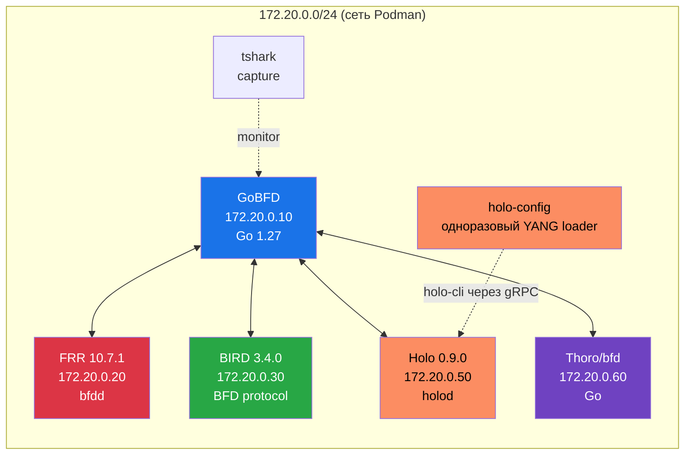
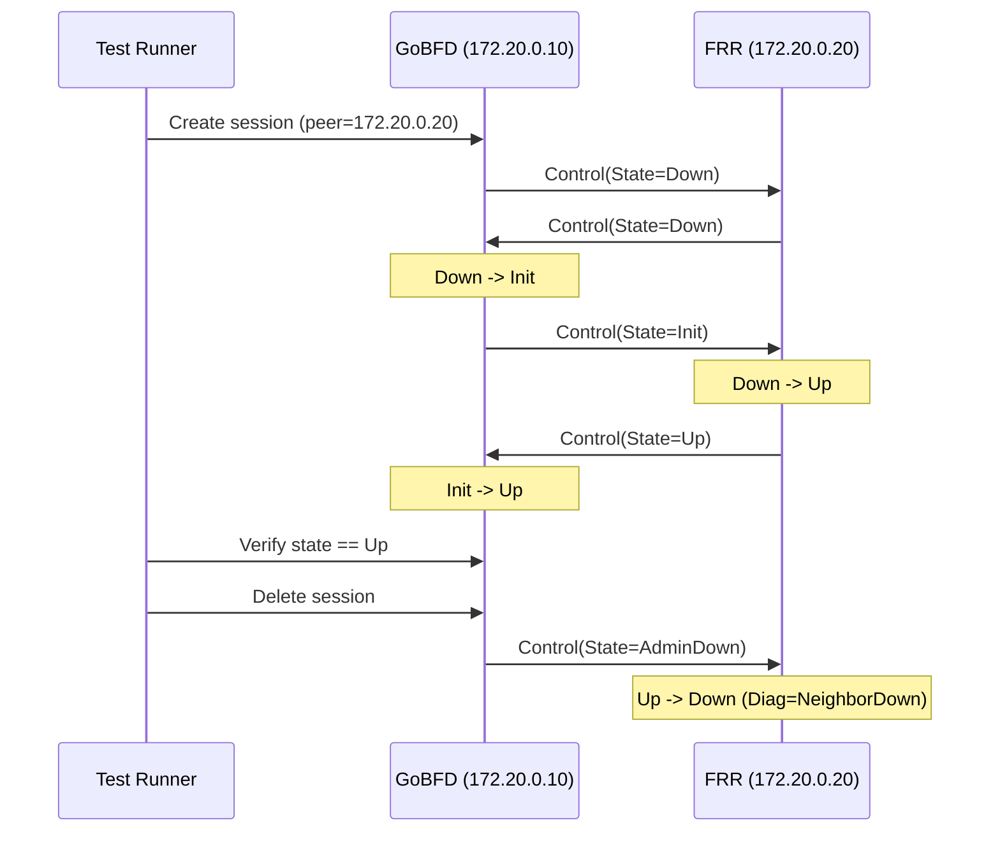
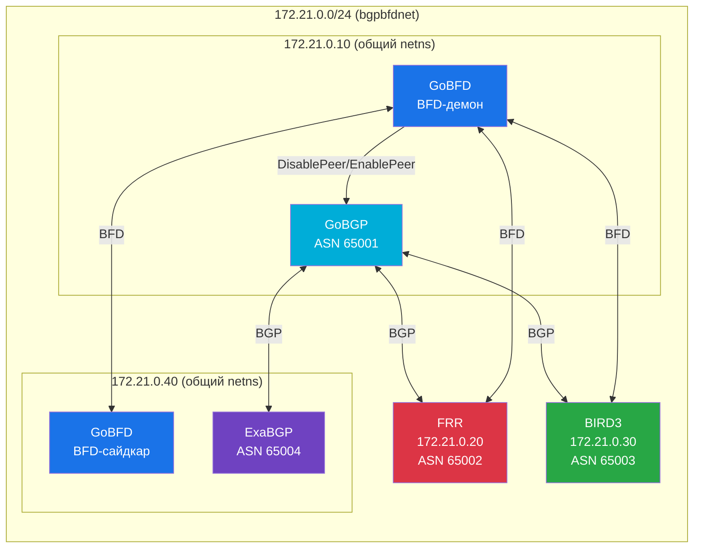
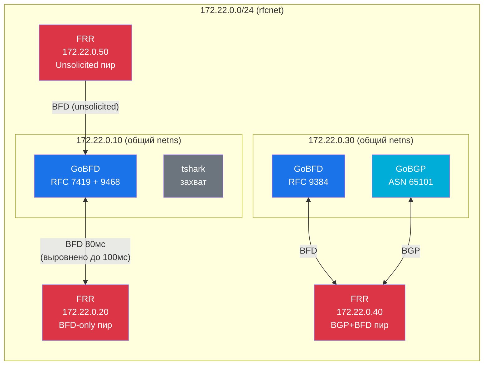
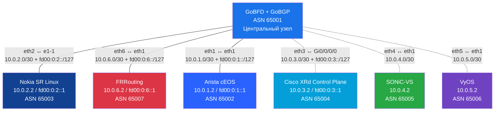

# Тестирование совместимости


> Обязательное тестирование четырёх пиров: Debian FRR 10.7.1, BIRD 3.4.0,
> Holo 0.9.0 и Thoro/bfd в топологии Podman с захватом пакетов.
>
> **Оставшийся блокер запуска (2026-09-08):** старый закреплённый образ FRR
> `10.7.0` использует Alpine 3.22.5. BASE переведён на квалифицированный Debian
> FRR `10.7.1`; E2E и Containerlab со старым образом нельзя запускать
> до приёмки их миграции в Beads `gobfd-qj0.8.2.8.5.2.4`.
> Имя vendor-образа не является исключением из запрета Alpine.

Переключение базовых потребителей локально принято в Beads `.8.5.2.4.2.1`:
`test/interop/compose.yml` и его testcontainers harness используют общий
рецепт Debian FRR 10.7.1. Ручной Compose и testcontainers gates пройдены на
linux/amd64 2026-09-08; второй завершился за 247.71 секунды с проверенным
удалением своих контейнеров, сети и образов. В каждом выполнены существующие
девять функциональных тестов. В обоих явно пропущены отклонение source port
BIRD3 и зависящее от захвата измерение detection precision; в ручном запуске
также пропущено начальное diagnostic capture. Это не полное соответствие RFC.
Логи, PCAP и структурированная квитанция сохранены локально в
`reports/e2e/frr-base-caps-20260908/`. Перед каждым запуском проверяйте свободное
место на общем хосте. BGP и RFC также локально квалифицированы ниже;
переключение E2E и Containerlab ещё впереди.
Исторический baseline 10.7.0 ниже не переименовывается.
Сборки testcontainers и invalid vectors ограничены по CPU/RAM.
При ручном запуске BASE `interopctl` получает `compose config --format json`
и последовательно собирает активные образы: два CPU, 2 GiB RAM, без swap,
одна build job. Обе фазы запуска используют `--no-build`; лимиты сервисов
действуют отдельно в runtime. Неподдерживаемые параметры сборки и
`COMPOSE_COMPATIBILITY` отклоняются до сборки. Не используйте
`compose build --print` как dry run: Compose 5.5.0 с `DOCKER_BUILDKIT=0`
может начать настоящую сборку.
`make interop-testcontainers` передаёт полную ревизию checkout с хоста через
`GOBFD_BUILD_REVISION`: изолированному mount рабочего дерева не нужен доступ
к Git-каталогу хоста. При прямом запуске из контейнера без Git-метаданных
передайте то же значение; некорректные ревизии отклоняются.

Текущие BASE fixtures используют Simple Password для FRR и Keyed SHA1 для
BIRD с публичным тестовым ключом `gobfd-interop` и key ID 7. GoBFD передаёт
обоим UDP payload 128 байт; Holo и Thoro используют payload 24 байта без
аутентификации. Для FRR выбран Simple Password, поскольку закреплённая
[SHA1-реализация использует HMAC](https://github.com/FRRouting/frr/blob/frr-10.7.1/bfdd/bfd_packet.c#L532),
а [BIRD хеширует объявленный BFD PDU](https://github.com/CZ-NIC/bird/blob/e66773c42f115d80aaaef3b7246953b276a88065/proto/bfd/packets.c#L268).
Проверки аутентификации GoBFD сохраняются без ослабления.

На 2026-10-15 критический manual Compose gate с race detector пройден на
linux/amd64 для `task/rfc9764-interop` в
`e71afa118ae10cac8e8a53e3672f7f7b6cc83afa`: четыре handshake, Version,
длина/authentication/padding, TTL 255, destination port и source-port range.
Capture проверил 293 пакета GoBFD к FRR и 296 к BIRD: BFD Length 40/52,
UDP Length 136, нулевой padding и IPv4 DF; 300 пакетов к Holo и 296 к Thoro
сохранили BFD Length 24 и UDP Length 32. Текущий API GoBFD показал local и
remote Up для четырёх peers. Локальные доказательства сохранены в
`reports/rfc9764-interop/`. Проверен padded TX GoBFD и обычный authenticated
RX от peers; peers не передают padding. Полный functional suite, timer
reload и проверка path MTU не выполнялись. Запуск использовал существующий
command-scoped DNS override контейнеров; исправление host resolver остаётся
открытым. Контейнеры остановлены по проверенным точным ID; контейнеры, сеть
и образы сохранены.

Рецепт замены — `test/interop/frr/Containerfile`, build context —
`test/interop/frr`. Общая база Debian trixie закреплена digest, официальные
пакеты FRR `10.7.1-0~deb13u1` / libyang `3.13.6-1~deb13u1` — SHA-256
для каждой архитектуры. Стартовый smoke на amd64 пройден; arm64 runtime
и переключение остальных потребителей ещё не квалифицированы. Исторические
результаты `10.7.0` ниже не квалифицируют новый артефакт.

Сборка принимает полный commit checkout в `VCS_REF` и время RFC 3339 в
`BUILD_DATE`, с лимитами `--cpu-period 100000 --cpu-quota 200000 --memory 2g
--memory-swap 2g --jobs 1`. Штатный foreground `watchfrr` наблюдает за `mgmtd`,
`zebra`, `bfdd` и `staticd`; пакетный startup применяет `/etc/frr/frr.conf`.
BGP-потребители должны передать свою конфигурацию демонов и включить `bgpd`
в команду. FRR требует `NET_ADMIN`, `NET_RAW` и `SYS_ADMIN`; для изолированного
стартового smoke не нужны host network или сокет runtime.
Python и `frr-pythontools` не установлены. Скрипты из пакета остаются внешними
деталями FRR; собственный shell launcher в репозиторий не добавляется.

Smoke использует один CPU, 256 MiB, 64 PID и `--network none`: заданный
BFD-пир остаётся Down с TX/RX 300 ms, четыре демона — Up.
Остановка в пределах десяти секунд возвращает код 0; host PID демонов исчезают.
Это удаление PID namespace, **не graceful shutdown отдельных демонов**:
[watchfrr завершается по SIGTERM](https://github.com/FRRouting/frr/blob/frr-10.7.1/watchfrr/watchfrr.c#L1027).
Отчёты CycloneDX и SPDX сохранены локально в
`reports/frr-debian-20260908/`. Debian-зависимости не закреплены snapshot,
поэтому побитовая воспроизводимость итогового образа не заявляется.
Beads `.8.5.2.4.1` охватывает этот этап артефакта; `.8.5.2.4.2` — переключение
потребителей и live-квалификацию. Блокер остальных потребителей остаётся активным.

---

## Содержание

- [Обзор](#обзор)
- [Топология тестирования](#топология-тестирования)
- [Реализации пиров](#реализации-пиров)
- [Запуск тестов совместимости](#запуск-тестов-совместимости)
- [Что тестируется](#что-тестируется)
- [Захват пакетов](#захват-пакетов)
- [Устранение проблем](#устранение-проблем)
- [Тестирование совместимости по RFC](#тестирование-совместимости-по-rfc)

### Обзор

GoBFD тестируется с четырьмя независимыми реализациями BFD. Обязательный
базовый gate работает на `linux/amd64`: Holo публикует официальный amd64-образ,
но не multi-architecture manifest. GoBGP и ExaBGP входят в отдельный BGP+BFD
набор и не считаются базовыми пирами.

### Топология тестирования



### Реализации пиров

| Пир | Версия | Реализация | Язык | Документированное покрытие RFC |
|---|---:|---|---|---|
| [FRR](https://frrouting.org/) | 10.7.1 | bfdd | C | 5880, 5881, 5882, 5883 |
| [BIRD3](https://bird.network.cz/) | 3.4.0 + fix | BFD protocol | C | 5880, 5881, 5882, 5883 |
| [Holo](https://github.com/holo-routing/holo/releases/tag/v0.9.0) | 0.9.0 | holod | Rust | 5880, 5881, 5882, 5883 |
| [Thoro/bfd](https://github.com/Thoro/bfd) | repository build | gRPC daemon | Go | 5880, 5881 |

Рецепт BIRD собирает commit тега `c3669497e3949b942d86d07e343092cc439b4659`
и применяет закреплённое по checksum исправление upstream
[`7cf75587`](https://gitlab.nic.cz/labs/bird/-/commit/7cf75587b6f38b87849fe192bf5dfd124b7702bc)
для CVE-2026-112112. Образ хранит оба хеша в
`/usr/share/doc/bird/gobfd-source.txt`. `TestBIRDFlowSpecValidation`
(тег `interop_testcontainers`) проверяет, что BIRD помечает IPv6 FlowSpec
destination с ненулевым offset как invalid; его запускает
`make interop-testcontainers`. BIRD собирается из исходников, поэтому
SBOM образа и пакетные сканеры его не показывают.

Holo использует immutable digest официального образа из `compose.yml`. Демон
запускается с `holo/holod.toml`, после чего healthy-gated одноразовый сервис
`holo-config` применяет `holo/holo.startup` через `holo-cli`. Значения YANG
указаны в микросекундах: `300000` для интервалов передачи и приёма с
множителем `3`, что даёт согласованный интервал 300 мс и detection time 900 мс.
У loader нет фиксированного адреса, и он не является пятым пиром.

### Программируемый Go-пир

Закреплённые FRR/BIRD profiles не проверяют все zero-RX и remote-Demand inputs.
BIRD zero-RX не является общим доказанным ограничением.
`TestCraftedPeerTestcontainers` (тег
`interop_testcontainers`) запускает отдельную топологию: GoBFD с одной сессией
из `gobfd/crafted-peer.yml`, tshark в сетевом namespace GoBFD и
репозиторный Go-инструмент из `scapy/Containerfile` с аргументом `peer` по
адресу `172.20.0.40`. Без аргумента тот же бинарник по-прежнему отправляет
корпус невалидных векторов. Peer использует кодек репозитория, TTL 255,
source port 49152, Poll/Final, медленный интервал вне Up и работает без
аутентификации. Каждый `SIGUSR1` из теста переводит его в следующую фазу:

| Фаза | Действие peer | Проверка по захвату |
|---|---|---|
| `rx0`, `poll` | Required Min RX 0 с Poll, затем второй Poll | От GoBFD только Final, по одному на Poll, не менее 10 согласованных интервалов (RFC 5880 Section 6.8.7) |
| `silent` | Передача прекращена | Демон фиксирует Down с diag 1 через один Detection Time (из `gobfdctl`, сверен с wire) после последнего кадра peer, в пределах `[DT-1 ms, DT+max(2 ms, DT/50)]`; первый кадр GoBFD (Down, diag 1, Your Discriminator 0) следует не позднее `DT+50 ms+max(2 ms, DT/50)` после последнего кадра peer, далее не менее 3 интервалов медленного режима в границах jitter (Sections 6.8.4, 6.8.7 и 6.8.18) |
| `recover` | Новый three-way handshake | Up с таймерами 300 ms в обе стороны |
| `demand` | D=1 с Poll | GoBFD отвечает Final и далее передаёт только кадры Poll или Final; SIGHUP на 500 ms даёт Poll GoBFD с новыми таймерами, Final от peer и converged receipt перезагрузки после этого Final (Sections 6.5 и 6.6) |
| `demand-clear` | D=0 с Poll | GoBFD отвечает Final и возобновляет periodic TX в пределах `T+slack`; далее не менее 12 интервалов проходят границы jitter и проверку среднего в 3 стандартные ошибки для T=500 ms |
| `final-loss`, `poll`, `final-restore` | Отбрасывает свои ответы Final (имитация потерь), затем пересекает незавершённый Poll GoBFD своим Poll, затем снова отвечает | SIGHUP на 400 ms и, пока Final теряется, на 800 ms: GoBFD повторяет P=1 с активным кортежем 400 ms, отвечает на пересекающий Poll только F с тем же кортежем, возобновляет P=1 и отправляет Poll 800 ms только после Final пира и интервала не меньше измеренного обмена; этот Poll получает свой Final и receipt (Sections 6.5 и 6.8.3); ни один кадр захвата не содержит одновременно P и F |

`make interop-testcontainers` запускает чистые тесты оценщика
(`TestCraftedPeerEvidence*`) и живую топологию. Тест сохраняет журналы демона и
peer, TSV кадров, итоговый JSON и PCAP с файлами SHA-256 в
`INTEROP_TESTCONTAINERS_ARTIFACT_DIR`.

Существующие reload-сценарии также проверяют изменения Detect Multiplier:
аутентифицированные FRR/BIRD3 Async-сессии — 1→5→3 без GoBFD Poll;
crafted remote-Demand — 5→3, каждый раз с собственными Poll, peer Final,
applied receipt и quiet window. DetectMult 1 использует jitter 75–90% со
средним 0.825T, остальные проверяемые множители — 75–100% и 0.875T.
Capture сохраняет UDP source port/length, тип/key/sequence аутентификации,
discriminators и таймеры. До изменений запросы runtime registry tshark ограничены
префиксами `frame.`, `ip.`, `bfd.` и `udp.`; сохраняемые строки сопоставляются
по первому столбцу. Полный registry не буферизуется в ограниченном race runner.
Локальное receive Detection Time зависит от множителя peer. Расчётные peer
Async и local Demand Poll bounds отделены от измерений; crafted peer не имеет
detection timer. Source contracts не закрывают P0 `gobfd-qj0.8.2.2.7.5.2`:
обязательны фактические captures кандидата.

Локальная квалификация на `d9e67064e51012c0d25a1a22dc9bd469600d8469` проходит
обе топологии с этими captures; receipts — в `reports/detect-wire-20261024/`.
Это не закрывает prepared-padding, TTL и финальную five-field квалификацию.

Prepared-padding сценарии расширяют тот же timer lifecycle аутентифицированными
целями 128→192→128, отклонением auth+padding, enable/disable padding и
комбинированного кандидата. Meticulous SHA1 startup-профиль запускается через
`TestFourPeerMeticulousTopologyTestcontainers`; default keyed SHA1 — через
`TestFourPeerTopologyTestcontainers`. Каждый загружает и восстанавливает
собственный выбранный immutable baseline. Независимый peer сохраняет свой
размер пакета. Capture validator сохраняет replay state между фазами и retries,
проверяет DF, raw UDP payload, declared PDU length, нули padding и границу MAC.
Aggregate и named BFD readiness проверяются внутри собственного контейнера демона
через существующий Unix socket тем же собранным interop-бинарником, скопированным
механизмом container files; TCP остаётся loopback-only. Crafted peer принимает SIGUSR2
как Poll текущего состояния без продвижения фазы и сброса Demand: это даёт
Final старого размера после отклонённого Demand resize. Фактический capture
acceptance ведётся отдельно в `gobfd-qj0.8.2.2.7.5.3.3`;
source-only результаты эту задачу не закрывают.

Локальная квалификация на `b97729458a696aee21023ba147af51417ed9ff7b` проходит
оба FourPeer профиля и crafted Demand с этими captures. Три runtime receipts
и 675 проверенных sidecar сохранены в `reports/padding-wire-20261024/`.
Квалифицирован только padding reload; actual TTL, unified final-candidate
и stable-release gates остаются отдельными. Baseline SKIP начального Down
и DetectionPrecision требуют final-gate disposition вместе с известным
отклонением source-port range BIRD на Linux.

Окончательный qualifier ограничивает декодированные строки TShark после display
filter; `-c` ограничивает прочитанные пакеты и может скрыть поздние matching frames.
Отсутствие initial Down(diag=0) или detection-expiry evidence завершает обязательные
проверки ошибкой. Исключение BIRD source port подтверждено закреплённым
[BFD TX socket](https://github.com/CZ-NIC/bird/blob/c3669497e3949b942d86d07e343092cc439b4659/proto/bfd/packets.c#L496)
и [platform helper](https://github.com/CZ-NIC/bird/blob/c3669497e3949b942d86d07e343092cc439b4659/sysdep/unix/io.c#L796):
`SKF_HIGH_PORT` не обеспечивает диапазон RFC 5881 на Linux. В сохранённом padding
capture 938 BIRD packets используют порт 43990; это отклонение peer, а не
compliance coverage GoBFD. Общий сборщик сохраняет immutable image ID и
обязательные source/base OCI annotations до очистки.
Evidence: `reports/final-wire-20261024/`; actual final-candidate qualification
остаётся в `gobfd-qj0.8.2.2.7.5.5`.
Default FourPeer gate проходит на
`e4e79a8eee8e7c38bfc78321bdc5e9030909c214` за 429,47 с: все десять сценариев,
initial Down и DetectionPrecision выполнены (gap 0,901 с), один явный BIRD
RFC SKIP; сохранены шесть image ID, совпали 867 source hashes и 310 artifact
sidecars. Четырнадцать readiness probes вернули SERVING для обоих services.
При лимите runner 512 MiB max/OOM events и swap — 0; отсутствие точных image
ID после очистки подтверждено. Все четыре final profiles повторяются после
оставшихся production thread/scale изменений.

Тот же crafted lifecycle предоставляет `TestCraftedMultihopTTLTestcontainers`
с закрытым startup command `peer-multihop`: UDP/4784, meticulous SHA1,
local RX 3 s и прежний TX 300 ms. `SIGUSR1` включает remote Demand;
три шага `SIGUSR2` приостанавливают periodic TX peer до reload, повторяют
последний принятый payload с допустимым TTL, отправляют свежий Poll ниже
порога и его byte-identical повтор на пороге с шагом 200 ms, затем явно
возобновляют TX после authenticated Final и снимков counters. Max-hops 1→5→1
проверяется в Async и remote Demand, затем — отклонение auth+hop-policy input.
Capture/authentication checkpoints сохраняются между фазами. Accepted RX
увеличивается на один; ровно один auth failure относится к намеренному replay,
state transitions не меняются. Исходный baseline охватывает reload и вход
в Demand, а также каждую пробу.
Проверяется локальная policy GoBFD `255 - N`; routed/cloud acceptance остаётся
отдельной. Actual qualification принадлежит `gobfd-qj0.8.2.2.7.5.4.3`.

Локальная квалификация на `491b2214994f07e017eb93ab67a29a95378c619e` проходит
исходный crafted profile за 162.94 s и authenticated multihop за 81.98 s.
Все семь boundary/replay windows проходят; совпадают 863 source hashes
и 212 artifact sidecars. Evidence: `reports/ttl-wire-20261024/`. Оба профиля
повторены на исправленном source после удаления повторного атрибута session log;
strict JSON receipt parsing сохранён. Unified five-field и stable-release
qualification остаются отдельными.

### Запуск тестов совместимости

#### Полный цикл (рекомендуется)

```bash
# Сборка, запуск топологии, тесты, очистка -- всё в одном
make interop
```

Команда запускает Go-owned lifecycle на testcontainers: проверяет доступность
фиксированных имён, требует нулевой exit status у Holo loader, выполняет Go-
проверки, сохраняет packet capture и подтверждает удаление каждого test-owned
контейнера, сети и образа.

#### Явный target Go testcontainers

```bash
make interop-testcontainers
```

Это явная форма full-cycle target по умолчанию. Она создаёт сеть со статическими адресами, GoBFD, FRR,
BIRD3, Holo, Thoro/bfd и tshark напрямую через Podman provider библиотеки
testcontainers. Он выполняет те же Go-проверки, сохраняет захват пакетов в
`reports/e2e/interop-testcontainers` и проверяет удаление каждого тестового
контейнера, сети и образа.

#### Пошагово

```bash
# Шаг 1: Запуск 4-пировой топологии
make interop-up

# Шаг 2: Запуск Go-тестов совместимости
make interop-test

# Шаг 3: Остановка и очистка
make interop-down
```

#### Просмотр захваченных пакетов

```bash
# Сводка в формате CSV
make interop-pcap-summary

# Полная расшифровка пакетов
make interop-pcap

# Живой захват
make interop-capture
```

### Что тестируется

Тесты совместимости (`test/interop/interop_test.go`) проверяют:

| Тест | Описание |
|---|---|
| Установление сессии | Трёхстороннее рукопожатие с каждым пиром до состояния Up |
| Разрыв сессии | Корректная передача AdminDown |
| Согласование таймеров | Правильные согласованные интервалы между реализациями |
| Анализ пакетов | tshark проверяет формат BFD-пакетов на проводе |



BASE testcontainers выполняет `TestTimerReload` между анализом RFC baseline и
разрушающими lifecycle tests: три последовательных subprocess batches. Меняются
только тестовые копии конфигураций FRR/BIRD: peer RX floor 100 ms, локальные
`300→100→500→300 ms`, затем отдельные фазы явного RX0 с восстановлением baseline.
Каждая фаза требует JSON receipts точного поколения, замкнутого окна пакетов с
Poll и Final и публикации applied receipt после завершающего Final. Ненулевые
фазы дополнительно требуют неизменных discriminators, состояния Up и счётчиков
текстового CLI. Фазы RX0 требуют нулевого объявления, receipts и восстановления;
Down после Final допускается, потому что пир может прекратить передачу: BIRD
3.4.0 прекращает, FRR 10.7.1 продолжает. Точные JSON/PCAP timestamps
предполагают общий realtime clock хоста для testcontainers-демона и захвата;
округление и допуск clock skew не применяются.

Timing требует минимум 12 последовательных periodic intervals GoBFD после Final.
RFC 5880, раздел 6.8.7, ограничивает каждый интервал 75–100% negotiated TX при
DetectMult больше 1.
Проверка расширяет эти границы на max(2 ms, 2% TX) для задержки пробуждения
таймера и захвата и требует, чтобы выборочное среднее лежало в пределах трёх
стандартных ошибок от 87,5% — среднего равномерного уменьшения 0–25%, которое
выбирает GoBFD; верхняя граница получает тот же допуск на задержку, потому что
таймер перезапускается после каждой отправки. Логи, конфигурации, frame
summaries, статусы subprocess,
checksums и PCAP с проверкой чтения сохраняются в
`INTEROP_TESTCONTAINERS_ARTIFACT_DIR` до удаления своих ресурсов при успехе и
ошибке; без явного каталога выводится сохраняемый временный путь. Демон в
testcontainers-топологии пишет логи в JSON; проверки логов принимают текстовую и
JSON-форму.

2026-10-21 бинарник гейта для `af7c907` прошёл все восемь фаз с FRR 10.7.1 и
BIRD 3.4.0 с исправлением `7cf75587`. Объединённые интервалы GoBFD при 100, 300 и
500 ms (n = 37, 26, 25) имеют средние 88,3%, 89,1% и 86,2% negotiated TX.
Критерии Колмогорова–Смирнова и χ² при α = 0,05 не отвергли равномерную модель
75–100%; наибольшее превышение 100% составило 0,97 ms. Authenticated selective-Final loss, deterministic crossed
Poll и remote Demand остаются открытыми в `gobfd-qj0.8.2.1.1.1.4.3`; H-05
остаётся partial.

### Захват пакетов

Топология включает контейнер tshark для захвата всего BFD-трафика. Захваты сохраняются в формате `.pcapng`.

```bash
# Просмотр захваченных пакетов
make interop-pcap

# Сводка в формате CSV
make interop-pcap-summary

# Поля сводки:
#   frame.time_relative, ip.src, ip.dst,
#   bfd.version, bfd.diag, bfd.sta, bfd.flags,
#   bfd.detect_time_multiplier, bfd.my_discriminator,
#   bfd.your_discriminator, bfd.desired_min_tx_interval,
#   bfd.required_min_rx_interval
```

### Устранение проблем

| Проблема | Решение |
|---|---|
| Контейнеры не запускаются | Проверьте `podman network inspect` на конфликты IP |
| Сессии застряли в Down | Убедитесь, что `CAP_NET_RAW` доступен в контейнерах |
| tshark без данных | Проверьте конфигурацию общего сетевого интерфейса |

```bash
# Просмотр логов принадлежащих проекту контейнеров через guarded target
make interop-logs
```

---

## Полноцикловое тестирование BGP+BFD


> Сквозное тестирование связки BFD→BGP (RFC 5882): обнаружение отказа через BFD вызывает отключение BGP-пира, восстановление BFD — повторное включение.

### Топология BGP+BFD



### Три тестовых сценария

| # | Сценарий | BFD | BGP | Маршрут |
|---|---|---|---|---|
| 1 | GoBFD+GoBGP ↔ FRR | FRR bfdd (нативный) | FRR bgpd (нативный) | `10.20.0.0/24` |
| 2 | GoBFD+GoBGP ↔ BIRD3 | BIRD3 BFD (нативный) | BIRD3 BGP (нативный) | `10.30.0.0/24` |
| 3 | GoBFD+GoBGP ↔ GoBFD+ExaBGP | GoBFD-сайдкар | ExaBGP (без BFD) | `10.40.0.0/24` |

### Полный цикл тестирования

Каждый сценарий проверяет три фазы:

1. **Установление**: BGP-сессия Established, BFD-сессия Up, маршрут получен в RIB GoBGP
2. **Отказ**: Остановка/пауза пира → BFD Down (~900мс) → GoBGP DisablePeer → маршрут отозван
3. **Восстановление**: Запуск/снятие паузы → BFD Up → GoBGP EnablePeer → BGP восстановлен → маршрут возвращён

### Запуск тестов BGP+BFD

**BGP на trixie локально квалифицирован** (Beads `gobfd-qj0.8.2.8.5.2.4.2.2`).
Согласованная замена использует общие рецепты FRR, GoBGP и ExaBGP в
`test/interop/`. GoBGP v4.10.0 собирается из upstream commit
`da824d99912e02124b53741245ee4186c381adcc` на trixie; рецепт закрепляет Go 1.27.3,
а записанная квалификация выполнена с builder Go 1.27.2 и повторяется в
`gobfd-bjr`. GoBGP v3
обслуживает `/apipb.GobgpApi`, v4 — `/api.GoBgpService`; они несовместимы по
wire, поэтому GoBFD в `dev` требует демон GoBGP v4. Нативный BFD в GoBGP v4
по умолчанию выключен, и ни одна конфигурация GoBGP в репозитории его не
включает. Внешний ExaBGP 5.0.13 использует системный
Python trixie и native entrypoint `python3 -m exabgp`, без pip, uv, собственного
launcher и Python-исходников репозитория. Его
[закреплённый upstream manifest](https://github.com/Exa-Networks/exabgp/blob/edf249571174449f80c72d75eb6933dcabd67f92/pyproject.toml)
не содержит runtime package dependencies. Оба архива исходников закреплены
SHA-256. Узкое исключение для runtime ExaBGP не разрешает Python tooling.

С GoBGP v3.37.0 на linux/amd64 ручной Compose и полный testcontainers gate
пройдены 2026-09-08; второй занял 200.07 секунды. Каждый выполнил все четыре
существующих race-теста: установление соседства и отказ FRR/BIRD3/ExaBGP,
отзыв маршрутов и восстановление, без пропусков. Семь контейнеров каждой
топологии ограничены одним CPU, 256 MiB RAM, без swap и 128 PID; OOM не было.
Последовательные сборки ограничены двумя CPU и 2 GiB. Свои контейнеры, сети
и теги образов удалены. Логи, PCAP, CycloneDX/SPDX SBOM пиров и квитанция
приёмки сохранены локально в `reports/e2e/bgp-trixie-20260908/`.
Это не квалификация arm64, остальных потребителей образов, reload таймеров
или полного соответствия RFC. Разрешение Debian-пакетов не закреплено
snapshot; побитовая воспроизводимость итоговых образов не заявляется.
Для `GO-2026-4736` в GoBGP v3.37.0 исправления нет; с GoBGP v4.10.0 строгий
`govulncheck` runtime не обнаруживает достижимых findings, оставшееся
исключение на уровне модуля описано в [SECURITY.md](../../SECURITY.md).
Изолируйте этих пиров от недоверенных сетей; функциональные BGP-тесты и SBOM
не означают security-квалификацию.

2026-10-13 на commit `f85ca09` на linux/amd64 testcontainers gate
`TestBGPBFDTopologyTestcontainers` пройден с GoBGP v4.10.0 за 359.25 секунды:
все четыре race-подтеста (`AllPeersUp`, FRR, BIRD3, ExaBGP) выполнены без
пропусков, проверка версии GoBGP вернула 4.10.0, контейнеров не осталось.
Ручной путь Compose на GoBGP v4 не перезапускался.

```bash
# Авторитетный routing aggregate с owned artifacts и cleanup
make e2e-routing

# Full cycle по умолчанию: Go управляет Podman lifecycle через testcontainers
make interop-bgp
```

Go lifecycle напрямую через Podman provider создаёт статическую сеть,
оба экземпляра GoBFD, GoBGP v4.10.0, FRR 10.7.1, BIRD 3.4.0, ExaBGP 5.0.13
и tshark. Он выполняет те же проверки установления сессий, отказа, отзыва
маршрутов и восстановления, сохраняет непустой packet capture и доказывает
удаление всех test-owned контейнеров, сети и локально собранных образов.

Оба BGP-пути передают native `watchfrr` список `mgmtd`, `zebra`, `bgpd`,
`bfdd`, `staticd`. FRR-конфигурация в Compose остаётся read-only: тесты
останавливают и запускают пиров, но не сохраняют конфигурацию. Все семь сервисов
ограничены одним CPU, 256 MiB RAM, без дополнительного swap и 128 PID.
Сборки ограничены двумя CPU и 2 GiB, как описано выше.
Ручные `make interop-bgp-up/down/logs` используют существующий контроллер
с проверкой владения; после сборок с лимитами выполняется `up --no-build`.
`INTEROP_BGP_PROJECT_NAME` по умолчанию равен `${INTEROP_PROJECT_NAME}-bgp`,
как в routing aggregate; ручные тесты используют тот же проект. Общий
`dev-exec` допускает десять минут на компиляцию и пятиминутный тест;
служебные команды сохраняют двухминутное ограничение.
Testcontainers target передаёт host revision и регистрирует очистку образа
до сборки.

### Ключевое решение: общие сетевые пространства имён

GoBFD и GoBGP разделяют сетевое пространство имён (оба на `172.21.0.10`), поэтому адрес BFD-пира совпадает с адресом BGP-соседа. Когда GoBFD обнаруживает BFD Down для пира `172.21.0.20`, он вызывает `DisablePeer("172.21.0.20")`, что корректно отключает BGP-сессию с FRR.

Аналогичный подход для ExaBGP: GoBFD-сайдкар и ExaBGP разделяют netns на `172.21.0.40`. Тест ExaBGP использует `podman pause` для заморозки только BFD-сайдкара, сохраняя BGP-сессию ExaBGP, доказывая, что BFD обнаруживает отказ раньше, чем истекает BGP holdtimer.

### Связанные документы

- [09-development.md](./09-development.md) -- Рабочий процесс разработки и make-цели
- [06-deployment.md](./06-deployment.md) -- Контейнерный образ и Podman Compose
- [08-rfc-compliance.md](./08-rfc-compliance.md) -- Матрица соответствия RFC

---

## Тестирование совместимости по RFC


> Целевые interop-тесты RFC-расширений сверх базового протокола
> в топологии из восьми контейнеров с захватом пакетов (tshark).

### Топология RFC Interop



### Контейнеры (8)

| Контейнер | IP | Роль |
|---|---|---|
| `gobfd-rfc` | 172.22.0.10 | GoBFD с align_intervals + unsolicited |
| `tshark-rfc` | (общий netns) | Захват пакетов на интерфейсах gobfd-rfc |
| `frr-rfc` | 172.22.0.20 | FRR BFD-only пир для выравнивания таймеров RFC 7419 |
| `gobfd-rfc9384` | 172.22.0.30 | GoBFD с интеграцией GoBGP для RFC 9384 |
| `gobgp-rfc` | (общий netns) | GoBGP ASN 65101 для тестирования BGP Cease |
| `frr-rfc-bgp` | 172.22.0.40 | FRR BGP+BFD пир для RFC 9384 |
| `frr-rfc-unsolicited` | 172.22.0.50 | FRR BFD пир без предварительно настроенной сессии на GoBFD |
| `echo-reflector` | 172.22.0.60 | Независимый UDP echo-reflector для RFC 9747 |

### Результаты тестов

| Тест | RFC | Описание | Результат |
|---|---|---|---|
| `TestRFC7419_CommonIntervalAlignment` | 7419 | GoBFD настроен на 80мс; с `align_intervals: true` интервал должен быть выровнен до 100мс. Верифицируется через tshark-захват поля `DesiredMinTxInterval`. | **PASS** |
| `TestRFC9384_BGPCeaseBFDDown` | 9384 | Пауза frr-rfc-bgp → BFD Down → GoBFD вызывает DisablePeer → BGP-сессия разорвана. Снятие паузы → BFD Up → EnablePeer → BGP восстановлен. Annotation упоминает Cease/10, но `DisablePeer` отправляет Administrative Shutdown (Cease/2): так делает GoBGP v3, а `DisablePeerRequest` в GoBGP v4 по-прежнему содержит только поля `address` и `communication`. Action path пройден на GoBGP v3.37.0 и на v4.10.0 (2026-10-13). | **Action path проходит; wire subcode RFC 9384 не реализован** |
| `TestRFC9468_UnsolicitedBFD` | 9468 | frr-rfc-unsolicited (172.22.0.50) инициирует BFD без настроенной сессии GoBFD. Проверяются Up-пакеты и пять секунд стабильности, но не истечение или очистка unsolicited-сессии. | **PASS** |
| `TestRFC9747_EchoSession` | 9747 | Echo-сессия GoBFD достигает Up через независимый reflector; пауза и восстановление доказывают обнаружение отказа и возврат сессии. | **PASS** |

Тест RFC 9384 доказывает BFD-to-BGP teardown и recovery coupling, но не
проверяет и не подтверждает Cease subcode 10 на wire.

### Запуск RFC Interop тестов

P0-миграция `.8.5.2.4.2.3` прошла полный локальный linux/amd64
testcontainers gate 2026-09-08 за 117.50 секунды: все четыре существующих
race-сценария без пропусков. FRR 10.7.1 и GoBGP v3.37.0 использовали общие
рецепты trixie. Пять последовательных сборок ограничены двумя CPU и 2 GiB;
восемь контейнеров — одним CPU, 256 MiB, без swap и 128 PID.
OOM не было; удаление точных контейнеров, сети и образов проверено.
Логи, PCAP, CycloneDX/SPDX SBOM пиров и JSON-квитанция сохранены в
`reports/e2e/rfc-trixie-20260908/`.
Прямой Compose lifecycle с фиксированными именами остаётся неподдерживаемым.
Эта приёмка не квалифицирует arm64, полный wire-контракт RFC 9384,
истечение unsolicited-сессий или reload таймеров и не является security gate.
Общий рецепт теперь собирает GoBGP v4.10.0. 2026-10-13 тот же
testcontainers gate пройден на GoBGP v4.10.0 за 162.12 секунды на `7559c05`:
все четыре race-сценария без пропусков, тестовых контейнеров не осталось.

Для live-проверки используйте Go-owned Podman lifecycle. Каждая runtime-
операция разрешается в immutable container ID:

```bash
make interop-rfc
```

---

## Совместимость с вендорными NOS (Containerlab)


> Опциональные NOS profile tests. Настройка топологии не устанавливает полную
> квалификацию RFC 5880/5881/5882. SONiC/VyOS profiles имеют только IPv4;
> остальные настроенные profiles включают IPv6. Доступность images и фактические
> результаты запуска остаются отдельными условиями приёмки.

### Топология вендоров

Звёздообразная топология использует IPv4 /30 и, где настроено, IPv6 /127 на
той же veth pair. RFC 3021 относится к /31, а не к этим /30 links. Go-owned
lifecycle code управляет containers и veth links через Podman.



> Сплошные линии = primary или baseline profiles. Пунктирные линии =
> deferred profile или image-dependent profile. Image availability фиксируется
> через `make e2e-vendor`.

### Доступность вендоров

| Вендор | Образ | Подсеть IPv4 | Подсеть IPv6 | ASN | Статус | Лицензия |
|---|---|---|---|---|---|---|
| **Nokia SR Linux** | `ghcr.io/nokia/srlinux:25.10.2` | `10.0.2.0/30` | `fd00:0:2::/127` | 65003 | Primary, public image | Бесплатно, без регистрации |
| **FRRouting** | `quay.io/frrouting/frr:10.7.0` | `10.0.6.0/30` | `fd00:0:6::/127` | 65007 | Baseline | GPL, бесплатно |
| **Arista cEOS** | `ceos:4.36.0.1F` | `10.0.1.0/30` | `fd00:0:1::/127` | 65002 | Primary, operator image | Бесплатный аккаунт Arista.com |
| SONiC-VS | `docker.io/netreplica/docker-sonic-vs:latest` | `10.0.4.0/30` | -- | 65005 | Primary, public image | Бесплатно |
| VyOS | `docker.io/muruu1/vyos:latest` | `10.0.5.0/30` | -- | 65006 | Primary, public mirror; ISO build fallback | Бесплатный rolling/community image |
| Cisco XRd | `ios-xr/xrd-control-plane:25.4.1` | `10.0.3.0/30` | `fd00:0:3::/127` | 65004 | Deferred | Сервисный контракт Cisco |

### Предварительные требования

- **Podman** с активным socket API (`/run/podman/podman.sock`)
- **containerlab** 0.57+ (для справки по топологии; используется прямое управление Podman)
- Capabilities контейнера: `NET_ADMIN`, `NET_RAW`
- Хотя бы один доступный вендорный образ

### Подготовка лаборатории (Go bootstrap)

Команда на Go 1.27 отвечает за preflight, ограниченные параллельные скачивания,
сборку, инвентаризацию, нативную подготовку ISO/rootfs VyOS и импорт
предоставленных оператором архивов Arista/Cisco. Python и shell helper в
подготовке вендорных образов больше не участвуют.

```bash
# Скачать все public образы + подготовить VyOS tag + собрать GoBFD
go run ./test/cmd/clabbootstrap -v

# С коммерческими образами
go run ./test/cmd/clabbootstrap \
    --arista-image /path/to/cEOS64-lab-4.36.0.1F.tar

# Подготовка + деплой топологии
go run ./test/cmd/clabbootstrap --deploy

# Подготовка + полный прогон тестов
go run ./test/cmd/clabbootstrap --test

# Пробный запуск (показать что будет сделано)
go run ./test/cmd/clabbootstrap --dry-run
```

Команда выполняет:
- **Предварительные проверки**: podman и точный toolchain Go
- **Параллельное скачивание образов**: Nokia SR Linux, SONiC-VS, VyOS, FRRouting (+ зависимости сборки)
- **Подготовка образа VyOS**: скачивание `docker.io/muruu1/vyos:latest`, tag как `vyos:latest`; ISO build остаётся fallback
- **Импорт коммерческих образов**: Arista cEOS (`podman load`); Cisco XRd остаётся deferred до появления operator-provided image
- **Сборка образа GoBFD**: многоэтапный Containerfile с GoBGP sidecar,
  run-owned ссылкой `localhost/gobfd-clab:<run-id>` и точным image ID.
  Sidecar — GoBGP v4.10.0, собранный из того же source pin, что и
  `test/interop/gobgp`; контрактный тест поддерживает совпадение pin.
  Совместимость с vendor NOS на GoBGP v4 ещё не квалифицирована
- **Отчёт об инвентаризации**: итоговый список образов со статусом готовности

Выполните `make interop-clab-bootstrap ARGS=--help` для просмотра всех опций.
Go bootstrap проверяет HTTPS redirects, извлечение архивов и фиксированные argv
внешних image-инструментов.

### Запуск вендорных тестов

```bash
# Полный цикл: сборка образа GoBFD + деплой + тесты + очистка
make interop-clab

# Пошагово
make interop-clab-up     # Сборка + деплой топологии
make interop-clab-test   # Запуск Go-тестов (топология должна работать)
make interop-clab-down   # Удаление owned-контейнеров, линков и точного образа GoBFD

# Только подготовка, затем использование или удаление staged owned-образа
make interop-clab-bootstrap
make interop-clab-bootstrap ARGS="--deploy --skip-build"
# либо: make interop-clab-down
```

`make interop-clab` скачивает public images Nokia SR Linux, SONiC-VS, VyOS и
FRRouting до проверки availability. Cisco XRd и Arista cEOS остаются
operator-provided images. Go lifecycle формирует topology только для доступных
профилей, записывает точные container identities в receipt с mode 0600 и
записывает в тот же receipt run-owned ссылку, ID и ownership labels образа
GoBFD. Перед первой мутацией cleanup проверяет все записанные identities,
удаляет образ по точному ID без `--force` и последним удаляет receipt.
Отдельный bootstrap намеренно оставляет staged image и receipt для следующего
деплоя с `--skip-build` либо точной очистки через `--down`; `--skip-build`
никогда не доверяет общему тегу `latest`. UID-scoped host-global lock
сериализует фиксированный namespace Containerlab между worktree репозитория.
Перед формированием evidence режим `--test-only` повторно проверяет каждый
записанный live container ID и ownership label, а также отклоняет любой
незаписанный контейнер с фиксированным именем, который могли бы обнаружить
тесты.

### Матрица соответствия RFC

| Тест | Раздел RFC | Описание |
|---|---|---|
| Установление сессии (v4+v6) | 5880 Section 6.8.6 | Трёхстороннее рукопожатие до состояния Up |
| Обнаружение отказа (v4+v6) | 5880 Section 6.8.4 | Обнаружение за DetectMult x interval |
| Формат пакетов (v4) | 5880 Section 4.1, 5881 Sections 4-5 | Version=1, TTL=255, порт 3784 |
| Формат пакетов (v6) | 5880 Section 4.1, 5881 Sections 4-5 | Version=1, Hop Limit=255, порт 3784 |
| Согласование таймеров (v4+v6) | 5880 Section 6.8.2 | Согласованный TX = max(DesiredMinTx, RemoteMinRx) |
| Точность обнаружения (v4+v6) | 5880 Section 6.8.4 | Время обнаружения ~900мс (3 x 300мс) |
| Независимость сессий | 5880 Section 6.8.1 | Отказ одного вендора не влияет на остальных (группировка по baseName) |

### Особенности вендоров

Repository profiles настраивают single-hop BGP+BFD. Они не квалифицируют все
NOS features, hardware offload или owner-specific overlay backends.
Boot/readiness polling принадлежит Go lifecycle; сохраняйте фактический outcome,
не выводите фиксированное startup time из названия vendor.

### Проверка конфигурации вендоров

| Profile | Repository input | Область |
|---|---|---|
| Arista cEOS | `arista/startup-config.cfg` | BGP neighbors и interface BFD timers; без Vxlan1 qualification |
| Nokia SR Linux | `nokia/config.cli` | Subinterface BFD и BGP failure-detection configuration |
| SONiC-VS | `test/internal/clabbootstrap` | FRR-backed process/interface lifecycle; native SONiC CLI acceptance отдельно |
| VyOS | `vyos/config.boot` | Interface, BGP neighbor BFD и explicit BFD peer |
| FRRouting | `frr/frr.conf` | IPv4/IPv6 single-hop BGP+BFD |
| Cisco XRd | `cisco/xrd.cfg` | Отложенный optional image-gated profile |

Перед адаптацией lab inputs изучите upstream documentation точного релиза.
Настроенный vendor syntax сам по себе не является измеренным passing deployment.

### Тестирование BFD с двойным стеком IPv6

RFC 5881 задаёт single-hop encapsulation обеих address families в §4,
а TTL/Hop Limit handling — в §5. Profiles Arista, Nokia, Cisco и FRR имеют
IPv6 endpoints; SONiC/VyOS имеют только IPv4. Cisco остаётся image-gated.

**Отличия address families**:
- IPv6 использует Hop Limit=255 вместо TTL=255 для GTSM
- BFD-сессии создаются для каждой адресной семьи отдельно (отдельные IPv4 и IPv6 сессии на вендора)
- Тот же UDP-порт 3784 и диапазон исходных портов 49152-65535

**План адресации** (RFC 4193 ULA `fd00::/8`, /127 на линк по RFC 6164):

| Вендор | GoBFD IPv6 | Вендор IPv6 | Префикс линка | Анонсируемый маршрут |
|---|---|---|---|---|
| Arista | `fd00:0:1::` | `fd00:0:1::1` | `fd00:0:1::/127` | `fd00:20:1::/48` |
| Nokia  | `fd00:0:2::` | `fd00:0:2::1` | `fd00:0:2::/127` | `fd00:20:2::/48` |
| Cisco  | `fd00:0:3::` | `fd00:0:3::1` | `fd00:0:3::/127` | `fd00:20:3::/48` |
| FRR    | `fd00:0:6::` | `fd00:0:6::1` | `fd00:0:6::/127` | `fd00:20:6::/48` |

**Конструктивные решения**:
- ULA-адреса исключают конфликты с глобальными таблицами маршрутизации в лабораторных средах
- Префиксы /127 по RFC 6164 предотвращают проблемы ping-pong на межмаршрутизаторных point-to-point линках
- IPv4 и IPv6 сессии используют один контейнер, но являются независимыми BFD-сессиями
- Тест `SessionIndependence` группирует пиров по `baseName` для корректной обработки паузы контейнера, затрагивающей обе адресные семьи

---

## Опциональные lab tools

netlab и VM-based vendor orchestration не входят в поддерживаемый toolchain.
В репозитории нет Python environment, dependency group или Python lock file
для расширения. Текущий topology lifecycle остаётся Go-owned и использует
Podman. Оценка внешней lab требует отдельного владельца и записанного допуска
images, privileges и resources; эта страница не создаёт план миграции.

Наличие vendor image или настроенной topology не означает полное покрытие RFC.
Запустите выбранный profile и сохраните точные source/image identities, captures,
assertion results, skips и cleanup evidence. Vendor acceptance отслеживается
отдельно в Beads; недоступные и отложенные profiles не считаются пройденными.
