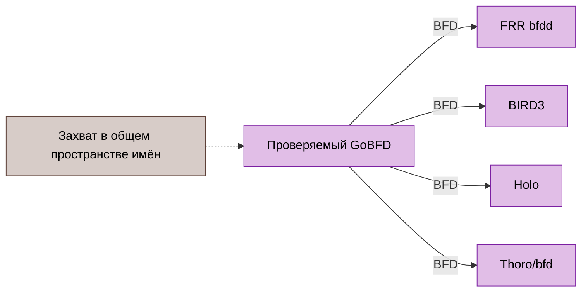

# Проверка совместимости

[Английский оригинал](../en/05-interop.md).

Доказательство совместимости содержит точную ревизию GoBFD, артефакт соседа, сценарий и захват пакетов. Определения тестов являются контрактами исходного кода; исторический успех не квалифицирует изменённого кандидата. [Покрытие RFC](08-rfc-compliance.md) определяет реализованные и неполные процедуры; [справочник производителей](reference/vendor-bfd.md) — внешнюю конфигурационную семантику.

BFD означает Bidirectional Forwarding Detection. TX и RX обозначают передачу и приём; Detection Time (DT) — согласованный интервал обнаружения. Protocol data unit (PDU) — объявленный пакет BFD; Don’t Fragment (DF) — флаг фрагментации IPv4. Захват пакетов (PCAP) сохраняет доказательства обмена на линии. Квалификация сетевой операционной системы (NOS) требует фактического выполнения соседа.

## Выбор проверки

| Проверка | Команда | Граница |
|:---|:---|:---|
| Базовые соседи | make interop | testcontainers с детектором гонок: FRR, BIRD3, Holo, Thoro/bfd и управляемые тестовые профили |
| Связь с BGP | make interop-bgp | testcontainers с детектором гонок: GoBGP с FRR/BIRD3/ExaBGP |
| Сценарии RFC | make interop-rfc | testcontainers с детектором гонок: 7419, цепочка действий 9384, 9468 и предварительная реализация Echo |
| Совокупная проверка маршрутизации | make e2e-routing | Отдельные сохранённые наборы Compose; не все профили testcontainers |
| Совокупная проверка RFC | make e2e-rfc | Устаревший исполнитель Compose без детектора гонок; отдельно от interop-rfc |
| Containerlab | make interop-clab | Топология только с FRR, учётом владения и двумя стеками; приёмка в нативной среде отдельно |
| Манифесты производителей | make e2e-vendor | Свидетельства метаданных и политики; без выполнения NOS производителей |

Первые три команды — алиасы явных целей -testcontainers. [Makefile](../../Makefile) задаёт фильтры наборов, среду и каталоги артефактов. [Реестр E2E](../../test/e2e/targets.md) определяет различия выполнения и очистки.

## Подготовка и выполнение

Использовать поддерживаемую среду Linux и учётную запись с правом управления выбранным движком Podman и создания заявленных сетевых ресурсов и ресурсов захвата. Ограничить прогон одной собственной лабораторией или проектом; записать идентичности существующих ресурсов до запуска и исключить производственных соседей из её подсетей. Ниже приведены невыполненные примеры процедуры.

1. Подготовить [среду разработки](09-development.md), закреплённый провайдер Compose и нужный Podman API.
2. Прочитать выбранную топологию и правила выполнения. Проверить имена проектов, фиксированные имена, подсети, ограничения и владение до создания ресурсов.
3. Выбрать новое место хранения доказательств и сохранить полный commit исходников.
4. Выполнить нужную проверку полного цикла:

```sh
make interop-testcontainers
make interop-bgp-testcontainers
make interop-rfc-testcontainers
```

5. Проверить именованные результаты, пропуски, проверки полей пакетов и записи очистки. Сохранить исходные JSON и журналы, PCAP и сопутствующие файлы SHA-256.
6. Повторить затронутые профили после изменений рабочего кода. Прежняя запись для точного SHA не квалифицирует новую ревизию потоков, транспорта или таймеров.

Базовые артефакты находятся в reports/e2e/interop-testcontainers; BGP/RFC используют соответствующие имена -bgp-/-rfc-. GOBFD_REQUIRE_PODMAN=1 превращает отсутствие обязательного Podman в отказ вместо молчаливого пропуска. Владельцы полного цикла сохраняют диагностику до очистки только принадлежащих им ресурсов.

Остановить последовательность при отказе проверки, неожиданном пропуске, отсутствии проверки пакетов или конфликте владения. До восстановления сохранить артефакты неуспешного прогона и состояние очистки. Не повторять полный цикл поверх неизвестных оставшихся ресурсов: сверить точные ID и метки с управляющим стендом, завершить разрешённую очистку своих ресурсов и проверить исходное состояние лаборатории. Сохранить посторонние ресурсы и отдельное место доказательств для каждого повтора. Источник: [контракт жизненного цикла и очистки E2E](../../test/e2e/README.md).

## Базовая топология



Рецепты сборки соседей находятся в [test/interop](../../test/interop/). Закреплённые исходники используют FRR 10.7.1, BIRD 3.4.0 с сохранённым исправлением, неизменяемый Holo 0.9.0 и закреплённую сборку Thoro из исходников. Получать реальные идентификаторы сборки и образов из рецептов и каждого прогона; названия версий недостаточно.

Фиксированная лаборатория использует частную подсеть 172.20.0.0/24; приведённые адреса воспроизводят отслеживаемую топологию, а не производственный план адресации. Проверки охватывают установление сессии, AdminDown, согласованные таймеры, отказ и восстановление, захваченные поля Control. Аутентификация, дополнение и управляемые тестовые процедуры имеют отдельные профили. Независимый сосед Go использует кодек репозитория; это не независимая реализация кодека.

<a id="crafted-peer"></a>

### Управляемый тестовый сосед

TestCraftedPeerTestcontainers запускает GoBFD, tshark в общем пространстве имён и соседа Go 172.20.0.40. Сосед использует TTL 255, исходный порт 49152, не использует аутентификацию и переключает фазу по SIGUSR1.

| Фаза | Вход | Требуемое доказательство |
|:---|:---|:---|
| rx0/poll | Нулевой Required RX и последовательные Poll | Один Final на Poll; без периодической передачи минимум десять согласованных интервалов |
| silent | Остановка передачи соседа | Down с диагностикой 1 и время истечения срока; первый Down с нулевым Your Discriminator; минимум три интервала медленной передачи |
| recover | Новое установление сессии | Up с интервалами 300 мс |
| demand | D=1/Poll; перечитывание 500 мс | Final, подавление периодической передачи, локальный Poll/Final соседа, квитанция сходимости |
| demand-clear | D=0/Poll | Final, периодическая передача, двенадцать интервалов и проверки среднего/разброса |
| final-loss/poll/final-restore | Потеря Final, пересекающийся Poll, восстановление | Повтор активного кортежа 400 мс; кандидат 800 мс после прежнего Final и интервала между обменами; P/F не одновременно |

Граница фазы молчания — от DT−1 мс до DT+max(2 мс,DT/50) от последнего кадра соседа. Первый Down GoBFD имеет дополнительный допуск 50 мс. Множитель 1 использует случайный разброс 75–90% со средним 0.825T; остальные проверенные множители — 75–100% со средним 0.875T. Возобновлённая фаза 500 мс проверяет среднее в пределах трёх стандартных ошибок.

Аутентифицированный асинхронный FRR/BIRD3 меняет множитель 1→5→3 без локального Poll. Удалённый Demand использует 5→3 с отдельными Poll/Final/квитанцией/интервалом молчания на изменение. Захват сохраняет порт и длину, тип аутентификации, ключ и номер последовательности, дискриминаторы и таймеры. Локальный Detection Time приёма использует множитель соседа; границы асинхронного режима соседа и локального Demand подписаны отдельно. Управляемый тестовый сосед не имеет таймера обнаружения.

<a id="padding-и-multihop"></a>

### Дополнение и многоскачковый режим

Подготовленное дополнение проверяет аутентифицированные размеры 128→192→128 байт, отказ изменения аутентификации вместе с дополнением, включение и отключение, отказ объединённого кандидата. Профиль Keyed SHA1 по умолчанию и TestFourPeerMeticulousTopologyTestcontainers восстанавливают собственное неизменяемое начальное состояние. Захват проверяет DF, полезную нагрузку UDP, объявленную длину PDU, нулевое дополнение, область MAC и состояние защиты от повторов между фазами. SIGUSR2 проверяет текущий управляемый Poll без сброса Demand.

TestCraftedMultihopTTLTestcontainers использует peer-multihop: UDP 4784, Meticulous SHA1, локальный RX 3 с, TX 300 мс. Асинхронный режим и Demand меняют max-hops 1→5→1, затем отклоняют вход с изменениями аутентификации и политики числа скачков. Последовательные пробы по 200 мс повторяют принятые байты с линии, дают новый Poll ниже порога и его повтор на пороге; один принятый RX и одна намеренная ошибка защиты аутентификации от повтора сохраняют счётчики переходов. Это локальная политика 255−N, а не приёмка маршрутизируемой или облачной среды.

Финальный захват ограничивает число декодированных совпадающих строк после фильтра отображения. Ограничение чтения захвата может скрыть последующие кадры. Обязательные проверки начального Down с диагностикой 0 и истечения срока обнаружения нельзя молча пропускать. Закреплённый помощник BIRD для высоких портов Linux не обеспечивает исходный диапазон RFC 5881; сохранённый захват дополнения содержит 938 пакетов с портом 43990. Это указанное отклонение соседа, а не покрытие GoBFD.

<a id="сохранённые-wire-receipts"></a>

### Сохранённые квитанции обмена на линии

| Область | Точные исходники / квитанция | Измеренный результат | Ограничение |
|:---|:---|:---|:---|
| Множитель обнаружения | d9e67064e51012c0d25a1a22dc9bd469600d8469; reports/detect-wire-20261024 | Обе топологии прошли | Дополнение/TTL/финальная проверка отдельно |
| Дополнение | b97729458a696aee21023ba147af51417ed9ff7b; reports/padding-wire-20261024 | Три записи выполнения, 675 проверенных файлов контрольных сумм | Начальные пропуски и финальное решение отдельно |
| TTL | 491b2214994f07e017eb93ab67a29a95378c619e; reports/ttl-wire-20261024 | 162.94 с управляемого сценария, 81.98 с многоскачкового; семь окон; 863 хеша исходников, 212 сопутствующих файлов | Общая финальная/стабильная проверка отдельно |
| FourPeer по умолчанию | e4e79a8eee8e7c38bfc78321bdc5e9030909c214; reports/final-wire-20261024 | 429.47 с; десять сценариев; разрыв истечения срока 0.901 с; один пропуск RFC BIRD | Повтор четырёх финальных профилей после изменений потоков/масштаба |

Квитанция FourPeer сохраняет шесть идентификаторов образов, 867 совпадающих хешей исходников, 310 сопутствующих файлов и четырнадцать проб SERVING двух служб. Исполнитель с 512 MiB фиксирует ноль событий max/нехватки памяти (OOM) и нулевой swap; отсутствие точных образов проверяется. Это датированные наблюдения, а не текущий прогон или полная квалификация выпуска.

## Связь с BGP

Топология 172.21.0.0/24 соединяет GoBFD/GoBGP с FRR с нативными BFD+BGP, BIRD3 с нативными BFD+BGP и GoBFD/ExaBGP. ExaBGP использует мост GoBFD; это не нативный сосед BFD.

| Путь соседа | Объявленный префикс |
|:---|:---|
| FRR | 10.20.0.0/24 |
| BIRD3 | 10.30.0.0/24 |
| Мост ExaBGP | 10.40.0.0/24 |

Сохранять отдельно установленные BFD/BGP, наличие маршрута, отзыв при отказе и восстановленный маршрут/BGP. Общие пространства имён выравнивают исходные адреса BFD/BGP. Текущий dev использует GoBGP v4 API; поддерживаемая v0.6 сохраняет v3 и не использует контракт конечных точек v4.

## Сценарии RFC

Топология 172.22.0.0/24 содержит FRR для выравнивания интервалов, путь BGP GoBFD/GoBGP, незапрошенный FRR и независимый отражатель Echo.

| Сценарий | Проверка | Граница квалификации |
|:---|:---|:---|
| 7419 | Настроенные 80 мс → 100 мс на линии | Точный сценарий интервала |
| Цепочка действий с названием 9384 | BFD Down отключает BGP; Up включает | GoBGP DisablePeer выдаёт Cease/2; требуемый подкод 10 не реализован |
| 9468 | Ненастроенная входящая сессия достигает Up и держится пять секунд | Не проверяет истечение срока/очистку |
| Echo с названием 9747 | Up отражателя, отказ при паузе, восстановление | Предварительная реализация Echo; без полной проверки и аутентификации возврата по RFC |

Нормативная область задана в [RFC 5880](../rfc/rfc5880.txt), [RFC 5881](../rfc/rfc5881.txt) и [матрице RFC](08-rfc-compliance.md). Успешная цепочка действий не меняет статус реализации RFC.

<a id="сохранённый-compose-workflow"></a>

## Сохранённый процесс Compose

Использовать для намеренно выбранного сохранённого проекта; фильтры и обработка отказов отличаются от проверок testcontainers.

Применять те же условия Linux, полномочий на движок и владения. Записать исходное состояние проекта до `interop-up`; остановиться при ошибке создания или теста, проверить `interop-logs` и сохранить доказательства до восстановления. До повтора `interop-up` проверить уже работающий проект; не считать его новым прогоном и не предполагать отсутствие изменений при повторе.

```sh
make interop-up
make interop-test
make interop-logs
```

После разрешения очистки принадлежащих сценарию ресурсов использовать interop-down. BGP/RFC имеют соответствующие -up/-test/-logs/-down. Помощники захвата — interop-capture, interop-pcap, interop-pcap-summary. Совокупная проверка маршрутизации базового сценария и BGP и устаревшая совокупная проверка RFC не используют детектор гонок. Фиксированные имена и подсети могут конфликтовать между проектами.

После очистки требовать отсутствия контейнеров и сетей собственной лаборатории и сохранности записанных посторонних ресурсов. Сохранить тома данных и доказательства, если их удаление явно не входит в область очистки.

## Процедура FRR в Containerlab

Политику выполнения задают [profiles.json](../../test/e2e/vendor/profiles.json) и [vendorprofiles](../../test/internal/vendorprofiles/manifest.go). Arista cEOS, Nokia SR Linux, SONiC-VS, VyOS и отложенный Cisco XRd остаются retained-unavailable. Кешированные образы, историческая конфигурация, метаданные реестра и руководства производителей не дают разрешения выполнения и приёмки. e2e-vendor сообщает политику без развёртывания.

Использовать учётную запись с правом управления выбранным движком и сетью топологии. До начальной подготовки записать существующие ресурсы с фиксированными именами и сохранённую квитанцию владения. Остановиться, если они принадлежат другому прогону или не могут быть проверены; процедура только с FRR не разрешает менять такой ресурс.

1. Использовать нативный Linux amd64/arm64, Podman с нужным сокетом Unix API, GNU Make/coreutils/flock и точный containerlab 0.82.0 из закрепления контроллера.
2. Предзагрузить ссылки SDK/Debian из [test_compiler_source.go](../../test/internal/clabbootstrap/test_compiler_source.go). Оставить CLAB_LABDIR_BASE незаданным.
3. Выполнить полный цикл или явные стадии с учётом владения:

```sh
make interop-clab-bootstrap ARGS=--dry-run
make interop-clab-up
make interop-clab-test
```

4. Проверить PASS пакета и десять именованных PASS: установление сессии в двух стеках, отказ, согласование, время обнаружения, формат пакета и all-available. Только SessionIndependence может быть пропущен при одном FRR.
5. Выполнить разрешённый interop-clab-down и подтвердить отсутствие точных записанных ID.

Остановиться до следующей стадии при отказе начальной подготовки, развёртывания или проверок. Сохранить данные обнаружения и квитанции; до нового прогона повторить очистку через того же владельца. Повтор `up` или `test` требует свежей проверки идентичности по сохранённой квитанции, а не предположения об идемпотентности. После down проверить сохранность общих образов и отсутствие точных собственных ресурсов.

interop-clab выполняет полный цикл FRR. Начальная подготовка без развёртывания сохраняет оба ID подготовленных образов и квитанцию для --deploy --skip-build или очистки своих ресурсов; skip-build не доверяет latest. Справка, dry-run и down также собирают новый контроллер. Старые флаги архивов/ISO производителей разбираются, но не разрешают подготовку.

Компилятор при холодном запуске получает частный снимок исходников без сокета контейнерного движка и с ограничениями. Полезная нагрузка компилируется отдельно с детектором гонок в SDK с отключённой сетью; рабочая среда Debian получает точные бинарные файлы с хешами и выбранный сокет движка без компилятора. Монтирование сокета только для чтения сохраняет полномочия управления движком. Нативный контроллер хоста имеет ограничение времени без эквивалентного жёсткого ограничения памяти. Ограничения полезной нагрузки — 2 CPU/2 GiB/без дополнительного swap/512 PID.

Проверки до и после компиляции проверяют квитанцию schema-3, полные ID и метки owner/run через CLI и однажды выбранный API-клиент; каждый контекст — 30 секунд. Изменённые или некорректные квитанции, конфликты чужих фиксированных имён и список сохранённых NOS отклоняются. Общая для UID на хосте блокировка сериализует фиксированную лабораторию между рабочими деревьями.

Containerlab соединяет запущенные приложения ext-container без сети управления. Адреса IPv6 ожидают проверки дублирования адресов (DAD) до 30 секунд. Выбирать сессии по точному кортежу и типизированному локальному и удалённому состоянию; другой сессии или диагностики со словом Down недостаточно.

Очистка проверяет идентичности до изменения, удаляет точные ID образов приложений без принудительного удаления и прореживания, а квитанцию — последней. Неуспешное уничтожение сохраняет данные обнаружения и квитанцию для повтора. Исторические schema-1/2 служат только входом очистки. Общие образы SDK и рабочей среды сохраняются. JSON результатов теста остаётся в test/interop-clab/gobfd/.runtime.

Проверки FRR используют номинальные и согласованные 300 мс и обнаружение 900 мс; проверка времени допускает пять секунд. Проверка формата пакета требует двадцать полных кадров двух стеков. Квалификация нативного жизненного цикла FRR, компилятора и контейнерного движка и все пять квалификаций NOS остаются незавершёнными; сохранить записи фактического выполнения до заявления приёмки.

## Диагностика

| Симптом | Проверка | Действие |
|:---|:---|:---|
| Нет обязательной среды исполнения | Провайдер/сокет и GOBFD_REQUIRE_PODMAN | Восстановить среду исполнения; не принимать пропуск |
| Конфликт фиксированного имени/подсети | Манифест проекта и точное текущее владение | Выбрать изолированный проект; сохранить чужие ресурсы |
| Сессия остаётся Down | Локальный кортеж и кортеж соседа, возможности, TTL/аутентификация/порты | Исправить вход; сохранить пакеты |
| Пустой захват | Пространство имён/фильтр, время начала, совпадающие строки | Повторить ограниченный захват в окне проверки |
| Успех теста с именем RFC без гарантии обмена на линии | Проверки и матрица RFC | Указать точную область цепочки действий |
| Очистка не завершена | ID квитанции, метки, выбор API | Повторить down владельца; сохранить состояние восстановления |
| Профиль производителя недоступен | Политика и доказательства исходников/лицензии | Сохранить unavailable до отдельного допуска |

[Разработка](09-development.md), [стенд E2E](../../test/e2e/README.md), [справочник производителей](reference/vendor-bfd.md), [измерения среды исполнения](14-performance-analysis.md).
