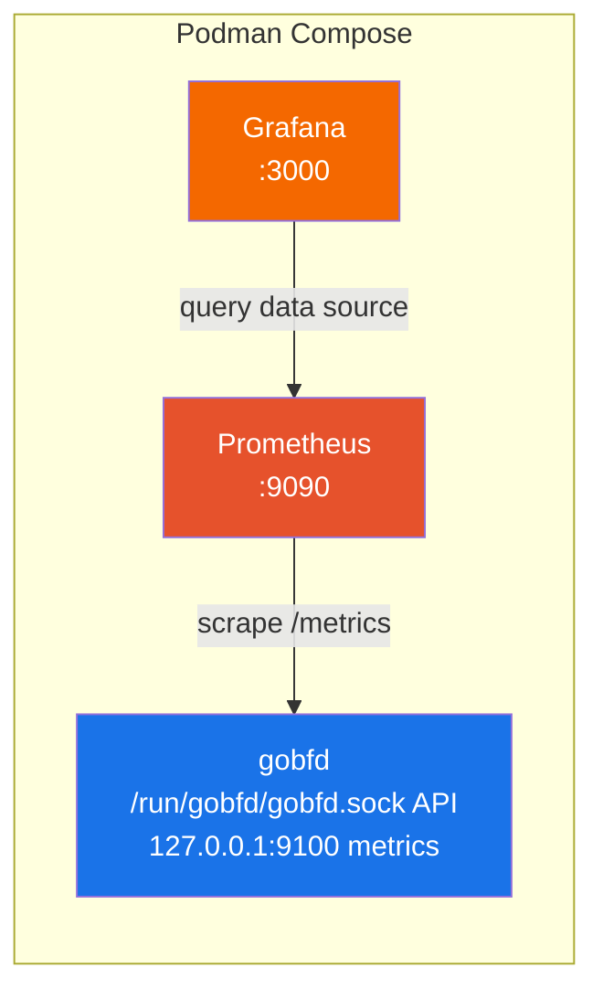

# Развёртывание


> Руководство по развёртыванию в рабочей среде: systemd-сервис, стеки Podman Compose, контейнерные образы, пакеты deb/rpm и укрепление безопасности.

---

## Содержание

- [Требования](#требования)
- [Матрица release-артефактов](#матрица-release-артефактов)
- [Способы установки](#способы-установки)
- [systemd-сервис](#systemd-сервис)
- [Podman Compose](#podman-compose)
- [Контейнерный образ](#контейнерный-образ)
- [Укрепление безопасности](#укрепление-безопасности)
- [Обновление сертификатов управления](#обновление-сертификатов-управления)
- [Чек-лист production](#чек-лист-production)

### Требования

- **Linux** (сырые сокеты требуют Linux-специфичных API)
- Привилегии **CAP_NET_RAW** и **CAP_NET_ADMIN** по поставляемому контракту выполнения (привязка устройства и настроенные сетевые операции)
- Закреплённый Go 1.27.3 внутри Podman (только для сборки исходников)

Для систем, отличных от Linux, поддерживается только совместимость при компиляции.
Конструкторы транспорта `internal/netio` возвращают `ErrUnsupportedPlatform`;
GoBFD не публикует и не поддерживает сетевую среду исполнения для систем, отличных от Linux.

### Матрица release-артефактов

Это контракт артефактов текущей конфигурации релиза `dev`
([`.goreleaser.yml`](../../.goreleaser.yml)), а не список опубликованных или
квалифицированных продуктов. `master` содержит принятое стабильное состояние;
`release/v0.6` сохраняет собственные контракты и GoBGP v3.37.0. Публикация
следующей линии заблокирована до финальной квалификации и разрешения.

| Артефакт | Целевые системы | Архитектуры | Базовый образ / формат пакета |
|---|---|---|---|
| Статические бинарные файлы | Linux-дистрибутивы с пользовательским окружением glibc или musl | `amd64`, `arm64` | Архив `tar.gz` |
| Debian-пакет | Профиль жизненного цикла Debian 13 `trixie` | `amd64`, `arm64` | `.deb`, systemd-юнит |
| RPM-пакет | Универсальная генерация RPM; квалификация целевой платформы отдельно | `amd64`, `arm64` | `.rpm`, systemd-юнит |
| OCI-образ по умолчанию | Docker, Podman, среды CRI Kubernetes | `linux/amd64`, `linux/arm64` | `docker.io/library/debian:trixie-slim` |

| Тег образа | База |
|---|---|
| `ghcr.io/dantte-lp/gobfd:<version>` | Debian `trixie-slim` |
| `ghcr.io/dantte-lp/gobfd:latest` | Debian `trixie-slim` |
| `ghcr.io/dantte-lp/gobfd:<version>-debian-trixie` | Debian `trixie-slim` |
| `ghcr.io/dantte-lp/gobfd:debian-trixie` | Debian `trixie-slim` |

Oracle Linux 10 исключён из OCI и квалификации жизненного цикла v1. Генерация
универсальных RPM сохранена; наличие RPM-файла не подтверждает квалификацию
платформы. Образы и теги v0.6 сохранены.

### Способы установки

Выберите один пакет нужной версии и архитектуры хоста. Совместимость формата
пакета сама по себе не подтверждает квалификацию операционной системы.

#### Из deb/rpm-пакетов

```bash
# Установка .deb-пакета
sudo apt install ./gobfd_*.deb   # устанавливает зависимости systemd и procps

# Установка .rpm-пакета
sudo rpm -i gobfd_*.rpm

# Редактирование конфигурации
sudo vim /etc/gobfd/gobfd.yml

# Запуск демона
sudo systemctl enable --now gobfd

# Проверка
sudo systemctl status gobfd
sudo gobfdctl session list
```

Пакеты собираются GoReleaser v2 и включают:
- Бинарные файлы `/usr/local/bin/gobfd`, `/usr/local/bin/gobfdctl`, `/usr/local/bin/gobfd-haproxy-agent`, `/usr/local/bin/gobfd-exabgp-bridge`
- Пример конфигурации `/etc/gobfd/gobfd.yml`
- systemd-юнит `/usr/lib/systemd/system/gobfd.service`
- Системного пользователя и группу `gobfd`
- Группу сокета управления `gobfd-admin`; членство выдаётся только уполномоченным операторам

Жизненный цикл пакетов реализован внутренним исполняемым файлом пакета
`internal/cmd/gobfd-package-lifecycle`. Он преобразует только поддерживаемые
фазы установки, обновления и окончательного удаления Debian/RPM в фиксированные
команды systemd. Декларативные входные файлы
`deployments/systemd/gobfd.sysusers` и
`deployments/systemd/gobfd.tmpfiles` создают системную учётную запись без входа
`gobfd` и владение `/etc/gobfd`, не меняя контракт четырёх публичных бинарников.

`go run ./test/cmd/cictl package-lifecycle` устанавливает DEB релиза в
контейнер Debian с systemd и выполняет фазы установки и окончательного удаления;
см. [Тесты жизненного цикла пакетов](./09-development.md#тесты-жизненного-цикла-пакетов).

#### Из исходников

```bash
git clone --branch dev https://github.com/dantte-lp/gobfd.git
cd gobfd

# Сборка всех 4 бинарников с информацией о версии в закреплённом контейнере
make up
make build

# Установка бинарников, записанных в корень репозитория
sudo install -m 755 gobfd gobfdctl gobfd-haproxy-agent gobfd-exabgp-bridge /usr/local/bin/
```

Копирование бинарников не устанавливает конфигурацию пакета, юнит systemd и
системные учётные записи. Пример конфигурации требует существующую группу
`gobfd-admin`. Для управляемой службы используйте пакет; проверочный запуск с
настройками по умолчанию выполняется как `sudo ./gobfd` без этого примера.
В другом терминале запросите сокет командой `sudo ./gobfdctl session list`.
Оператору без root требуется членство в группе сокета в текущем сеансе входа.

### systemd-сервис

Юнит-файл `deployments/systemd/gobfd.service`:

```ini
[Unit]
Description=GoBFD — BFD Protocol Daemon
Documentation=https://github.com/dantte-lp/gobfd
After=network-online.target
Wants=network-online.target

[Service]
Type=notify
ExecStart=/usr/local/bin/gobfd -config /etc/gobfd/gobfd.yml
ExecReload=/bin/kill -HUP $MAINPID
Restart=on-failure
RestartSec=5s
WatchdogSec=30s

# Security hardening
User=gobfd
Group=gobfd
# The management socket /run/gobfd/gobfd.sock is 0660 with group gobfd-admin;
# operators join gobfd-admin, not gobfd, which can read /etc/gobfd.
SupplementaryGroups=gobfd-admin
RuntimeDirectory=gobfd
RuntimeDirectoryMode=0755
UMask=0077
AmbientCapabilities=CAP_NET_RAW CAP_NET_ADMIN
CapabilityBoundingSet=CAP_NET_RAW CAP_NET_ADMIN
NoNewPrivileges=true
# The only writable state is RuntimeDirectory= and the private /tmp.
ProtectSystem=strict
ProtectHome=true
ReadOnlyPaths=/etc/gobfd
PrivateTmp=true
ProtectProc=invisible
ProcSubset=pid
ProtectKernelModules=true
ProtectKernelTunables=true
ProtectControlGroups=true
RestrictRealtime=true
RestrictSUIDSGID=true
LockPersonality=true
# UDP and TCP (BFD, gRPC, metrics, GoBGP), Unix (management socket, sd_notify,
# NetworkManager D-Bus, OVSDB) and rtnetlink (interface inventory and monitor).
RestrictAddressFamilies=AF_UNIX AF_INET AF_INET6 AF_NETLINK
SystemCallArchitectures=native
SystemCallFilter=@system-service
SystemCallErrorNumber=EPERM
# The v1 bound is 2*sessions+256 descriptors; 16384 covers the 5,000-session
# engineering gate.
LimitNOFILE=16384

[Install]
WantedBy=multi-user.target
```

Ключевые возможности:

| Возможность | Описание |
|---|---|
| `Type=notify` | `sd_notify(READY)` подтверждает запуск процесса и слушателей; сходимость конфигурации имеет отдельную проверку готовности gRPC |
| `WatchdogSec=30s` | Watchdog systemd -- демон отправляет сигналы активности каждые 15 секунд |
| `ExecReload` | SIGHUP перезагружает уровень лога и согласует сессии и принадлежащие им слушатели/backend UDP; стартовые настройки требуют перезапуска |
| `Restart=on-failure` | Авто-перезапуск с задержкой 5 секунд после сбоя или аварийного выхода при потере пути приёма или диспетчера |
| Штатная остановка | Выход с кодом 0 после AdminDown drain. Drain, который не может завершиться из-за недоступного пира или пира без дискриминатора, записывается как предупреждение; локальные ошибки drain по-прежнему завершают процесс с ошибкой |
| Директивы безопасности | Минимальные привилегии с `CAP_NET_RAW` и `CAP_NET_ADMIN` |

#### Контракт песочницы

Директивы для семейств адресов, системных вызовов, `/proc`, umask и файловых
дескрипторов выведены из измеренного инвентаря демона, а не из общего шаблона:

| Директива | Основание |
|---|---|
| `RestrictAddressFamilies=AF_UNIX AF_INET AF_INET6 AF_NETLINK` | `strace` демона с одношаговым IPv4/IPv6, multihop, unsolicited, Echo, Micro-BFD с `SO_BINDTODEVICE`, VXLAN, Geneve, GoBGP, метриками, сокетом управления, перезагрузкой и остановкой зафиксировал только эти семейства. `AF_UNIX` также нужен для `sd_notify` и LAG-backend NetworkManager D-Bus и OVSDB; `AF_NETLINK` нужен для инвентаря и монитора интерфейсов. Сокеты `AF_PACKET` не используются. |
| `SystemCallFilter=@system-service`, `SystemCallErrorNumber=EPERM` | Все 50 системных вызовов этого прогона входят в `@system-service`, раскрытый `systemd-analyze syscall-filter` в Debian 13 и Oracle Linux 10 (systemd 257). `@privileged` не запрещён: смена группы сокета управления использует `fchownat`. |
| `LockPersonality=true` | Демон не вызывает `personality(2)`. |
| `ProtectProc=invisible`, `ProcSubset=pid` | Демон читает только `/proc/self/cgroup` и `/proc/self/mountinfo` (среда исполнения Go). Чтение `/proc/sys/net/core/somaxconn` для очереди ожидающих подключений скрыто, поэтому слушатели управления, gRPC и метрик используют резервную очередь Go размером 128. |
| `UMask=0077` | Единственный создаваемый демоном файл — сокет управления; затем ему назначаются настроенные режим и группа (`0660 gobfd:gobfd-admin`). |
| `LimitNOFILE=16384` | Ресурсная граница v1 — `2*sessions+256` дескрипторов; 16384 покрывает инженерную проверку на 5000 сессий (10256). Go держит мягкий лимит равным этому жёсткому лимиту. |

Записываемое состояние ограничено `RuntimeDirectory=` (`/run/gobfd`) и
приватным `/tmp`. `ProtectKernelTunables=true` оставляет `/sys` только для
чтения, поэтому актуатор Micro-BFD `kernel-bond` в режиме `enforce` не может
записать `/sys/class/net/<bond>/bonding/slaves` под этим юнитом; `dry-run`,
`ovs` и `networkmanager` не затронуты. Явно включаемый drop-in
[`deployments/systemd/gobfd-kernel-bond.conf`](../../deployments/systemd/gobfd-kernel-bond.conf)
открывает на запись только `/sys/devices/virtual/net/<bond>/bonding/slaves`,
файл, который пишет backend, для каждого управляемого bond:

```bash
sudo install -D -m 0644 deployments/systemd/gobfd-kernel-bond.conf /etc/systemd/system/gobfd.service.d/kernel-bond.conf
# До restart замените bond0 в установленном drop-in на каждый управляемый bond.
sudoedit /etc/systemd/system/gobfd.service.d/kernel-bond.conf
sudo systemctl daemon-reload && sudo systemctl restart gobfd
```

Bond-интерфейс должен существовать к моменту запуска gobfd. Атрибуты сетевых устройств
в sysfs имеют режим `0644 root:root`, поэтому drop-in также выдаёт
`CAP_DAC_OVERRIDE`: непривилегированный UID только с `CAP_NET_ADMIN` получил
`EACCES` при записи сетевого атрибута sysfs, а с `CAP_NET_ADMIN` и
`CAP_DAC_OVERRIDE` запись прошла. Эта привилегия обходит проверки прав файлов
на всех путях, видимых сервису, включая чтение файлов только для root, например
`/etc/shadow`; запись по-прежнему ограничена пространством имён монтирования только для чтения.
Включайте drop-in только там, где этот компромисс принят. `systemd-analyze
verify` принимает его в Debian 13 и Oracle Linux 10; квалификация записи на
хосте с модулем bonding не выполнена (`gobfd-qj0.8.2.3.3.1`).

Для крупных развёртываний лимит дескрипторов повышается drop-in-файлом, а не
правкой юнита из пакета:

```bash
sudo systemctl edit gobfd   # [Service] LimitNOFILE=<2*sessions+256 или больше>
```

[Тест жизненного цикла пакетов](./09-development.md#тесты-жизненного-цикла-пакетов)
охватывает DEB релиза в Debian 13. Историческая квалификация systemd 257
также охватывала RPM в Oracle Linux 10 до исключения этой платформы из v1.
Демон запускается с `Seccomp: 2`, `NoNewPrivs: 1`, `Umask: 0077`,
`hidepid=invisible,subset=pid` и лимитом 16384 дескрипторов, удерживает сессии
Up дольше `WatchdogSec=` без перезапуска, перезагружает конфигурацию без смены PID,
перезапускается после `SIGKILL` и останавливается с `Result=success` после
уничтожения пира. В журнале нет отказов песочницы. `systemd-analyze security`
показывает оценку доступности атакам 5.2 для прежнего юнита и 3.3 для текущего.

#### Управление сервисом

```bash
sudo systemctl start gobfd       # Запуск
sudo systemctl stop gobfd        # Остановка
sudo systemctl reload gobfd      # Горячая перезагрузка (SIGHUP)
sudo journalctl -u gobfd -f      # Просмотр логов
sudo systemctl status gobfd      # Статус
```

### Podman Compose

GoBFD использует внешний провайдер Compose Podman с официальным Go-бинарником
Docker Compose v5.6.0. Установите провайдер, закреплённый контрольной суммой, и выберите его явно;
Python `podman-compose` не поддерживается:

Приведённая ниже команда начальной подготовки сейчас выполняется на хосте и требует
закреплённого в репозитории компилятора Go. Она не использует контейнер разработки.

```bash
# Bootstrap выполняется на хосте с закреплённым Go toolchain
go run ./test/cmd/toolbootstrap compose --install-dir "$HOME/.local/bin"
export PODMAN_COMPOSE_PROVIDER="$HOME/.local/bin/docker-compose"
export PODMAN_COMPOSE_WARNING_LOGS=false
export DOCKER_BUILDKIT=0
podman compose version
```

Команда начальной подготовки перед использованием лексически нормализует абсолютный путь
установки и принимает только путь из реальных каталогов. Конечный каталог должен
принадлежать текущему пользователю и не должен быть доступен для записи группе
или остальным пользователям. Родительские каталоги должны принадлежать root или
текущему пользователю; доступный для записи родительский каталог допустим только
с sticky bit. Идентичность скачанного провайдера сохраняется от проверки контрольной суммы
до запуска и атомарной публикации, а очистка отказывается удалять подменённый
inode.

`DOCKER_BUILDKIT=0` оставляет сборку на совместимом с Podman классическом API Docker;
Docker Buildx/Bake не входит в контракт выполнения проекта.

#### Стек разработки

Описание: `deployments/compose/compose.dev.yml`.

```bash
# Запуск среды разработки
make up

# Сборка и тесты внутри development container
make build && make test

# Запуск отдельного теста через управляемый Make Compose project
make test-run RUN=TestFSMTransition PKG=./internal/bfd
```

Четыре набора проверок testcontainers с отчётами используют реализованный на Go бинарник `e2ectl`,
который Make собирает внутри контейнера разработки перед запуском:

| Цель | Каталог отчёта |
|---|---|
| `make e2e-core-testcontainers` | `reports/e2e/core/run.*` |
| `make int-bgp-failover-testcontainers` | `reports/e2e/bgp-fast-failover/run.*` |
| `make int-haproxy-testcontainers` | `reports/e2e/haproxy-health/run.*` |
| `make int-observability-testcontainers` | `reports/e2e/observability/run.*` |

#### Production-стек

```bash
# Запуск gobfd с Prometheus и Grafana
podman compose -f deployments/compose/compose.yml up -d

# Сервисы:
#   gobfd API:        unix:///run/gobfd/gobfd.sock (внутри контейнера gobfd)
#   Prometheus:       http://localhost:9090
#   Grafana:          http://localhost:3000 (admin/admin)
```

Пример собирается из исходников и не является опубликованным продуктом релиза
или новым результатом приёмки рабочей эксплуатации. Сначала проверьте сформированную
конфигурацию с выбранным провайдером; три сборки не используют interop-контроллер
с лимитами. На общем хосте отдельно проверьте допуск ресурсов сборки и выполнения.

Unix-сокет остаётся внутри контейнера GoBFD: этот Compose-файл не монтирует
`/run/gobfd`. Для управления используйте `podman exec gobfd gobfdctl session list`
либо отдельно настройте собственное монтирование сокета. Сеть хоста не делает общими
пути файловой системы.

Все три сервиса используют сетевое пространство Linux-хоста. Prometheus
опрашивает `127.0.0.1:9100`, Grafana использует источник данных
`http://127.0.0.1:9090`. Prometheus и Grafana слушают только loopback хоста;
для удалённого доступа используйте SSH-туннель или обратный прокси с
аутентификацией. Порты хоста 9100, 9090 и 3000 должны быть свободны.
После первого сбора метрик (до 15 секунд) проверьте цель сбора:

```bash
curl --fail --silent --show-error http://127.0.0.1:9090/api/v1/targets |
  jq -e '.status == "success" and
    ([.data.activeTargets[] | select(.labels.job == "gobfd")] |
      length == 1 and all(.[]; .health == "up" and .lastError == ""))'
```



### Контейнерный образ

```bash
# Стандартная сборка
podman build -f deployments/docker/Containerfile -t gobfd .

# Multi-arch сборка (через GoReleaser)
goreleaser release --snapshot --clean
```

Релизные образы содержат четыре бинарных файла GoBFD и не содержат инструментов разработки:
`gobfd`, `gobfdctl`, `gobfd-haproxy-agent` и
`gobfd-exabgp-bridge`.

Приведённый рецепт сборки из исходников `deployments/docker/Containerfile` содержит только
`gobfd` и `gobfdctl`; отдельный релизный рецепт находится в
`deployments/docker/Containerfile.release`.

Контейнер требует:
- Привилегии `CAP_NET_RAW` и `CAP_NET_ADMIN`
- `network_mode: host` (рекомендуется) или проброс UDP-портов 3784/4784

### Укрепление безопасности

| Уровень | Механизм |
|---|---|
| **Capabilities** | Только `CAP_NET_RAW` + `CAP_NET_ADMIN` (без root) |
| **systemd** | `ProtectSystem=strict`, `NoNewPrivileges`, `PrivateTmp`, фильтры семейств адресов и системных вызовов, `ProcSubset=pid`; см. [Контракт песочницы](#контракт-песочницы) |
| **Код** | Нет `unsafe` в собственном рукописном коде; сгенерированный код среды protobuf исключён; ошибки сокетов обрабатываются |
| **TTL** | Control TX TTL=255; одношаговый RX требует 255, multihop RX использует настроенный порог `255 - multihop_max_hops` |
| **Аутентификация** | Опциональная BFD-аутентификация (5 типов по RFC 5880 Section 6.7) |

Конечная точка управления по умолчанию — `unix:///run/gobfd/gobfd.sock`, режим
`0660`; пример и пакеты выбирают группу `gobfd-admin`. Метрики по умолчанию
доступны без аутентификации по `127.0.0.1:9100`. TCP-слушатель управления вне
loopback требует `grpc.tls.cert_file`, `key_file` и `client_ca_file`;
анонимный доступ через loopback TCP по умолчанию разрешает только чтение.
Сохраняйте Unix-сокет, если удалённое управление не требуется. Для отдельно
настроенного mTLS-сервера:

```bash
gobfdctl --addr https://bfd.example:50052 \
  --tls-ca /etc/gobfd/tls/server-ca.pem \
  --tls-cert /etc/gobfd/tls/operator.pem \
  --tls-key /etc/gobfd/tls/operator.key session list
```

Сертификат сервера должен содержать выбранное имя хоста. Правила ролей,
например `grpc.mutating_identities`, управляют изменениями отдельно от доверия
сертификату. Точные настройки по умолчанию и проверки находятся в
[`internal/config/config.go`](../../internal/config/config.go), флаги клиента —
в [`cmd/gobfdctl/commands/root.go`](../../cmd/gobfdctl/commands/root.go).

### Обновление сертификатов управления

При наличии действующего сертификата, соответствующего закрытого ключа и явно
доверенных корней CA запустите обновление вне демона:

```bash
gobfdctl certificate renew \
  --ca-url https://ca.example \
  --ca-root /etc/gobfd/root.pem \
  --cert /etc/gobfd/management.pem \
  --key /etc/gobfd/management-key.pem
```

Нативный mTLS-запрос `POST /renew` сохраняет ключ и точный SAN, атомарно заменяя
только файл открытого сертификата. Ключ принадлежит вызывающему пользователю
и имеет режим `0400` или `0600`; входные файлы обычные, с единственной жёсткой
ссылкой и без символических ссылок, родительские каталоги доверенные и
недоступны для записи группе и остальным. Ошибка `ErrCommitted` сообщает об
уже заменённом сертификате с возможной неопределённостью долговечности записи;
не предполагайте откат.

Сервер читает PEM при каждом новом рукопожатии TLS. Существующие TLS-соединения
сохраняют согласованный идентификатор. `gobfdctl` и постоянные клиенты мостов
загружают клиентские сертификаты при создании транспорта; после обновления
перезапустите клиент или пересоздайте его транспорт. Доверенный CA может
выпускать идентификаторы, выбранные правилами ролей API; сам выпуск не
разрешает доступ к API.

Первичный выпуск и расписание требуют отдельных решений жизненного цикла.
Квалификация с настоящим step-ca ожидается в `gobfd-qj0.8.2.3.7.4`; локальные
тестовые конфигурации TLS её не подтверждают. Флаги и поведение при неизменённой цепочке
описаны в [справочнике CLI](04-cli.md#обновление-сертификата).

### Настройка памяти (`GOMEMLIMIT` и `GOGC`)

Go 1.27 рассматривает `GOMEMLIMIT` как мягкий лимит памяти, управляемой
средой исполнения Go. Он не включает отображение бинарного файла, память ядра и память,
управляемую вне Go. Среда исполнения может повышать частоту сборки мусора для соблюдения
лимита даже при `GOGC=off`; эта настройка не устраняет паузы GC. Лимит ниже
рабочего набора может привести к почти непрерывной сборке мусора.

GoBFD не публикует таблицы размеров памяти по количеству сессий. Выбирайте
лимит ниже лимита памяти сервиса или контейнера с запасом для бинарного файла,
сокетных буферов ядра и другой памяти вне Go, затем квалифицируйте его с целевым
числом сессий, режимом аутентификации, телеметрией и нагрузкой с отказами.
Сохраняйте стандартный `GOGC`, пока измерения развёртывания не обоснуют переопределение.

#### Конфигурация systemd

Добавьте квалифицированное для развёртывания значение в байтах в секцию
`[Service]` файла `gobfd.service`:

```ini
# Только пример; замените значением, квалифицированным для deployment.
Environment=GOMEMLIMIT=512MiB
```

#### Конфигурация контейнера

```dockerfile
# Только пример; замените значением, квалифицированным для deployment.
ENV GOMEMLIMIT=512MiB
```

#### Мониторинг

Отслеживайте вместе RSS процесса, лимит памяти контейнера или сервиса, частоту
GC и длительность пауз GC. RSS и `GOMEMLIMIT` измеряют разные величины.
Устойчивый рост нагрузки на GC или почти непрерывная работа GC около лимита
памяти требуют большего
квалифицированного лимита либо меньшей нагрузки; мягкий лимит не гарантирует
защиту от OOM.

### Чек-лист production

- [ ] Квалифицировать `GOMEMLIMIT` с запасом и репрезентативной нагрузкой
- [ ] Сохранять стандартный `GOGC`, пока измерения не обоснуют переопределение
- [ ] Отслеживать RSS, лимит памяти сервиса, частоту GC и паузы GC
- [ ] Настроить `gobfd.yml` с соответствующими параметрами сессий
- [ ] Установить `log.format: json` для структурированного логирования
- [ ] Включить интеграцию с GoBGP при использовании BFD для переключения BGP при отказе
- [ ] Включить демпфирование колебаний для предотвращения частых изменений маршрутов
- [ ] Настроить скрапинг Prometheus по адресу `:9100/metrics`
- [ ] Импортировать дашборд из `deployments/compose/configs/grafana/dashboards/bfd.json`
- [ ] Настроить алертинг на `gobfd_bfd_state_transitions_total{from_state="Up",to_state="Down"}`
- Проверить успешный запуск сокетов и выбранный профиль плоскости передачи; `session list` проверяет только доступ к управлению.
- [ ] Протестировать SIGHUP: `systemctl reload gobfd`
- [ ] Убедиться, что корректная остановка отправляет AdminDown

### Связанные документы

- [03-configuration.md](./03-configuration.md) -- Справочник конфигурации
- [07-monitoring.md](./07-monitoring.md) -- Метрики Prometheus и Grafana
- [09-development.md](./09-development.md) -- Настройка среды разработки

---

*Сверено с исходниками `dev`: 2026-10-25; команды проверены по коду, но не выполнялись.*
