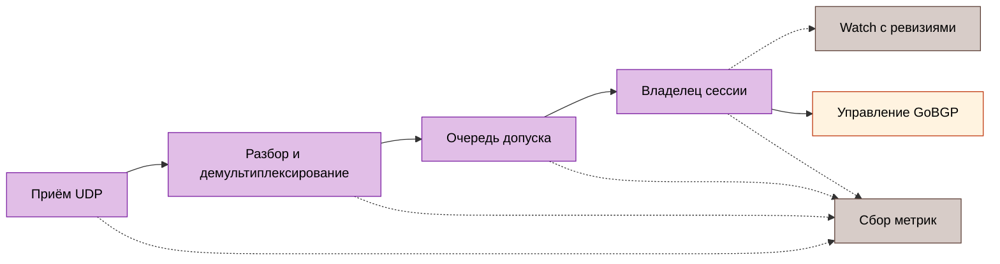

# Мониторинг

Конечная точка по умолчанию — `http://127.0.0.1:9100/metrics` без аутентификации. Открывать вне loopback только с явной сетевой политикой. Слушающий сокет метрик не содержит обработчиков отладки. Источники: [конфигурация](../../internal/config/config.go), [коллектор](../../internal/metrics/collector.go).

## Границы сигналов

`gobfd_bfd_sessions` считает зарегистрированные Control и Echo, включая типы Control Micro-BFD, VXLAN, Geneve. Регистрация не означает Up. Echo создаёт собственный ряд `session_type` и добавляет приращения пакетов и переходов в общие семейства метрик. Счётчики пакетов по соседу и локальному адресу не имеют дискриминатора, интерфейса и типа: одинаковые пары адресов агрегируются между обменами. Для отдельной сессии использовать снимок API. Источники: [регистрация Echo](../../internal/bfd/manager_echo.go), [прямое подключение коллектора](../../cmd/gobfd/factory.go).



## Справочник метрик

| Метрика | Тип | Метки | Значение |
| :--- | :--- | :--- | :--- |
| `gobfd_bfd_sessions` | gauge | `peer_addr,local_addr,session_type` | Зарегистрированные Control и Echo |
| `gobfd_bfd_packets_sent_total` | counter | `peer_addr,local_addr` | Успешные отправки Control/Echo |
| `gobfd_bfd_packets_received_total` | counter | `peer_addr,local_addr` | Приёмы Control/Echo, проверенные владельцем |
| `gobfd_bfd_packets_dropped_total` | counter | `peer_addr,local_addr` | Отказы и оставленные пакеты допущенной идентичности |
| `gobfd_bfd_state_transitions_total` | counter | `peer_addr,local_addr,from_state,to_state` | Переходы FSM |
| `gobfd_bfd_auth_failures_total` | counter | `peer_addr,local_addr` | Подмножество отказов аутентификации |
| `gobfd_bfd_delivery_outcomes_total` | counter | `source,outcome` | Фиксированные решения конвейера и уведомлений |
| `gobfd_bfd_control_rx_timing_total` | counter | `outcome` | Фиксации владельцем по достоверности времени |
| `gobfd_bfd_control_rx_commit_seconds` | histogram | нет | От программной метки приёма ядра до завершения владельцем |
| `gobfd_bfd_timer_events_total` | counter | `timer,event` | Наблюдения вызова и завершения таймеров |
| `gobfd_bfd_timer_delay_seconds` | histogram | `timer,stage` | Достоверная задержка вызова и эффекта |
| `gobfd_bfd_socket_drop_samples_total` | counter | `kind,outcome` | Достоверность отсчёта потерь сокета |
| `gobfd_bfd_socket_drops_total` | counter | `kind` | Наблюдаемые упорядоченные приращения потерь |
| `gobfd_gobgp_rpc_errors_total` | counter | `rpc` | Ошибки API и предварительной проверки GoBGP |
| `gobfd_gobgp_endpoint_compatible` | gauge | нет | 1 после предварительной проверки совместимости |
| `gobfd_gobgp_dampening_penalty` | gauge | `peer_addr` | Затухший штраф при сборе метрик |
| `gobfd_gobgp_dampening_suppressed` | gauge | `peer_addr` | Восстановление удерживается |
| `gobfd_gobgp_dampening_suppression_deadline_seconds` | gauge | `peer_addr` | Максимальный срок подавления в формате Unix, иначе 0 |
| `gobfd_gobgp_pending_action` | gauge | `peer_addr,action` | Неприменённое намерение `up`/`down` |
| `gobfd_gobgp_pending_action_deadline_seconds` | gauge | `peer_addr,action` | Срок повтора/перепроверки в формате Unix, иначе 0 |

Источники: [базовые метрики](../../internal/metrics/collector.go), [проверка и учёт Control](../../internal/bfd/session_packet.go), [принятые возвраты Echo](../../internal/bfd/echo.go), [время приёма](../../internal/metrics/receive_timing.go), [таймеры](../../internal/metrics/timer.go), [потери сокетов](../../internal/metrics/socket_drops.go), [GoBGP](../../internal/metrics/gobgp.go).

<a id="ledger-доставки"></a>

### Учёт доставки

Отказы разбора, TTL и неизвестного соседа не создают меток соседа. Учёт за время жизни процесса заранее создаёт поддерживаемые пары source/outcome и сохраняется после удаления последней сессии. Знаменатели стадий различаются: `queued` не равно `committed`; сумма стадий не измеряет потери пакетов.

Демультиплексирование Control выдаёт `scope_mismatch` для другого транспорта или интерфейса и `ttl_rejected` при отказе политики числа скачков. Echo использует `echo_read`, `echo_parse`, `echo_ttl`, `echo_demux`, `echo_admission`, `echo_owner`. Нулевой дискриминатор Echo отклоняется разбором. Обычные чтения, завершённые отменой или закрытием, не являются ошибками чтения.

Попытки уведомления используют `control_notification`, `unsolicited_notification`, `echo_notification`. Рассылка различает принятые, устаревшие и оставленные при завершении исходные события. `watch_recipient` отмечает исходное событие как queued/gapped; объединённый маркер GAP не является дополнительным исходным событием. Переполнение публичной очереди исходных Control/Echo аннулирует подписки с ревизиями, которым нужен повторный снимок. Доставка через прежний интерфейс выполняется по возможности. Потеря уведомлений не увеличивает счётчики потерь пакетов. ListSessions выдаёт выборочные `delivery_counters`; снимок ревизии не версионирует их атомарно. Источник: [модель доставки](../../internal/bfd/delivery.go).

<a id="время-и-socket-loss"></a>

### Время и потери сокетов

| Наблюдение | Фиксированные значения | Значение |
| :--- | :--- | :--- |
| Исход приёма | `valid`, `unavailable`, `invalid`, `before_calibration`, `future`, `clock_step` | Гистограмма принимает только достоверные фиксации |
| Таймер | `control_tx`, `control_detection`, `echo_tx`, `echo_detection` | Наблюдения владельцев |
| Событие таймера | `dispatch`, `effect`, `no_effect`, `invalid_dispatch`, `invalid_effect` | Гистограмма содержит достоверные вызовы и эффекты |
| Вид сокета | `control`, `echo` | Раздельные потоки прочитанных датаграмм |
| Исход сокета | `initial`, `sample`, `unavailable`, `invalid`, `ambiguous` | Только упорядоченные отсчёты дают приращение потерь |

Отсутствие отсчёта не означает нулевую задержку или потери. Оверлей и прежние пути без временных меток ядра возвращают unavailable. Отзыв достоверности часов действует до пересоздания слушающего сокета. Эффект TX означает успешный возврат транспорта, а не доставку соседу. Эффект обнаружения — публикация Down по истечении срока до журнала и уведомлений. Паника или незавершённый обработчик может оставить вызов без конечного наблюдения. Новый собственный сокет имеет известный ноль; существующий или пользовательский сокет задаёт начальный уровень первым отсчётом без вывода о прошлых потерях. См. [границы измерений](14-performance-analysis.md).

### Состояние GoBGP

Метрики gauge по соседям существуют только при включённой интеграции для принятых декларативных `sessions`. Вход API и незапрошенных сессий не создаёт меток. Перечитывание меняет разрешённый список; удалённый сосед исчезает при следующем сборе метрик. IPv4-mapped адреса нормализуются и дедуплицируются. Сосед выдаёт семь отсчётов пяти метрик gauge, включая оба неактивных действия.

Штраф и подавление оцениваются при сборе метрик без изменения маршрутов. Максимальный срок подавления ограничивает допуск, а не завершение RPC. Ожидающее намерение отражает последний завершённый шаг обработчика; предельный срок может быть в прошлом во время RPC. Успех, отмена, удаление и завершение очищают намерение. Источник: [метрики GoBGP](../../internal/metrics/gobgp.go).

<a id="запросы-и-alerts"></a>

## Запросы и оповещения

```promql title="bfd-observations.promql"
sum(gobfd_bfd_sessions)
increase(gobfd_bfd_state_transitions_total{from_state="Up",to_state="Down"}[1m])
rate(gobfd_bfd_auth_failures_total[5m])
rate(gobfd_bfd_delivery_outcomes_total[5m])
```

Первый запрос считает регистрации, а не Up. Поставляемые [правила](../../deployments/integrations/observability/configs/prometheus/alert-rules.yml):

| Оповещение | Условие | Удержание |
| :--- | :--- | :--- |
| `BFDNoActiveSessions` | Исправный экспортёр без положительного ряда регистраций | `10s` |
| `BFDExporterUnavailable` | Ошибка или отсутствие цели сбора `gobfd` | `10s` |
| `BFDSessionDownTransition` | Рост Up→Down за минуту | `0s` |
| `BFDSessionFlapping` | Более 3 переходов за 5 минут | `1m` |
| `BFDAuthFailures` | Положительная частота отказов за 5 минут | `30s` |
| `BFDPacketDrops` | Положительная частота потерь допущенного соседа за 5 минут | `1m` |

Экспортёр без сессий отличается от недоступного экспортёра. `BFDNoActiveSessions` проверяет все положительные ряды регистраций, включая Echo, хотя поставляемая аннотация говорит «Control sessions»; это не проверка только Control и не проверка состояния Up. Оповещение о переходе не доказывает текущее Down. Панель: [Grafana JSON](../../deployments/integrations/observability/configs/grafana/dashboards/bfd.json).

### Проверка Prometheus

В согласованной лаборатории наблюдаемости проверить опубликованный локальный API до внесения отказа:

```sh title="prometheus-readback.sh"
curl -fsS http://localhost:9090/api/v1/targets
curl -fsS http://localhost:9090/api/v1/rules
curl -fsS http://localhost:9090/api/v1/alerts
```

Требовать нужную цель GoBFD с health `up` без ошибки сбора метрик, загрузки всех ожидаемых правил, срабатывания оповещения о переходе при согласованном отказе и неактивного правила после восстановления. Пустого ответа targets/rules либо HTTP 200 недостаточно. [Prometheus HTTP API](https://prometheus.io/docs/prometheus/latest/querying/api/) определяет ответы; [проверка наблюдаемости под управлением Go](11-integrations.md#наблюдаемость) содержит условия проверок и жизненный цикл только собственных ресурсов.

<a id="журнал-health-и-traces"></a>

## Журнал, работоспособность и трассировки

`log/slog` выдаёт JSON/text на уровнях debug/info/warn/error. Фиксировать локальное и удалённое состояния, диагностику, субъект доступа, генерацию сверки и ошибки ожидающих ресурсов по сценарию. Адреса соседей и трассировки хранить внутри эксплуатационной границы доказательств.

Работоспособность управления отличается от BFD Up. Небезопасный режим анонимного изменения через loopback устанавливает `gobfd.management` в `NOT_SERVING`. Неоднозначность или несовместимость GoBGP и отказ сверки требуют собственных проверок работоспособности; сбор метрик их не заменяет.

`grpc.flight_recorder` включает `/debug/flightrecorder` только на слушающем сокете управления. Допускаются субъекты Unix и разрешённые идентичности mTLS; анонимный доступ запрещён даже в небезопасном режиме. Трассировка хранится как чувствительный артефакт; интерфейс анализа привязывается к loopback. Источники: [отладка управления](../../cmd/gobfd/shutdown.go), [безопасность](15-security.md), [регламент](16-production-runbooks.md).

Справочник не фиксирует выполнение проверки мониторинга или производственной тренировки.
