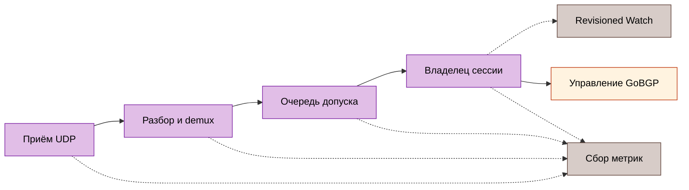

# Мониторинг

Default endpoint — `http://127.0.0.1:9100/metrics` без аутентификации. Открывать вне loopback только с явной сетевой политикой. Metrics listener не содержит debug handlers. Источники: [config](../../internal/config/config.go), [collector](../../internal/metrics/collector.go).

## Границы сигналов

`gobfd_bfd_sessions` считает зарегистрированные Control и Echo, включая типы Control Micro-BFD, VXLAN, Geneve. Регистрация не означает Up. Echo создаёт собственную series `session_type` и добавляет packet/transition increments в общие families. Peer/local packet counters не имеют discriminator/interface/type: одинаковые пары адресов агрегируются между wires. Для отдельной сессии использовать API snapshot. Источники: [регистрация Echo](../../internal/bfd/manager_echo.go), [прямое подключение collector](../../cmd/gobfd/factory.go).



## Справочник метрик

| Метрика | Тип | Labels | Значение |
| :--- | :--- | :--- | :--- |
| `gobfd_bfd_sessions` | gauge | `peer_addr,local_addr,session_type` | Зарегистрированные Control и Echo |
| `gobfd_bfd_packets_sent_total` | counter | `peer_addr,local_addr` | Успешные отправки Control/Echo |
| `gobfd_bfd_packets_received_total` | counter | `peer_addr,local_addr` | Проверенные владельцем Control/Echo receives |
| `gobfd_bfd_packets_dropped_total` | counter | `peer_addr,local_addr` | Отказы/abandonment допущенной identity |
| `gobfd_bfd_state_transitions_total` | counter | `peer_addr,local_addr,from_state,to_state` | Переходы FSM |
| `gobfd_bfd_auth_failures_total` | counter | `peer_addr,local_addr` | Подмножество auth refusals |
| `gobfd_bfd_delivery_outcomes_total` | counter | `source,outcome` | Фиксированные решения pipeline/notification |
| `gobfd_bfd_control_rx_timing_total` | counter | `outcome` | Owner commits по достоверности времени |
| `gobfd_bfd_control_rx_commit_seconds` | histogram | нет | Software kernel RX до завершения owner |
| `gobfd_bfd_timer_events_total` | counter | `timer,event` | Dispatch и terminal timer observations |
| `gobfd_bfd_timer_delay_seconds` | histogram | `timer,stage` | Достоверная dispatch/effect delay |
| `gobfd_bfd_socket_drop_samples_total` | counter | `kind,outcome` | Достоверность socket-drop sample |
| `gobfd_bfd_socket_drops_total` | counter | `kind` | Наблюдаемые упорядоченные drop increments |
| `gobfd_gobgp_rpc_errors_total` | counter | `rpc` | Ошибки GoBGP API/preflight |
| `gobfd_gobgp_endpoint_compatible` | gauge | нет | 1 после compatibility preflight |
| `gobfd_gobgp_dampening_penalty` | gauge | `peer_addr` | Decayed penalty при scrape |
| `gobfd_gobgp_dampening_suppressed` | gauge | `peer_addr` | Восстановление удерживается |
| `gobfd_gobgp_dampening_suppression_deadline_seconds` | gauge | `peer_addr` | Максимальный Unix deadline подавления, иначе 0 |
| `gobfd_gobgp_pending_action` | gauge | `peer_addr,action` | Неприменённый `up`/`down` intent |
| `gobfd_gobgp_pending_action_deadline_seconds` | gauge | `peer_addr,action` | Unix deadline retry/recheck, иначе 0 |

Источники: [base](../../internal/metrics/collector.go), [проверка/учёт Control](../../internal/bfd/session_packet.go), [принятые Echo returns](../../internal/bfd/echo.go), [receive timing](../../internal/metrics/receive_timing.go), [таймеры](../../internal/metrics/timer.go), [socket drops](../../internal/metrics/socket_drops.go), [GoBGP](../../internal/metrics/gobgp.go).

### Ledger доставки

Отказы parser/TTL/unknown-peer не создают peer labels. Process-lifetime ledger заранее создаёт поддерживаемые source/outcome pairs и сохраняется после удаления последней сессии. Знаменатели стадий различаются: `queued` не равно `committed`; сумма стадий не измеряет packet loss.

Control demux выдаёт `scope_mismatch` для другого transport/interface и `ttl_rejected` при отказе hop policy. Echo использует `echo_read`, `echo_parse`, `echo_ttl`, `echo_demux`, `echo_admission`, `echo_owner`. Нулевой Echo discriminator отклоняет parser. Обычные canceled/closed reads не являются read errors.

Notification attempts используют `control_notification`, `unsolicited_notification`, `echo_notification`. Dispatch различает accepted, stale, shutdown-abandoned raw events. `watch_recipient` отмечает исходное событие queued/gapped; coalesced GAP marker не является дополнительным исходным событием. Переполнение публичной Control/Echo raw queue инвалидирует revisioned subscribers, которым нужен resnapshot. Legacy delivery — best effort. Notification loss не увеличивает packet-drop counters. ListSessions выдаёт sampled `delivery_counters`; revision snapshot не версионирует их атомарно. Источник: [delivery model](../../internal/bfd/delivery.go).

### Время и socket loss

| Наблюдение | Фиксированные значения | Значение |
| :--- | :--- | :--- |
| Receive outcome | `valid`, `unavailable`, `invalid`, `before_calibration`, `future`, `clock_step` | Histogram принимает только valid commits |
| Timer | `control_tx`, `control_detection`, `echo_tx`, `echo_detection` | Наблюдения владельцев |
| Timer event | `dispatch`, `effect`, `no_effect`, `invalid_dispatch`, `invalid_effect` | Histogram содержит valid dispatch/effect |
| Socket kind | `control`, `echo` | Раздельные потоки consumed datagrams |
| Socket outcome | `initial`, `sample`, `unavailable`, `invalid`, `ambiguous` | Только упорядоченные samples дают drop delta |

Нет sample не означает нулевую latency/loss. Overlay/legacy без kernel timestamps возвращает unavailable. Clock revocation действует до пересоздания listener. TX effect означает успешный transport return, не доставку соседу. Detection effect — публикация timeout-caused Down до журнала/notifications. Panic/in-flight handler может оставить dispatch без terminal observation. Новый owned socket имеет известный ноль; existing/custom socket устанавливает baseline первым sample без вывода о прошлых потерях. См. [границы измерений](14-performance-analysis.md).

### Состояние GoBGP

Per-peer gauges существуют только при включённой интеграции для accepted declarative `sessions`. API/unsolicited input не создаёт labels. Reload меняет allowlist; удалённый peer исчезает при следующем scrape. IPv4-mapped адреса нормализуются/дедуплицируются. Peer выдаёт семь samples пяти gauges, включая оба idle action.

Penalty/suppression оцениваются при scrape без изменения маршрутов. Максимальный срок подавления ограничивает eligibility, не RPC completion. Pending intent отражает последний завершённый handler step; deadline может быть в прошлом во время RPC. Success, cancellation, deletion и shutdown очищают intent. Источник: [GoBGP metrics](../../internal/metrics/gobgp.go).

## Запросы и alerts

```promql title="bfd-observations.promql"
sum(gobfd_bfd_sessions)
increase(gobfd_bfd_state_transitions_total{from_state="Up",to_state="Down"}[1m])
rate(gobfd_bfd_auth_failures_total[5m])
rate(gobfd_bfd_delivery_outcomes_total[5m])
```

Первый запрос считает регистрации, а не Up. Поставляемые [правила](../../deployments/integrations/observability/configs/prometheus/alert-rules.yml):

| Alert | Условие | Удержание |
| :--- | :--- | :--- |
| `BFDNoActiveSessions` | Healthy exporter без положительной registration series | `10s` |
| `BFDExporterUnavailable` | Failed/absent scrape target `gobfd` | `10s` |
| `BFDSessionDownTransition` | Рост Up→Down за минуту | `0s` |
| `BFDSessionFlapping` | Более 3 переходов за 5 минут | `1m` |
| `BFDAuthFailures` | Положительная failure rate за 5 минут | `30s` |
| `BFDPacketDrops` | Положительная admitted-peer drop rate за 5 минут | `1m` |

Exporter без сессий отличается от недоступного exporter. `BFDNoActiveSessions` проверяет все положительные registration series, включая Echo, хотя поставляемая annotation говорит «Control sessions»; это не Control-only и не Up-state test. Transition alert не доказывает текущее Down. Dashboard: [Grafana JSON](../../deployments/integrations/observability/configs/grafana/dashboards/bfd.json).

### Проверка Prometheus

В согласованном observability lab проверить опубликованный local API до внесения отказа:

```sh title="prometheus-readback.sh"
curl -fsS http://localhost:9090/api/v1/targets
curl -fsS http://localhost:9090/api/v1/rules
curl -fsS http://localhost:9090/api/v1/alerts
```

Требовать нужный GoBFD target с health `up` без scrape error, загрузки всех ожидаемых rules, firing transition alert при согласованном отказе и inactive rule после восстановления. Пустой targets/rules response либо HTTP 200 недостаточны. [Prometheus HTTP API](https://prometheus.io/docs/prometheus/latest/querying/api/) определяет ответы; [Go-owned observability gate](11-integrations.md#наблюдаемость) содержит assertions и exact-owned lifecycle.

## Журнал, health и traces

`log/slog` выдаёт JSON/text на уровнях debug/info/warn/error. Фиксировать local/remote state, diagnostic, principal, generation сверки и pending resource errors по сценарию. Адреса peers и traces хранить внутри эксплуатационной evidence boundary.

Management health отличается от BFD Up. Небезопасный anonymous loopback mutation mode устанавливает `gobfd.management` в `NOT_SERVING`. GoBGP ambiguity/incompatibility и reconciliation failure требуют собственных health checks; metrics scrape их не заменяет.

`grpc.flight_recorder` включает `/debug/flightrecorder` только на management listener. Допускаются Unix principals и разрешённые mTLS identities; anonymous запрещён даже в unsafe mode. Trace хранится как чувствительный артефакт; analysis UI привязывается к loopback. Источники: [management debug](../../cmd/gobfd/shutdown.go), [безопасность](15-security.md), [регламент](16-production-runbooks.md).

Справочник не фиксирует выполнение monitoring/production drill.
