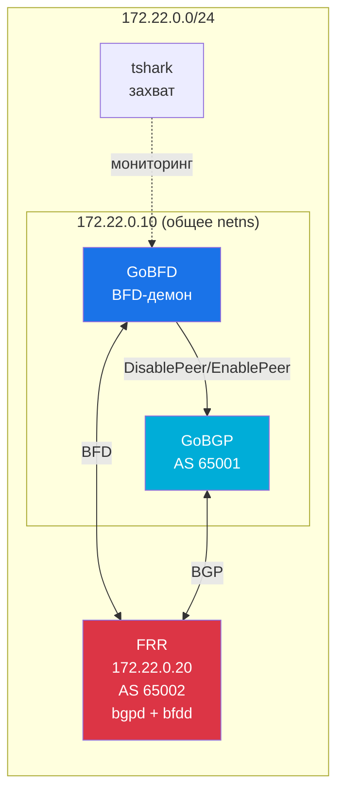
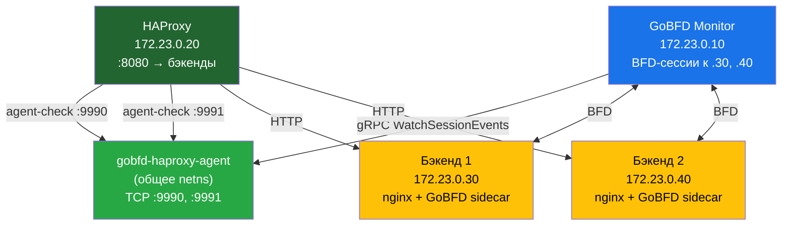
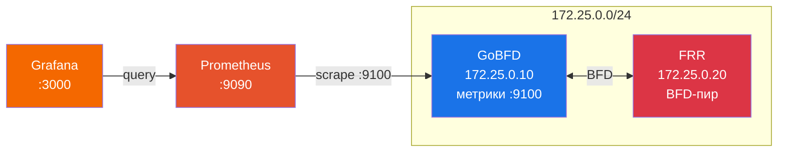
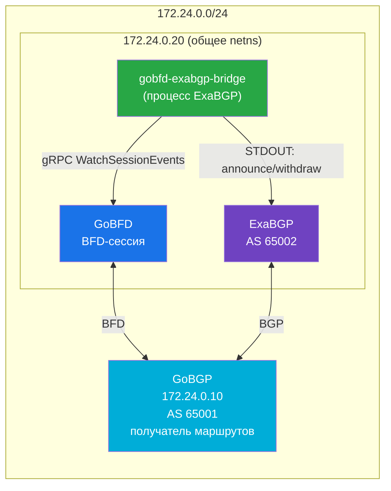
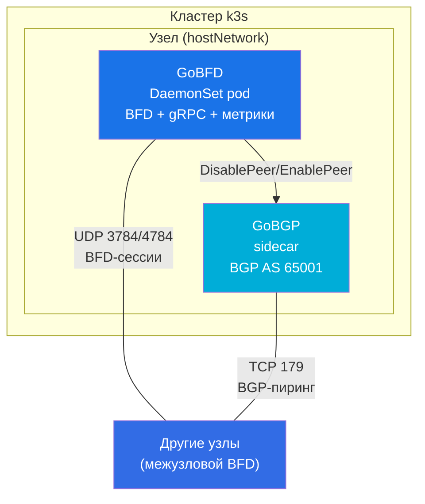

# Примеры интеграций


> Готовые к запуску интеграционные стеки, демонстрирующие работу GoBFD с продакшн-системами. Каждый пример включает compose-файлы, конфигурацию, демо-скрипты и верификацию пакетов через tshark.

---

## Содержание

- [Обзор](#обзор)
- [Быстрое переключение BGP](#быстрое-переключение-bgp)
- [Мониторинг бэкендов HAProxy](#мониторинг-бэкендов-haproxy)
- [Наблюдаемость](#наблюдаемость)
- [Anycast через ExaBGP](#anycast-через-exabgp)
- [DaemonSet в Kubernetes](#daemonset-в-kubernetes)
- [Верификация пакетов через tshark](#верификация-пакетов-через-tshark)
- [Архитектура интеграций](#архитектура-интеграций)
- [Связанные документы](#связанные-документы)

---

## Обзор

GoBFD интегрируется с системами маршрутизации, балансировки нагрузки, мониторинга и оркестрации для обеспечения обнаружения сбоев за доли секунды. Каждый пример интеграции — самодостаточный запускаемый стек в директории `deployments/integrations/`.

Четыре Compose-примера используют **podman compose** и **tshark** capture
containers. Kubernetes использует manifests и существующий k3s cluster;
tshark sidecar отсутствует. Примеры требуют отдельной квалификации целевого окружения.

| # | Интеграция | Компоненты | Подсеть | Новый код |
|---|-----------|-----------|---------|-----------|
| 1 | Быстрое переключение BGP | GoBFD + GoBGP + FRR | 172.22.0.0/24 | Только конфиги |
| 2 | Мониторинг бэкендов HAProxy | GoBFD + HAProxy + nginx | 172.23.0.0/24 | `gobfd-haproxy-agent` |
| 3 | Наблюдаемость | GoBFD + Prometheus + Grafana | 172.25.0.0/24 | Правила алертинга |
| 4 | Anycast через ExaBGP | GoBFD + ExaBGP + GoBGP | 172.24.0.0/24 | `gobfd-exabgp-bridge` |
| 5 | DaemonSet в Kubernetes | GoBFD + GoBGP + k3s | Host network | K8s-манифесты |

GoBFD в `dev` использует API GoBGP v4 и требует демон GoBGP v4: GoBGP v3
`/apipb.GobgpApi` и v4 `/api.GoBgpService` несовместимы по wire. Примеры
с GoBGP собирают v4.10.0 из `test/interop/gobgp`; HAProxy и observability
не запускают GoBGP.
Пример Kubernetes собирает `gobgp:local` из этого рецепта и импортирует его в
k3s вместе с `gobfd:local`; на живом кластере k3s он не запускался.

При старте GoBFD проверяет endpoint вызовом `GetBgp` без побочных эффектов.
Endpoint без API v4, например демон GoBGP v3, прерывает старт с сообщением
«requires GoBGP v4». Недоступный endpoint даёт предупреждение и повторно
проверяется в фоне с задержкой от 1 до 30 с до определённого результата;
несовместимый демон, поднявшийся позже, фиксируется в журнале с уровнем error.
Тот же preflight получает соседей GoBGP через `ListPeer` и отклоняет нативный
BFD GoBGP v4 (`[neighbors.bfd.config] enabled = true`) для любого пира
сконфигурированной сессии GoBFD: у пира должен быть один владелец BFD. Для
других соседей нативный BFD допускается. Сессии, добавленные позже через API,
не проверяются.

---

## Быстрое переключение BGP

**Директория:** `deployments/integrations/bgp-fast-failover/`

BFD Down инициирует отключение BGP-пира, вызывая немедленный отзыв маршрутов вместо ожидания 90-секундного BGP holdtimer.

Подробный runbook: [`deployments/integrations/bgp-fast-failover/README.md`](../../deployments/integrations/bgp-fast-failover/README.md)

Compose и Go testcontainers gate переиспользуют общие рецепты FRR 10.7.1 и
GoBGP v4.10.0 на Debian trixie. Лимиты сборок — 2 CPU / 2 GiB, runtime —
1 CPU / 256 MiB / 128 PIDs. Автоматический gate сохраняет проверку отзыва
и восстановления точного маршрута, packet evidence и удаление своих ресурсов.
2026-10-13 на commit `f85ca09` на linux/amd64 gate
(`e2ectl bgp-fast-failover`,
`TestBGPFastFailoverTestcontainers/BFD-driven_route_withdrawal_and_restoration`)
пройден с GoBGP v4.10.0 за 105.39 секунды. Ручной путь Compose на GoBGP v4
не перезапускался.

Лабораторный пример использует RFC 5881 single-hop BFD пакеты на UDP
destination port 3784 с TTL 255. Таймеры примера: transmit 300 ms, receive
300 ms и detect multiplier 3, что даёт ожидаемую цель обнаружения около
900 ms без учёта локального scheduling и задержки BGP control plane.

### Топология



### Быстрый старт

```bash
# Автоматизированный Go testcontainers gate с артефактами и точной очисткой
make int-bgp-failover

# Операционный Compose-пример, пошагово
make int-bgp-failover-up     # Запуск топологии
make int-bgp-failover-logs   # Просмотр логов
make int-bgp-failover-down   # Очистка
```

### Сценарий демо

1. GoBFD устанавливает BFD-сессию с FRR на 172.22.0.20
2. GoBGP устанавливает BGP-сессию, получает маршрут 10.20.0.0/24
3. **Сбой:** FRR приостановлен → BFD обнаруживает сбой (~900мс) → GoBGP отключает пир → маршрут отозван
4. **Восстановление:** FRR возобновлён → BFD Up → GoBGP включает пир → маршрут восстановлен

---

## Мониторинг бэкендов HAProxy

**Директория:** `deployments/integrations/haproxy-health/`

Обнаружение сбоя бэкенда за доли секунды через BFD, интегрированное с протоколом agent-check HAProxy.

### Архитектура



### Протокол agent-check

Бинарник `gobfd-haproxy-agent` связывает состояние BFD с протоколом agent-check HAProxy:

- HAProxy подключается по TCP к порту агента, читает ASCII-ответ до перевода строки
- BFD Up → отвечает `"up ready\n"` → HAProxy помечает сервер как рабочий
- BFD Down → отвечает `"down\n"` → HAProxy убирает сервер из ротации

Listener agent-check не имеют аутентификации. Они слушают `127.0.0.1`, если
`listen_addr` в конфигурации агента не задаёт другой адрес. Для `agent-addr`
HAProxy на другом хосте нужен явный достижимый адрес; конфигурация стенда
задаёт `listen_addr: "0.0.0.0"`.

Агент переподключает Watch после ошибки или EOF с прерываемой задержкой
1–30 секунд. Обрыв и `GAP` сразу сбрасывают health; снимок применяется только
после `SYNC_COMPLETE`. Неизвестная, удалённая и неоднозначная сессия дают
`down`. Потеря public Control/Echo raw notification также вызывает GAP/resnapshot
без reconnect. Общий Watch client отклоняет старую queued observation после
authoritative snapshot. Backend может добавить к обязательному `peer` поля `local`,
`interface`, `type` (`single_hop`, `multi_hop`, `micro_bfd`, `vxlan`, `geneve`).
Конфигурация только с peer работает при единственном совпадении. При нескольких
сессиях одного peer добавьте selectors; если публичный API не различает их
transport scope, даже явный tuple даёт отказ. Agent ports должны различаться
и находиться в диапазоне 1–65535.

Watch включает Echo-сессии. Control и Echo одного peer делают peer-only selector
неоднозначным даже при совпадении local address и interface. Укажите явный
Control `type: single_hop` или `type: multi_hop` для этого backend.

### Быстрый старт

```bash
make int-haproxy              # Полное демо
make int-haproxy-up           # Запуск топологии
curl http://localhost:8080    # Проверка балансировки
make int-haproxy-down         # Очистка
```

---

## Наблюдаемость

**Директория:** `deployments/integrations/observability/`

Изолированный лабораторный пример с правилами Prometheus и настроенным Grafana dashboard.
Compose публикует порты 9090 и 3000 на интерфейсах хоста и использует Grafana
credentials `admin/admin`. URL localhost ниже не ограничивают эту публикацию.
До запуска изолируйте хост или переопределите bindings и credentials.
Отдельный [deployment stack](06-deployment.md#podman-compose) привязывает
опубликованные monitoring ports к loopback.

### Топология



### Метрики

Packet-drop и authentication-failure accounting подключён. Per-peer counters
и fixed delivery outcomes имеют разные stage denominators; не все pre-session
parser/demux refusals входят в peer packet drops. Перед интерпретацией нулевых
counters и alerts см. [Мониторинг](07-monitoring.md).

| Метрика | Тип | Описание |
|---------|-----|----------|
| `gobfd_bfd_sessions` | Gauge | Активные BFD-сессии по пирам |
| `gobfd_bfd_packets_sent_total` | Counter | Отправленные пакеты по пирам |
| `gobfd_bfd_packets_received_total` | Counter | Полученные пакеты по пирам |
| `gobfd_bfd_packets_dropped_total` | Counter | Потерянные пакеты по пирам |
| `gobfd_bfd_state_transitions_total` | Counter | Переходы FSM (метки from/to) |
| `gobfd_bfd_auth_failures_total` | Counter | Ошибки аутентификации по пирам |

### Правила алертинга

| Алерт | Выражение | Критичность |
|-------|----------|-------------|
| BFDNoActiveSessions | `sum(gobfd_bfd_sessions) == 0` за 10с | Warning |
| BFDSessionDownTransition | `increase(gobfd_bfd_state_transitions_total{from_state="Up",to_state="Down"}[1m]) > 0` | Critical |
| BFDSessionFlapping | `sum by (peer_addr, local_addr) (increase(gobfd_bfd_state_transitions_total[5m])) > 3` за 1м | Warning |
| BFDAuthFailures | `rate(gobfd_bfd_auth_failures_total[5m]) > 0` за 30с | Warning |
| BFDPacketDrops | `rate(gobfd_bfd_packets_dropped_total[5m]) > 0` за 1м | Warning |

Поставляемое правило `BFDNoActiveSessions` требует существующий session series
и не срабатывает для свежего пустого exporter. При адаптации примера используйте
обработку отсутствующих series из [Мониторинга](07-monitoring.md#правила-алертинга);
исправление общего правила отслеживается в `gobfd-qj0.8.2.8.7.2.8`.

Prometheus v3.15.0, Grafana 13.2.4 и FRR 10.7.1 собираются из закреплённых
по checksum upstream-артефактов на Debian trixie (`test/interop/prometheus`,
`test/interop/grafana`, `test/interop/frr`). 2026-10-13 testcontainers gate
пройден за 172.77 секунды: метрики BFD, алерт, provisioning Grafana, отказ и
восстановление FRR; тестовых контейнеров и образов не осталось.

### Быстрый старт

```bash
make int-observability        # Полное демо
make int-observability-up     # Запуск топологии

# Открыть в браузере:
# Grafana:    http://localhost:3000 (admin/admin)
# Prometheus: http://localhost:9090

make int-observability-down   # Очистка
```

---

## Anycast через ExaBGP

**Директория:** `deployments/integrations/exabgp-anycast/`

Объявление anycast-IP, управляемое состоянием BFD-линка через process API ExaBGP.

### Архитектура



### Pipe-протокол

`gobfd-exabgp-bridge` запускается как процесс ExaBGP:

- **BFD Up** → пишет `announce route 198.51.100.1/32 next-hop self` в STDOUT
- **BFD Down** → пишет `withdraw route 198.51.100.1/32 next-hop self` в STDOUT
- Логирование в STDERR (соглашение ExaBGP)
- Переподключение к GoBFD с экспоненциальным backoff

`GOBFD_PEER` обязателен. Опциональные `GOBFD_LOCAL`, `GOBFD_INTERFACE` и
`GOBFD_SESSION_TYPE` выбирают сессию по тем же правилам, что HAProxy agent.
`ANYCAST_PREFIX` должен содержать корректный IP prefix. При старте bridge
отзывает маршрут предыдущего процесса. Announcement допускается только после
завершённого снимка или live event с единственной выбранной сессией Up.
Любое другое состояние, удаление, обрыв, `GAP` или неоднозначность отзывают
маршрут. Applied-state сохраняется между Watch streams; EOF также вызывает
reconnect. Ошибка или неполная запись stdout завершает bridge без подтверждения
изменения маршрута.

Потеря public Control/Echo raw notification инвалидирует тот же live stream и
создаёт resnapshot без следующего BFD edge. Observation floor общего Watch client
не позволяет старому queued Up восстановить отозванный маршрут.

Echo rows участвуют в той же проверке неоднозначности. Задайте
`GOBFD_SESSION_TYPE=single_hop` или `multi_hop`, если Control и Echo используют
один peer.

### Быстрый старт

```bash
make int-exabgp-anycast        # Сборка с лимитами, проверка маршрута, точная очистка
make int-exabgp-anycast-up     # Сборка с лимитами и запуск без неявных сборок
make int-exabgp-anycast-down   # Очистка
```

GoBGP v4.10.0 и ExaBGP 5.0.13 используют общие рецепты Debian trixie; образ
anycast добавляет `gobfd-exabgp-bridge` к той же закреплённой среде ExaBGP.
Каждый контейнер ограничен 1 CPU, 256 MiB и 128 PID; сборки выполняются
последовательно с 2 CPU и 2 GiB через контроллер проекта с проверкой
владения. Gate завершается ошибкой, если маршрут не анонсирован, не отозван
после паузы GoBFD на стороне приёмника или не восстановлен после её снятия.
2026-10-13 локальный прогон на amd64 прошёл за 106 секунд; контейнеров,
сетей и томов проекта не осталось, контроллер сохраняет собранные образы.

---

## DaemonSet в Kubernetes

**Директория:** `deployments/integrations/kubernetes/`

Развёртывание GoBFD как DaemonSet в кластере k3s с sidecar-контейнером GoBGP и host-сетью.

### Архитектура



### Предварительные требования

- Root или sudo-доступ
- `podman`, `kubectl` и существующий кластер k3s
- `/etc/rancher/k3s/k3s.yaml` доступен runner-у

### Ключевые решения

- **hostNetwork: true** — BFD использует raw-сокеты, требуется прямой доступ к сети хоста
- **CAP_NET_RAW + CAP_NET_ADMIN** — необходимы для работы с BFD-пакетами
- **Linux node selector** — пример опирается на Linux socket и capability semantics
- **Probes** — exec `gobfdctl` через Unix socket для readiness; metrics TCP для liveness; session convergence они не доказывают
- **DaemonSet** — один экземпляр GoBFD на каждый узел для полного покрытия BFD
- **Динамические сессии** — BFD-сессии добавляются через `gobfdctl` после обнаружения IP узлов

### Быстрый старт

```bash
# Полное демо в существующем k3s (сборка, импорт, деплой, проверка)
sudo make int-k8s

# Пошагово
sudo make int-k8s-up
kubectl -n gobfd rollout status daemonset/gobfd

# Очистка удаляет только namespace gobfd и сохраняет кластер хоста
sudo make int-k8s-down
```

### Манифесты

| Файл | Ресурс | Описание |
|------|--------|----------|
| `namespace.yml` | Namespace | Пространство имён `gobfd` |
| `configmap-gobfd.yml` | ConfigMap | Конфигурация GoBFD-демона |
| `configmap-gobgp.yml` | ConfigMap | Конфигурация GoBGP |
| `daemonset.yml` | DaemonSet | GoBFD + GoBGP sidecar (hostNetwork) |
| `service.yml` | Service | Headless-сервис для DNS-обнаружения |

---

## Верификация пакетов через tshark

Четыре Compose-примера включают **tshark** capture container. Kubernetes
manifests его не содержат; capture требует отдельно разрешённого namespace tool.

### Настройка захвата

Контейнер tshark захватывает весь BFD-трафик в общем сетевом пространстве имён:

- **Фильтр:** `udp port 3784 or udp port 4784`
- **Формат:** pcapng, записывается в `/captures/bfd.pcapng`
- **Автостоп:** лимит размера файла 100МБ

### Офлайн-анализ

```bash
# Полная расшифровка пакетов
podman exec <tshark-контейнер> tshark -r /captures/bfd.pcapng -V -Y bfd

# CSV-сводка BFD-полей
podman exec <tshark-контейнер> tshark -r /captures/bfd.pcapng -Y bfd \
    -T fields -e frame.time_relative -e ip.src -e ip.dst \
    -e bfd.version -e bfd.diag -e bfd.sta -e bfd.flags \
    -e bfd.detect_time_multiplier -e bfd.desired_min_tx_interval \
    -e bfd.required_min_rx_interval -E header=y -E separator=,
```

### Чек-лист верификации

| Поле | Ожидаемое значение | Ссылка на RFC |
|------|-------------------|---------------|
| Version | 1 | RFC 5880 Section 4.1 |
| TTL | 255 | RFC 5881 Section 5 (GTSM) |
| Dest Port | 3784 (single-hop) / 4784 (multihop) | RFC 5881 Section 4 |
| Source Port | 49152-65535 | RFC 5881 Section 4 |
| Переходы состояний | Down → Init → Up (трёхэтапный) | RFC 5880 Section 6.8.6 |

Справка: [tshark.dev](https://tshark.dev/) — документация и руководства по tshark.

---

## Архитектура интеграций

| Стек | Подсеть | Сервисы | Host-порты |
|------|---------|---------|------------|
| Быстрое переключение BGP | 172.22.0.0/24 | gobfd, gobgp, frr, tshark | — |
| Мониторинг HAProxy | 172.23.0.0/24 | gobfd-monitor, haproxy-agent, haproxy, backend1/2, backend1/2-bfd, tshark | 8080 |
| Наблюдаемость | 172.25.0.0/24 | gobfd, frr, prometheus, grafana, tshark | 9090, 3000 |
| Anycast ExaBGP | 172.24.0.0/24 | gobgp, gobfd, exabgp, tshark | — |
| Kubernetes | Host network | DaemonSet (gobfd + gobgp sidecar) | — |
| **Interop: Базовый** | 172.20.0.0/24 | gobfd, frr, bird3, holo, holo-config, thoro, tshark | — |
| **Interop: BGP+BFD** | 172.21.0.0/24 | gobfd, gobgp, frr, bird3, exabgp, gobfd-sidecar | — |
| **Interop: RFC** | 172.22.0.0/24 | gobfd-rfc, gobfd-rfc9384, gobgp-rfc, frr-rfc, frr-rfc-bgp, frr-rfc-unsolicited, tshark-rfc | — |
| **Interop: Вендоры** | 10.0.x.0/30 | gobfd, gobgp, nokia, arista, frr, sonic, vyos; cisco deferred | — |

### Новые бинарники

| Бинарник | Назначение | Зависимости |
|----------|-----------|-------------|
| `gobfd-haproxy-agent` | Мост agent-check для HAProxy | connectrpc, bfdv1connect |
| `gobfd-exabgp-bridge` | Мост process API для ExaBGP | connectrpc, bfdv1connect |

---

## Связанные документы

- [03-configuration.md](./03-configuration.md) — Справочник конфигурации GoBFD
- [05-interop.md](./05-interop.md) — Тестирование совместимости (FRR, BIRD3, вендорные NOS)
- [06-deployment.md](./06-deployment.md) — Контейнерный образ, Podman Compose, systemd
- [07-monitoring.md](./07-monitoring.md) — Метрики Prometheus и дашборд Grafana
- [16-production-runbooks.md](./16-production-runbooks.md) — Production drills и validation checklist

---

*Сверено с исходниками `dev`: 2026-10-24.*
