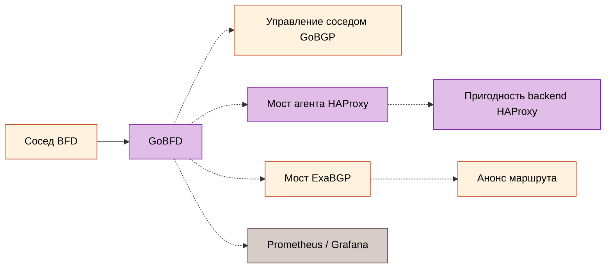

# Интеграции

[English original](../en/11-integrations.md).

GoBFD публикует состояние BFD; потребитель применяет политику маршрутизации или выбора backend. Репозиторий содержит управление GoBGP, HAProxy agent-check, команды для процесса ExaBGP, примеры наблюдаемости и Kubernetes. Для каждого примера необходима отдельная приёмка отказа, восстановления и пересылки трафика.



## Допуск изолированного запуска

Выполнить [предпосылки разработки](09-development.md#подготовка-рабочей-копии), обеспечить доступ выбранного runner к Podman или кластеру. Согласовать одну одноразовую топологию, до запуска записать имена, подсеть, порты и принадлежность ресурсов. Остановиться при пересечении с существующими ресурсами, отказе готовности, отсутствии проверяемого снятия или восстановления либо отказе очистки; сохранить каталог запуска и конечный результат. Повторный вызов — новое учение отказа, а не откат. Восстановить внесённый отказ и проверить потребителя до отдельно разрешённого удаления своих ресурсов.

Очистка сохранённого жизненного цикла Compose может удалить тома и orphans; путь завершения Kubernetes удаляет namespace `gobfd`. Эти пути не являются общей проверкой принадлежности. До очистки проверить точный [runner интеграций](../../test/internal/integrationrunner/runner.go) и [правила допуска E2E](../../test/e2e/README.md).

## Быстрое переключение BGP

В [примере FRR/GoBGP](../../deployments/integrations/bgp-fast-failover/README.md) GoBFD и GoBGP используют общий адрес `172.22.0.10`, а FRR — `172.22.0.20`. FRR анонсирует `10.20.0.0/24`. GoBFD отслеживает профиль Control 300 мс × 3 и применяет к GoBGP действие `disable-peer`.

Обязательны совместимость с API GoBGP v4 и единственный владелец BFD. Встроенный BFD GoBGP на управляемых соседях вызывает конфликт; несколько базовых сессий для одного адреса соседа не позволяют однозначно выбрать сессию для управления. Подавление колебаний GoBFD задерживает восстановление, но не обработку Down. Административные переходы отличаются от отказов пересылки. Источники: [предварительная проверка и выбор](../../cmd/gobfd/handlers.go), [обработчик](../../internal/gobgp/handler.go), [RFC 5882, раздел 10.2](https://www.rfc-editor.org/rfc/rfc5882.html#section-10.2).

Обработчик хранит сведения об отключённых им соседях только в памяти процесса. После перезапуска GoBFD эти сведения теряются; уже отключённый сосед GoBGP остаётся отключённым даже после восстановления BFD. До перезапуска сохранить административное состояние каждого соседа и доказательства того, что его отключил GoBFD. После перезапуска явно включить только соседа с подтверждённым отключением со стороны GoBFD, используя [процедуру восстановления](16-production-runbooks.md#22-startup-owned-изменения). Автоматическое включение соседа, отключённого оператором, запрещено.

```sh
make int-bgp-failover-testcontainers
```

Проверка сохраняет `reports/e2e/bgp-fast-failover/run.*/` и подтверждает снятие и восстановление конкретного маршрута при приостановке и возобновлении FRR. Её предел снятия маршрута 20 секунд не подтверждает гарантию BFD 900 мс или непрерывность пересылки. Отдельная ручная топология запускается через `make int-bgp-failover-up`; её фиксированные имена и подсеть пересекаются с другими лабораториями. Перед запуском или очисткой свериться с описанием примера.

<a id="здоровье-backend-haproxy"></a>

## Работоспособность backend HAProxy

`gobfd-haproxy-agent` выбирает одну сессию BFD для каждого настроенного backend и выдаёт ответы агента по TCP без аутентификации. Только Up даёт `up ready\n`; остальные состояния, отсутствие или неоднозначность сессии дают `down\n`. После переподключения Watch получает полные актуальные снимки. Ответы определяют пригодность пути BFD, но не работоспособность приложения по HTTP/TLS.

| Вход | Контракт |
|:---|:---|
| Флаги | `-config`, `-gobfd-addr`, `-version` |
| Приоритет адреса API | Встроенный Unix-сокет → `GOBFD_ADDR` → флаг → непустой YAML `gobfd_addr` |
| Общие поля YAML | `gobfd_addr`, `listen_addr`, `backends` |
| Поля backend | `peer`, `local`, `interface`, `type`, `agent_port` |
| Адрес прослушивания по умолчанию | `127.0.0.1`; для удалённого HAProxy адрес задаётся явно |
| Переменные TLS | `GOBFD_TLS_CA_FILE`, `GOBFD_TLS_CERT_FILE`, `GOBFD_TLS_KEY_FILE` для HTTPS |
| Допуск | Не менее одного backend; уникальный порт 1–65535; проверенный селектор сессии |
| Ограничение запросов | 64 параллельные записи на сокет прослушивания, срок записи 100 мс |

Источники: [реализация агента](../../cmd/gobfd-haproxy-agent/main.go), [пример конфигурации](../../deployments/integrations/haproxy-health/haproxy-agent.yml). Ограничить доступ к удалённому сокету агента: аутентификация отсутствует.

```sh
make int-haproxy-testcontainers
```

Проверка с жизненным циклом под управлением Go проверяет ответ backend и восстановление, сохраняет `reports/e2e/haproxy-health/run.*/`. Требования к среде выполнения приведены в [проверках разработки](09-development.md). Эта проверка не квалифицирует прикладной протокол production-среды.

## ExaBGP anycast

`gobfd-exabgp-bridge` пишет в stdout только команды для процесса ExaBGP, а журналы — в stderr. Выбранная сессия Up выдаёт `announce route PREFIX next-hop self`; отсутствие, неоднозначность, состояние вне Up или потеря наблюдения приводят к снятию маршрута. Повтор одинакового состояния не дублирует команду; перезапуск процесса согласует начальное состояние маршрута.

| Переменная окружения | Контракт |
|:---|:---|
| `GOBFD_ADDR` | По умолчанию `unix:///run/gobfd/gobfd.sock` |
| `GOBFD_PEER` | Обязательный адрес соседа |
| `ANYCAST_PREFIX` | Обязательный корректный IP-префикс; нормализуется до адреса сети |
| `GOBFD_LOCAL` | Необязательный селектор исходного адреса |
| `GOBFD_INTERFACE` | Необязательный селектор интерфейса |
| `GOBFD_SESSION_TYPE` | Необязательный селектор типа |
| `GOBFD_TLS_CA_FILE`, `GOBFD_TLS_CERT_FILE`, `GOBFD_TLS_KEY_FILE` | Доверие HTTPS API управления и клиентская идентичность |

Только `-version`/`--version` распознаются как запрос версии. Селектор типа допускает пустое значение, `single_hop`, `multi_hop`, `micro_bfd`, `vxlan`, `geneve`; пустое значение соответствует любому наблюдаемому типу, включая Echo. Селектор только по соседу должен давать единственный результат; при необходимости добавить исходный адрес, интерфейс или тип. Тот же контракт селектора действует для `type` backend HAProxy. Источники: [мост](../../cmd/gobfd-exabgp-bridge/main.go), [селектор и Watch](../../internal/apiclient).

```sh
make int-exabgp-anycast
```

[Пример anycast](../../deployments/integrations/exabgp-anycast) имеет отдельную границу интеграционной приёмки. Вывод жизненного цикла под управлением Go или сама команда маршрута не доказывают распространение BGP во внешней сети либо пересылку anycast.

## Наблюдаемость

[Стек наблюдаемости](../../deployments/integrations/observability/compose.yml) содержит соседей BFD, правила Prometheus и Grafana. Его лабораторные порты хоста и стандартные учётные данные Grafana требуют изолированной согласованной среды; публикация в качестве production-панели запрещена.

```sh
make int-observability-testcontainers
```

Проверка требует исправного сбора метрик, активного оповещения о переходе при отказе, восстановления BFD и неактивного оповещения после восстановления. Результаты сохраняются в `reports/e2e/observability/run.*/`. Одного HTTP 200 недостаточно. См. [метрики и оповещения](07-monitoring.md).

## Kubernetes

[Набор манифестов](../../deployments/integrations/kubernetes/manifests) запускает один DaemonSet с сетью хоста на каждом выбранном Linux-узле, с локальными образами и контейнером GoBGP sidecar. Перед применением проверить `imagePullPolicy: Never`, импорт образов на каждом узле, конфликты портов, пробы и границы локального управления хостом.

`make int-k8s` — пример запуска. Приёмка требует подтверждённого импорта образов на каждом узле, согласованных меток и проб, а также отчёта о развёртывании, ресурсах, отказе и восстановлении в работающем кластере. Одни манифесты не подтверждают принятого развёртывания в кластере. См. [развёртывание](06-deployment.md#kubernetes).

<a id="квалификация-и-vendor-references"></a>

## Квалификация и источники производителей

| Доказательство | Подтверждает | Не подтверждает |
|:---|:---|:---|
| Модульные проверки и проверка исходников | Поведение по контракту на проверенных путях | Совместимость с нативным соседом |
| Управляемый жизненный цикл testcontainers | Проверенные локальные отказ и восстановление | Ресурсы production или непрерывную пересылку |
| Захват пакетов | Захваченные поля и события на линии | Исчерпывающее покрытие RFC |
| Руководство производителя | Описанное поведение выбранного выпуска и платформы | Приёмку GoBFD с этим устройством |
| Учение в production | Измеренные заявленные топологию, SHA и нагрузку | Другие профили и платформы |

Использовать [покрытие RFC](08-rfc-compliance.md), [эксплуатационный регламент](16-production-runbooks.md) и [официальные источники Cisco/Arista/Juniper/Huawei](reference/vendor-bfd.md). Необязательные [заметки EOS](../../deployments/integrations/bgp-fast-failover/vendor-notes/arista-eos.md) не входят в запускаемую топологию FRR.
