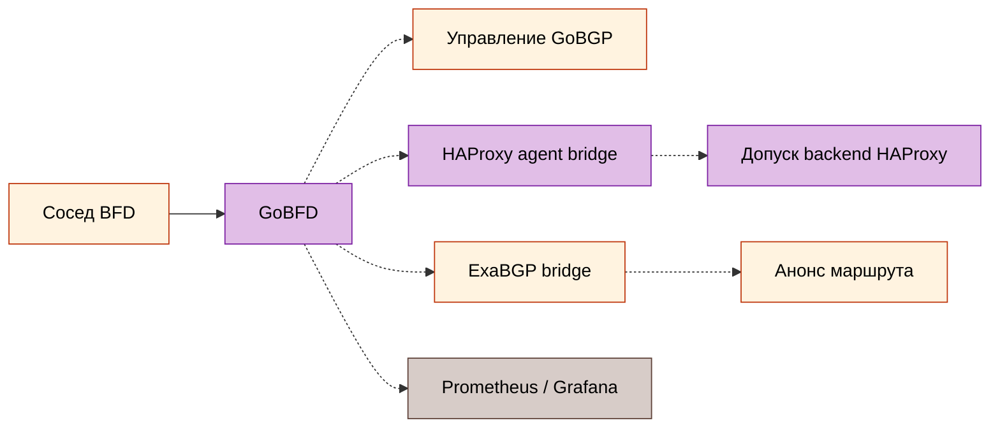

# Интеграции

GoBFD публикует состояние BFD; consumer применяет routing/backend policy. Репозиторий содержит GoBGP actuation, HAProxy agent-check, ExaBGP process output, observability и Kubernetes. Каждая интеграция требует отдельной проверки отказа, восстановления и пересылки.



## Быстрое переключение BGP

В [FRR/GoBGP образце](../../deployments/integrations/bgp-fast-failover/README.md) GoBFD/GoBGP разделяют `172.22.0.10`, FRR использует `172.22.0.20` и анонсирует `10.20.0.0/24`. GoBFD проверяет Control-профиль 300 мс × 3 и применяет `disable-peer`.

GoBGP v4 API и единственный владелец BFD обязательны. Native GoBGP BFD конфликтует на управляемом соседе; несколько base-сессий к одному адресу запрещают однозначное действие. Dampening удерживает восстановление, а не Down. Административный переход отличается от отказа пересылки. Источники: [preflight/выбор](../../cmd/gobfd/handlers.go), [handler](../../internal/gobgp/handler.go), [RFC 5882 раздел 10.2](https://www.rfc-editor.org/rfc/rfc5882.html#section-10.2).

Handler хранит список отключённых им peers только в памяти процесса. Restart GoBFD теряет ownership record; отключённый GoBGP peer остаётся disabled после восстановления BFD. Перед restart сохранить administrative state каждого peer и доказательство ownership GoBFD. После restart явно включать только peer, для которого доказано отключение GoBFD, по [процедуре восстановления](16-production-runbooks.md#22-startup-owned-изменения). Не включать автоматически operator-disabled peers.

```sh
make int-bgp-failover-testcontainers
```

Gate сохраняет `reports/e2e/bgp-fast-failover/run.*/` и проверяет исчезновение/возврат точного маршрута при pause/unpause FRR. Предел 20 секунд не измеряет гарантию BFD 900 мс или непрерывность data plane. Отдельный ручной запуск — `make int-bgp-failover-up`; fixed names/subnet пересекаются с другими labs. До запуска/cleanup прочитать README образца.

## Здоровье backend HAProxy

`gobfd-haproxy-agent` выбирает одну BFD-сессию на backend и отвечает через TCP без аутентификации. Только Up выдаёт `up ready\n`; остальные, отсутствующие и неоднозначные состояния — `down\n`. Watch reconnect использует authoritative resnapshot. Ответ означает пригодность BFD-пути, а не HTTP/TLS health приложения.

| Ввод | Условие |
| :--- | :--- |
| Flags | `-config`, `-gobfd-addr`, `-version` |
| Приоритет endpoint | Встроенный Unix socket → `GOBFD_ADDR` → flag → непустой YAML `gobfd_addr` |
| Глобальный YAML | `gobfd_addr`, `listen_addr`, `backends` |
| Backend | `peer`, `local`, `interface`, `type`, `agent_port` |
| Listener default | `127.0.0.1`; для remote HAProxy задать host |
| TLS environment | `GOBFD_TLS_CA_FILE`, `GOBFD_TLS_CERT_FILE`, `GOBFD_TLS_KEY_FILE` для HTTPS |
| Допуск | Минимум один backend; уникальный port 1–65535; проверенный selector |
| Лимит запросов | 64 одновременных записи/listener, write deadline 100 мс |

Источники: [agent](../../cmd/gobfd-haproxy-agent/main.go), [пример](../../deployments/integrations/haproxy-health/haproxy-agent.yml). Ограничить доступ к remote agent listener: аутентификации нет.

```sh
make int-haproxy-testcontainers
```

Go-owned gate проверяет backend response/recovery и сохраняет `reports/e2e/haproxy-health/run.*/`. Предпосылки определены в [development gates](09-development.md). Прикладной протокол production этим не квалифицируется.

## ExaBGP anycast

`gobfd-exabgp-bridge` пишет process commands в stdout, журнал — в stderr. Выбранный Up выдаёт `announce route PREFIX next-hop self`; отсутствующее, неоднозначное, non-Up или disconnected наблюдение вызывает withdraw. Повтор состояния не дублирует команду; restart bridge сверяет начальное route state.

| Переменная | Условие |
| :--- | :--- |
| `GOBFD_ADDR` | Default `unix:///run/gobfd/gobfd.sock` |
| `GOBFD_PEER` | Обязательный адрес |
| `ANYCAST_PREFIX` | Обязательный IP prefix, нормализуется к сети |
| `GOBFD_LOCAL` | Необязательный local selector |
| `GOBFD_INTERFACE` | Необязательный interface selector |
| `GOBFD_SESSION_TYPE` | Необязательный type selector |
| `GOBFD_TLS_CA_FILE`, `GOBFD_TLS_CERT_FILE`, `GOBFD_TLS_KEY_FILE` | HTTPS trust/client identity |

Версия запрашивается только `-version`/`--version`. Тип selector принимает пустое значение, `single_hop`, `multi_hop`, `micro_bfd`, `vxlan`, `geneve`; пустое совпадает с любым наблюдаемым типом, включая Echo. Peer-only selector должен быть однозначным; при необходимости добавить local/interface/type. Та же политика действует для HAProxy backend `type`. Источники: [bridge](../../cmd/gobfd-exabgp-bridge/main.go), [selector/Watch](../../internal/apiclient).

```sh
make int-exabgp-anycast
```

[Anycast specimen](../../deployments/integrations/exabgp-anycast) — отдельная граница интеграции. Lifecycle output или route command не доказывают внешнюю BGP propagation и anycast forwarding.

## Наблюдаемость

[Стек](../../deployments/integrations/observability/compose.yml) содержит peers BFD, Prometheus rules и Grafana. Lab host ports и стандартные Grafana credentials требуют изолированной согласованной среды; не публиковать как production dashboard.

```sh
make int-observability-testcontainers
```

Gate требует healthy scraping, firing transition alert при отказе, восстановление BFD и inactive alert после восстановления. Evidence сохраняется в `reports/e2e/observability/run.*/`. HTTP 200 недостаточно. См. [метрики/alerts](07-monitoring.md).

## Kubernetes

[Manifests](../../deployments/integrations/kubernetes/manifests) запускают host-network DaemonSet на выбранных Linux nodes с local images и GoBGP sidecar. До apply проверить `imagePullPolicy: Never`, доставку images по nodes, port conflicts, probes и host-local management.

`make int-k8s` — пример runner. Приёмка требует проверенной доставки images на nodes, совпадения labels/probes и live-cluster receipt запуска, ресурсов, отказа/восстановления. Одни manifests не являются принятой установкой кластера. См. [развёртывание](06-deployment.md#kubernetes).

## Квалификация и vendor references

| Доказательство | Подтверждает | Не подтверждает |
| :--- | :--- | :--- |
| Unit/source checks | Контракт проверенных путей | Native interoperability |
| Owned testcontainers | Проверенный локальный отказ/возврат | Production ресурсы и непрерывную пересылку |
| Packet capture | Захваченные поля/события | Полный RFC |
| Vendor manual | Поведение выбранной платформы/release | Приёмку GoBFD на устройстве |
| Production drill | Измеренную topology/SHA/workload | Другие профили/платформы |

Использовать [RFC coverage](08-rfc-compliance.md), [регламент](16-production-runbooks.md), [официальные Cisco/Arista/Juniper/Huawei references](reference/vendor-bfd.md). Опциональный [EOS note](../../deployments/integrations/bgp-fast-failover/vendor-notes/arista-eos.md) не входит в исполняемую FRR topology.
