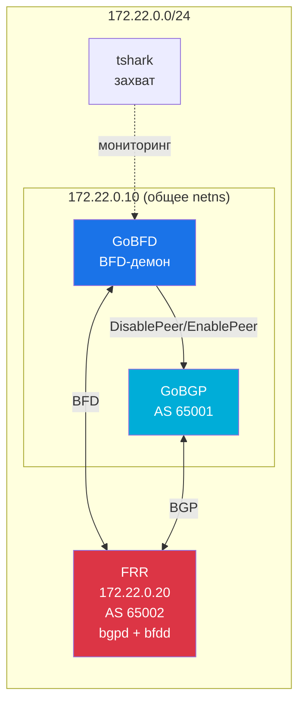
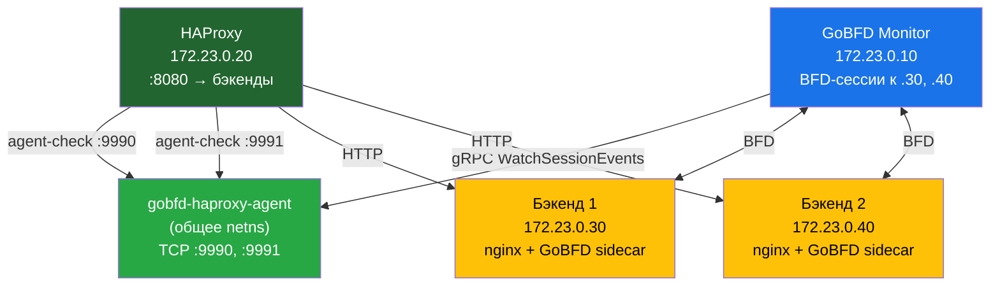
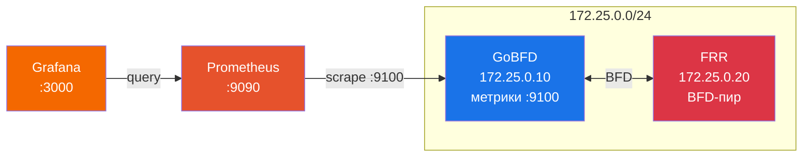
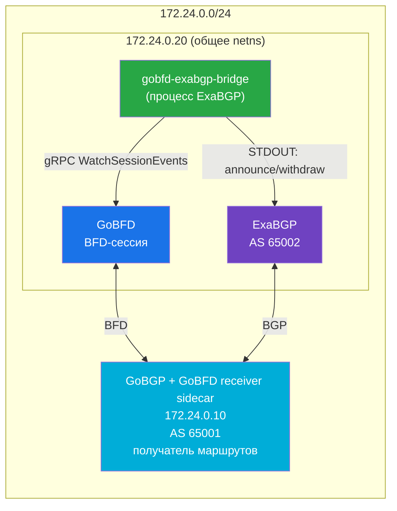
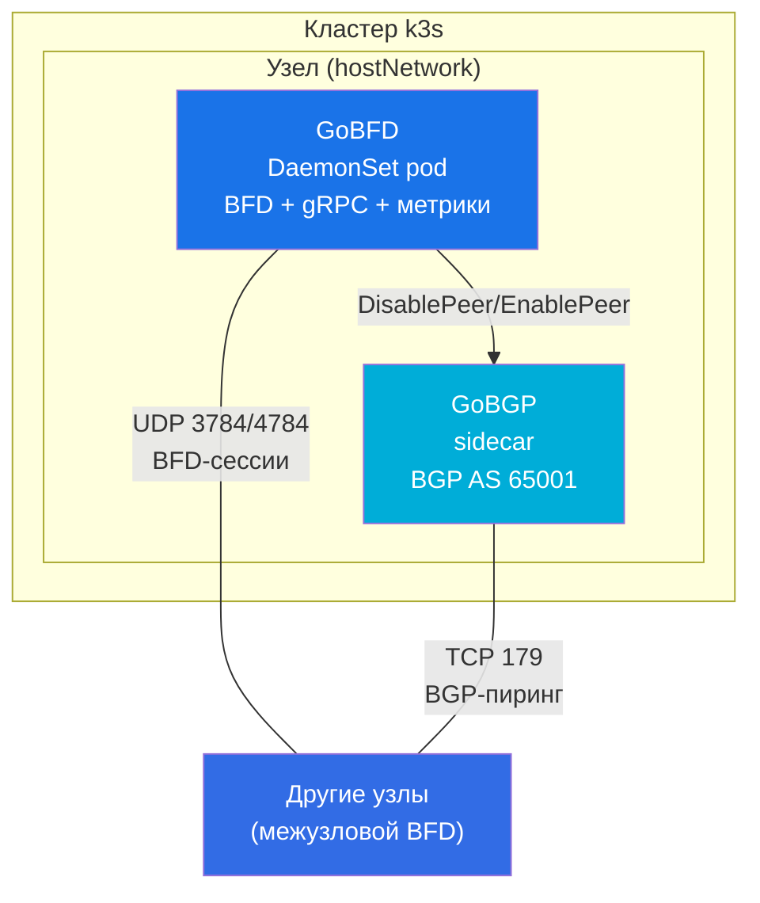

# Примеры интеграций


> Примеры интеграции маршрутизации, балансировки, мониторинга и Kubernetes. Compose-примеры содержат контейнеры захвата пакетов; квалификация целевого окружения остаётся отдельной.

---

## Содержание

- [Обзор](#обзор)
- [Быстрое переключение BGP](#быстрое-переключение-bgp)
- [Мониторинг бэкендов HAProxy](#мониторинг-бэкендов-haproxy)
- [Наблюдаемость](#наблюдаемость)
- [Anycast через ExaBGP](#anycast-через-exabgp)
- [DaemonSet в Kubernetes](#daemonset-в-kubernetes)
- [Верификация пакетов через tshark](#верификация-пакетов-через-tshark)
- [Архитектура интеграций](#архитектура-интеграций)
- [Связанные документы](#связанные-документы)

---

## Обзор

GoBFD интегрируется с системами маршрутизации, балансировки нагрузки,
мониторинга и оркестрации. Примеры топологий находятся в
`deployments/integrations/`; время обнаружения определяется их таймерами и
нагрузкой. Исторические прогоны ниже подтверждают только записанные исходники
и сценарии, а не новый прогон или приёмку текущего релиза. Публикация остаётся
заблокированной до проверок финального кандидата.

Четыре Compose-примера используют **podman compose** и контейнеры захвата
**tshark**. Kubernetes использует манифесты и существующий кластер k3s;
сайдкар tshark отсутствует. Примеры требуют отдельной квалификации целевого окружения.

| # | Интеграция | Компоненты | Подсеть | Новый код |
|---|-----------|-----------|---------|-----------|
| 1 | Быстрое переключение BGP | GoBFD + GoBGP + FRR | 172.22.0.0/24 | Только конфиги |
| 2 | Мониторинг бэкендов HAProxy | GoBFD + HAProxy + nginx | 172.23.0.0/24 | `gobfd-haproxy-agent` |
| 3 | Наблюдаемость | GoBFD + Prometheus + Grafana | 172.25.0.0/24 | Правила алертинга |
| 4 | Anycast через ExaBGP | GoBFD + ExaBGP + GoBGP | 172.24.0.0/24 | `gobfd-exabgp-bridge` |
| 5 | DaemonSet в Kubernetes | GoBFD + GoBGP + k3s | Сеть хоста | K8s-манифесты |

GoBFD в `dev` использует API GoBGP v4 и требует демон GoBGP v4: GoBGP v3
`/apipb.GobgpApi` и v4 `/api.GoBgpService` несовместимы на уровне протокола. Примеры
с GoBGP собирают v4.10.0 из `test/interop/gobgp`; HAProxy и наблюдаемость
не запускают GoBGP.
Пример Kubernetes собирает `gobgp:local` из этого рецепта и импортирует его в
k3s вместе с `gobfd:local`; на живом кластере k3s он не запускался.

Подготовьте закреплённый [провайдер Compose](06-deployment.md#podman-compose)
и проверьте сформированную конфигурацию выбранных файлов до запуска. Ручные
примеры используют фиксированные имена контейнеров; проверьте принадлежность
имён, подсетей и опубликованных портов этой лаборатории. Цели `-up` HAProxy и
наблюдаемости собирают образы напрямую через Compose без interop-контроллера
с лимитами. Их цели `-down` удаляют тома и контейнеры-сироты; до очистки нужны
проверка владения и требуемое разрешение на удаление.

При старте GoBFD проверяет конечную точку вызовом `GetBgp` без побочных эффектов.
Конечная точка без API v4, например демон GoBGP v3, прерывает старт с сообщением
«requires GoBGP v4». Недоступная конечная точка даёт предупреждение и повторно
проверяется в фоне с задержкой от 1 до 30 с до определённого результата;
несовместимый демон, поднявшийся позже, фиксируется в журнале с уровнем ошибки.
Та же предварительная проверка получает соседей GoBGP через `ListPeer` и отклоняет нативный
BFD GoBGP v4 (`[neighbors.bfd.config] enabled = true`) для любого пира
сконфигурированной сессии GoBFD: у пира должен быть один владелец BFD. Для
других соседей нативный BFD допускается. Сессии, добавленные позже через API,
не проверяются.

---

## Быстрое переключение BGP

**Директория:** `deployments/integrations/bgp-fast-failover/`

BFD Down инициирует отключение BGP-пира и отзыв маршрутов до истечения обычного таймера удержания BGP.

Подробная эксплуатационная инструкция: [`deployments/integrations/bgp-fast-failover/README.md`](../../deployments/integrations/bgp-fast-failover/README.md)

Compose и проверка testcontainers на Go переиспользуют общие рецепты FRR 10.7.1 и
GoBGP v4.10.0 на Debian trixie. Лимиты сборок — 2 CPU / 2 GiB, контейнеров при выполнении —
1 CPU / 256 MiB / 128 PIDs. Автоматическая проверка сохраняет проверку отзыва
и восстановления точного маршрута, доказательства по пакетам и удаление своих ресурсов.
2026-10-13 на commit `f85ca09` на linux/amd64 проверка
(`e2ectl bgp-fast-failover`,
`TestBGPFastFailoverTestcontainers/BFD-driven_route_withdrawal_and_restoration`)
пройден с GoBGP v4.10.0 за 105.39 секунды. Ручной путь Compose на GoBGP v4
не перезапускался.

Лабораторный пример использует одношаговые BFD-пакеты RFC 5881 на UDP-порт
назначения 3784 с TTL 255. Таймеры примера: передача 300 ms, приём
300 ms и множитель обнаружения 3, что даёт ожидаемую цель обнаружения около
900 ms без учёта локального планирования и задержки плоскости управления BGP.

### Топология



### Быстрый старт

```bash
# Автоматизированный Go testcontainers gate с артефактами и точной очисткой
make int-bgp-failover

# Операционный Compose-пример, пошагово
make int-bgp-failover-up     # Запуск топологии
make int-bgp-failover-logs   # Просмотр логов
make int-bgp-failover-down   # Очистка
```

### Сценарий демо

1. GoBFD устанавливает BFD-сессию с FRR на 172.22.0.20
2. GoBGP устанавливает BGP-сессию, получает маршрут 10.20.0.0/24
3. **Сбой:** FRR приостановлен → BFD обнаруживает сбой (~900мс) → GoBGP отключает пир → маршрут отозван
4. **Восстановление:** FRR возобновлён → BFD Up → GoBGP включает пир → маршрут восстановлен

---

## Мониторинг бэкендов HAProxy

**Директория:** `deployments/integrations/haproxy-health/`

Состояние BFD управляет протоколом agent-check HAProxy. Пример использует
номинальные интервалы BFD 300 мс, Detect Mult 3 и опрос агента раз в 1 с.
Задержка исключения бэкенда измеряется отдельно; эти настройки не гарантируют
исключение менее чем за секунду.

### Архитектура



### Протокол agent-check

Бинарник `gobfd-haproxy-agent` связывает состояние BFD с протоколом agent-check HAProxy:

- HAProxy подключается по TCP к порту агента, читает ASCII-ответ до перевода строки
- BFD Up → отвечает `"up ready\n"` → HAProxy помечает сервер как рабочий
- BFD Down → отвечает `"down\n"` → HAProxy убирает сервер из ротации

Слушатели agent-check не имеют аутентификации. Они слушают `127.0.0.1`, если
`listen_addr` в конфигурации агента не задаёт другой адрес. Для `agent-addr`
HAProxy на другом хосте нужен явный достижимый адрес; конфигурация стенда
задаёт `listen_addr: "0.0.0.0"`.

Управление по умолчанию использует `unix:///run/gobfd/gobfd.sock`. Общее
сетевое пространство имён не делает путь сокета общим: лаборатория HAProxy
явно использует loopback TCP только для чтения,
`http://127.0.0.1:50052` в `haproxy-agent.yml`. Для удалённого управления
выберите `https://host:port` через `GOBFD_ADDR` (либо `gobfd_addr` агента) и
задайте все три переменные: `GOBFD_TLS_CA_FILE`, `GOBFD_TLS_CERT_FILE` и
`GOBFD_TLS_KEY_FILE`. Мост ExaBGP использует те же переменные конечной точки и TLS.
Эти настройки клиента не настраивают mTLS-слушатель демона или правила ролей;
см. [Развёртывание](06-deployment.md#укрепление-безопасности) и
[`internal/apiclient/endpoint.go`](../../internal/apiclient/endpoint.go).

В агенте HAProxy непустое поле конфигурации `gobfd_addr` переопределяет и
`--gobfd-addr`, и `GOBFD_ADDR`; при адаптации лаборатории измените это поле.

Агент переподключает Watch после ошибки или EOF с прерываемой задержкой
1–30 секунд. Обрыв и `GAP` сразу сбрасывают состояние исправности; снимок применяется только
после `SYNC_COMPLETE`. Неизвестные, удалённые и неоднозначные сессии дают
`down`. Потеря исходного публичного уведомления Control/Echo также вызывает GAP и повторный снимок
без переподключения. Общий клиент Watch отклоняет старое наблюдение из очереди после
авторитетного снимка. Backend может добавить к обязательному `peer` поля `local`,
`interface`, `type` (`single_hop`, `multi_hop`, `micro_bfd`, `vxlan`, `geneve`).
Конфигурация только с пиром работает при единственном совпадении. При нескольких
сессиях одного пира добавьте селекторы; если публичный API не различает их
транспортную область, даже явный кортеж даёт отказ. Порты агента должны различаться
и находиться в диапазоне 1–65535.

Watch включает Echo-сессии. Control и Echo одного пира делают селектор только по пиру
неоднозначным даже при совпадении локального адреса и интерфейса. Укажите явный
Control `type: single_hop` или `type: multi_hop` для этого backend.

### Быстрый старт

```bash
make int-haproxy              # Полное демо
make int-haproxy-up           # Запуск топологии
curl http://localhost:8080    # Проверка балансировки
make int-haproxy-down         # Очистка
```

`make int-haproxy` использует устаревший демонстрационный исполнитель: часть наблюдений даёт только
предупреждение, а запрос сессий всё ещё использует неподдерживаемую команду `sessions`.
Отдельная проверка с обязательными утверждениями — `make int-haproxy-testcontainers`; завершённое
демо не подтверждает приёмку переключения при отказе.
Исправление устаревшего исполнителя отслеживается в `gobfd-qj0.8.2.8.7.1.4.1`.

---

## Наблюдаемость

**Директория:** `deployments/integrations/observability/`

Изолированный лабораторный пример с правилами Prometheus и заранее настроенной панелью Grafana.
Compose публикует порты 9090 и 3000 на интерфейсах хоста и использует учётные данные Grafana `admin/admin`. URL localhost ниже не ограничивают эту публикацию.
До запуска изолируйте хост или переопределите привязки и учётные данные.
Отдельный [стек развёртывания](06-deployment.md#podman-compose) привязывает
опубликованные порты мониторинга к loopback.

### Топология



### Метрики

Учёт потерь пакетов и ошибок аутентификации подключён. Счётчики по пирам
и фиксированные исходы доставки имеют разные знаменатели стадий; не все отказы
парсера и demux до создания сессии входят в потери пакетов пиров. Перед интерпретацией
нулевых счётчиков и оповещений см. [Мониторинг](07-monitoring.md).

| Метрика | Тип | Описание |
|---------|-----|----------|
| `gobfd_bfd_sessions` | Gauge | Активные BFD-сессии по пирам |
| `gobfd_bfd_packets_sent_total` | Counter | Отправленные пакеты по пирам |
| `gobfd_bfd_packets_received_total` | Counter | Полученные пакеты по пирам |
| `gobfd_bfd_packets_dropped_total` | Counter | Потерянные пакеты по пирам |
| `gobfd_bfd_state_transitions_total` | Counter | Переходы FSM (метки from/to) |
| `gobfd_bfd_auth_failures_total` | Counter | Ошибки аутентификации по пирам |

### Правила алертинга

| Алерт | Выражение | Критичность |
|-------|----------|-------------|
| BFDNoActiveSessions | `sum(gobfd_bfd_sessions) == 0` за 10с | Warning |
| BFDSessionDownTransition | `increase(gobfd_bfd_state_transitions_total{from_state="Up",to_state="Down"}[1m]) > 0` | Critical |
| BFDSessionFlapping | `sum by (peer_addr, local_addr) (increase(gobfd_bfd_state_transitions_total[5m])) > 3` за 1м | Warning |
| BFDAuthFailures | `rate(gobfd_bfd_auth_failures_total[5m]) > 0` за 30с | Warning |
| BFDPacketDrops | `rate(gobfd_bfd_packets_dropped_total[5m]) > 0` за 1м | Warning |

Поставляемое правило `BFDNoActiveSessions` требует существующий ряд метрик сессии
и не срабатывает для свежего пустого экспортёра. При адаптации примера используйте
обработку отсутствующих рядов из [Мониторинга](07-monitoring.md#правила-алертинга);
исправление общего правила отслеживается в `gobfd-qj0.8.2.8.7.2.8`.

Prometheus v3.15.0, Grafana 13.2.4 и FRR 10.7.1 собираются из закреплённых
контрольными суммами артефактов upstream на Debian trixie (`test/interop/prometheus`,
`test/interop/grafana`, `test/interop/frr`). 2026-10-13 набор проверок testcontainers
пройден за 172.77 секунды: метрики BFD, алерт, подготовка Grafana, отказ и
восстановление FRR; тестовых контейнеров и образов не осталось.

### Быстрый старт

```bash
make int-observability        # Полное демо
make int-observability-up     # Запуск топологии

# Открыть в браузере:
# Grafana:    http://localhost:3000 (admin/admin)
# Prometheus: http://localhost:9090

make int-observability-down   # Очистка
```

Полный демонстрационный исполнитель показывает метрики и оповещения, но часть ошибок считает
предупреждениями; это не проверка оповещений с обязательными утверждениями.
Для неё используйте `make int-observability-testcontainers` либо ограниченный
[проверочный сценарий](16-production-runbooks.md#проверка-оповещений-prometheus).

---

## Anycast через ExaBGP

**Директория:** `deployments/integrations/exabgp-anycast/`

Объявление anycast-IP, управляемое состоянием BFD-линка через API процессов ExaBGP.

### Архитектура



### Pipe-протокол

`gobfd-exabgp-bridge` запускается как процесс ExaBGP:

- **BFD Up** → пишет `announce route 198.51.100.1/32 next-hop self` в STDOUT
- **BFD Down** → пишет `withdraw route 198.51.100.1/32 next-hop self` в STDOUT
- Логирование в STDERR (соглашение ExaBGP)
- Переподключение к GoBFD с экспоненциальным увеличением задержки

`GOBFD_PEER` и `ANYCAST_PREFIX` обязательны. Опциональные `GOBFD_LOCAL`, `GOBFD_INTERFACE` и
`GOBFD_SESSION_TYPE` выбирают сессию по тем же правилам, что агент HAProxy.
`ANYCAST_PREFIX` должен содержать корректный IP-префикс. При старте мост
отзывает маршрут предыдущего процесса. Анонс допускается только после
завершённого снимка или текущего события с единственной выбранной сессией Up.
Любое другое состояние, удаление, обрыв, `GAP` или неоднозначность отзывают
маршрут. Применённое состояние сохраняется между потоками Watch; EOF также вызывает
переподключение. Ошибка или неполная запись stdout завершает мост без подтверждения
изменения маршрута.

Потеря исходного публичного уведомления Control/Echo делает тот же текущий поток недостоверным и
создаёт повторный снимок без следующего перехода BFD. Нижняя граница наблюдений общего клиента Watch
не позволяет старому Up из очереди восстановить отозванный маршрут.

Строки Echo участвуют в той же проверке неоднозначности. Задайте
`GOBFD_SESSION_TYPE=single_hop` или `multi_hop`, если Control и Echo используют
одного пира.

### Быстрый старт

```bash
make int-exabgp-anycast        # Сборка с лимитами, проверка маршрута, точная очистка
make int-exabgp-anycast-up     # Сборка с лимитами и запуск без неявных сборок
make int-exabgp-anycast-down   # Очистка
```

GoBGP v4.10.0 и ExaBGP 5.0.13 используют общие рецепты Debian trixie; образ
anycast добавляет `gobfd-exabgp-bridge` к той же закреплённой среде ExaBGP.
Каждый контейнер ограничен 1 CPU, 256 MiB и 128 PID; сборки выполняются
последовательно с 2 CPU и 2 GiB через контроллер проекта с проверкой
владения. Проверка завершается ошибкой, если маршрут не анонсирован, не отозван
после паузы GoBFD на стороне приёмника или не восстановлен после её снятия.
2026-10-13 локальный прогон на amd64 прошёл за 106 секунд; контейнеров,
сетей и томов проекта не осталось, контроллер сохраняет собранные образы.

---

## DaemonSet в Kubernetes

**Директория:** `deployments/integrations/kubernetes/`

Развёртывание GoBFD как DaemonSet в кластере k3s с сайдкаром GoBGP и сетью хоста.

### Архитектура



### Предварительные требования

- Root или sudo-доступ
- `podman`, `kubectl` и существующий кластер k3s
- `/etc/rancher/k3s/k3s.yaml` доступен исполнителю

### Ключевые решения

- **hostNetwork: true** — BFD использует raw-сокеты, требуется прямой доступ к сети хоста
- **CAP_NET_RAW + CAP_NET_ADMIN** — необходимы для работы с BFD-пакетами
- **Выбор узлов Linux** — пример опирается на семантику сокетов и привилегий Linux
- **Проверки состояния** — запуск `gobfdctl` через Unix-сокет для готовности; TCP-порт метрик для работоспособности; сходимость сессий они не доказывают
- **DaemonSet** — один экземпляр GoBFD на каждый узел для полного покрытия BFD
- **Динамические сессии** — BFD-сессии добавляются через `gobfdctl` после обнаружения IP узлов

Поставляемый сайдкар переопределяет
[значение API по умолчанию закреплённого upstream](https://github.com/osrg/gobgp/blob/da824d99912e02124b53741245ee4186c381adcc/cmd/gobgpd/main.go#L58-L76)
аргументом `--api-hosts=127.0.0.1:50051`. GoBFD использует этот loopback endpoint;
обе probes GoBGP выполняют `/usr/local/bin/gobgp --host 127.0.0.1 --port 50051 global`
внутри контейнера с `timeoutSeconds: 3`. Команда обращается к API;
она не доказывает сходимость BFD или маршрутов. Локальные процессы узла
сохраняют незашифрованный доступ к API. Метрики TCP/9100 и BGP TCP/179
остаются слушателями в сети хоста; ограничьте доступ к узлу до применения примера.
Приёмка probes и ресурсов на работающем кластере остаётся в
`gobfd-qj0.8.2.8.7.1.4.1.1`; проверка исходников её не закрывает.

### Быстрый старт

```bash
# Полное демо в существующем k3s (сборка, импорт, деплой, проверка)
sudo make int-k8s

# Пошагово
sudo make int-k8s-up
kubectl -n gobfd rollout status daemonset/gobfd

# Очистка удаляет только namespace gobfd и сохраняет кластер хоста
sudo make int-k8s-down
```

Исполнитель импортирует оба образа только в локальное хранилище образов k3s. На остальных
узлах те же образы нужны до размещения, поскольку задано `imagePullPolicy: Never`.
Полное демо сейчас выбирает `app=gobfd`, что не совпадает с метками манифеста,
и сохраняет устаревшие проверки CLI и инструментов. Успешный импорт или rollout не завершает
демо и не квалифицирует сходимость BFD/BGP.
Исправление исполнителя и проверка работающего кластера отслеживаются в
`gobfd-qj0.8.2.8.7.1.4.1`.

### Манифесты

| Файл | Ресурс | Описание |
|------|--------|----------|
| `namespace.yml` | Namespace | Пространство имён `gobfd` |
| `configmap-gobfd.yml` | ConfigMap | Конфигурация GoBFD-демона |
| `configmap-gobgp.yml` | ConfigMap | Конфигурация GoBGP |
| `daemonset.yml` | DaemonSet | GoBFD + сайдкар GoBGP (hostNetwork) |
| `service.yml` | Service | Headless-сервис для DNS-обнаружения |

---

## Верификация пакетов через tshark

Четыре Compose-примера включают контейнер захвата **tshark**. Манифесты
Kubernetes его не содержат; захват требует отдельно разрешённого инструмента в пространстве имён.

### Настройка захвата

Контейнер tshark захватывает Control и Echo на UDP-портах в общем сетевом пространстве имён:

- **Фильтр:** `udp port 3784 or udp port 3785 or udp port 4784`
- **Формат:** pcapng, записывается в `/captures/bfd.pcapng`
- **Автостоп:** лимит размера файла 100МБ

### Офлайн-анализ

```bash
# Полная расшифровка пакетов
podman exec <tshark-контейнер> tshark -r /captures/bfd.pcapng -V -Y bfd

# CSV-сводка BFD-полей
podman exec <tshark-контейнер> tshark -r /captures/bfd.pcapng -Y bfd \
    -T fields -e frame.time_relative -e ip.src -e ip.dst \
    -e bfd.version -e bfd.diag -e bfd.sta -e bfd.flags \
    -e bfd.detect_time_multiplier -e bfd.desired_min_tx_interval \
    -e bfd.required_min_rx_interval -E header=y -E separator=,
```

### Чек-лист верификации

| Поле | Ожидаемое значение | Ссылка на RFC |
|------|-------------------|---------------|
| Version | 1 | RFC 5880 Section 4.1 |
| Single-hop TTL | 255 | RFC 5881 Section 5 (GTSM) |
| Dest Port | 3784 (single-hop) / 4784 (multihop) | RFC 5881 Section 4 / RFC 5883 Section 5 |
| Source Port | 49152-65535 | RFC 5881 Section 4 |
| Переходы состояний | Down → Init → Up (трёхэтапный) | RFC 5880 Section 6.8.6 |

Справка: [tshark.dev](https://tshark.dev/) — документация и руководства по tshark.

---

## Архитектура интеграций

| Стек | Подсеть | Сервисы | Порты хоста |
|------|---------|---------|------------|
| Быстрое переключение BGP | 172.22.0.0/24 | gobfd, gobgp, frr, tshark | — |
| Мониторинг HAProxy | 172.23.0.0/24 | gobfd-monitor, haproxy-agent, haproxy, backend1/2, backend1/2-bfd, tshark | 8080 |
| Наблюдаемость | 172.25.0.0/24 | gobfd, frr, prometheus, grafana, tshark | 9090, 3000 |
| Anycast ExaBGP | 172.24.0.0/24 | gobgp, gobfd-receiver, gobfd, exabgp, tshark | — |
| Kubernetes | Сеть хоста | DaemonSet (gobfd + gobgp sidecar) | TCP 179, 9100; API TCP 50051 на loopback; UDP 3784, 4784 по конфигурации |
| **Interop: Базовый** | 172.20.0.0/24 | gobfd, frr, bird3, holo, holo-config, thoro, tshark | — |
| **Interop: BGP+BFD** | 172.21.0.0/24 | gobfd, gobgp, frr, bird3, exabgp, gobfd-sidecar | — |
| **Interop: RFC** | 172.22.0.0/24 | gobfd-rfc, gobfd-rfc9384, gobgp-rfc, frr-rfc, frr-rfc-bgp, frr-rfc-unsolicited, tshark-rfc | — |
| **Interop: Вендоры** | 10.0.6.0/30; fd00:0:6::/127 | Только свои gobfd, gobgp, frr; нативная приёмка не завершена | — |

Порядок работы Containerlab из исходников сохраняет профили Arista, Nokia, Cisco, SONiC
и VyOS как `retained-unavailable` в `gobfd-qj0.8.2.8.5.2.7.4`.
Их метаданные и локальные образы не разрешают скачивание, подготовку или запуск.
Базовый профиль FRR отдельно требует свою квитанцию владения и нативную приёмку в
`gobfd-qj0.8.2.8.5.2.7.3`; проверка компилятора, движка и сокета отслеживается в
`gobfd-qj0.8.2.8.5.2.7.3.4`.
Пять целей Make собирают нативный контроллер без Go на хосте и без сокета
движка у компилятора. Тестовый payload с race detector собирается в отдельном
SDK без сокета и исполняется в Debian с выбранным сокетом движка.
Строгие проверки PCAP и типизированных таймеров проходят независимые локальные
fixtures; проверки исходников и launcher не подтверждают нативную приёмку FRR.
Фактическая квалификация пакетов и команд остаётся открытой в `gobfd-qj0.8.2.8.5.2.7.3.5`.
Проверки владения CLI и API используют исходную квитанцию и выбранный клиент
до подготовки и входа в runtime. Локальные регрессии исходников в
`gobfd-qj0.8.2.8.5.2.7.3.4.4` не закрывают нативную приёмку; см.
[требования Containerlab](05-interop.md#предварительные-требования).

RFC-топология также содержит независимый `echo-reflector`. Её подсеть
пересекается с примером быстрого переключения BGP; не запускайте обе сети
одновременно в одном движке Podman. Статические адреса и фиксированные имена
требуют отдельного допуска хоста даже при разных именах Compose-проектов.

### Новые бинарники

| Бинарник | Назначение | Зависимости |
|----------|-----------|-------------|
| `gobfd-haproxy-agent` | Мост agent-check для HAProxy | connectrpc, bfdv1connect |
| `gobfd-exabgp-bridge` | Мост API процессов для ExaBGP | connectrpc, bfdv1connect |

---

## Связанные документы

- [03-configuration.md](./03-configuration.md) — Справочник конфигурации GoBFD
- [05-interop.md](./05-interop.md) — Тестирование совместимости (FRR, BIRD3, вендорные NOS)
- [06-deployment.md](./06-deployment.md) — Контейнерный образ, Podman Compose, systemd
- [07-monitoring.md](./07-monitoring.md) — Метрики Prometheus и дашборд Grafana
- [16-production-runbooks.md](./16-production-runbooks.md) — Проверки рабочей эксплуатации и контрольный список

---

*Сверено с исходниками `dev`: 2026-10-25; команды проверены по коду, но не выполнялись.*
