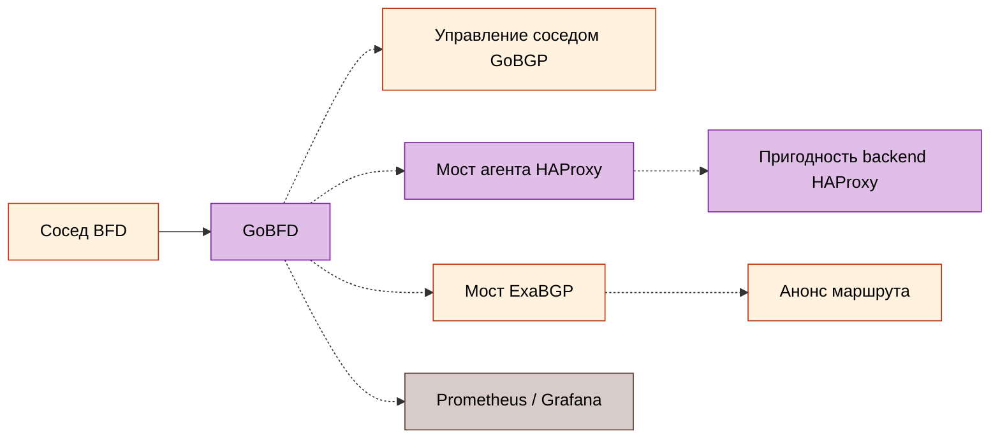

# Интеграции

[English original](../en/11-integrations.md).

GoBFD публикует состояние BFD; потребитель применяет политику маршрутизации или выбора backend. Репозиторий содержит управление GoBGP, HAProxy agent-check, команды для процесса ExaBGP, примеры наблюдаемости и Kubernetes. Для каждого примера необходима отдельная приёмка отказа, восстановления и пересылки трафика.



## Допуск изолированного запуска

Выполнить [предпосылки разработки](09-development.md#подготовка-рабочей-копии), обеспечить доступ выбранного runner к Podman или кластеру. Согласовать одну одноразовую топологию, до запуска записать имена, подсеть, порты и принадлежность ресурсов. Остановиться при пересечении с существующими ресурсами, отказе готовности, отсутствии проверяемого снятия или восстановления либо отказе очистки; сохранить каталог запуска и конечный результат. Повторный вызов — новое учение отказа, а не откат. Восстановить внесённый отказ и проверить потребителя до отдельно разрешённого удаления своих ресурсов.

Сохранённые точки входа Compose используют общие проверки принадлежности проекта. Завершение Kubernetes требует закрытой записи владения из исходной рабочей копии, совпадения кластера, UID namespace и метки владельца. Сохранить запись после отказа. До очистки проверить точный [runner интеграций](../../test/internal/integrationrunner/runner.go) и [правила допуска E2E](../../test/e2e/README.md).

## Быстрое переключение BGP

В [примере FRR/GoBGP](../../deployments/integrations/bgp-fast-failover/README.md) GoBFD и GoBGP используют общий адрес `172.22.0.10`, а FRR — `172.22.0.20`. FRR анонсирует `10.20.0.0/24`. GoBFD отслеживает профиль Control 300 мс × 3 и применяет к GoBGP действие `disable-peer`.

Обязательны совместимость с API GoBGP v4 и единственный владелец BFD. Встроенный BFD GoBGP на управляемых соседях вызывает конфликт; несколько базовых сессий для одного адреса соседа не позволяют однозначно выбрать сессию для управления. Подавление колебаний GoBFD задерживает восстановление, но не обработку Down. Административные переходы отличаются от отказов пересылки. Источники: [предварительная проверка и выбор](../../cmd/gobfd/handlers.go), [обработчик](../../internal/gobgp/handler.go), [RFC 5882, раздел 10.2](https://www.rfc-editor.org/rfc/rfc5882.html#section-10.2).

При подключении GoBFD к GoBGP через локальный файловый Unix-сокет (`unix:///abs/path` или `unix:/abs/path`) подтверждённые вызовы `DisablePeer` сохраняют в `gobgp.state_file` квитанцию `0600`, привязанную к эпохе спикера GoBGP ([ADR-0013](adr/0013-gobgp-restart-disable-ownership.md)): после перезапуска GoBFD автоматически включает отключённого им соседа при возврате BFD в Up, оставляя отключёнными соседей, выведенных оператором, имеющих `Conf.AdminDown = true` либо принадлежащих перезапущенному `gobgpd`. При подключении к GoBGP по TCP (где `SO_PEERCRED` ядра недоступен) либо после перезапуска самого `gobgpd` непрерывность эпохи спикера не доказуема, поэтому отключённые соседи остаются без автоматического включения до выполнения [процедуры восстановления](16-production-runbooks.md#22-startup-owned-изменения). Автоматическое включение соседа, отключённого оператором, запрещено.

```sh
make int-bgp-failover-testcontainers
```

Проверка сохраняет `reports/e2e/bgp-fast-failover/run.*/` и подтверждает снятие и восстановление конкретного маршрута при приостановке и возобновлении FRR. Её предел снятия маршрута 20 секунд не подтверждает гарантию BFD 900 мс или непрерывность пересылки. Отдельная ручная топология запускается через `make int-bgp-failover-up`; её фиксированные имена и подсеть пересекаются с другими лабораториями. Перед запуском или очисткой свериться с описанием примера.

<a id="здоровье-backend-haproxy"></a>

## Работоспособность backend HAProxy

`gobfd-haproxy-agent` выбирает одну сессию BFD для каждого настроенного backend и выдаёт ответы агента по TCP без аутентификации. Только Up даёт `up ready\n`; остальные состояния, отсутствие или неоднозначность сессии дают `down\n`. После переподключения Watch получает полные актуальные снимки. Ответы определяют пригодность пути BFD, но не работоспособность приложения по HTTP/TLS.

| Вход | Контракт |
|:---|:---|
| Флаги | `-config`, `-gobfd-addr`, `-version` |
| Приоритет адреса API | Встроенный Unix-сокет → `GOBFD_ADDR` → флаг → непустой YAML `gobfd_addr` |
| Общие поля YAML | `gobfd_addr`, `listen_addr`, `backends` |
| Поля backend | `peer`, `local`, `interface`, `type`, `agent_port` |
| Адрес прослушивания по умолчанию | `127.0.0.1`; для удалённого HAProxy адрес задаётся явно |
| Переменные TLS | `GOBFD_TLS_CA_FILE`, `GOBFD_TLS_CERT_FILE`, `GOBFD_TLS_KEY_FILE` для HTTPS |
| Допуск | Не менее одного backend; уникальный порт 1–65535; проверенный селектор сессии |
| Ограничение запросов | 64 параллельные записи на сокет прослушивания, срок записи 100 мс |

Источники: [реализация агента](../../cmd/gobfd-haproxy-agent/main.go), [пример конфигурации](../../deployments/integrations/haproxy-health/haproxy-agent.yml). Ограничить доступ к удалённому сокету агента: аутентификация отсутствует.

```sh
make int-haproxy-testcontainers
```

Проверка с жизненным циклом под управлением Go проверяет ответ backend и восстановление, сохраняет `reports/e2e/haproxy-health/run.*/`. Требования к среде выполнения приведены в [проверках разработки](09-development.md). Эта проверка не квалифицирует прикладной протокол production-среды.

## ExaBGP anycast

`gobfd-exabgp-bridge` пишет в stdout только команды для процесса ExaBGP, а журналы — в stderr. Выбранная сессия Up выдаёт `announce route PREFIX next-hop self`; отсутствие, неоднозначность, состояние вне Up или потеря наблюдения приводят к снятию маршрута. Повтор одинакового состояния не дублирует команду; перезапуск процесса согласует начальное состояние маршрута.

| Переменная окружения | Контракт |
|:---|:---|
| `GOBFD_ADDR` | По умолчанию `unix:///run/gobfd/gobfd.sock` |
| `GOBFD_PEER` | Обязательный адрес соседа |
| `ANYCAST_PREFIX` | Обязательный корректный IP-префикс; нормализуется до адреса сети |
| `GOBFD_LOCAL` | Необязательный селектор исходного адреса |
| `GOBFD_INTERFACE` | Необязательный селектор интерфейса |
| `GOBFD_SESSION_TYPE` | Необязательный селектор типа |
| `GOBFD_TLS_CA_FILE`, `GOBFD_TLS_CERT_FILE`, `GOBFD_TLS_KEY_FILE` | Доверие HTTPS API управления и клиентская идентичность |

Только `-version`/`--version` распознаются как запрос версии. Селектор типа допускает пустое значение, `single_hop`, `multi_hop`, `micro_bfd`, `vxlan`, `geneve`; пустое значение соответствует любому наблюдаемому типу, включая Echo. Селектор только по соседу должен давать единственный результат; при необходимости добавить исходный адрес, интерфейс или тип. Тот же контракт селектора действует для `type` backend HAProxy. Источники: [мост](../../cmd/gobfd-exabgp-bridge/main.go), [селектор и Watch](../../internal/apiclient).

```sh
make int-exabgp-anycast
```

[Пример anycast](../../deployments/integrations/exabgp-anycast) имеет отдельную границу интеграционной приёмки. Вывод жизненного цикла под управлением Go или сама команда маршрута не доказывают распространение BGP во внешней сети либо пересылку anycast.

## Наблюдаемость

[Стек наблюдаемости](../../deployments/integrations/observability/compose.yml) содержит соседей BFD, правила Prometheus и Grafana. Его лабораторные порты хоста и стандартные учётные данные Grafana требуют изолированной согласованной среды; публикация в качестве production-панели запрещена.

```sh
make int-observability-testcontainers
```

Проверка требует исправного сбора метрик, активного оповещения о переходе при отказе, восстановления BFD и неактивного оповещения после восстановления. Результаты сохраняются в `reports/e2e/observability/run.*/`. Одного HTTP 200 недостаточно. См. [метрики и оповещения](07-monitoring.md).

Сохранённый демонстрационный сценарий `make int-observability` и его цели `-up`, `-logs`, `-down` используют [контроллер Compose с проверкой владения](../../test/internal/interopproject/controller.go). До запуска выполнить [условия сохранённого процесса](05-interop.md#сохранённый-compose-workflow). Контроллер сериализует фиксированный проект, собирает уникальные теги образов, запускает по записанным ID и удаляет только проверенные собственные runtime-ресурсы. Демонстрационный сценарий не заменяет проверку testcontainers выше.

Файлы захвата сохраняются в `reports/e2e/observability-compose/run.<nonce>/`, включая созданные до частичного отказа запуска; незавершённый запуск может оставить неполный захват. Сохранить каталог для диагностики. Prometheus использует ограниченный tmpfs размером 1 ГиБ для TSDB, поэтому история демонстрационного сценария непостоянна. Это предел хранилища демонстрационного сценария, а не квалификация длительного хранения; перед изменением учесть [хранение WAL и head chunks](https://prometheus.io/docs/prometheus/latest/storage/). Существующие именованные тома сохраняются и автоматически не переносятся. Для восстановления выполнить соответствующую цель `-down` из исходного каталога с теми же UID и выбором движка. Источники: [владелец захватов](../../test/internal/interopproject/capture.go), [монтирования сценария](../../deployments/integrations/observability/compose.yml).

## Kubernetes

[Набор манифестов](../../deployments/integrations/kubernetes/manifests) запускает один DaemonSet с сетью хоста на каждом выбранном Linux-узле, с локальными образами и контейнером GoBGP sidecar. Перед применением проверить `imagePullPolicy: Never`, импорт образов на каждом узле, конфликты портов, пробы и границы локального управления хостом.

`make int-k8s` — пример запуска. Приёмка требует подтверждённого импорта образов на каждом узле, согласованных меток и проб, а также отчёта о развёртывании, ресурсах, отказе и восстановлении в работающем кластере. Одни манифесты не подтверждают принятого развёртывания в кластере. См. [развёртывание](06-deployment.md#kubernetes).

После развёртывания [проверки пода](../../test/internal/integrationrunner/kubernetes_probe.go) выбирают единственный не удаляемый Pod в состоянии `Running` и `Ready` на сопоставленном локальном Node (отсутствует `deletionTimestamp`, `status.phase == "Running"`, `Ready == "True"`, `spec.nodeName` равен локальному узлу) и требуют успешных RPC-запросов к Unix-сокету GoBFD и loopback GoBGP. Успешный пустой список сессий подтверждает только доступность управления. Метрики читаются через Kubernetes Pod proxy с ограничением вывода 1 MiB; оператору требуется право `get` для `pods/proxy` в namespace `gobfd`. Требовать ровно один образец `gobfd_gobgp_endpoint_compatible` без меток с числовым значением `1`; отсутствие, дубли, метки или неуспешные значения завершают команду ошибкой. Эта метрика подтверждает предварительную проверку совместимости API GoBGP, но не BFD Up или пересылку. Ошибки RPC, proxy и вывода останавливают проверки; необязательные средства захвата пакетов не подтверждают приёмку. Источник: [API Pod proxy](https://kubernetes.io/docs/reference/kubernetes-api/core/pod-v1/).

[Владелец сборки](../../test/internal/integrationrunner/kubernetes_build.go) использует общий жизненный цикл образов для [двух существующих рецептов](../../deployments/integrations/kubernetes/compose.build.yml). Он записывает уникальные теги, проверенные исходные ID и сформированный DaemonSet в закрытый каталог `reports/e2e/kubernetes-build/run.<identity>/` до импорта, а после завершения импорта обновляет `images.json` опубликованными digest OCI-манифестов. До создания namespace исполнитель подключается к image-service endpoint из конфигурации kubelet, передаёт `containerd-namespace: k8s.io` в каждом gRPC-запросе, сохраняет UUID сервера, проверяет namespace и требует отсутствия обоих тегов. Только gRPC `NotFound` от `Images.Get` означает отсутствие образа. Закрытая запись `containerd.json` сохраняет endpoint, namespace и UUID. DaemonSet выбирает заданные теги и записывает исходные ID в аннотации. После callback локальные образы сборки удаляются по проверенным ID, а импортированные образы и файлы отчёта сохраняются. Сохранить план при ошибке импорта или apply. Аутентификация идентичности сервера, владение очисткой импортированного хранилища, ссылки runtime с digest и доставка образов на несколько узлов остаются неквалифицированными.

[Владелец namespace](../../test/internal/integrationrunner/kubernetes_namespace.go) отклоняет существующий namespace `gobfd`. До исключающего повторное создание запроса он сохраняет случайную метку владельца и наблюдаемый UID `kube-system`, затем записывает UID созданного namespace в закрытый файл `reports/e2e/kubernetes-build/namespace.json`. Запуск и завершение используют общую локальную блокировку. При потере ответа создания сохраняется незавершённая запись; завершение восстанавливает UID только из namespace с совпадающими меткой владельца и UID кластера. Незавершённая запись блокирует следующий запуск даже при отсутствии namespace; сохранить её nonce и установить результат исходного запроса до нового запуска. Автоматического повтора создания нет. Использовать namespace исключительно для этого запуска; не добавлять посторонние ресурсы.

Выполнить `make int-k8s-down` из исходной рабочей копии, с исходными UID пользователя и контекстом кластера. Завершение проверяет запись, метку владельца и UID namespace, передаёт [предусловия DeleteOptions UID и resourceVersion](https://kubernetes.io/docs/reference/kubernetes-api/common-definitions/delete-options/) и требует завершения удаления с последующим подтверждением отсутствия. Изменение идентичности, конфликт или ошибка ожидания останавливают завершение; сохранить запись и файлы запросов для диагностики. Записи остаются после успешного завершения; повторное завершение при отсутствующем namespace ничего не удаляет. Импортированные образы containerd сохраняются. Эти проверки исходников не подтверждают приёмку реального кластера или хранилища образов.

[Импортёр](../../test/internal/integrationrunner/runner.go) и [клиент прямой загрузки containerd](../../test/internal/integrationrunner/kubernetes_containerd_import.go) требуют один полный SHA-256 ID исходного образа до создания архива. Экспорт выбирает этот ID с явными `docker-archive` и `--multi-image-archive=false`; запрошенный тег сохраняется в метаданных архива. Некорректный, неоднозначный или слишком большой вывод идентичности завершает команду ошибкой до экспорта. Импортёр удерживает открытым дескриптор закрытого архива, проверяет, что путь экспорта по-прежнему указывает на исходный обычный файл, и проверяет содержимое без распаковки на диск. Затем создаётся 15-минутная аренда containerd (`Leases.Create` с `containerd.io/gc.expire`, удаляемая при выходе через `Leases.Delete`), проверенные слои и config передаются поточно из открытого дескриптора в `Content.Write` с ожидаемыми digest и размерами, записывается детерминированный манифест образа OCI v1 с метками `containerd.io/gc.ref.content.config` и `containerd.io/gc.ref.content.0..N`, а тег публикуется только через `Images.Create` без вызова `Images.Update` (`AlreadyExists` завершает импорт ошибкой без перезаписи существующего тега). Повторное чтение проверяет `Images.Get` и `Content.Info` на совпадение digest манифеста, размера и корневых меток GC, после чего сохраняется `import-<source-id>.json` и обновляется `images.json` полем `manifest_digest`. Ошибки экспорта, проверки, записи квитанций, хранилища контента, публикации через Create, закрытия дескриптора и очистки завершают команду ошибкой. Очистка удаляет только исходный файл; подменённый файл сохраняется и отражается в диагностике. Владение очисткой импортированного хранилища, ссылки runtime с digest и приёмка на нескольких узлах остаются неквалифицированными.

До создания namespace или импорта образов исполнитель требует непустой ограниченный `NodeList` с уникальными именами и UID, условием Ready, метаданными Linux, поддерживаемой архитектурой, machine ID, boot ID и версией runtime `containerd://`. Локальный host должен совпасть ровно с одним узлом по machine ID и boot ID. Исполнитель читает объединённую конфигурацию kubelet через `/api/v1/nodes/{name}/proxy/configz` и принимает только абсолютные Unix socket URI для `containerRuntimeEndpoint` и эффективного `imageServiceEndpoint` (по умолчанию равен runtime endpoint). Закрытая запись запуска сохраняет UID локального узла, оба пути сокетов, отсортированные наблюдаемые узлы и UID кластера до изменения namespace; UID кластера проверяется повторно перед созданием namespace. UUID, возвращённый image-service endpoint, записывается в отчёт, но отдельно доверенной опорой не аутентифицируется. Готовность кластера ограничена 60 секундами и отклоняет пустой список. Эти проверки не доказывают планирование DaemonSet или наличие образа на каждом узле. Готовый, но cordoned-узел остаётся в списке: DaemonSet допускает unschedulable-узлы. Право `nodes/proxy` привилегированное; см. [права оператора](06-deployment.md#kubernetes). Источники: [состояние узла](https://kubernetes.io/docs/reference/node/node-status/), [tolerations DaemonSet](https://kubernetes.io/docs/concepts/workloads/controllers/daemonset/), [API конфигурации kubelet](https://kubernetes.io/docs/reference/config-api/kubelet-config.v1beta1/).

[Проверка архива](../../test/internal/integrationrunner/kubernetes_archive.go) требует один Docker manifest с точным тегом запуска, SHA-256 config, равным выбранному исходному ID, и упорядоченными хешами несжатых слоёв, равными `rootfs.diff_ids`. Отклоняются дубли членов, неоднозначный JSON, небезопасные пути, отсутствующие данные, усечённое обрамление и гибридные OCI layout. Служебные ссылки `layer.tar` допускаются только на проверенные физические слои; соответствующие метаданные `VERSION`, `json` и `repositories` поддерживаются. Содержимое проверяется поточно, без распаковки. До импорта исполнитель записывает рядом с `images.json` файл `archive-<source-id>.json` со схемой, тегом, исходным ID, SHA-256 всего архива и числом байтов, не заменяя существующую запись. Сохранить эти записи после отказа. Источники: [формат экспорта и служебные ссылки](https://github.com/containers/image/blob/df7e80d2d19872b61f352a8a182ec934dc0c2346/docker/internal/tarfile/writer.go), [экспорт несжатых слоёв](https://github.com/containers/image/blob/df7e80d2d19872b61f352a8a182ec934dc0c2346/docker/internal/tarfile/dest.go).

| Вход архива | Ограничение |
|:---|:---|
| Размер файла | 4 GiB |
| Число членов | 4096 |
| JSON manifest | 1 MiB |
| JSON config | 4 MiB |
| Нулевое заполнение после завершающих блоков | 10 KiB |

Проверка закрытого файла не защищает inode от конкурентной записи его владельцем. Digest архива и ID исходного config отличаются от digest OCI manifest или index, выбранного containerd. Владение целевым хранилищем, неизменяемые ссылки runtime и приёмка на каждом реальном узле остаются неквалифицированными.

<a id="квалификация-и-vendor-references"></a>

## Квалификация и источники производителей

| Доказательство | Подтверждает | Не подтверждает |
|:---|:---|:---|
| Модульные проверки и проверка исходников | Поведение по контракту на проверенных путях | Совместимость с нативным соседом |
| Управляемый жизненный цикл testcontainers | Проверенные локальные отказ и восстановление | Ресурсы production или непрерывную пересылку |
| Захват пакетов | Захваченные поля и события на линии | Исчерпывающее покрытие RFC |
| Руководство производителя | Описанное поведение выбранного выпуска и платформы | Приёмку GoBFD с этим устройством |
| Учение в production | Измеренные заявленные топологию, SHA и нагрузку | Другие профили и платформы |

Использовать [покрытие RFC](08-rfc-compliance.md), [эксплуатационный регламент](16-production-runbooks.md) и [официальные источники Cisco/Arista/Juniper/Huawei](reference/vendor-bfd.md). Необязательные [заметки EOS](../../deployments/integrations/bgp-fast-failover/vendor-notes/arista-eos.md) не входят в запускаемую топологию FRR.
