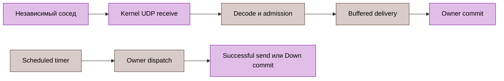

# Производительность runtime и измерения

Квалификация runtime объединяет независимый учёт пакетов, состояние owner, timer effects, ресурсы и доказательства часов. Source-тест, компонентный бенчмарк и короткая fixture не определяют поддерживаемый масштаб. [Бенчмарки](12-benchmarks.md) задают стоимость компонента; эта страница определяет runtime measurement и ограничения.

## Границы измерений



| Измерение | Начало → конец | Ограничение |
|:---|:---|:---|
| Control RX commit | Converted kernel software RX → фиксация пакета владельцем сессии | Только valid clock conversions |
| Timer dispatch | Scheduled timer firing → обработка владельцем сессии | Задержка планирования owner |
| TX effect | Scheduled firing → успешный возврат SendPacket | Без гарантии wire/peer arrival |
| Detection effect | Scheduled firing → публикация timeout-caused Down | До logs, notification и actuator |
| Peer send | Фактический UDP write | Не owner receipt |
| Enqueue benchmark | Decode/lookup → попытка запись в буферизованную очередь | Не обработка владельцем сессии |

Реализация: [receiver](../../internal/netio/receiver.go), [timer observations](../../internal/bfd/timer_observation.go), [workload owner](../../test/internal/bfdload/owner_linux.go), [assessment](../../test/internal/bfdload/assessment_linux.go).

## Телеметрия приёма

Linux base listeners запрашивают SO_TIMESTAMPNS_NEW и SO_RXQ_OVFL. ENOPROTOOPT делает optional telemetry unavailable; другие ошибки options останавливают создание listener. TTL и packet-info остаются обязательными. Ancillary буфер 128 bytes содержит timestamp, drop count, TTL/Hop Limit и destination/interface. MSG_CTRUNC возвращает ErrAncillaryTruncated до demux.

KernelRXUnixNano содержит software CLOCK_REALTIME reading; ноль означает absent/invalid. Native-endian time64 decode требует normalized nanoseconds и положительный int64 result. Это не hardware timestamp. Внешний формат определяет [kernel timestamp ABI](https://www.kernel.org/doc/html/latest/networking/timestamping.html).

Каждый listener калибрует paired realtime/monotonic readings. Отсутствие monotonic data, numeric overflow, sample до calibration или из будущего остаются invalid/unusable. Расхождение elapsed realtime/monotonic свыше 1 мс отзывает calibration listener, включая queued packets. Перезапуск receiver на том же listener не снимает отзыв; пересоздание listener снимает.

Допуск 1 мс — validity policy, не accuracy guarantee. Промежуточный clock step с возвратом до observation может остаться незамеченным. Валидность часов не меняет packet acceptance и monotonic detection deadlines.

Завершённые Control owner packets увеличивают outcomes valid, unavailable, invalid, before_calibration, future или clock_step. Только valid входят в gobfd_bfd_control_rx_commit_seconds. Validation refusal, enqueue/refusal, abandonment и panic имеют отдельные delivery denominators. Метрики не имеют peer labels. Legacy/overlay без kernel timing дают unavailable.

### Потери сокета

SO_RXQ_OVFL — cumulative uint32 snapshot в момент помещения datagram в очередь, а не delta пакета. Отсутствие cmsg не доказывает нулевых потерь. Освободите старую очередь и получите свежие post-load markers; повторите marker для проверки идемпотентности агрегации.

Каждый base listener сохраняет synchronized high-water mark между receiver restarts. Новые daemon sockets начинаются с нуля; existing/custom sockets требуют известного baseline. Forward modular distance меньше 2^31 двигает mark; равный sample добавляет ноль, stale/half-range — ambiguous без изменения mark. Несколько незамеченных wraps и reset, похожий на progress, не обнаруживаются.

Drops учитываются до size/TTL/BFD rejection. Независимые полные ancillary metadata сохраняются при payload truncation; malformed, duplicate и truncated drop cmsgs невалидны. Read error, closure и timeout не являются consumed-datagram samples. Overlay listeners исключены. Два kinds и пять outcomes дают десять sample counters и два increment counters без peer labels; удаление/reset series не поддерживается.

См. [socket-drop tests](../../internal/netio/socket_drops_test.go) и [real UDP tests](../../internal/netio/socket_drops_linux_test.go). Счётчики не определяют полные wire loss.

## Наблюдения таймеров

Control/Echo owners сохраняют фактический timer-channel timestamp и сбрасывают собственные detection timers. Dispatch/effect используют monotonic arithmetic отдельно от converted kernel realtime.

Четыре timer kinds дают 20 event-counter series и восемь valid-stage histograms. Invalid zero/future timestamps остаются outcomes. no_effect объединяет suppression, send failure и idle detection; это не loss counter. Panic/in-flight handler может оставить dispatch без terminal effect. Untimed actions исключены.

Не считайте timer arithmetic и reset-contract test приёмкой scheduling, false-Down или масштаба.

## Справочник команд нагрузки

Linux-only [bfdload](../../test/cmd/bfdload/main.go) предоставляет следующие формы. Выполняйте или собирайте инструмент в закреплённой среде; owner/peers/prepare создают sockets или адреса namespace и требуют допущенной одноразовой среды.

| Форма | Результат |
|:---|:---|
| bfdload environment | JSON-наблюдения текущего процесса |
| bfdload prepare HOST_NAMESPACE PROFILE [flags] | Добавление отсутствующих local/peer addresses в проверенный частный loopback namespace |
| bfdload owner PROFILE [flags] | Запуск production-core owners и owner JSON |
| bfdload peers PROFILE [flags] | Независимый трафик соседей и peer JSON |
| bfdload assess OWNER_JSON PEER_JSON | Чтение сведённых отчётов и условная оценка |

PROFILE принимает fixture, reference или engineering. Передайте обоим процессам полный явный список endpoints; именованные профили не создают его по числу сессий.

Owner listeners и senders запрашивают стандартные socket buffers демона, включая senders после churn: по 4 MiB для приёма и передачи. Ядро может ограничить запрос; фиксируйте фактическую ёмкость сокетов и drop counters на runner. Успешная установка buffer не доказывает приём без потерь. Источники: [owner sockets](../../test/internal/bfdload/owner_linux.go), [daemon defaults](../../internal/config/config.go).

| Флаг | Назначение и default |
|:---|:---|
| --session=LOCAL_ADDRPORT,PEER_ADDRPORT | Повторяется на сессию; IPv6 AddrPort использует квадратные скобки |
| --interface=NAME | Общий интерфейс bindings; обязателен для именованных профилей |
| --source-port-base=49152 | Первый стабильный peer source port; все N ports должны поместиться до 65535 |
| --control-dir=ABSOLUTE_PATH | Частный общий каталог синхронизации фаз; без него независимые таймеры |
| --echo | Режим Echo owner/return; default false |
| --sessions / --interval / --duration | Точные параметры выбранного профиля |
| --detect-multiplier | Ненулевой множитель протокола; default 3 |
| --cpu-load-percent | Запрашиваемая нагрузка owner; фактическое потребление измеряется отдельно |
| --gc-pressure / --scheduler-pressure / --session-churn | Отключённые по умолчанию варианты нагрузки/жизненного цикла |
| --tx-only-blackhole | Отключённый по умолчанию selector направления только для fixture |
| --loss-permille | Вероятность случайного намеренного пропуска по каждому направлению |
| --blackhole-every / --blackhole-for | Период/длительность; ноль отключает оба |
| --seed | Начальное значение генератора потерь; default 1 |

Scalar flags запрещают повтор; повторяется только session. Размер списка должен совпадать с sessions; peer receive endpoints уникальны и отличны от соответствующего owner endpoint; диапазон source ports должен помещаться. Именованные профили требуют обеих address families и обоих endpoints на Control 3784 или Echo 3785. Fixture допускает ограниченные альтернативные порты.

prepare имеет setup context 30 секунд. HOST_NAMESPACE — свежий фактический inode host network namespace, переданный владельцем. Текущий ненулевой namespace должен отличаться, содержать только уже поднятый loopback; каждый binding обязан указывать lo. Подготовка идемпотентна для существующих точных host-length prefixes, добавляет адреса через rtnetlink и не удаляет существующие. При частичной ошибке owning runner отвечает за разрешённое удаление всего собственного namespace. См. [подготовку](../../test/internal/bfdload/topology_linux.go) и [проверку флагов](../../test/cmd/bfdload/peers.go).

## Профили нагрузки

[profile_linux.go](../../test/internal/bfdload/profile_linux.go) определяет утверждённые inputs:

| Профиль | Сессии и интервал | Длительность | Fault/pressure input |
|:---|:---|:---|:---|
| reference | 1000 mixed IPv4/IPv6, 100 мс | 24 часа после setup | Потери 1-per-mille, CPU request 80%, blackhole 1 с каждые 30 мин |
| engineering | 5000, 300 мс | 30 минут | Те же loss/CPU; blackhole 1 с каждые 10 мин |
| fixture | Явные уменьшенные test inputs | Выбранная ограниченная длительность | Без квалификации |

Engineering содержит полные blackholes на минутах 10 и 20; события на cutoff входят в drain. GC/scheduler/churn variants по умолчанию отключены и требуют отдельной реальной активности. Named profiles отклоняют reduced dimensions и TX-only blackholes.

Reference admission требует точных child limits 8 CPU/8 GiB, GOMAXPROCS 8 и отсутствия более строгих visible ancestors. Hidden hierarchy roots отклоняются. Conservative PID headroom — sessions+64 на каждом visible ancestor: 1064 для reference и 5064 для engineering. Это исторический бюджет pinned owner, а не резерв ресурсов или измеренное число threads.

## Наблюдение ресурсов

Выполните Go environment command в закреплённом контейнере:

```bash
go run ./test/cmd/bfdload environment
```

CaptureEnvironment наблюдает собственный процесс: smaps_rollup RSS, threads, FDs, process context switches, affinity наблюдающего thread, GOMAXPROCS, GC settings и копии cumulative runtime histograms. Бесконечные histogram bounds представлены strings. Samples последовательны и неатомарны; FD count включает observer descriptors, overhead требует calibration.

Cgroup observations охватывают visible hierarchy. cpu.stat bandwidth counts исключают inherited throttling; cpu.stat.local имеет отдельную optional validity. Missing/malformed остаётся unavailable; max отличается от numeric zero. Следуйте [cgroup v2 contract](https://docs.kernel.org/admin-guide/cgroup-v2.html). Namespace visibility и generator isolation требуют отдельных доказательств.

### Pressure и churn

| Driver | Ограниченное поведение | Граница receipt |
|:---|:---|:---|
| CPU | Один pinned helper на GOMAXPROCS, максимум восемь; duty windows 100 мс | Requested duty, actual thread CPU, worker wall time, lateness/missed windows |
| GC | Максимум 4 MiB/100 мс, objects 64 KiB, retained references 16 MiB | Bytes/objects/batches, skipped/truncated work, references и lateness |
| Scheduler | Четыре helpers на GOMAXPROCS, максимум 32; до 64 rounds по 1024 iterations с Gosched за 100 мс | Фактический rounds/yields, joined workers, skipped/incomplete windows, checksum |
| Churn | Одна admitted fixed-manifest session; начало 250 мс, период 5 с, gap 200 мс | Реальные release/create/Up, ports, generations и phase times |

CPU duty включает polling/runtime overhead; elapsed time не доказывает consumed CPU. GC workers не вызывают принудительный GC и не меняют settings; released_objects считает занятые ring entries, освобождённые при exit, а не GC reclamation. Yield counts не доказывают OS context switches и queue depth. Workers join до фиксации измерений и drain.

CPU засчитывается в окно только по sample thread clock, завершённому строго до wall deadline; граница проверяется после вызова clock. Позднее чтение сохраняет последний своевременный credit, поэтому последующая CPU-работа не скрывает missed window; lifetime CPUTimeNS остаётся отдельной суммой. При неизвестном времени завершения консервативный результат может быть miss. Cancellation и wall time проверяются перед каждым общим chunk; thread-CPU clock опрашивается раз в четыре chunk. Неполный batch не добавляет credit; более редкие samples могут отложить решение о yield без ограничения wall latency. См. [учёт CPU](adr/0007-workload-phase-accounting.md).

Для пропущенных CPU-окон сохраняются не более 16 диагностических образцов на worker и счётчик несохранённых образцов. Запись содержит worker, окно и исходный бюджет; принятое CPU-время отделено от последнего наблюдаемого неубывающего CPU-образца. Существующие wall-проверки сохраняются как смещения с признаками known и обозначением ветви выхода. Дополнительных чтений часов нет. Отклонённый поздний образец не увеличивает зачёт CPU. Последняя wall-проверка не доказывает время возврата или причину scheduler/GC. Порядок join не является временным порядком; причина несохранённого образца остаётся неизвестной. Собрать строгий reader новой схемы и указать SHA поколения нагрузки; стоимость диагностики требует новой квалификации. См. [CPU accounting](adr/0007-workload-phase-accounting.md).

CPU helpers вызывают Gosched примерно через 5 мс измеренного thread CPU, пока в их окне 100 мс остаётся работа. Полный CPU budget 80 мс допускает не более 15 добровольных checkpoints. Полный CPU budget и закреплённый поток сохраняются; ожидание после yield не считается потреблением CPU. Checkpoints не гарантируют wall latency. Обозначайте поколение pressure через source SHA и применяйте его одинаково к обеим сторонам A/B; результаты прежнего поколения храните отдельно. Восемь workers, измеренная duty не ниже 80% и нулевое число missed windows остаются обязательными. Требуется новая native-калибровка. См. [CPU pressure](../../test/internal/bfdload/cpu_pressure_linux.go) и [ADR-0007](adr/0007-workload-phase-accounting.md).

Churn требует минимум шесть секунд и пропускает cycle при остатке менее пяти секунд. AdminDown multiplier 3 требует минимум три секунды notification drain; recovery ждёт максимум пять секунд и не дольше measurement. Mixed-family process fixture использует 11 секунд. Отсутствие фактического recovery завершает enabled variant ошибкой. Release start/completion ограничивают registry removal; completion не является точным временем удаления.

Current/retired generations имеют отдельные RX counts; terminal accounting относится ко всему lifetime. Active registrations отличаются от retained collector label sets. Fixed-manifest variant не квалифицирует произвольный рост unique-peer metrics.

## Owner, соседи и фазы

StartOwner запускает production listeners, receiver, manager, owned senders и real collector. Snapshot содержит endpoints/ports, session state, delivery counters и resources. Shutdown joins собственные workers и возвращает socket errors. Изолированные alternate-port tests не квалифицируют RFC ports и полный daemon.

RunPeers использует независимую unauthenticated asynchronous Control model. Отдельные seeded PCG streams обслуживают directions и protocol jitter. Random omissions, blackholes, UDP writes, cancellation и unprocessed input учитываются отдельно. Typed flags и повторяемые session bindings отклоняют duplicate scalar flags, malformed endpoints и reduced named profiles до открытия sockets. Signals отменяют, join и выдают partial JSON.

Без control-dir totals включают setup/shutdown и независимые duration timers. Controlled roles выполняют bind/readiness, принимают future common monotonic epoch, замораживают measurement_final, останавливают/присоединяют peers, сводят terminal packets и закрывают owners. Частные bounded control files запрещают replacement и проверяют общий time namespace. Отсутствие terminal receipts даёт ошибку по bounded deadline.

Не делите lifetime totals на requested duration для window throughput. [ADR-0007](adr/0007-workload-phase-accounting.md) определяет phases и ledger.

### Режим Echo

Постоянный selector --echo использует настоящие Manager Echo sessions, production receiver и source-port leases. Оба named endpoints используют UDP 3785; prepared plan сохраняет один owner address на family. Physical session регистрируется один раз и снимается после owner join.

Peers возвращают весь datagram, включая padding, с TTL/Hop Limit 254. Проверяются codec, tuple, inbound TTL и отсутствие auth. Они не генерируют periodic Control и не синтезируют remote Control Up. Readiness требует фактического return write. Независимые received_sequences связывают accepted RX и return omissions.

Это проверка Echo preview, а не adjacent forwarding plane, RFC return authentication или полного RFC 9747. Текущий typed assessment обрабатывает Echo отдельно; Control RX latency не заменяет Echo measurement.

## Доказательства Down

Workload Manager с `WithShutdownNotificationDrain` доставляет queued notifications после producer join и до subscriber EOF. Проверки физической identity, GAP и равенства счётчиков журнала остаются обязательными. Завершение не вызывает actuator; обычный Manager сохраняет abandonment. См. [ADR-0007](adr/0007-workload-phase-accounting.md).

Полный source journal требуется даже при отсутствии Down rows. Raw/subscriber queues резервируют min(65536,64+3N): 3064 entries при N=1000, saturation после 21824 producers. Каждый subscriber владеет своей queue. Sustained churn/reload growth могут вызвать overflow; legacy/unconfigured queues остаются 64. Проверки GAP/overflow обязательны.

Один consumer работает от setup до остановка владельца сессии. После owners он присоединяется за пять секунд; gaps, omissions, missing counters и unsettled delivery нарушают completeness. Сохраняются:

| Поле | Значение |
|:---|:---|
| cutoff_at_utc | Плановое окончание measurement |
| source_sampled_at_utc | Фактическое завершение cutoff counter read |
| source_transitions | Lifetime Up→Down count в этом read |
| final_source_transitions | Count после остановка владельца сессии |
| observed_before_cutoff / observed_after_cutoff | Доставленные notification-time totals, включая setup/drain |
| down_events | Notification rows только в [start,end) |

Требуются observed_before_cutoff ≤ source_transitions ≤ final_source_transitions и final_source_transitions = observed_before_cutoff + observed_after_cutoff. Samples неатомарны в cutoff. Не вычитайте ненаблюдавшийся startup baseline.

### Owner witnesses и идентичность

StateChange.TransitionTiming содержит last validated receive, actual dispatched detection deadline, Detection Time и local commit bracket. ObservationVersion должен совпадать. Echo ValidatedAt означает preview-owner acceptance; прямой вызов handler не создаёт detection deadline и remote state.

down_witnesses сохраняет setup/drain rows, даже если notification поступает после cutoff. Known flags отличают measured zero от unavailable timing. Missing monotonic, несовпадение версии и reversed brackets остаются unknown. Вычисляйте offsets до UTC serialization; virtual synctest не доказывает происхождение времени в нативной среде.

Incarnation связывает slot, generation и полный endpoint с physical session. Инициализируйте до churn и отслеживайте соответствующие Deleted/Added; repeated active Added не увеличивает generation. Освобождайте session references при deletion/invalidation/end; historical rows сохраняют scalars. Source-count complete и incarnations_complete — независимые требования. См. [ADR-0012](adr/0012-owner-down-transition-witness.md).

### Независимые истечения таймеров peer

Каждый Control peer сохраняет до 256 фактических `detection_expiry_events`: lifetime ID истечения, прежнее состояние, прежние discriminators, время принятого получения, фактический deadline и время проверки обработчика. `first_down_write` фиксирует только первую успешную запись Down после истечения в Init/Up и до любого нового принятого входа. Номер `scheduled` соответствует lifetime-последовательности решений TX; время решения отличается от интервала записи в сокет. Omissions и неуспешные/отменённые записи оставляют свидетельство unknown. Последующие записи его не заменяют.

Offsets проецируются после завершения workers; `phase_known=false` обозначает отсчёт от запуска группы генератора. `timing_known` отличает отсутствие монотонных timestamps от измеренного нуля. Переполнение учитывается в `detection_expiry_events_omitted` и запрещает completion, включая отмену. Успешная запись не устанавливает доставку, owner incarnation или преднамеренную потерю. RemoteDown допускает только доказательство происхождения от первого expiry; неоднозначные последующие epochs остаются unresolved. См. [ADR-0012](adr/0012-owner-down-transition-witness.md#независимое-свидетельство-истечения-таймера-peer) и [producer](../../test/internal/bfdload/peer_expiry_linux.go).

Квалифицированный Control RX omission сохраняет `receive_qualified`: фактические проверки codec/tuple/TTL и протокольного принятия на копии состояния peer без изменения фактических state/counters. Классификация RemoteDown по первому expiry требует полного журнала истечений, совпадающих owner incarnation и expired-Down body, строгого порядка write/receive brackets и исключения любого последующего expiry до получения владельцем. Восстанавливаются только qualified matching stable Up RX inputs с checked `max(p)+D>d+Bpeer` до первого старого due. Вывод относится к происхождению от первого peer deadline; owner commit может следовать после конца blackhole. Неоднозначные последующие источники и прежние отчёты без этих свидетельств остаются unresolved. См. [ADR-0012](adr/0012-owner-down-transition-witness.md#происхождение-remotedown-от-первого-истечения).

### Фактические omissions и классификация

Peer blackhole_windows фиксируют реальные TX/RX omission decisions отдельно от schedule. При нулевых counts timestamps не являются observation. RX decision может предшествовать validation; время не равно socket arrival или commit. Сопоставляйте только общий phase, а не независимые worker epochs.

Лимиты на peer — 256 windows, 16 segments и 128 combined offset/sequence pairs на window. Для 1000 peers абсолютные пределы — 4096000 segments и 32768000 pairs; 47 reference periods дают 752000 и 6016000. Это cardinality limits, не measured RSS. Overflow учитывается и запрещает completion. Повторные markers не удваивают loss.

ClassifyDowns присваивает каждому подходящему свидетельству intentional, false или unresolved; полностью внешние интервалы фиксации учитываются отдельно. Для локального Control timeout требуются точные incarnation/tuple, прежний validated remote discriminator, directional Detection Time, actual due и known conversion brackets. Выборочно восстанавливаются только зафиксированные matching Up packets с неизменными intervals/multiplier, diagnostic None и сброшенными Poll/Final. Каждый выбранный offset p удовлетворяет `p>r+owner_bracket` и `p+peer_bracket<d`; непустой набор должен доказать checked `max(p)+D>d+owner_bracket`. До положительного вывода проверяется body каждого потенциально подходящего TX packet. RX omissions и строго проверенные expired Down packets остаются удержанными; их время не ограничивает доказательство по восстановленным Up. Неподдерживаемые bodies, Up после Down и неполный учёт actual decisions оставляют вывод unresolved. [ADR-0012](adr/0012-owner-down-transition-witness.md) задаёт полную грамматику пакетов и вмешательство. Одного schedule overlap, количества пакетов или nominal cadence недостаточно.

Положительный intentional result предполагает принятие выбранных пакетов владельцем и завершение detection Reset до old due при отсутствии одновременного скрытого независимого отказа. Вывод относится к старому deadline; он не воспроизводит generator, не устраняет весь отказ и не исключает последующие Down. Отсутствующие actual decisions, повторные свидетельства, journal overflow и run/clock mismatch запрещают passing. Прежние оценки сохраняются; повторные записываются отдельно с original producer и new assessor SHA. Controller сохраняет down-classification.json рядом с owner/peer reports и binary/resource/записями очистки. Изменение проверяющего кода не квалифицирует native run.

Для Echo проверяются локальное D=interval×DetectMult, фактический старый deadline d, последний принятый возврат r, совпадение incarnation/version и diagnostic EchoFailed. Пропуски RX и return-TX объединяются по received_sequences: уникальные возрастающие read indices, неубывающие времена и непустой последовательный набор с совпадающей wire generation. Каждый выбранный вход p удовлетворяет `p>r+owner_bracket` и `p+peer_bracket<d`; весь интервал фиксации следует после d внутри того же blackhole window. Строго более поздний новый deadline требует checked `max(p)+D>d+owner_bracket`. DetectMult входит в D; одного количества входов для доказательства продления недостаточно. Отсутствующие/повторные входы, пересечение границ, overflow, отсутствие продления и независимые потери остаются unresolved. Вывод относится только к старому deadline при явном допущении принятия владельцем и Reset до due; отсутствие последующих timeouts и аутентификацию RFC Echo он не доказывает. См. [модель пропусков Echo](../../test/internal/bfdload/echo_omission_linux.go).

Default-off tx-only-blackhole разрешён только fixture. Quiet fixture: шесть секунд, blackout 1.2 с после трёх секунд, без loss/pressure/churn. Отдельная bidirectional fixture длится 13 секунд, blackhole после девяти, CPU/GC/scheduler/churn и loss 25-per-mille; требует реальных random omissions. Ни одна не является named workload acceptance.

## Валидность часов

Calibration сохраняет three-read monotonic bracket и nominal clock resolutions. Conditional conversion bound — span_ns + realtime_resolution_ns + monotonic_resolution_ns. Модель предполагает постоянный realtime-minus-monotonic offset и один fixed read-error interval на clock шириной не более nominal resolution. Само разрешение не доказывает модель или physical accuracy.

Для outer monotonic B,A, anchor M,R и commit/kernel C,K измеренная latency — C−M−(K−R). Fixed offsets сокращаются; bracket и одна within-clock error difference на clock дают conditional bound. Independent fixtures проверяют skew и противоположные endpoints интервалов. Отдельный consistency tolerance 1 мс не равен этому bound.

ClockEpochGuard ставит realtime timerfd CANCEL_ON_SET до calibration и проверяет после last sample. no_cancellation_observed не доказывает отсутствия step: kernel publication/notification могут расходиться во времени. Срок witness ограничен семью днями. Нет per-packet syscall/guard goroutine.

WithClockEpoch требует process-local monotonic provenance от calibration до остановка владельца сессии. JSON replay не восстанавливает её. Неизвестно/invalid/uncovered input очищает bounds и stale qualification. Даже с conditional bound total timing_uncertainty_ns остаётся null, reference_qualified — false.

Перед разрешённым запуск в нативной среде выполните процедуру часов собственного runner: chrony через Unix socket, makestep 1.0 3, bounded waitsync 60 0.01 0 1, затем makestep 1.0 0 до anchor. Сохраните PID/InvocationID/restarts, selected source/leap, boot/time namespace, kernel/Go/clocksource/config identities; сравните после run. Предполагается отсутствие suspend, migration, restart, manual set и leap step. Chrony correction/skew не равно RX conversion bound. Это процедура собственного runner, а не assessor option и не разрешение менять shared host.

## Оценка сведённых отчётов

После join обоих процессов выполните в закреплённой среде:

```bash
go run ./test/cmd/bfdload assess OWNER_JSON PEER_JSON
```

Inputs — regular JSON files максимум 512 MiB каждый. Duplicate/unknown members, invalid Unicode, trailing documents и некорректная схема отклоняются. Numeric nanosecond durations поддерживаются.

Assessor проверяет profile/admission, одинаковую native phase, peer coverage полного окно измерения владельца сессии, итоговый учёт пакетов, causal Down, resources и фактические requested pressure/churn. Setup/drain UTC ranges не обязаны начинаться одновременно. Один pass не завершает variant matrix.

| Численная проверка | Порог или условие |
|:---|:---|
| TX/detection effect CDF | На 25/50 мс точные ranks ceil(0.99N)/ceil(0.999N) |
| Threads | Измеренный максимум ≤48 |
| FDs | Измеренный максимум ≤2N+256 |
| Goroutines | Измеренный максимум ≤3N+256 |
| RSS | Измеренный максимум ≤512 MiB |
| Reference RSS growth | First/final six-hour means: рост строго ниже 5% |
| Engineering six-hour comparison | Не применимо к 30 минутам |

Dispatch/no-effect denominators отдельные; percentile interpolation отсутствует. Control kernel-RX latency имеет собственные distribution/bound, а не TX threshold. Echo выбирает echo_tx/echo_detection; RX-commit distribution явно not_applicable. Stopped Echo returns равны current+retired RX; peer input не превышает lifetime owner TX. Exact cross-counter settlement использует stopped snapshots.

pass возвращает ноль; fail/incomplete выдают structured output и ненулевой exit. Pass — численная приёмка в declared conditional native software-модель часов. Guest identity, operator discipline, происхождение исходников, variant coverage и приёмка выпуска остаются отдельными.

## Сохранённые наблюдения и незавершённая приёмка

| Наблюдение | Запись | Граница |
|:---|:---|:---|
| Mixed IPv4/IPv6 process fixture | reports/udp-resume-20261024; 47.98 с, 79 writes/79 commits, четыре removals | Production-core fixture, не reference/full-daemon acceptance |
| Corrected process fixture | b2e68ad2a13824a05a9b92528fe55c9a8d4fd6d1; 47.67 с, 79/79, непустой снимок измерений | reference_qualified=false; total clock uncertainty unknown |
| Owner collector allocation | reports/collector-owner-20261022; 16 B/op/2 allocs → 0/0 | Synthetic, без UDP/decode/auth |
| Numeric-zone sender recovery | baseline 706991db9433b13cec47e0bb8ea2549b01e948d9; reports/sender-rebind-20261025 | Combined send/receive 3→51; corrected fixture 3 до и после двух recreations |

Sender recovery сохраняет source port 49152 и новый ifindex; это не zero-allocation SendPacket benchmark. Исправленная запись — green03-artifacts/sender-rebind-IPv6LinkLocal.json в указанном report root; red08-test.txt сохраняет отказ.

Текущие Control/Echo owners выполняются в goroutines без постоянного закрепления OS thread за сессией. Старый pinned baseline не укладывается в 48 threads при 1000 owners. Требуются matched native A/B, thread/RSS distributions, timer p99.9, false-Down и final 24-hour/wire gates. Интеграция исходников не заменяет измерений.

Не выводите RSS/session, startup time и GC pauses из construction B/op. Daemon не задаёт project-wide GOMAXPROCS. Сохраните default GOGC; квалифицируйте GOMEMLIMIT измерениями deployment. CPU quota не резервирует execution time. Поля network.dscp нет; проверяйте host QoS отдельно.

[Метод сравнения](13-competitive-analysis.md), [мониторинг](07-monitoring.md), [RFC coverage](08-rfc-compliance.md).
