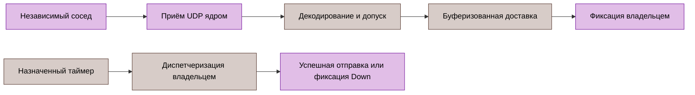

# Производительность runtime и измерения

[English original](../en/14-performance-analysis.md).

Квалификация runtime объединяет независимый учёт пакетов, состояние владельца, эффекты таймеров, ресурсы и доказательства часов. Тест исходников, компонентный бенчмарк или короткий стенд не доказывают поддерживаемый масштаб. [Процедуры бенчмарков](12-benchmarks.md) охватывают стоимость компонентов; эта страница определяет измерения runtime и их ограничения.

## Границы измерений



| Измерение | Начало → конец | Ограничение |
|:---|:---|:---|
| Фиксация Control RX | Преобразованная программная отметка RX ядра → фиксация владельцем | Только валидные преобразования часов |
| Диспетчеризация таймера | Назначенное срабатывание таймера → обработка владельцем | Задержка планирования владельца |
| Эффект TX | Назначенное срабатывание → успешный возврат SendPacket | Без гарантии передачи на линию или прихода к соседу |
| Эффект обнаружения | Назначенное срабатывание → публикация Down из-за тайм-аута | До журналов, уведомления или исполнительного механизма |
| Отправка соседа | Фактическая запись UDP | Не приём владельцем |
| Бенчмарк постановки в очередь | Декодирование и поиск → попытка постановки в буферизованную очередь | Не обработка владельцем |

Реализации: [приёмник](../../internal/netio/receiver.go), [наблюдения таймеров](../../internal/bfd/timer_observation.go), [владелец нагрузки](../../test/internal/bfdload/owner_linux.go), [оценка](../../test/internal/bfdload/assessment_linux.go).

## Телеметрия приёма

Базовые сокеты прослушивания Linux запрашивают SO_TIMESTAMPNS_NEW и SO_RXQ_OVFL. ENOPROTOOPT помечает необязательную телеметрию недоступной; другие ошибки опций останавливают создание сокета. Метаданные TTL и packet-info остаются обязательными. Вспомогательный буфер 128 байт вмещает отметку времени, счётчик потерь, TTL/Hop Limit и данные адреса назначения и интерфейса. MSG_CTRUNC даёт ErrAncillaryTruncated до демультиплексирования.

KernelRXUnixNano хранит программное показание CLOCK_REALTIME; ноль означает отсутствие или невалидность. Декодирование time64 в порядке байтов хоста требует нормализованных наносекунд и положительного результата int64. Это не аппаратная отметка. Внешний формат определяется [ABI отметок времени ядра](https://www.kernel.org/doc/html/latest/networking/timestamping.html).

Каждый сокет прослушивания калибрует парные показания реальных и монотонных часов. Отсутствующие монотонные данные, числовое переполнение, образцы до калибровки или в будущем остаются невалидными или непригодными. Расхождение истёкшего времени реальных и монотонных часов выше 1 мс отзывает калибровку этого сокета, включая пакеты уже в очереди. Перезапуск приёмника на том же сокете не снимает отзыв; пересоздание сокета снимает.

Допуск 1 мс — политика валидности, а не гарантия точности. Промежуточный скачок часов с возвратом до наблюдения может остаться незамеченным парными проверками. Валидность часов не меняет допуск пакетов или монотонные сроки обнаружения.

Завершённые пакеты владельца Control увеличивают исходы измерения valid, unavailable, invalid, before_calibration, future или clock_step. Только valid входит в gobfd_bfd_control_rx_commit_seconds. Отказ проверки, постановка в очередь и её отказ, отбрасывание и panic имеют отдельные знаменатели доставки. Метрики не содержат меток соседей. Устаревшие входы и overlay без отметки ядра сообщают unavailable.

### Потери сокета

SO_RXQ_OVFL — накопленный снимок uint32, прикреплённый при постановке датаграммы в очередь. Это не разность для отдельного пакета. Отсутствие cmsg не доказывает нулевые потери. Освободить старые записи очереди и наблюдать новые маркеры после нагрузки; повторить маркер для проверки идемпотентного суммирования.

Каждый базовый сокет хранит синхронизированную верхнюю отметку между перезапусками приёмника. Новые сокеты демона начинаются с нуля; существующим или пользовательским нужна известная исходная точка. Прямое модульное расстояние менее 2^31 продвигает отметку; равные образцы добавляют ноль, устаревшие и на половине диапазона неоднозначны и сохраняют её. Несколько ненаблюдаемых оборотов или сброс, имитирующий продвижение, обнаружить нельзя.

Наблюдение потерь предшествует отказам размера, TTL и BFD. Полные независимые вспомогательные метаданные сохраняются при усечении полезной нагрузки; некорректные, повторяющиеся или усечённые cmsg потерь невалидны. Ошибка чтения, закрытие и тайм-аут не являются образцами потреблённой датаграммы. Сокеты overlay вне этой границы. Два вида и пять исходов дают десять счётчиков образцов и два счётчика прироста без меток соседей; удаление или сброс этих рядов не поддерживаются.

См. [тесты потерь сокета](../../internal/netio/socket_drops_test.go) и [тесты фактического UDP](../../internal/netio/socket_drops_linux_test.go). Эти счётчики не доказывают полный учёт потерь на линии.

## Наблюдения таймеров

Владельцы Control/Echo сохраняют фактическую отметку канала таймера и сбрасывают собственные таймеры обнаружения. Диспетчеризация и эффект используют монотонную арифметику отдельно от преобразованного реального времени ядра.

Четыре вида таймеров дают 20 рядов счётчиков событий и восемь гистограмм валидных стадий. Невалидные нулевые и будущие отметки остаются исходами. no_effect объединяет подавление, отказ отправки и неактивное обнаружение; это не счётчик потерь. Panic или незавершённый обработчик могут оставить диспетчеризацию без конечного эффекта. Действия без отметок не входят в наблюдения.

Арифметика таймеров и тест контракта сброса не доказывают приёмку планирования, ложного Down или масштаба.

## Справочник команд нагрузки

[Точка входа bfdload только для Linux](../../test/cmd/bfdload/main.go) предоставляет следующие формы. Запускать или собирать в закреплённой среде; команды owner/peer/prepare создают сокеты или адреса пространства имён и требуют допущенной одноразовой среды выполнения.

| Форма | Результат |
|:---|:---|
| bfdload environment | Наблюдения текущего процесса в JSON |
| bfdload prepare HOST_NAMESPACE PROFILE [flags] | Добавить отсутствующие локальные адреса и адреса соседей в проверенное закрытое loopback-пространство имён |
| bfdload owner PROFILE [flags] | Запустить владельцев ядра production-кода и выдать JSON владельца |
| bfdload peers PROFILE [flags] | Запустить независимый трафик соседей и выдать JSON соседа |
| bfdload assess OWNER_JSON PEER_JSON | Прочитать объединённые отчёты и выдать условную оценку |

PROFILE принимает fixture, reference или engineering. Передать обеим ролям полный явный манифест адресов; именованные профили не создают его из числа сессий.

Сокеты приёма и отправители владельца запрашивают буферы демона по умолчанию, включая пересозданных отправителей: 4 MiB на приём и передачу. Ядро может ограничить запросы; записать эффективную ёмкость сокетов и счётчики потерь на runner. Успешный запрос буфера не доказывает приём без потерь. Источники: [сокеты владельца](../../test/internal/bfdload/owner_linux.go), [значения демона по умолчанию](../../internal/config/config.go).

| Флаг | Смысл и значение по умолчанию |
|:---|:---|
| --session=LOCAL_ADDRPORT,PEER_ADDRPORT | Повторить для каждой сессии; AddrPort IPv6 использует скобки |
| --interface=NAME | Интерфейс всех привязок; обязателен для именованных профилей |
| --source-port-base=49152 | Первый стабильный исходный порт соседа; все N портов должны помещаться до 65535 |
| --control-dir=ABSOLUTE_PATH | Закрытый общий каталог управления фазами; без него таймеры независимы |
| --echo | Выбрать режим владельца и возврата Echo; по умолчанию false |
| --sessions / --interval / --duration | Точные размеры выбранного профиля |
| --detect-multiplier | Ненулевой множитель на линии; по умолчанию 3 |
| --cpu-load-percent | Запрошенная доля CPU владельца; фактическое потребление измеряется отдельно |
| --gc-pressure / --scheduler-pressure / --session-churn | Варианты нагрузки и жизненного цикла, по умолчанию выключены |
| --tx-only-blackhole | Выбор направления только для стенда, по умолчанию выключен |
| --loss-permille | Частота намеренных случайных пропусков по направлениям |
| --blackhole-every / --blackhole-for | Период и длительность; ноль выключает оба |
| --seed | Начальное состояние генератора воспроизводимых потерь; по умолчанию 1 |

Скалярные флаги не допускают повторов; повторяется только session. Число записей манифеста должно равняться sessions, принимающие адреса соседей должны быть уникальными и отличаться от адресов своих владельцев, стабильный диапазон исходных портов должен помещаться. Именованные профили требуют обоих семейств адресов и обоих принимающих адресов на порту Control 3784 или Echo 3785. Стенд допускает ограниченные альтернативные порты.

prepare имеет контекст настройки 30 секунд. HOST_NAMESPACE — свеженаблюдаемый inode сетевого пространства имён хоста, переданный владельцем. Текущее ненулевое пространство должно отличаться, содержать только уже поднятый loopback-интерфейс, а каждая привязка манифеста должна указывать lo. Подготовка идемпотентна для существующих точных префиксов длины хостового адреса; она добавляет адреса через rtnetlink и никогда не удаляет существующие. При частичном отказе владеющий runner отвечает за разрешённую утилизацию всего принадлежащего ему пространства имён. См. [подготовку](../../test/internal/bfdload/topology_linux.go) и [проверку флагов](../../test/cmd/bfdload/peers.go).

Согласованный запуск нельзя продолжить перезапуском ролей в том же каталоге управления: завершённые публикации фаз запрещают замену. При отмене или неполном конечном учёте присоединить свои процессы и сохранить частичные JSON и диагностику. Начать новый допущенный запуск с новым закрытым каталогом управления; не объединять счётчики разных запусков и не удалять общие пространства имён. Утилизация пространства имён остаётся отдельно разрешённым действием восстановления владеющего runner. Источники: [однократные публикации](../../test/internal/bfdload/control_linux.go), [протокол остановки и присоединения фаз](../../test/internal/bfdload/control_phase_linux.go), [фазы нагрузки](adr/0007-workload-phase-accounting.md).

## Профили нагрузки

[profile_linux.go](../../test/internal/bfdload/profile_linux.go) задаёт одобренные входы:

| Профиль | Сессии и интервал | Длительность | Отказы и нагрузка ресурсов |
|:---|:---|:---|:---|
| reference | 1000, смешанные IPv4/IPv6, 100 мс | 24 часа после настройки | Потери 1 на тысячу, запрос CPU 80%, blackhole 1 с каждые 30 мин |
| engineering | 5000, 300 мс | 30 минут | Те же потери и CPU; blackhole 1 с каждые 10 мин |
| fixture | Явные уменьшенные тестовые параметры | Выбранная ограниченная длительность | Не квалифицирован |

Инженерный профиль имеет полные blackhole на минутах 10 и 20; активность на отсечке относится к завершению обмена. Варианты GC, планировщика и пересоздания по умолчанию выключены и требуют отдельной фактической активности. Именованные профили отклоняют уменьшенные размеры и blackhole только TX.

Эталонный допуск требует точных дочерних ограничений 8 CPU/8 GiB, GOMAXPROCS 8 и отсутствия более строгих видимых предков. Скрытые корни иерархии отклоняются. Консервативный запас PID — sessions+64 у каждого видимого предка: 1064 для эталонного и 5064 для инженерного профиля. Это сохраняет исторический бюджет закреплённых владельцев, но не резервирует ресурсы и не измеряет требуемое число потоков.

## Наблюдение ресурсов

Запустить команду окружения под управлением Go внутри закреплённого контейнера:

```sh
go run ./test/cmd/bfdload environment
```

CaptureEnvironment наблюдает собственный процесс: smaps_rollup RSS, потоки, FD, переключения контекста процесса, affinity наблюдающего потока, GOMAXPROCS, настройки GC и копии накопленных гистограмм runtime. Бесконечные границы гистограмм представлены строками. Образцы последовательны и неатомарны; счёт FD включает дескрипторы наблюдателя, а накладные расходы требуют калибровки.

Наблюдения cgroup охватывают видимую иерархию. Счётчики полосы cpu.stat не включают унаследованное throttling; cpu.stat.local имеет отдельную необязательную валидность. Отсутствующие и некорректные значения остаются недоступными; max отличается от числового нуля. Следовать [контракту cgroup v2](https://docs.kernel.org/admin-guide/cgroup-v2.html). Видимость пространств имён и изоляция генератора требуют отдельных доказательств.

### Атрибуция CPU-диагностики

До новой нагрузки декодировать сохранённые трассы закреплённым инструментарием Go. Go 1.27 использует `go tool trace -d=parsed` для декодированных событий; см. [исходник закреплённого декодера](https://github.com/golang/go/blob/go1.27.3/src/cmd/trace/main.go). Сопоставлять входы ClockGettime рабочих и выходы системных вызовов по GoID и стеку перехода; разделять `Syscall→Running`, `Syscall→Runnable`, возобновление, Gosched рабочего и уступки вспомогательного стенда. Один вход системного вызова не доказывает потерю Go P. Длительность от входа до возобновления включает runtime и планирование; это не изолированное время исполнения ядра.

Разделять поколения исходников и наблюдения с трассировкой и без неё. Вспомогательный стенд без наблюдаемой потери P — отрицательный контроль атрибуции, а не доказательство невозможности потери P под нативной нагрузкой. Отсутствующие или несопоставленные события оставляют причину неизвестной. Сохранить исходную трассу и идентификатор декодера; ожидания планировщика, профили CPU и интервалы реального времени отвечают на разные вопросы. Существующие условия доли CPU, пропущенных окон и нативного допуска не меняются. См. [трассировку Go runtime](https://github.com/golang/go/blob/go1.27.3/src/runtime/HACKING.md#execution-tracer).

<a id="pressure-и-churn"></a>

### Нагрузка ресурсов и пересоздание

| Источник нагрузки | Ограниченное поведение | Граница отчёта |
|:---|:---|:---|
| CPU | Один закреплённый помощник на GOMAXPROCS, максимум восемь; окна доли CPU 100 мс | Запрошенная доля, фактический CPU потока, реальное время рабочего, опоздания и пропущенные окна |
| GC | Максимум 4 MiB/100 мс, объекты 64 KiB, сохранённые ссылки 16 MiB | Байты, объекты, серии выделений, пропущенная и обрезанная работа, ссылки и опоздание |
| Планировщик | Четыре помощника на GOMAXPROCS, максимум 32; до 64 раундов по 1024 итерации и Gosched за 100 мс | Фактические раунды и уступки, присоединённые рабочие, пропущенные и неполные окна, контрольная сумма |
| Пересоздание | Одна допущенная сессия фиксированного манифеста за раз; первая через 250 мс, период 5 с, разрыв 200 мс | Фактические освобождение, создание и Up, исходные порты, поколения и времена фаз |

Доля CPU включает опрос и накладные расходы runtime; истёкшее время не доказывает потреблённый CPU. Рабочие GC не вызывают принудительную сборку и не меняют настройки, а released_objects считает занятые записи кольца, освобождённые при выходе, а не возврат памяти GC. Число уступок не доказывает переключения контекста ОС или глубину очереди. Рабочие присоединяются до заморозки измерения и завершения обмена.

Окно CPU получает зачёт только по образцу часов потока, завершённому строго до срока реального времени, проверенного после вызова часов. Позднее чтение сохраняет последний своевременный зачёт, поэтому более поздняя работа CPU не стирает пропуск окна; CPUTimeNS за время жизни остаётся отдельной суммой. Это может консервативно сообщить пропуск при неизвестном времени завершения. Отмена и реальное время проверяются перед каждым общим фрагментом; часы CPU потока опрашиваются каждые четыре фрагмента. Незавершённая серия фрагментов работы не добавляет зачёт; более редкие образцы могут отложить решение об уступке без предела задержки реального времени. См. [учёт CPU](adr/0007-workload-phase-accounting.md).

Пропущенные окна CPU сохраняют до 16 диагностических образцов на рабочего и число пропущенных образцов. Каждый образец указывает рабочего, окно и исходный бюджет, отделяет принятый CPU от последнего наблюдаемого неубывающего образца и записывает существующие смещения проверок реального времени с признаками known и ветвью выхода. Чтения часов не добавляются. Отклонённый поздний образец никогда не увеличивает принятый зачёт. Последняя проверка реального времени не доказывает время возврата или причину в планировщике/GC. Порядок присоединения не является временным порядком; причина пропущенного образца остаётся неизвестной. Пересобрать строгую программу чтения отчёта для новой схемы и обозначить поколение нагрузки SHA исходников; стоимость диагностики требует новой квалификации. См. [учёт CPU](adr/0007-workload-phase-accounting.md).

Помощники CPU вызывают Gosched примерно после 5 мс измеренного CPU потока, пока в их окне 100 мс остаётся работа. Полный бюджет 80 мс CPU допускает максимум 15 добровольных контрольных точек. Полный бюджет CPU и закреплённый поток сохраняются; ожидание после уступки не является потреблением CPU. Контрольные точки не гарантируют задержку реального времени. Обозначить поколение нагрузки SHA исходников и применить его одинаково к обеим сторонам A/B; результаты ранних поколений хранить отдельно. Восемь рабочих, измеренная доля минимум 80% и ноль пропущенных окон остаются обязательными. Требуется новая нативная калибровка. См. [нагрузку CPU](../../test/internal/bfdload/cpu_pressure_linux.go) и [ADR-0007](adr/0007-workload-phase-accounting.md).

Пересоздание требует длительности минимум шесть секунд и пропускает цикл, если осталось менее пяти секунд. AdminDown с множителем 3 требует минимум трёх секунд доставки уведомлений при завершении; восстановление ожидается максимум пять секунд и не выходит за измерение. Процессный стенд с обоими семействами использует 11 секунд. Отсутствие фактического восстановления означает отказ включённого варианта. Начало и завершение освобождения ограничивают момент удаления из реестра; завершение не является точной отметкой удаления.

Текущие и завершённые поколения сохраняют отдельные счётчики RX; конечный учёт охватывает всё время жизни. Активные регистрации отличаются от сохранённых наборов меток коллектора. Вариант с фиксированным манифестом не квалифицирует произвольный рост метрик уникальных соседей.

<a id="owner-соседи-и-фазы"></a>

## Владелец, соседи и фазы

StartOwner запускает production-сокеты прослушивания, приёмник, manager, управляемых отправителей и фактический коллектор. Снимок сохраняет адреса и исходные порты, состояние сессий, счётчики доставки и ресурсы. Завершение присоединяет принадлежащие ему рабочие и сообщает ошибки сокетов. Изолированные тесты альтернативных портов не квалифицируют порты RFC или полный демон.

RunPeers использует независимую неаутентифицированную асинхронную модель Control. Отдельные PCG-потоки с seed охватывают каждое направление и джиттер протокола. Случайные пропуски, blackhole, записи UDP, отмена и необработанный ввод остаются раздельными. Типизированные флаги и повторяемые привязки сессий отклоняют повторяющиеся скалярные флаги, некорректные адреса и уменьшенные именованные профили до открытия сокетов. Сигналы отменяют, присоединяют и выдают частичный JSON.

Без control-dir суммы включают настройку и завершение под независимыми таймерами длительности. Управляемые роли привязывают сокеты, достигают готовности, принимают будущую общую монотонную эпоху, замораживают measurement_final, останавливают и присоединяют соседей, сводят конечные исходы пакетов, затем закрывают владельцев. Закрытые ограниченные файлы управления запрещают замену и проверяют общее пространство имён времени. Отсутствие конечных отчётов приводит к отказу по ограниченному сроку.

Не делить суммы за время жизни на запрошенную длительность для получения пропускной способности окна. Фазы и учёт определяются [ADR-0007](adr/0007-workload-phase-accounting.md).

### Режим Echo

Постоянный селектор --echo использует фактические сессии Manager Echo, production-приёмник и аренды исходных портов. Оба именованных адреса используют UDP 3785; в подготовленном плане остаётся один адрес владельца на семейство. Каждая физическая сессия регистрируется один раз и снимает регистрацию после присоединения владельца.

Соседи возвращают полную датаграмму, включая дополнение, с TTL/Hop Limit 254. Проверяются кодек, кортеж, входной TTL и отсутствие аутентификации входа. Они не передают периодический Control и не синтезируют удалённый Control Up. Готовность требует фактической записи возврата. Независимые received_sequences связывают принятый RX и пропуски возврата.

Это проверяет Echo preview, но не соседнюю плоскость передачи, аутентификацию возвратов RFC или полный RFC 9747. Текущая типизированная оценка отдельно обрабатывает Echo; образец задержки Control RX не подменяет измерение Echo.

## Доказательства Down

Manager нагрузки доставляет уведомления из очереди после присоединения производителей и до EOF подписчика с `WithShutdownNotificationDrain`. Проверки физической идентичности, GAP и равенства счётчиков журнала остаются обязательными. Такое наблюдательное завершение не вызывает исполнительный механизм и не меняет отбрасывание Manager по умолчанию; см. [ADR-0007](adr/0007-workload-phase-accounting.md).

Полный журнал источника обязателен даже при отсутствии строк Down. Исходная очередь и очереди подписчиков резервируют min(65536,64+3N): 3064 записи при N=1000, насыщение за 21824 производителями. Каждому подписчику принадлежит своя очередь. Непрерывное пересоздание или рост при перечитывании могут вызвать переполнение; устаревшие и ненастроенные очереди сохраняют 64. Проверки GAP и переполнения обязательны.

Один потребитель работает от настройки до завершения владельца. После присоединения владельцев он присоединяется за пять секунд; разрывы, пропуски, отсутствующие счётчики или несведённая доставка нарушают полноту. Сохранять:

| Поле | Смысл |
|:---|:---|
| cutoff_at_utc | Плановый конец измерения |
| source_sampled_at_utc | Фактическое завершение чтения счётчика отсечки |
| source_transitions | Число Up→Down за время жизни при этом чтении |
| final_source_transitions | Счётчик после завершения владельца |
| observed_before_cutoff / observed_after_cutoff | Суммы доставок по времени уведомлений, включая настройку и завершение обмена |
| down_events | Строки уведомлений только в [start,end) |

Требовать observed_before_cutoff ≤ source_transitions ≤ final_source_transitions и final_source_transitions = observed_before_cutoff + observed_after_cutoff. Образцы неатомарны на отсечке. Не вычитать ненаблюдаемую стартовую исходную точку.

<a id="owner-witnesses-и-идентичность"></a>

### Свидетельства владельца и идентичность

StateChange.TransitionTiming содержит последний проверенный приём, фактический переданный в обработку срок обнаружения, Detection Time и локальный интервал фиксации. ObservationVersion должен совпадать. Для Echo ValidatedAt означает принятие владельцем preview; прямые вызовы обработчика не могут выдумывать сроки обнаружения или удалённое состояние.

down_witnesses сохраняет строки настройки и завершения обмена, даже если уведомление приходит после отсечки. Признаки known отличают измеренный ноль от недоступного времени. Отсутствующие монотонные показания, несовпадающие версии и обратные интервалы остаются неизвестными. Вычислять смещения до сериализации UTC; виртуальные значения synctest не доказывают нативный результат.

Воплощение связывает слот, поколение и полный адрес с физической сессией. Инициализировать до пересоздания и отслеживать совпадающие уведомления Deleted/Added; повтор активного Added не продвигает поколение. Освобождать ссылки сессии при удалении, признании невалидной и завершении; исторические строки сохраняют скаляры. Полнота исходного счётчика и incarnations_complete — независимые предпосылки. См. [ADR-0012](adr/0012-owner-down-transition-witness.md).

<a id="независимые-истечения-таймеров-peer"></a>

### Независимые истечения таймеров соседа

Каждый сосед Control сохраняет до 256 фактических `detection_expiry_events`: идентификатор истечения за время жизни, прежнее состояние, старые discriminator, время принятого приёма, фактический срок и время проверки обработчика. `first_down_write` записывает только первую успешную запись Down после истечения в Init/Up и до любого нового принятого ввода. Его порядковый номер `scheduled` — номер решения TX за время жизни; время решения отличается от интервала вокруг записи в сокет. Пропуски, неуспешные и отменённые записи оставляют его неизвестным. Поздние записи его не заменяют.

Смещения проецируются после присоединения рабочих; `phase_known=false` означает эпоху группы генератора. `timing_known` отличает отсутствие монотонных отметок от измеренного нуля. Переполнение считает `detection_expiry_events_omitted` и запрещает полноту, включая отмену. Успешная запись не доказывает доставку, воплощение владельца или намеренную потерю. RemoteDown может быть квалифицирован только доказательством происхождения от первого истечения; неоднозначные поздние эпохи остаются неразрешёнными. См. [ADR-0012](adr/0012-owner-down-transition-witness.md#independent-peer-expiry-evidence) и [производитель](../../test/internal/bfdload/peer_expiry_linux.go).

Квалифицированный пропуск RX Control сохраняет `receive_qualified`: фактические проверки кодека, кортежа и TTL и допуск протокола на копии состояния соседа без изменения фактических состояния и счётчиков. Классификация RemoteDown от первого истечения отклоняет порядковый номер записи за время жизни, меньший или равный последовательности строго более раннего пропуска TX; позднее равенство порядкового номера фазы остаётся допустимым после настройки. Требуются полный журнал истечений, совпадающие воплощение владельца и тело Down после истечения, строго упорядоченные интервалы записи и приёма и исключение каждого последующего истечения до приёма владельцем. Восстанавливать только квалифицированные совпадающие стабильные входы Up RX и доказать с проверяемой арифметикой `max(p)+D>d+Bpeer` до первого старого срока. Это касается происхождения первого срока соседа; фиксация владельцем может быть после конца blackhole. Более позднее неоднозначное происхождение и старые отчёты без этих свидетельств остаются неразрешёнными. См. [ADR-0012](adr/0012-owner-down-transition-witness.md#first-expiry-remotedown-ancestry).

<a id="фактические-omissions-и-классификация"></a>

### Фактические пропуски и классификация

blackhole_windows соседа записывает фактические решения пропуска TX/RX отдельно от расписания. Нулевые счётчики означают отсутствие наблюдения для отметок времени. Решения RX могут предшествовать проверке; время решения не является приходом в сокет или фиксацией. Сопоставлять только общую фазу, а не независимые эпохи рабочих.

Пределы на соседа: 256 окон, 16 сегментов и 128 объединённых пар смещение/последовательность на окно. Для 1000 соседей абсолютные пределы — 4096000 сегментов и 32768000 пар; 47 периодов внутри эталонного окна ограничивают их до 752000 и 6016000. Это пределы числа элементов, а не измеренный RSS. Переполнение считается и запрещает полноту. Повторные маркеры не дублируют потерю.

ClassifyDowns назначает каждому допустимому свидетельству источника intentional, false или unresolved; интервалы фиксации целиком снаружи учитываются отдельно. Атрибуция локального тайм-аута Control требует точных воплощения и кортежа, старого проверенного удалённого discriminator, направленного Detection Time, фактического срока и известных интервалов преобразования. Избирательно восстанавливать только захваченные совпадающие пакеты Up с неизменными интервалами и множителем, диагностикой None и сброшенными Poll/Final. Каждое выбранное смещение p удовлетворяет `p>r+owner_bracket` и `p+peer_bracket<d`; непустой набор должен доказать с проверяемой арифметикой `max(p)+D>d+owner_bracket`. До успеха проверить каждое потенциально попадающее в диапазон тело TX. Сохранять пропуски RX и узко проверенные пакеты Down после истечения исключёнными; их время не ограничивает доказательство восстановленных Up. Неподдерживаемые тела, Up после Down и нарушенный фактический учёт решений остаются неразрешёнными. [ADR-0012](adr/0012-owner-down-transition-witness.md) определяет полную грамматику пакета и вмешательство. Одного пересечения расписаний, числа пакетов или номинального ритма недостаточно.

Положительный результат intentional предполагает, что выбранные пакеты были бы приняты и завершили бы Reset обнаружения до старого срока, без совпадающего скрытого независимого отказа. Вывод касается этого старого срока; он не воспроизводит генератор, не снимает весь отказ и не исключает более поздний Down. Отсутствие фактических решений, повторные свидетельства, переполнение журнала и несовпадение запуска или часов не позволяют успех. Сохранить прежние оценки; повторные записывать отдельно с исходным SHA производителя и новым SHA оценщика. Контроллер сохраняет down-classification.json рядом с отчётами владельца и соседа, идентификатором бинарника и отчётами ресурсов и очистки. Изменение программы чтения вне горячего пути не квалифицирует нативный запуск.

Атрибуция Echo вместо этого проверяет локальный D=interval×DetectMult, старый фактический срок d, последний принятый возврат r, совпадающие воплощение и версию и диагностику EchoFailed. Пропуски RX и возврата TX связываются через received_sequences: уникальные возрастающие индексы чтения, неубывающие времена и непустой последовательный набор, совпадающий с поколением владельца на линии. Каждый выбранный вход p должен удовлетворять `p>r+owner_bracket` и `p+peer_bracket<d`; полный интервал фиксации следует за d внутри того же окна blackhole. Требовать с проверяемой арифметикой `max(p)+D>d+owner_bracket` для строго более позднего заменяющего срока. DetectMult входит в D; одно число входов не доказывает продление. Отсутствующие или повторно воспроизведённые входы, пересечение границ, переполнение, отсутствие продления или независимая потеря остаются неразрешёнными. Это классифицирует только старый срок при явном предположении принятия владельцем и Reset до срока; не доказывает отсутствие более поздних тайм-аутов и не аутентифицирует возвраты RFC Echo. См. [модель пропусков Echo](../../test/internal/bfdload/echo_omission_linux.go).

tx-only-blackhole по умолчанию выключен и доступен только стенду. Его спокойный стенд длится шесть секунд, с blackout 1.2 секунды после трёх секунд, без потерь, нагрузки ресурсов или пересоздания. Отдельный двунаправленный стенд 13 секунд создаёт blackhole после девяти секунд, использует CPU/GC/планировщик/пересоздание и потери 25 на тысячу, требует фактических случайных пропусков. Ни один не является приёмкой именованной нагрузки.

## Валидность часов

Калибровка сохраняет монотонный интервал трёх чтений и номинальные разрешения часов. Условная граница преобразования — span_ns + realtime_resolution_ns + monotonic_resolution_ns. Она предполагает постоянное смещение реальных и монотонных часов и один фиксированный интервал ошибки чтения для каждых часов, не шире номинального разрешения. Одно номинальное разрешение не доказывает эту модель или физическую точность.

Для внешних монотонных B,A, опоры M,R и фиксации/ядра C,K измеренная задержка — C−M−(K−R). Постоянные смещения сокращаются; интервал плюс одна разность ошибок внутри каждых часов дают условную границу. Независимые стенды проверяют сдвиг и противоположные концы интервалов. Отдельный допуск согласованности 1 мс не является этой границей.

ClockEpochGuard активирует realtime timerfd CANCEL_ON_SET до калибровки и проверяет после последнего образца. no_cancellation_observed не доказывает отсутствие скачка часов: публикация и уведомление ядра могут состязаться. Семидневный горизонт ограничивает время жизни. Не добавляются системный вызов на пакет или goroutine защиты.

WithClockEpoch требует локального для процесса монотонного происхождения, охватывающего калибровку и завершение владельца. Повтор JSON не восстанавливает его. Неизвестный, невалидный или непокрытый ввод очищает границы и устаревшую квалификацию. Даже при условной границе полная timing_uncertainty_ns остаётся null, а reference_qualified — false.

До разрешённого нативного запуска применить процедуру часов управляемого runner: chrony через его Unix-сокет, makestep 1.0 3, ограниченный waitsync 60 0.01 0 1, затем makestep 1.0 0 до опоры. Сохранить PID/InvocationID/перезапуски, выбранный источник и состояние leap, boot и пространство имён времени, идентификаторы ядра, Go, clocksource и конфигурации и сравнить после. Предполагается отсутствие suspend, миграции, перезапуска, ручной установки времени и скачка leap. Коррекция и skew Chrony не являются границей преобразования RX. Это процедура управляемого runner, а не опция оценщика или разрешение менять общий хост.

## Оценка сведённых отчётов

Выполнить в закреплённой среде после присоединения обоих процессов:

```sh
go run ./test/cmd/bfdload assess OWNER_JSON PEER_JSON
```

Входы — обычные файлы JSON, каждый ограничен 512 MiB. Повторяющиеся или неизвестные поля, некорректный Unicode, последующие документы и некорректная схема приводят к отказу. Числовые наносекундные длительности поддерживаются.

Оценщик проверяет профиль и допуск, совпадение нативной фазы, покрытие соседом полного окна владельца, конечный учёт, причинные доказательства Down, ресурсы и фактическую запрошенную нагрузку и пересоздание. Диапазоны UTC настройки и завершения обмена не обязаны начинаться одинаково. Один успех не выполняет матрицу вариантов.

| Числовая проверка | Порог или условие |
|:---|:---|
| CDF эффектов TX/обнаружения | На 25/50 мс достигнуты точные ранги ceil(0.99N)/ceil(0.999N) |
| Потоки | Наблюдаемый пик ≤48 |
| FD | Наблюдаемый пик ≤2N+256 |
| Goroutine | Наблюдаемый пик ≤3N+256 |
| RSS | Наблюдаемый пик ≤512 MiB |
| Рост RSS эталонного профиля | Средние первых и последних шести часов: рост строго менее 5% |
| Шестичасовое сравнение инженерного профиля | Неприменимо к длительности 30 минут |

Знаменатели диспетчеризации и отсутствия эффекта остаются раздельными; интерполяции процентилей нет. Задержка Control kernel-RX имеет собственные распределение и границу, а не порог TX. Echo выбирает echo_tx/echo_detection; распределение RX-commit явно not_applicable. Остановленные возвраты Echo должны равняться текущему и завершённому RX; вход соседа не может превышать TX владельца за время жизни. Точное сведение счётчиков использует остановленные снимки.

pass завершается с нулём; fail/incomplete выдают структурированный результат и ненулевой код. Успех означает числовую приёмку при объявленной условной модели нативных программных часов. Идентичность гостевой системы, дисциплина оператора, происхождение исходников, покрытие вариантов и приёмка выпуска остаются отдельными.

## Сохранённые наблюдения и незавершённая приёмка

| Наблюдение | Отчёт | Граница |
|:---|:---|:---|
| Процессный стенд со смешанными IPv4/IPv6 | reports/udp-resume-20261024; 47.98 с, 79 записей/79 фиксаций, четыре удаления | Стенд ядра production-кода, не эталонная или полная приёмка демона |
| Исправленный процессный стенд | b2e68ad2a13824a05a9b92528fe55c9a8d4fd6d1; 47.67 с, 79/79, непустой снимок измерения | reference_qualified=false; полная неопределённость часов неизвестна |
| Выделения коллектора владельца | reports/collector-owner-20261022; 16 B/op/2 allocs → 0/0 | Синтетика, без UDP/декодирования/аутентификации |
| Восстановление отправителя с числовой зоной | Исходная точка 706991db9433b13cec47e0bb8ea2549b01e948d9; reports/sender-rebind-20261025 | Совместная стоимость отправки и приёма 3→51; исправленный стенд 3 до и после двух пересозданий |

Восстановление отправителя сохраняет исходный порт 49152 и новый ifindex; это не бенчмарк SendPacket без выделений памяти. Исправленный отчёт — green03-artifacts/sender-rebind-IPv6LinkLocal.json под указанным корнем отчёта; red08-test.txt сохраняет отказ.

Текущие владельцы Control/Echo работают в goroutine без постоянного закрепления за отдельным потоком ОС на сессию. Старый закреплённый исходный вариант не может выполнить предел 48 потоков при 1000 владельцев. Сопоставимые нативные A/B, распределения потоков и RSS, p99.9 таймеров, ложный Down и окончательные проверки 24 часов и линии остаются обязательными. Интеграция исходников их не предоставляет.

Не выводить RSS на сессию, время запуска или паузы GC из B/op конструирования. У демона нет общего переопределения GOMAXPROCS для проекта. Сохранить GOGC по умолчанию; квалифицировать GOMEMLIMIT измерениями развёртывания. Квота CPU не резервирует время исполнения. Поля конфигурации network.dscp нет; отдельно квалифицировать QoS хоста.

[Метод сравнения](13-competitive-analysis.md), [мониторинг](07-monitoring.md), [покрытие RFC](08-rfc-compliance.md).
