# ADR-0001: Мониторинг состояния интерфейсов через rtnetlink

[Английский оригинал](../../en/adr/0001-link-state-rtnetlink.md).

| Поле | Значение |
|:---|:---|
| Статус | Принято |
| Дата | 2026-05-01 |

## Контекст

Состояние интерфейса служит входом плоскости управления для BFD. При уведомлении об отключении интерфейса следует запрашивать локальный PathDown до обычного истечения срока обнаружения, с учётом доставки события и планирования владельца. Трассировка пакетов не обеспечивает владение жизненным циклом интерфейса.

## Решение

Использовать уведомления Linux `NETLINK_ROUTE` в `internal/netio`. Преобразовывать `RTM_NEWLINK`/`RTM_DELLINK` в `InterfaceEvent{IfName, IfIndex, Up}`; рабочее состояние Up равно `IFF_UP && IFF_RUNNING`. Подписаться на изменения адресов IPv4/IPv6 для повторов ожидающих ресурсов. Не вводить `cilium/ebpf` в мониторинг состояния интерфейсов.

| Вход | Обязательное поведение | Источник |
|:---|:---|:---|
| Отключение/удаление интерфейса | Запросить Down/5 без ожидания Detection Time | [interface_events.go](../../../cmd/gobfd/interface_events.go) |
| Существующий локальный AdminDown | Сохранить AdminDown/7 | [session_loop.go](../../../internal/bfd/session_loop.go) |
| Изменение адреса | Повторить классы ожидающих ресурсов без побочных эффектов состояния интерфейса | [interface_events.go](../../../cmd/gobfd/interface_events.go) |
| Потеря событий ядра/канала | Запросить полную повторную синхронизацию инвентаризации | [ifmon_linux.go](../../../internal/netio/ifmon_linux.go) |
| Отмена | Закрыть сокет монитора и канал событий, принадлежащий владельцу | [ifmon_linux.go](../../../internal/netio/ifmon_linux.go) |

## Последствия

Сокет наблюдает своё сетевое пространство имён; наблюдение интерфейсов хоста требует пространства имён хоста. Политика развёртывания должна разрешать этот доступ и подписку netlink. Запрос PathDown может уступить истечению таймера; более ранняя фиксация не гарантируется.

Использовать rtnetlink для уведомлений об интерфейсах, адресах и маршрутах; оставить TC/XDP/eBPF для отдельно спроектированных функций пакетного пути. Заглушка вне Linux не создаёт автоматические события повтора. Проверить повторную синхронизацию и пересоздание интерфейса по [тестам монитора](../../../internal/netio/ifmon_linux_test.go) и доказательствам сверки в среде исполнения.

## Пересоздание интерфейса

Восстановление UDP sender с привязкой к устройству сохраняет существующий сокет и исходный порт. После разрешения имени интерфейса требовать, чтобы readback `SO_BINDTOIFINDEX` совпадал с этим положительным ожидаемым индексом; возвращать ошибку, если во время операции имя стало обозначать другой экземпляр интерфейса. Успешный системный вызов привязки сам по себе не подтверждает ожидаемую привязку. Источники: [восстановление sender](../../../internal/netio/sender_rebind_linux.go), [регрессия сокета](../../../internal/netio/sender_rebind_linux_test.go), [RFC 5881 §§3–4](https://datatracker.ietf.org/doc/html/rfc5881#section-3).

При пересоздании явно именованного интерфейса ресурсные проверки демона обновляют привязку каждой физической single-hop-сессии, включая API-only и shared. Сохранять объект сессии, Ref, discriminator, состояние аутентификации, счётчики, claims и sender lease. До восстановления помечать транспорт как pending; блокировать новые RX и TX. Владелец сессии фиксирует PathDown, кроме уже установленного AdminDown, и проверяет перепривязку существующего сокета sender. Демон проверяет принимающий listener до публикации владельцем новой принимающей привязки. Перед фиксацией Manager проверяет, что существует та же запись. Пакеты с меткой прежней привязки не изменяют восстановленную сессию. Источники: [обновление Manager](../../../internal/bfd/manager_binding.go), [барьер владельца](../../../internal/bfd/session_binding.go), [проверка RX](../../../internal/bfd/session_packet.go), [UDP-адаптер](../../../internal/netio/sender_binding_linux.go).

Обновлять индексы unsolicited-политики до получения снимка физических сессий. Защищать публикацию политики и регистрацию сессии одной блокировкой реестра. Повторно проверять интерфейс после получения sender и исходные метаданные пакета при активации. Отклонять устаревший инициирующий пакет и освобождать только его unsolicited claim и квоту; сохранять независимые API- и конфигурационные claims. Источники: [регистрация и активация](../../../internal/bfd/manager_session.go), [регрессия admission](../../../internal/bfd/manager_binding_admission_test.go).

Перепривязка listener проверяет ожидаемый индекс из инвентаризации. После ошибки транспорта или listener агрегатная и Control health остаются NOT_SERVING; возвращать SERVING только после успеха обеих проверок и готовности остальных обязательных компонентов. Ресурсные проверки выполняются по событиям интерфейса и периодически, без SIGHUP. Квитанции конфигурации по-прежнему описывают желаемые поколения; готовность операционной привязки является отдельным условием. Источники: [подключение проверок](../../../cmd/gobfd/handlers.go), [совместная проверка](../../../cmd/gobfd/reconciliation.go), [readiness](../../../cmd/gobfd/readiness.go).

Получать свежее подтверждение listener для каждой фиксации привязки и итоговой публикации readiness. Сериализовать проверки, ожидать уже выполняющуюся проверку после отмены refresh и отклонять callbacks, допущенные после финализации. Синхронный вызов инвентаризации интерфейсов может продлить это ожидание за пределы deadline refresh; API не позволяет прервать такой syscall.

[Регрессия Linux-демона](../../../test/e2e/linux/daemon_pending_test.go) проверяет реальные IPv4/IPv6 UDP RX/TX, сохранение discriminator, исходного порта и идентичности сокетов при создании из конфигурации с последующим общим владением, удалении конфигурационной заявки, пересоздании veth при единственном владельце API и восстановлении конфигурации с последующим освобождением API-заявки. Повторный API Add от того же principal возвращает `AlreadyExists` без дополнительной физической сессии или сокета. Публичный снимок не содержит внутреннего SessionRef; эти внешние проверки не доказывают полное равенство Ref или непрерывность пересылки. Источники: [API-проба владения](../../../test/e2e/linux/daemon_binding_test.go), [контракт заявок](../../../internal/bfd/manager_session.go).

[Регрессия отказов retained binding](../../../test/e2e/linux/binding_fault_test.go) покрывает IPv4/IPv6 с конфигурационным, общим и API-владением после пересоздания veth. Отсутствие локального адреса вызывает отказ фактического восстановления sender до проверки listener. Неверный ожидаемый индекс listener вызывает отказ проверки фактического readback; это не имитация ошибки syscall привязки. Валидный UDP с нового индекса наблюдается и отклоняется при pending; счётчики успешных RX/TX не меняются за окно 1,1 секунды при настроенном секундном интервале передачи. Корректная повторная проверка сохраняет полный внутренний Ref, discriminator, идентичность сокетов и исходный порт без нового получения sender. Общее владение сохраняется после удаления конфигурационной заявки; удаление последней заявки закрывает физический sender один раз. Эти проверки не квалифицируют агрегатную readiness демона, пакеты из очереди прежней привязки, гонки удаления или совместимость с поддерживаемыми peers.

[Изолированный launcher](../../../test/internal/e2erunner/runner.go) включает IPv4 `accept_local` и отключает `rp_filter` только в тестовом namespace `--network none`: обе стороны veth используют локальные адреса. Это настройки fixture, а не рекомендации для развёртывания. Источник: [Linux IP sysctl](https://docs.kernel.org/networking/ip-sysctl.html).

```mermaid
flowchart LR
    accTitle: Пересоздание интерфейса и восстановление удержанной привязки сессии
    accDescr: Изменение инвентаризации переводит подтверждённую привязку в pending, запускает PathDown и проверку sender/listener и публикует readiness после фиксации live entry.
    confirmed["Подтверждённая привязка"]:::leaf --> inventory["Изменение инвентаризации"]:::mgt
    inventory --> pending["Pending: блокировать RX и TX"]:::brt
    pending --> rebind["PathDown владельца и rebind sender"]:::srv
    rebind --> listener["Проверить привязку listener"]:::srv
    listener --> commit["Проверить live entry и зафиксировать RX binding"]:::leaf
    commit --> ready["Опубликовать readiness"]:::mgt
    rebind -->|"ошибка"| pending
    listener -->|"ошибка"| pending
    classDef mgt fill:#d7ccc8,stroke:#5d4037,color:#000
    classDef srv fill:#e1bee7,stroke:#7b1fa2,color:#000
    classDef leaf fill:#e3f2fd,stroke:#1976d2,color:#000
    classDef brt fill:#fff3e0,stroke:#bf360c,color:#000
```

Миграция пути без имени интерфейса или sender без поддержки retained rebind остаются pending и требуют явного восстановления оператором. Не заменять физическую сессию незаметно. Компонентные тесты плоскости управления не квалифицируют фактическое пересоздание интерфейса, wire continuity или поддерживаемый масштаб; сохранять проверки Linux и производительности на точном исходном коде.

## Источники

- [Реализация монитора](../../../internal/netio/ifmon_linux.go).
- [Linux rtnetlink API](https://man7.org/linux/man-pages/man7/rtnetlink.7.html).
- [Граница восстановления](../01-architecture.md#восстановление-и-readiness).
