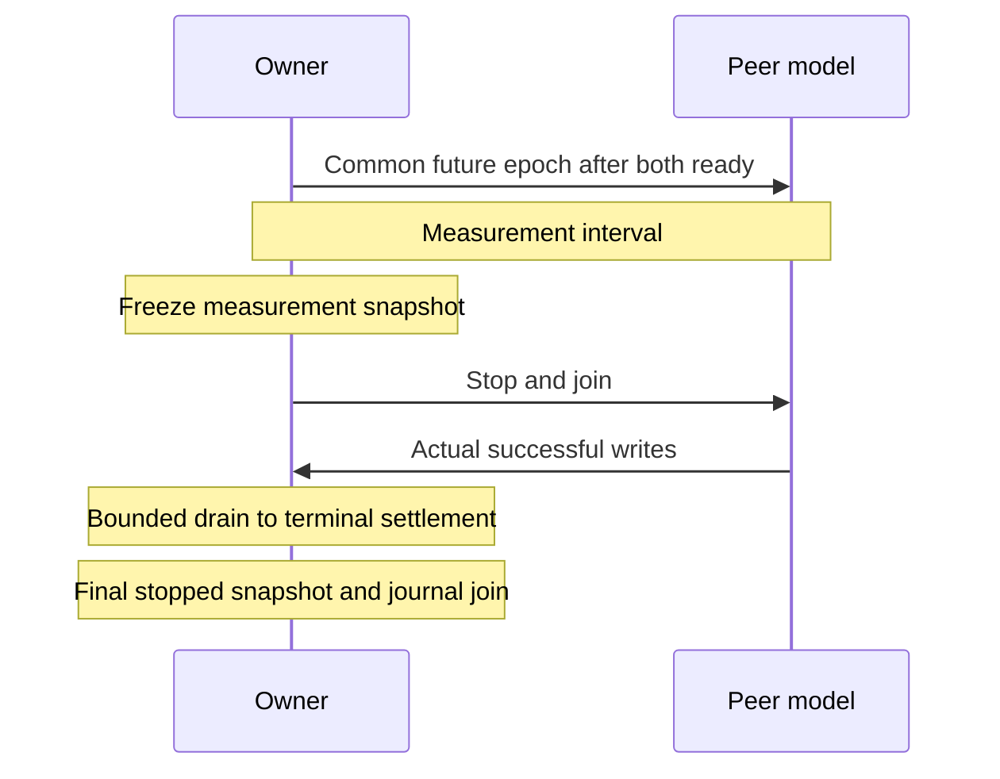

# ADR-0007: Фазы нагрузки и конечный учёт пакетов

| Поле | Значение |
|:---|:---|
| Статус | Политика принята; квалификация runtime отдельно |
| Дата | 2026-10-24 |
| Поправка поколения CPU | 2026-10-29 |
| Поправка зачёта CPU | 2026-10-29 |
| Поправка опроса CPU | 2026-10-29 |
| Поправка журнала завершения | 2026-10-29 |

## Контекст

Допуск в очередь не означает фиксацию владельцем. Независимые таймеры остановки могут завершить приём до достижения конечного результата успешной отправкой соседа. Одна истёкшая длительность не доказывает завершённость учёта пакетов, задержку или эталонную приёмку.

## Решение

Использовать существующую нагрузку ядра production-кода под управлением Go и независимую модель соседа. Полнота источника, подписки, конечных исходов, часов и причинных связей проверяется независимо.

### Размер очередей

Демон и владелец нагрузки используют `Q=min(65536,64+3*N)` для исходной очереди и очередей подписок. Учитывать настроенные сессии Control, включённых соседей Echo/VXLAN/Geneve, участников Micro-BFD и включённый предел Unsolicited с проверяемой арифметикой; совместные заявки могут завышать счёт. Резерв покрывает регистрацию и два изменения состояния на производителя, но не непрерывное пересоздание без потерь. Полный резерв помещается до N=21824 включительно.

Каждый подписчик требует O(Q) без общего бюджета подписчиков. Конструирование по умолчанию и устаревший канал сохраняют 64. Рост через API или перечитывание не меняет размер очередей или допуск. Переполнение исходной очереди выдаёт восстановительный GAP; переполнение подписчика сохраняет собственный GAP. Оба нарушают полноту журнала. Применить общую политику к обеим сторонам A/B до сравнения закрепления потоков. Источник: [размеры Manager](../../../internal/bfd/manager.go).

### Контракт фаз и конечного учёта

После Up владельца и готовности трафика соседа опубликовать одну будущую эпоху нативных монотонных часов. Обе роли проверяют идентичность пространства имён времени до преобразования в таймер Go. Закрытые файлы управления `os.Root` с проверенным владельцем ограничены 64 байтами, отклоняют ссылки и специальные файлы и запрещают замену завершённых публикаций. Интервал неопределённости преобразования не ограничивает полную неопределённость часов RX.

Требовать `successful peer writes = owner committed + terminal rejections + observed kernel drops`. Слагаемые не пересекаются; промежуточные стадии приёма и очереди не входят в уравнение. Избыток конечных исходов сразу означает отказ; недостаток означает отказ при сроке завершения обмена с неполным отчётом. Отсутствующие образцы переполнения не обосновывают вымышленные потери.

Разделять замороженный снимок измерений и остановленный снимок всего времени жизни. Деление счётчиков рукопожатия и завершения на запрошенную длительность не даёт пропускную способность окна. Снятие снимков не является одновременным наблюдением; неизвестные данные часов остаются неизвестными. Команды без каталога управления сохраняют независимые таймеры и явные ограничения. Источники: [протокол фаз](../../../test/internal/bfdload/control_phase_linux.go), [конечный учёт](../../../test/internal/bfdload/controlled_owner_linux.go).

### Допуск ресурсов и нагрузка на них

Использовать запросы буферов приёма и передачи по умолчанию демона для сокетов владельца нагрузки, включая пересоздание. Повторно использовать существующие настройки получателя и отправителя; не подставлять значения ОС и не менять sysctl хоста. Независимо записать эффективную ёмкость ядра и наблюдаемые потери. Это согласует настройку транспорта с демоном, но не квалифицирует пропускную способность или потери. Источники: [владелец](../../../test/internal/bfdload/owner_linux.go), [значения по умолчанию](../../../internal/config/config.go).

| Вход | Фиксированный контракт | Граница измерения |
|:---|:---|:---|
| Запас PID | Каждый видимый некорневой предок: `pids.max−pids.current≥sessions+64` | Последовательная проверка, не резервирование или доказательство пика; отсутствующие, некорректные или тесные пределы отклоняются |
| Нагрузка CPU | Число рабочих goroutine по эффективному GOMAXPROCS, максимум 8; окна 100 мс; доля по CPU потока, последнее окно обрезается | Фактические CPU, реальное время, опоздания и пропущенные бюджеты; долг не переносится |
| Нагрузка GC, по умолчанию выключена | До 64 × 64 KiB объектов за окно, максимум 256 ссылок =16 MiB, касание страниц | Серии, выделения и освобождённые ссылки; немедленный возврат RSS не обещается |
| Нагрузка планировщика, по умолчанию выключена | 4 помощника/GOMAXPROCS, максимум 32; до 64 раундов за окно по 1024 итерации смеси + Gosched | Число уступок не равно числу переключений контекста ОС |

Подготовить помощников до общей эпохи; проверять отмену и сроки реального времени, пропускать истёкшие окна. Присоединить рабочие goroutine CPU/GC/планировщика до заморозки измерений и завершения обмена при успехе и отказе. Помощники CPU закрепляются только для измерения CLOCK_THREAD_CPUTIME_ID и снимают закрепление при выходе; помощники планировщика не закреплены. Не менять GOGC, GOMEMLIMIT, политику планировщика и не вызывать принудительный GC. Работа опроса CPU и runtime входит в измеренный CPU потока. Запрос 80% не доказывает удержанную нагрузку хоста; отдельно откалибровать допущенные ресурсы.

Помощники CPU добровольно уступают исполнение примерно после 5 мс измеренного CPU потока, пока текущий бюджет не выполнен. Полный бюджет 80 мс CPU допускает максимум 15 добровольных контрольных точек. Сохранить исходное окно реального времени 100 мс, полный бюджет CPU, проверки отмены и запрет переноса долга; ожидание после уступки не является потреблённым CPU. Gosched сохраняет закреплённый поток помощника и освобождает его P без гарантии задержки реального времени или таймера продукта. Записать SHA исходников как поколение нагрузки и использовать то же поколение с обеих сторон A/B; не объединять более ранние распределения. Строгие проверки фактического CPU и нуля пропущенных окон не меняются. До квалификации этого поколения требуется новая нативная калибровка.

Засчитывать CPU окну только тогда, когда неубывающий образец часов потока получен строго до срока реального времени. Повторно проверить реальное время после вызова часов и до обновления зачтённого бюджета. Поздний образец сохраняет последний своевременный зачёт; невыполненный бюджет остаётся пропущенным окном, даже если CPUTimeNS за время жизни включает более позднюю работу. Этот консервативный учёт не экстраполирует неизвестное время завершения. Проверять отмену и реальное время до каждого общего фрагмента работы; читать CLOCK_THREAD_CPUTIME_ID каждые четыре фрагмента. Незавершённая серия фрагментов работы не даёт зачёта. Сохранить порог уступки 5 мс; опрос может отложить решение, поэтому ни число фрагментов, ни порог не ограничивают задержку реального времени. Это поколение требует новой сопоставимой нативной квалификации.

Сохранять до 16 образцов пропущенных окон на каждого рабочего CPU с резервированием до фазы; объединять до 128 для восьми рабочих и сообщать о каждом пропущенном образце. Образец указывает индексы рабочего и окна с нуля, запланированное смещение, обрезанное окно и исходный бюджет. Отделять принятый CPU от последнего успешно прочитанного неубывающего образца CPU, включая отклонённый поздний. Поля реального времени повторно используют существующие проверки как монотонные смещения от планового начала окна; признаки known отличают отсутствующие показания. Последняя проверка реального времени не является отметкой возврата при отмене или ошибках часов. Метки выхода определяют наблюдаемую ветвь, а не причину в планировщике, GC или системном вызове. Диагностический учёт добавляет стоимость наблюдения при неизменной частоте вызова часов; отдельно квалифицировать это поколение исходников. До нового запуска собрать строгую программу чтения отчёта с этой схемой; сохранить отклонение неизвестных полей и все пороги приёмки CPU. Источник: [доказательства отказов CPU](../../../test/internal/bfdload/cpu_failure_linux.go).

Пределы PID учитывают потоки и потомков; GOMAXPROCS не ограничивает создание потоков. Сохранить консервативный бюджет задач исходного варианта с закреплением до обоснования изменения нативными измерениями A/B. Источники: [допуск](../../../test/internal/bfdload/admission_linux.go), [CPU](../../../test/internal/bfdload/cpu_pressure_linux.go), [GC](../../../test/internal/bfdload/gc_pressure_linux.go), [планировщик](../../../test/internal/bfdload/scheduler_pressure_linux.go).

### Пересоздание сессий, по умолчанию выключено

Циклически обрабатывать по одному слоту Up из фиксированного манифеста адресов: первый запуск через 250 мс после эпохи, затем каждые пять секунд без повтора пропущенных циклов. Освободить фактическую последнюю заявку Manager, дождаться завершения обмена, выдержать разрыв регистрации 200 мс, пересоздать ту же идентичность и потребовать наблюдаемый Up. Ожидать максимум пять секунд внутри измерения; не начинать, если осталось менее пяти секунд. Включённые стенды требуют минимум шесть секунд. Считать слоты вне Up и пропущенные завершающие циклы; отсутствие фактического восстановления означает отказ.

Объявляемая нижняя граница AdminDown одна секунда при множителе 3 требует минимум трёх секунд завершения обмена. Трафик соседа продолжается независимо. Подписаться до пересоздания. Сериализовать изменение инвентаризации, Close и снимки одной блокировкой; отклонять создание после начала закрытия. Каждый слот хранит только текущую аренду и накапливает счётчики завершённых поколений после присоединения. Записать поколения, discriminator, исходные порты, времена фаз и число объектов до освобождения, во время отсутствия и после восстановления. Начало освобождения и конец завершения обмена ограничивают момент удаления; ни одно не является его точной отметкой.

Разделять взаимно однозначные счётчики Manager/demux, активные gauge и сохранённые ряды метрик. Ограничить хранение событий времени жизни для профиля 24 часа / пять секунд и считать пропуски. Присоединить пересоздание до заморозки; свести учёт всего времени жизни между поколениями. Повтор фиксированного манифеста не квалифицирует произвольный рост уникальных меток. Источники: [пересоздание](../../../test/internal/bfdload/session_churn_linux.go), [инвентаризация](../../../test/internal/bfdload/owner_churn_linux.go).

### Журнал Down

Владелец нагрузки включает `WithShutdownNotificationDrain` при создании Manager. Close отклоняет новые изменения, отменяет производителей и диспетчер и присоединяет рабочие goroutine, кроме подписчиков, пока физические идентичности ещё зарегистрированы. Затем он доставляет изменения из очереди с совпадающим SessionRef, закрывает и присоединяет подписчиков и освобождает ресурсы. Финальная доставка сохраняет исходное свидетельство и не выполняет управление Micro-BFD или очистку Unsolicited. Ожидающая потеря исходной очереди всё равно даёт GAP; отменённые или медленные подписчики могут остаться неполными. Close Manager по умолчанию сохраняет семантику отбрасывания, а устаревший канал не открывается повторно после EOF диспетчера. Произвольные обратные вызовы отправителя по-прежнему не имеют универсального срока завершения. Источники: [завершение](../../../internal/bfd/manager_shutdown.go), [владелец](../../../test/internal/bfdload/owner_linux.go).

Запустить одного ограниченного подписчика на настройку, измерение и завершение. Снимать знаменатель отсечки с фактического исходного счётчика Up→Down коллектора, который увеличивается до отметки уведомления и постановки в очередь. Разделять плановую отсечку и фактическое завершение чтения. Заморозить измерения до остановки, завершения обмена и присоединения журнала; использовать этот снимок для разностей гистограмм.

Сохранять максимум maxDownEvents компактных строк с монотонными отметками до определения фазы. Считать все уведомления до и после отсечки, но хранить строки `down_events` только в [start,end); счёт до отсечки включает настройку. После присоединения владельцев требовать обычного закрытия подписки за пять секунд, иначе отменить и присоединить.

Полнота требует равенства конечного исходного счётчика сумме наблюдений до и после и `before≤cutoff source≤final source`. GAP, переполнение, некорректные счётчики, незакрытая подписка или несовпадение означают отказ. Поздние события не компенсируют ранние потери; не вычитать выборочно измеренные стартовые колебания. Повторно использовать метрики без барьера в горячем пути. Одна полнота не доказывает намеренный Down или валидность фиксации и часов. Источник: [журнал](../../../test/internal/bfdload/down_journal_linux.go).

### Blackhole и оценка

Инженерный профиль использует 5000 сессий, 300 мс, 30 минут, случайные потери и нагрузку CPU с секундным blackhole каждые 10 минут. Полные измеряемые окна начинаются на минутах 10 и 20. Эталонный профиль сохраняет секундные окна каждые 30 минут за 24 часа. Первый blackhole на отсечке 30 минут не может квалифицировать инженерные отказ и восстановление. Записать различия профилей; более ранние инженерные запуски с периодом 30 минут не квалифицируют исправленную нагрузку.

Положительный стенд Control с фактическим UDP использует множитель 1 и плановый джиттер 75–90% для запаса диспетчеризации. Именованные профили сохраняют множитель 3. Избирательное доказательство старого срока в [ADR-0012](0012-owner-down-transition-witness.md) использует фактические захваченные времена Up и проверяемое продление срока без допуска по номинальному ритму. Предыдущая политика ритма отклоняла разрывы выше согласованного интервала, включая дробные превышения; сохранять её оценки отдельно от повторных оценок по изменённой модели.

`bfdload assess OWNER_JSON PEER_JSON` объединяет один канонический остановленный эталонный или инженерный запуск. До числовых порогов требовать полных доказательств профиля, допуска, учёта и причинных связей. Использовать границы калибровки производителей и точные целочисленные ранги CDF на границах гистограммы эффектов 25/50 мс. Разделять знаменатели RX, диспетчеризации, успешного эффекта, отсутствия эффекта и некорректных событий; точное сведение счётчиков требует остановленных наблюдений.

Измеренные нарушения и ложный Down означают отказ. Неизвестные или некорректные доказательства означают неполноту; неразрешённый Control Down — числовой отказ, неразрешённый Echo — неполноту. Оба сохраняют структурированный отчёт и ненулевой код. У инженерного профиля нет вымышленных шестичасовых подокон. Программы чтения сохраняют числовые наносекундные длительности, но отклоняют повторяющиеся или неизвестные поля и некорректный Unicode.

Успех остаётся условным относительно допущений часов и транспорта; сериализованный ввод не восстанавливает закрытое монотонное покрытие. Полная неопределённость остаётся null, а reference_qualified — false. Нативная дисциплина часов, происхождение исходников, обязательные варианты и приёмка выпуска остаются отдельными. Источники: [оценка](../../../test/internal/bfdload/assessment_linux.go), [классификация](../../../test/internal/bfdload/down_classification_linux.go), [ADR-0012](0012-owner-down-transition-witness.md).

### Нагрузка Echo

Явный `--echo` записывает режим без изменения размеров именованного профиля. Повторно использовать Manager, аренды, фазы, нагрузку ресурсов, пересоздание и завершение обмена. Топология с обоими семействами адресов сохраняет по одному адресу владельца на семейство и порт приёма 3785; проверка Control не меняется.

Соседи возвращают только фактически принятые байты, включая дополнение, с TTL/Hop Limit 254. Проверять кодек, IP-кортеж и входной TTL до решения о потере RX; аутентифицированный ввод не поддерживается. Каждый сохранившийся вход даёт одно решение о возврате без FSM Control соседа или автономной периодической передачи. Готовность означает фактическую запись возврата. Пропуск RX из-за blackhole не создаёт попытку TX.

Регистрировать метрики один раз на физическое создание Echo и снимать регистрацию после того, как финальное освобождение или Close Manager присоединит владельца. Совместимые заявки делят регистрацию. Считать фактические физические записи Manager, а не сохранённые ряды. У Echo нет обмена Control AdminDown, но консервативные бюджеты пересоздания сохраняются.

Пропуски сохраняют исходную последовательность Read, связывая решения RX и возврата TX. Сохранять границы журнала и независимые счётчики чтения, возврата и потери. Валидность означает проверку кодека, кортежа и TTL, а не аутентификацию RFC или доставку. Свести текущие и завершённые возвраты с зафиксированной доставкой Echo; Read соседа не может превышать TX владельца за время жизни. Задержка Echo kernel-RX явно not_applicable. Классификация старого срока следует ADR-0012 без удалённого Up или предполагаемого трафика Control.

Источники: [сосед Echo](../../../test/internal/bfdload/echo_peer_linux.go), [владелец](../../../test/internal/bfdload/owner_echo_linux.go), [модель пропусков](../../../test/internal/bfdload/echo_omission_linux.go). Нативная квалификация Echo остаётся обязательной.

## Последствия

Приёмка реализации отделена от эталонных распределений, политики регрессии, нативного A/B и окончательных проверок линии и 24-часового выпуска. Успешный локальный стенд не квалифицирует полную нагрузку демона, точность часов или стабильную поставку и не обосновывает новый быстрый путь планировщика или ядра.

## Источники

- [Границы производительности и часов](../14-performance-analysis.md).
- [RFC 5880 §6.8.4](../../rfc/rfc5880.txt).
- [Свидетельство Down владельца и условные причинные связи](0012-owner-down-transition-witness.md).
