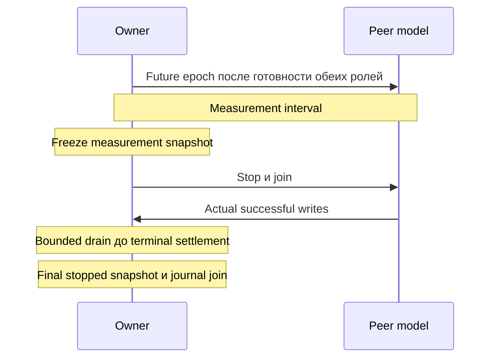

# ADR-0007: Фазы workload и конечный учёт пакетов

| Поле | Значение |
|:---|:---|
| Status | Accepted policy; runtime qualification separate |
| Date | 2026-10-24 |

## Контекст

Queue admission не равен owner commit. Независимые stop timers могут остановить приём до terminal outcome успешной peer write. Elapsed duration не доказывает packet settlement, latency либо reference acceptance.

## Решение

Используется existing Go-owned production-core workload и independent peer model. Source, subscription, terminal, clock и causal completeness проверяются независимо.

### Queue population

Daemon и workload owner задают `Q=min(65536,64+3*N)` для raw/per-subscription queues. Configured Control sessions, enabled Echo/VXLAN/Geneve peers, Micro-BFD members и unsolicited limit суммируются с checked arithmetic; shared claims могут завысить оценку. Reserve покрывает registration и два state changes на producer, но не sustained lossless churn. Полный reserve помещается до N=21824.

Каждый subscriber требует O(Q), global subscriber budget отсутствует. Default construction и legacy channel сохраняют 64. API/reload growth не меняет размер либо admission. Raw overflow создаёт recovery GAP; subscriber overflow — свой GAP. Любой из них нарушает journal completeness. Примените shared policy к обеим A/B сторонам до сравнения thread pins. Источник: [Manager sizing](../../../internal/bfd/manager.go).

### Phase и terminal contract

После owner Up и готовности peer traffic публикуется future native-monotonic epoch. Обе роли проверяют time-namespace identity до Go-timer conversion. Owner-checked private `os.Root` control files ограничены 64 байтами, отклоняют links/special files и replacement complete publication. Conversion bracket не ограничивает total RX-clock uncertainty.

Требуется `successful peer writes = owner committed + terminal rejections + observed kernel drops`. Члены не пересекаются; intermediate accepted/queued stages не входят. Excess terminal counts дают immediate failure; missing counts — incomplete report на drain deadline. Отсутствие overflow samples не разрешает выдумывать drops.

Frozen measurement и stopped lifetime snapshots различаются. Handshake/drain counts, делённые на requested duration, не дают window throughput. Sampled snapshots не одновременны; unknown clocks остаются unknown. Команды без control directory сохраняют independent timers/explicit limits. Источники: [phase protocol](../../../test/internal/bfdload/control_phase_linux.go), [terminal accounting](../../../test/internal/bfdload/controlled_owner_linux.go).

### Resource admission и pressure

| Input | Fixed contract | Measurement boundary |
|:---|:---|:---|
| PID headroom | Каждый visible nonroot ancestor: `pids.max−pids.current≥sessions+64` | Sequential check без reservation/peak proof; missing/malformed/tight limits отклоняются |
| CPU pressure | Effective GOMAXPROCS workers, max 8; окна 100 мс; thread-CPU duty, truncated last | Actual CPU/wall/lateness/missed budgets; без debt carry |
| GC pressure, default off | До 64 × 64 KiB objects/window, max 256 refs =16 MiB, page touch | Batches/allocations/released refs; без immediate RSS reclamation |
| Scheduler pressure, default off | 4 helpers/GOMAXPROCS, max 32; до 64 rounds/window: mix 1024 iterations + Gosched | Yield count не равен OS context switches |

Подготовьте helpers до epoch; проверяйте cancellation/deadlines, пропускайте elapsed windows. Join CPU/GC/scheduler предшествует freeze/drain при success/failure. CPU helpers pin только для CLOCK_THREAD_CPUTIME_ID и unlock на выходе; scheduler helpers unpinned. Не меняйте GOGC, GOMEMLIMIT, scheduler policy и не форсируйте GC. CPU polling/runtime work входит в measured thread CPU. Requested 80% не доказывает held host load; отдельно калибруйте admitted resources.

PID limits считают threads/descendants; GOMAXPROCS не ограничивает создание threads. Conservative pinned-baseline budget сохраняется до measured native A/B. Источники: [admission](../../../test/internal/bfdload/admission_linux.go), [CPU](../../../test/internal/bfdload/cpu_pressure_linux.go), [GC](../../../test/internal/bfdload/gc_pressure_linux.go), [scheduler](../../../test/internal/bfdload/scheduler_pressure_linux.go).

### Session churn, default off

Один Up slot fixed manifest обрабатывается за раз: первый cycle через 250 мс от epoch, далее cadence пять секунд без replay missed cycles. Освободите real final Manager claim, join drain, выдержите registration gap 200 мс, создайте прежнюю identity и дождитесь Up. Ожидание не более пяти секунд внутри measurement; новый cycle не начинается при остатке меньше пяти секунд. Enabled fixture требует минимум шесть секунд. Учитывайте not-Up slots/trailing skipped cycles; отсутствие actual recovery даёт failure.

AdminDown floor одна секунда при multiplier 3 требует минимум три секунды drain. Peer traffic независим. Subscribe выполняется до churn. Inventory mutation, Close и snapshots сериализуются одним lock; creation после closing отклоняется. Slot хранит только current lease, retired counters суммируются после join. Сохраняются generations, discriminators, source ports, phase times и cardinality до release/при отсутствии/после recovery. Release-start и drain-end ограничивают removal, но не задают exact instant.

Manager/demux count, active gauges и retained metric series различаются. Lifetime event storage ограничено для 24-hour/five-second profile, omissions учитываются. Join churn выполняется до freeze; ledger охватывает все generations. Fixed-manifest reuse не квалифицирует arbitrary unique-label growth. Источники: [churn](../../../test/internal/bfdload/session_churn_linux.go), [inventory](../../../test/internal/bfdload/owner_churn_linux.go).

### Down journal

Один bounded subscriber работает через setup/measurement/shutdown. Cutoff denominator снимается с реального Up→Down source counter, увеличиваемого до notification timestamp/enqueue. Planned cutoff и actual sample completion сохраняются отдельно. Measurement freeze предшествует stop/drain/journal join и задаёт histogram deltas.

Хранятся максимум maxDownEvents compact rows с monotonic timestamps до определения phase. Считаются все notifications before/after cutoff; `down_events` rows сохраняются только в [start,end), before-cutoff включает setup. После owners join требуется normal subscription closure за пять секунд; иначе cancel/join.

Completeness требует final source count = before+after observations и `before≤cutoff source≤final source`. GAP, overflow, invalid counters, unclosed subscription и mismatch дают failure. Поздние events не компенсируют раннюю потерю; sampled startup flaps не вычитаются. Используются existing metrics без hot-path fence. Completeness не доказывает intentional Down либо commit/clock validity. Источник: [journal](../../../test/internal/bfdload/down_journal_linux.go).

### Blackholes и assessment

Engineering: 5000 sessions, 300 мс, 30 минут, random loss/CPU pressure и one-second blackhole каждые 10 минут. Полные measured windows начинаются на минутах 10/20. Reference сохраняет one-second windows каждые 30 минут за 24 часа. Первый blackhole на 30-minute cutoff не квалифицирует engineering failure/recovery. Profile differences фиксируются; старые engineering runs с периодом 30 минут не подтверждают новый workload.

Positive actual-UDP Control fixture использует multiplier 1 и planned jitter 75–90% для dispatch headroom. Named profiles сохраняют multiplier 3; actual omission gaps выше interval остаются unresolved, включая fractional overruns.

`bfdload assess OWNER_JSON PEER_JSON` объединяет один canonical stopped reference/engineering run. Полнота profile/admission/ledger/causal evidence проверяется до thresholds. Используются producer calibration bounds и exact integer CDF ranks на effect-histogram boundaries 25/50 мс. RX, dispatch, successful-effect, no-effect и invalid denominators различаются; exact settlement требует stopped observations.

Measured violations/false Down дают failure. Unknown/malformed evidence — incomplete; unresolved Control Down — numeric failure, unresolved Echo — incomplete. Оба сохраняют structured report/nonzero exit. Engineering не создаёт six-hour subwindows. Readers сохраняют numeric nanosecond durations, но отклоняют duplicate/unknown fields и invalid Unicode.

Passing условен относительно clock/transport assumptions; serialization не восстанавливает private monotonic coverage. Total uncertainty остаётся null, reference_qualified — false. Native clocks, source provenance, required variants и release acceptance отдельны. Источники: [assessment](../../../test/internal/bfdload/assessment_linux.go), [classification](../../../test/internal/bfdload/down_classification_linux.go), [ADR-0012](0012-owner-down-transition-witness.md).

### Echo workload

Явный `--echo` фиксирует mode, не меняя named profile dimensions. Используются Manager, leases, phases, pressure, churn и drain. Mixed-family topology сохраняет один owner address/family и port 3785; Control validation прежняя.

Peer возвращает только actual received bytes, включая padding, с TTL/Hop Limit 254. Codec/IP tuple/inbound TTL проверяются до RX-loss decision; authenticated input не поддерживается. Surviving input даёт один return decision без peer Control FSM и autonomous periodic TX. Readiness требует actual return write. RX blackhole omission не создаёт TX attempt.

Metrics регистрируются один раз при physical Echo creation, unregister выполняется после owner join при final release/Manager close. Compatible claims разделяют registration. Учитываются physical Manager entries, а не retained series. Echo не передаёт Control AdminDown, но сохраняет conservative churn budgets.

Omissions содержат original Read sequence для объединения RX/return-TX decisions. Сохраняются journal bounds и независимые read/return/drop counters. Valid означает codec/tuple/TTL check, а не RFC authentication/delivery. Current/retired returns сопоставляются committed Echo delivery; peer Read не превышает lifetime owner TX. Echo kernel-RX latency имеет not_applicable. Old-deadline classification следует ADR-0012 без remote Up либо вымышленного Control traffic.

Источники: [Echo peer](../../../test/internal/bfdload/echo_peer_linux.go), [owner](../../../test/internal/bfdload/owner_echo_linux.go), [omission model](../../../test/internal/bfdload/echo_omission_linux.go). Native Echo qualification остаётся обязательной.

## Последствия

Implementation acceptance отделена от reference distributions, regression policy, native A/B и final wire/24-hour release gates. Local fixture не квалифицирует full-daemon load, clock accuracy либо stable delivery и не обосновывает новый scheduler/kernel fast path.

## Источники

- [Performance/clock boundaries](../14-performance-analysis.md).
- [RFC 5880 §6.8.4](../../rfc/rfc5880.txt).
- [Owner Down witness и conditional causality](0012-owner-down-transition-witness.md).
