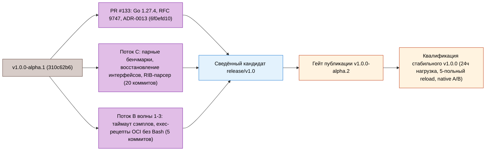

# Ретроспектива выпуска v1 и сведение потоков разработки — 2026-11-27

[Английская версия](../../en/audits/2026-11-27-release-retrospective.md).

Документ сравнивает [ретроспективу выпуска от 26 октября](2026-10-26-release-retrospective.md) (`dev@1c535f9ac1de7a12f7d85054a9d0fe81216f02c0`) с состоянием `release/v1.0@6f0efd108c7a66f291818063e2c447c676ef0dd8` (влитый pull request `#133`) и фиксирует сведение разошедшихся после `v1.0.0-alpha.1` локальных потоков работ в `release/v1.0`. Область выпуска задают [контракт продукта](../reference/production-contract.md) и его принятые поправки. Оценка фиксирует техническое состояние на дату и не разрешает публикацию стабильного релиза.

## Изменения после ретроспективы 26 октября

Между `1c535f9ac1de7a12f7d85054a9d0fe81216f02c0` и `6f0efd108c7a66f291818063e2c447c676ef0dd8` ветка `release/v1.0` включает 253 коммита и 543 изменённых файла (`+59 134/-33 561` строк; 864 отслеживаемых Go-файла):

| Область | Файлов изменено | Добавлено | Удалено |
|:---|---:|---:|---:|
| Runtime и API без тестов и сгенерированного кода | 52 | 2 332 | 350 |
| Тесты, инструменты, скрипты, рецепты контейнеров и CI | 358 | 47 222 | 3 959 |
| Документация и данные цепочки поставки под docs | 119 | 9 235 | 29 173 |
| Сгенерированные пакеты protobuf | 0 | 0 | 0 |
| Корневая конфигурация и метаданные сборки | 14 | 345 | 79 |

Ключевые блокеры поставки и протокола, закрытые в исходном коде `release/v1.0` к коммиту `6f0efd108c7a66f291818063e2c447c676ef0dd8`:

| Область | Подтверждённая граница в `release/v1.0` | Доказательство |
|:---|:---|:---|
| Канал экспериментальных пререлизов | Разрешён канал `v1.0.0-alpha.N` ([ADR-0008](../adr/0008-experimental-prerelease-boundary.md)); создан неизменяемый тег `v1.0.0-alpha.1` на `310c62b61254f702fbbbe84496b3dea7967dcf63` | Тег Git `v1.0.0-alpha.1`, активные ruleset веток и тегов |
| Владение GoBGP при рестарте и Unix IPC | Квитанции эпохи спикера по `SO_PEERCRED` ([ADR-0013](../adr/0013-gobgp-restart-disable-ownership.md)), локальные `unix://` сокеты (`#131`, `#132`) и привязка `--api-hosts=127.0.0.1:50051` в манифестах Kubernetes | Pull request `#133`, `internal/gobgp/`, `deployments/integrations/kubernetes/manifests/daemonset.yml` |
| Стек компилятора, пиры Debian trixie и нулевой список исключений CVE | Go `1.27.4`, `debian:trixie-slim@sha256:8aa5a7bf5a1955bddbe7d74fcdd0b91ab30e74362a8b73af672b0481b35b44a0` (включая пиры FRR `10.7.1` и BIRD `3.4.0`), `GoBGP v4.11.0`, `GoReleaser v2.20.3`, `Syft v1.57.2`, `Trivy v0.76.2`, `Compose v5.8.0`; `0` записей в `allowlist` | `scripts/vuln-audit.go`, `test/interop/`, CI run `45973518398` |
| Усиление RFC 5880, RFC 9747 и планирования горутин | Медленная передача Echo вне `Up` (`max(TxInterval, 1s)`), отказ для интервалов `< 1µs`, fail-closed проверка длины auth-секции и `DetectMult`, граница `[75%, 90%]` в `ApplyJitter` при `DetectMult == 1` и снятие постоянного `runtime.LockOSThread` (`bb6668fc`) | `internal/bfd/`, E2E run `45973518378` |
| Детерминизм hosted CI | Сохранение `argv[0]` при запуске `/proc/self/fd/3` для `uutils` на Ubuntu 26.04, исключение переиспользования inode `ext4` в тестах сокетов, единственный владелец кэша Go-модулей | CI run `45973518398`, E2E run `45973518378` |

## Расхождение локальных веток после alpha.1 и их сведение

После `v1.0.0-alpha.1` (`310c62b61254f702fbbbe84496b3dea7967dcf63`) локальная разработка разделилась на три изолированных worktree на фоне блокировки публикации черновика `alpha.1` шагом парного сравнения бенчмарков с `v0.6.4`. Сведение чистых по линтеру волн поверх `6f0efd108c7a66f291818063e2c447c676ef0dd8` объединяет завершённые изменения при сохранении прототипных и диагностических веток под backup-ссылками:

| Срез изменений | Решение для `release/v1.0` | Обоснование |
|:---|:---|:---|
| Парный overlay бенчмарков (`decode-packet-per-iteration-v1`), `-race` preflight и лимит 120 с на сэмпл | Интегрировано | Устраняет гонку владения буфером в baseline и выравнивает измеряемые границы относительно `v0.6.4` |
| Проверенные оптимизации RX demux (переиспользование `transportScope` и конкретный `*Manager` в `delivery`) | Интегрировано | Сохраняет 0 аллокаций и потокобезопасность; пять непроверенных экспериментов со снятием блокировок исключены |
| Восстановление сессий и аренд привязки после пересоздания сетевого интерфейса | Интегрировано | Восстанавливает привязки `SO_BINDTODEVICE` отправителя/слушателя и сохраняет локальную причину `AdminDown` при drain |
| Инвентаризация функций и CPU-профилей (`repoquality code`) и строгий парсер GoBGP RIB JSON | Интегрировано | Отделяет тестовую обвязку от метрик промышленного кода и отклоняет обрезанный вывод RIB |
| Отказ от установки Bash и перевод диагностических/dev `Containerfile` на exec-форму | Интегрировано | Удаляет пакет `bash` и shell-шаги `RUN` при сохранении проверенного по SHA-256 `Compose v5.8.0` |
| Очистка образов E2E/Compose по ID и проверка архивов/UID/containerd в Kubernetes (`Поток B` волны 4–5) | Зафиксировано в тематической ветке; вынесено в волну 2 | Сохранено под `refs/backups/20261127/*`; требует устранения 387 замечаний `cyclop`/`wrapcheck`/`govet`/`lll` до слияния |
| Отдельный граф сборки Docker Compose из исходников (`прототип v5.6.1`) | Вынесено в отдельную волну | В `release/v1.0` уже квалифицирован бинарный `Compose v5.8.0`; исходный граф требует предварительного подъёма до `v5.8.0` |
| Диагностическая атрибуция окон CPU (`695b2fa1`) | Припарковано в ветке диагностики | Дополнительные чтения часов на каждое окно вносят неограниченную стоимость наблюдателя |

## Иерархия задач и оставшийся объём до v1

Показатели ниже измерены по иерархии работ v1 на коммите `6f0efd108c7a66f291818063e2c447c676ef0dd8` непосредственно перед закрытием сведённых post-`alpha.1` задач для сопоставимости с октябрьскими срезами:

| Показатель | 23 октября | 26 октября | 27 ноября |
|:---|---:|---:|---:|
| Потомков | 423 | 523 | 698 |
| Закрытых потомков | 293 | 384 | 535 |
| Незакрытых потомков | 130 | 139 | 163 |
| Листовых задач | 322 | 392 | 528 |
| Незакрытых листьев | 84 | 75 | 85 |
| Незакрытые листья по приоритетам P0/P1/P2/P3 | 8/51/24/1 | 7/41/26/1 | 7/39/38/1 |

Число записей не выражает процент готовности: прирост листьев вызван детализацией проверок пререлиза, владения образами и Kubernetes, при этом `535` закрытых записей (`+151` к 26 октября) сняли блокеры `Go 1.27.4`, `GoBGP v4.11.0`, уязвимостей модулей, Unix-владения и медленного темпа RFC 9747.

| Оставшийся гейт | Целевой канал | Требуемое доказательство |
|:---|:---|:---|
| Вливание сведённого post-`alpha.1` PR (волны 1–3) и выпуск `v1.0.0-alpha.2` | `v1.0.0-alpha.2` | Успешные hosted `CI`, `PR-safe E2E`, парное сравнение в `release.yml`, проверенные draft-артефакты и package lifecycle |
| Приведение волн 4–5 `Потока B` к 92 линтерам и квалификация интеграционных потребителей Debian trixie | `v1.0.0` stable | Нулевой вывод `cictl lint` по хелперам владения образами и Kubernetes containerd + живые проверки BGP failover, ExaBGP и K8s |
| Запись нативного сравнения A/B (Control и Echo) после снятия `runtime.LockOSThread` | `v1.0.0` stable | Нативное сравнение A/B на 1 000 сессиях в пределах `2*GOMAXPROCS+32` потоков ОС без регрессии таймеров |
| Сквозная wire-квалификация 5-польного безразрывного reload на поддерживаемых пирах | `v1.0.0` stable | Дампы трафика и сохранение `Up` с закреплёнными FRR `10.7.1` и BIRD `3.4.0` на замороженном кандидате |
| Допуск эталонного раннера, инженерный гейт 5 000 сессий и 24-часовой прогон 1 000 сессий | `v1.0.0` stable | 24 ч на изолированном Debian-раннере 8 vCPU / 8 GiB (`p99 <= 25 мс`, `p99.9 <= 50 мс`, `RSS <= 512 МиБ`, дрейф `< 5%`) |
| Финальный аудит кандидата, журналы изменений и синхронизация веток (`release/v1.0`, `master`, `dev`) | `v1.0.0` stable | Проверка подписанных deb/rpm/OCI/SBOM/provenance артефактов, паритет `CHANGELOG*.md` и перенос в `dev` |

## Инженерная оценка

Диапазоны ниже оценивают активные инженерные часы без учёта внешнего ожидания инфраструктуры; родительские и дочерние работы не суммируются повторно:

| Пакет работ | Активных часов |
|:---|---:|
| W1: вливание сведённого post-`alpha.1` PR (волны 1–3), выпуск `v1.0.0-alpha.2` и проверка hosted package lifecycle | 2–4 |
| W2: устранение замечаний линтера в волнах 4–5 `Потока B`, source-built `Compose v5.8.0` и проверки интеграционных стендов trixie | 4–7 |
| W3: запись нативного сравнения A/B (Control/Echo) и инженерный гейт 5 000 сессий | 3–5 |
| W4: сквозная wire-квалификация 5-польного reload (`FRR 10.7.1`, `BIRD 3.4.0`) и проверка ancillary UDP-метаданных | 3–5 |
| W5: допуск изолированного эталонного раннера, финальный аудит кандидата, changelog и синхронизация веток | 4–6 |
| Активная инженерная работа до заморозки стабильного кандидата, всего | **16–27** |
| Обязательный эталонный прогон 1 000 сессий | **24 часа elapsed** |

## Выводы по процессу

1. **Единая вершина интеграции на релизную линию.** Параллельные неотправленные worktree (`20` и `43` коммита поверх `v1.0.0-alpha.1`) привели к дублированию исправлений и оставили незакоммиченные правки контейнеров и Kubernetes изолированными. Фиксировать изменения на тематических ветках сразу и вливать каждую проверенную волну до начала следующей.
2. **Полный прогон 92 линтеров до парковки прототипных веток.** `Поток C` и волны 1–3 `Потока B` прошли все 19 профилей `cictl lint` без замечаний, тогда как волны 4–5 `Потока B` накопили 387 замечаний цикломатической сложности и обёртки ошибок; изоляция волн 4–5 предотвращает блокировку `v1.0.0-alpha.2`.
3. **Отделение небезопасных микро-оптимизаций от проверенных правок.** Несинхронизированное чтение `time.Time` между горутинами и эксперименты с разделением мьютексов ухудшали либо потокобезопасность под `-race`, либо парную пропускную способность; сохранение backup-ссылок с переносом только проверенных коммитов (`0c93f227`) исключило регрессии горячего пути.
4. **Атомарное обновление компилятора, модулей и сканеров.** Одновременный переход на `Go 1.27.4`, `GoBGP v4.11.0`, `GoReleaser v2.20.3` и `x/crypto v0.59.0` позволил полностью очистить список исключений уязвимостей вместо продления сроков пересмотра.
