# Пострелизная ретроспектива v1.0.0 и формальный аудит RFC — 2026-11-28

[Английский оригинал](../../en/audits/2026-11-28-v1-post-release-retrospective-and-formal-rfc-audit.md).

Инженерная ретроспектива и формальный аудит протокола фиксируют завершённый выпуск `v1.0.0`, сопоставляют GoBFD с полным корпусом RFC и черновиков Internet-Draft рабочей группы IETF BFD по состоянию на ноябрь 2026 года и документируют машинно проверенные результаты в `Z3`, `TLA+ TLC`, `Lean 4`, `SageMath`, криптоаналитическую оценку и микробенчмарки `Go 1.27.4`. Документ дополняет [предрелизную сверку потоков от 27 ноября](2026-11-27-release-retrospective.md) и задаёт техническую основу плана развития ветки `dev` (`v1.1`).

## 1. Ретроспектива выпуска v1.0.0

### Хронология поставки и проверенные артефакты

Между `v1.0.0-alpha.1` (`310c62b61254f702fbbbe84496b3dea7967dcf63`) и опубликованным релизом `v1.0.0` (`release/v1.0@bc558130d37e489939f4b8764b6a9d1b568861da`, неизменяемый аннотированный тег `v1.0.0@1cac85e8083b38717066769f2db7b0d62ad7f11d`, синхронизированный с `master` и `dev` на `3bcdea03d3f05f21b14dd2a785e20805f642bf5f`) три параллельных потока разработки сведены через восемь проверенных pull request (`#133`–`#140`):

```mermaid
flowchart LR
    accTitle: Сведение потоков GoBFD v1.0.0, публикация релиза и синхронизация веток
    accDescr: Pull request 133-139 сводятся в release/v1.0, PR 134 формирует v1.0.0, release.yml публикует проверенные артефакты, PR 140 синхронизирует master и dev.
    A1["v1.0.0-alpha.1 (310c62b6)"]:::mgt --> W1["PR #133, #135, #136, #137: Go 1.27.4, GoBGP v4.11.0, OCI без Bash, 0 lint"]:::srv
    W1 --> W2["PR #138, #139: ADR-0014, аудит 115 документов, логотип"]:::srv
    W2 --> RP["PR #134: Release Please v1.0.0 (bc558130)"]:::leaf
    RP --> TAG["Тег v1.0.0 (1cac85e8) + release.yml (46083125672)"]:::brt
    TAG --> SYNC["PR #140: синхронизация master и dev (3bcdea03)"]:::leaf
    classDef mgt fill:#d7ccc8,stroke:#5d4037,color:#000
    classDef srv fill:#e1bee7,stroke:#7b1fa2,color:#000
    classDef leaf fill:#e3f2fd,stroke:#1976d2,color:#000
    classDef brt fill:#fff3e0,stroke:#bf360c,color:#000
```

| Этап | Ссылка | Измеренное доказательство |
|:---|:---|:---|
| Обновление стека, владение Unix-сокетом и темп Echo | Pull request `#133` (`6f0efd10`) | `Go 1.27.4`, `GoBGP v4.11.0`, квитанции эпохи спикера `SO_PEERCRED` по [ADR-0013](../adr/0013-gobgp-restart-disable-ownership.md), медленный темп `1 с` Echo вне `Up` |
| Контейнеры без Bash и защита ядра времени исполнения | Pull request `#135` (`a315549c`), `#136` (`53644fae`), `#137` (`e4f9c3b8`) | Exec-форма `Containerfile`, ресинхронизация Micro-BFD при потере уведомлений, лимит `4 096` неактивных peer-метрик, импорт архивов через containerd gRPC lease, `0` замечаний по 92 линтерам / 19 профилям |
| Выпуск линии `v1.0` на GoBGP v4 и аудит документации | Pull request `#138` (`816fc7e0`), `#139` (`a1f8c84c`) | [ADR-0014](../adr/0014-v1-gobgp-v4-release-line-baseline.md), прохождение `repoquality markdown` по `115` файлам `.md` и `36` диаграммам Mermaid |
| Выпуск и публикация `v1.0.0` | Pull request `#134` (`bc558130`), тег `v1.0.0` (`1cac85e8`) | Прогон `release.yml` `46083125672` (`SUCCESS`): `12` артефактов (`.deb`, `.rpm`, `.tar.gz`, CycloneDX SBOM, `checksums.txt`, подпись Cosign) + мультиархитектурные образы GHCR `:1.0.0` / `:latest` |
| Синхронизация ветки по умолчанию и `dev` | Pull request `#140` (`3bcdea03`) | Идентичное дерево `61b43f886e09a5943a9774c406dc9a654790b6d9` в `master` и `dev`; закрыты 12 устаревших PR Dependabot (`#111`–`#130`) для линии `v0.6`/GoBGP v3 |
| Очистка сборочного сервера | Гигиена контейнеров и кэшей | Освобождено `+43,1 ГиБ` на `/` (заполнение снижено с `97%` до `83%`) без затрагивания работающих инфраструктурных контейнеров |

### Инженерные выводы по итогам выпуска `v1.0.0`

1. **Изменения в `release/v1.0` требуют обязательного обратного слияния в `master` до закрытия релиза.** До слияния pull request `#140` ветка по умолчанию `master` сохраняла дерево `v0.6.4` без нового логотипа и обновлённого `README.md`. Обратное слияние зафиксировано как обязательный шаг завершения выпуска.
2. **Парные релизные бенчмарки должны выравнивать семантику владения памятью между версиями.** Сравнение `v1.0.0` с `v0.6.4` выявило гонку переиспользования структуры пакета в старом эталоне; выделенный профиль `decode-packet-per-iteration-v1` обеспечил эквивалентное измерение без ослабления порогов регрессии.
3. **Разделение продуктовых линий (`release/v0.6` на GoBGP v3 и `release/v1.0` на GoBGP v4) устранило блокировку очереди зависимостей.** Формализация границы в [ADR-0014](../adr/0014-v1-gobgp-v4-release-line-baseline.md) отделила несовместимые мажорные обновления gRPC API от сопровождения стабильных веток.
4. **Длительные нагрузочные испытания и проверка на аппаратных коммутаторах отделены от публикации исходного релиза.** Явная публикация уровней зрелости и включения профилей в `CapabilityService` (`CAPABILITY_MATURITY_PREVIEW` в паре с `CAPABILITY_ENABLEMENT_DISABLED` / `CAPABILITY_ENABLEMENT_ENABLED`) сохранила точные эксплуатационные гарантии `v1.0.0`, оставив 24-часовой soak-прогон и стенды физических NOS отдельными задачами квалификации.

## 2. Аудит актуальных RFC и черновиков IETF BFD WG (2026)

Сверка с базой IETF Datatracker рабочей группы BFD по состоянию на **2026-11-28** охватывает все опубликованные RFC категорий Standards Track, Experimental и Informational, а также пять активных пересмотров `-bis` для продвижения в статус Internet Standard:

| Документ | Категория / дата | Ключевое требование или отличие | Состояние в GoBFD `v1.0.0` / `dev` |
|:---|:---|:---|:---|
| [RFC 5880](../../rfc/rfc5880.txt) + `draft-ietf-bfd-rfc5880bis-02` | Standards Track / черновик `2026-11-18` | Включает Verified Errata `2530` (опечатка `RemoteSessionState`), `6926` (шаг `+1` для sequence number), `7082` (MD5) и `7083` (SHA-1) с переносом записи `AuthSeqKnown`/`RcvAuthSeq` **после** проверки дайджеста; определяет термин `"meticulous keyed"`; обновляет реестр IANA Auth Types `0..8`; оставляет Held Errata `5205`/`7240` без слияния | **Соответствует Verified Errata `2530`/`6926`/`7082`/`7083`**: [auth.go](../../../internal/bfd/auth.go) обновляет `AuthSeqKnown` и `RcvAuthSeq` строго после константной по времени сверки хеша; политика Held Errata `5205`/`7240` явно закреплена в [fsm.go](../../../internal/bfd/fsm.go) |
| [RFC 5881](../../rfc/rfc5881.txt) + `draft-ietf-bfd-rfc5881bis-02` | Standards Track / черновик `2026-11-18` | Включает Verified Erratum `2293` (исправление опечатки порта Echo `3875` на `3785` в §8); §2 явно указывает, что отправка Echo на собственный адрес требует API в обход обычного поиска локальных маршрутов IP-слоя | **Соответствует по UDP `3784`/`3785` и GTSM `255`**; §2 напрямую подтверждает задачу GitHub `#126` (обычный UDP-сокет Linux заворачивает пакет на `lo`, требуется `AF_PACKET` / L2-отправка) |
| [RFC 5882](../../rfc/rfc5882.txt) + `draft-ietf-bfd-rfc5882-bis-02` | Standards Track / черновик `2026-08-19` | Обновление нормативных ссылок и шаблона BCP 14 (`RFC 8174`) без изменения семантики взаимодействия с клиентами (`AdminDown`, подавление колебаний) | **Соответствует** стратегии `disable-peer` и механизму эпох владения Unix-сокета по [ADR-0013](../adr/0013-gobgp-restart-disable-ownership.md) |
| [RFC 5883](../../rfc/rfc5883.txt) + `draft-ietf-bfd-rfc5883-bis-02` | Standards Track / черновик `2026-08-19` | Редакционное обновление ссылок для многоскачкового UDP `4784`, запрета Echo и рекомендации криптографической аутентификации | **Соответствует** с дополнительным локальным порогом GTSM `multihop_max_hops` |
| [RFC 5884](../../rfc/rfc5884.txt) + `draft-ietf-bfd-rfc5884-bis-01`, [RFC 5885](../../rfc/rfc5885.txt), [RFC 7726](../../rfc/rfc7726.txt) | Standards Track / черновик `2026-08-15` | BFD для MPLS LSP, VCCV и множественных сессий на FEC | **Вне области продукта** (отсутствует плоскость MPLS и сигнализация LSP Ping) |
| [RFC 7130](../../rfc/rfc7130.txt), [RFC 7419](../../rfc/rfc7419.txt) | Standards Track | Micro-BFD на участниках LAG (`UDP/6784`, multicast MAC `01:00:5E:90:00:01`) и сетка общих интервалов | **Предварительный профиль (`7130`) / Реализовано (`7419`)**: выделенный MAC участника и двухстековые группы LAG запланированы в `dev` |
| [RFC 7880](https://www.rfc-editor.org/rfc/rfc7880.html)–`7886` | Standards Track | Seamless BFD (`S-BFD`, `UDP/7784`, безсостоятельный отражатель и инициатор) | **Запланировано** (исследования `dev`; сокеты в `v1.0.0` отсутствуют) |
| [RFC 8562](../../rfc/rfc8562.txt), [RFC 8563](../../rfc/rfc8563.txt), [RFC 9780](https://www.rfc-editor.org/rfc/rfc9780.html) | Standards Track (`9780`: май 2025) | Многоточечный BFD (`M=1` / `MultipointHead` / `MultipointTail`); `RFC 9780` обновляет `RFC 8562` для P2MP MPLS LSP на префикс IPv6 `100:0:0:1::/64` | **Не реализовано**: [packet.go](../../../internal/bfd/packet.go) отклоняет `M=1` по правилам точка-точка `RFC 5880` §6.8.6 |
| [RFC 8971](../../rfc/rfc8971.txt), [RFC 9521](../../rfc/rfc9521.txt) | Standards Track | BFD поверх VXLAN (`UDP/4789`, Management VNI) и Geneve (`UDP/6081`, `0x6558` Ethernet VAP Format A) | **Предварительный профиль userspace UDP**: строгая проверка внутренних заголовков реализована; интеграция с ядром/OVS/CNI отдельно |
| [RFC 9314](https://www.rfc-editor.org/rfc/rfc9314.html), [RFC 9612](https://www.rfc-editor.org/rfc/rfc9612.html), [RFC 9355](https://www.rfc-editor.org/rfc/rfc9355.html) | Standards Track | `RFC 9314` заменяет устаревший `RFC 9127` как базовую NMDA YANG-модель BFD; `RFC 9612` обновляет MPLS YANG; `RFC 9355` задаёт строгий режим OSPF BFD | **Справочные модели**: GoBFD предоставляет ConnectRPC (`bfd.v1`) и метрики Prometheus вместо NETCONF/RESTCONF YANG |
| [RFC 9384](../../rfc/rfc9384.txt) | Standards Track | Подкод `10` BGP `NOTIFICATION` Cease (*BFD Down*) | **Частично**: строка причины содержит ссылку на `RFC 9384`, но `DisablePeer` в GoBGP формирует Cease/`2`; требуется расширение API GoBGP |
| [RFC 9468](../../rfc/rfc9468.txt) | Standards Track | Незапрошенный BFD на односкачковых интерфейсах | **Предварительный профиль (выключен по умолчанию)**: фильтры подсети, `TTL=255`, лимит скорости (`10/с`, всплеск `20`) и квота сессий |
| [RFC 9747](../../rfc/rfc9747.txt) | Standards Track (март 2025) | Несвязанный BFD Echo (`UDP/3785`) в формате пакета Control `RFC 5880`, трёхсостоятельный FSM `Down -> Init -> Up`, демультиплексирование по `YourDiscriminator` и защита возврата | **Предварительный профиль (выключен по умолчанию)**: медленный темп `1 с` вне `Up` реализован; 3-состоятельный FSM + `YourDiscriminator` (`#125`) и L2-отправка через соседа (`#126`) запланированы на `v1.1` |
| [RFC 9764](../../rfc/rfc9764.txt) | Standards Track (май 2025) | BFD в больших пакетах (`bfd.PaddedPduSize` до `9 000` байт с флагом DF и хешем по объявленной длине BFD) | **Частично**: приём/передача `24..9 000` Б, проверка хеша по `Length` и reload положительных размеров реализованы; динамическое включение/выключение запланировано в `dev` |
| [RFC 9978](../../rfc/rfc9978.txt) | Experimental (июнь 2026) | *BFD Stability*: `NULL Auth Type (6)` (8-байтовый заголовок со счётчиком без криптографии) и счётчик потерь `lost-packet-count` для meticulous-сессий | **Не реализовано (текст архивирован, проведён формальный аудит)**: доказательство в `Z3` выявило два арифметических дефекта буквальной формулы §5, которые необходимо закрыть при реализации в `v1.1` |
| [RFC 9985](../../rfc/rfc9985.txt), [RFC 9986](../../rfc/rfc9986.txt) | Experimental (июнь 2026) | *Оптимизация аутентификации BFD* (`Opt. Mode 1` MCI для смен состояния/параметров + периодический Poll; `Opt. Mode 2` LCI в установившемся `Up`) и *Meticulous Keyed ISAAC* (`Auth Types 7` и `8`, секция 16 байт, страницы по 256 слов) | **Не реализовано (текст архивирован, проведён формальный аудит)**: замеры SHA-NI и доказательства `Z3`/`Lean 4` ниже определяют точную границу применимости и буферизации страниц |

## 3. Формальная верификация и математический аудит

Все машинные доказательства и символьные расчёты выполнены в изолированных одноразовых контейнерах Podman (`Z3 4.13.3`, `TLA+ TLC 2.19` / `v1.7.4` на `OpenJDK 21.0.13.1`, `Lean 4.36.0` commit `611c117bfaf7` и `SageMath 10.10`).

### 3.1 SMT-верификация битовых векторов и линейной арифметики (`Z3 4.13.3`)

| ID | Логика | Проверенное свойство кода GoBFD и текста RFC | Результат | Время (мс) |
|:---|:---|:---|:---|---:|
| `Z1a` | `QF_BV(32)` | `SeqInWindow(seq, rcv+1, rcv+3*M)` ([auth.go](../../../internal/bfd/auth.go)) эквивалентна модульному окну `1 <= (seq - rcv) mod 2^32 <= 3*M` для всех `M in [1, 255]` | `UNSAT` (доказано) | 147,09 |
| `Z1b` | `QF_BV(32)` | `SeqInWindow(seq, rcv, rcv+3*M)` эквивалентна модульному окну `0 <= (seq - rcv) mod 2^32 <= 3*M` для всех `M in [1, 255]` | `UNSAT` (доказано) | 0,53 |
| `Z2` | `QF_BV(32)` | Приём meticulous-последовательностей не допускает циклов повтора длины 1, 2 и 3 при переходе через `2^32` (`M in [1, 255]`) | `UNSAT` (доказано) | 33,37 |
| `Z3a` | `QF_BV(32)` | Порядок действий до Errata в `RFC 5880` §§6.7.3–6.7.4 и `RFC 9985` §7.1 (запись `RcvAuthSeq` при `AuthSeqKnown == 0` **до** проверки MAC) допускает DoS отравлением окна одним пакетом | `SAT` (`atk_seq=43008`, `peer_seq=1`, `M=3`) | 5,48 |
| `Z3b` | `QF_BV(32)` | Фиксация после проверки MAC в `verifyAndUpdateSeq` / `verifyHash` GoBFD (`rfc5880bis-02` Verified Errata `7082`/`7083`) полностью устойчива к невалидным пакетам | `UNSAT` (доказано) | 0,52 |
| `Z4a` | `QF_LIA` | `applyJitterWithRand` ([session_packet.go](../../../internal/bfd/session_packet.go)) при `DetectMult == 1` строго выдерживает `0.75 * I <= out <= 0.90 * I` на всём диапазоне `[1 мкс, 4 294 967 295 мкс]` | `UNSAT` (доказано) | 5,51 |
| `Z4b` | `QF_LIA` | `applyJitterWithRand` при `DetectMult > 1` строго выдерживает `0.75 * I <= out <= 1.00 * I` на всём диапазоне `[1 мкс, 4 294 967 295 мкс]` | `UNSAT` (доказано) | 4,79 |
| `Z4c` | `QF_BV(64)` | Отсутствие знакового 64-битного переполнения `int64` во всех промежуточных операциях `applyJitterWithRand` | `UNSAT` (доказано) | 24,58 |
| `Z5a` | `QF_BV(32)` | Буквальная формула `rxSeq - RcvAuthSeq` в `RFC 9978` §5 завышает число потерянных пакетов на `+1` при каждом разрыве (`rcv=100`, `rx=102`, потерян только `101`, формула прибавляет `2`) | `SAT` (`rcv=100`, `rx_seq=102`) | 0,74 |
| `Z5b` | `QF_BV(32)` | Для `NULL Auth (6)` без отбрасывания по окну (`RFC 9978` §5) перестановка одного пакета на LAG/ECMP (`rcv=1000`, `rx=999`) вызывает беззнаковое переполнение `+4 294 967 295` (`0xFFFFFFFF`) | `SAT` (`rcv=1000`, `rx_seq=999`) | 0,50 |
| `Z5c` | `QF_BV(32)` | Защищённая формула `1 < delta <= 3*M ? delta - 1 : 0` точна на прямых разрывах, даёт `0` при перестановке назад и ограничена `<= 764` на пакет | `UNSAT` (доказано) | 29,52 |
| `Z6a` | `QF_BV(32)` | Двойная буферизация страниц ISAAC по 256 слов (`{current, next}`, `RFC 9986` §11.1) исключает промах страницы на быстром пути для всех `DetectMult in [1, 85]` | `UNSAT` (доказано) | 18,38 |
| `Z6b` | `QF_BV(32)` | Точная граница: при `DetectMult = 86` и `page_idx = 255` допустимый скачок `255 + 257 = 512` выходит за пределы двух страниц (`512` слов) | `SAT` (`mult=86`, `idx=255`) | 4,21 |

**Находка по порядку байтов `RFC 9986` ISAAC (проверка KAT-векторов):** Воспроизведение эталонного примера `RFC 9986` §10 Table 1 (`Seed = 0x0bfd5eed`, `Y-Disc = 0x4002d15c`, `Secret = "RFC5880June"`, `Counter = 0..50`) дало побитовое совпадение со всеми восемью выходами Table 2 (`9af65d83`, `44355d56`, `9334074e`, `b643ef59`, `74d659f1`, `8966dc56`, `a1f6f9bc`, `21895a46`) и выявило неявный контракт порядка байтов: поля `Seed` и `Your Discriminator` записываются в 1024-байтовый буфер инициализации в **сетевом порядке (big-endian)**, тогда как сам 1024-байтовый буфер должен распаковываться в массив `randrsl[0..255]` как **32-битные слова little-endian** (`binary.LittleEndian.Uint32`) перед вызовом `randinit(true)` с прямым чтением индексов `0..255` первой страницы.

### 3.2 Полный обход пространства состояний (`TLA+ TLC 2.19`)

| Модель | Пространство состояний | Глубина графа | Проверенные инварианты безопасности | Нарушения |
|:---|---:|---:|:---|---:|
| `BFDSessionAndEcho` (две связанные сессии RFC 5880 + Poll/Final + сравнение 2- и 3-состоятельного Echo) | `8 821 904` сгенерировано / `849 642` различных | 32 | `~(wireP /\ wireF)` (взаимоисключение P и F по `RFC 5880` §6.8.7), `pollSent => pollActive`, очистка Poll/Final в `AdminDown`, а также `echo3State = "Up" => echo2State = "Up"` (одиночный отражённый пакет `Down` переводит 2-состоятельный preview в `Up`, тогда как 3-состоятельный FSM `RFC 9747` §2 задерживается в `Init` до второго RTT) | `0` |
| `GoBGPEpochOwnership` ([ADR-0013](../adr/0013-gobgp-restart-disable-ownership.md): сбой GoBFD, смена эпохи спикера GoBGP, действия оператора `ConfAdminDown` / CLI enable) | `87` сгенерировано / `24` различных | 6 | `operatorOwned => peerAdminDown` (GoBFD никогда не включает соседа BGP, отключённого оператором), `operatorOwned => (~disabledByUs /\ recoveredEpoch = 0)` и `recoveredEpoch # 0 => (recoveredEpoch = speakerEpoch /\ ~confAdminDown /\ peerAdminDown)` | `0` |

### 3.3 Конструктивные доказательства теорем (`Lean 4.36.0`)

Девять конструктивных теорем проверены ядром `Lean 4.36.0` (`commit 611c117bfaf7`) с **нулём аксиом `sorry`**:

1. `adminDown_closed`: для всех кодов диагностики и любых событий кроме `AdminUp` (приём пакетов, истечение таймера, `PathDown`) состояние `StateAdminDown` остаётся замкнутым с `changed = false`.
2. `changed_iff_state_ne`: для всех `4 x 7 = 28` переходов `(State, Event)` в [fsm.go](../../../internal/bfd/fsm.go), дополненных событием владельца `controlPathDown` и `9` кодами диагностики из [session_loop.go](../../../internal/bfd/session_loop.go) (`4 x 9 x 8 = 288` комбинированных случаев), флаг `changed = true` истинен тогда и только тогда, когда `newState != curState`.
3. `rxUp_from_down_stays_down`: приём удалённого пакета `Up` в локальном состоянии `Down` никогда не переводит сессию в `Up` в обход `Init` (трёхэтапное рукопожатие `RFC 5880` §6.2).
4. `recovery_to_up_preserves_diag`: каждый переход в `StateUp` сохраняет предшествующий `curDiag` (политика Held Erratum `7240`).
5. `seqInWindow_lo` и `seqInWindow_hi`: обе границы `lo` и `hi` включительно принадлежат модульному окну `UInt32` при любом переполнении.
6. `microBFD_monotone`: предикат агрегата `MicroBFDGroup` `minActive <= upCount` ([micro.go](../../../internal/bfd/micro.go)) монотонен при переходе участников в `Up`.
7. `rfc9985_lci_never_mutates_params`: по правилам `RFC 9985` §7.1 ни один пакет в режиме `Opt. Mode = 2` (LCI / ISAAC), подлинный или поддельный, не способен изменить `(state, desiredMinTx, reqMinRx, detectMult, demandMode)`.
8. `rfc9978_missed_count_exact`: мощность открытого интервала пропущенных номеров `(rcv, rcv + d)` при `d >= 1` тождественно равна `d - 1`.
9. `cutset_survives_f_link_failures`: в графе с рёберной связностью Менгера `lambda` одновременный отказ `f < lambda` контролируемых BFD каналов оставляет не менее `lambda - f >= 1` исправных путей пересылки.

### 3.4 Точный стохастический, комбинаторный и графовый анализ (`SageMath 10.10`)

#### Моменты восстановления таймера с джиттером в точных рациональных числах

GoBFD выбирает целочисленный процент уменьшения интервала равномерно (`0..25%` при `DetectMult >= 2`; `10..25%` при `DetectMult == 1`). Точно над полем рациональных чисел (`QQ`):

- При `DetectMult >= 2`: `E[T/I] = 7/8 = 0,875`, `Var(T/I) = 9/1600`, асимптотическая интенсивность отправки `lambda_TX = 8 / (7 * I) = 1,142857 / I` (`+14,29%` к номинальной частоте `DesiredMinTxInterval`).
- При `DetectMult == 1`: `E[T/I] = 33/40 = 0,825`, `Var(T/I) = 17/8000`, интенсивность `lambda_TX = 40 / (33 * I) = 1,212121 / I`, гарантированный минимальный запас до истечения окна обнаружения `1 - 9/10 = 1/10` (`10%` времени обнаружения).

#### Вероятность ложного срабатывания BFD за 24 часа: Бернулли против пачечного канала Гилберта–Эллиотта

При `DesiredMinTxInterval = 10 мс` (`E[T] = 8,75 мс`, `K = 9 874 285` пакетов на сессию за 24 часа) сопоставлены независимые потери Бернулли и двухсостоятельная марковская модель пачечных потерь Гилберта–Эллиотта с **одинаковой средней долей потерь** `p_avg = 3/50005` (`~6,0e-5`, где `p_G = 1e-5`, `p_B = 0,5`, `alpha = 2e-5`, `beta = 0,2`, средняя длительность пачки `43,75 мс`, окна обнаружения `30–100 мс`) в 256-битной арифметике (`RealField(256)`):

| `DetectMult` (`M`) | Ложный `Down` за 24 ч (1, i.i.d.) | Ложный `Down` за 24 ч (1 000, i.i.d.) | Ложный `Down` за 24 ч (1, Гилберт–Эллиотт) | Ложный `Down` за 24 ч (1 000, Гилберт–Эллиотт) |
|---:|---:|---:|---:|---:|
| 3 | `2.13e-06` | `2.13e-03` | `1.0000` | `1.0000` |
| 5 | `7.67e-15` | `7.67e-12` | `0.9994` | `1.0000` |
| 7 | `2.76e-23` | `2.76e-20` | `0.7016` | `1.0000` |
| 10 | `5.96e-36` | `5.96e-33` | `0.0747` | `1.0000` |

Расчёт количественно объясняет эксплуатационное поведение: при независимых одиночных потерях `DetectMult = 3` на `10 мс` (`30 мс` окно обнаружения) даёт риск `0,21%` на флот из `1 000` сессий в сутки, но при микровсплесках очереди длительностью `40–50 мс` гарантированно приводит к ложным обрывам, если не увеличить интервал до `50–100 мс` ([RFC 7419](../../rfc/rfc7419.txt)) так, чтобы `M * I` превышало длину всплеска, либо не отслеживать предвестники деградации счётчиком `RFC 9978`.

#### Парадокс дней рождения для дискриминаторов и связность топологий

- **Пространство ненулевых 32-битных дискриминаторов** (`D = 2^32 - 1 = 4 294 967 295`): точная вероятность коллизии составляет `1,16e-4` при `1 000` сессиях, `2,91e-3` при `5 000`, `3,08e-2` при `16 384` и `0,3935` (`39,35%`) при `65 536` сессиях, что подтверждает обязательность проверки уникальности в `DiscriminatorAllocator.allocated` ([discriminator.go](../../../internal/bfd/discriminator.go)) и `Manager.sessions` ([manager.go](../../../internal/bfd/manager.go)) даже при криптостойком генераторе.
- **Связность графов (рёберная связность Менгера `kappa'(G)` и алгебраическая связность Фидлера `lambda_2(L)`)**: двойное кольцо DCI из `12` узлов (`14` рёбер) имеет `kappa'(G) = 2`, диаметр `4` и `lambda_2 = 0,4384`, тогда как фабрика Clos `K_{4,8}` (`4` spine, `8` leaf, `32` ребра) обеспечивает `kappa'(G) = 4`, диаметр `2` и `lambda_2 = 4,0000` (`9,12x` выше спектральное расширение и сохранение связности при отказе любых `3` каналов).

## 4. Криптоанализ, среда исполнения Go 1.27.4 и граница SIMD

### Криптографическая оценка и защита от побочных каналов

Сравнение режимов аутентификации BFD по числу 64-байтовых блоков Меркла–Дамгора, стойкости к подделке и измеренным затратам CPU (`Go 1.27.4` на `Intel Xeon Gold 6348` @ `2.60 GHz` в Podman):

| Режим (`AuthType`) | PDU / блоков 64 Б | Подпись (`нс/оп`) | Проверка (`нс/оп`) | Стойкость и защита от побочных каналов |
|:---|:---|---:|---:|:---|
| Simple Password (`1`) | `27–43 Б` / `0` | 12,42 | 48,06 | **Открытый пароль в канале**; нулевая защита от пассивного перехвата; фиксированное сравнение в GoBFD исключает утечку длины ключа по времени |
| Keyed / Meticulous MD5 (`2`, `3`) | `48 Б` / **1** | 165,0 | 188,2 | Суффиксное ключирование `MD5(PDU_with_padded_key)` укладывается в 1 блок (`48+9 <= 64`); удлинение сообщения неприменимо из-за фиксированного `Length`, но `MD5` уязвим к дифференциальным коллизиям (`~2^39`); чисто программные ARX-раунды |
| Keyed / Meticulous SHA-1 (`4`, `5`) | `52 Б` / **1** | **149,5** | **166,9** | Укладывается в **1 единственный 64-байтовый блок** (`52+9 <= 64`) и использует аппаратные инструкции **SHA-NI** (`SHA1RNDS4`) в `crypto/sha1`, за счёт чего SHA-1 **на 10–12% быстрее MD5** при более высокой стойкости (`>= 2^61.2`) и проверке через `subtle.ConstantTimeCompare` |
| `RFC 9764` SHA-1 с дополнением до 9 000 Б (`5`) | `52 Б` (`9 000` UDP) / **1** | 149,5 | 166,9 | GoBFD хеширует строго `pdu[:buf[3]]` (`52` Б объявленной длины BFD), предотвращая `141`-блочное (`141x`) усиление CPU на нулевом транспортном дополнении |
| `RFC 9978` `NULL Auth` (`6`, Experimental) | `32 Б` / `0` | — | — | **Нулевая криптографическая защита** (`0` бит MAC); только телеметрия потерь |
| `RFC 9985`/`9986` ISAAC LCI (`7`, `8`, `Opt. Mode 2`) | `40 Б` / `0` (`1/256` mix) | ~8–12 (оценка) | ~10–15 (оценка) | `32`-битный потоковый токен (`p_blind = 2^-32` на слот; `1.40e-05` за `60 000` попыток в окне `60 с` при `1 000 pps`), **0 бит MAC заголовка PDU**; безопасность целиком опирается на запрет смены состояния/таймеров в LCI (`RFC 9985` §7.1) и периодический MCI Poll |

На серверах `x86_64` с SHA-NI и `arm64` с криптографическими расширениями ARMv8 режим `Meticulous Keyed SHA-1` (`AuthType = 5`) потребляет всего `31,7 мс` процессорного времени в секунду (`3,17%` одного ядра) для подписи и проверки `1 000` двунаправленных сессий с частотой `100 pps` (`200 000` пакетов/с) при `0 B/op` и `0 allocs/op`. В полном соответствии с `RFC 9986` §15.1 алгоритм `Meticulous Keyed ISAAC` не даёт выигрыша в безопасности и не экономит существенных ресурсов на аппаратно ускоренных платформах до `5 000` сессий, оставаясь экспериментальной опцией только для программных концентраторов масштаба `50 000+` сессий или процессоров без аппаратного SHA.

### Среда исполнения Go 1.27.4 и граница целесообразности SIMD

Измеренные задержки горячего пути в `Go 1.27.4` (`0 B/op`, `0 allocs/op` во всех тестах):

- `ControlPacketUnmarshal`: `7,86 нс/оп` (`24` байта = три 64-битных скалярных чтения внутри одной 64-байтовой линии кэша L1).
- `ControlPacketMarshal`: `11,18 нс/оп` (`14,55 нс/оп` с секцией аутентификации).
- `FSMTransition`: `7,17–7,74 нс/оп`; `DetectionTimeCalcHot`: `1,59 нс/оп`; `SessionApplyJitter`: `6,53 нс/оп`.
- `ManagerDemux1000Sessions` (Swiss-таблицы Go 1.27 с `MapSplitGroup`): `191,9 нс/оп`.

Согласно `internal/buildcfg/exp.go` в `Go 1.27.4`, пакет `simd/archsimd` остаётся за экспериментальным флагом `GOEXPERIMENT=simd` (`SIMDStable` ещё не входит в стабильный контракт стандартной библиотеки) и опирается на архитектурно-зависимые примитивы, запрещённые правилами безопасности памяти GoBFD. Геометрически 24-байтовый заголовок BFD (`3 × 8` Б) уже одного 32-байтового регистра `AVX2`, поэтому маскированная векторная загрузка и перестановки дороже скалярного чтения `binary.BigEndian` за `7,86 нс`. Векторизация даёт выигрыш только на массовых буферных операциях, таких как проверка `8 976` байт дополнения `RFC 9764` (`1 122` скалярных чтения `uint64` против `281` вектора `AVX2`, сокращение в `3,99` раза), где стандартные функции `bytes.IndexByte` и `bytes.Equal` в `Go 1.27.4` уже используют проверенный ассемблер `AVX2`/`NEON` без включения `GOEXPERIMENT=simd` и `unsafe` в коде GoBFD.

## 5. Инженерный план развития после v1.0.0 (`dev` / `v1.1`)

По результатам ретроспективы и формального аудита развитие в ветке `dev` сгруппировано в четыре направления при сохранении `release/v1.0` открытой только для исправлений ошибок и уязвимостей:

1. **Завершение полной поддержки `RFC 9747` Unaffiliated Echo (`#125`, `#126`):**
   - Реализовать отправку самоадресованных пакетов Echo на Linux через `AF_PACKET` (`SOCK_DGRAM` с MAC-адресом соседа) согласно `draft-ietf-bfd-rfc5881bis-02` §2 для реального прохождения через плоскость пересылки смежного маршрутизатора вместо замыкания на `lo` (`#126`).
   - Перевести конечный автомат Echo с двух состояний `Down <-> Up` (демультиплексирование по `MyDiscriminator`) на трёхсостоятельный автомат `RFC 9747` §2 `Down -> Init -> Up` с демультиплексированием по `YourDiscriminator` после начальной установки и криптографической проверкой возврата (`#125`) в соответствии с моделью `TLA+` `BFDSessionAndEcho`.
2. **Связка локального здоровья сервисов с anycast-маршрутизацией и расширение reload (`#88`):**
   - Реализовать управление анонсом и отзывом anycast VIP в GoBGP v4 по результатам локальных проверок L4/HTTP с настраиваемым `hold-down` и плавным выводом из балансировки по `RFC 4786` §4.4.1 (`#88`).
   - Квалифицировать динамическое включение/выключение дополнения `RFC 9764` и бесшовную ротацию `AuthKeyID` при перечитывании конфигурации.
3. **Экспериментальные расширения RFC 2026 года (`RFC 9978`, `RFC 9985`/`9986`):**
   - Спроектировать опциональный счётчик потерь `RFC 9978` (`lost_packets_total`) для meticulous-сессий (`AuthType` `3`, `5` и опционального `6` `NULL Auth`) на основе доказанной в `Z3` формулы `1 < delta <= 3*M ? delta - 1 : 0` и определяемой в GoBFD 64-битовой скользящей маски перестановок (реализующей опциональную фильтрацию неупорядоченных пакетов, разрешённую `RFC 9978` §6.2), исключающей сдвиг на `+1` и переполнение `2^32 - 1` на LAG/ECMP.
   - Удерживать `RFC 9985`/`9986` (`AuthType` `7`/`8`) за экспериментальным флагом с двойной буферизацией страниц по 256 слов (ограничение `DetectMult <= 85` при валидации конфигурации по теоремам `Z6a`/`Z6b`) и явной фиксацией порядка байтов из проверки KAT Table 2.
4. **Эксплуатационная квалификация линии `v1.0`:**
   - Выполнить 24-часовой эталонный прогон `1 000` сессий на изолированном Debian runner, нативные проверки `linux/amd64` и `linux/arm64` без привязки потоков ОС, многоузловую доставку образов Kubernetes containerd и тестирование совместимости с аппаратными NOS (`Arista EOS`, `Cisco IOS XR`, `Juniper Junos`, `Nokia SR Linux`).
