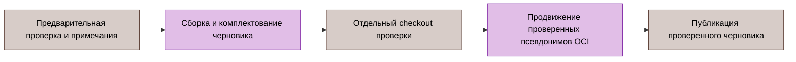

# Автоматизация CI и выпуска

[English original](../../en/reference/automation.md).

Выполнением workflow управляют команды Go. [.github/workflows/ci.yml](../../../.github/workflows/ci.yml), [security.yml](../../../.github/workflows/security.yml), [e2e.yml](../../../.github/workflows/e2e.yml) и [release.yml](../../../.github/workflows/release.yml) выбирают команды. Их реализуют [cictl](../../../test/cmd/cictl/main.go), [cirunner](../../../test/internal/cirunner/) и [toolbootstrap](../../../test/cmd/toolbootstrap/main.go).

Это контракты исходников. Наличие команды не доказывает приёмку кандидата и не разрешает удалённое изменение.

## Обычные команды

| Команда | Контракт |
|:---|:---|
| `cictl build` | Собрать бинарники workflow фиксированными прямыми аргументами |
| `cictl lint` | 92 настроенных базовых линтера и 18 явных профилей тегов сборки |
| `cictl test-coverage` | Race-тесты gotestsum; JUnit, JSON и атомарное покрытие |
| `cictl commit-policy` | Передать PR_TITLE одним буквальным аргументом проверки качества репозитория |
| `cictl proto-verify` | Собрать закреплённые генераторы, перегенерировать, отклонить изменения protobuf среди tracked/staged/untracked |
| `cictl buf-fetch-base`, `buf-breaking` | Проверить GITHUB_BASE_REF, получить полный refspec, разрешить точный commit для Buf |
| `cictl sbom` | Раздельные непустые сканирования файлов модулей runtime и инструментов в CycloneDX |
| `cictl sonar-mode`, `sonar-skip-notice` | Сохранить выбор анализа workflow и явные уведомления о пропуске |

Фиксированные пути отчётов проверяются и очищаются до сбора. Неуспешная дочерняя команда сохраняет stdout/stderr и завершает шаг отказом; старый обычный артефакт не подменяет успешное выполнение. Сбор SBOM фиксирует инвентаризацию зависимостей, но не достижимость символов.

`toolbootstrap podman-runtime` проверяет закреплённый Go-провайдер Compose, Podman и jq. `podman-e2e` добавляет настройку размещённого runner и закрытый rootless-сокет API. Готовность сокета ограничена 20 секундами; она не доказывает исправность API. Существующий сокет используется без приобретения владения. При отказе bootstrap завершает и присоединяет только новую принадлежащую ему службу; диагностический журнал сохраняется. Публикация GITHUB_ENV/GITHUB_PATH — часть готовности. `apparmor-denials` оставляет в диагностике только строки запретов.

Исполняемые шаги CI остаются одиночными командами; многострочные shell-программы и явные объявления shell не требуются. Значения токенов остаются в окружении процессов, не в аргументах команд или артефактах.

## Бенчмарки

`benchmark-pair` собирает десять чередующихся пар base/head, по одному образцу без race длительностью 100 мс на вызов для BFD/netio. Каждому пакету и имени нужны ровно десять валидных образцов с каждой стороны. Каждый вывод ограничен потоковым пределом 64 MiB; совпадающие по файловому объекту пути вывода и символические ссылки отклоняются. Отделённый worktree базовой версии создаётся один раз под RUNNER_TEMP и удаляется с ограниченным контекстом, устойчивым к отмене. Ожидание каналов дочернего процесса ограничено 30 секундами.

`benchmark-run`, `benchmark-base` и снимки выпуска сохраняют шесть запусков без чередования. `benchmark-normalize` сопоставляет только три исторических псевдонима и требует RecvDecodeLookupEnqueue, RecvDecodeFSM и TxMarshalJitter с обеих сторон. `benchmark-report` проверяет оба исходных входа, разбирает CSV benchstat и атомарно публикует Markdown, экранированный HTML, исходные CSV и примечания, а также версионированный JSON. Регрессии time/op не менее 10% для именованных критических бенчмарков приводят к отказу команды, когда base или head достигает порога 100 ns/op; другие регрессии только для отчёта используют 1 ns/op. Отчёты доступны и при критическом отказе. Ошибки сводки шага и предупреждений передаются вызывающей стороне; отсутствие получателя предупреждений или пропуск сводки выпуска не обходят критическую проверку. Некорректный или отсутствующий сбор и фактический отказ benchstat также приводят к отказу. См. [бенчмарки](../12-benchmarks.md).

## Последовательность выпуска

Последовательность разделяет сборку, независимую проверку доказательств, изменение псевдонимов и завершающую публикацию. Сохранять точного кандидата и останавливаться на первом неуспешном этапе.

| Команда | Проверка или изменение |
|:---|:---|
| `release-preflight` | Канонический стабильный тег, аннотация, репозиторий, точный HEAD ветки выпуска; отклонить существующие выпуск, черновик и версионные теги OCI |
| `release-notes` | Опубликованные стабильные выпуски с пагинацией, полный диапазон обслуживания, фактические даты; неизменяемые ссылки |
| `release-build` | Четыре бинарника с метаданными GITHUB_REF_NAME/GITHUB_SHA |
| `release-upx` | Точные размер и хеш архива, полная проверка записей tar, привязанная версия исполняемого файла; публикация PATH в ограниченном корне |
| `release-test-report` | Race-тесты и существующие пути JUnit/JSON/HTML |
| `release-benchmarks`, `release-benchmark-metadata` | Шесть образцов BFD/netio; commit, версия, UTC, Go и число запусков |
| `release-benchmark-comparison` | Новое сравнение в text/HTML/Markdown/CSV/примечаниях/структурированном виде при наличии baseline.txt; иначе очистить старые выходы и пропустить сравнение |
| `release-reports-archive` | Копия доказательств в ограниченном корне и архив отчётов; у производителя нет общего предела размера или числа записей |
| `release-artifacts` | Независимая проверка исходников и commit, отчёты точного ожидаемого набора артефактов |
| `release-assets-upload` | Загрузка основных артефактов, привязанных к отчётам, без перезаписи |
| `release-oci-evidence` | Оба версионных индекса, amd64/arm64, SPDX и связанные аттестации SLSA v1 |
| `release-evidence` | Хешировать снимки отчётов и digest, загрузить дополнительные доказательства |
| `release-verify` | Повторно проверить идентичности, тело черновика, ровно 12 артефактов; скачать и семантически проверить те же хешированные байты |
| `release-promote` | Сохранить снимок псевдонимов, скопировать проверенный индекс, считать дескрипторы; ограниченный откат при отказе |
| `release-publish` | Финальные проверки идентичностей, артефактов и digest, закрытие корней, завершающее изменение публикации черновика |

GoReleaser создаёт черновик с отключённой основной загрузкой. Финализация нативных пакетов заменяет программы жизненного цикла RPM и обновляет контрольные суммы и манифесты. Матрица артефактов требует два Linux-архива, четыре пакета DEB/RPM, два CycloneDX SBOM, соответствующих архивам, и контрольные суммы; отчёты, digest OCI и дополнительные отчёты контрольных сумм завершают 12 удалённых имён.

Проверяющий компонент использует отдельный checkout точного SHA workflow без постоянных учётных данных. Он привязывает пути исходного workspace к открытым корням и предварительным отчётам. Строгий JSON отклоняет невалидный UTF-8, повторяющиеся или неканонические поля контракта и небезопасные пути. Загрузки отклоняют отсутствующие, лишние, связанные ссылками, пустые или слишком большие файлы. Разбор архива отклоняет лишние элементы gzip, хвостовые данные, небезопасные или повторяющиеся записи, ссылки и специальные файлы.

[Производитель](../../../test/internal/cirunner/release.go) очищает выходы сравнения до проверки `testdata/benchmarks/baseline.txt` и упаковывает отчёты без общего предела выхода. Последующий проверяющий компонент ограничивает [сжатый артефакт](../../../test/internal/cirunner/release_download.go) 64 MiB, а [архив отчётов](../../../test/internal/cirunner/release_asset_content.go) — 256 MiB в распакованном виде и 4096 записями. Эти ограничения проверяющего компонента не ограничивают создание архива.

Доказательства OCI запрашиваются по неизменяемому digest индекса. Основной digest и digest продукта Debian должны совпадать и содержать ровно linux/amd64 и linux/arm64 со связанными аттестациями. Git/Docker не получают токены GitHub. Откат псевдонимов проверяет восстановленные идентичности; после завершающей публикации нет следующего шага выпуска, способного завершиться отказом. Считывание после публикации и закрытие стабильной ветки остаются отдельными обязанностями сопровождающего.

## Инвентаризация зависимостей

[dependency-inventory.json](../../supply-chain/dependency-inventory.json) описывает выбранные графы runtime и инструментов, объявленные инструменты, Actions, OCI и исходники соседей. Генерация запрашивает доказательства лицензий точных версий через deps.dev; статические переопределения и координаты исходников остаются непроверенными без собственного наблюдения.

Снимок связывает свою эпоху наблюдения, источник, запрос, результат, хеш, владельца и дату проверки. Продвижение эпохи требует нового сбора. Проверка без сети отклоняет расхождение графа, числа пакетов, привязки исходников и объявлений. Незавершённые проверки выпуска требуют точного покрытия незавершённых категорий проверки в review_exception; отложенные и устаревшие решения сохраняют собственные границы. Ни перегенерация, ни успешная проверка без сети не предоставляют текущую безопасность upstream или приёмку стабильной линии.

## Процедура отказа

1. Сохранить точную команду, ревизию, ожидаемый список артефактов и исходную диагностику.
2. Проверить код выхода производителя до использования его файлов.
3. Отклонить устаревшие, частичные доказательства и доказательства с несовпадающей идентичностью.
4. Исправить отвечающие за результат исходники или команду и повторить неуспешную проверку на окончательном кандидате.
5. Сохранить явное незакрытое условие выпуска до появления фактического измерения.

[Разработка](../09-development.md), [процесс выпуска](../10-changelog.md), [стенд E2E](../../../test/e2e/README.md).
