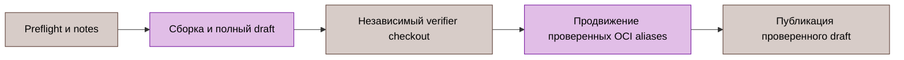

# Автоматизация CI и выпуска

Команды Go выполняют workflow. [.github/workflows/ci.yml](../../../.github/workflows/ci.yml), [security.yml](../../../.github/workflows/security.yml), [e2e.yml](../../../.github/workflows/e2e.yml) и [release.yml](../../../.github/workflows/release.yml) выбирают команды. Реализация находится в [cictl](../../../test/cmd/cictl/main.go), [cirunner](../../../test/internal/cirunner/) и [toolbootstrap](../../../test/cmd/toolbootstrap/main.go).

Это контракты исходного кода. Наличие команды не доказывает приёмки кандидата и не разрешает удалённую мутацию.

## Обычные команды

| Команда | Контракт |
|:---|:---|
| `cictl build` | Сборка workflow binaries прямыми фиксированными аргументами |
| `cictl lint` | 92 настроенных базовых линтера и 18 явных build-tag profiles |
| `cictl test-coverage` | Race-тесты gotestsum; JUnit, JSON и atomic coverage |
| `cictl commit-policy` | PR_TITLE передаётся одним literal-аргументом проверки |
| `cictl proto-verify` | Сборка pinned generators, генерация, отказ при tracked/staged/untracked drift protobuf |
| `cictl buf-fetch-base`, `buf-breaking` | Проверка GITHUB_BASE_REF, fetch полного refspec, точный commit для Buf |
| `cictl sbom` | Отдельные непустые runtime/tools CycloneDX module-file scans |
| `cictl sonar-mode`, `sonar-skip-notice` | Выбор анализа workflow и явные уведомления о пропусках |

Фиксированные outputs проверяются и очищаются перед сбором. Ошибка дочерней команды сохраняет stdout/stderr и завершает шаг ошибкой; старый regular artifact не заменяет успешного выполнения. SBOM фиксирует inventory зависимостей, а не достижимость символов.

`toolbootstrap podman-runtime` проверяет закреплённый провайдер Compose на Go, Podman и jq. `podman-e2e` добавляет настройки hosted runner и частный rootless API socket. Готовность socket ограничена 20 секундами; это не API health. Существующий socket используется без присвоения владения. При ошибке bootstrap останавливает и присоединяет только новый собственный service; диагностический лог сохраняется. Публикация GITHUB_ENV/GITHUB_PATH входит в готовность. `apparmor-denials` отбирает только denial-строки.

Исполняемые шаги CI остаются одиночными командами; multiline shell-программы и явные shell declarations не требуются. Tokens остаются в environment процесса, а не аргументах или артефактах.

## Бенчмарки

`benchmark-pair` собирает десять чередующихся base/head-пар: один non-race sample длительностью 100 мс на вызов для BFD/netio. Каждая package/name требует ровно десяти валидных samples на сторону. Поток каждого output ограничен 64 MiB; совпадающие файлы и symlinks отклоняются. Detached base worktree создаётся один раз под RUNNER_TEMP и удаляется bounded cancellation-safe context. Ожидание дочерних pipes ограничено 30 секундами.

`benchmark-run`, `benchmark-base` и release snapshots сохраняют шесть последовательных запусков. `benchmark-normalize` меняет только три исторических aliases и требует RecvDecodeLookupEnqueue, RecvDecodeFSM и TxMarshalJitter с обеих сторон. `benchmark-report` разбирает benchstat CSV и атомарно публикует Markdown, escaped HTML, raw CSV/notes и versioned JSON. Регрессия именованных critical time/op от 10% даёт предупреждение при base или head от 100 ns/op; прочие report-only строки используют порог 1 ns/op. Само предупреждение не блокирует gate. Неполный или некорректный сбор завершается ошибкой. См. [бенчмарки](../12-benchmarks.md).

## Последовательность выпуска

| Команда | Проверка или мутация |
|:---|:---|
| `release-preflight` | Canonical stable tag, annotation, repository, точный release-branch HEAD; отказ при существующих release/draft/versioned OCI tags |
| `release-notes` | Все страницы stable releases, полный maintenance range, реальные даты; immutable links |
| `release-build` | Четыре бинарника с metadata GITHUB_REF_NAME/GITHUB_SHA |
| `release-upx` | Точный размер/hash архива, весь tar inventory, версия bound executable; rooted PATH publication |
| `release-test-report` | Race-тесты и прежние JUnit/JSON/HTML paths |
| `release-benchmarks`, `release-benchmark-metadata` | Шесть BFD/netio samples; commit, version, UTC, Go и count |
| `release-benchmark-comparison` | Свежие text/HTML/Markdown/CSV/notes/structured comparison |
| `release-reports-archive` | Rooted copy доказательств и bounded reports archive |
| `release-artifacts` | Независимые source/commit checks и точные expected asset receipts |
| `release-assets-upload` | Загрузка receipt-bound primary assets без clobber |
| `release-oci-evidence` | Оба versioned indexes, amd64/arm64, SPDX и связанные SLSA v1 attestations |
| `release-evidence` | Hash report/digest snapshots и загрузка дополнительных доказательств |
| `release-verify` | Повтор identities, draft body, ровно 12 assets; download и semantic check тех же hashed bytes |
| `release-promote` | Снимок aliases, копия verified index, readback descriptors; bounded rollback при ошибке |
| `release-publish` | Финальные identity/asset/digest checks, закрытие roots, последняя draft-publication mutation |

GoReleaser создаёт draft с отключённой primary upload. Native package finalization заменяет RPM lifecycle programs и обновляет checksums/manifests. Матрица требует два Linux archives, четыре DEB/RPM packages, два соответствующих архивам CycloneDX SBOM и checksums; reports, OCI digest и supplemental checksum receipts дополняют список до 12 remote names.

Verifier использует отдельный checkout точного workflow SHA без постоянных credentials. Пути исходной рабочей копии связаны с открытыми roots и preflight receipts. Strict JSON отклоняет invalid UTF-8, duplicate/noncanonical contract fields и unsafe paths. Download отклоняет отсутствующие/лишние/linked/empty/oversized files. Archive parser отклоняет дополнительные gzip members, trailing data, unsafe/duplicate entries, links и special files.

OCI evidence запрашивается по immutable index digest. Primary и Debian digests должны совпадать и содержать ровно linux/amd64 и linux/arm64 со связанными attestations. Git/Docker не получают GitHub tokens. Rollback aliases проверяет восстановленные identities; после terminal publication нет следующего fallible release step. Postpublication readback и stable-branch closeout остаются отдельными обязанностями maintainer.

## Inventory зависимостей

[dependency-inventory.json](../../supply-chain/dependency-inventory.json) описывает выбранные runtime/tools graphs, tools, Actions, OCI и peer sources. Генерация получает exact-version license evidence через deps.dev; static overrides и source coordinates остаются непроверенными без собственного observation.

Снимок связывает observation epoch, source/query/result/hash, owner и review date. Новый epoch требует свежего сбора. Offline checker отклоняет graph, package-count, source-binding и расхождение объявлений. Незавершённые release reviews требуют точного покрытия dimensions в review_exception; deferred/stale decisions сохраняют собственные границы. Ни генерация, ни offline success не доказывают актуальной upstream security или stable-line acceptance.

## Процедура отказа

1. Сохраните точную команду, revision, expected artifact list и сырой diagnostic output.
2. Проверьте exit status producer до использования файлов.
3. Отклоните stale, partial и identity-mismatched evidence.
4. Исправьте owning source/command и повторите failed gate на финальный кандидат.
5. Сохраните явный remaining release gate до фактического измерения.

[Разработка](../09-development.md), [выпуск](../10-changelog.md), [E2E harness](../../../test/e2e/README.md).
